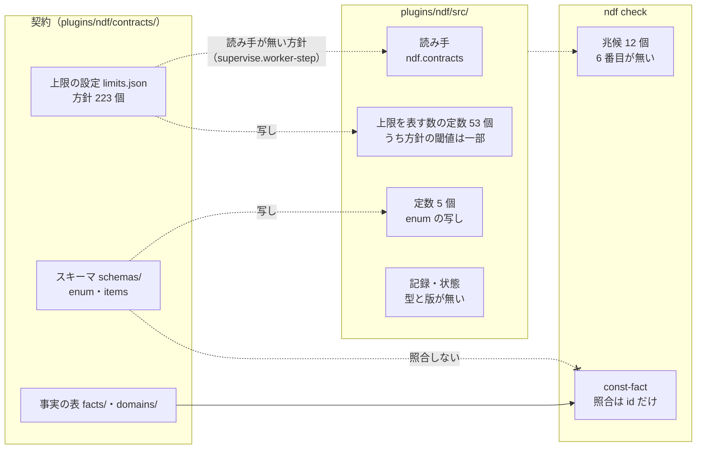
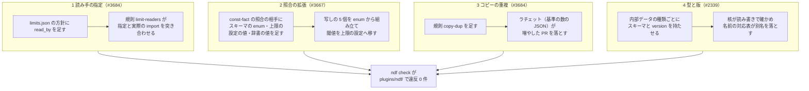
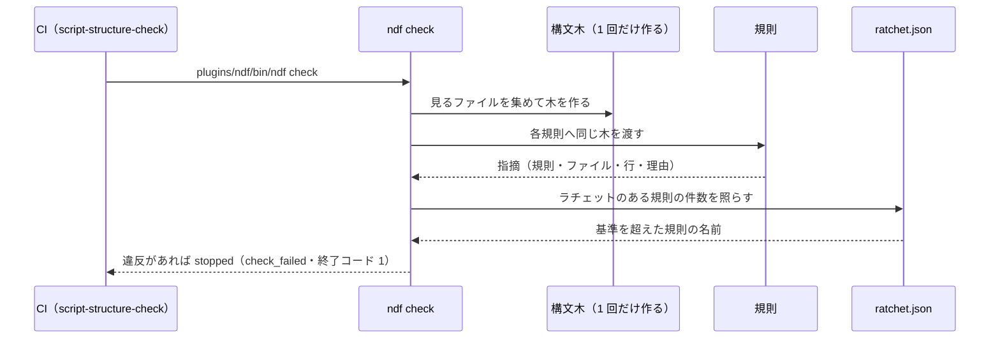
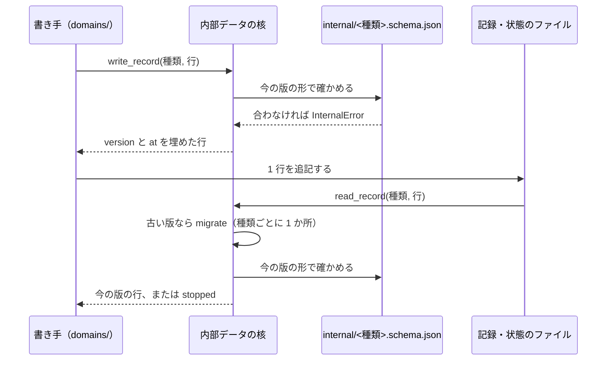

# 契約の検査: 正本に置いた事実が使われているかを機械で確かめ、正本の外の写しと別名を落とす（#3684 #3667 #2339）

契約（`plugins/ndf/contracts/`）に正本を置くと決めたのに、3 つのものが残っている。正本に置いたまま誰も読まない行、正本の外にある写し、正本の外で名乗る別名である。それを数える検査は、正本の一部（事実の表の `id`）しか見ていない。正本の側に「誰が読むか」を指定させ、検査の照合の相手を正本の全体（スキーマの `enum`・上限の設定の値・辞書の値）へ広げ、欠けた 1 種類（コピーで生まれた重複）の規則とラチェットを足す。採らなかった案（ラチェットをすべての規則へ当てる・pydantic で型を二重に持つ・説明の生成を外部のライブラリへ寄せる）は「決定の記録」に、比べた候補は付録の「外部の調査」にある。

## 今の姿

何が起きたか・目的・受け入れ条件は、課題ごとの要求仕様にある。この文書は「どう解くか」と「なぜその解き方か」だけを書く。

| 課題 | 要求仕様のコピー | 正 |
| --- | --- | --- |
| #3684 | [issue-3684-requirements.md](./issue-3684-requirements.md) | #3684 の本文 |
| #3667 | [issue-3667-requirements.md](./issue-3667-requirements.md) | #3667 の本文 |
| #2339 | [issue-2339-requirements.md](./issue-2339-requirements.md) | #2339 の本文 |

**3 つの課題を 1 本にまとめた理由は、根本原因が共通だからである。** 3 つとも「契約に正本を置く」という同じ決め事の、同じ欠け（正本と実際の使われ方を突き合わせる手段が無い）から出ている。



**欠けは 4 つに整理できる。** 詳しい数と確かめ方は各要求仕様の「今の姿」にある。

| # | 欠け | 当たる課題 | 実例 |
| --- | --- | --- | --- |
| 1 | 正本に置いたまま誰も読まない行を見分けられない | #3684（3367-6・要求 332） | 上限の設定の `supervise.worker-step`（1,800 秒）に読み手が無い。worker の上限は `src/ndf/core/worker.py:79` の `WORK_TIMEOUT`（3,600 秒）が決めている |
| 2 | 正本の外に写しと別名が残り、検査が照合しない | #3667（要求 333）・#2339 | スキーマの `enum` を写した定数 5 個、名前が上限・回数・待ちを表す数の定数 53 個のうち方針の閾値に当たるもの、時刻のキー 5 通り（`at`・`created_at`・`updated_at`・`started_at`・`ts`） |
| 3 | AI が陥りやすい作りの 7 種類のうち 6 番目（コピーで生まれた重複）だけ規則が無い | #3684（要求 306・324・325） | 2 つ以上のファイルの同じ名前の関数と、4 つ以上のファイルに出る 8〜80 字の文字列 |
| 4 | 項目の行き先を生成も検査もしていない | #3684（3395-2） | 設計レビューの項目の表（`issues/issue-1142-design-review-routing.md`）の 182 項目は今はすべて行き先を持つが、生成（`children.json` の `review_items`）と検査が無いため、書き忘れても誰も気づかない |

**既に直っている 2 行は作り直さない。** 契約の読み手の検証（3367-9）は `ndf.contracts.cached_reader` で 1 プロセス 1 回になっている。契約の説明（3382-8）は `ndf check --write-spec` が生成し、規則 `spec-docs` が差分を落としている。どちらも退行を止める条件（#3684 の受け入れ条件 2・3）だけを置く。

## 文脈と制約

- **検査は `plugins/ndf/` だけを見る。** 利用先のリポジトリへは配らない開発の検査で、CI のジョブ `script-structure-check` が `plugins/ndf/bin/ndf check` を 1 回打つ
- **兆候は初日から 0 件で、ラチェットを持たない**（`src/ndf/checks/README.md`）。要求 325 のラチェットはこの方針と衝突するため、当てる範囲を決める必要がある（決定 4）
- **普及のフェーズに入るまで後方互換を求めない**（MVV の Value 4）。内部データの名前と形は、互換の経路を持たずに移行の関数で読む
- **規則のしきい値と名前は `src/ndf/checks/rules.json` にあり、規則の関数は値を写さずにそこから読む。** 新しい規則も同じ形に従う
- **`ndf check` は見るファイルを 1 回集め、`.py` の構文木を 1 ファイルにつき 1 回だけ作る。** 新しい規則も同じ木を読み、ファイルを読み直さない
- 3 つの課題は同じレーン（p9 の `lz1-contract`）で続けて実装する。設計 Pull Request は 1 本、実装はレビューの単位ごとに分ける

## 解き方の全体像



設計どおりに実装を終えると、次の 5 つが成り立つ。正本に置いた方針は読み手を指定し、指定と実際の import が食い違えば `ndf check` が方針の名前を挙げて落ちる。スキーマの `enum`・上限の設定の値・辞書の値を写した定数は `const-fact` が指摘するので、写しを足した PR が通らない。AI が陥りやすい作りの 7 種類すべてに規則があり、6 番目（コピーで生まれた重複）はラチェットの基準の数を超えた PR が落ちる。内部データは種類ごとに型と版を持ち、核が読み書きの両方で確かめ、時刻と結果の名前は対応表に無い別名が残らない。設計レビューの項目の行き先は表から生成され、行き先を書き忘れた項目が検査で落ちる。

## 構成要素

| 要素 | 責務 |
| --- | --- |
| 上限の設定の読み手の指定（`contracts/limits.json` の `read_by`） | 方針ごとに、その方針を引くモジュールの名前を持つ |
| 規則 `limit-readers`（`src/ndf/checks/limits_readers.py`） | 指定した読み手がその方針を引いているか、指定の無い方針を引いていないかを、構文木の呼び出しから突き合わせる |
| 規則 `copy-dup`（`src/ndf/checks/copy_dup.py`） | 2 つ以上のファイルの同じ名前の最上位の関数と、4 つ以上のファイルに出る 8〜80 字の文字列を数える |
| ラチェット（`src/ndf/checks/ratchet.py` と `src/ndf/checks/ratchet.json`） | 規則ごとの基準の数を読み、超えたら違反にし、下回ったら基準を下げる |
| `const-fact` の照合の相手（`src/ndf/checks/facts.py` の拡張） | 事実の表の `id` に加え、手書きのスキーマの `enum`・上限の設定の数・辞書の定数の値を照合する |
| 内部データの型（`contracts/schemas/internal/` の記録と状態のスキーマ） | 記録・実行の状態の種類ごとに、形と `version` を持つ |
| 内部データの読み書きの核（`src/ndf/contracts/internal.py`） | 種類ごとのスキーマで読み書きの両方を確かめ、合わなければ `stopped` にする。古い版は移行の関数 1 か所で受ける |
| 名前の対応表（`contracts/data/internal-names.json`）と規則 `internal-names` | 同じ意味の値の 1 つの名前と、使ってよい場所を持ち、表に無い別名を落とす |
| 値の保存先の基準（`plugins/ndf/skills/refactoring/SKILL.md` の「分岐をデータ化」の節） | 事実・方針はデータ、語の集まりは `StrEnum`、外部の仕様と実装の都合は定数、を 1 か所で書く |
| 設計レビューの項目の行き先の生成（`src/ndf/checks/spec_render.py` の節と `issues/issue-1142-design-review-routing.md`） | 11.0 までの設計レビューの 1〜3 巡目に出た項目の表から、項目ごとの行き先（直した・11.x の課題・採らない）を生成し、行き先の無い項目を落とす。版が `11.x` の行は表に Issue の番号を持たず [11.x の対応表](issue-3388-design-routing.md) を指すので、入力は `issues/issue-1142-design-review-routing.md` と `issues/issue-3388-design-routing.md` の 2 つで、`11.x` の行の行き先は対応表から解く |

## データ構造

### 上限の設定の方針の読み手（`contracts/limits.json`）

既にある方針の行へ `read_by` を足す。値はモジュールの名前（`ndf.` から始まる import のパス）の並びで、1 つ以上を持つ。

```json
{
  "supervise.worker-run": {
    "summary": "worker 1 本の全体の上限（旧 WORK_TIMEOUT）",
    "seconds": 3600,
    "read_by": ["ndf.core.worker"]
  }
}
```

**`supervise.worker-step`（1,800 秒）は消し、worker 全体の上限は新しい方針 `supervise.worker-run`（3,600 秒）が持つ。** #3667 の前提 2 のとおり、両者は別の事実で、worker の全体を決めているのは `WORK_TIMEOUT`（3,600 秒）だけである。`worker-step` を引く「ステップ」の単位は今のコードに無い（`git grep -n "worker-step" plugins/ndf/src` が 0 件）。読み手を足すと、従来 3,600 秒で終えられた作業を 1,800 秒で止める新しい振る舞いになる。読み手の無い方針は表に置けない（`read_by` が必須）ので、`read_by` を必須にするのと同じコミットで `worker-step` の行を消す。#3684 の対象範囲にある「`WORK_TIMEOUT` の読み手を足して残す」はこの決め方に置き換える（要求のコピーも同じ文へ直した。#3684 の本文は設計の承認の後にそろえる）。

| 項目 | 型 | 必須 | 意味 |
| --- | --- | --- | --- |
| `read_by` | 文字列（`^ndf(\.[a-z_][a-z0-9_]*)+$`）の並び・1 つ以上 | 必須 | この方針を引くモジュール。1 つも無い方針は表に置けない |

### ラチェットの基準の数（`src/ndf/checks/ratchet.json`）

規則ごとに 1 つの数を持つ。行ではなく数で持つのは、行が動いただけで基準が崩れないためである（決定 5）。

| 項目 | 型 | 意味 |
| --- | --- | --- |
| `version` | 整数（`1`） | 形の版 |
| `rules` | オブジェクト | 規則の名前 → `{"max": <数>, "measured": "<測った日>", "commit": "<測った commit>"}` |

### 内部データの型（`contracts/schemas/internal/<種類>.schema.json`）

**要求が挙げる 5 種類のうち、版を既に持つものは版の欄をそのまま使い、版を持たないものだけに足す。記録と実行の状態は、記録の種類ごとにスキーマを新設する。** 既にあるスキーマと二重にしないため、5 つの汎用のスキーマは作らない。種類ごとの入口（読み書きを核へ通す関数）は詳細設計の「種類ごとの入口」の表にある。

| 要求の種類 | 今のスキーマと版 | この設計で何をするか |
| --- | --- | --- |
| 結果 | `contracts/schemas/result.schema.json` と `schemas/io/<名前>.result.schema.json`。版の欄は無い | `version`（整数）を任意の欄として足す。結果は書いた NDF がその場で `ndf.contracts.result.emit` を通して確かめる 1 回限りの出力で、無い結果は版 1 として読む |
| プラン | `contracts/workflow/parallel-plan.schema.json`（`version: const 1` を必須に持つ） | 足さない。既にある `version` を形の版として使い、読み手（`ndf.progress.plan.read_doc`）が今の版より大きい版で止まるかだけを確かめる |
| 工程の表 | `contracts/workflow/progress.schema.json`（`version: const 1` を必須に持つ） | 同上（読み手は `ndf.progress.model` の `require_schema`）。工程の表は契約の一部で、実行のたびに書くデータではない |
| 実行（工程の文脈と入出力） | `contracts/workflow/context.schema.json`・`stage-io.schema.json`。**`version` は形の版ではなく、出した製品の版の文字列**（`deploy` 工程の出力。`progress/command.py:337` の条件 `release_record` は `"version" in context` で出荷の有無を見る） | 製品の版の欄を `product_version` へ改名し（文脈・`stage-io.schema.json` の `release-result`・工程の定義の `deploy.json` の出力と `release-verification.json`・`layout-review.json` の入力・条件 `release_record`・リリースのゲート）、空いた `version` を形の版（整数）にする。既存の文脈の `version` が文字列なら、移行の関数が `product_version` へ移す |
| 記録（`*.jsonl` の 1 行） | 無し | 記録のファイルの種類ごとに `contracts/schemas/internal/<種類>.schema.json` を新設する（使用量・MVV の兆候・MVV の検証・文脈の記録）。共通の欄は `internal/common.schema.json` の `$defs` に置き、種類のスキーマが `$ref` で引く |
| 実行の状態 | 無し（開発ループの状態は `record.jsonl` のイベントを再生して作る） | 開発ループのイベント（`loops/<名前>/record.jsonl`）を記録の 1 種類 `loop-event` として扱い、`internal/loop-event.schema.json` を新設する。耐久ワークフローの保存（`ndf.core.durable`）は DBOS が形と版を持つので対象の外 |

**製品の版と形の版を同じ名前にしない。** 今は 3 つが製品の版である。文脈の `version`（出した版）・MVV の兆候の `version`（作業ツリーの版）・開発ループの `version-shipped` のイベントの `version`（出した版）である。プランと工程の表の `version` だけが形の版である。名前の対応表で「形の版」を `version`、「製品の版」を `product_version` に分け、製品の版の 3 か所を改名する。

記録のスキーマ（`internal/<種類>.schema.json`）の形:

| 項目 | 型 | 必須 | 意味 |
| --- | --- | --- | --- |
| `version` | 整数（`enum` で読める版だけを並べる） | 必須 | その行の形の版。読み手は知らない版を読まない |
| `at` | 文字列（`format: date-time` と、UTC に限る `pattern: (Z\|\+00:00)$`） | 必須 | その行が書かれた時刻（決定 11）。`format` は検証器に書式の検査器を渡さないと効かない（下の段落） |
| `status` | 文字列（結果の語彙） | 結果を持つ種類だけ必須 | 結果（決定 11）。開発ループのイベント・使用量のように結果を持たない種類のスキーマは、この欄を持たない |
| 種類の固有の欄 | 種類ごとに型を書く（例: 使用量の `caller`・`usage`、開発ループのイベントの `kind`・`lap`・`pr`） | 種類ごと | 書き手が今書いている欄をすべて載せる |

**`additionalProperties` は種類のスキーマごとに `false` にする。** 固有の欄を種類のスキーマが 1 つずつ型つきで持つので、閉じても既存の記録の欄は落ちず、型に合わない値と綴りの誤りは書く前に止まる。使用量の `**meta` のように呼び手が欄を足す箇所は、足しうる欄を種類のスキーマへ列挙する（実装の単位 4 で書き手を読んで埋める）。

**`format: date-time` を効かせるため、内部データの核は書式の検査器を持つ検証器を自分で組む。** 既存の `ndf.contracts.schema_errors` は `Draft202012Validator` を `format_checker` 無しで組む。そのため `format` は注釈として読み飛ばされ、不正な日付も通る。また jsonschema の `date-time` の検査は `rfc3339-validator` が入っているときだけ働き、NDF の依存（`plugins/ndf/pyproject.toml`）には無い。依存を足さない。`contracts/internal.py` が `jsonschema.FormatChecker()` に `date-time` の検査を登録し、`Draft202012Validator(schema, format_checker=...)` で組む。検査の中身は「`datetime.fromisoformat` で読めて、時差が 0 であること」である。`schema_errors` の振る舞いは変えない（ほかの契約の `format` を急に効かせると既存の入出力が落ちうるため、内部データの核だけに当てる）。

### 名前の対応表（`contracts/data/internal-names.json`）

| 項目 | 型 | 意味 |
| --- | --- | --- |
| `names` | オブジェクト | 意味 → `{"key": "<1 つの名前>", "aliases_removed": ["<消した別名>"], "where": ["<使う種類>"]}` |

## 入出力のコントラクト

結果 JSON のスキーマ（`contracts/schemas/result.schema.json`）の `items` の要素に、任意の欄を 4 つ足す。欄を持たない今の結果 JSON はそのまま通る（`required` に入れない）。

| 欄 | 型 | 意味 |
| --- | --- | --- |
| `lens` | 文字列・1 字以上 | その項目を見つけた観点（#3685 が使う） |
| `category` | 文字列・1 字以上 | 分類 |
| `severity` | `critical` / `major` / `minor` / `nit` のどれか | 重さ。語彙は既にある重さの表（`contracts/domains/severities.json`）の `rows[].id` から組み立て、スキーマに写さない（表へ重さを足すと語彙も増える） |
| `acceptance` | 文字列・1 字以上の並び | 当たる受け入れ条件（`<課題>:<番号>` の形） |

**`additionalProperties` は今のとおり開けたままにする。** `items` の要素は結果ごとに違う項目を持ち、閉じると既存のすべてのサブコマンドの結果が通らなくなる（決定 6）。

## 処理の流れ



**この図は検査の経路だけを描く。** 構成要素のうち、正本の側（上限の設定の読み手の指定・内部データの型・名前の対応表）と値の保存先の基準は、検査が読むデータと人が読む規約なので、図の登場人物にならない。内部データの読み書きの核は、検査ではなく NDF の実行の中で働く（下の図）。



## 決定の記録

### 決定 1: 正本に置いた方針が使われているかを機械で確かめられるよう、方針の側に読み手を指定させる

- **質問**: 上限の設定の方針が「引かれているか」をどう判定するか。方針の名前はコードが組み立てて引くため（`hook.budget.<事象>` のように接頭辞と変数をつなぐ）、名前の文字列で検索すると引かれている方針も 107 個が「無い」と出る
- **選んだ案**: 方針の行に読み手のモジュールの名前（`read_by`）を足し、規則 `limit-readers` が指定と実際の import を突き合わせる。指定した読み手がその方針を引いていない場合と、指定の無い方針を引いている場合の両方を違反にする
- 採らなかった案: 名前の文字列の検索で判定する（名前を組み立てて引く方針を「引かれていない」と誤って落とす。実測で 223 個中 107 個が誤検出）
- 採らなかった案: 実行時に引かれた方針を記録して集計する（テストが通る経路しか記録されず、めったに通らない経路の方針が消える）
- **代償**: 方針を足すたびに読み手を書く手間が増え、読み手を変えるときに 2 か所を直す
- 作り方: 自前で作る
- 比べた候補: LIB6（ruff に、データの行と import を突き合わせる規則は無い）/ PRD3（mypy-baseline は違反の基準を持つだけで、参照の有無は見ない）
- 根拠: Value 11（重複と冗長が無い。MVV バージョン 1）

### 決定 2: 写しを足した PR を落とせるよう、`const-fact` の照合の相手を正本の全体へ広げる

- **質問**: スキーマの `enum`・上限の設定の値・辞書の定数の値を写した定数を、どこで止めるか
- **選んだ案**: 既にある規則 `const-fact` の照合の相手に 3 つを足す。新しい規則を作らず、`src/ndf/checks/facts.py` の照合の関数を広げる
- 採らなかった案: 種類ごとに新しい規則を作る（同じ「正本の写し」を 3 つの規則が数え、指摘の読み手が規則ごとに判断を分けることになる）
- 採らなかった案: 一致を縛るテストを各定数に書く（原則がやめると決めた形そのもので、片方を直したときに食い違いが残る）
- **代償**: `const-fact` の実装が長くなり、1 つの規則が 4 種類の正本を読む
- 作り方: 自前で作る
- 比べた候補: LIB6（ruff に、コードの定数とスキーマの `enum` を突き合わせる規則は無い）/ LIB1（jsonschema はデータを検証するが、コードの側の定数を見ない）
- 根拠: Value 11（重複と冗長が無い。MVV バージョン 1）

### 決定 3: 値の種類で保存先が決まるよう、基準を既にある Skill の節へ書く

- **質問**: 値の保存先の基準（事実・方針はデータ、語の集まりは `StrEnum`、外部の仕様と実装の都合は定数）をどこに置くか
- **選んだ案**: `refactoring` の Skill の本文（`plugins/ndf/skills/refactoring/SKILL.md`）の「分岐をデータ化」の節に書く。#3664 の詳細設計の雛形の「内部のデータと定数」の欄からそこを指す。参照のファイル（`references/`）には置かない（基準は分岐をデータ化する判断と同じ場所で読むため）
- 採らなかった案: 新しい Skill を作る（既にある Skill へ統合してから新設を考える。前例は `refactoring` の `lang-*`）
- 採らなかった案: `plugins/ndf/` の開発ガイドに書く（開発ガイドは NDF 自身の開発の手順で、利用先のリポジトリの worker は読まない。基準は NDF 以外のコードにも当たる）
- **代償**: `refactoring` の Skill が長くなる
- 根拠: Value 11（重複と冗長が無い。MVV バージョン 1）

### 決定 4: 既に 0 件の規則の決まりを崩さないよう、ラチェットを新しく足す 1 種類だけに当てる

- **質問**: 要求 325 の「前の数を基準にしたラチェット」を、どの規則に当てるか。今の検査は「兆候は初日から 0 件で、ラチェットを持たない」と決めている
- **選んだ案**: ラチェットを当てるのは新しく足す 6 番目（コピーで生まれた重複）だけにする。既に 0 件の 1〜5・7 番目は 0 件のまま据え置く
- 採らなかった案: すべての規則へラチェットを当てる（0 件の規則に基準の数を置くと、0 件という強い保証が「基準より増えなければよい」に緩む）
- 採らなかった案: 6 番目も初日から 0 件にする（今のコードに同じ名前の関数と繰り返す文字列が残っており、1 つの PR では直し切れない。直すまで検査を入れないと、その間に増える）
- **代償**: 規則によって合否の決め方が 2 通りになり、`rules.json` を読む人がどちらかを調べる必要がある
- 作り方: 自前で作る
- 比べた候補: PRD1（SonarQube の「新しいコード」は基準の時点より後のコードだけを見る。合否の単位が変更の差分なので、ファイルを移しただけで数が動く）/ PRD2（betterer は検査の結果をファイルへ保存して悪化を落とす。npm の最新は 2024-12-01 の alpha で、Python の検査からは呼べない）/ PRD3（mypy-baseline は mypy 専用）
- 根拠: Value 10（使い続けても、読みやすく直しやすい。MVV バージョン 1）。PRD1・PRD2

### 決定 5: 行が動いただけで基準が崩れないよう、ラチェットの基準を規則ごとの件数で持つ

- **質問**: ラチェットの基準を、違反の行の一覧で持つか、規則ごとの件数で持つか
- **選んだ案**: 規則ごとの件数（`ratchet.json` の `rules.<規則>.max`）で持ち、測った日と commit を添える
- 採らなかった案: 違反の行の一覧で持つ（行を 1 行足しただけで一覧とずれ、直していない違反が「新しい違反」として落ちる）
- 採らなかった案: ファイルごとの件数で持つ（ファイルを分けたり名前を変えたりするたびに基準の作り直しが要る。#1142 の設計はファイルごとの基準を採ったが、入れ替えで基準ごと消えた）
- **代償**: どの箇所が基準に含まれているかが基準の側から読めず、増えた分の場所は検査の出力で見る
- 根拠: Value 3（同じ手順は毎回同じ結果になる。MVV バージョン 1）

### 決定 6: 既存のすべての結果が通るよう、`items` の新しい欄を任意にし、要素の追加の項目を閉じない

- **質問**: 結果 JSON の `items` に観点・分類・重さ・受け入れ条件の欄を足すとき、要素の形をどこまで締めるか
- **選んだ案**: 4 つの欄を任意（`required` に入れない）にし、`additionalProperties` は開けたままにする。欄の値は型と語彙で縛る（`severity` は重さの表から組み立てる）
- 採らなかった案: 欄を必須にする（今のすべてのサブコマンドの結果が通らなくなる）
- 採らなかった案: `additionalProperties: false` にする（`items` の要素は結果ごとに違う項目を持つ。閉じると結果ごとにスキーマを分ける作業が要る）
- **代償**: 欄の綴りを誤っても検証が通る
- 根拠: Value 4（どのプロジェクトでもそのまま使える。MVV バージョン 1）

### 決定 7: 打ち間違いを型で止めるため、語の集まりを `StrEnum` にし、値をスキーマから組み立てる

- **質問**: 語の集まり（状態や種類の名前）をどう持つか
- **選んだ案**: `StrEnum` にする。値がスキーマの `enum` か事実の表にあるものは、そこから組み立てる（`StrEnum("Name", {...})` の動的な作り方）
- 採らなかった案: 文字列の定数のまま置く（打ち間違いが実行時まで出ず、`const-fact` の照合でしか重複が見えない）
- 採らなかった案: `Literal` の型注釈だけを使う（実行時の値を持たないので、スキーマから組み立てた語彙を回せない）
- **代償**: スキーマから組み立てた `StrEnum` は、型検査が members を静的に読めない
- 作り方: 標準に倣う
- 比べた候補: STD5（Python の `enum.StrEnum`。3.11 以降）
- 根拠: Value 8（正しいデータ構造で作られる。MVV バージョン 1）。STD5

### 決定 8: 上限を変えるときに触る所を 1 つにするため、方針の閾値を上限の設定へ移す

- **質問**: 名前が上限・回数・待ちを表す数の定数 53 個のうち、どれを上限の設定へ移すか
- **選んだ案**: 方針の閾値（人が運用で決める上限・回数・待ち）だけを移す。外部の仕様の値（`CURL_TIMEOUT_EXIT = 28`）と実装の都合の値（ポーリングの間隔・表示の行数）は定数のまま置く。どちらに分けたかの一覧を実装の PR の本文に載せる
- 採らなかった案: 53 個すべてを上限の設定へ移す（外部の仕様の値を設定に出すと「変えてよい」という誤った印になる。変えると壊れる）
- 採らなかった案: 分ける基準を設けずに、目で選んだものだけ移す（次に定数を足す人が同じ判断をできない）
- **代償**: 境目の値（ロックの待ちなど）の分け方に判断が残る
- 根拠: Value 11（重複と冗長が無い。MVV バージョン 1）

### 決定 9: 版をまたいで黙って誤らないよう、内部データの版をデータの側の `version` で持つ

- **質問**: 内部データ（記録・実行の状態）の型の版をどこで持つか
- **選んだ案**: データの側に `version`（整数）を持ち、スキーマは読める版だけを `enum` で並べる。スキーマ自身の同一性は `$id` が持つ
- 採らなかった案: ファイルの名前に版を入れる（1 つのファイルに複数の版の行が混ざる `*.jsonl` では表せない）
- 採らなかった案: 版を持たず、項目の有無で形を見分ける（項目を足すたびに見分けの条件が増え、見分けが読み手ごとに散る）
- **代償**: 記録の 1 行ごとに `version` の分だけ大きくなる
- 作り方: 標準に倣う
- 比べた候補: STD1（JSON Schema の `$schema` と `$id`）/ STD3（Kubernetes の `apiVersion`）/ STD4（CloudEvents の `specversion`）
- 根拠: Value 8（正しいデータ構造で作られる。MVV バージョン 1）。STD1・STD3・STD4

### 決定 10: 古い形の分岐が散らないよう、移行を型ごとの関数 1 か所に置く

- **質問**: 古い版の内部データをどこで読むか
- **選んだ案**: 型ごとに移行の関数を 1 つ置き、読み手はその関数を通して読む。読み手の側に古い形の分岐を書かない
- 採らなかった案: 読み手ごとに古い形を扱う（同じ移行が読み手の数だけ増え、片方だけ直したときに食い違う）
- 採らなかった案: 移行のコマンドで古いファイルを書き換えてから読む（進行中のスプリントの記録を書き換えると、走っているプロセスが読んでいる行と食い違う）
- **代償**: 版が増えると移行の関数が長くなる
- 作り方: 標準に倣う
- 比べた候補: STD3（Kubernetes の API サーバーが版の間の変換を 1 か所で受ける）
- 根拠: Value 9（責務の分かれた設計で作られる。MVV バージョン 1）。STD3

### 決定 11: 集計と比較で取り違えないよう、時刻と結果の名前を対応表で 1 つにそろえる

- **質問**: 同じ意味の値に複数の名前がある。時刻は 5 通り（`at`・`created_at`・`updated_at`・`started_at`・`ts`）、結果と状態も 5 通り（`status`・`result`・`state`・`outcome`・`verdict`）である。どれを 1 つにするか
- **選んだ案**: 時刻は `at`（UTC の RFC 3339）、結果は `status` にそろえる。名前の対応表（`contracts/data/internal-names.json`）が 1 つの名前と消した別名を持ち、規則 `internal-names` が表に無い別名を落とす。**意味の違うものは別の名前のまま残す**（`state` は進行の状態、`verdict` は判定の結論で、結果とは別の意味である）。どれを同じ意味と見たかは表の `where` が持つ
- 採らなかった案: すべての名前を機械で `status` へ寄せる（意味の違う値まで同じ名前になり、読み手が取り違える）
- 採らなかった案: 名前を変えずに読み替えの表だけを持つ（読む側が表を引く手間が残り、別名が増え続ける）
- **代償**: 「同じ意味」の判断が表を書くときに要り、境目の値（`outcome`）の扱いに判断が残る
- 作り方: 標準に倣う
- 比べた候補: STD2（RFC 3339 の時刻の書式）/ STD4（CloudEvents の `time`・`type` の共通の属性）
- 根拠: Value 14（判断の理由が残り、語がそろっている。MVV バージョン 1）。STD2・STD4

### 決定 12: 同じ検査を 2 回数えないよう、コピーの重複を NDF 自身の検査に置く

- **質問**: AI が陥りやすい作りの 6 番目（コピーで生まれた重複）の規則をどこに置くか
- **選んだ案**: NDF 自身の検査（`ndf check`）の規則 `copy-dup` として置く。見る範囲は `plugins/ndf/src` の `.py` で、`ndf check` が 1 回作った構文木を読む
- 採らなかった案: 根の構造チェック（`scripts/check-script-structure.py`）に置く（入れ替え #3304 でこの検査は `plugins/ndf/` の中を見なくなった。範囲を戻すと 2 つの検査が同じファイルを読む）
- 採らなかった案: 外部の重複の検出（jscpd）を呼ぶ（Node の依存が増え、構文木を 2 回作る。NDF の数え方（同じ名前の関数・4 つ以上のファイルに出る文字列）とも違う）
- **代償**: 重複の検出の一般的な手法（トークン列の一致）は使わず、名前と文字列の一致だけを見る
- 作り方: 自前で作る
- 比べた候補: LIB6（ruff に、ファイルをまたぐ同じ名前の関数を見る規則は無い）/ PRD2（betterer は npm で、Python の検査から呼べない）
- 根拠: Value 11（重複と冗長が無い。MVV バージョン 1）

## 影響と危険

- **働く範囲**: このリポジトリだけ。検査は `plugins/ndf/` を見る開発の検査で、利用先のリポジトリへは配らない。内部データの型と版（#2339）は、NDF が利用先で書く記録にも当たる
- **プロジェクトごとに違うもの**: 無し（検査のしきい値と規則の名前は `rules.json`、ラチェットの基準は `ratchet.json` が持ち、どちらも `plugins/ndf/` の中にある）
- **当たるモード**: `standard`

壊れうる箇所と扱い:

| 箇所 | 壊れ方 | 扱い |
| --- | --- | --- |
| 上限の設定を読むすべてのモジュール | `read_by` を必須にすると、指定を書くまで上限の設定の検証が落ちる | 223 個の方針すべてに `read_by` を足してからスキーマで必須にする（同じコミットで行う） |
| 走っているスプリントの記録 | 内部データに `version` を足すと、版を持たない行を読めなくなる。開発ループのイベントは `at` が数で、出荷のイベントの `version` は製品の版である | 移行の関数が、`version` が無いか整数でない行を版 0 として読み、種類ごとに今の版の形へ移す（`at` の数を時刻の文字列へ・製品の版を `product_version` へ。詳細設計の「`migrate`（版 0 → 1）」の表。決定 10） |
| 他のレーンの PR | `copy-dup` のラチェットの基準は測った時点のコードで決まり、他のレーンがマージすると数が動く | 基準は `copy-dup` を足す変更の最後に測り直し、測った commit を `ratchet.json` に残す |

### 代表のリポジトリでの振る舞い

| 代表のリポジトリ | 設定の要点 | 直した後に起きること | この種類で扱えなくなること |
| --- | --- | --- | --- |
| Web サービス | テストのコマンドと起点のブランチを設定で渡す | 内部データ（記録・実行の状態）に版が入り、NDF が書く記録の形が決まる。検査（`ndf check`）は配らないので当たらない | 無し（新しい版の記録を古い NDF が読むと止まるが、`stopped` の理由に「プラグインを更新する」が出る。普及のフェーズの前なので後方互換は求めない） |
| モバイルアプリ | 同上 | 同上 | 無し |
| 業務文書だけ | 工程が `documentation` で、コードのテストを持たない | 同上（記録の形だけが変わる。検査は当たらない） | 無し |

### ai-plugins だけの事情

| 値 | 置く所 | 持つ Issue |
| --- | --- | --- |
| 検査の見る範囲（`plugins/ndf` と `.ndf` ほか） | `.github/workflows/script-structure.yml` の `NDF_PATHS`。行き先の規則の入力 `issues/issue-1142-design-review-routing.md`・`issues/issue-3388-design-routing.md` を足す（表だけを触る PR でも `ndf check` が走るように） | #3684 |
| ラチェットの基準の数 | `plugins/ndf/src/ndf/checks/ratchet.json` | #3684 |
| ラチェットの変更の前の基準（`--ratchet-base HEAD^1`） | `.github/workflows/script-structure.yml` の `ndf check` の行 | #3684 |

## 用語

| 用語 | 意味 | 用語集への反映 |
| --- | --- | --- |
| 読み手の指定 | 上限の設定の方針が持つ、その方針を引くモジュールの名前（`read_by`） | 追加 |
| 名前の対応表 | 同じ意味の値の 1 つの名前と、消した別名と、使う種類を持つ表（`plugins/ndf/contracts/data/internal-names.json`） | 意味の変更（旧い意味は「読むだけ受ける旧い名前の対応（`contracts/names.json`）」。保存先が変わり、旧い名前は受けずに消す） |

**「ラチェット」は用語集に既にある**（`ndf-code-structure` の「基準ファイルの数より増やす変更を CI で落とし、減らした変更では基準を下げる検査。数は減る向きにしか動かない」）。意味は変えず、出所をこの設計へ移す。

**用語集（`docs/glossary/glossary.json`）への書き込みは、この設計 Pull Request では行わない。** このレーン（p9 の `lz1-contract`）が触ってよいのは課題の設計文書だけで、用語集は並行するレーンも触るためである。上の 2 行（追加・意味の変更）と出所の付け替えは、実装の最初のコミットで `ndf records glossary render` と一緒に入れる。

## テスト設計

| 受け入れ条件・不変条件 | どの振る舞いで縛るか | どう壊したら落ちるべきか |
| --- | --- | --- |
| #3684 の 1 | 合成した上限の設定と `src` で、指定した読み手が引いていない方針・指定の無い方針を引いているモジュールの両方に指摘が出る | 突き合わせを片方向（指定 → 実際）だけにすると、指定の無い方針を引く側の指摘が出なくなる |
| #3684 の 2 | `limits.table()` を 3 回呼んでも検証の関数の呼び出しが 1 回 | 読み手から `cached_reader` を外すと 3 回になる |
| #3684 の 3 | 生成物の 1 ファイルを 1 文字変えると `spec-docs` の指摘が出る | 生成物の比較を省くと指摘が出なくなる |
| #3684 の 4 | 合成したコードで、同じ名前の関数を 2 ファイルに置くと `copy-dup` の指摘が出る。基準と同じ件数のコードへ 1 件足すと落ち、1 件減らして基準を据え置くと落ち、基準も下げると通る。変更の前の基準より `max` を上げた `ratchet.json` は、件数と一致しても落ちる | ラチェットが基準を読まずに 0 件を求めると、基準と同じ件数でも落ちる。基準以下を通すだけだと、減らした分を次の PR が戻しても通る。変更の前の基準と比べないと、基準を上げて増加を通せる |
| #3684 の 5 | `lens`・`category`・`severity`・`acceptance` を持つ結果 JSON が通り、欄を持たない結果 JSON も通り、`severity` に語彙の外の値を入れた結果 JSON が通らない | `severity` の語彙を `enum` で縛らないと、語彙の外の値が通る |
| #3684 の 6 | 上限の設定のすべての方針が `read_by` を持つ（スキーマの `required`） | `read_by` を任意にすると、読み手の無い方針が表に残る |
| #3684 の 7 | 設計レビューの 1〜3 巡目の項目の表（`issues/issue-1142-design-review-routing.md`）と 11.x の対応表（`issues/issue-3388-design-routing.md`）から行き先を生成し、行き先の無い項目があれば落ちる。`11.x` の行は対応表に行が無ければ落ちる | 行き先の欄が空の項目を通すと、生成物に空の行が残る。対応表を読まずに `11.x` を行き先とみなすと、対応表から消した項目が通る |
| #3667 の 1・2 | 5 個の定数（`KIND_LABELS`・`MVV_PACES`・`SIZES`・`INTERFACE_VALUES`・`CHOOSERS`）がスキーマの `enum` から組み立てられ、スキーマの `enum` を 1 つ増やすと定数も増える（テストはスキーマだけを触る）。`CHOOSERS` は `route-chosen.schema.json` の `chooser` の `enum` から、`MVV_PACES` は `context.schema.json` の `$defs/mvv_pace` から読む | 定数に文字列の並びを書き戻すと、スキーマを増やしても定数が増えない |
| #3667 の 1（`MVV_PACES` の部分集合） | `MVV_PACES` に `normal` が入らず、`sprint_decide.closing_pace("normal")` が `normal`、`verify_needed("normal", True, True, True)` が偽になる。`pace` の語彙全体（`normal`・`fast`・`auto`）は `loop` の CLI の選択肢に今までどおり並ぶ | `MVV_PACES` を `pace` の `enum` 全体から作ると `normal` が入り、通常の進め方で MVV 判定による承認ゲートの省略が起きる |
| #3667 の 4 | 合成した最小のスキーマと定数で、`enum` と同じ集まり・部分集合の定数に指摘が出て、関係の無い集まりには出ない | 部分集合の判定を等しい集まりだけにすると、部分集合の指摘が出なくなる |
| #3667 の 5 | 合成した上限の設定と定数で、名前の語に対応する値のキーが同じ数の定数に指摘が出る。`facts.limit_constants` に理由つきで載せた定数（実例の `POLL_INTERVAL = 0.1` と `procs.stop-tree` の `interval`）には出ない | 名前の条件か語とキーの対応を外すと、関係の無い同じ数の定数にも指摘が出る。除外を消すと実例の組に指摘が出る |
| #3667 の 6 | 辞書の定数の値の集まりが、別のファイルの集まりと同じなら指摘が出る。辞書のキーを写した定数にも、今までどおり指摘が出る | 辞書から値の `Const` を作らないと値の集まりに指摘が出ない。キーと値を組にして 1 つの `Const` に載せると、キーの指摘が消える |
| #3667 の 8 | `REASONS`・`CONTINUE`・`DENY`・`RESTART` が `StrEnum` になり、綴りの違う値を渡すと型検査が落ちる | 文字列の定数のまま置くと、綴りの違う値が通る |
| #2339 の 1 | 詳細設計の「種類ごとの入口」の表の入口のどれでも、型に合わない値を書こうとすると書かずに `stopped` を返し、合わないファイルを読むと `stopped` を返す | 書く側の検証を省くと、合わない値がファイルに残る。入口の 1 つ（例: `jsonl.append_locked`）だけ核を通さないと、その種類の記録だけ型が確かめられない |
| #2339 の 2 | 名前の対応表に無い別名（例: 記録に `created_at`）を 1 つ足すと `internal-names` の指摘が出る | 表の `where` を見ずにすべての名前を照らすと、意味の違う名前にも指摘が出る |
| #2339 の 3 | 時刻の値が UTC の RFC 3339 でなければ（時差つき・時差なし）核の検証が落ちる。UTC の接尾辞を持つ不正な日付（`2026-02-30T00:00:00Z`・`2026-13-01T00:00:00Z`）も落ちる | `format` だけで縛ると、時差つきの時刻が通る。検証器に書式の検査器を渡さないと、不正な日付が通る |
| #2339 の 5 | 版 0 の実際の行（数の `at` を持つ開発ループのイベント・製品の版を `version` に持つ出荷のイベントと MVV の兆候と文脈）が移行の関数を通して読め、開発ループの再生が今と同じ状態を返す。移行の関数の外に古い形の分岐が無い | 移行の関数を通さずに読む経路を残すと、古い形の行が `stopped` になる。`version` の有無だけで版を見分けると、製品の版の文字列を形の版と取り違える |

**テストで縛らない受け入れ条件は 5 件で、確かめ方を分けて置く。** 成果物の有無で判定するもの（PR の本文・Skill の節・課題の本文）は、テストの対象にならない。

| 受け入れ条件 | 確かめ方 |
| --- | --- |
| #3684 の 8・#3667 の 9（`ndf check` が違反 0 件） | CI のジョブ `script-structure-check` が `plugins/ndf/bin/ndf check` を打つ |
| #3667 の 3（方針の閾値と分けた一覧を PR の本文に載せる） | 実装の PR の本文に一覧があることを、工程「完了判定」で見る |
| #3667 の 7（値の保存先の基準が開発の規約に 1 か所で書かれ、#3664 の雛形がそこを指す） | `plugins/ndf/skills/refactoring/SKILL.md` の節と、詳細設計の雛形からの参照を、工程「完了判定」で見る |
| #2339 の 4（子の課題を閉じたか残したかに分けて本文に記録する） | #2339 の本文に判定の表があることを、工程「完了判定」で見る。#1706（開いている子）は移行の関数が設定のファイルに当たるかを確かめてから判定する |

## 設計の結果

| 課題 | 扱い | 統合先 | 触るファイル |
| --- | --- | --- | --- |
| #3684 | 実装する | — | `plugins/ndf/contracts/limits.json`、`plugins/ndf/contracts/schemas/limits.schema.json`、`plugins/ndf/contracts/schemas/result.schema.json`、`plugins/ndf/src/ndf/checks/limits_readers.py`（新設）、`plugins/ndf/src/ndf/checks/copy_dup.py`（新設）、`plugins/ndf/src/ndf/checks/ratchet.py`（新設）、`plugins/ndf/src/ndf/checks/ratchet.json`（新設）、`plugins/ndf/src/ndf/checks/rules.json`、`plugins/ndf/src/ndf/checks/run.py`、`plugins/ndf/src/ndf/checks/README.md`、`plugins/ndf/src/ndf/checks/spec_render.py`、`plugins/ndf/src/ndf/checks/spec_docs.py`、`plugins/ndf/src/ndf/checks/children.json`、`plugins/ndf/tests/checks/test_review_items.py`（新設）、`.github/workflows/script-structure.yml`、`.github/workflows/script-structure.yml`（`ndf check` に `--ratchet-base HEAD^1` を渡す・`NDF_PATHS` に行き先の表 2 つを足す）、`issues/issue-3388-design-routing.md`（規則の入力として読むだけ）、`plugins/ndf/tests/checks/test_limits_readers.py`（新設）、`plugins/ndf/tests/checks/test_copy_dup.py`（新設）、`plugins/ndf/tests/checks/test_ratchet.py`（新設）、`plugins/ndf/tests/contracts/test_result_items.py`（新設）、`plugins/ndf/tests/contracts/test_limits_cached.py`（新設）、`docs/glossary/glossary.json`、`docs/glossary.md`（生成物） |
| #3667 | 実装する | — | `plugins/ndf/src/ndf/checks/facts.py`、`plugins/ndf/src/ndf/core/worker.py`、`plugins/ndf/src/ndf/adapters/notify.py`、`plugins/ndf/src/ndf/progress/model.py`、`plugins/ndf/src/ndf/contracts/chosen.py`、`plugins/ndf/contracts/workflow/context.schema.json`、`plugins/ndf/src/ndf/domains/loop/cli.py`、`plugins/ndf/tests/domains/loop/test_loop_sprint_decide.py`、`plugins/ndf/src/ndf/domains/gws/thumbnails.py`、`plugins/ndf/src/ndf/domains/materials/collect.py`、`plugins/ndf/src/ndf/domains/relay/context_thresholds.py`、`plugins/ndf/src/ndf/domains/crossreview/drive.py`、`plugins/ndf/src/ndf/domains/crossrefactor/flaky_decide.py`、`plugins/ndf/src/ndf/core/plan/model.py`、`plugins/ndf/src/ndf/core/plan/runner.py`、`plugins/ndf/src/ndf/core/durable_sweep.py`、`plugins/ndf/src/ndf/testing/records.py`、`plugins/ndf/skills/refactoring/SKILL.md`、`plugins/ndf/tests/adapters/test_notify_sender.py`、`plugins/ndf/tests/contracts/test_chosen.py`、`plugins/ndf/tests/checks/test_facts_enum.py`（新設）、`plugins/ndf/tests/checks/test_facts_limits.py`（新設）、`plugins/ndf/tests/checks/test_facts_dict.py`（新設） |
| #2339 | 実装する | — | `plugins/ndf/contracts/schemas/internal/`（新設。`common`・`usage`・`mvv-signals`・`mvv-validation`・`context-records`・`loop-event` の 6 つの `.schema.json`）、`plugins/ndf/contracts/schemas/result.schema.json`、`plugins/ndf/contracts/workflow/context.schema.json`、`plugins/ndf/contracts/workflow/stage-io.schema.json`、`plugins/ndf/contracts/workflow/stages/deploy.json`、`plugins/ndf/contracts/workflow/stages/release-verification.json`、`plugins/ndf/contracts/workflow/stages/layout-review.json`、`plugins/ndf/src/ndf/contracts/__init__.py`、`plugins/ndf/contracts/data/internal-names.json`（新設）、`plugins/ndf/src/ndf/contracts/internal.py`（新設）、`plugins/ndf/src/ndf/checks/internal_names.py`（新設）、`plugins/ndf/src/ndf/domains/records/jsonl.py`、`plugins/ndf/src/ndf/domains/records/usage.py`、`plugins/ndf/src/ndf/domains/records/mvv.py`、`plugins/ndf/src/ndf/domains/relay/context_records.py`、`plugins/ndf/src/ndf/domains/relay/context_report.py`、`plugins/ndf/src/ndf/domains/loop/store.py`、`plugins/ndf/src/ndf/domains/loop/record_decide.py`、`plugins/ndf/src/ndf/domains/loop/control_decide.py`、`plugins/ndf/src/ndf/contracts/result.py`、`plugins/ndf/src/ndf/progress/plan/__init__.py`、`plugins/ndf/src/ndf/progress/command.py`、`plugins/ndf/src/ndf/progress/invoke.py`、`plugins/ndf/src/ndf/progress/run.py`、`plugins/ndf/src/ndf/progress/stages.py`、`plugins/ndf/src/ndf/progress/gate/asking.py`、`plugins/ndf/src/ndf/domains/release/cli.py`、`plugins/ndf/tests/contracts/test_internal.py`（新設）、`plugins/ndf/tests/checks/test_internal_names.py`（新設） |

詳細設計は別ファイル [issue-3684-3667-2339-design-detail.md](issue-3684-3667-2339-design-detail.md) にある。新設する関数が 2 つ以上あるためである。

## 未確認のまま残ること

| 項目 | 内容 |
| --- | --- |
| コピーの重複の今の数 | `copy-dup` の基準の数は、規則を実装してから `plugins/ndf/src` で測る。#1142 の設計が develop で測った 242 件（同じ名前の関数）・471 件（4 つ以上のファイルに出る文字列）は、入れ替えの前の範囲（`plugins/ndf/scripts/`）の値で、今の範囲の値ではない |
| 引かれない方針の数 | `read_by` を書き始めるまで、223 個のうち何個が読み手を持たないかは決まらない。実例として `supervise.worker-step` の 1 個は確かめた（消す。「データ構造」の上限の設定の節） |
| 意味の違う名前の分け方 | `outcome`（14 か所）が結果と同じ意味かは、箇所ごとに読むまで決まらない。名前の対応表を書くときに箇所を読んで分ける |

## 外部の調査

| 種類 | 調べるか | 理由 |
| --- | --- | --- |
| 標準・仕様 | 調べる | スキーマの版の指定・時刻の書き方・版をまたぐ形の移し方には事実上の標準がある |
| 主要な製品 | 調べる | 「前の数より増やさない」検査（ラチェット・ベースライン）を主要な静的解析の製品がどう持つかを比べる |
| ライブラリとサービス | 調べる | スキーマの検証・説明の生成・握りつぶしの検出・重複の検出に、既に依存しているものと公開のものがある |

### 標準・仕様

| # | 標準・仕様 | 何を定めているか | 設計への反映 | 出典 |
| --- | --- | --- | --- | --- |
| STD1 | JSON Schema の `$schema`・`$id` | `$schema` はスキーマが従う方言を指定し、その値でスキーマ自身を検証できる | 型の定義の版は `$id` の末尾と、データの側の `version` の 2 つで持つ（決定 9） | https://json-schema.org/understanding-json-schema/reference/schema （2026-11-23） |
| STD2 | RFC 3339（Date and Time on the Internet: Timestamps） | ISO 8601 の部分集合として、インターネットで交わす時刻の書式（`Z` か `+00:00` の時差）を定める | 時刻は UTC の RFC 3339 で `at` に書く（決定 11） | https://www.rfc-editor.org/rfc/rfc3339 （2026-11-23） |
| STD3 | Kubernetes の API の非推奨の方針 | API のオブジェクトは `apiVersion` で版を持ち、版の間の変換を API サーバーの 1 か所が受ける | 古い形の読み込みは型ごとの移行の関数 1 か所で受ける（決定 10） | https://kubernetes.io/docs/reference/using-api/deprecation-policy/ （2026-11-23） |
| STD4 | CloudEvents の仕様 | イベントの共通の属性（`specversion`・`time` は RFC 3339・`type`）を名前 1 つで定める | 同じ意味の値に 1 つの名前を決め、名前の対応表で持つ（決定 11） | https://github.com/cloudevents/spec/blob/main/cloudevents/spec.md （2026-11-23） |
| STD5 | Python の `enum.StrEnum`（3.11 以降） | 値が `str` の部分型でもある列挙 | 語の集まりは `StrEnum` にし、値はスキーマの `enum` から組み立てる（決定 7） | https://docs.python.org/3/library/enum.html （2026-11-23） |

### 主要な製品

| # | 製品 | どう解いているか | 設計への反映 | 出典 |
| --- | --- | --- | --- | --- |
| PRD1 | SonarQube の「新しいコード」 | 品質の判定を、基準の時点より後に足したコードだけに当てる | 今ある違反を一度に直さず、前の数を基準にして増やさない形にする（決定 4） | https://docs.sonarsource.com/sonarqube-server/latest/user-guide/about-new-code/ （2026-11-23） |
| PRD2 | betterer（npm） | 検査の結果をファイルへ保存し、悪くなった変更を落とし、良くなったら保存した結果を更新する | 基準の数をリポジトリの JSON に持ち、減らした PR が基準を下げる（決定 4） | `https://registry.npmjs.org/@betterer/cli`（最新 6.0.0-alpha.1、2024-12-01。2026-11-23） |
| PRD3 | mypy-baseline（PyPI） | mypy の今の違反を基準のファイルへ書き、新しい違反だけで落とす | 同上。違反の行ではなく規則ごとの数で持つ（行の移動で基準が崩れないため） | `https://pypi.org/pypi/mypy-baseline/json`（0.7.4、2026-04-13。2026-11-23） |

### ライブラリとサービス

| # | 候補 | バージョン | ライセンス | 最後のリリースの日付 | 終了のアナウンス | 要件を満たすか | 出典 |
| --- | --- | --- | --- | --- | --- | --- | --- |
| LIB1 | jsonschema | 4.26.0（NDF が既に固定） | MIT | 2026-01-07 | 無し | 満たす。検証の関数を契約ごとに 1 回作って使い回せる | `https://pypi.org/pypi/jsonschema/json`・`plugins/ndf/pyproject.toml`（2026-11-23） |
| LIB2 | fastjsonschema | 2.22.3 | BSD-3-Clause | 2026-11-01 | 無し | 検証を速くするが、依存が増え、エラーの形が jsonschema と違う。1 回だけ検証すれば速さは要らない | `https://pypi.org/pypi/fastjsonschema/json`（2026-11-23） |
| LIB3 | pydantic | 2.14.3（NDF が既に固定。PyPI の最新は 2.14.4） | MIT | 2026-11-19 | 無し | 型の器にはなるが、正本を JSON Schema に置く今の作りと二重になる | `https://pypi.org/pypi/pydantic/json`・`plugins/ndf/pyproject.toml`（2026-11-23） |
| LIB4 | json-schema-for-humans | 1.5.1 | Apache-2.0 | 2025-11-21 | 無し | スキーマから HTML・Markdown を作るが、NDF の説明の表（日本語の列と並び）に合わせられない | `https://pypi.org/pypi/json-schema-for-humans/json`（2026-11-23） |
| LIB5 | jsonschema2md | 1.7.0 | Apache-2.0 | 2025-08-14 | 無し | スキーマから Markdown を作るが、上限の設定・止まった理由の表はスキーマでなくデータで、対象の外 | `https://pypi.org/pypi/jsonschema2md/json`（2026-11-23） |
| LIB6 | ruff（`BLE001` blind-except・`S110` try-except-pass） | 0.17.5（NDF が既に固定） | MIT | — | 無し | 握りつぶしの検出に使える。境界の外だけを数える形は ruff の設定（ファイルごとの除外）で持てる | https://docs.astral.sh/ruff/rules/blind-except/ ・ https://docs.astral.sh/ruff/rules/try-except-pass/ （2026-11-23） |

### 確かめられなかったこと

| 対象 | 試した手段 | 結果と理由 |
| --- | --- | --- |
| betterer の PyPI 版 | `https://pypi.org/pypi/betterer/json` | PyPI に無い（応答に `info` が無い）。npm の版だけを確かめた |
| jscpd（重複の検出） | `https://pypi.org/pypi/jscpd/json` | PyPI に同名の版（5.4.3）はあるが、npm の jscpd と同じものかを確かめていない |

調べた量: 候補 14 件・取得の試み 17 回。
