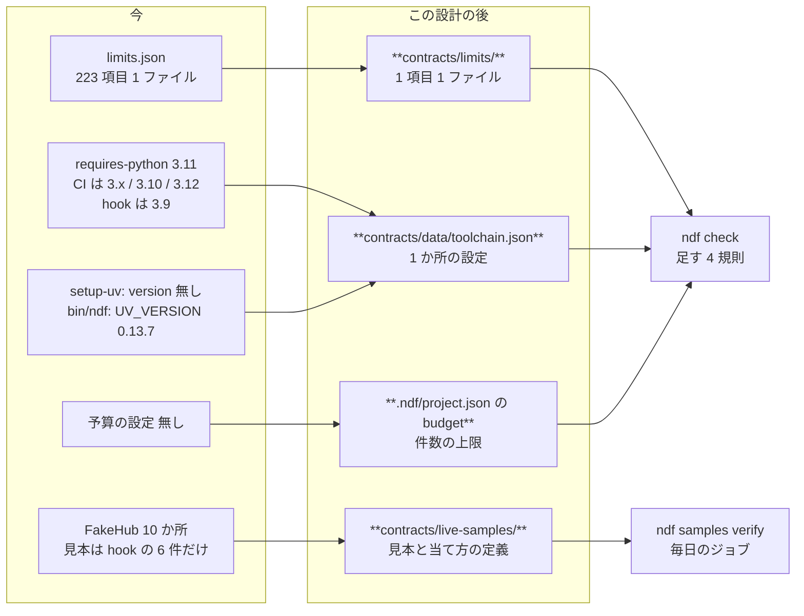
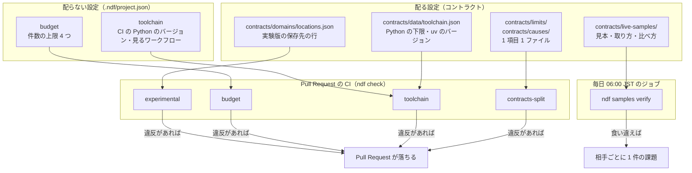
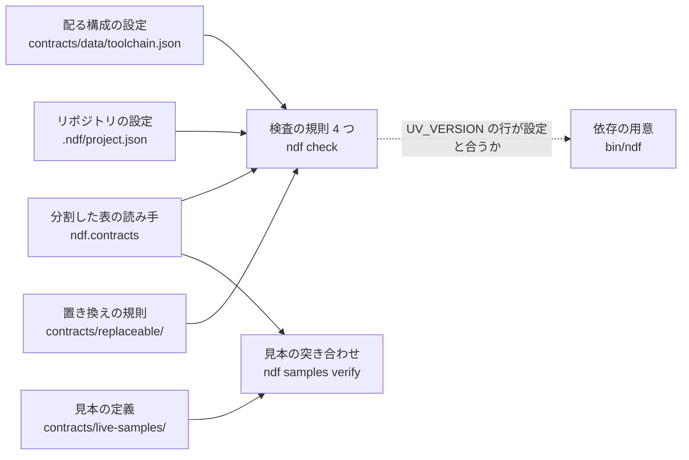
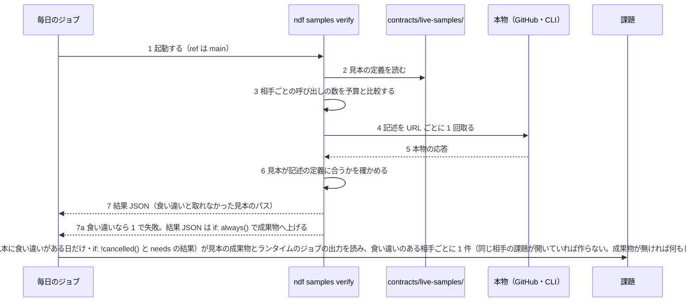
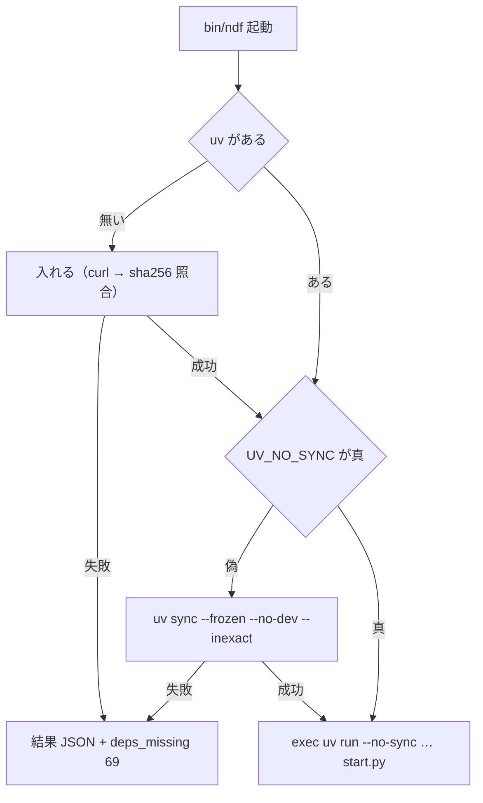

# テストと CI と配る構成: 見本を毎日本物に当て、予算と設定を 1 か所で検査する（#3687）

テストが差し込むテストダブルは本物と突き合わされず、Python と uv のバージョンは指定箇所ごとに食い違い、テストと CI は上限のないまま増え続けている。設定（コントラクト）を 1 か所にそろえ、`ndf check` に 4 つの規則を足して Pull Request で落とし、見本を本物へ当てる仕事は毎日 1 回のジョブへ置く。何を満たせば終わりかは要求仕様（[issue-3687-requirements.md](./issue-3687-requirements.md)、正は #3687 の本文）にある。採らなかった案と、比べた外部の候補は末尾の「決定の記録」と「外部の調査」にある。

## 今の姿

何が起きたか・目的・受け入れ条件は要求仕様（[issue-3687-requirements.md](./issue-3687-requirements.md)、正は #3687 の本文）にある。この文書は「どう解くか」と「なぜその解き方か」だけを書く。

NDF は、コマンド群（`plugins/ndf/src/ndf/`）・hook・Skill を Claude Code と Codex へ配るプラグインである。上限・停止理由・事実の表はコントラクト（`plugins/ndf/contracts/`）が持つ。構造と規約の検査は `ndf check`（`plugins/ndf/src/ndf/checks/`）が Pull Request の CI で当てる。変更が触るのは、下の図の太字の 4 か所である。



設計に要る今の構造は次の 4 つである。

| 今の構造 | 中身 |
| --- | --- |
| コントラクトの読み込み | `plugins/ndf/src/ndf/contracts/__init__.py` の `load_json`（67 行）が 1 ファイルを読み、同じキーが 2 つあれば断る（60-65 行）。読み手（`limits`・`causes` ほか）は `cached_reader` で 1 プロセス 1 回だけ読む。hook の経路だけは `jsonschema` を使えないため `plugins/ndf/src/ndf/domains/hooks/tables.py` が標準ライブラリで直に読む |
| 検査の登録 | 表は無く、`plugins/ndf/src/ndf/checks/run.py:88-96` の `check()` の呼び出しの並びが登録である。しきい値と要約は `plugins/ndf/src/ndf/checks/rules.json`、構文木は 1 ファイル 1 回だけ作る（`model.py` の `Source`） |
| 本物に当てる毎日のジョブ | `.github/workflows/runtime-plugin-smoke-latest.yml`（毎日 06:00 JST）が、外部 CLI の `--help` を `plugins/ndf/contracts/domains/cli-floors.json` の `help` 列と突き合わせ（96-107 行）、落ちたらランタイムごとに 1 件の課題を作る（113 行）。見ているブランチは `develop`（45 行）で、2026-11-17 の 10 系で止まっている |
| 依存の用意 | `plugins/ndf/bin/ndf` が uv を探し（60-61 行）、無ければ入れ（71-79 行）、失敗すれば結果 JSON を出して `deps_missing`（69）で止まる（48-58 行の `stop_deps_missing`）。最後は `exec` で uv へ渡る（98 行）ため、uv が依存を取れずに落ちた場合はこの経路を通らない |

## 文脈と制約

- **直す先は入れ替えの後の `plugins/ndf/` だけである。** 10 系は変えず、修正のバージョンも出さない（#3388 の設計の子の表の「直す先」）
- **hook の経路は標準ライブラリだけで動く。** `plugins/ndf/contracts/hooks/imports.json` の `stdlib_only` が縛るためである。hook が読む設定は `jsonschema` を通さずに読める形にする
- **このリポジトリは CI でテストを走らせる**（`.ndf/project.json` の `test.ci.only: true`）。足す検査の合否も CI で見る
- **同じスプリントの Z1（#3684）がコントラクトの表の整理とラチェット（前の数より増やさない仕組み）を持つ。** Z2 は固定の上限までを作り、ラチェットは作らない
- **毎日のジョブは本物の GitHub とランタイムの CLI に当たる。** 1 日の呼び出しの数を設定した上限の内に収める（要求仕様の前提 4）
- **1 項目 1 ファイルへ分ける対象は設定に書いた表に限る**（要求仕様の前提 2）。177 ファイルすべては分けない

## 解き方の全体像

設定を 4 つのコントラクトへ集め、読む側（コード・CI・起動）がその設定と一致していることを `ndf check` の 4 規則が Pull Request で確かめる。本物へ当てる仕事だけはネットワークが要るので、`ndf check` には入れず、毎日 1 回のジョブが打つ `ndf samples verify` が持つ。



設計どおりに実装を終えると、次の形になる。コントラクトの 1 項目を変える Pull Request の差分は 1 ファイルに収まり、同じ表の別の項目を触る Pull Request と衝突しない。NDF が動く Python の下限と uv のバージョンは `toolchain.json` が唯一の設定である。`pyproject.toml`・CI のワークフロー・`bin/ndf` がそこと食い違えば Pull Request が落ちる。テストの関数・CI のジョブ・使われない依存・置き換えられる自作の件数はリポジトリの設定に上限を持ち、超えた Pull Request が落ちる。実験版は配布元の外の `experimental/ndf/` に置き、既定で動くものから参照すると落ちる。テストダブルの見本は毎日 1 回本物の記述と当たり、食い違えば見本のパスを挙げて課題になる。依存を用意できないときは、どの場合でも結果 JSON と `deps_missing`（69）で終わる。

## 構成要素

| 要素 | 責務 |
| --- | --- |
| 分割した表の読み手（`ndf.contracts` に足す） | ディレクトリに分けた表を 1 つの辞書・配列として読む。ファイル名が項目のキーになる |
| 配る構成の設定（`contracts/data/toolchain.json`。新設） | NDF が動く Python の下限・hook のシステム python の下限・uv のバージョンとインストーラの照合値を 1 か所で持つ |
| リポジトリの設定（`.ndf/project.json` の `toolchain`・`budget`。キーを足す） | そのリポジトリの CI が回す Python のバージョン・検査が見るワークフロー・件数の上限 4 つ |
| 見本の定義（`contracts/live-samples/`。新設） | 本物へ当てる見本ごとに、相手・見本のパス・本物の取り方・比べ方を持つ |
| 置き換えの規則（`contracts/replaceable/`。新設） | lock の部品で置き換えられる自作を構文木で見つける形と、置き換えの先 |
| 見本の突き合わせ（`ndf samples verify`。新設のサブコマンド） | 定義した見本を本物へ当て、キーの集合と型の食い違いを `items` に出す |
| 検査の規則 4 つ（`ndf check` に足す） | `contracts-split`（分割の形）・`toolchain`（配る構成の一致）・`budget`（件数の上限）・`experimental`（実験版の参照） |
| 依存の用意（`plugins/ndf/bin/ndf` を変える） | `exec` の前に依存を同期し、落ちたら結果 JSON を出して `deps_missing`（69）で終わる |

図は、要素が読むものから読む側への向きで描く（点線は、設定と一致しているかを検査が確かめる向き）。



## データ構造

### 分割した表の形

設定に書いた表は、1 ファイルだったものを同じ名前のディレクトリへ移し、項目ごとに 1 ファイルへ分ける。キーはファイル名（拡張子を除く）で、ファイルの中身は項目の値だけを持つ。

| 分ける前 | 分けた後 | キーの出所 |
| --- | --- | --- |
| `contracts/limits.json` の `policies` の 223 項目 | `contracts/limits/<方針の名前>.json`（223 ファイル） | ファイル名（`test-run.test.json` → `test-run.test`） |
| `contracts/causes.json` の `causes` の 35 項目 | `contracts/causes/<kind>.json`（35 ファイル） | ファイル名（`ci_pending.json` → `kind: ci_pending`） |

表そのものが持つ値（`owner`）は、ディレクトリの下の `_meta.json` に置く。項目のファイル名は先頭が `_` で始まらないため、項目とメタは名前で見分けられる。サブディレクトリへ分けないのは、項目のキーがドットを含む名前（`test-run.test`）で、ディレクトリの階層へ対応付けるとキーの区切りとパスの区切りが二重になるためである。

```json
// contracts/limits/test-run.test.json
{"summary": "テスト 1 回の上限の秒と、実測に掛ける倍率", "seconds": 900, "factor": 3}
```

分ける表の一覧は `contracts/domains/split-tables.json` が持つ（`rows` に 表・項目の単位・キーの出所・もとのキー名）。この表自身は分けない（項目が 2 件で、同時に書き足す担当がいない）。

### 配る構成の設定と、リポジトリの設定

**設定は 2 か所に分かれる。** NDF 自身がどの Python と uv で動くかは配るコントラクトが持ち、そのリポジトリの CI が何で回すか・量の上限をいくつにするかはリポジトリの設定が持つ。ai-plugins の値を利用先のリポジトリへ持ち込まないためである（決定 3）。

```json
// plugins/ndf/contracts/data/toolchain.json（配る。NDF が動く条件）
{
  "owner": "Z2（#3687。ndf.contracts）",
  "python": {"floor": "3.11", "hook_floor": "3.9"},
  "uv": {"version": "0.13.7", "installer_sha256": "d263ee68314cf5bea36b08e6bd9e2c4563240d7adb73756cf33af5c199b92db4"}
}
```

```json
// .ndf/project.json（配らない。このリポジトリの値。足すキーだけを書いた）
{
  "toolchain": {
    "workflows": ".github/workflows/*.y*ml",
    "python_ci": ["3.11", "3.13"],
    "python_compat": {"versions": ["3.10"], "workflows": [".github/workflows/script-structure.yml"]},
    "plugin_pyprojects": ["plugins/ndf/pyproject.toml"],
    "launchers": ["plugins/ndf/bin/ndf"]
  },
  "budget": {
    "tests": 4400, "ci_jobs": 40, "unused_deps": 3, "replaceable": 3,
    "dep_modules": {"markdown-it-py": "markdown_it", "python-dotenv": "dotenv", "ruamel-yaml": "ruamel"},
    "dep_exempt": {"ruff": "子プロセスとして起動する（ndf check の lint）"}
  }
}
```

| キー | 意味 | 読む側 |
| --- | --- | --- |
| `toolchain.python.floor`（配る） | NDF が動く Python の下限 | 検査が `plugin_pyprojects` の `requires-python` と突き合わせる |
| `toolchain.python.hook_floor`（配る） | 依存の環境が無いときに hook のエントリポイントが動くシステムの python3 の下限 | `plugins/ndf/src/ndf/domains/hooks/boot.py` が読む（今は `contracts/hooks/imports.json` の `boot.python` を読む） |
| `toolchain.uv.version`・`installer_sha256`（配る） | 起動が入れる uv のバージョンと照合値 | 検査が `bin/ndf` の `UV_VERSION=`・`UV_INSTALLER_SHA256=` の行、ワークフローの `setup-uv` の `version` と突き合わせる |
| `toolchain.workflows`（設定） | 検査が見るワークフローのグロブ（`.yml` と `.yaml` の両方に当てる）。無ければワークフローを見ない | 検査 |
| `toolchain.python_ci`（設定） | `setup-python` の `python-version` に書いてよい値の一覧（通常の CI のバージョン） | 検査 |
| `toolchain.python_compat`（設定） | 対応の下限を確かめる手順だけに書いてよいバージョン（`versions`）と、それを書いてよいワークフロー（`workflows`）。このリポジトリでは根の `scripts/` を 3.10 で動かす確かめ（`script-structure.yml` の PATH の `python3`。ruff の `target-version = "py310"` と同じ下限）を残すために置く。`workflows` の外で `versions` のバージョンを書けば違反。無ければ `python_ci` だけを許す | 検査 |
| `toolchain.plugin_pyprojects`（設定） | `requires-python` を `python.floor` と突き合わせる `pyproject.toml` の一覧。無ければ突き合わせない | 検査 |
| `toolchain.launchers`（設定） | `UV_VERSION=`・`UV_INSTALLER_SHA256=` の行を `uv` の設定と突き合わせるランチャーの一覧。無ければ突き合わせない | 検査 |
| `budget.tests`・`ci_jobs`・`unused_deps`・`replaceable`（設定） | 件数の上限。キーが無い項目は上限と比べない（件数は `metrics` に出す） | 検査 |
| `budget.dep_modules`（設定） | 依存の名前（正規化した小文字）→ import の名前。書かない依存は、名前の `-` と `.` を `_` へ替えたものを import の名前とみなす | 検査 |
| `budget.dep_exempt`（設定） | 使っているとみなす依存の名前 → 理由（子プロセスとして起動する・プラグインとして読み込まれるなど、import に現れない使い方） | 検査 |

**設定のキーごとに独立して効く。** `toolchain` のキーが 1 つも無ければ規則 `toolchain` は何も突き合わせず、`workflows`・`plugin_pyprojects`・`launchers` はそれぞれ在るものだけを突き合わせる。NDF 自身を突き合わせるのは ai-plugins の設定がこの 3 つを持つからであり、規則がプラグインの保存先を決め打ちしない。利用先のリポジトリは、新しいキーを置く前から検査に落ちることが無い。

`bin/ndf` はシェルで動き、uv より前に走るため、この設定を読まない。自分の行を持ち、検査が設定と一致を確かめる。

### 見本の定義

見本を当てる相手は 2 通りある。GitHub の REST のように本番がリクエストの検証に使う記述を公開している相手は、その記述（PRD3）と当てる。記述の無い相手（ランタイムの CLI）は、既にある毎日のジョブの `cli-help` がコマンドを打って出力と当てる（下で述べる）。

```json
// plugins/ndf/contracts/live-samples/github-rest-issue.json
{
  "summary": "GitHub の REST の課題 1 件の応答の形",
  "peer": "github",
  "sample": "tests/samples/github/rest/issue.json",
  "source": {"schema": "https://raw.githubusercontent.com/github/rest-api-description/main/descriptions-next/api.github.com/api.github.com.json", "pointer": "#/components/schemas/issue"},
  "absent_keys": ["body_html", "body_text", "user/starred_at"],
  "extra_keys": [],
  "known_mismatches": []
}
```

| キー | 意味 |
| --- | --- |
| `peer` | 相手（この変更では `github` だけ）。呼び出しの数は相手ごとに数える |
| `sample` | 見本のファイル（プラグインの根からの相対）。テストダブルはこのファイルだけから応答を組み立てる |
| `source` | 本物の取り方。`schema`（公開の記述の URL。認証情報・クエリ・フラグメントは書けない）と `pointer`（記述の中の定義を指す JSON ポインタ。`anyOf`・`oneOf` の定義を指せば、見本の型を受けるただ 1 つの枝と当てる）。記述は OpenAPI 3.1 の bundled 形式（`descriptions-next/`）を取る。3.1 のスキーマは JSON Schema 2020-12 と同じ書き方で、null を取る列は `type` の配列で書かれる（3.0 の `nullable` を持たない） |
| `absent_keys` | 見本を録った時点の記述の定義にあり、見本（本物の応答）には無かったキーの一覧。見本の根からのパス（辞書のキーを `/` で区切り、配列の要素は `*`）で書く。見本のキーとこの一覧を合わせたものが「録った時点の形」（基準の形）で、取った記述の定義がこれより多いキーを持てば、相手がキーを足したとして落とす（詳細設計書の「足されたキーの判定」）。見本を録り直すときは、定義のキーから見本のキーを引いた残りを書き直す |
| `extra_keys` | 見本（本物の応答）にあり、記述の定義に無いと分かっているキーの一覧。書き方は `absent_keys` と同じ。無ければ空の並びを書く。挙げたキーだけを (1) の向きの食い違いから除き、定義に載るか見本から消えれば食い違いにする |
| `known_mismatches` | 本物の応答と記述が食い違うと分かっている所の説明（`archived_by: type` のような、突き合わせの説明 1 行そのまま）の一覧。無ければ空の並びを書く。この説明だけを除き、出なくなれば食い違いにする。定義に無いキーは `extra_keys` へ書く（件数の説明をここへ書くと、キーの入れ替わりを見逃す） |

比べ方は 2 つの向きで 1 通りに決め、定義に置くのは基準の形（`absent_keys`）と既知の食い違い（`extra_keys`・`known_mismatches`）だけである。(1) 見本が記述の定義に合うか（見本のキーが定義に無ければ、相手がキーを消したか改名した）。(2) 記述の定義のキーが基準の形（見本のキー + `absent_keys`）に収まるか（収まらなければ、相手がキーを足した）。GitHub の定義は `additionalProperties` を書かないため、(1) だけでは相手の応答にキーが足されても見本は通り続ける。記述の無い相手（ランタイムの CLI）を本物と当てる仕事は、既にある毎日のジョブの `cli-help`（`--help` を `contracts/domains/cli-floors.json` と突き合わせる）が持ち続ける。同じ `--help` を見本の側でも打つと、毎日の CLI の起動がランタイムごとに 1 回増えるためである。

**呼び出しの数は定義の自己申告にしない。** 相手ごとの上限は上限の表の 1 項目（`contracts/limits/samples.fetch.json` の `peers`。`{"github": 2}`）に置く。`ndf samples verify` は定義から相手ごとの異なる URL の数を求め、1 つの URL を 1 回だけ取る（同じ記述を指す見本が増えても呼び出しは増えない）。打ち直しは持たない（`retries` は 0。失敗は次の日のジョブに任せる）。取得は転送を追わない（3xx は取れないものとして扱い、転送の先へ要求を足さない）ので、1 URL は必ず 1 要求である。記述は大きい（GitHub は 2026-11-23 の実測で 14,395,662 バイト）ため、本文の上限は同じ項目の `max_bytes`（64 MiB）に置く。最悪の呼び出しの数（異なる URL の数 ×（1 + 打ち直し））が上限を超える定義では、1 回も呼ばずに止まる。実際に送った要求の数を相手ごとに数え、結果 JSON の `metrics.calls` に出す。

### 予算と置き換えの規則

| 設定のキー | 上限（2026-11-23 の実測を基準） | 数え方 |
| --- | --- | --- |
| `budget.tests` | 4,400（実測 4,312） | テストのファイルの `def test_` と `async def test_` の定義の数 |
| `budget.ci_jobs` | 40（実測 37） | `toolchain.workflows` に当たるファイルの `jobs` のキーの数の合計（matrix の展開は数えない） |
| `budget.unused_deps` | 3（実測 3） | `toolchain.plugin_pyprojects` の各 `pyproject.toml` の `[project].dependencies`（直接の実行時の依存。`dependency-groups` の開発用と推移的な依存は数えない）のうち、同じディレクトリの `src/` に import が無く `budget.dep_exempt` にも無いものの数。対にする lock は同じディレクトリの `uv.lock` で、lock に無い依存は数えない |
| `budget.replaceable` | 3（実測 3。構文木で数えられる形に限る） | 置き換えの規則に当たった箇所の数 |

**上限は実測の値に余裕を乗せて置く。** テストの関数とジョブの数は、機能を足せば増えるため実測の 2 パーセント（4,312 → 4,400、37 → 40）を乗せる。使われない依存と置き換えられる自作は、増やしてよいものではないため実測と同じ値を置く（1 件でも増えれば落ちる）。要求仕様の前提 3 が挙げる置き換えられる自作 5 件のうち、`budget.replaceable` が数えるのは構文木で見つかる 3 件である。残る 2 件（Markdown の解析の拡張・Slack への送信）は、定義した依存を使っていない形なので `budget.unused_deps` の 3 件に含まれる。

```json
// contracts/replaceable/fcntl-flock.json
{
  "summary": "fcntl.flock の直接の呼び出し。filelock で置き換えられる",
  "find": {"kind": "call", "name": "fcntl.flock"},
  "replace_with": "filelock",
  "exempt": ["src/ndf/domains/hooks/counter.py", "src/ndf/domains/hooks/env.py", "src/ndf/domains/hooks/outbox.py"]
}
```

`exempt` は、hook の経路のように標準ライブラリだけで動く縛りがあって置き換えられない保存先である。

### 実験版の保存先

既にある保存先の表（`contracts/domains/locations.json`）へ 1 行足す。新しい表は作らない。

| 列 | 値 |
| --- | --- |
| 保存先 | `experimental/ndf/`（リポジトリの根からの相対。配布元の `plugins/ndf/` の外） |
| 持ち主 | 実験版を足した担当 |
| 呼び方 | `python3 experimental/ndf/<名前>.py`（配る対象に入れないため、`bin/` にエントリポイントを置かない） |
| 消す時点 | 本体へ移したとき、または使われないと決めたとき |

**保存先を配布元の外に置く。** Claude Code のマーケットプレイス（`.claude-plugin/marketplace.json` の `source: ./plugins/ndf`）は `plugins/ndf/` のディレクトリを丸ごと配り、Codex もプラグインのディレクトリ（`.codex-plugin/` を持つ `plugins/ndf/`）を単位に取り込むため、その内側に置くと `bin/` にエントリポイントが無くても実験版のファイルが利用者へ届く。配布元の外に置けば、両ランタイムの配布経路に除外の仕組みを足さずに済み、除外の漏れも起きない。

## 入出力のコントラクト

| 呼び出し | 返り | 終了コード |
| --- | --- | --- |
| `ndf samples verify [--peer <相手>]` | 結果 JSON。`items` は見本ごとに `sample`（見本のパス）・`peer`・`kind`（`mismatch`＝食い違い・`unreachable`＝本物を取れない）・`detail`（食い違ったキーか型、または取れなかった理由）。`metrics` は `samples`（当てた数）・`calls`（相手ごとに実際に送った要求の数） | `mismatch` が 0 件で `unreachable` も 0 件なら 0。`mismatch` が 1 件以上なら、`unreachable` があっても `samples_mismatch` で 1。`mismatch` が 0 件で `unreachable` があれば `infra_wait`（75） |
| `ndf check`（規則 4 つ） | 今のまま。`items` の `rule` が `contracts-split`・`toolchain`・`budget`・`experimental` | 今のまま（違反 1・構文の誤り 2） |
| `plugins/ndf/bin/ndf <サブコマンド>`（依存を用意できないとき） | 結果 JSON 1 行。`summary` と `cause.detail` に無いものの名前と直し方 | `deps_missing`（69） |

`samples_mismatch` は停止理由の表（分割後の `contracts/causes/`）へ足す新しい 1 項目である。

## 処理の流れ



依存の用意の流れは、`exec` の前に同期を 1 回挟む形へ変える。



## 非機能の実現方式

| 条件（要求仕様） | 実現方式 |
| --- | --- |
| 運用・保守性: 落ちたら相手ごとに 1 件の課題 | 既にある `scripts/runtime-smoke-latest.py report` と同じ形（同じ相手の開いた課題があれば作らない）を、相手の列を `peer` に替えて使う。課題を作るのは `items` に食い違い（`kind: mismatch`）がある相手だけで、本物へ届かなかった相手（`kind: unreachable`）には作らない。同じ実行で両方が起きても、食い違いのある相手の課題は作る。届かない状態が続いていることは、ジョブが続けて失敗していることで気づく（GitHub は定期のワークフローが続けて失敗すると、リポジトリの管理者へ通知する） |
| システム環境: 設定した Python と uv で走る | ワークフローの `setup-python` と `setup-uv` の値を `toolchain.json` の値にそろえ、検査が食い違いを落とす |
| 性能・拡張性: CI の所要を 3 分以上延ばさない | 足す 4 規則は既にある `ndf check` の 1 回の実行に相乗りし、構文木は 1 ファイル 1 回だけ作る既存の仕組み（`checks/model.py` の `Source`）を使う。毎日走るジョブは `live-samples` の 1 件だけ増やす。権限を分けるために足す報告のジョブ `report` は、ランタイムのジョブが失敗したか見本に食い違いがある日だけ起動する（`if: ${{ !cancelled() && (needs.runtime-smoke-latest.result == 'failure' || needs.live-samples.outputs.mismatch-artifact-id != '') && (github.event_name == 'schedule' || ((inputs.ref || 'main') == 'main' && (inputs.floors_ref || 'main') == 'main')) }}`）ので、失敗の日だけ 1 実行あたり 2 件になる。ワークフローのジョブの定義は 2 件増え（37 → 39）、`budget.ci_jobs` の上限 40 の内に収まる。Pull Request のジョブは増やさない。起動に足す `uv sync --frozen` は、後続の `uv run` を `--no-sync` にして同期の経路を 1 起動に 1 回に保つ。同期済みなら 1 回 15 ミリ秒（2026-11-23 の実測。`uv sync --frozen --no-dev --quiet --project plugins/ndf` を 3 回で 45 ミリ秒） |

## 決定の記録

決定 9 件は [issue-3687-design-decisions.md](./issue-3687-design-decisions.md) にある（1 ファイル 500 行の上限を超えたため分けた）。

## 影響と危険

- **働く範囲**: 仕組み（分割した表の読み手・`ndf samples verify`・4 つの規則）は配る NDF のコードに入り、利用先のリポジトリでも設定を置けば働く。CI で回す Python のバージョン・見るワークフロー・量の上限はリポジトリの設定（`.ndf/project.json`）が持ち、キーが無ければその検査は当たらない
- **プロジェクトごとに違うもの**: CI の Python のバージョン・見るワークフロー・予算の値はリポジトリの設定で、見本の定義と実験版の保存先はコントラクトで受ける。引数で渡すのは `ndf samples verify --peer` の絞り込みだけ
- **当たるモード**: すべてのモード（検査は Pull Request の CI、毎日のジョブはモードに依らない）

同じファイルを触る別の変更と、壊れうる箇所は次のとおりである。

| 箇所 | 扱い |
| --- | --- |
| Z1（#3684）のコントラクトの表の整理とラチェット | Z1 はこのレーンの後に流れる（並列の計画 p9 の「同時に動く組」）。分割した後の表を前提に整理でき、ラチェットは `budget` の規則が数えた値を基準に足せる。順序が逆になると、Z1 が整理した 1 ファイルを Z2 が分け直すことになる |
| `contracts/hooks/imports.json` の `boot.python` | `toolchain.json` へ移し、もとのキーは消す。読むのは `boot.py` の 1 か所だけなので、同じ Pull Request で両方を直す |
| `.github/workflows/` の 15 本 | 直前のレーン（#3961）が Action の固定を付け替えたばかりである。`setup-uv` に `version:` を足し、`setup-python` の値を替える変更は、その行の上に重なる |
| 毎日のジョブが見るブランチ（`develop`） | `main` へ替える。10 系で止まったブランチを見ているため、今の毎日のジョブは 11 系を一度も試していない |
| `plugins/ndf/bin/ndf` の `exec` | 同期を 1 回挟む。シグナルの伝わり方は `exec` のまま変えない（同期は `exec` の前に終わる） |

### 代表のリポジトリでの振る舞い

| 代表のリポジトリ | 設定の要点 | 直した後に起きること | この種類で扱えなくなること |
| --- | --- | --- | --- |
| Web サービス | テストと CI を持ち、依存の定義を持つ | `.ndf/project.json` に `toolchain` と `budget` を置けば、同じ検査が自分の値で働く。置かなければ `toolchain` と `budget` の規則は何も数えない | 無し |
| モバイルアプリ | テストはあるが Python の依存を持たないことがある | `budget.unused_deps` と `budget.replaceable` は Python の依存の定義が無ければ数えず、`budget.tests` はテストのファイルの見分け方の定義（`contracts/domains/test-files.json`）に従う | 無し |
| 業務文書だけ | テストも CI のジョブも持たない | 設定のキーが無いため、4 規則は何も数えない。毎日のジョブは置かない | 無し |

### ai-plugins だけの事情

| 値 | 置く所 | 持つ Issue |
| --- | --- | --- |
| 予算の値（テスト 4,400・ジョブ 40・使われない依存 3・置き換えられる自作 3） | `.ndf/project.json` の `budget` | #3687 |
| CI で回す Python のバージョン（3.11・3.13）と見るワークフロー | `.ndf/project.json` の `toolchain` | #3687 |
| 見本の相手（GitHub）と取り方・相手ごとの呼び出しの上限 | `plugins/ndf/contracts/live-samples/` | #3687 |
| 毎日のジョブが見るブランチ（`main`） | `.github/workflows/runtime-plugin-smoke-latest.yml` | #3687 |
| 分ける表の一覧（`limits`・`causes`） | `plugins/ndf/contracts/domains/split-tables.json` | #3687 |

## 用語

| 用語 | 意味 | 用語集への反映 |
| --- | --- | --- |
| テストダブル | テストが本物の代わりに差し込む偽の相手 | 追加 |
| 見本 | 本物の相手の入出力を記録した JSON。テストダブルはこれだけから応答を組み立てる | 追加 |
| 分割した表 | 1 項目 1 ファイルへ分けたコントラクトの表。ディレクトリの名前がもとの表の名前で、ファイル名が項目のキーになる | 追加 |
| テストと CI の予算 | テストの関数・CI のジョブ・使われない依存・置き換えられる自作の件数の上限 | 追加 |
| 安定版と実験版 | NDF の変更の 2 つの経路。実験版の保存先は `experimental/ndf/`（配布元の `plugins/ndf/` の外） | 意味の変更（10 系の `experimental/` から保存先を改める） |

## テスト設計

| 受け入れ条件 | どの振る舞いで縛るか | どう壊したら落ちるべきか |
| --- | --- | --- |
| 1 見本を本物に当てる毎日のジョブ | 偽の `fetch`（記述を返す関数）を使い、見本と同じ形なら 0。**見本を固定したまま取得した記述の側だけを変え**、定義の `properties` へキーを 1 つ足すと 1 で、そのキーと見本のパスが `items` に出る（足されたキーの判定）。記述を固定して見本へキーを 1 つ足しても 1（未知のキーの判定。偽の記述は本物と同じく `additionalProperties` を書かないので、どちらも JSON Schema の検証とは別の判定で落とす）。型の誤りでも見本の値は `items` に出ず、見本の動的なキー（定義が名前を決めない辞書のキーと、定義に無いキー）の名前も出ない | 食い違いを数えずに 0 を返す・記述の側の足しを見ないようにすると落ちる |
| 1 の呼び出しの予算 | 相手ごとの最悪の呼び出しの数（異なる URL の数 ×（1 + 打ち直し））が `samples.fetch` の `peers` の上限を超える定義では、本物を呼ばずに止まる。同じ URL の見本が 2 件あっても要求は 1 回 | 予算を読まずに全部呼ぶ・見本ごとに取り直すと落ちる |
| 1 の取得の障害と食い違いの同時 | ある見本が取れず、別の見本が食い違うと、結果は `samples_mismatch`（1）で `items` に両方が載る | 取得の障害で `infra_wait` を返して食い違いを隠すと落ちる |
| 2 コントラクトは 1 項目 1 ファイル | 分けた表の 1 ファイルを 2 項目へ戻すと `contracts-split` が落ち、ディレクトリの全ファイルを読んで元の 1 ファイルと同じ辞書になる | 読み手がディレクトリを読まず 1 ファイルだけを読むと、読めない項目が出て落ちる |
| 2 キーの重なり | 同じキーのファイルが 2 つある（大文字と小文字だけが違うなど）と、読み手が断る | 後のファイルで黙って上書きすると落ちる |
| 3 Python の下限 | `pyproject.toml` の `requires-python` を設定と違う値にすると `toolchain` が落ちる。hook のエントリポイントは設定の `hook_floor` を読んで動く | hook が設定ではなく自分の中の値で下限を見るようにすると落ちる |
| 3 CI の Python | ワークフローの `python-version` に設定の一覧に無い値（`3.x` など）を書くと落ちる | 一覧を読まずに素通ししていると落ちる |
| 4 CI の uv | ワークフローの `setup-uv` の `version` か `bin/ndf` の `UV_VERSION=` が設定と違うと落ちる。`version` を書いていないステップも落ちる | 書いていないステップを見逃すと落ちる |
| 5 依存を用意できないとき | 同期の失敗のメッセージを `start.emit_deps_missing` へ渡すと結果 JSON 1 行と `deps_missing`（69）になる（単体テスト）。uv が無い・入れられない・同期に失敗する、の 3 つをランチャーごと通す確認はリリース後テストの実機で行う | 同期の失敗を `exec` の後に起こすと、実機の確認で結果 JSON が出ずに落ちる |
| 6 テストと CI の予算 | テストの関数を上限 + 1 件に増やすと `budget` が落ち、ワークフローのジョブを上限 + 1 件に増やすと落ちる | 数を数えずに設定だけ読むと落ちる |
| 7 使われない依存と自作 | 定義した依存に import の無いものを 1 件足すと件数が増えて落ちる。置き換えの規則に当たる箇所を 1 件足すと落ちる。違反が無いときも `ndf check` の `metrics.budget` に 4 つの件数が出る | `exempt` の保存先まで数えると、今の状態で既に落ちる。違反のときだけ件数を出すと、通った Pull Request で件数が取れずに落ちる |
| 8 実験版の参照 | 既定で動くもの（`bin/`・`src/`・`hooks/`・`skills/`・`agents/`・`contracts/`・`manifests/`・`.claude-plugin/`・`.codex-plugin/`）から実験版の保存先を参照すると落ち、README と CHANGELOG と保存先の表の実験版の行からの参照は落ちない | 除外の一覧を持たずに全ファイルを見ると、README と `locations.json` で落ちる。`bin/` を見ないと `bin/ndf` からの参照を見逃して落ちる |
| 9 退行しない | 既存の 15 件の必須チェックが落ちない | 足した規則が既存の違反を新しく数えると落ちる |

## 未確認のまま残ること

| 項目 | 内容 |
| --- | --- |
| 起動に足す同期の上乗せ（並列・キャッシュが冷えたとき） | 実測した 15 ミリ秒は、同期済みで 1 本だけ動かしたときの値である。複数の NDF を同時に起動したときに uv がロックを取り合うか、キャッシュが冷えたときに何秒かかるかは測っていない。実装（Task 12）で、同時に 6 本起動した実測を取って確かめる |
| 分けたコントラクトの読み込みが CI の所要へ与える差 | 223 ファイルを 1 つずつ開く分の入出力が増える。1 プロセス 1 回の読み込みなので小さいと見ているが、実測していない。実装（Task 4）で分割の前後の `ndf check` の所要を測って確かめる |
| 公開の記述で見つけられない食い違い | GitHub の記述が示すのは応答の形（キーと型）までで、誤りの返し方・ページング・利用上限の振る舞いは現れない。この設計はそこを当てられない。見つける手段が要ると分かった時点で、別の課題にする |

## 設計の結果

| 課題 | 扱い | 統合先 | 触るファイル |
| --- | --- | --- | --- |
| #3687 | 実装する | — | `plugins/ndf/contracts/limits/`（新設・分割）、`plugins/ndf/contracts/causes/`（新設・分割）、`plugins/ndf/contracts/data/toolchain.json`（新設）、`plugins/ndf/contracts/live-samples/`（新設）、`plugins/ndf/contracts/replaceable/`（新設）、`plugins/ndf/contracts/domains/split-tables.json`（新設）、`plugins/ndf/contracts/domains/locations.json`、`plugins/ndf/contracts/hooks/imports.json`、`plugins/ndf/contracts/schemas/limits.schema.json`、`plugins/ndf/contracts/schemas/causes.schema.json`、`plugins/ndf/contracts/schemas/toolchain.schema.json`（新設）、`plugins/ndf/contracts/schemas/live-sample.schema.json`（新設）、`plugins/ndf/contracts/schemas/replaceable.schema.json`（新設）、`plugins/ndf/contracts/schemas/ndf-settings/project.schema.json`、`plugins/ndf/contracts/schemas/io/check.result.schema.json`、`plugins/ndf/contracts/schemas/io/samples.args.schema.json`（新設）、`plugins/ndf/contracts/schemas/io/samples.result.schema.json`（新設）、`plugins/ndf/src/ndf/contracts/__init__.py`、`plugins/ndf/src/ndf/contracts/limits.py`、`plugins/ndf/src/ndf/contracts/causes.py`、`plugins/ndf/src/ndf/contracts/toolchain.py`（新設）、`plugins/ndf/src/ndf/domains/hooks/boot.py`、`plugins/ndf/src/ndf/domains/hooks/tables.py`、`plugins/ndf/src/ndf/adapters/http.py`、`plugins/ndf/tests/adapters/test_notify.py`、`plugins/ndf/src/ndf/domains/samples/verify.py`（新設）、`plugins/ndf/src/ndf/domains/samples/cli.py`（新設）、`plugins/ndf/src/ndf/checks/run.py`、`plugins/ndf/src/ndf/checks/model.py`、`plugins/ndf/src/ndf/checks/rules.json`、`plugins/ndf/src/ndf/checks/contracts_split.py`（新設）、`plugins/ndf/src/ndf/checks/toolchain.py`（新設）、`plugins/ndf/src/ndf/checks/budget.py`（新設）、`plugins/ndf/src/ndf/checks/experimental.py`（新設）、`plugins/ndf/src/ndf/route/cli.py`、`plugins/ndf/bin/ndf`、`plugins/ndf/tests/contracts/test_split.py`（新設）、`plugins/ndf/tests/contracts/test_toolchain.py`（新設）、`plugins/ndf/tests/checks/test_contracts_split.py`（新設）、`plugins/ndf/tests/checks/test_toolchain.py`（新設）、`plugins/ndf/tests/checks/test_budget.py`（新設）、`plugins/ndf/tests/checks/test_experimental.py`（新設）、`plugins/ndf/tests/domains/samples/test_verify.py`（新設）、`plugins/ndf/tests/domains/samples/test_cli.py`（新設）、`plugins/ndf/tests/samples/github/rest/issue.json`（新設）、`plugins/ndf/tests/support/sample_hub.py`（新設）、`plugins/ndf/tests/support/test_sample_hub.py`（新設）、`.ndf/project.json`、`.github/workflows/runtime-plugin-smoke-latest.yml`、`.github/workflows/lint.yml`、`.github/workflows/pytest.yml`、`.github/workflows/glossary.yml`、`.github/workflows/pr-base-guard.yml`、`.github/workflows/script-structure.yml`、`.github/workflows/release-cd.yml`、`.github/workflows/ndf-release-reusable.yml`、`.github/workflows/deps-weekly.yml`、`.github/workflows/runtime-plugin-smoke.yml`、`.github/workflows/runtime-plugin-validate.yml`、`docs/glossary/glossary.json`、`AGENTS.md`。旧ファイル `limits.json`・`causes.json` を読む既存の検査・コード・テスト（`scripts/contracts_lib/limits_decl.py`、`scripts/check-ndf-contracts.py`、`scripts/tests/test_check_ndf_contracts.py`、`plugins/ndf/src/ndf/contracts/facts.py`、`plugins/ndf/contracts/domains/loop-phases.json`、`plugins/ndf/src/ndf/checks/spec_model.py`、`plugins/ndf/src/ndf/checks/children.json`、`plugins/ndf/src/ndf/domains/hooks/budget.py`、`plugins/ndf/src/ndf/domains/hooks/registration.py`、`plugins/ndf/src/ndf/domains/hooks/guards/session.py`、`plugins/ndf/tests/contracts/conftest.py` ほかのテスト。一覧は実装計画の Task 4）、`plugins/ndf/contracts/causes/samples_mismatch.json`（新設）、`plugins/ndf/contracts/limits/samples.fetch.json`（新設）、`plugins/ndf/tests/bin/test_start.py` |

詳細設計は [issue-3687-design-detail.md](./issue-3687-design-detail.md) にある。

## 外部の調査

| 種類 | 調べるか | 理由 |
| --- | --- | --- |
| 標準・仕様 | 調べる | テストダブルと本物の食い違いを見つける形（コントラクトテスト）と、Python のバージョンの下限の設定には、公開の仕様がある |
| 主要な製品 | 調べる | 本物のスキーマへ追随する仕組みと、1 ファイルの表を項目ごとに分けた形には、先例がある |
| ライブラリとサービス | 調べる | 記録と再生・コントラクトテスト・使っていない依存の検出は、自前で書く前に既存のものと比べる |

### 標準・仕様

| # | 標準・仕様 | 何を定めているか | 設計への反映 | 出典 |
| --- | --- | --- | --- | --- |
| STD1 | Pact Specification（V1〜V4） | consumer 側で応答をモックし、provider 側でそのやり取りを検証する形。Pact の契約ファイルは JSON で、各言語の実装が同じ突き合わせをすることを求める | 採らない。provider（GitHub）が検証を送り返す前提が成り立たない（決定 2） | https://github.com/pact-foundation/pact-specification （2026-11-23） |
| STD2 | PEP 621 の `requires-python` | `[project]` の `requires-python` をコアメタデータの `Requires-Python` へ対応付ける。書式の規則は持たず、現行の正本は PyPA の pyproject.toml の仕様だと自ら記す | 下限の設定先を `requires-python` にし、検査がコントラクトと突き合わせる（決定 3） | https://peps.python.org/pep-0621/ （2026-11-23） |
| STD3 | コアメタデータの `Requires-Python` | パッケージが対応する Python のバージョンを示す唯一のフィールド。値はバージョン指定子の書式で、環境マーカーは取れない。**下限を別ファイルで示す仕組みと、使っていない依存を示すフィールドは無い** | 下限の正を `requires-python` 1 か所にし、ほかの指定箇所は検査で突き合わせる | https://packaging.python.org/en/latest/specifications/core-metadata/ （2026-11-23） |
| STD4 | `.python-version`（uv の規約。PyPA の仕様ではない） | 手元で使うインタープリタの明示の指定。`requires-python` はプロジェクトが守る制約という役割分担 | `.python-version` は作らない。手元のインタープリタの指定は CI の設定が持つ | https://docs.astral.sh/uv/concepts/python-versions/ （2026-11-23） |
| STD5 | 使っていない依存の検出（該当する標準は無い） | パッケージングの PEP 232 件のうち、題に unused を含むものは 0 件。依存に触れる 13 件はいずれも書式・解決・再現性を扱う | 自前で数える判断の根拠（決定 4） | https://peps.python.org/topic/packaging/ （2026-11-23） |

### 主要な製品

| # | 製品 | どう解いているか | 設計への反映 | 出典 |
| --- | --- | --- | --- | --- |
| PRD1 | Pact Broker の can-i-deploy | 検証の結果を行列として持ち、出すバージョンと環境のバージョンの間に成功した検証があるかを終了コードで答える | 採らない（STD1 と同じ理由） | https://docs.pact.io/pact_broker/can_i_deploy （2026-11-23） |
| PRD2 | @octokit/openapi | GitHub 公式の OpenAPI 記述に拡張を足して配り、下流は `repository_dispatch` でリリースを受けて追随する | 見本の定義に記述の URL を持つ形の先例 | https://github.com/octokit/openapi （2026-11-23） |
| PRD3 | github/rest-api-description | 「本番が GitHub API のリクエストの検証に使う記述と自動で同期する」と公式が記す。bundled と dereferenced の 2 形式、OpenAPI 3.0 と 3.1 の 2 系統で配る | **採る。** GitHub の見本は API を呼ばずにこの記述と当てる（決定 2） | https://github.com/github/rest-api-description （2026-11-23） |
| PRD4 | botocore | サービスごと・API のバージョンごとのディレクトリに JSON のモデルを置き、更新は `api-change:` の行としてまとめて入れ替える | 見本を相手ごとのディレクトリに分けて置く形の先例 | https://api.github.com/repos/boto/botocore/contents/botocore/data/s3/2006-03-01 （2026-11-23） |
| PRD5 | changesets | 1 つの変更を 1 つの Markdown ファイルにして `.changeset` へ置き、適用したら消す | **採る。** 1 項目 1 ファイルの形の根拠（決定 1） | https://raw.githubusercontent.com/changesets/changesets/main/docs/faq.md （2026-11-23） |
| PRD6 | towncrier（news fragment） | 「開発者が全員書き込んで衝突を生む 1 つのファイル」の代わりとして、項目ごとの断片を置く方式を公式に位置づける | **採る。** 1 ファイルの同時編集を避ける根拠（決定 1） | https://towncrier.readthedocs.io/en/stable/ （2026-11-23） |

### ライブラリとサービス

| # | 候補 | バージョン | ライセンス | 最後のリリースの日付 | 終了のアナウンス | 要件を満たすか | 出典 |
| --- | --- | --- | --- | --- | --- | --- | --- |
| LIB1 | vcrpy（応答の記録と再生） | 9.4.2 | MIT | 2026-11-02 | 無し | 録り直しはできるが、食い違いを見つけて落とす仕組みを持たない。採らない | https://pypi.org/pypi/vcrpy/json （2026-11-23） |
| LIB2 | pytest-recording（vcrpy の pytest 統合） | 0.15.0 | MIT | 2026-11-15 | 無し | LIB1 と同じ理由で採らない | https://pypi.org/pypi/pytest-recording/json （2026-11-23） |
| LIB3 | responses（requests の応答の差し替え） | 0.26.3 | Apache-2.0 | 2026-08-26 | 無し | NDF は `httpx` を使い `requests` を持たない。採らない | https://pypi.org/pypi/responses/json （2026-11-23） |
| LIB4 | pact-python（コントラクトテスト） | 4.2.0 | MIT | 2026-10-23 | 無し | STD1 の実装で、provider 側の検証を前提にする。採らない | https://pypi.org/pypi/pact-python/json （2026-11-23） |
| LIB5 | deptry（使っていない依存の検出） | 0.25.1 | MIT | 2026-03-18 | 無し。ただしリポジトリが `fpgmaas/deptry` から `osprey-oss/deptry` へ移動（旧名は `Moved Permanently`、新名は最終 push 2026-11-23） | ルール DEP002 が目的に合う。別プロセスと別の設定になり例外の設定が二重になるため採らない（決定 4） | https://pypi.org/pypi/deptry/json ・ https://deptry.com/rules-violations/ （2026-11-23） |
| LIB6 | github/rest-api-description（GitHub REST の記述の取得元） | リポジトリ（PyPI のパッケージではない） | MIT | 最終 push 2026-11-21 | 無し | **採る。** 記述をファイルとして取得でき、本番の検証に使う記述と同期する | https://api.github.com/repos/github/rest-api-description （2026-11-23） |

### 確かめられなかったこと

| 対象 | 試した手段 | 結果と理由 |
| --- | --- | --- |
| respx・schemathesis・fawltydeps・pip-check-reqs | 試していない | 上限（ライブラリの候補の上限 6 件を LIB1〜LIB6 で使い切った） |
| GitHub の GraphQL の公開スキーマの取得元とバージョン | 試していない | 上限（取得の試み 30 回）。GraphQL の見本を足すときに調べ直す |
| githubkit が GitHub の OpenAPI 記述からコードを生成しているか | https://github.com/yanyongyu/githubkit の本文と README の検索 | 未確認。README には「Always up to date, like octokit」とあるが、生成の仕組みと追随の頻度を述べた記述は見つからなかった |
| `.python-version` と `requires-python` が食い違ったときの uv の振る舞い | https://docs.astral.sh/uv/concepts/python-versions/ | 未確認。明示の指定が自動選択に優先することは書かれているが、範囲の外のときに警告するのか失敗するのかの記述が無い。`.python-version` を作らない判断（STD4）に影響しない |
| botocore の JSON モデルを更新する自動化の仕組み | リポジトリの API と CHANGELOG の先頭 30 行 | 未確認。モデルの構成と更新のまとめ方は取れたが、取り込みのパイプラインを述べた一次情報は上限で未取得 |

調べた量: 候補 17 件・取得の試み 30 回。
