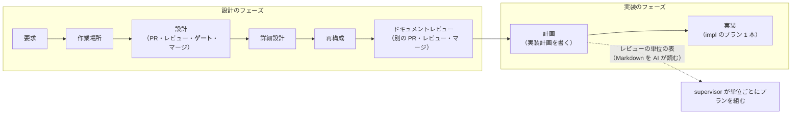
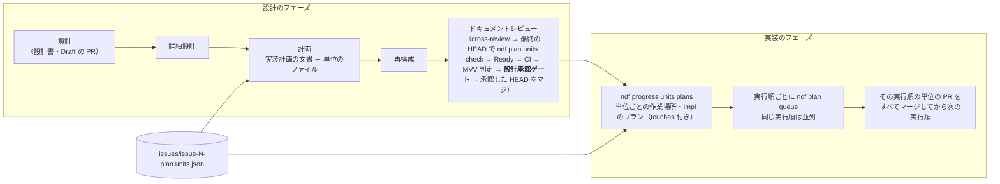

# PR の単位: 分け方・順序・並列を設計承認ゲートで見て、大きすぎる単位を機械で止める（#3702）

大きな課題の実装が 1 本の PR（#3698 は 319 ファイル・16,757 行）にまとまり、分け方を誰も承認の前に見られなかった。実装計画を詳細設計の直後に書いて設計 PR に載せ、単位の依存・触るファイル・見込みの行数を機械が読むファイルでも出し、実行順と並列をそこから決めて、上限を超える単位を分け方の案とともに止める。
そのために設計承認ゲートを工程「ドキュメントレビュー」の終わりへ移し、詳細設計と実装計画をゲートの前に入れる。外部の調査は末尾に、採らなかった案は決定ごとにある。

## 今の姿

何が起きたか・目的・受け入れ条件は要求仕様（[issue-3702-requirements.md](./issue-3702-requirements.md)、正は #3702 の本文）にある。この文書は「どう解くか」と「なぜその解き方か」だけを書く。



設計に要る今の構造（main `5b699121d` で確かめた。ファイルと行は [詳細設計書](./issue-3702-design-detail.md) の地図）:

- **工程の定義では、設計承認ゲートが工程「設計」の中にあり、詳細設計より前に来る。** `stages/design.json` のステップは 設計 → レビュー → MVV 判定 → ゲート → マージで、詳細設計（`design-detail.json`）・再構成・ドキュメントレビュー（`document-review.json`。自分の PR・レビュー・マージを持つ）はゲートの後に流れる。手順書のフェーズの表（`agent-layers.md`）はゲートをドキュメントレビューの後に置いており、定義と食い違う
- **工程「計画」（`stages/plan.json`）は `phase: implement` で、工程表（`modes/standard.json`・`legacy-refactor.json`）ではドキュメントレビューの後にある**
- **単位ごとのプランを組むコードは無い。** `ndf progress new` はステートマシンを作るだけで、プランを書き出さない。テンプレートも工程から組む経路も `touches`（触るファイル）・`needs`（前提のプラン）を書かない（grep 0 件）。実装計画の「レビューの単位」の表を読むコードも無い
- **プランの並びと重なりの判定は既にある。** `ndf plan queue`・`ndf plan check` は `needs` が済み、`touches` が同じファイルで重ならないプランを同じ組（wave）で流す（`core/plan/queue_decide.py` の `waves`）。同時の本数は `--max` が持つ
- **大きさの上限は手順書の目安（1 単位 400 行以下、1,000 行を超える単位を作らない）だけで、数える・止めるコードは無い**
- **設計の結果の表（課題・扱い・統合先・触るファイル）の読み手 `design_gaps` は「PR の単位が 2 つ以上なら止める」を持つが、本番の呼び手が無い**（テストだけが呼ぶ）

## 文脈と制約

- 11.0.10 で入った部分（レビューの単位の欄・単位ごとの PR と cross-review・課題 1 つを 1 単位にする既定・400 / 1,000 行の目安・重ね合わせ）は作り直さない。この設計は、その欄の中身を機械が読む形にし、順序と大きさを機械で確かめる
- 承認ゲートは 2 つのまま増やさない（`development-workflow` の「人手の承認を求める承認ゲート」）
- 見込みの行数は実装の前の値で、git の差分からは数えられない。実装計画を書く人（worker）が見積もった数を読む
- 前提 1〜4（要求仕様）: 実行順は「先に要る単位の実行順の最大 + 1」、依存の向きの既定は 契約 → 読み手の付け替え → 削除、行数は追加と削除の和で再生成のファイルと lock を数えない
- 11.x ではプランのテンプレートが #3908 で動かず、設計と実装のフェーズは supervisor が回している。工程の定義を直しても、流すのは #3908 の後になる。supervisor の手順（`agent-layers.md`）も同じ機械の読み手を使うようにし、テンプレートが動く前から効かせる
- この課題を進める並列の計画のレーン（lsplit。触ってよい場所を宣言し、ほかのレーンと重ならないようにしている）の外に 14 ファイルが要る（一覧は「影響と危険」）。上限の宣言と既定の正本・設計の結果の表の読み手・承認した HEAD でのマージ・固定した SHA からの作業場所の作成・受け入れ条件の確かめがそこにあるため

## 解き方の全体像



- 設計 PR には要求・設計書・詳細設計書・実装計画（文書と単位のファイル）が載り、設計承認ゲートで分け方・実行順・並列と直列の表を見て承認する。ゲートは工程「ドキュメントレビュー」の終わりの 1 回だけになる
- 単位のファイル（`issues/issue-<番号>-plan.units.json`）がタスクと単位の正本で、実装計画の文書の「レビューの単位」と「並列と直列」の表はそこから作る
- `ndf plan units check` が実行順を出し、400 行を超える単位に警告、1,000 行を超える単位・依存の輪・同じ実行順で同じファイルを触る単位・理由の無い依存で止め、分け方の案を返す。上限は `.ndf/project.json` の宣言で変えられる
- 実装のフェーズでは、`ndf progress units plans` が単位ごとの impl のプランを `touches`（触るファイル）と担当のタスクの指示付きで書き、工程が実行順ごとに単位専用の作業場所を用意して既存の `ndf plan queue` で同じ実行順の単位を並列に流し、その実行順の PR をすべてマージしてから次へ進む。実装計画を省いた課題は課題 1 つを 1 単位にする
- この新しい経路を使うのは `standard`・`legacy-refactor` だけで、ほかのモードは今の工程の定義を指したまま変えない

## 構成要素

| 要素 | 責務 |
| --- | --- |
| 単位のファイルの形（`contracts/workflow/review-units.schema.json`） | タスク（対象ファイル・満たす受け入れ条件・見込みの行数・先に要るタスク）と単位（含むタスク・先に要る単位と理由）の形を決める |
| 単位の判定（`core/plan/units_decide.py`） | 単位のファイルから実行順・触るファイル・行数を導き、規則の違反・警告・分け方の案を返す。ファイルも git も読まない |
| 単位の検査のコマンド（`ndf plan units check`・`render`・`prompt`。`core/plan/cli.py`） | ファイルと宣言を読んで判定を呼び、結果 JSON を返す。`render` は文書の 2 つの表を作り直し、`prompt` は impl のプロンプトの全文を書く |
| 単位を流すコマンド（`ndf progress units plans`・`run`。`progress/command.py`） | `plans` は単位ごとの impl のプランと流し方の記録を書き、`run` はそれを実行順ごとに流す（単位ごとの題・本文・レビューの起動を組む処理が `progress` にあるため、`ndf plan` に置かない） |
| 工程「設計」（`stages/design-draft.json`。新設。standard・legacy-refactor だけ） | 設計の作業場所を作り、設計書を書いて Draft の設計 PR を開く（レビュー・ゲート・マージは持たない） |
| 工程「詳細設計」（`stages/design-detail-pr.json`。新設。standard・legacy-refactor だけ） | 共有の `design-detail.json` と同じステップを、設計 PR の作業場所（`design_worktree`）で流す。共有の定義はスプリントの作業場所で書くので、設計 PR に載せるために分ける |
| 工程「計画」（`stages/plan-pr.json`。新設。standard・legacy-refactor だけ。共有の `plan.json` は変えない） | 設計のフェーズへ移り（`phase: design`）、設計 PR の作業場所で実装計画の文書と単位のファイルを書いて push する（確かめは承認の前の最終の HEAD で 1 回だけ行う） |
| 工程「ドキュメント再構成」（`stages/document-rebuild-pr.json`。新設。standard・legacy-refactor だけ） | 共有の `document-rebuild.json` と同じステップを設計 PR の作業場所で流し、指摘のファイル（`rebuild_findings`）をドキュメントレビューへ渡す |
| 工程「ドキュメントレビュー」（`stages/design-approval.json`。新設。standard・legacy-refactor） | 設計 PR の cross-review・最終の HEAD での `ndf plan units check`・Draft の解除・CI・MVV 判定・設計承認ゲート・承認した記録と回答を照らしたマージ（`ndf ci merge --target --answer`）・スプリントへの同期を持つ（工程「設計」から移す） |
| 工程「実装」（`stages/implement-units.json`。新設。standard・legacy-refactor） | 承認した計画の入力と照らしてから `ndf progress units plans` と同じ処理で単位ごとのプランを書き、実行順ごとに作業場所を用意して `ndf plan queue` で流し、マージしてから次の実行順へ進む |
| 上限の既定（`contracts/limits.json` の `review-units.target-lines`・`review-units.max-lines`） | 400 と 1,000。宣言（`.ndf/project.json` の `workflow.review_units`）が先に効く |

## データ構造

単位のファイルの形（正本はスキーマ。値は例）:

```json
{
  "version": 1,
  "issues": [3672],
  "tasks": [
    {"id": "T1", "title": "既定の表と移す行の表を置く", "files": ["contracts/domains/branch-strategy-presets.json"], "lines": 320, "criteria": ["3672:2"], "after": []},
    {"id": "T2", "title": "読む部品", "files": ["src/ndf/core/branch_strategy.py", "tests/test_branch_strategy.py"], "lines": 380, "criteria": ["3672:1"], "after": ["T1"]}
  ],
  "units": [
    {"name": "契約", "tasks": ["T1"], "after": []},
    {"name": "読む部品", "tasks": ["T2"], "after": [{"unit": "契約", "reason": "T2 が T1 の表を読む"}]}
  ]
}
```

| 値 | 持つ所 | 導く値（ファイルに書かない） |
| --- | --- | --- |
| タスクの対象ファイル・見込みの行数・満たす受け入れ条件・先に要るタスク | `tasks[]` | 単位の触るファイル（タスクの和）・見込みの行数（タスクの和）・満たす受け入れ条件（タスクの和） |
| 単位の含むタスク・先に要る単位と理由 | `units[]` | 実行順（先に要る単位の実行順の最大 + 1）・マージの順（実行順、同じ実行順は `units[]` の並び） |
| タスクの所属の課題 | `tasks[].issue`（ファイルの課題が 1 つなら省ける） | 単位の課題（タスクの和）・代表の課題（最初のタスクの課題） |
| 実際の行数 | `units[].actual_lines`（任意。最後の実行順のマージの後に 1 回だけ書き足す。単位の PR はこのファイルを触らない）。値は単位の PR の**ファイルごとの**追加と削除（`gh pr view <番号> --json files` の `path`・`additions`・`deletions`）から、見込みと同じ規則（前提 4: 再生成のファイルと lock を数えない。対象は実装計画の文書の行数の注記に挙げたパス）で除いたファイルを引いた和。PR 全体の `additions`・`deletions` の集計は除外を当てられないので使わない | — |

**同じ事実を 2 か所に持たない。** 単位の行数・触るファイル・実行順はタスクと依存から導き、ファイルに書かない。実装計画の文書の 2 つの表は `ndf plan units render` が作り、`--check` が食い違いを落とす（用語集の `ndf records glossary render --check` と同じ形）。

## 入出力のコントラクト

| コマンド | 入力 | 返り（結果 JSON） |
| --- | --- | --- |
| `ndf plan units check [--issue N]... [<ファイル>...] [--docs]` | 単位のファイル。`--issue` は `issues/issue-*-plan.units.json` から番号で引き（名前の `-` で区切った番号のどれか。同じファイルは 1 回だけ読む）、すべてのファイルを 1 つのグラフにして確かめる。`--docs` は実装計画の文書の表も照らす | `ok`: `items` に単位ごとの `{"kind": "unit", "file", "name", "seq", "order", "merge", "parallel_with", "after", "issues", "criteria", "lines", "touches"}`（`seq`・`merge` はスプリント全体の番号で、実装が使う番号と同じ。承認資料の単位の表はこの項目と `metrics.parallel` だけから作る。`touches` は並列の相手と触るファイルが重ならないことを承認者が見るため）。`warnings` に W1・W2。案は `{"kind": "split", ...}` で、行数の規則に当たった単位ごとに次のどちらか（決定 6）: 機械で当てられる案（`units` が空でなく、どの単位も上限以下）か、書き手への切り直しの指示（`units` が空で `resplit` と `note`）。`stopped`（`invalid`）: `{"kind": "violation", "rule", "unit", "reason"}` と案 |
| `ndf plan units render <ファイル> --doc <実装計画> [--check]` | 単位のファイルと実装計画の文書 | 文書の「レビューの単位」「並列と直列」の表を書き直す。`--check` は書かずに、食い違えば `stopped`（`invalid`） |
| `ndf progress units plans --out <ディレクトリ> --sprint <ブランチ> --target <承認の記録> --answer <回答> [--issue N]... [--omitted N]... [--set <名前>=<値>]...`（工程では `--from-stage`。単位ごとの差し込みは工程と同じく単位ごとに組み、`--set` は共通の差し込みだけ。流すのは `ndf progress units run`） | 単位のファイル（実装計画を省いた課題・旧い形の課題は課題 1 つを 1 単位。新しい形の実装計画なのに単位のファイルが無ければ止める）と、承認した入力の一覧と指紋（承認の記録の `files`） | 読んだ計画・単位のファイル・設計文書の一覧と blob が承認した一覧と同じとき（追加・削除・変更が無いとき）だけ、単位ごとの impl のプラン（`touches` 付き、名前はスプリントで一意）と担当のタスクの指示のファイルを書き、`items` にプランのパス・単位のブランチ・依存を実行順に返す。`metrics.max` に同時に流す本数の上限。違えば・`check` が止まる入力では書かない |

宣言（`.ndf/project.json`）:

```json
{"workflow": {"review_units": {"target_lines": 400, "max_lines": 1000}}}
```

`target_lines < max_lines` でなければ設定の誤り（`invalid`）。片方だけ書けば、もう片方は上限の既定（`contracts/limits.json`）を使う。

## 決定の記録

### 決定 1: 分け方を承認の前に見せるため、工程「計画」を設計のフェーズの詳細設計の直後へ移し、設計承認ゲートをドキュメントレビューの終わりへ移す

- **質問**: 実装計画を設計 PR に載せ、設計承認ゲートの前に書かせるには、工程表をどう変えるか（未決 2: 工程「計画」を読む側にするか外すか）
- **選んだ案**: `standard`・`legacy-refactor` の工程「計画」を新しい定義（`plan-pr`）で `phase: design` にし、両モードの工程表で詳細設計と再構成の間へ移す。実装のフェーズから「計画」の行が外れ、単位を読むのは工程「実装」のステップ（`ndf progress units plans`）になる。あわせて、工程「設計」の レビュー・MVV 判定（プロジェクトの方針に照らした AI の判定）・設計承認ゲート・マージのステップを工程「ドキュメントレビュー」へ移し、ドキュメントレビューが今は別に開いてマージしている PR（ステップ `docs-pr`・`docs-merge`）をやめる。設計 PR は 1 本で、ゲートは 1 回のまま
  - **新しい経路を使うモード**: `standard`・`legacy-refactor` だけが新しい工程の定義 6 つを指す: 工程「設計」`design-draft`（Draft の設計 PR を開く）・「詳細設計」`design-detail-pr`・「計画」`plan-pr`・「ドキュメント再構成」`document-rebuild-pr`（この 3 つは共有の `design-detail`・`plan`・`document-rebuild` と同じ中身を、設計 PR の作業場所で書くために分けたもの。詳細設計と実装計画を設計 PR の 1 本に載せるのに要る）・「ドキュメントレビュー」`design-approval`・「実装」`implement-units`。`light`・`operation`（ドキュメントレビューを持たない）と `documentation`（「計画」がドキュメントレビューの後にある）は今の `design`・`design-detail`・`plan`・`document-rebuild`・`document-review`・`implement` を指したまま変えない。共有の定義からステップを抜くと、これらのモードで Draft の PR が残る・計画の前にマージするため。**phase を `design` に変えるのは新設の `plan-pr` だけ**で、共有の `plan.json` は `phase: implement` のままなので、`operation`・`documentation` の「計画」の所属は変わらない
  - **実装計画の書き手は工程「計画」だけ**: 設計書を省いた課題も工程「設計」では書かない。実装計画を省く課題（文書の役割の表の条件）は、工程「計画」の worker が書かずに終え、`check` が「省いた課題」として承認資料に出す
  - **確かめは最終の HEAD で 1 回**: 単位のファイルと表は、レビュー・再構成で変わりうるので、工程「ドキュメントレビュー」でレビューが収束した後の HEAD で `ndf plan units check --docs` を 1 回打つ。工程「計画」には確かめのステップを置かない（同じ入力を 2 回確かめない）
  - **Draft の解除と承認した HEAD**: 設計 PR は Draft で開き、レビューと単位の確かめの後に Ready にしてから CI を待つ。承認は CI が通った HEAD（`design_head`）・宛先・方式・マージの経路と組で承認の記録（`design-target.json`）に書き、回答（`design-answer.json`）はその記録の SHA-256 と結ぶ。設計 PR のマージは工程でも手動でも `ndf ci merge --target <承認の記録> --answer <回答>` の 1 つの入口で行い、回答と記録を照らしてから記録の番号・宛先・HEAD でマージする。`ndf ci merge --reviewed <HEAD>` の照合の経路は単位の PR（工程「実装」）のもので、設計 PR には使わない（承認の記録と回答との結び付けを持たないため）。マージのプランは承認を聞き直さない。衝突の解消などで HEAD が変われば、マージせずにレビューから打ち直し、承認をやり直す
  - **宛先を固定できない窓は承認事項にする**: GitHub の直接マージとキューへの登録は HEAD を条件にできるが宛先を条件にできず、最後の照合から要求までの間（直接マージは 1 往復、キューは登録からマージまで）の宛先の変更を防げない。そこで承認の記録に宛先ごとのマージの経路（直接かキューか）を書き、承認資料にその経路の「宛先を固定できない窓」の例外を載せて承認を得る。マージは承認した経路と要求の時点の経路が同じときだけ要求を送り、違えば（承認の後にキューを有効にした・外した）要求を送らずに断る。窓の中の変更は要求の後の読み直しか再開の照合で見つけ、マージ済みなら止めて人に返す
  - **受け入れ条件 4 の文言との差**: 条件 4 は「計画」を「設計のフェーズで書いた実装計画を読む側にするか、工程表から外す」と書くが、この案では「計画」が設計のフェーズの書き手になる。条件 4 の意図（実装計画を実装のフェーズで書かない・設計承認の前に見せる）は満たし、読む側は工程「実装」が持つ。**条件 4 の文言を「工程『計画』が設計のフェーズへ移り、設計承認ゲートの前に実装計画を書く」に改めることを、設計承認ゲートの承認事項にする**
- 採らなかった案: 実装のフェーズに「計画」を読む側として残し、設計のフェーズに新しい工程「実装計画」を足す（行が 19 になり、読む側の工程は `ndf progress units plans` を打つだけで中身が無い。工程表の検査・テスト・ステートマシンの行を増やす）
- 採らなかった案: 工程「計画」を消し、工程「詳細設計」が実装計画も書く（詳細設計を畳む課題・詳細設計を通らないモード（`operation`・`documentation`）の「計画」の行も消え、執筆の分担の計画の置き場が無くなる）
- 採らなかった案: ゲートを工程「設計」に残したまま、設計のテンプレートの中で詳細設計と実装計画も書く（工程「詳細設計」「ドキュメント再構成」がゲートの後に空で流れ、工程表とフェーズの表の食い違いが残る）
- **代償**: 設計 PR に詳細設計書と実装計画が加わり、承認する人とレビュー担当が読む量が増える（レビューは設計 PR の 1 回にまとまり、別の PR のレビューとマージは無くなる）。新しい工程の定義 6 つとテンプレート 3 つを足し、2 つのモードの並び、工程の出力（`mvv_gate`・`design_head` がドキュメントレビューの出力になる）を同時に変える。`standard`・`legacy-refactor` とほかのモードで工程「設計」「詳細設計」「計画」「ドキュメント再構成」「ドキュメントレビュー」「実装」の定義が 2 通りになる
- 根拠: Value 1 / Value 3（MVV バージョン 10）

### 決定 2: 単位の正本を 1 つにするため、機械が読む形を実装計画と組の JSON ファイルにし、設計の結果の表は課題ごとのまま残す

- **質問**: 機械が読む形をどこに置くか（未決 3: 設計の結果の表を単位まで広げるか、別に置くか）
- **選んだ案**: `issues/issue-<番号>-plan.units.json` をタスクと単位の正本にし、実装計画の文書の 2 つの表は `ndf plan units render` で作る。設計の結果の表は課題の扱い（実装する・マージする・閉じる）と触るファイルのまま変えず、単位のファイルの課題と触るファイルはその表の範囲に収める（外れたら `check` が警告する）。`design_gaps` の「PR の単位が 2 つ以上なら止める」は消す
- 採らなかった案: 設計の結果の表に単位の列（単位・先に要る単位・行数）を足す（課題の扱いと単位の分け方は読み手と決める時点が違い、1 つの課題が複数の行に割れて「課題 1 つが 1 行」の読み手を作り直す。Markdown の表は理由のような自由な文と配列を持ちにくい）
- 採らなかった案: 実装計画の文書の表を正本にし、コードが Markdown の表を読む（`after` と理由・タスクごとの行数のような入れ子を表で持つと列が増え、書き手の書き崩しで読めなくなる。読めないときの扱いを別に作る）
- **代償**: 実装計画を書く worker は JSON と文書の両方に触れる（表は `render` が作るので手で写さない）
- 根拠: Value 8 / Value 11（MVV バージョン 10）

### 決定 3: 書き手が順序を書き違えないよう、実行順とマージの順は書かずに依存から導く

- **質問**: 単位ごとの実行順・マージの順をファイルに書かせるか、依存から計算するか
- **選んだ案**: 書くのは単位の `after`（先に要る単位と理由）だけで、実行順は前提 1 の式で導く。マージの順は実行順、同じ実行順の中は `units[]` の並びとする。同じ実行順の単位は同じファイルを触らないので（決定 4 の規則）、並びは衝突に効かない。並べと輪の検出は標準ライブラリの `graphlib.TopologicalSorter` を使う。前提 1 の「次の実行順は前の実行順のマージの後に始める」を守るため、工程「実装」は実行順ごとに、スプリントのブランチを取得し直した HEAD から単位専用のブランチと作業場所を作り、プランのキュー（`ndf plan queue`）を 1 回打ち、終わった実行順の単位の PR をマージの順に、それぞれの単位の作業場所で `ndf ci merge --reviewed` してから、すべての PR がマージ済みになったのを確かめて次の実行順へ進む。impl のプランは単位の PR のマージを持たない（テンプレートの最後のステップは指摘の解決の確かめ `resolved`）ため、区切りは工程が持つ。今のキューは起動ごとに済んだプランを空から数えるので、プランの `needs` には前の実行順のプランを書かない（前の実行順の完了は工程のマージの記録が持つ）。単位ごとに PR の番号・レビュー済みの HEAD・マージの状態を記録し、打ち直したときはマージ済みの単位を飛ばし、マージキューへの登録（`ci_pending`）を完了と区別する
- 採らなかった案: 単位に `order` を書かせ、依存と照らす（同じ事実を 2 か所に持ち、照らす規則が増える）
- **代償**: 1 つ前の実行順の遅い単位が、依存の無い次の単位も待たせる（前提 1 のとおり）。同時に流す本数は `ndf plan queue --max` に、レーンの `max_plans`（並列の計画の宣言）とマシンの上限（`NDF_RELAY_MAX_NAMED` があればそれ、無ければ設定 `relay.max-named`）の小さい方を渡し、工程と supervisor は同じ関数（`units_files.parallel_cap`）の値を使う。超えた分は空きを待つ（前提 1 の「次の実行順へ送る」をキューの待ちで満たす）
- 作り方: ライブラリやサービスを使う
- 比べた候補: LIB1 / LIB2
- 根拠: Value 3 / Value 12（MVV バージョン 10）

### 決定 4: 作り直しと取り込みの衝突を生む組み方を止めるため、単位の規則を 6 つにする

- **質問**: `check` が何を違反として止め、何を警告にするか
- **選んだ案**: 下の 6 つで止め（`invalid`）、2 つで警告する（`ok` と `warnings`）

  | 規則 | 当たる組み方 | 扱い |
  | --- | --- | --- |
  | U1 | タスクの番号・単位の名前が重なる。先に要る単位・タスクが無い。単位かタスクの依存が輪になる（同じ単位の中のタスクの輪も） | 止める |
  | U2 | タスクがどの単位にも無い。2 つの単位にある。タスクの課題がファイルの課題の外にある。単位が受け入れ条件を 1 つも持たない | 止める |
  | U3 | タスク B が A の後なのに、B の単位が A の単位の後でない | 止める |
  | U4 | 同じ実行順の単位どうしが同じファイルを触る（前提 3 の直列に残すもの）。スプリントのすべての単位のファイルを 1 つのグラフにして確かめ、ファイルは具体的なパスだけを書く（ディレクトリを書かせない） | 止める |
  | U5 | 単位の依存に理由が無い | 止める |
  | U6 | 見込みの行数が上限（1,000）を超える | 止める |
  | W1 | 見込みの行数が目安（400）を超える | 警告 |
  | W2 | 単位の課題・触るファイルが設計の結果の表の外にある | 警告 |

- 採らなかった案: U4 に当たる単位を止めず、キューが触るファイルの重なりで自動に 1 本ずつ流すのに任せる（承認資料の「並列に流す単位」が実際には並列に流れず、後の単位は先の単位のマージを取り込まずに同じファイルを直して衝突する。依存を書かせて順を承認の前に見せる）
- 採らなかった案: 契約 → 付け替え → 削除の向き（前提 2）を機械で確かめる（ファイルの役割を機械は知らない。向きは単位の依存の理由と承認資料で人が見る）
- **代償**: 前提 2 の向きの誤りは機械で止まらず、設計承認ゲートと cross-review が見る
- 根拠: Value 1 / Value 7（MVV バージョン 10）

### 決定 5: レビューに読み切れる大きさを保ちつつ機械的な大きい変更を通すため、400 行で警告し 1,000 行で止める

- **質問**: 上限を超えた単位で止めるか警告するか（未決 1）。既定値をいくつにするか
- **選んだ案**: 目安 400 行を超えると警告（`ok` のまま `warnings` と分け方の案）、上限 1,000 行を超えると止める（`invalid` と分け方の案）。既定は `contracts/limits.json` の `review-units.target-lines`（400）・`review-units.max-lines`（1,000）、宣言 `.ndf/project.json` の `workflow.review_units` が先に効く
- 採らなかった案: 400 行で止める（機械的な一括の変更や生成に近い変更は 400 行を超えても読み切れ、止めると毎回宣言を書き換える）
- 採らなかった案: どちらも警告だけにする（#3698 は手順書の目安を読み落として 1 本になった。警告は読み落とせるので同じことが起きる）
- **代償**: 1,000 行を超える機械的な変更は、ディレクトリ単位に分けるか宣言を上げるまで通らない
- 根拠: Value 1 / Value 2（MVV バージョン 10）。STD1 / STD2 / PRD1。既定値の根拠は下の表

| 根拠 | 値 | 出所 |
| --- | --- | --- |
| #3698（#3672 の実装） | 319 ファイル・+11,923 / −4,834（16,757 行）。cross-refactoring 約 49 分、cross-review 2 時間以上、指摘の直しの間に CI の失敗 85 件 | `gh pr view 3698 --json additions,deletions,changedFiles`（2026-11-21）と要求仕様の「何が起きたか」 |
| #3247（#3092 の実装） | 246 ファイル・+13,266 / −10,742（24,008 行）。CI の失敗 70 件。マージせずに閉じた | `gh pr view 3247 --json additions,deletions,changedFiles,state`（2026-11-21） |
| #3870 | 課題 3 件で 4,127 行。どの指摘がどの課題のものかを人が追えなかった（11.0.10 の単位の欄の起点） | 確定仕様 `docs/specifications/ndf-review-units-and-refactoring-timing.md` |
| レビューの効き | 一度に読むのは 200〜400 行まで、60 分を超えると見つける率が落ちる | STD2 |
| 大きさの目安 | 100 行が妥当、1,000 行はたいてい大きすぎる | STD1 |
| 大きさの区分 | 1,000 行以上を最大の区分（`size/XXL`）にし、生成されたファイルを数えない | PRD1 |

### 決定 6: 上限で止まったときに書き手が直せるよう、分け方の案をタスクの依存の深さで返す

- **質問**: 「分け方の案」を何から作るか
- **選んだ案**: 超えた単位のタスクを、タスクの依存の深さ（先に要るタスクの深さの最大 + 1）の順に並べ、同じ深さの中は対象ファイルの重ならないものを別の単位に、重なるものを同じ単位に束ね、目安（400）に収まるところで区切った単位の並びを返す。重なるものを束ねると目安を超えるときは、タスクごとの単位にして同じファイルを触る単位どうしを直列につなぐ（理由「同じファイルを触る」）。区切った単位には、先に要るタスクを含む単位への依存を理由「タスクの依存の深さ」で付ける。元の単位の依存は最初の深さの単位のすべてが引き継ぎ、元の単位を指していた後続の単位は最後の深さの単位のすべてを指すように付け替える。案は元のグラフに当てて同じ判定を通し、違反が残らないものだけを返す。返りは 2 種類に分ける。**機械で当てられる案**（`units` が空でない）は、どの単位も上限（1,000）以下で、目安（400）を超えるのはタスク 1 つだけの単位に限る（分けようがないので W1 のまま残す）。**書き手への切り直しの指示**（`units` が空で、`resplit` に切り直すタスク、`note` に理由）は、1 つのタスクだけで上限を超える・案を当てると違反が残るときに返す（タスクの中身は機械が分けられない）。案を作るのは U6 の単位と、W1 でタスクが 2 つ以上の単位だけで、タスク 1 つで目安を超え上限以下の単位は W1 の警告だけを返す。たとえば 600 行の単独タスクは W1 だけ、1,001 行の単独タスクは U6 と切り直しの指示（`resplit: ["T1"]`）になる。案は返すだけで、ファイルは書き換えない
- 採らなかった案: 触るファイルのディレクトリだけで機械的に割る（依存の途中で切れ、単位が単独でテストを通らない。`implementation-plan` の決まり「行数だけで機械的に切らない」に反する）
- 採らなかった案: 詳細設計書の地図の「依存する先」の列を読んで案を作る（列は自由な文（例「`strategy_*.py`」「5 種の宣言の fixture」）で、読めない行の扱いを別に作る）
- **代償**: 案の質はタスクの粒度で決まる。タスクが粗いと案も粗い
- 作り方: 自前で作る・ライブラリやサービスを使う
- 比べた候補: LIB1 / LIB2 / PRD2
- 根拠: Value 1 / Value 3（MVV バージョン 10）

### 決定 7: 手順書の読み落としに依らず単位を組むため、supervisor も工程も同じコマンドで単位のプランを書く

- **質問**: 実装のフェーズで単位を読む主体を、工程の定義だけにするか、supervisor の手順も変えるか
- **選んだ案**: 工程「実装」のステップと、supervisor の手順（`agent-layers.md` の「実装のフェーズの単位」）の両方を `ndf progress units plans` → `ndf progress units run`（工程と同じ関数で、実行順ごとの作業場所・`ndf plan queue`・マージ・再開を流す）にする。実行計画の実装の行は、設計 PR がマージされた見直しで単位のファイルから 1 回で置く（仮の行を置いて置き直す 2 回の手順をやめる）。**単位を組む前に承認した入力と照らす**: 承認の記録の `files`（`check` が読んだ計画・単位のファイル・設計文書のパスと blob）と課題・省いた課題を工程「実装」まで渡し（工程は文脈の `units_queue`、手動は `--target`・`--answer`）、スプリントの作業場所で読んだ入力の一覧と blob が同じでなければ（ファイルの追加・削除・変更のどれも）単位を組まずに止める。設計の同期の後に別の変更が取り込まれても、承認していない分け方で流さない
- 採らなかった案: 工程の定義だけを直し、supervisor は今の Markdown の表を読む（#3908 でテンプレートが動かない間、機械の読み手が使われない）
- **代償**: `agent-layers.md`・`execution-plan.md` の手順を同じ変更で書き直す
- 根拠: Value 3（MVV バージョン 10）

## 影響と危険

- **働く範囲**: 利用先のリポジトリでも働く。設計のフェーズの工程の並び・単位のファイル・`ndf plan units` は NDF の製品の振る舞いである
- **プロジェクトごとに違うもの**: 上限の 2 つの値を宣言（`.ndf/project.json` の `workflow.review_units`）で受ける。宣言が無ければ `contracts/limits.json` の既定
- **当たるモード**: `standard`・`legacy-refactor`（新しい工程の定義を指し、工程の並びが変わる）。`light`・`operation`・`documentation` は今の工程「設計」「詳細設計」「計画」「ドキュメント再構成」「ドキュメントレビュー」「実装」の定義を指したまま変わらない（`operation`・`documentation` の「計画」も `phase: implement` のまま）
- **書きかけの文書・同じ場所を触る変更**: 実装のフェーズの単位の手順（`agent-layers.md`）・実行計画（`execution-plan.md`）を同じ変更で書き直す。工程の定義を触る変更（#3092 の後続・#3908）とは `contracts/workflow/stages/` が重なる。#3908 の直しが先に入れば、取り込むのは後からマージする側である
- **壊れうる箇所**: `standard`・`legacy-refactor` では工程「設計」の出力に `mvv_gate` が無く、`ドキュメントレビュー` が持つ。出力を読む側（承認ゲートの承認の受け渡し・テスト `test_definition.py`）を同じ単位で直す。工程表の行の数（18）は変わらない。工程のメタデータには `per_unit` を足し、既存の `per_issue` は改名しない（保存済みのスナップショットと工程の定義のスキーマを今のまま読むため）
- **見積もりが外れたとき**: 関門が読むのは書き手の見込みの行数である（受け入れ条件 5 の範囲）。実装の後の実際の行数は単位の PR ごとに cross-review の前に見えるが、この設計では数えて止めない。見込みが外れたときは実装の途中で単位を分け直す（11.0.10 の決まり）
- **レーンの触る場所の外の 14 ファイル**: 上限の宣言と既定の正本（`contracts/limits.json`・`contracts/schemas/project-workflow.schema.json`・`contracts/schemas/ndf-settings/project.schema.json`）、設計の結果の表の読み手を 1 つにする `src/ndf/domains/materials/collect.py`、設計のテンプレートの選び方の `src/ndf/core/route/__init__.py`、承認した HEAD でマージする `src/ndf/ci_cli.py`・`src/ndf/adapters/github.py`・`tests/adapters/test_ci_cli.py`、固定した SHA から作業場所を作る（`ndf worktree create --no-fetch`）`src/ndf/domains/worktree/create.py`・`src/ndf/domains/worktree/cli.py`・`tests/domains/worktree/test_worktree_cli.py`、承認したリポジトリと受け入れ条件の中身を本文と照らし、記録を条件の文の版に結び付ける（`ndf loop acceptance check --repo --criteria-digest`）`src/ndf/domains/loop/acceptance.py`・`src/ndf/domains/loop/acceptance_decide.py`・`tests/domains/loop/test_loop_acceptance.py`。レーンの触る場所に足す必要がある

### 代表のリポジトリでの振る舞い

| 代表のリポジトリ | 設定の要点 | 直した後に起きること | この種類で扱えなくなること |
| --- | --- | --- | --- |
| Web サービス | `standard` で課題ごとに設計 PR。実装はスプリントブランチへ単位の PR | 設計 PR に実装計画と単位のファイルが載り、承認資料に単位・実行順・並列と直列の表が出る。実装のプランは単位ごとに `touches` 付きで、実行順ごとに流れる | 無し |
| モバイルアプリ | 同じ。生成のファイル（lock・生成コード）が多い | 見込みの行数は書き手が生成のファイルを除いて見積もる（前提 4）。1,000 行を超える生成に近い変更は宣言で上限を上げられる | 無し |
| 業務文書だけ | `documentation`。「計画」は執筆の分担のときだけ | 工程の定義を変えないので、今と同じに流れる（「計画」の phase も `implement` のまま） | 無し |

### ai-plugins だけの事情

- 無し（上限の既定 400 / 1,000 は 11.0.10 の製品の目安で、ai-plugins の運用の値ではない）

## テスト設計

| 受け入れ条件・規則 | どの振る舞いで縛るか | どう壊したら落ちるべきか |
| --- | --- | --- |
| 1 | `standard`・`legacy-refactor` の工程表で「計画」が「詳細設計」の直後・「ドキュメント再構成」の前にあり、phase が design。設計承認ゲートのステップが工程「ドキュメントレビュー」に 1 つだけある。設計 PR が Draft で開き、CI の前に Ready になり、変更の無い経路で承認が 1 回、マージの argv が `ndf ci merge --target <承認の記録> --answer <回答>`（`--reviewed` の経路でない）。承認資料に宛先ごとのマージの経路と宛先を固定できない窓の例外が載り、承認の後に経路が変わる（キューを有効にした・外した）と要求を送らずに断る。`light`・`operation`・`documentation` は偽の流しで最後まで流れ、並びとステップが変わらず、`operation`・`documentation` の「計画」の phase が `implement` のまま | 「計画」を実装のフェーズへ戻す・ゲートを工程「設計」に残す・ゲートを 2 つにする・Draft のまま CI を待つ・承認の後に HEAD が変わってもマージする・設計 PR を回答と照らさずにマージする・承認と違う経路でマージを要求する・ほかのモードの経路か phase を変えると落ちる |
| 2 | `render` が「レビューの単位」の表に実行順・先に要る単位・マージの順を、「並列と直列」の表に実行順ごとの並列の単位と依存ごとの理由を書く。`check` が理由の無い依存を U5 で止める | 理由を空にしても通る・表から実行順が落ちると落ちる |
| 3 | `plans` が単位ごとのプランを書き、単位の触るファイルを `touches`、担当のタスクを指示のファイルに持ち、名前がスプリントで一意。書いたプランを `queue_decide.waves` に渡すと、同じ実行順の単位が同じ組に入る。依存のある 2 単位を別々の本物の `ndf plan queue` で流すと、前のマージの後に後の単位が流れる。工程「実装」は単位ごとに作業場所を用意し、前の実行順の単位をすべてマージしてから次を打ち、打ち直しでマージ済みの単位にマージを打たない。承認の後にスプリントで計画・単位のファイル・設計文書を足す・消す・変えると、`plans` が単位を組まずに止まる。統合する課題の条件を持つタスクの単位では、プランの受け入れ条件の確かめが統合する課題の `--issue` と `--criteria` を持ち、その条件の確認の記録が無いと止まる | `touches` を落とす（すべてと重なり 1 本ずつになる）・2 単位が同じ作業場所やブランチを使う・マージの前に次の実行順を打つ・後の実行順が `needs` で止まる・打ち直しで止まる・承認と違う入力で組む・統合する課題の条件を確かめから落とすと落ちる |
| 4 | 実装計画を省いた課題・旧い形の実装計画の課題では、`plans` が課題 1 つを 1 単位にしたプランを 1 本書く。新しい形の実装計画に単位のファイルが無ければ止まる | 省いた課題で止まる・課題を束ねる・書き忘れを 1 単位に落とすと落ちる |
| 5 | U6 を超える単位で `check` が `invalid`、W1 を超える単位で `ok` と `warnings`。タスクが 2 つ以上の単位では `split` の案を返し、機械で当てられる案の単位はどれも上限以下で、案の依存は依存の深さの順。600 行の単独タスクは W1 だけで `split` を返さず、1,001 行の単独タスクは U6 と、`units` が空で `resplit` にそのタスクを持つ切り直しの指示を返す | 超えても止まらない・タスクが 2 つ以上で案が無い・当てられる案の単位が上限を超える・単独タスクの W1 に案を返す・上限を超えた単独タスクを当てられる案に残すと落ちる |
| 6 | 宣言の `target_lines`・`max_lines` が既定より先に効き、片方だけなら残りは既定。`target_lines >= max_lines` は `invalid`。宣言が無ければ 400 / 1,000 | 宣言を読み捨てる・既定が 400 / 1,000 でないと落ちる |
| 7 | #3698（16,757 行）と #3247（24,008 行）の大きさの単位（PR のファイルごとのタスクに分けた fixture）で止まり、決定 6 の 2 種類のどちらかの `split` を返す。400 行以下の単位では `warnings` も `split` も出ない | 大きな単位で通る・小さな単位で警告が出ると落ちる |
| 8 | #3672 の詳細設計の地図から作った単位のファイル（地図の行をタスクにし、依存する先を `after`、#3698 の実際の行数を見込みにした fixture）を 1 単位にすると止まり、案が上限に収まる複数の単位に分かれ、実行順が 契約 → 読む部品と解析 → 工程の読み手の付け替え → 削除とテストの移し替え の順に沿う | 案が 1 単位のまま・順が入れ替わると落ちる |
| U1〜U4 | それぞれの違反の入力で `violation` の `rule` が出る（同じ単位の中のタスクの輪・名前の重複・別のファイルどうしの同じ実行順の重なりを含む） | 輪・重複・重なり・覆われない依存を見逃すと落ちる |
| 分け方の案 | 案を元のグラフに当てて `judge` を通すと違反が無い（同じ深さで同じファイルを触る大きなタスクは直列になり、後続の依存が付け替わる） | 案が U4 に当たる・後続が消えた単位を指すと落ちる |
| 文書と正本の一致 | `render --check` が、表を手で直した文書で `invalid` | 食い違いを見逃すと落ちる |

## 設計の結果

詳細設計は別ファイル: [issue-3702-design-detail.md](./issue-3702-design-detail.md)（新設する関数 2 つ以上・シグネチャを変える関数あり）。この課題自身の分け方（7 単位・実行順 6・どれも上限の 1,000 行以下。目安の 400 行を超える 4 単位は W1 の警告）は実装計画 [issue-3702-plan.md](./issue-3702-plan.md) にある

| 課題 | 扱い | 統合先 | 触るファイル |
| --- | --- | --- | --- |
| #3702 | 実装する | — | `plugins/ndf/tests/progress/test_definition.py`、`plugins/ndf/contracts/workflow/review-units.schema.json`（新設）、`plugins/ndf/contracts/limits.json`、`plugins/ndf/contracts/schemas/project-workflow.schema.json`、`plugins/ndf/contracts/schemas/ndf-settings/project.schema.json`、`plugins/ndf/src/ndf/core/plan/units_decide.py`（新設）、`plugins/ndf/tests/core/plan/test_units_decide.py`（新設）、`plugins/ndf/tests/core/plan/fixtures/units/issue-3672.units.json`（新設）、`plugins/ndf/src/ndf/core/plan/units_files.py`（新設）、`plugins/ndf/src/ndf/core/plan/cli.py`、`plugins/ndf/tests/core/plan/test_units_cli.py`（新設）、`plugins/ndf/src/ndf/core/plan/inputs_decide.py`、`plugins/ndf/tests/core/plan/test_inputs.py`、`plugins/ndf/src/ndf/domains/materials/collect.py`、`plugins/ndf/contracts/workflow/stages/plan-pr.json`（新設）、`plugins/ndf/contracts/workflow/stages/design-draft.json`（新設）、`plugins/ndf/contracts/workflow/stages/design-approval.json`（新設）、`plugins/ndf/contracts/workflow/stages/design-detail-pr.json`（新設）、`plugins/ndf/contracts/workflow/stages/document-rebuild-pr.json`（新設）、`plugins/ndf/contracts/workflow/modes/standard.json`、`plugins/ndf/contracts/workflow/modes/legacy-refactor.json`、`plugins/ndf/contracts/workflow/context.schema.json`、`plugins/ndf/contracts/templates/design-draft.json`（新設）、`plugins/ndf/contracts/templates/design-review.json`（新設）、`plugins/ndf/contracts/templates/design-land.json`（新設）、`plugins/ndf/contracts/templates/implementation-plan.json`、`plugins/ndf/src/ndf/core/route/__init__.py`、`plugins/ndf/tests/progress/test_command.py`、`plugins/ndf/tests/progress/test_sprint_templates.py`、`plugins/ndf/contracts/workflow/stages/implement-units.json`（新設）、`plugins/ndf/contracts/workflow/ndf.schema.json`、`plugins/ndf/contracts/templates/impl.json`、`plugins/ndf/src/ndf/progress/stages.py`、`plugins/ndf/src/ndf/progress/definition.py`、`plugins/ndf/src/ndf/progress/invoke.py`、`plugins/ndf/src/ndf/progress/command.py`、`plugins/ndf/tests/progress/test_invoke.py`、`plugins/ndf/src/ndf/ci_cli.py`、`plugins/ndf/src/ndf/adapters/github.py`、`plugins/ndf/tests/adapters/test_ci_cli.py`、`plugins/ndf/src/ndf/domains/worktree/create.py`、`plugins/ndf/src/ndf/domains/worktree/cli.py`、`plugins/ndf/tests/domains/worktree/test_worktree_cli.py`、`plugins/ndf/src/ndf/progress/run.py`、`plugins/ndf/src/ndf/progress/gate/asking.py`、`plugins/ndf/src/ndf/progress/gate/answering.py`、`plugins/ndf/tests/progress/test_run.py`、`plugins/ndf/tests/progress/gate/test_gate_answer.py`、`plugins/ndf/contracts/workflow/units-run.schema.json`（新設）、`plugins/ndf/contracts/templates/params.json`、`plugins/ndf/skills/implementation-plan/SKILL.md`、`plugins/ndf/skills/design/SKILL.md`、`plugins/ndf/skills/design/references/design-template.md`、`plugins/ndf/skills/requirements-design/references/document-roles.md`、`plugins/ndf/skills/development-workflow/SKILL.md`、`plugins/ndf/skills/development-workflow/references/agent-layers.md`、`plugins/ndf/skills/development-workflow/references/approval-request.md`、`plugins/ndf/skills/issue-plan-strategy/references/execution-plan.md`、`plugins/ndf/skills/development-workflow/references/stage-notes.md` |

## 未確認のまま残ること

| 項目 | 内容 |
| --- | --- |
| 工程の定義の並びを実際に流したときの振る舞い | #3908 でテンプレートが動かず、工程から組む経路を本物のプランで流せない。定義の検査とテスト（`test_sprint_templates.py` の偽の流し）で縛り、本物は #3908 の直しの後に流して分かる |
| 400 行の目安の当たり方 | このリポジトリで 400〜1,000 行の単位の cross-review の時間と指摘の数はまだ測っていない。リリース後に、次の大きな課題の単位ごとの PR で分かる |

## 外部の調査

| 種類 | 調べるか | 理由 |
| --- | --- | --- |
| 標準・仕様 | 調べる | 一度にレビューする差分の大きさの目安 |
| 主要な製品 | 調べる | PR の大きさの区分と、分けた PR を順に積む形 |
| ライブラリとサービス | 調べる | 依存の並べと輪の検出 |

### 標準・仕様

| # | 標準・仕様 | 何を定めているか | 設計への反映 | 出典 |
| --- | --- | --- | --- | --- |
| STD1 | Google Engineering Practices「Small CLs」 | 100 行がふつう妥当、1,000 行はたいてい大きすぎる。先の変更の上に次を積む（stacking）、ファイルの組で分ける（契約を先に入れる）、リファクタリングを分ける | 上限 1,000 の根拠。依存の向きの既定（契約が先） | https://google.github.io/eng-practices/review/developer/small-cls.html （2026-11-21） |
| STD2 | SmartBear「Best Practices for Code Review」 | 一度に 200〜400 行まで、60 分を超えてレビューしない。200〜400 行を 60〜90 分で読むと欠陥の 70〜90% を見つける | 目安 400 の根拠 | https://smartbear.com/learn/code-review/best-practices-for-peer-code-review/ （2026-11-21） |

### 主要な製品

| # | 製品 | どう解いているか | 設計への反映 | 出典 |
| --- | --- | --- | --- | --- |
| PRD1 | Kubernetes Prow の size プラグイン | 追加と削除の和で PR に区分のラベルを付ける（XL 500〜999、XXL 1,000 以上）。生成されたファイル（`.gitattributes` の `linguist-generated` と設定の群）を数えない。閾値は設定で変えられる | 上限 1,000・数え方（追加と削除の和、生成を除く）・宣言で変えられる形 | https://github.com/kubernetes-sigs/prow/blob/main/pkg/plugins/size/size.go （2026-11-21） |
| PRD2 | Google の stacking（STD1 と同じ文書） | 先の変更を待たずに次の変更をその上に積む | 案の単位を依存の深さの順に並べる（決定 6） | STD1 と同じ（2026-11-21） |

### ライブラリとサービス

| # | 候補 | バージョン | ライセンス | 最後のリリースの日付 | 終了のアナウンス | 要件を満たすか | 出典 |
| --- | --- | --- | --- | --- | --- | --- | --- |
| LIB1 | Python 標準ライブラリ `graphlib.TopologicalSorter` | Python 3.9 以降（NDF は `requires-python >=3.11`） | PSF | Python 3.14.4 に同梱 | 無し | 満たす。並べ（`static_order`）と輪の検出（`CycleError` が輪の並びを返す）を持つ。実行順の計算は並べた順に最大 + 1 を取れば足りる | `python3 -c 'import graphlib'` で並べと `CycleError` を確かめた（2026-11-21）・`plugins/ndf/pyproject.toml` |
| LIB2 | 自前の深さ優先の並べ | — | — | — | — | 満たすが、輪の検出と並べを自分で持つ | 比べた候補（作らない） |

### 確かめられなかったこと

| 対象 | 試した手段 | 結果と理由 |
| --- | --- | --- |
| 単位ごとの cross-review の時間（このリポジトリ） | PR #3698 のレビューのコメント（`gh api .../pulls/3698/comments`） | 0 件。cross-review の記録が PR に残っておらず、要求仕様の数（2 時間以上）を使った |

調べた量: 候補 6 件・取得の試み 6 回。
