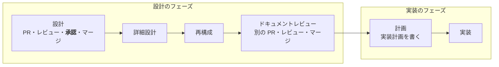
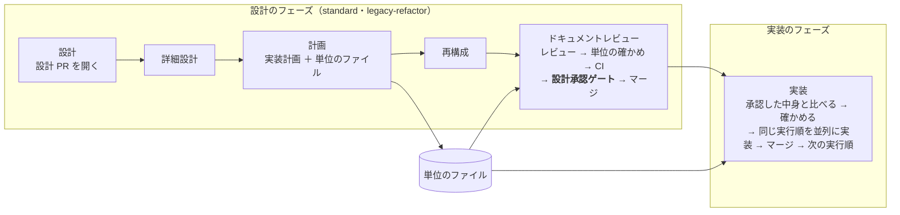
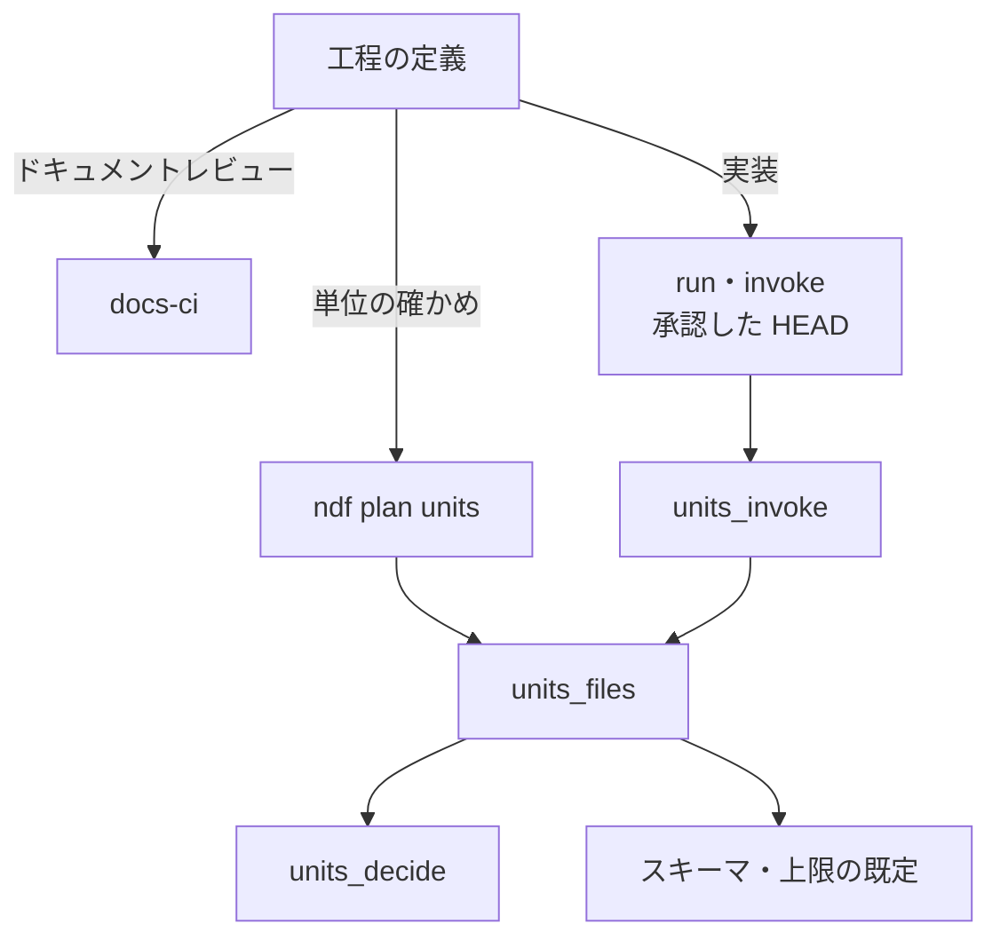
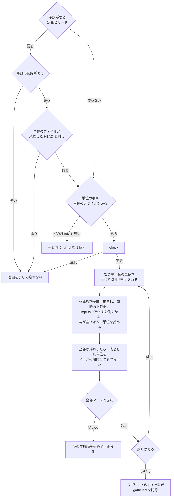

# PR の単位: 分け方・順序・並列を設計承認ゲートで見て、大きすぎる単位を機械で止める（#3702）

大きな課題の分け方・順序・並列は、設計の承認の後に決まり、大きさを確かめる仕組みも無い。実装計画を詳細設計の直後に書いて設計 PR に載せ、単位を機械が読むファイルでも出し、実行順をそこから決めて、上限を超える単位があれば、分け方の案を示して止める。
単位を順に流す部分は [#4369 の設計](https://github.com/devbasex/ai-plugins/pull/4546) を前提にし、この設計は並列と承認と大きさを足す。採らなかった案は決定ごとに、調査は末尾にある。

## 今の姿

何が起きたか・目的・受け入れ条件は要求仕様（[issue-3702-requirements.md](./issue-3702-requirements.md)、正は #3702 の本文）にある。この文書は「どう解くか」と「なぜその解き方か」だけを書く。



設計に要る今の構造は次のとおりである（パスは `plugins/ndf/` からの相対。2026-11-26、main `0e4b7db05` で確かめた）。

- **設計承認ゲートは工程「設計」の中にあり、詳細設計より前に来る。** 
  - `contracts/workflow/stages/design.json` のステップは、設計・レビュー・MVV 判定（プロジェクトの方針に沿うかの AI の判定）・ゲート・マージの順である
  - 詳細設計と再構成は同じ作業場所に書き、`document-review.json` が 2 本目の PR を出してマージする
  - 手順書のフェーズの表（`agent-layers.md`）はゲートをドキュメントレビューの後に置いていて、定義と食い違う
- **工程「計画」は実装のフェーズにある**（`stages/plan.json` の `phase: implement`）
- **ステップはモードごとに流す・流さないを指定できる**（`metadata.ndf.modes`）
- **マージは承認が見た HEAD とマージ先でだけ行う**（`ndf ci merge --approved-head --approved-base`。値は同じ工程の承認の回答から入る）
- **工程「実装」には 2 つの経路がある。** ここでいうプランは、手順をステップの列にした実行の定義で、実装計画とは別である
  - `ndf progress next` は工程の定義どおりに流す。実装のプランは工程 1 回につき 1 回呼び、単位には分けない
  - supervisor（工程を回す AI）が回すときは、`agent-layers.md` の手順に沿って AI が実装計画の表を読み、単位ごとのプランを組んで流し、マージする
- **どちらの経路にも、単位を読むコードと行数を数えるコードは無い。**
  - 単位の表を読み、単位を 1 つずつ流す処理は #4369 の設計にある（未実装）
  - #4369 の設計は、単位の並列と、承認した中身と同じかの確かめを #3702 に任せている
- **`design_gaps`（1 つの課題が 2 つ以上の PR に分かれていると止める関数）は、テストのほかに呼び出し元が無い**
  - `git grep -n design_gaps -- plugins/ndf/src` の結果は、定義と注記の 2 件である

## 文脈と制約

- 11.0.10 で入った部分（レビューの単位の欄・単位ごとの PR と cross-review・大きさの目安など）は作り直さない
- **#4369 の実装を前提にする。** 使うのは次の 2 つである
  - 単位の作業場所・実装のプラン・マージ・打ち直し・スプリントの PR を流す処理（`progress/units_invoke.py`）
  - 工程の指定 `per_unit`（単位ごとに流す指定）
- 承認ゲートは 2 つのまま増やさない
- 見込みの行数は実装の前の値で、git の差分からは数えられない。実装計画を書く担当の見積もりを読む
- 触るファイルは予測であり、制限ではない（要求の前提 5）。実装がほかのファイルを変えても失敗にしない
- 単位の実行の中断と、レビューの後に PR が外から変えられる場合の備えは [#4218](https://github.com/devbasex/ai-plugins/issues/4218) が扱う

## 解き方の全体像



- 設計 PR には要求・設計書・詳細設計書・実装計画が載り、承認する人は分け方・実行順・並列と直列の表を見て承認する
- 単位の SSOT は、実装計画と組の JSON ファイル（以下「単位のファイル」）にする。実装計画の 2 つの表はそこから作る
- 工程「実装」の 2 つの経路は、同じ `check`（承認した中身との照合を含む）の結果から単位を得る。図の「実装」の並びは `ndf progress next` の流し方で、supervisor は同じ結果からプランを組んで流す（決定 12）
- `ndf plan units check` が実行順を導き、400 行を超える単位に警告し、1,000 行を超える単位や組み方の誤りで止めて、分け方の案を返す
- 工程「実装」は、同じ実行順の単位を並列に流し、すべてマージしてから次の実行順へ進む
- こうする理由は、分け方の誤りを実装の前に人が直せるようにし、読み落とせる手順書の目安を機械の判定に置き換えるためである

## ドメインモデル

### コンテキスト

| コンテキスト | 何の語が 1 つの意味に決まるか |
| --- | --- |
| NDF のブランチ戦略 | レビューの単位・単位の PR・実行順・単位のファイル |
| NDF の設計 | 設計の結果・触るファイル |

関係: 単位のファイルは公表された言語である。NDF の設計が書き、工程「実装」が同じ形のまま読む。設計の結果の表は変えない。

### 集約

| 集約 | オーナー（書き換えてよいもの） | 根 | エンティティ | 値オブジェクト |
| --- | --- | --- | --- | --- |
| 単位の分け方 | 工程「計画」（承認の後は読むだけ。例外は実際の行数の追記） | 単位のファイル | タスク・レビューの単位 | 依存と理由・見込みの行数・触るファイル |
| 単位の実行 | 工程「実装」 | 単位の PR | — | 単位のブランチ・レビューした HEAD |

### 不変条件

| # | 集約 | 条件 | 破れたときの扱い |
| --- | --- | --- | --- |
| I1 | 単位の分け方 | タスクはちょうど 1 つの単位に入り、依存に輪が無い | 確かめが止める |
| I2 | 単位の分け方 | 先に要る単位には理由がある | 確かめが止める |
| I3 | 単位の分け方 | 同じ実行順の単位は、同じファイルを触る予定を持たない | 確かめが止める |
| I4 | 単位の分け方 | 見込みの行数が上限を超える単位が無い | 確かめが止めて案を返す |
| I5 | 単位の実行 | 流すのは、設計承認ゲートで承認した中身の分け方だけである。承認が要るのに承認の記録が無ければ流さない | 実装を始めずに止まる |
| I6 | 単位の実行 | 次の実行順は、前の実行順の単位をすべてマージした後に始める | 次を始めずに止まる |
| I7 | 単位の分け方 | 確かめ・CI・MVV 判定・承認資料・承認の回答は、設計 PR の同じ HEAD に対応する | 資料を出さず、回答を確定せず、ドキュメントレビューをやり直す |

### ドメインイベント

要求のドメインイベント E1〜E8 をそのまま使う。

| # | 発生元 | 受け手 |
| --- | --- | --- |
| E1・E2 | 工程「詳細設計」「計画」 | 単位のファイル |
| E3 | `ndf plan units check` | 書き手・承認する人・工程「実装」 |
| E4・E5 | 工程「ドキュメントレビュー」 | 工程「実装」（承認した HEAD） |
| E6〜E8 | 工程「実装」 | 単位の PR |

## 構成要素

パスは `plugins/ndf/` からの相対。

| 要素 | 責務 |
| --- | --- |
| 単位のファイルの形（`contracts/workflow/review-units.schema.json`。新設） | タスクと単位の形を決める |
| 単位の判定（`src/ndf/core/plan/units_decide.py`。新設） | 実行順・触るファイル・行数を導き、違反・警告・分け方の案を返す。ファイルも git も読まない |
| 単位の読み書き（`src/ndf/core/plan/units_files.py`。新設） | 単位のファイル・実装計画・上限の設定を読み、実装計画の表を作る。承認した HEAD との照合と、承認したファイルの取り込みを持つ |
| コマンド（`ndf plan units check`・`render`・`sync`。`core/plan/cli.py`） | 読み書きと判定を呼び、結果 JSON を返す |
| 単位を流す処理（`progress/units_invoke.py`。#4369 が作る） | 単位の並びを表からでなく単位のファイルから得る。承認した中身と比べ、同じ実行順を並列に流す |
| #4369 の、表を読むコード（`core/plan/review_units_decide.py`） | 削除する。同じ事実を読むコードを 2 つにしないため |
| 工程の定義（`stages/design.json`・`document-review.json`） | `standard`・`legacy-refactor` のマージ・MVV 判定・ゲートを、設計からドキュメントレビューへ移す |
| 工程「計画」の定義（`stages/plan-design.json`。新設） | `phase: design` の「計画」。`standard`・`legacy-refactor` の工程表が、詳細設計と再構成の間で呼ぶ |
| CI を待つテンプレート（`contracts/templates/docs-ci.json`。新設） | 承認の前に、設計 PR の最後の HEAD の CI を待つ |
| 承認した HEAD の引き渡し（`progress/run.py`・`invoke.py`） | ドキュメントレビューの承認の回答が見た HEAD を、工程「実装」へ渡す |
| 承認の記録と HEAD の照合（`progress/gate/asking.py`・`answering.py`） | 承認資料を出す時点と回答を確定する時点で、記録の HEAD と設計 PR の HEAD を比べる |
| 承認したファイルの取り込み（工程「ドキュメントレビュー」の最後のステップ `design-sync`。`ndf plan units sync`） | 設計 PR の宛先がベースブランチ（`branch_strategy.sprint.doc_prs: base`）のとき、承認した HEAD の単位のファイル・実装計画・設計文書をスプリントブランチへ取り込む |
| 上限の既定（`contracts/limits/review-units.target-lines.json`・`review-units.max-lines.json`。新設） | 400 と 1,000 |
| 手順書と worker の定義 | 単位のファイルの書き方、工程の並び、supervisor が単位を読む手順を書き直す |

呼び出しの向きは次のとおりである。矢印は呼ぶ側から呼ばれる側へ向く。



工程「計画」の定義と手順書は、呼び出しを持たないので図に描かない。表を読むコードは削除するので描かない。

## データ構造

単位のファイルは `issues/issue-<番号の並び>-plan.units.json` に置く。番号の並びは組になる実装計画と同じである。値は例である。

```json
{
  "version": 1,
  "issues": [3672],
  "tasks": [
    {"id": "T1", "title": "ブランチ戦略の既定の表を置く", "files": ["plugins/ndf/contracts/domains/branch-strategy-presets.json"], "lines": 320, "criteria": ["3672:2"], "after": []},
    {"id": "T2", "title": "設定を読む部品を作る", "files": ["plugins/ndf/src/ndf/core/branch_strategy.py"], "lines": 380, "criteria": ["3672:1"], "after": ["T1"]}
  ],
  "units": [
    {"name": "コントラクト", "tasks": ["T1"], "after": []},
    {"name": "読む部品", "tasks": ["T2"], "after": [{"unit": "コントラクト", "reason": "読む部品が既定の表を読む"}]}
  ]
}
```

| 値 | 持つ所 | 導く値（ファイルに書かない） |
| --- | --- | --- |
| タスクの題・触るファイル・見込みの行数・満たす受け入れ条件・先に要るタスク | `tasks[]` | 単位の触るファイル・行数・受け入れ条件（どれもタスクの和） |
| 単位の含むタスク・先に要る単位と理由 | `units[]` | 実行順・マージの順 |
| 実際の行数（任意） | `units[].actual_lines`（今の欄と同じく、実装の後に書き足す） | — |

- タスクの `id` は `T` と、実装計画の「タスク分解」の番号をつないだ文字列である（`Task 2` は `T2`）。`tasks[].after` と `units[].tasks` もこの文字列で指す
- `title`（タスクの題）は必須である。`issues` が 2 つ以上のファイルでは、どの課題のタスクかを `issue` で書く
- `criteria` は `<課題の番号>:<受け入れ条件の番号>` の文字列の配列である。`3672:2` は課題 #3672 の本文の「受け入れ条件」の 2 番を指す。範囲の指定は使わず、1 件ずつ書く。条件の無いタスクは空の配列にする
- 別の単位のファイルの単位が先に要るときは、`after` に `issue`（そのファイルの課題の番号）を足す
- どのタスクにも条件の無い単位は、#4369 の決定 9 の `--no-criteria` で流す
- 触るファイルは具体的なパスで書き、ディレクトリは書かない
- プレリファクタリングの単位を先に流すときは、後の単位の `after` に理由つきで書く

## 入出力のコントラクト

### コマンド

| コマンド | 入力 | 結果 JSON |
| --- | --- | --- |
| `ndf plan units check [--issue N]... [--omitted N]... [<ファイル>...] [--docs]` | スプリントの課題の単位のファイルを 1 つのグラフにして確かめる。`--omitted` は実装計画を省いた課題である。`--docs` は承認の前の確かめで、実装計画の表とタスクの番号も突き合わせ、下の「欠落の確かめ」をする | 下の表のとおり |
| `ndf plan units check ... --for-implement (--approved-head <SHA> \| --no-approval)` | 実装を始めるときの確かめ。承認した HEAD の単位のファイルと比べてから確かめる。`--approved-head` と `--no-approval` のどちらも無ければ止める | 同上。承認した中身と違えば `stopped` |
| `ndf plan units render [--issue N]...` | 同上 | 実装計画の「レビューの単位」と「並列と直列」の表を書き直す |
| `ndf plan units sync --approved-head <SHA> [--issue N]...` | 承認した HEAD の単位のファイル・実装計画・設計文書を、今の作業場所のブランチへ取り込んで push する | 取り込んだ内容が承認した HEAD と違えば、push せずに `stopped` |

**欠落の確かめ（`--docs`）**: `--issue` で渡した課題を 1 件ずつ見る。工程は入力の `issues` と、工程「計画」が出す `plan_omitted`（実装計画を省いた課題の番号）を渡す。

| 課題の状態 | 扱い |
| --- | --- |
| 設計の結果の扱いが「マージする」か「閉じる」 | 単位を持たない |
| `--omitted` にある | 課題全体を 1 つの単位にする。承認資料に「実装計画を省いた課題（行数は確かめていない）」として載せる |
| 上のどちらでもなく、単位のファイルがある | 確かめる |
| 上のどちらでもなく、単位のファイルが無い | `stopped`（`invalid`）。1 件の欠落でも、全件の欠落でも承認へ進まない |

`check` の結果 JSON は次の形である。

| 場合 | 結果 JSON の中身 |
| --- | --- |
| 通る（`ok`） | `items` に単位ごとの `kind: unit`（`name`・`file`・`order`・`merge`・`after`・`criteria`・`lines`・`touches`） |
| 目安の超過 | `warnings` に入れる |
| 違反 | `stopped`（`invalid`）で `kind: violation`（`rule`・`unit`・`reason`） |
| 行数の超過（目安と上限のどちらも） | `kind: split`（分け方の案）を添える |

`--issue` は番号で単位のファイルを探す。引数でファイルを直に指すこともできる。単位に関して公開するコマンドは上の表のものだけで、単位を手で流すコマンドは作らない（決定 12）。引数の細部は詳細設計で決める。

### 実装計画の表

| 表 | 列 |
| --- | --- |
| レビューの単位 | 単位・含むタスク・満たす受け入れ条件・見込みの差分の行数・実行順・先に要る単位・マージの順・実際の行数 |
| 並列と直列 | 実行順ごとの並列の単位（理由は「依存が無く、触るファイルが重ならない」）と、直列に残す依存ごとの理由 |

### 設定

`.ndf/project.json`:

```json
{"workflow": {"review_units": {"target_lines": 400, "max_lines": 1000}}}
```

片方だけ書けば、もう片方は既定を使う。`target_lines` が `max_lines` 以上なら設定の誤りとして止まる。

## 処理の流れ

### 設計のフェーズ（`standard`・`legacy-refactor`）

| 工程 | することの順 |
| --- | --- |
| 設計 | 設計書を書き、設計 PR を開き、設計をレビューする。マージしない |
| 詳細設計・計画・再構成 | 同じブランチに書き足して push する。計画の担当は実装計画と単位のファイルを書き、`render` と `check` を打つ |
| ドキュメントレビュー | 設計 PR の cross-review → `check --docs` → CI → MVV 判定 → 設計承認ゲート → 承認した HEAD をマージ |

- 承認資料には、`check` の `items` と `warnings` から作る単位の表を載せる
- 承認ゲートの入力は、設計 PR の 1 つの HEAD に固定する
  - レビューの後の HEAD に、`check --docs`・CI・MVV 判定・承認資料を当てる
  - ゲートの記録（`design-target.json`）に、その HEAD と、読んだ単位のファイル・実装計画・設計文書の内容のハッシュを持つ
  - 資料を出す時点と回答を確定する時点で、設計 PR の HEAD と記録を比べる。違えば資料を出さず、回答を確定せず、工程「ドキュメントレビュー」を初めから流し直す
- `doc_prs: base` のプロジェクトは、承認した HEAD のマージ先がベースブランチになる。マージの後に `design-sync` が承認したファイルをスプリントブランチへ取り込み、承認した HEAD の内容と一致したときだけ工程「実装」へ進む
- 承認で変更を求められたら、工程「ドキュメントレビュー」を初めから流し直す。求められた変更は cross-review の修正の対象に加える。直した後の `check` が大きさを数え直す（要求の前提 6）
- `documentation` は今の 2 本の PR のまま、`light`・`operation` は今の工程「設計」のままである

### 工程「実装」



- 図の「承認が要る」は、スプリントが保存した工程の定義で、工程「ドキュメントレビュー」の設計承認ゲートがそのモードに流れることをいう。`documentation` の設計承認ゲートは工程「設計」にあり、実装計画より前なので、当たらない
- `gathered` は、すべての単位をスプリントブランチへ集めた時点の記録で、後のコードレビューの起点になる
- 単位ごとの作業場所・プラン・レビュー・マージ・打ち直し（止まった後の流し直し）は #4369 の処理をそのまま呼ぶ
- 単位の欄（実装計画の「レビューの単位」の欄）がある課題と無い課題が混ざるときは、欄の無い課題は、課題全体を 1 つの単位にする。この単位は触るファイルが分からないので、単位のファイルの単位が済んだ後に、課題の番号の順に 1 つずつ流す
- 実装計画に単位の欄があるのに単位のファイルが無いときは、始めずに止まる

## 決定の記録

### 決定 1: 分け方を承認の前に見せるため、工程「計画」を設計のフェーズへ移し、設計承認ゲートをドキュメントレビューの終わりへ移す

- **質問**: 実装計画を設計 PR に載せ、承認の前に書かせるには、工程をどう変えるか（要求の未決の「計画を読む側にするか外すか」）
- **選んだ案**: `standard`・`legacy-refactor` の「計画」を、設計のフェーズで実装計画を書く工程にし、詳細設計の後へ移す
  - 設計の工程が開いた PR を開いたまま、後の工程が書き足す
  - ドキュメントレビューの終わりで 1 回だけ承認してマージする。2 本目の PR はやめる
  - ほかのモードとの違いは、ステップのモードの指定で表す
  - 工程の定義の新設は、`phase` が違う「計画」の 1 つだけである
- 採らなかった案: モードごとに工程の定義を分ける（設計・詳細設計・再構成・レビューの定義が 2 通りになり、同じ手順の直しを 2 か所へ入れることになる）
- 採らなかった案: ゲートを工程「設計」に残し、設計の中で詳細設計と実装計画も書く（後の工程が空で流れる）
- 採らなかった案: 「計画」を実装のフェーズに残して読む側にする（読むのは工程「実装」で足り、中身の無い工程になる）
- **代償**: 承認する人とレビュー担当が 1 本の PR で読む量が増える
- 根拠: Value 1 / Value 11（MVV バージョン 11）

### 決定 2: 同じ流す仕組みを 2 回作らないため、#4369 の単位の流れの上に並列・承認した中身の確かめ・大きさの確かめを足す

- **質問**: 単位を流す処理を何の上に作るか（要求の未決の「工程を順に流す仕組みを前提にするか」）
- **選んだ案**: `ndf progress next` の工程「実装」に #4369 が足す処理を前提にし、#3702 の実装は #4369 の実装のマージの後に始める
- 採らなかった案: #3702 で流す処理も作る（#4369 と同じファイルに同じ仕組みを 2 回作る）
- 採らなかった案: supervisor がプランを組む手順の上にだけ足す（並列と承認の確かめを手順書で守らせることになり、読み落とせる）
- **代償**: #4369 の実装が入るまで着手できない
- 根拠: Value 3 / Value 11（MVV バージョン 11）

### 決定 3: 単位の SSOT を 1 つにするため、実装計画と組の JSON ファイルを SSOT にし、設計の結果の表は課題ごとのまま残す

- **質問**: 機械が読む形をどこに置くか（要求の未決の「設計の結果の表を広げるか」）
- **選んだ案**: 単位のファイルを SSOT にし、実装計画の 2 つの表は `render` が作る。#4369 の、表を読むコードは消す。設計の結果の表は変えない。1 つの課題を複数の単位に分ける形と食い違う `design_gaps` は消す
- 採らなかった案: 実装計画の Markdown の表を SSOT にする（タスクごとの行数・依存・理由を持つと列が増え、書き崩しで読めなくなる）
- 採らなかった案: 設計の結果の表に単位の列を足す（課題 1 つが 1 行という読み手を作り直すことになる）
- 採らなかった案: 単位のファイルと表の両方を読む（同じ事実の読み手が 2 つになる）
- **代償**: 計画の担当は JSON を書く。この変更の前に表だけで書いた計画は、単位のファイルを足すまで流れない
- 作り方: 自前で作る
- 比べた候補: PRD3 / LIB3
- 根拠: Value 8 / Value 11（MVV バージョン 11）

### 決定 4: 順序の書き違いを無くすため、実行順とマージの順は書かずに依存から導く

- **質問**: 実行順とマージの順をファイルに書かせるか
- **選んだ案**: 書くのは先に要る単位と理由だけにする。実行順は要求の前提 1 の式で導く。マージの順は実行順、同じ実行順の中は課題の番号とファイルの並びの順とする。輪の検出は標準ライブラリの `graphlib` を使う
- 採らなかった案: 実行順を書かせて依存と突き合わせる（同じ事実を 2 か所に持つ）
- **代償**: 依存の無い順序の希望は、理由つきの依存として書く必要がある
- 作り方: ライブラリやサービスを使う
- 比べた候補: LIB1
- 根拠: Value 3 / Value 8（MVV バージョン 11）

### 決定 5: 作り直しと衝突を生む組み方を止めるため、確かめの規則を 6 つの停止と 1 つの警告にする

- **質問**: 何を違反として止めるか
- **選んだ案**: 次の表のとおりにする

  | 規則 | 当たる組み方 | 扱い |
  | --- | --- | --- |
  | U1 | 番号や名前が重なる。指した先が無い。タスクか単位の依存が輪になる | 止める |
  | U2 | タスクがちょうど 1 つの単位に入っていない。受け入れ条件の番号が課題の本文に無い | 止める |
  | U3 | タスクの依存を、単位の依存（間接を含む）が覆っていない | 止める |
  | U4 | 同じ実行順の単位が同じファイルを触る | 止める |
  | U5 | 単位の依存に理由が無い | 止める |
  | U6 | 見込みの行数が上限を超える | 止める |
  | W1 | 見込みの行数が目安を超える | 警告 |

- 採らなかった案: U4 を止めずに、実行のときに 1 つずつ流す（承認した並列の表と実際が食い違う）
- 採らなかった案: 設計の結果の表の触るファイルとの食い違いを警告する（触るファイルは予測で、受け入れ条件にも無い）
- 採らなかった案: 依存の向き（コントラクト → 読み手の付け替え → 削除）を機械で確かめる（ファイルの役割を機械は知らない）
- **代償**: 依存の向きの誤りは、承認する人と cross-review が見る
- 根拠: Value 1 / Value 9（MVV バージョン 11）

### 決定 6: 読み切れる大きさを保ちつつ機械的な大きい変更を通すため、400 行で警告し 1,000 行で止める

- **質問**: 上限を超えた単位で止めるか警告するか（要求の未決）。既定値はいくつか
- **選んだ案**: 400 行を超えると警告、1,000 行を超えると停止にする。どちらも分け方の案を返し、`.ndf/project.json` の設定が既定より先に効く
- 採らなかった案: 400 行で止める（一括の機械的な変更が通らず、毎回設定を書き換えることになる）
- 採らなかった案: 警告だけにする（#3698 は手順書の目安を読み落として 1 本になった。警告も読み落とせる）
- **代償**: 1,000 行を超える機械的な変更は、分けるか設定を上げるまで通らない
- 根拠: Value 1 / Value 2（MVV バージョン 11）。STD1 / STD2 / PRD1 と下の表

| 根拠 | 値 | 出所 |
| --- | --- | --- |
| #3698（#3672 の実装） | 319 ファイル・16,757 行。cross-refactoring 約 49 分、cross-review 2 時間以上、指摘の直しの間の CI の失敗 85 件 | `gh api repos/devbasex/ai-plugins/pulls/3698`（2026-11-26）と要求仕様 |
| #3247（#3092 の実装） | 246 ファイル・24,008 行。CI の失敗 70 件。マージせずに閉じた | `gh api repos/devbasex/ai-plugins/pulls/3247`（2026-11-26）と要求仕様 |
| 400 行以下のコードの PR（17 本） | cross-review のラウンドの中央値 3、指摘の中央値 3 | 下の注の集計 |
| 401〜1,000 行（26 本） | 同 5、13.5 | 同上 |
| 1,001〜3,000 行（24 本） | 同 6.5、20 | 同上 |
| 3,001 行以上（9 本） | 同 5、20 | 同上 |

注（集計の方法。2026-11-26 に実施）:

- 2026-11-15 以降にマージし、cross-review の記録のコメントを持つ PR を GitHub の検索で引いた。全 249 本のうち、先頭の 100 本を読んだ
- リリースと文書の PR を除いた 76 本について、記録の「ラウンド・指摘」の数を PR ごとに合計した
- 行数は追加と削除の和で、lock などを除いていない

400 行を超えると、指摘の中央値が 3 から 13.5 以上へ増える。3,001 行以上で指摘が増えないのは、ラウンドの上限で止まる影響の可能性がある（未確認）。

### 決定 7: 承認する人と実装が同じ判定を見るため、確かめを承認の前と実装の開始の両方で打つ

- **質問**: 大きさの確かめをいつ打つか（要求の未決）
- **選んだ案**: 工程「ドキュメントレビュー」のレビューが済んだ後と、工程「実装」が単位を読むときに、同じ判定を通す。書き手も書いた直後に打つ
- 採らなかった案: 承認の前だけ打つ（`operation`・`documentation` と、supervisor が回す経路で確かめが抜ける）
- 採らなかった案: 実装の開始だけで打つ（承認する人が結果を見られない）
- **代償**: 同じ判定を 2 回通る。判定はファイルを読むだけで軽い
- 根拠: Value 1 / Value 3（MVV バージョン 11）

### 決定 8: 案がいつも依存の順に沿うように、超えた単位のタスクを依存の順の直列の単位に区切る

- **質問**: 分け方の案を何から作るか
- **選んだ案**: 超えた単位のタスクを依存の順（同順はタスクの番号）に並べ、目安に収まるところで区切る
  - 前の区切りを、後の区切りの先に要る単位にする
  - 元の依存は最初の区切りが引き継ぐ。元の単位を指していた依存は、最後の区切りへ付け替える
  - 1 つのタスクで上限を超えるものは、切り直すタスクとして返す
  - 案を当てた後の判定で残る違反も添える
  - ファイルは書き換えない
- 採らなかった案: 重ならないタスクを並列の単位にまとめる案まで作る（付け替えと重なりの直しの規則が増え、案を作る側に誤りが入る）
- 採らなかった案: ディレクトリで割る（依存の途中で切れ、単位が単独でテストを通らない）
- **代償**: 案は直列になる。並列にできる所は書き手が直す
- 作り方: 自前で作る・ライブラリやサービスを使う
- 比べた候補: LIB1 / PRD2
- 根拠: Value 3 / Value 9（MVV バージョン 11）

### 決定 9: 空いた枠を遊ばせずに並列にするため、同じ実行順の単位を待ち行列にして、#4369 の単位 1 つの処理を同時に呼ぶ

- **質問**: 同じ実行順の単位をどう並列に流すか
- **選んだ案**: 工程「実装」の単位を流す処理（`units_invoke`）が起動を担う。標準ライブラリの `concurrent.futures` に同じ実行順の単位をすべて渡し、実装のプランを同時に流す
  - 同時の本数の上限は、マシンの同時実行の上限（`ndf.contracts.named_cap` が読む値）の 1 つだけである。レーンごとの上限は [#3989](https://github.com/devbasex/ai-plugins/issues/3989) で無くなった。承認の時点の本数は固定しない
  - 上限を超える単位は同じ実行順のまま待ち、枠が空いた順に始める。実行順の番号とマージの順は変えない（要求の前提 1）
  - 作業場所の用意とマージは 1 つずつ行う
  - 成否は単位ごとに判定する。1 つが失敗しても、同じ実行順の残りは始めて終わりまで流す。同じ実行順の単位は互いに依存しないためである
  - 成功した単位は、ほかの単位の失敗に関わらずマージする
  - 次の実行順は、前の実行順の単位がすべてマージされたときだけ始める（I6）
- 採らなかった案: 上限の本数ずつの組に区切り、組ごとに待つ（先に終わった単位の枠が、いちばん遅い単位を待って空いたままになる）
- 採らなかった案: プランのキュー（`ndf plan queue`）に渡す（単位ごとの環境変数と、打ち直しの開始ステップの選び方を、キューの側へ書き直すことになる）
- 採らなかった案: 1 つが失敗した時点で新しい単位を始めない（依存の無い単位の実装が、打ち直しまで遅れる）
- **代償**: 同じ実行順の単位は、互いの変更を含まない状態でテストとレビューを通る。組み合わせの不具合は、スプリントの PR の CI とコードレビューで見つける。利用上限のように全単位に効く失敗でも、残りの単位を 1 回ずつ始める
- 作り方: ライブラリやサービスを使う
- 比べた候補: LIB2 / LIB3
- 根拠: Value 5 / Value 12（MVV バージョン 11）

### 決定 10: 分けたはずの変更が 1 本にならないよう、単位を読めないときは止める

- **質問**: 単位のファイルが無い・読めない・依存が循環するときと、この変更より前のスプリントをどう扱うか（要求の未決）
- **選んだ案**: 実装計画に単位の欄があるのに単位のファイルが無いか読めない・違反があるときは、始めずに理由を返す。どの課題にも欄もファイルも無いときは今の流れにする。この変更より前に作ったスプリントは、保存した工程の定義の並びのまま流れ、単位のファイルを足せば実装に進める
- **この変更より前に実装計画を書いたスプリント**:
  - 単位のファイルは、AI（工程「計画」の担当）が実装計画の単位の表とタスク分解から作る。人は書かない
  - 機械だけでは移せない。表はタスクごとの触るファイルと見込みの行数を持たないためである
  - 実装計画を設計 PR で承認していた場合は、単位の名前・含むタスク・順を表のまま移す。確かめが違反を返すなどで変える必要があれば、変えた分け方を人に見せて再承認を取ってから流す
  - 実装計画を設計の承認の後に書いた場合は、人が承認した分け方が無いので、再承認は要らない
- 採らなかった案: 課題 1 つを 1 単位にして流す（#3698 と同じ 1 本の PR が気づかれずにできる。#4369 の決定 2 とも食い違う）
- **代償**: 途中のスプリントは、単位のファイルを書き足すまで止まる。表のまま移したかは、手順書とレビューで確かめる
- 根拠: Value 3 / Value 13（MVV バージョン 11）

### 決定 11: 承認していない分け方を流さないため、実装の開始で単位のファイルを承認した HEAD の中身と比べる

- **質問**: 承認の後に分け方が変わった場合をどう見つけるか
- **選んだ案**: `check --for-implement --approved-head <SHA>` が、スプリントの単位のファイルの並びと中身（実際の行数を除く）を、ドキュメントレビューの承認が見た HEAD のものと比べる。違えば始めない
  - 比べるのは、単位の欄やファイルがあるかを見るより先である。承認の時点にあった単位のファイルが、作業場所から欄ごと消えても止まる。今までどおりの 1 回の実装へ進むのは、承認の時点にも単位のファイルが無かったときだけである
  - 承認の回答が無い場合は 2 つに分ける

    | 場合 | 扱い |
    | --- | --- |
    | 分け方を承認しないモード（`standard`・`legacy-refactor` 以外）と、古い定義のスプリント | 比べない（`--no-approval`） |
    | 承認が要る定義とモードなのに、承認の記録を取れない | 実装を始めない。承認の記録を戻すか、工程「ドキュメントレビュー」を流し直して承認を取り直す |
- 採らなかった案: 承認の記録に、読んだ全文書の指紋を持たせる（設計書の直しでも実装が止まる。守る対象は分け方である）
- 採らなかった案: 比べない（設計の承認の後の変更が、人の目を通らずに実装される）
- **代償**: 承認の後に分け方を直すには、承認を取り直す
- **実装の途中の分け直し**: この変更では扱わない（要求の対象外）。承認の後の単位のファイルは、実際の行数の追記を除いて書き換えない。実装の途中で範囲が広がった分は、別の課題にする。`implementation-plan` の手順書の「実装の途中で単位を分け直す」も、この形に書き直す
- 根拠: Value 1 / Value 13（MVV バージョン 11）

### 決定 12: 承認していない分け方がどちらの経路でも流れないように、supervisor も同じ確かめのコマンドの結果から単位を組む

- **質問**: supervisor が回す経路をどうするか
- **選んだ案**: 承認した HEAD との照合と単位の確かめは、`ndf plan units check --for-implement` の 1 か所に置く。`units_invoke` は同じ関数を呼び、supervisor はこのコマンドを打つ
  - `agent-layers.md` の手順を、`check` が `ok` で返した `items` の順と引数で実装のプランを組む形に書き直す。`stopped` なら `items` が無いので、プランは組めない
  - 承認した HEAD は、設計 PR のマージに使った承認の回答の HEAD を渡す
  - `doc_prs: base` では、どちらの経路も先に `ndf plan units sync` で取り込む
  - 実行計画（スプリントの作業の順と進み具合の予定表）の実装の行も、同じ `items` から置く
  - 単位を手で流すコマンドは作らない。supervisor は今のコマンド（プランの組み立て・`ndf plan queue`・`ndf ci merge`）で流し、同時の本数と、次の実行順へ進む条件は決定 9 と同じにする
- 採らなかった案: 単位を手で流すコマンドを足す（`ndf progress next` の経路と同じことをするコマンドが 2 つになる）
- 採らなかった案: 照合を `units_invoke` の中だけに置く（supervisor の経路が、承認の後に変わった分け方の抜け道になる）
- **代償**: supervisor の経路では、確かめのコマンドを打つことと、渡す承認の HEAD の正しさは手順書の指示にとどまる
- 根拠: Value 3 / Value 15（MVV バージョン 11）

## 影響と危険

- **働く範囲**: 利用先のリポジトリでも働く
- **プロジェクトごとに違うもの**: 大きさの目安と上限を `.ndf/project.json` の `workflow.review_units` で受ける
- **当たるモード**: 工程の並びが変わるのは `standard`・`legacy-refactor`。単位のファイルと確かめは、実装計画に単位を書くすべてのモードに当たる
- **壊れうる箇所**:
  - 工程「設計」の出力から `standard`・`legacy-refactor` の `mvv_gate` が無くなり、ドキュメントレビューが持つ。出力を読む側とテストを同じ単位で直す
  - 手順や変更の中には、工程「設計」の終わりに設計 PR がマージ済みだと仮定するものがある。これらは、ドキュメントレビューの後を前提にするように直す。[#4295](https://github.com/devbasex/ai-plugins/issues/4295) の設計は、触る範囲の置き換えをドキュメントレビューの後に置いていて合う
  - 見込みの行数が外れても、この仕組みは実際の行数で止めない。実装の途中の分け直しは扱わない（決定 11）
- **同じファイルを触る変更**（後からマージする側が合わせる）:
  - #4369 の実装: 決定 2 のとおり先に入れる
  - [テンプレートの書き直し（PR #4548）](https://github.com/devbasex/ai-plugins/pull/4548): 実装計画のテンプレートのファイルが変わる。単位の理由の行は、単位のファイルの理由と重ならないように合わせる
  - [フェーズの分け直し（#4050）](https://github.com/devbasex/ai-plugins/issues/4050): 工程の定義の `phase` と工程表を両方が触る。新しい「計画」の `phase: design` は #4050 の区分にも含まれる

### 代表のリポジトリでの振る舞い

| 代表のリポジトリ | 設定の要点 | 直した後に起きること | この種類で扱えなくなること |
| --- | --- | --- | --- |
| Web サービス | `standard` で設計 PR。実装は単位の PR | 承認資料に単位の表が出て、同じ実行順の単位が並列に流れる | 無し |
| モバイルアプリ | 生成のファイルが多い | 見込みは生成のファイルを除いて書く。大きい一括の変更は設定で上限を上げられる | 無し |
| 業務文書だけ | `documentation`。計画は執筆の分担のときだけ | 工程の並びは変わらない。単位を書けば同じ確かめが当たる | 無し |

### ai-plugins だけの事情

- 無し（400・1,000 は 11.0.10 で入った製品の目安で、このリポジトリの運用の値ではない）

## 用語

| 用語 | 意味 | 用語集への反映 |
| --- | --- | --- |
| 単位のファイル | 実装計画と組の JSON ファイル。タスクとレビューの単位の SSOT | 追加 |
| 実行順 | レビューの単位を始める順の番号。先に要る単位の実行順の最大に 1 を足した値で、同じ値の単位は並列に流せる | 追加 |
| 分け方の案 | 大きさの目安や上限を超えた単位を、依存の順に区切り直した案 | 追加 |

## テスト設計

| 受け入れ条件・不変条件 | どの振る舞いで縛るか | どう壊したら落ちるべきか |
| --- | --- | --- |
| 1 | `standard`・`legacy-refactor` で「計画」が詳細設計の後・再構成の前にあり、設計承認ゲートがドキュメントレビューに 1 つだけある。マージは承認した HEAD で行う。ほかのモードの流れるステップは変わらない | ゲートを設計に残す・2 つにする・承認の前にマージする・ほかのモードの並びを変えると落ちる |
| 2・I2 | `render` が実行順・先に要る単位・マージの順と、並列と直列の理由を書く。理由の無い依存は止まる。`check --docs` は手で直した表を落とす | 理由が空でも通る・表の食い違いを見逃すと落ちる |
| 3 | `check` の結果が単位・実行順・触るファイル・受け入れ条件を持つ。工程「実装」は同じ実行順の単位を同時に流し、上限を超える分は枠が空いたら始め、全部マージしてから次を始める | 1 つずつ流す・組ごとに区切って空いた枠を埋めない・マージの前に次を始める・上限の本数を超えて同時に流すと落ちる |
| 4 | 単位の欄もファイルも無いスプリントは今と同じに流れ、欄の無い課題が混ざれば課題 1 つの 1 単位になる | 省いた課題で止まる・まとめると落ちる |
| 5・I4 | 上限を超える単位で停止し、目安を超える単位で警告し、案を返す。案は依存の順で、案の単位は上限を超えない（超えるタスクは切り直しとして返す） | 超えても通る・案が無い・案が依存に逆らうと落ちる |
| 6 | 設定が既定より先に効き、片方だけなら残りは既定。目安が上限以上なら止まる | 設定を読み捨てる・既定が 400 と 1,000 でないと落ちる |
| 7 | #3698 と #3247 の大きさの単位で停止し、400 行以下の単位では警告も案も出ない | 大きい単位が通る・小さい単位で警告が出ると落ちる |
| 8 | #3672 の詳細設計から作った単位のファイルを 1 単位にすると停止し、案が上限に収まる複数の単位になり、コントラクト → 読む部品と解析 → 読み手の付け替え → 削除とテストの移し替えの順になる | 案が 1 単位のまま・順が入れ替わると落ちる |
| I1・I3 | U1〜U4 の違反（別のファイルどうしの重なりを含む）で、それぞれの規則の番号を返す | 輪・重なり・覆われない依存を見逃すと落ちる |
| I5 | 承認の後に単位のファイルを足す・消す・変えると実装が始まらない（欄とファイルが共に消えた場合を含む）。承認が要るのに記録が無ければ始まらない。実際の行数だけの追記では始まる。`--for-implement` で承認の指定が無ければ止まる | 比べない・記録が無ければ比べずに流す・実際の行数で止めると落ちる |
| I7 | 設計 PR の HEAD が記録と違えば、資料を出さず、回答を確定しない | 古い HEAD の資料で承認が通ると落ちる |
| 欠落の確かめ | 省いていない課題の単位のファイルが 1 件でも無ければ、`check --docs` が止まる。省いた課題と「マージする」「閉じる」の課題では止まらない | 見つかったファイルだけを確かめると落ちる |
| `doc_prs: base` | `sync` の後、承認した内容と同じときだけ実装が始まる | 取り込まずに進む・違う内容を push すると落ちる |
| I6 | 同じ実行順の 1 つが失敗しても残りは流し、成功した単位はマージし、次の実行順を始めない。打ち直しはマージ済みを飛ばす | 次を始める・成功した単位を捨てると落ちる |
| 決定 1 | 承認の変更要求の指摘が修正の対象に渡り、直した後に `check` が再び流れる | 指摘を捨てる・確かめを飛ばすと落ちる |
| 決定 10 | 欄があるのにファイルが無い・読めないスプリントは始まらない | 1 単位にまとめると落ちる |

## 設計の結果

詳細設計は別ファイル: [issue-3702-design-detail.md](./issue-3702-design-detail.md)（新設する関数が 2 つ以上あるため）

今の詳細設計と、実装計画（[issue-3702-plan.md](./issue-3702-plan.md) と単位のファイル）は、この書き直しより前の設計に沿っている。食い違う所はこの設計書が正である。工程「詳細設計」と「計画」で書き直すまで、実装の根拠にしない。

| 課題 | 扱い | 統合先 | 触るファイル |
| --- | --- | --- | --- |
| #3702 | 実装する | — | `plugins/ndf/contracts/workflow/review-units.schema.json`（新設）、`plugins/ndf/contracts/limits/review-units.target-lines.json`（新設）、`plugins/ndf/contracts/limits/review-units.max-lines.json`（新設）、`plugins/ndf/contracts/schemas/project-workflow.schema.json`、`plugins/ndf/contracts/schemas/ndf-settings/project.schema.json`、`plugins/ndf/src/ndf/core/plan/units_decide.py`（新設）、`plugins/ndf/src/ndf/core/plan/units_files.py`（新設）、`plugins/ndf/src/ndf/core/plan/cli.py`、`plugins/ndf/src/ndf/core/plan/review_units_decide.py`（削除）、`plugins/ndf/src/ndf/core/plan/inputs_decide.py`、`plugins/ndf/src/ndf/progress/units_invoke.py`、`plugins/ndf/src/ndf/progress/invoke.py`、`plugins/ndf/src/ndf/progress/run.py`、`plugins/ndf/src/ndf/progress/gate/asking.py`、`plugins/ndf/src/ndf/progress/gate/answering.py`、`plugins/ndf/contracts/workflow/stages/implement.json`、`plugins/ndf/contracts/workflow/stages/design.json`、`plugins/ndf/contracts/workflow/stages/document-review.json`、`plugins/ndf/contracts/workflow/stages/plan-design.json`（新設）、`plugins/ndf/contracts/workflow/modes/standard.json`、`plugins/ndf/contracts/workflow/modes/legacy-refactor.json`、`plugins/ndf/contracts/workflow/context.schema.json`、`plugins/ndf/contracts/templates/docs-ci.json`（新設）、`plugins/ndf/contracts/worker/kinds.json`、`plugins/ndf/docs/contracts/commands.md`、`plugins/ndf/skills/implementation-plan/SKILL.md`、`plugins/ndf/skills/design/SKILL.md`、`plugins/ndf/skills/requirements-design/references/document-roles.md`、`plugins/ndf/skills/development-workflow/SKILL.md`、`plugins/ndf/skills/development-workflow/references/agent-layers.md`、`plugins/ndf/skills/development-workflow/references/approval-request.md`、`plugins/ndf/skills/development-workflow/references/stage-notes.md`、`plugins/ndf/skills/issue-plan-strategy/references/execution-plan.md`、`plugins/ndf/tests/core/plan/test_units_decide.py`（新設）、`plugins/ndf/tests/core/plan/test_units_cli.py`（新設）、`plugins/ndf/tests/core/plan/fixtures/units/issue-3672.units.json`（新設）、`plugins/ndf/tests/core/plan/test_review_units.py`（削除）、`plugins/ndf/tests/core/plan/test_inputs.py`、`plugins/ndf/tests/progress/test_units_invoke.py`、`plugins/ndf/tests/progress/test_invoke.py`、`plugins/ndf/tests/progress/test_definition.py`、`plugins/ndf/tests/progress/test_sprint_templates.py` |

## 未確認のまま残ること

| 項目 | 内容 |
| --- | --- |
| #4369 の実装の形 | #4369 は未実装である。関数の分け方とファイル名は、詳細設計と実装の開始の時点で #4369 の実装に合わせる |
| 並列の実装の資源 | 同じ実行順で複数の実装・レビュー・CI を同時に流したときの時間と利用上限は、リリース後の実測で分かる |
| 承認の流れの通し | 設計 PR を開いたまま詳細設計・計画・再構成を書き足し、最後に承認してマージする流れは、定義とテストで確かめる。実際に最初から最後まで通るかは、リリース後テストで分かる |

## 外部の調査

| 種類 | 調べるか | 理由 |
| --- | --- | --- |
| 標準・仕様 | 調べる | 一度にレビューする差分の大きさの目安 |
| 主要な製品 | 調べる | PR の大きさの区分、分けた変更の積み方、AI の開発ツールの並列の表し方 |
| ライブラリとサービス | 調べる | 依存の並べ・輪の検出・同時実行 |

### 標準・仕様

| # | 標準・仕様 | 何を定めているか | 設計への反映 | 出典 |
| --- | --- | --- | --- | --- |
| STD1 | Google Engineering Practices「Small CLs」 | 100 行がふつう妥当で、1,000 行はたいてい大きすぎる。先の変更の上に次を積み、コントラクトを先に入れる | 上限 1,000 と、依存の向きの既定 | https://google.github.io/eng-practices/review/developer/small-cls.html （2026-11-21） |
| STD2 | SmartBear「Best Practices for Code Review」 | 一度に読むのは 200〜400 行まで。60 分を超えると見つける率が落ちる | 目安 400 | https://smartbear.com/learn/code-review/best-practices-for-peer-code-review/ （2026-11-21） |

### 主要な製品

| # | 製品 | どう解いているか | 設計への反映 | 出典 |
| --- | --- | --- | --- | --- |
| PRD1 | Kubernetes Prow の size プラグイン | 追加と削除の和で区分し、1,000 以上が最大の区分。生成のファイルを数えず、閾値を設定で変えられる | 数え方・上限・設定 | https://github.com/kubernetes-sigs/prow/blob/main/pkg/plugins/size/size.go （2026-11-21） |
| PRD2 | Google の stacking | 先の変更を待たずに、次の変更をその上に積む | 分け方の案を依存の順の直列にする | STD1 と同じ（2026-11-21） |
| PRD3 | GitHub Spec Kit のタスクの生成 | タスクの一覧を依存の順に並べ、別のファイルで未完の依存が無いタスクに並列のマークを付ける。マークは Markdown に書く | 並列の条件（依存が無く、ファイルが重ならない）を同じにする。マークは書かせず、依存とファイルから導く | https://raw.githubusercontent.com/github/spec-kit/main/templates/commands/tasks.md （2026-11-26） |

### ライブラリとサービス

| # | 候補 | バージョン | ライセンス | 最後のリリースの日付 | 終了のアナウンス | 要件を満たすか | 出典 |
| --- | --- | --- | --- | --- | --- | --- | --- |
| LIB1 | Python 標準ライブラリ `graphlib.TopologicalSorter` | Python 3.14.4 で確かめた（NDF は 3.11 以上） | PSF | Python 本体と同じ | 無し | 満たす。依存の並べと、輪の並びを返す検出がある | `python3` で並べと `CycleError` を実行した（2026-11-26） |
| LIB2 | Python 標準ライブラリ `concurrent.futures.ThreadPoolExecutor` | 同上 | PSF | Python 本体と同じ | 無し | 満たす。本数を決めて同時に呼べる。待つ相手は子プロセスなのでスレッドで足りる | `python3` で実行した（2026-11-26） |
| LIB3 | NDF の `ndf plan queue`（このリポジトリにある仕組み） | main `0e4b7db05` | このリポジトリと同じ | 11.0.42 | 無し | 一部。前提と触るファイルで並べるが、単位ごとの環境変数と打ち直しの開始ステップの選び方を持たない | `plugins/ndf/src/ndf/core/plan/queue_decide.py`（2026-11-26） |

### 確かめられなかったこと

| 対象 | 試した手段 | 結果と理由 |
| --- | --- | --- |
| 単位の大きさごとの cross-review の時間 | 試していない | 記録のコメントから、時間は比べられる形で読んでいない。ラウンドと指摘の数で代えた |
| 残りの 149 本の PR の記録 | 試していない | 検索の 1 回分（100 本）だけを読んだ |

調べた量: 候補 8 件・取得の試み 4 回。
