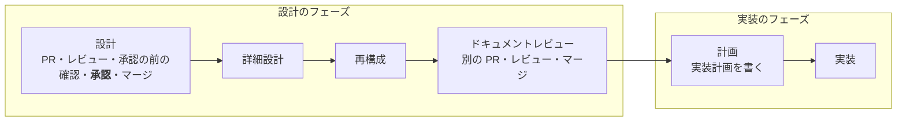
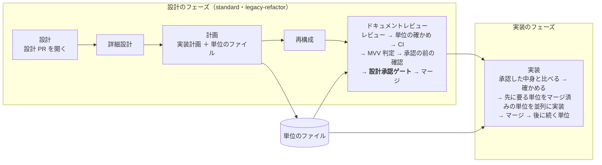
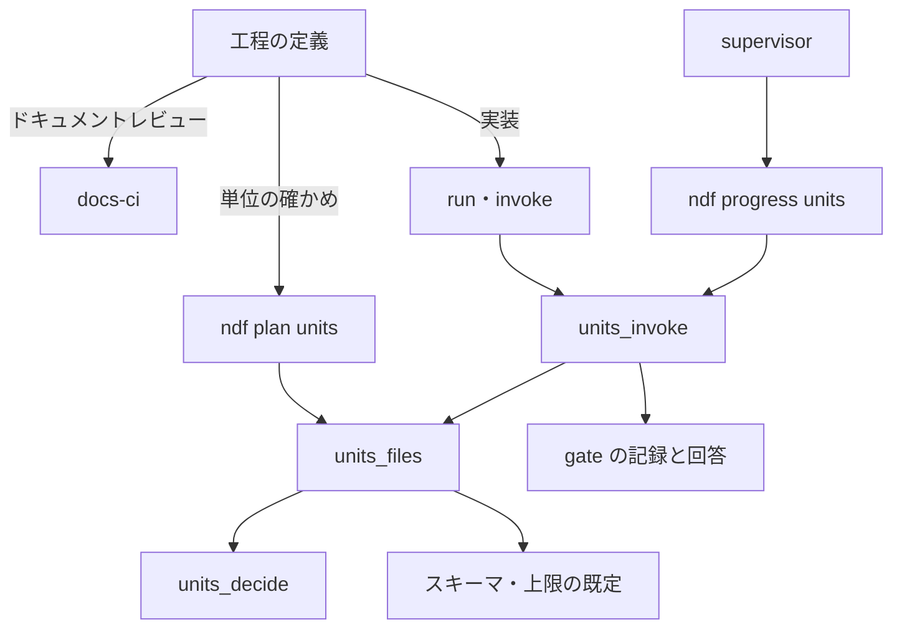
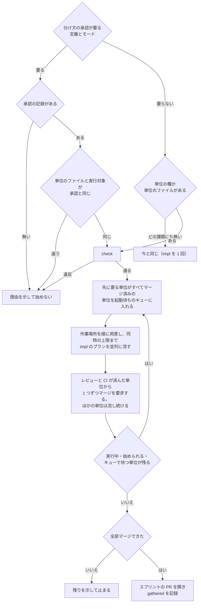

# PR の単位: 分け方・順序・並列を設計承認ゲートで見て、大きすぎる単位を機械で止める（#3702）

これまで、大きな課題の分け方・順序・並列は設計の承認の後に決まり、大きさを確かめる仕組みも無かった。この設計では、実装計画を詳細設計の直後に書いて設計 PR に載せ、単位（レビューの単位。1 本の PR として実装・レビュー・マージするタスクのまとまり）を機械が読むファイルでも出し、実行順をそこから決めて、上限を超える単位があれば、分け方の案を示して止める。
単位を順に流す部分は [#4369 の設計](https://github.com/devbasex/ai-plugins/pull/4546) を前提にし、この設計は、単位の並列、承認した中身の確かめ、大きさの確かめを足す。採らなかった案は決定ごとに、調査は末尾にある。

## 今の姿

何が起きたか・目的・受け入れ条件は要求仕様（[issue-3702-requirements.md](./issue-3702-requirements.md)、正は #3702 の本文）にある。この文書は「どう解くか」と「なぜその解き方か」だけを書く。



設計に要る今の構造は次のとおりである（パスは `plugins/ndf/` からの相対。2026-11-27、main `696cdc439` で確かめた）。

- **設計承認ゲートは工程「設計」の中にあり、詳細設計より前に来る。**
  - `contracts/workflow/stages/design.json` のステップは、設計・レビュー・MVV 判定・承認の前の確認・ゲート・マージの順である
    - MVV 判定は、プロジェクトの方針に沿うかの AI の判定である
    - 承認の前の確認は、読み手役の AI に承認資料と文書を読ませるステップである
  - そのため `ndf progress next` の自動のプランは、詳細設計の無い設計 PR で承認を求め、マージする（[#4420](https://github.com/devbasex/ai-plugins/issues/4420)）
  - 詳細設計と再構成（工程「ドキュメント再構成」）は同じ作業場所に書き、`document-review.json` が 2 本目の PR を出してマージする
  - 手順書のフェーズの表（`agent-layers.md`）はゲートをドキュメントレビューの後に置いていて、定義と食い違う
- **工程の終わりの確かめは、定義の `outputs` のキーがすべてあることを求める。** 工程「設計」の `outputs` は `design_pr` と `mvv_gate`（判定の結果）である
- **`ndf progress next` の経路では、設計 PR の head はスプリントブランチで、宛先はスプリントの PR の宛先（ベースブランチ）である。** 文書の PR の宛先を定める宣言 `doc_prs`（`.ndf/project.json` の `branch_strategy.sprint.doc_prs`。値は `base` と `sprint`）は読まない。
  - `doc_prs` を読むのは `Strategy.pr_target("doc")`（`core/branch_strategy.py`）で、`ndf progress next` の外（supervisor か人）で、スプリントブランチとは別のブランチから設計 PR を出すときの宛先である。2026-11-26 に `git grep pr_target -- plugins/ndf/src` を引くと、`"doc"` を渡す呼び手はコードに無かった
  - リリース方式の表（`contracts/domains/branch-flows.json`）では、既定の `merge_base_branch` が `base`、`trunk` と `release_branch` が `sprint` である
  - `base` のとき、設計 PR はベースブランチへマージされるので、スプリントブランチは承認した文書をまだ持たない。そのため、この経路でだけ、後の「取り込みの前の確かめ」の `sync` が取り込むものを持つ。`ndf progress next` の経路と `doc_prs: sprint` の経路では、スプリントブランチがすでに承認した文書を持ち、`sync` は確かめだけで終わる
- **工程「計画」は実装のフェーズにある**（`stages/plan.json` の `phase: implement`）
- **ステップはモードごとに流す・流さないを指定できる**（`metadata.ndf.modes`）
- **`ndf ci merge` は、承認した HEAD とマージ先を `--approved-head`・`--approved-base` で受け取り、開いた PR が違えばマージしない。** マージ済みの PR は照合せずに `ok` にする。この 2 つを渡すのはリリースのマージ（テンプレート `release`）だけで、設計 PR のマージ（テンプレート `design-merge`）は渡していない
- **工程「実装」には 2 つの経路がある。** ここでいうプランは、手順をステップの列にした実行の定義で、実装計画とは別である
  - `ndf progress next` は工程の定義どおりに流す。実装のプランは工程 1 回につき 1 回呼び、単位には分けない
  - supervisor（工程を回す AI）が回すときは、`agent-layers.md` の手順に沿って AI が実装計画の表を読み、単位ごとのプランを組んで流し、マージする
- **どちらの経路にも、単位を読むコードと行数を数えるコードは無い。**
  - 単位の表を読み、単位を 1 つずつ流す処理は #4369 の設計にある（未実装。詳細設計は [PR #4567](https://github.com/devbasex/ai-plugins/pull/4567) でレビュー中）
  - #4369 の設計は、単位の並列と、承認した中身と同じかの確かめを #3702 に任せている
- **`design_gaps`（1 つの課題が 2 つ以上の PR に分かれていると止める関数）は、テストのほかに呼び出し元が無い**
  - `git grep -n design_gaps -- plugins/ndf/src` の結果は、定義と注記の 2 件である

## 文脈と制約

- 11.0.10 で入った部分（レビューの単位の欄・単位ごとの PR と cross-review・大きさの目安など）は作り直さない
- **#4369 の実装を前提にする。** 使うのは次の 2 つである
  - 単位を流す処理（`progress/units_invoke.py`）。単位の作業場所の用意、実装のプランの実行、マージ、打ち直し、スプリントの PR の作成を行う
    - 打ち直しは、失敗か待ちで止まった実装を、コマンドをもう一度打って続きから進めることである
  - 工程の指定 `per_unit`（単位ごとに流す指定）
- 承認ゲートは 2 つのまま増やさない
- 見込みの行数は実装の前の値で、git の差分からは数えられない。実装計画を書く担当の見積もりを読む
- 触るファイルは予測であり、制限ではない（要求の前提 5）。実装がほかのファイルを変えても失敗にしない
- 単位の実行の中断と、レビューの後に PR が外から変えられる場合の備えは [#4218](https://github.com/devbasex/ai-plugins/issues/4218) が扱う

## 解き方の全体像



- 設計 PR には要求・設計書・詳細設計書・実装計画が載り、承認する人は分け方・実行順・並列と直列の表を見て承認する。詳細設計・再構成・レビューは設計 PR のマージの前に終わる（[#4420](https://github.com/devbasex/ai-plugins/issues/4420) の条件 1・2。決定 1）
- 単位の SSOT は、実装計画と対になる 1 つの JSON ファイル（以下「単位のファイル」）にする。実装計画の 2 つの表はそこから作る
- 工程「実装」の 2 つの経路は、同じ処理で単位を流す。`ndf progress next` はその処理を呼び、supervisor は同じ処理を `ndf progress units run` で呼ぶ。承認した中身との照合もこの処理の中にある（決定 12）
- `ndf plan units check` が実行順を導き、400 行を超える単位に警告し、1,000 行を超える単位や組み方の誤りで止めて、分け方の案を返す
- 工程「実装」は、依存で前後が決まらない単位を並列に流す。各単位は、先に要る単位をすべてマージしたら始める
- こうする理由は、分け方の誤りを実装の前に人が直せるようにし、読み落とせる手順書の目安を機械の判定に置き換えるためである

## ドメインモデル

### コンテキスト

| コンテキスト | 何の語が 1 つの意味に決まるか |
| --- | --- |
| NDF のブランチ戦略 | レビューの単位・単位の PR・実行順・単位のファイル |
| NDF の設計 | 設計の結果・触るファイル |

関係: 単位のファイルは、2 つのコンテキストが共有する、公開されたデータ形式（ドメイン駆動設計の Published Language）である。NDF の設計が書き、工程「実装」が同じ形のまま読む。設計の結果の表は変えない。

### 集約

| 集約 | オーナー（書き換えてよいもの） | 根 | エンティティ | 値オブジェクト |
| --- | --- | --- | --- | --- |
| 単位の分け方 | 工程「計画」（承認の後は読むだけ。例外は実際の行数の追記） | 単位のファイル | タスク・レビューの単位 | 依存と理由・見込みの行数・触るファイル |
| 単位の実行 | 工程「実装」 | 単位の PR | — | 単位のブランチ・レビューした HEAD |

### 不変条件

| # | 集約 | 条件 | 破れたときの扱い |
| --- | --- | --- | --- |
| I1 | 単位の分け方 | タスクはちょうど 1 つの単位に入り、依存に輪が無い | 確かめが止める |
| I2 | 単位の分け方 | 先に要る単位には理由がある | 確かめが止める |
| I3 | 単位の分け方 | 依存で前後が決まらない 2 つの単位は、同じファイルを触る予定を持たない | 確かめが止める |
| I4 | 単位の分け方 | 見込みの行数が上限を超える単位が無い | 確かめが止めて案を返す |
| I5 | 単位の実行 | 実装を始められるのは、設計承認ゲートで承認した分け方と実行対象だけである。実行対象の中身は表の下に示す。承認が要るのに承認の記録が無ければ流さない。手で組んだ実装のプランからも流さない | 実装を始めずに止まる |
| I6 | 単位の実行 | 単位は、先に要る単位をすべてマージした後に始める | その単位と後に続く単位を始めない |
| I7 | 単位の分け方 | 設計 PR の cross-review・確かめ・CI・MVV 判定・承認資料・承認の回答は、同じリポジトリ・設計 PR・HEAD・マージ先に対応する | 資料を出さず、回答を確定せず、ドキュメントレビューをやり直す |
| I8 | 単位の実行 | 承認した設計の文書をスプリントブランチへ送るのは、送り先のリポジトリがスプリントの状態とゲートの記録に一致し、送り先のブランチがゲートの記録のスプリントブランチと一致するときだけである。取得と送信の相手は、照合した URL そのものである。認証情報を含む URL は、取得にも送信にも使わない | 取り込みもコミットも push もせずに止まる |

I5 の実行対象は、次を指す。

- スプリントの課題
- 課題ごとの扱い。値は「実装する」「マージする」（他の課題へ統合する。PR のマージではない）「閉じる」（実装せずに閉じる）である
- 統合先
- 実装計画を省いた課題（実装はする）

### ドメインイベント

要求のドメインイベント E1〜E8 をそのまま使う。

| # | 出来事 | 発生元 | 受け手 |
| --- | --- | --- | --- |
| E1 | 詳細設計を書き終えた | 工程「詳細設計」 | 単位のファイル |
| E2 | 実装計画を、文書と単位のファイルで書いた | 工程「計画」 | 単位のファイル |
| E3 | 単位の見込みの行数を上限と比べた | `ndf plan units check` | 書き手・承認する人・工程「実装」 |
| E4 | 実装計画を設計 PR に載せた | 工程「ドキュメントレビュー」 | 工程「実装」（ゲートの記録と承認の回答） |
| E5 | 設計と実装計画を承認した | 工程「ドキュメントレビュー」 | 工程「実装」（ゲートの記録と承認の回答） |
| E6 | 単位ごとの実装の作業を実行順に並べた | 工程「実装」 | 単位の PR |
| E7 | ある単位をマージした | 工程「実装」 | 単位の PR |
| E8 | 先に要る単位がそろった単位を始めた | 工程「実装」 | 単位の PR |

## 構成要素

パスは `plugins/ndf/` からの相対。

| 要素 | 責務 |
| --- | --- |
| 単位のファイルの形（`contracts/workflow/review-units.schema.json`。新設） | タスクと単位の形を決める |
| 単位の判定（`src/ndf/core/plan/units_decide.py`。新設） | 実行順・触るファイル・行数を導き、違反・警告・分け方の案を返す。ファイルも git も読まない |
| 単位の読み書き（`src/ndf/core/plan/units_files.py`。新設） | 単位のファイル・実装計画・上限の設定を読み、実装計画の表を作る。指定したコミットとの照合と、そのコミットのファイルの取り込みを持つ |
| コマンド（`ndf plan units render`・`check`。`core/plan/cli.py`） | 読み書きと判定を呼び、結果 JSON を返す |
| 単位を流す処理（`progress/units_invoke.py`。#4369 が作る） | 単位の並びを表からでなく単位のファイルから得る。承認した中身と比べ、先に要る単位をすべてマージした単位を並列に流す。この変更より前のスプリントでは、単位のファイルへの変換を呼ぶ（決定 10）。マージキューの待ちは、状態を読んで後の単位を始める（決定 9） |
| 実装を流すコマンド（`ndf progress units run`・`sync`。`progress/units_cli.py` を新設し、`progress/command.py` に登録する） | supervisor の入口。`run` は工程「実装」と同じ関数を呼び、`sync` は承認したファイルを取り込む。承認の要否・承認の記録・実行対象は、スプリントの保存した状態から読む |
| 実装のプランの最初の確かめ（`contracts/templates/impl.json` のステップ。`ndf progress units guard`） | 分け方の承認が要るスプリントでは、単位を流す処理が起動した単位だけを通す。どの入口が組んだプランにも当たる |
| #4369 の、表を読むコード（`core/plan/review_units_decide.py`） | このコードを呼ぶのは、この変更より前に承認した表と変換した結果を照合する処理だけにする（決定 10）。単位を流す処理は表を読まない |
| 工程の定義（`stages/design.json`・`document-review.json`） | `standard`・`legacy-refactor` のマージ・MVV 判定・承認の前の確認・ゲートを、設計からドキュメントレビューへ移す |
| 工程の出力と判定の入力（`progress/definition.py`・`domains/records/{cli,mvv_gate}.py`） | MVV 判定のステップを流さないモードでは、その工程の出力から `mvv_gate` を外す。設計の MVV 判定の入力は、工程「設計」の形でも工程「ドキュメントレビュー」の形でも受ける。工程「ドキュメントレビュー」の判定は、レビューしたリポジトリの PR を対象にする |
| 設計 PR をレビューするテンプレート（`contracts/templates/design-pr-review.json`。新設） | cross-review を流し、レビューしたリポジトリ・PR・HEAD・マージ先を書き出させる |
| 工程「計画」の定義（`stages/plan-design.json`。新設） | `phase: design` の「計画」。`standard`・`legacy-refactor` の工程表が、詳細設計と再構成の間で呼ぶ |
| CI を待つテンプレート（`contracts/templates/docs-ci.json`。新設） | 承認の前に、設計 PR の最後の HEAD の CI を待つ |
| 承認した設計 PR をマージするテンプレート（`contracts/templates/design-merge-approved.json`。新設） | ゲートの記録の対象だけをマージする。マージ済みの場合も同じ対象かを確かめる |
| 承認の記録（`progress/design_record.py`。新設） | ゲートの記録を組み、今の PR と比べ、承認の回答に結ばれた記録を読む。承認の要否も返す |
| 承認ゲートとのつなぎ（`progress/gate/{entry,answering}.py`・`progress/{run,invoke}.py`） | 承認資料を出す時点と回答を確定する時点で記録と比べ、違えばステップを未了に戻す。承認の回答に記録を添える。MVV 判定が人の承認を省いて作った回答にも添える |
| 承認した文書の取り込み（`progress/units_sync.py`。新設。ステップ `design-sync` と `ndf progress units sync`） | 送り先のリポジトリとブランチがゲートの記録と一致することを確かめ、スプリントブランチがまだ持たない承認した文書を取り込んで push する |
| 送り先の URL の読み取り（`adapters/git.py`） | push の URL を読み、URL の全体を解析してリポジトリと認証情報の有無を返す。git がもう一度書き換える URL かも返す |
| 変換・キューの読み取り・確かめ（`progress/{units_convert,units_queue,units_guard}.py`。新設） | この変更より前の表の変換、キューで待つ単位の状態、実装のプランを通すかの判定 |
| 上限の既定（`contracts/limits/review-units.target-lines.json`・`review-units.max-lines.json`。新設） | 400 と 1,000 |
| 手順書と worker の定義 | 単位のファイルの書き方、工程の並びを書き直す。supervisor が単位ごとにプランを組む手順は、`ndf progress units run` を打つ手順に置き換える |

### 呼び出しの向き

呼び出しの向きは次のとおりである。矢印は呼ぶ側から呼ばれる側へ向く。



工程「計画」の定義と手順書は、呼び出しを持たないので図に描かない。表を読むコードは移行の照合だけが呼ぶので描かない。

## データ構造

単位のファイルは `issues/issue-<番号の並び>-plan.units.json` に置く。番号の並びは組になる実装計画と同じである。値は例である。

```json
{
  "version": 1,
  "issues": [3672],
  "tasks": [
    {"id": "T1", "title": "ブランチ戦略の既定の表を置く", "files": ["plugins/ndf/contracts/domains/branch-strategy-presets.json"], "lines": 320, "criteria": ["3672:2"], "after": []},
    {"id": "T2", "title": "設定を読む部品を作る", "files": ["plugins/ndf/src/ndf/core/branch_strategy.py"], "lines": 380, "criteria": ["3672:1"], "after": ["T1"]}
  ],
  "units": [
    {"name": "コントラクト", "tasks": ["T1"], "after": []},
    {"name": "読む部品", "tasks": ["T2"], "after": [{"unit": "コントラクト", "reason": "読む部品が既定の表を読む"}]}
  ]
}
```

| 値 | 持つ所 | 導く値（ファイルに書かない） |
| --- | --- | --- |
| タスクの題・触るファイル・見込みの行数・満たす受け入れ条件・先に要るタスク | `tasks[]` | 単位の触るファイル・行数・受け入れ条件（どれもタスクの和） |
| 単位の含むタスク・先に要る単位と理由 | `units[]` | 実行順・マージの順 |
| 実際の行数（任意） | `units[].actual_lines`（実装の後にここへ書き足し、`render` で表を作り直す） | — |

- タスクの `id` は `T` と、実装計画の「タスク分解」の番号をつないだ文字列である（`Task 2` は `T2`）。`tasks[].after` と `units[].tasks` もこの文字列で指す
- タスクと単位は、単位のファイルと組で識別する。タスクの `id` と単位の名前は、1 つのファイルの中で重ならなければよい。別のファイルに同じ `T1` や同じ名前があってよい
- 1 つの課題を 2 つの単位のファイルに載せない。課題の番号で、ファイルが 1 つに決まる
- `tasks[].after` と `units[].tasks` は、同じファイルの中だけを指す。ファイルをまたぐ依存は `units[].after` で書く
- 実装計画の表の「実際の行数」は、`units[].actual_lines` だけから作る。表の古い値は引き継がない。単位はファイルと単位の名前の組で引くので、別のファイルの同じ名前の単位の値は混ざらない
- 見込みの行数 `tasks[].lines` は必須である。行数の確かめを当てないのは、実装計画を省いた課題を 1 単位にしたものだけである。通常のタスクに行数が無ければ、形の誤りとして止まる
- `title`（タスクの題）は必須である。`issues` が 2 つ以上のファイルでは、どの課題のタスクかを `issue` で書く
- `criteria` は `<課題の番号>:<受け入れ条件の番号>` の文字列の配列である。`3672:2` は課題 #3672 の本文の「受け入れ条件」の 2 番を指す。範囲の指定は使わず、1 件ずつ書く。条件の無いタスクは空の配列にする
- 別の単位のファイルの単位が先に要るときは、`after` に `issue`（そのファイルに載る課題の番号のどれか）を足す
- 依存を評価する前に、参照元と参照先をどちらも「単位のファイルと単位の名前」の組へ解決する。`issue` は参照先のファイルを探すためだけに使う。1 つのファイルに複数の課題が載る場合、`issue` にそのどの課題の番号を書いても、単位の名前が同じなら同じ単位を指す
- この組を使うのは、次の 3 つである
  - 規則の確かめ（決定 5 の表）。U1 は番号や名前の重なり・指した先の欠落・依存の輪、U3 は単位の依存が覆わないタスクの依存、U4 は前後が決まらない単位の同じファイルである
  - 実行順の計算
  - 実装を始める判定
- どのタスクにも条件の無い単位は、受け入れ条件を突き合わせない指定（`ndf loop acceptance check --no-criteria`。#4369 の設計の決定 9）で流す
- 触るファイルは具体的なパスで書き、ディレクトリは書かない
- プレリファクタリングの単位を先に流すときは、後の単位の `after` に理由つきで書く

## 入出力のコントラクト

### コマンド

| コマンド | 入力 | 結果 JSON |
| --- | --- | --- |
| `ndf plan units check [--issue N]... [--omitted N]... [<ファイル>...] [--docs]` | スプリントの課題の単位のファイルを 1 つのグラフにして確かめる。`--omitted` は実装計画を省いた課題である。`--docs` は設計承認ゲートの前に打つ指定で、実装計画の 2 つの表とタスクの集合も突き合わせ、下の「欠落の確かめ」をする | 下の表のとおり |
| `ndf plan units render [--issue N]... [--omitted N]...` | `--issue` はスプリントの全課題、`--omitted` は計画の担当が実装計画を省くと決めた課題（工程の出力 `plan_omitted` と同じ値）。計画の担当が打つのはこのコマンドだけである | 全課題の単位のファイルを 1 つのグラフにして実行順を導き、読んだ単位のファイルと組の実装計画すべての「レビューの単位」と「並列と直列」の表を書き直す。省いた課題には何も書かない。続けて同じプロセスで、同じ入力の `check --docs` をして、その結果を返す |
| `ndf progress units run` | 実装を始める。スプリントは、ほかの `ndf progress` のコマンドと同じ指定で選ぶ。工程「実装」と同じ処理で、承認の照合・確かめ・単位の実行・打ち直しをする。始められるのは、`ndf progress next` が次に実装を流す状態のときだけで、工程の記録も `next` と同じに残す（下の「実装を始められる時点」）。承認した HEAD や、承認が要らないという指定は引数で受けない | `ndf progress next` で工程「実装」を流したときと同じ（成功・失敗・回答の待ち・作業が動いている）。開始の条件か承認の照合に落ちれば `stopped` |
| `ndf progress units sync` | 下の「取り込みの前の確かめ」の 3 つを確かめてから、ゲートの記録の HEAD の単位のファイル・実装計画・設計文書を、スプリントブランチへ取り込んで push する。工程「ドキュメントレビュー」の `design-sync` も同じ関数を通る | どれかを満たさなければ、取り込みも push もせずに `stopped`。スプリントブランチ側の変更と競合するときと、取り込んだ内容が記録の HEAD と違うときは、push せずに `stopped`（下の「取り込みの競合」） |
| `ndf progress units guard --issue <N> --base <ブランチ> --branch <ブランチ> --unit-file <ファイル>` | 実装のプランが最初に打つ（決定 12）。`--unit-file` は担当の指示のファイルで、指示の無い単位では空にする。人は打たない | 通せないプランなら `stopped` |

#### 実装を始められる時点

承認の回答があるだけでは、実装を始めない。回答の後にも、設計 PR のマージと承認した文書の取り込み（`design-sync`）が残るためである。

- `units run` は、工程「実装」だけを `ndf progress next` と同じ処理で流す。始める前の判定（保存した状態から次の 1 手を決める `run.decide`、工程の開始条件と入力の検査）も、流した後の記録（成功・失敗・回答の待ち）も同じである
- 次の 1 手の工程が「実装」で、手が工程の開始か続きのときだけ流す。工程「実装」が失敗して再試行の選択を待つ状態と、回答を待つ状態では流さない。`units run` 自身の実行で失敗や再承認の待ちになった後も同じである
- `ndf progress next` が起動した作業がまだ動き始めていないときも流さず、その作業を待つ結果を返す
- supervisor は工程「実装」を `units run` で流し終え、`ndf progress finish` は打たない
- 分け方の承認が要るスプリントでは、単位を流す処理が、承認した文書がスプリントブランチにあることも確かめる。ゲートの記録の HEAD か取り込みのコミットが、スプリントブランチの HEAD と同じか祖先なら通る。単位をマージしてブランチが進んだ後も、打ち直しは通る

#### 取り込みの前の確かめ

`sync` は次の 3 つを確かめる。

1. ゲートの記録に結ばれた回答が承認で、後の変更要求などで無効になっていない
2. 送り先のリポジトリとブランチが、ゲートの記録と一致する（下の「送り先の確かめ」）
3. 取り込むものがあるときは、設計 PR が記録の HEAD のまま、記録のマージ先へマージ済みである。そのマージ先は、下の「送り先の確かめ」の表の「設計 PR のマージ先」の条件に合う

スプリントブランチが記録の HEAD をすでに含むときは、取り込むものが無い。上の 1 と 2 を確かめた後、PR を読まずに `ok` を返す。

#### 送り先の確かめ

I8 を守る確かめである。取り込みの前に、次をすべて確かめる。違いがあれば、取り込みもコミットも push もせず、項目ごとの記録の値と今の値を返して止まる。承認した文書を、別のリポジトリや別のブランチへ送らないためである。

| 確かめるもの | 合う条件 |
| --- | --- |
| 送り先のリポジトリ | リモートの push の URL が 1 つだけで、その URL とスプリントの状態が持つリポジトリが、ゲートの記録のリポジトリと同じ（下の「送り先の URL」） |
| 送り先のブランチ | ゲートの記録のスプリントブランチが、スプリントの状態のブランチと作業場所が今いるブランチの両方と同じで、配布先として宣言したブランチでない（下の説明） |
| 設計 PR のマージ先 | 宣言 `doc_prs` が定める宛先。設計 PR の head がスプリントブランチ自身の経路（`ndf progress next`）では、スプリントの PR の宛先 |

配布先として宣言したブランチは、`.ndf/project.json` の `branch_strategy` の次のキーに指定したブランチである。これらを送り先から外す。QA やステージングを別のブランチで配布するプロジェクトも外れる（定義は [#4369 の設計の開始前の確かめ](./issue-4369-design.md)）。

- `branches.base`
- `branches.production`
- `channels[].ref`
- `release.deliveries[].branch`

ゲートの記録のスプリントブランチは、承認の時点でスプリントの状態が持っていたブランチである。記録のマージ先（`review.base`）は設計 PR の宛先で、`doc_prs: base` ではベースブランチになるため、取り込み先はここから分からない。スプリントの状態のブランチと作業場所が、そろって承認の後に別のブランチへ変わっても、そのブランチへは送らない。

push するときは、照合した URL を相手にし、ゲートの記録のスプリントブランチを ref で指定する。`ndf progress next` の経路では、スプリントブランチが承認した HEAD をすでに持つので、取り込むものは無い。

##### 送り先の URL

取り込み（`sync`）と変換の反映は、最初の通信の前に push の URL を 1 回読み、次の条件をすべて確かめる。通った URL の文字列を、そのまま `git fetch` と `git push` に渡す。リモート名では送らない。照合の後に設定を読み直すと、照合していない相手へ送れるためである。

| 条件 | 理由 |
| --- | --- |
| push の URL が 1 つだけである | 全部が同じリポジトリでなければならないので、2 つ目以降は使い道が無い |
| URL の全体が、GitHub の 3 つの形（`https://github.com/<所有者>/<リポジトリ>`・`ssh://git@github.com/…`・`git@github.com:…`）のどれかに合う。合わなければ拒否する | 今の読み手は URL の部分一致で、`notgithub.com` の同じ名前のリポジトリも通る |
| URL が認証情報を含まない（https の利用者の情報、ssh のパスワード） | URL をコマンドの引数に渡すので、含むとプロセスの一覧と記録に残る |
| git がその URL をもう一度書き換えない | 読んだ URL は `insteadOf` を 1 回当てた後の値である。引数に渡すと `insteadOf` と `pushInsteadOf` がもう一度当たり、別の相手へ送れる |

- **止めた後の直し方**: 理由と一緒に返す。URL は `git remote set-url --push <remote> https://github.com/<所有者>/<リポジトリ>.git` で置き換え、認証は git の credential helper（`gh auth setup-git`）か ssh の鍵で渡す。理由の文に URL は出さない
- **認証情報を止める方式を選んだ理由**: 認証情報を取り出して別の経路で git へ渡す方式は、渡し方ごとのコードが要り、扱いを誤ると漏れる。止めて直し方を返せば、判定は 1 つで済む
- **git で確かめたこと**（2.53.0 で実行）: `git remote get-url --push --all` は書き換えた後の URL を返す。その値を引数に渡すと、`insteadOf` も `pushInsteadOf` ももう一度当たる。URL と同じ名前のリモートがあれば、引数はそのリモートとして読まれる

#### 取り込みの競合

`sync` は、記録の HEAD とスプリントブランチの共通の起点（`git merge-base`）から、取り込むファイルごとに両側の変更を調べる。

- 取り込むファイルに未コミットの変更（作業ツリー・インデックス・追跡していないファイル）があるか、作業場所がマージの途中なら、何も書き換えずに止まる。`git merge-base` を使う比較はコミットどうしを比べるので、未コミットの編集が見えないためである。取り込みのコミットには、取り込むファイルだけを含める
- スプリントブランチ側も変えていて、中身が記録の HEAD と違うファイルが 1 つでもあれば、何も書き換えず、push もせずに、そのファイル名を返して止まる。スプリント側で足した追記を残すためである
- 手元だけにあるコミットは公開しない。`sync` は送り先（照合した URL）からスプリントブランチの今の先端を読み、そこから新しく送るコミットを調べる。送ってよいのは、取り込むファイルだけを変えた取り込みのコミット 1 つまでである。ほかのコミットか、対象外のファイルを含むコミットがあれば、そのコミットを示して止まる。この確かめは、取り込みのコミットを作る前と push の前の両方で行う
- コミットした後、push の前に、送るコミットの各ファイルが記録の HEAD と同じことを確かめる。違えば push しない
- 届いたかどうかも、送り先（照合した URL）から読んだ先端で確かめる。読み取り用の URL が別のリポジトリを指す設定では、push した内容がそちらに現れないことがあるためである
- 取り込みのコミットは、push の前に、ゲートの記録の HEAD と組にして作業の保存先に書く
- 同じゲートの記録の取り込みのコミットをリモートのスプリントブランチが含めば、何もせずに `ok` を返す。手元にあってリモートに無ければ（push の失敗の後）、確かめてから push し直す。取り込みの後に実際の行数を書き足しても、打ち直しは止まらない

#### `check` の確かめと結果

**タスクの集合の一致（`--docs`）**: 実装計画の「タスク分解」のタスクの番号と、単位のファイルの `tasks[].id` を集合で比べる。一致しなければ `stopped`（`invalid`）にし、片側にしかないタスクを示す。集合にする前に、実装計画の側で同じ番号の見出しが 2 回以上現れないことも確かめ、重なれば同じく止めて番号を示す。重なった番号は集合では 1 つになり、片方の作業が担当に割り当たらないためである。単位のファイルに載っていないタスクには、担当が割り当たらないためである。

**欠落の確かめ（`--docs`）**: `--issue` で渡した課題を 1 件ずつ見る。`render` と `check --docs` には同じ値を渡す。工程は入力の `issues` と、工程「計画」が出す `plan_omitted`（実装計画を省いた課題の番号）を渡す。

| 課題の状態 | 扱い |
| --- | --- |
| 設計の結果の扱いが「マージする」（他の課題へ統合する）か「閉じる」（実装せずに閉じる） | 独立した単位を持たない。統合する課題の作業は、統合先の課題の実装計画に含める |
| `--omitted` にある | 課題全体を 1 つの単位にする。承認資料に「実装計画を省いた課題（行数は確かめていない）」として載せる |
| 上のどちらでもなく、単位のファイルがある | 確かめる |
| 上のどちらでもなく、単位のファイルが無い | `stopped`（`invalid`）。1 件の欠落でも、全件の欠落でも承認へ進まない |

`check` の結果 JSON は次の形である。

| 場合 | 結果 JSON の中身 |
| --- | --- |
| 通る（`ok`） | `items` に単位ごとの `kind: unit`（`name`・`file`・`order`・`merge`・`after`・`issues`・`tasks`・`criteria`・`lines`・`touches`） |
| 目安の超過 | `warnings` に入れる |
| 違反 | `stopped`（`invalid`）で `kind: violation`（`rule`・`unit`・`reason`） |
| 行数の超過（目安と上限のどちらも） | `kind: split`（分け方の案）を添える |

`--issue` は番号で単位のファイルを探す。引数でファイルを直に指すこともできる。`items` の `tasks` は担当するタスクの並びで、1 件ずつ `id` と所属する課題の番号（`issue`）を持つ。`issues` は単位が含む課題の番号である。単位を流す処理は、この 2 つを単位の指示のファイル（#4369 の `unit_file`）に書き、担当の worker へ渡す。同じ課題を複数の単位に分けても、担当が重ならない。同じ単位の中のタスクに依存があれば、依存の順に並べて指示のファイルに書く。

担当タスクの作業内容も、指示のファイルに書く。分け方の承認が要るスプリントでは、ゲートの記録の HEAD の実装計画から、担当タスクの「タスク分解」の本文を取り出す。worker とレビューの相手役は、この本文を作業内容の正とし、作業場所の実装計画の本文には従わない。

単位に関して公開するコマンドは上の表のものだけである。引数の細部は詳細設計にある。

### 実装計画の表

| 表 | 列 |
| --- | --- |
| レビューの単位 | 単位・含むタスク・満たす受け入れ条件・見込みの差分の行数・実行順・先に要る単位・マージの順・実際の行数 |
| 並列と直列 | 実行順ごとの単位と、依存で前後が決まらず並列に流れる単位（理由は「依存が無く、触るファイルが重ならない」）と、直列に残す依存ごとの理由 |

「マージの順」は、同時にマージの準備ができた単位のうち、どれを先にマージするかの順である。実際に取り込まれる順は、準備ができた順になる（決定 9）。承認資料の表にも、この意味を添える。

### 設定

`.ndf/project.json`:

```json
{"workflow": {"review_units": {"target_lines": 400, "max_lines": 1000}}}
```

片方だけ書けば、もう片方は既定を使う。`target_lines` が `max_lines` 以上なら設定の誤りとして止まる。

## 処理の流れ

### 設計のフェーズ（`standard`・`legacy-refactor`）

| 工程 | することの順 |
| --- | --- |
| 設計 | 設計書を書き、設計 PR を開き、設計をレビューする。マージしない |
| 詳細設計・計画・再構成 | 同じブランチに書き足して push する。計画の担当は実装計画と単位のファイルを書き、`render` を打つ（表の書き直しと確かめを 1 回で済ませる） |
| ドキュメントレビュー | 設計 PR の cross-review → `check --docs` → CI → MVV 判定 → 承認の前の確認 → 設計承認ゲート → 承認した HEAD をマージ → `design-sync`。supervisor が回す経路も、同じ確かめと同じゲートの記録を通る |

- 承認資料には、`check` の `items` と `warnings` から作る単位の表を載せる
- 承認ゲートの入力は、cross-review が収束したリポジトリ・設計 PR・HEAD に固定する
  - cross-review は、実際にレビューしたリポジトリと PR の番号（`--reviewed-pr-out`。#4369 が足す）・HEAD（`--reviewed-out`）・マージ先（`--reviewed-base-out`。この変更が足す）を書き出す。後の手順はこの値を入力にし、PR から読み直した値を代わりに使わない
  - 設計 PR のレビューは、差分の比較元も PR の今の宛先（マージ先）に合わせる。宛先の名前を記録し、宛先が変わったら前のレビューの収束（指摘が残らず終わった結果）を使わないようにするだけでは足りない。それだけでは、レビューの相手役の AI が、古い宛先との差分を読み続けるためである
    - `--reviewed-base-out` を渡した起動は、始めに PR の今の宛先を読み、そのブランチを取得して、差分の比較元にする。呼び出し側が起動時に決めた比較元は使わない
    - 前のラウンドの記録と宛先が違えば、前回の収束の結果も、前の HEAD からの差分も使わない。新しい宛先に対する PR 全体の差分をレビューし直す。比較元のコミットと merge-base も、新しい宛先から求め直す
    - 書き出すマージ先は、相手役の全員が読んだ最後のラウンドで比較元にした宛先のブランチ名である。ラウンドの記録にも残す。起動の途中で宛先が変われば、後の照合が違いを見つけ、cross-review をやり直す
  - CI を待つ対象のリポジトリ・PR の番号・HEAD は、cross-review が書き出した値を使う。待ちの開始と成功の確定の時点で PR の HEAD が違えば、成功にしない（`ndf ci watch --head`。この変更が足す引数）
  - 工程「ドキュメントレビュー」の入力の `design_pr`（工程「設計」の出力）は任意のままにする。値があれば、cross-review がレビューした PR の番号と一致することを `units-check` が確かめる
  - MVV 判定にも、cross-review が書き出したリポジトリと PR の番号を渡す。判定の直前に PR の HEAD とマージ先を照合し、違えば判定せずにレビューからやり直す
  - `check --docs`・CI・MVV 判定・承認資料は、その HEAD とマージ先に当てる。設計 PR の HEAD かマージ先がレビューの結果と違えば、cross-review からやり直す
  - ゲートの記録（`design-target.json`）は次を持つ

    | 記録するもの | 中身 |
    | --- | --- |
    | レビューの結果 | cross-review が書き出したリポジトリ・PR の番号・HEAD・マージ先 |
    | スプリントブランチ | 承認の時点のスプリントのブランチ。承認した文書の取り込み先になる |
    | 実行対象 | スプリントの課題、課題ごとの扱いと統合先、実装計画を省いた課題 |
    | 大きさの上限 | `check --docs` が使った目安と上限の値 |
    | 受け入れ条件の数 | `check --docs` が課題の本文から数えた、課題ごとの数 |

  - 実装の開始の確かめは、受け入れ条件の数もこの記録から読み、課題の本文を読み直さない。承認の後に Issue の受け入れ条件を整理しても、承認した分け方は止まらない

  - 単位のファイル・実装計画・設計文書の内容は、記録に写さない。記録の HEAD から読めるためである
  - 承認の回答は、この記録に結ぶ
  - 資料を出す時点と回答を確定する時点で、設計 PR の HEAD とマージ先を記録と比べる。違えば資料を出さず、回答を確定せず、工程「ドキュメントレビュー」を初めから流し直す
  - 承認の後のマージは、新しいテンプレート `design-merge-approved` で行う。工程「ドキュメントレビュー」の `standard`・`legacy-refactor` のステップだけが呼ぶ
    - 記録のリポジトリ・PR の番号・HEAD・マージ先を `ndf ci merge` に渡す（`--repo`・`--pr`・`--approved-head`・`--approved-base`）。記録が無ければマージしない
    - 本番チャネルの判定（`production_gate`）の扱いは `design-merge` と同じにする（`progress/invoke.py` の `PRODUCTION_GATE` に足す）
    - 打ち直しも同じコマンドを打つ。PR が `MERGED` かだけを見てステップを飛ばす確かめ（`probe`）は置かない
    - `ndf ci merge` は、今はマージ済みの PR を照合せずに `ok` にする。そこで引数 `--verify-merged` を足す。この引数があるときは、マージ済みの PR の HEAD と宛先も承認の値と比べ、違えば `refused` で止まる。引数が無いときの振る舞いは変えない
  - 今のテンプレート `design-merge` は変えない。工程「設計」から呼ぶモード（`documentation`・`light` など）と古い定義のスプリントは、新しい承認の記録を持たないため、承認の引数を渡さずに今のままマージする
    - 古い定義のスプリントは、この変更より前に作り、保存した工程の定義の並びのまま流れるスプリントである
- `doc_prs: base` のプロジェクトは、承認した HEAD のマージ先がベースブランチになる。マージの後に `design-sync` が、承認の回答・送り先・マージを確かめて、承認したファイルをスプリントブランチへ取り込む。競合が無く、取り込んだ内容が承認した HEAD と一致したときだけ工程「実装」へ進む
- 承認の前の確認が文書を直して push したら、今と同じ仕組みで、レビューから流し直す
- 承認ゲートでは、一部の課題をスプリントから外して承認する回答（`--drop`）ができる。受けるのは、承認資料の単位の表から外す課題の行を除くだけで、残る行が変えずに実行できるときである。次のどれかなら断り、変更の要求で実装計画を分け直す
  - 1 つの単位のファイルが、外す課題と残す課題の両方を持つ
  - 扱いが「マージする」の課題と、その統合先の片方だけを外す
  - 残る単位が、外す課題の単位を先に要る
- 受けたときは、ゲートの記録の実行対象を残る課題に絞る。課題の一覧・扱いと統合先・省いた課題・受け入れ条件の数・単位の表のすべてから、外した課題を除く。承認の回答にはこの絞った記録を結び、実装の開始の照合と起動も同じ課題だけを見る
- 承認で変更を求められたら、工程「ドキュメントレビュー」を初めから流し直す。求められた変更は cross-review の修正の対象に加える。直した後の `check` が大きさを数え直す（要求の前提 6）
- `documentation` は今の 2 本の PR のまま、`light`・`operation` は今の工程「設計」のままである

### 工程「実装」



- 図の確かめの前に、#4369 の開始前の確かめ（取得して、遅れた作業場所をリモートの先端まで進め、push する）を済ませる。照合・単位の読み込み・起動の判定は、その後の同じ HEAD のコミットに当てる。別の作業場所から送られた更新も、承認と照らすためである
- 図の「単位の欄」は、実装計画の「レビューの単位」の欄を指す
- 図の「分け方の承認が要る」は、スプリントが保存した工程の定義で、工程「ドキュメントレビュー」の設計承認ゲートがそのモードに流れることをいう。`documentation` の設計承認ゲートは工程「設計」にあり、実装計画より前なので、当たらない
- 承認が要るときの実行対象は、ゲートの記録から復元する。実装計画を省いた課題は、課題全体を 1 つの単位にする。全部の課題が省いた課題でも、`impl` を 1 回にまとめず、承認資料に載せた課題ごとの単位を流す
- 「今と同じ（impl を 1 回）」は、分け方の承認が要らないモードと、古い定義のスプリントだけが通る
- `gathered` は、すべての単位をスプリントブランチへ集めた時点の記録で、後のコードレビューの起点になる
- 単位 1 つ分の作業場所・プラン・レビュー・マージ・打ち直し（止まった後の流し直し）は #4369 の処理を呼ぶ。作業場所の起点・マージする時点・キューの待ちの確かめ方は決定 9 に合わせる
- この変更より前に作ったスプリントで、実装計画に単位の欄があり、単位のファイルへの変換が終わっていないときは、始める前に変換する（決定 10）
- 単位の欄がある課題と無い課題が混ざるときは、欄の無い課題は、課題全体を 1 つの単位にする。この単位は触るファイルが分からないので、単位のファイルの単位に実行中や待ち（上限を超えてキューに残る PR を含む）が無くなった後に、課題の番号の順に 1 つずつ流す。単位のファイルの単位が失敗していても流す。実装計画を省いた課題の単位も同じである
- この変更より後に作ったスプリントで、実装計画に単位の欄があるのに単位のファイルが無いときは、始めずに止まる

## 決定の記録

各決定の「根拠」の Value は、このリポジトリの判断基準（[プロジェクト MVV](../.ndf/mvv.md) のバージョン 11）の「Value」の項目の番号である。STD・PRD・LIB の番号は、末尾の「外部の調査」の表の行を指す。

| Value | 項目 |
| --- | --- |
| 1 | 人の判断を、読み切れる量の大事な所だけにする |
| 2 | 安く使える |
| 3 | 同じ手順は毎回同じ結果になる |
| 5 | 速く届く |
| 8 | 正しいデータ構造で作られる |
| 9 | 責務の分かれた設計で作られる |
| 11 | 重複と冗長が無い |
| 12 | 調べて分析した、実績のある最新のやり方で作られる |
| 13 | 確かめたことだけが済んだとされる |
| 15 | 人も AI も同じ入口から使える |

### 決定 1: 分け方を承認の前に見せるため、工程「計画」を設計のフェーズへ移し、設計承認ゲートをドキュメントレビューの終わりへ移す

- **質問**: 実装計画を設計 PR に載せ、承認の前に書かせるには、工程をどう変えるか
- **選んだ案**: `standard`・`legacy-refactor` の「計画」を、設計のフェーズで実装計画を書く工程にし、詳細設計の後へ移す
  - 設計の工程が開いた PR を開いたまま、後の工程が書き足す
  - ドキュメントレビューの終わりで 1 回だけ承認してマージする。2 本目の PR はやめる
  - MVV 判定と承認の前の確認も、ゲートと一緒に移す。承認の前の確認が読む詳細設計書が、その時点でそろう
  - ほかのモードとの違いは、ステップのモードの指定で表す
  - 工程の定義の新設は、`phase` が違う「計画」の 1 つだけである
- 採らなかった案: モードごとに工程の定義を分ける（設計・詳細設計・再構成・レビューの定義が 2 通りになり、同じ手順の直しを 2 か所へ入れることになる）
- 採らなかった案: ゲートを工程「設計」に残し、設計の中で詳細設計と実装計画も書く（後の工程が空で流れる）
- 採らなかった案: 「計画」を実装のフェーズに残し、実装計画を読む側にする（読むのは工程「実装」で足り、中身の無い工程になる）
- **代償**: 承認する人とレビュー担当が 1 本の PR で読む量が増える。`standard`・`legacy-refactor` では、工程「ドキュメントレビュー」が承認ゲートを持つので、無効にできなくなる
- **[#4420](https://github.com/devbasex/ai-plugins/issues/4420) の受け入れ条件との関係**: この決定で条件 1 と 2 を満たす。条件 3（設計 PR の本文）は、この変更では扱わない

  | #4420 の条件 | 満たす根拠 |
  | --- | --- |
  | 1. 承認ゲートで止まった時点の設計 PR に、詳細設計書か「どこを変えるか」のセクションがある | ゲートは「ドキュメントレビュー」の中にあり、工程の順で「詳細設計」の後になる。工程「詳細設計」は、設計 PR の head と同じブランチへ push する。ゲートの前に設計 PR をマージするステップは無い。設計書を省く課題は、同じ中身（変えるファイルと関数）を実装計画の「修正対象」が持ち、工程「設計」がそれを設計 PR に載せる |
  | 2. 詳細設計・再構成・ドキュメントレビューはマージの前に終わり、マージの後に流し直さない | 詳細設計と再構成はゲートより前の工程である。レビュー・確かめ・CI はマージより前のステップで、マージの後に残るのは `design-sync` だけである。流し直すのはマージの前（レビューの後の head の変化、承認の取り直し、変更の要求）に限る。マージの後に承認の記録を失った場合も、流し直さずに止まる（決定 11） |
- 根拠: Value 1 / Value 11（MVV バージョン 11）

### 決定 2: 同じ流す仕組みを 2 回作らないため、#4369 の単位の流れの上に並列・承認した中身の確かめ・大きさの確かめを足す

- **質問**: 単位を流す処理を何の上に作るか（要求の未決の「工程を順に流す仕組みを前提にするか」）
- **選んだ案**: `ndf progress next` の工程「実装」に #4369 が足す処理を前提にし、#3702 の実装は #4369 の実装のマージの後に始める
- 採らなかった案: #3702 で流す処理も作る（#4369 と同じファイルに同じ仕組みを 2 回作る）
- 採らなかった案: supervisor がプランを組む手順の上にだけ足す（並列と承認の確かめを手順書で守らせることになり、読み落とせる）
- **代償**: #4369 の実装が入るまで着手できない
- 根拠: Value 3 / Value 11（MVV バージョン 11）

### 決定 3: 単位の SSOT を 1 つにするため、実装計画と組の JSON ファイルを SSOT にし、設計の結果の表は課題ごとのまま残す

- **質問**: 機械が読む形をどこに置くか（要求の未決の「設計の結果の表を広げるか」）
- **選んだ案**: 単位のファイルを SSOT にし、実装計画の 2 つの表は `render` が作る。単位を流す処理は表を読まない。#4369 の表を読むコードは、この変更より前に承認した表との照合（決定 10）だけに使う。設計の結果の表は変えない。1 つの課題を複数の単位に分ける形と食い違う `design_gaps` は消す
- 採らなかった案: 実装計画の Markdown の表を SSOT にする（タスクごとの行数・依存・理由を持つと列が増え、書き崩しで読めなくなる）
- 採らなかった案: 設計の結果の表に単位の列を足す（課題 1 つが 1 行という読み手を作り直すことになる）
- 採らなかった案: 単位のファイルと表の両方を読む（同じ事実の読み手が 2 つになる）
- **代償**: 計画の担当は JSON を書く。この変更の前に表だけで書いた計画は、単位のファイルを足すまで流れない
- 作り方: 自前で作る
- 比べた候補: PRD3 / LIB3
- 根拠: Value 8 / Value 11（MVV バージョン 11）

### 決定 4: 順序の書き違いを無くすため、実行順とマージの順は書かずに依存から導く

- **質問**: 実行順とマージの順をファイルに書かせるか
- **選んだ案**: 書くのは先に要る単位と理由だけにする。実行順は要求の前提 1 の式で導く。マージの順は実行順、同じ実行順の中は、単位の課題の最小の番号の順、それも同じなら単位のファイルの `units[]` の中の位置の順とする（詳細設計の `judge` の手順 6）。この順は、同時にマージの準備ができた単位を選ぶときにだけ使う（決定 9）。実行順の番号は承認する人が並びを読むためのもので、実装を始める条件には使わない（決定 9）。輪の検出は標準ライブラリの `graphlib` を使う
- 採らなかった案: 実行順を書かせて依存と突き合わせる（同じ事実を 2 か所に持つ）
- **代償**: 依存の無い順序の希望は、理由つきの依存として書く必要がある
- 作り方: ライブラリやサービスを使う
- 比べた候補: LIB1
- 根拠: Value 3 / Value 8（MVV バージョン 11）

### 決定 5: 作り直しと衝突を生む組み方を止めるため、確かめの規則を 6 つの停止と 1 つの警告にする

- **質問**: 何を違反として止めるか
- **選んだ案**: 次の表のとおりにする

  | 規則 | 当たる組み方 | 扱い |
  | --- | --- | --- |
  | U1 | 同じファイルの中でタスクの番号か単位の名前が重なる。1 つの課題が 2 つの単位のファイルに載る。指した先が無い。タスクか単位の依存が輪になる | 止める |
  | U2 | タスクがちょうど 1 つの単位に入っていない。受け入れ条件の番号が課題の本文に無い。受け入れ条件が、スプリントの対象でない課題を指す（扱いが「マージする」の統合元は対象に含む） | 止める |
  | U3 | 別の単位に属する 2 つのタスクの依存を、単位の依存（間接を含む）が覆っていない。同じ単位の中の依存は当たらず、順序を担当の指示に書く | 止める |
  | U4 | 依存（間接を含む）で前後が決まらない 2 つの単位が、同じファイルを触る | 止める |
  | U5 | 単位の依存に理由が無い | 止める |
  | U6 | 見込みの行数が上限を超える | 止める |
  | W1 | 見込みの行数が目安を超える | 警告 |

- 採らなかった案: U4 を止めずに、実行のときに 1 つずつ流す（承認した並列の表と実際が食い違う）
- 採らなかった案: 設計の結果の表の触るファイルとの食い違いを警告する（触るファイルは予測で、受け入れ条件にも無い）
- 採らなかった案: 依存の向き（コントラクト → 読み手の付け替え → 削除）を機械で確かめる（ファイルの役割を機械は知らない）
- **代償**: 依存の向きの誤りは、承認する人と cross-review が見る
- 根拠: Value 1 / Value 9（MVV バージョン 11）

### 決定 6: 読み切れる大きさを保ちつつ機械的な大きい変更を通すため、400 行で警告し 1,000 行で止める

- **質問**: 上限を超えた単位で止めるか警告するか（要求の未決）。既定値はいくつか
- **選んだ案**: 400 行を超えると警告、1,000 行を超えると停止にする。どちらも分け方の案を返し、`.ndf/project.json` の設定が既定より先に効く
- 採らなかった案: 400 行で止める（一括の機械的な変更が通らず、毎回設定を書き換えることになる）
- 採らなかった案: 警告だけにする（#3698 は手順書の目安を読み落として 1 本になった。警告も読み落とせる）
- **代償**: 1,000 行を超える機械的な変更は、分けるか設定を上げるまで通らない
- 根拠: Value 1 / Value 2（MVV バージョン 11）。STD1 / STD2 / PRD1 と下の表

| 根拠 | 値 | 出所 |
| --- | --- | --- |
| #3698（#3672 の実装） | 319 ファイル・16,757 行。cross-refactoring 約 49 分、cross-review 2 時間以上、指摘の直しの間の CI の失敗 85 件 | `gh api repos/devbasex/ai-plugins/pulls/3698`（2026-11-26）と要求仕様 |
| #3247（#3092 の実装） | 246 ファイル・24,008 行。CI の失敗 70 件。マージせずに閉じた | `gh api repos/devbasex/ai-plugins/pulls/3247`（2026-11-26）と要求仕様 |
| 400 行以下のコードの PR（17 本） | cross-review のラウンドの中央値 3、指摘の中央値 3 | 下の注の集計 |
| 401〜1,000 行（26 本） | 同 5、13.5 | 同上 |
| 1,001〜3,000 行（24 本） | 同 6.5、20 | 同上 |
| 3,001 行以上（9 本） | 同 5、20 | 同上 |

注（集計の方法。2026-11-26 に実施）:

- 2026-11-15 以降にマージし、cross-review の記録のコメントを持つ PR を GitHub の検索で引いた。全 249 本のうち、先頭の 100 本を読んだ
- リリースと文書の PR を除いた 76 本について、記録の「ラウンド・指摘」の数を PR ごとに合計した
- 行数は追加と削除の和で、lock などを除いていない

400 行を超えると、指摘の中央値が 3 から 13.5 以上へ増える。3,001 行以上で指摘が増えないのは、ラウンドの上限で止まる影響の可能性がある（未確認）。

### 決定 7: 承認する人と実装が同じ判定を見るため、確かめを承認の前と実装の開始の両方で打つ

- **質問**: 大きさの確かめをいつ打つか（要求のドメインイベント E3。要求ではこの決定の結果を書いている）
- **選んだ案**: 工程「ドキュメントレビュー」のレビューが済んだ後と、工程「実装」が単位を読むときに、同じ判定を通す。書き手の確かめは、表を書き直す `render` の中で済ませる
  - 設計のフェーズを通るスプリントで、設計 PR 1 本ごとに増える CLI の起動は 3 回である。計画の作成の `render`、ドキュメントレビューでレビュー済みの HEAD に当てる `check --docs`、マージの後の `design-sync` である。工程「実装」の確かめは同じプロセスの中で呼ぶ
  - `design-sync` の PR の読み取りは、取り込むものがあるとき（`doc_prs: base`）の 1 回だけである。`ndf progress next` の経路はスプリントブランチが承認した HEAD を含むので、PR を読まずに終わる
- 採らなかった案: 承認の前だけ打つ（`operation`・`documentation` と、supervisor が回す経路で確かめが抜ける）
- 採らなかった案: 実装の開始だけで打つ（承認する人が結果を見られない）
- 採らなかった案: 計画の担当が `render` と `check` を別々に打つ（起動が 1 回増え、片方を打ち忘れられる）
- 採らなかった案: `check --docs` を、承認資料を作るプロセスの中で呼ぶ（起動は 1 回減るが、CI の待ちと MVV 判定の後で違反に気づき、その時間と AI の費用が無駄になる）
- **上限の値**: 分け方の承認が要るスプリントでは、実装の開始の確かめは、ゲートの記録の目安と上限を使う。承認の後に設定の上限を下げても、承認した単位は止まらない。新しい値は、次に承認する分け方から効く。承認が要らないスプリントは、その時点の設定を読む。受け入れ条件の数も同じで、承認が要るスプリントはゲートの記録の値を使う
- **代償**: 同じ判定を 2 回通る。判定はファイルを読むだけで軽い
- 根拠: Value 1 / Value 3（MVV バージョン 11）

### 決定 8: 案がいつも依存の順に沿うように、超えた単位のタスクを依存の順の直列の単位に区切る

- **質問**: 分け方の案を何から作るか
- **選んだ案**: 超えた単位のタスクを依存の順（同順はタスクの番号）に並べ、目安に収まるところで区切る
  - 前の区切りを、後の区切りの先に要る単位にする
  - 元の単位が持っていた「先に要る単位」は、最初の区切りが引き継ぐ
  - ほかの単位が元の単位を先に要るとしていた依存は、最後の区切りへ付け替える
  - 1 つのタスクで上限を超えるものは、切り直すタスクとして返す
  - 案を当てた後の判定で残る違反も添える
  - ファイルは書き換えない
- 採らなかった案: 重ならないタスクを並列の単位にまとめる案まで作る（付け替えと重なりの直しの規則が増え、案を作る側に誤りが入る）
- 採らなかった案: ディレクトリで割る（依存の途中で切れ、単位が単独でテストを通らない）
- **代償**: 案は直列になる。並列にできる所は書き手が直す
- 作り方: 自前で作る・ライブラリやサービスを使う
- 比べた候補: LIB1 / PRD2
- 根拠: Value 3 / Value 9（MVV バージョン 11）

### 決定 9: 並べられる作業を止めないため、先に要る単位をマージし終えた単位から並列に流し、マージできる単位から順にマージする

- **質問**: 単位をいつ始め、どう並列に流し、いつマージするか
- **選んだ案**: 工程「実装」の単位を流す処理（`units_invoke`）が起動を担う。単位は、先に要る単位をすべてマージしたら始める。依存していない単位の終了は、実行順が小さくても待たない。標準ライブラリの `graphlib` で始められる単位を取り出し、`concurrent.futures` で実装のプランを同時に流す
  - 1 回の実装で同時に流すプランの本数には上限を置く。値は `ndf.contracts.named_cap` が読む値（既定 6）を使う。承認の時点の本数は固定しない
  - この上限は 1 回の実装の中の本数で、マシン全体の合計ではない。複数の実装が並ぶと、プランの合計は上限を超える
  - マシン全体では、メモリを多く使う起動の同時数を、今ある `ndf.slot_pool`（重い起動のスロット）が抑える。このスロットは起動をメモリの重みで数え、空きが無ければ待たせる。各単位の AI の CLI の起動とテストは、どの実装から流してもこのスロットを取る。単位のための新しい枠の管理は作らない
  - 上限を超える単位は待ち、枠が空いた順に始める。実行順の番号は変えない（要求の前提 1）
  - 作業場所は、その単位を始める時点のスプリントブランチの先端から作る。先に要る単位の変更は、この先端に入っている。打ち直しは #4369 の扱いに従う
  - マージの要求は 1 度に 1 つだけ送る。排他するのは、`ndf ci merge` を 1 回打って結果（マージ済み・キューの待ち・失敗）を保存するまでである。このコマンドはキューへ入れた時点で返るので、先の単位がキューで待つ間にも次の要求を送れる。実装のプランが終わった（レビューと CI が通った）単位から順に送り、番号が先の単位の終了は待たない
  - 同時に準備ができた単位が複数あるときだけ、表のマージの順で選ぶ
  - マージが失敗するか、マージキューなどの待ちになった単位があっても、ほかの準備ができた単位のマージを進める。そのため、後の順の単位が先に取り込まれてよい
  - キューに入った単位がある間は、実行中の単位の終了を待ちながら、キューの状態も読む。間隔は `ndf ci watch` と同じ方針（`test-triage.check-wait`。結果が変わらない間は延ばす）にする。読むのは次の問い合わせの時刻に達したときだけで、実行中の単位が終わるたびには読まない
  - 状態は GraphQL で読み、REST への読み替えは使わない。REST の応答には、PR がキューにあるかの項目が無く、キューにある PR も「キューに無い」と読めるためである。`GitHub.pulls` に、読み替えを止める指定を足す
  - 1 回の読み取りの問い合わせは、待ちの PR 100 件ごとに 1 回である（待ちが N 件なら ⌈N/100⌉ 回）

    | 読んだ PR の状態 | 扱い |
    | --- | --- |
    | マージ済み | スプリントの作業場所を進め、始められるようになった単位を空いた枠で始める |
    | キューにある | 何もしないで待つ |
    | 開いたまま、キューに無いと GraphQL で確かめた（要求が失われた） | `ndf ci merge` を 1 回だけ打ち直す。もう一度外れたら、その単位の失敗にする。打ち直したことは PR ごとに作業の保存先に書き、実装を打ち直しても回数を数え直さない |
    | 状態を取得できない（利用枠の上限・通信の失敗など） | 待ちのままにし、`ndf ci merge` を打ち直さない。次の間隔で読み直し、読めない時間も待ちの上限に数える |
    | 閉じている | その単位の失敗にする |

  - 実行中の単位が無くなっても待ちがあれば、同じ読み取りで待ち続ける
  - 待ちには、CI の待ちの上限（`ci_budget`。既定 3600 秒）を置く。PR ごとに、最初にキューの待ちになった時刻から数える。この時刻は作業の保存先に書き、ほかの単位が動いている間も、打ち直した後も、同じ時刻から数える。次の問い合わせの時刻を決めるたびに確かめる
  - 上限を超えた PR は、読むのをやめて `ci_pending` の失敗にする。利用枠が戻る時刻がこの上限より後なら、`infra_wait` と再開できる時刻を返す失敗にする。ほかの単位は流し続け、残りがあれば最後に止まる
  - 上限を超えた PR は、キューから外れたと確かめるまで、残っているとみなす。打ち直しで `ndf ci merge` を打ち直した場合は、その結果まで見て判断する。再送でキューに入り直した場合と、状態を取得できない場合は、残っているとみなす。この間は、触るファイルが分からない単位（実装計画を省いた課題と、単位の欄が無い課題の単位）を始めない
  - 打ち直しでも、先に同じ読み取りで状態を確かめる。#4369 の「`ndf ci merge` だけを打ち直す」は、開いたままキューに無い PR にだけ当てる
  - 作業場所の用意も 1 つずつ行う
  - 成否は単位ごとに判定する。ある単位だけの失敗で始めないのは、その単位に依存する単位（間接を含む）だけである。ほかの単位は始めて終わりまで流す
  - 単位の結果の `cause.kind` が `usage_limit`（利用上限）なら、全単位に効くので新しい単位を始めない。起動済みの単位は終わりまで待って結果を保存し、成功した単位はマージする。残りは打ち直しで始める
  - 単位は、先に要る単位がすべてマージされたときだけ始める（I6）
- 採らなかった案: 実行順ごとに区切り、前の実行順をすべてマージしてから次を始める（依存していない単位のレビュー・CI・マージを待つことになる。たとえば A と B が実行順 1 で C が A だけに依存するとき、A をマージしても C が B を待つ）
- 採らなかった案: 上限の本数ずつの組に区切り、組ごとに待つ（先に終わった単位の枠が、いちばん遅い単位を待って空いたままになる）
- 採らなかった案: 別の単位が終わった時と、実行する単位が無くなった時だけ、`ndf ci merge` を打ち直して確かめる（キューでマージされても、無関係な単位が終わるまで空いた枠が使われない。待ちの単位ごとに CLI の起動と API の呼び出しが増える）
- 採らなかった案: 全部の単位が終わってからマージする（先にマージできる単位の CI とマージキューが、最後の単位のレビューを待つ）
- 採らなかった案: 表のマージの順のとおりに取り込む（先の順の単位のレビューが長引くと、準備ができた単位が待つ）
- 採らなかった案: 単位のプランも、同時に動かす数の上限（`ndf relay cap`）の稼働中の数に数える（単位を流すレーン（並行で進める作業の 1 本）がすでに 1 つ分を使っている。上限が小さいと、単位が始められないままレーンと待ち合う）
- 採らなかった案: プランのキュー（`ndf plan queue`）に渡す（結果はまとめて渡したプランの組が終わってから返る。そのため、単位が終わるたびのマージと、利用上限で新しい起動を止める操作をキューに足すことになる）
- 採らなかった案: 1 つが失敗した時点で、理由によらず新しい単位を始めない（依存の無い単位の実装が、打ち直しまで遅れる）
- **代償**:
  - 依存の関係が無い単位は、互いの変更を含まない状態でテストとレビューを通る。組み合わせの不具合は、スプリントの PR の CI とコードレビューで見つける
  - 依存の無い 2 つの単位が同じファイルを触る予定なら、実行順が違っても依存を書き足す必要がある（U4）
  - キューの待ちがある間は、GitHub への GraphQL の問い合わせが間隔ごとに ⌈N/100⌉ 回増える（N は待ちの PR の数。100 件までは 1 回で、CLI は起動しない）
  - GraphQL の利用枠を使い切ると、戻るまで後の単位を始められない。複数の実装が並ぶと、スロットの空きを待つ時間が上限（`launch.wait.llm-cli`）を超えた単位は起動できずに失敗し、打ち直しになる
- 作り方: ライブラリやサービスを使う
- 比べた候補: LIB1 / LIB2 / LIB3
- 根拠: Value 2 / Value 5 / Value 12（MVV バージョン 11）

### 決定 10: 分けたはずの変更が 1 本にならないよう、単位を読めないときは止める

- **質問**: 単位のファイルが無い・読めない・依存が循環するときと、この変更より前のスプリントをどう扱うか（要求の未決）
- **選んだ案**: 実装計画に単位の欄があるのに単位のファイルが無いか読めない・違反があるときは、始めずに理由を返す。分け方の承認が要らないスプリントで、どの課題にも欄もファイルも無いときは今の流れにする。分け方の承認が要るスプリントは、承認した単位を流す（決定 11）。この変更より前に作ったスプリントは、保存した工程の定義の並びのまま流れ、単位のファイルへ変換してから実装に進む
- **この変更より前に実装計画を書いたスプリント**: 利用者が普段どおり実装を再開すれば、変換して続ける
  - **入口**: 工程「実装」の単位を流す処理は、`ndf progress next` と `ndf progress units run` の共通の関数である。古い定義のスプリントで実装計画に単位の欄があれば、この関数が、変換が終わっているかを確かめる
  - **変換**: 工程「計画」と同じ担当を、その場で呼ぶ。プランは、push のステップを持たない新設の `implementation-plan-convert` を使う。担当は実装計画の単位の表とタスク分解から単位のファイルを作り、コミットする。push はしない。人は書かない。機械だけでは移せないのは、表がタスクごとの触るファイルと見込みの行数を持たないためである
  - **結果の置き場**: 変換の結果は、照合か再承認が済むまで手元だけに置き、スプリントブランチに載せない。利用者が却下した分け方が、共有のブランチに残らないようにするためである。担当は、上の「送り先の URL」を通った URL の先端から作る一時の作業場所で書く。手元が送り先より古いまま変換し直して、競合を繰り返さないためである。コミットはローカルの ref（`refs/ndf/convert/<ステートマシンの ID>`）で持つ。手元のスプリントブランチにも載せないのは、開始前の確かめが手元のコミットを push するためである
  - **反映**: 照合が一致するか、有効な再承認があれば、次の順に進める。スプリントの作業場所は、push が通るまで変えない
    1. 「送り先の URL」を通った URL から読んだスプリントブランチの先端に、持っておいたコミットの変更だけを載せたコミット（送るコミット）を、一時の作業場所で作る
    2. 送るコミットで、変換が変えた範囲を確かめる。実装計画で変えてよいのは「レビューの単位」と「並列と直列」の 2 つのセクションだけで、`check --docs` も通る必要がある。違反があれば変換し直す。ただし、変換の担当を起動できるのは、1 回の `convert` で 2 回まで（最初の変換と、やり直し 1 回）とする。初回の実行にも打ち直しにも、同じ上限が当たる。手順 1 で持っておいたコミットを先端へ載せる cherry-pick が競合し、変換し直すための起動も、この回数に含める。2 回目でも違反か競合があれば、最後の候補と違反の一覧を保存して止まる。同じ変換の誤りが続くとき、AI の起動とトークンの費用を払い続けないためである（MVV の Value 2「費用・時間・繰り返しの上限に当たれば、手を広げずにやめるか縮める」）
    3. 送るコミットを、次のどちらかで確かめる。差があれば push せず、送るコミットに対して再承認を求める
       - 再承認を受けた場合: 旧い表との照合の結果によらず、単位のファイル・実装計画・実行対象が承認した内容と同じことを確かめる。承認を待つ間に先端が進むと、送る内容が承認した内容と変わりうるためである
       - 受けていない場合: 旧い表と照合し、実装計画の本文も旧い設計承認の HEAD と比べる。本文は、変換が書き換える 2 つのセクションを除いて比べる。設計承認の後から変換までにタスクの本文が書き換わると、単位の分け方が一致していても、承認していない本文が担当へ渡るためである
    4. 承認した文書の取り込み（`sync`）と同じ確かめを通す。相手の URL は手順 1 で照合した値で、読み直さない。送り先のリポジトリとブランチがスプリントの状態と合い、先端から増えるのは変換のコミット 1 つで、変えるのは単位のファイルと実装計画だけである。手元だけのコミットを公開しないためである
    5. push の直前に、送るコミットの SHA と、照合に使った承認（旧い設計承認の HEAD か、再承認の記録）を、スプリントの作業の保存先の `convert.json` に書く。push の後に止まっても、再開したときに、何を承認して送ったかを読めるようにするためである
    6. 送るコミットをその URL へ push し、通った後にスプリントの作業場所を進める。push が拒否されても手元のスプリントブランチは変わらないので、打ち直しは開始前の確かめを通り、新しい先端に対して 1 からやり直す
  - **変換の後の実装の指示**: 担当（worker）へ渡すタスクの本文は、`convert.json` の送ったコミットの実装計画から取り出す。決定 11 が新しいスプリントで記録の HEAD から取り出すのと同じである。変換の後にスプリントブランチの実装計画のタスクの本文が書き換わっても、承認していない本文で実装は進まない
  - **再開点**: 工程「計画」は開き直さず、工程「実装」を進行中のままにする。ファイルがあるだけでは変換を終えたとせず、次の表の止まった所から続ける

    | 打ち直しの時点の単位のファイル | 続ける処理 |
    | --- | --- |
    | 手元に持つコミットもリモートのスプリントブランチのファイルも、無い・読めない・確かめの違反がある | 変換の担当を呼ぶ |
    | 担当が書いて確かめを通るが、コミットしていない | コミットして手元に持つ |
    | 手元に持つコミットがあり、リモートのスプリントブランチに無いか中身が違う | 下の照合へ進み、通れば上の「反映」の順に進める |
    | 確かめを通り、リモートのスプリントブランチに同じ中身がある | `convert.json` の送ったコミットが今の先端の祖先で、単位のファイルがそのコミットと同じ（決定 11 と同じく `units[].actual_lines` を除いて比べる）なら、変換を終える。`convert.json` が無いか、どちらかが合わなければ、変換の後に誰かが書き換えたか、変換を通らずに置かれた中身なので、今の先端に対して再承認を求める。承認されたら、そのコミットを送ったコミットとして `convert.json` に書く（push するものは無い） |
  - **旧い承認の対象**: 保存した設計承認ゲートの承認の回答が見た HEAD から、実装計画を読む（`git show`）。その HEAD に単位の表があれば、利用者が承認した分け方である
  - **照合**: 表を #4369 の読み手で読み、単位のファイルと比べる。比べるのは、単位の名前、含むタスク、単位ごとの先に要る単位である。実行順の番号は比べない。番号が同じでも、待つ相手が減ることがあるためである
    - 旧い表の先に要る単位は、旧い実行の規則から戻す。「実行順」の列があれば、値がその単位より小さい単位のすべてである。列が無ければ、#4369 の順（行の順。プレリファクタリングをするならその単位が先頭）で前にある単位のすべてである。対象は同じ表の中の単位とする
    - 旧い表の先に要る単位が、新しい依存（間接を含む）にすべて含まれていれば、順序は保たれている
    - 新しい依存で増えてよい待ちは、根拠のある待ちだけである。旧い方式で並行して始められた単位を、根拠なく先行の単位のレビュー・CI・マージに待たせないためである（MVV の Value 5「並べられる作業は並べて進め」）。比べるのは直接の依存の辺ではなく、間接を含めた「どの単位がどの単位を待つか」の組である
      - 根拠のある待ちは、次の 2 種類の辺をつないだグラフで、間接を含めてたどれる組である。1 つは旧い表の先に要る単位、もう 1 つは触るファイル（`touches`）が重なる 2 つの単位の間の、新しい依存と同じ向きの辺（規則 U4 が依存を求める）である
      - 新しい依存で間接を含めてたどれる組のうち、根拠のある待ちに無い組が 1 つでもあれば違いに数え、再承認を求める
      - 例: 旧い表で B が A を待ち、C は待たないとする。B と C の触るファイルが重なり、C を B の後にすると、C は A も間接に待つ。A→B（旧い順序）と B→C（U4）をつなぐとたどれるので、根拠のある待ちである。一方、B と C の触るファイルが重ならないのに C を B の後にすれば、C が B と A を待つ組はどちらも根拠が無いので、違いになる
    - 変換では、名前と含むタスクを表のまま移し、旧い順序を理由つきの依存（理由は「承認した表の順」）で書く
  - **再承認**: 照合が違えば（確かめの違反を直すために変えた場合を含む）、旧い表と新しい分け方を並べて、工程「実装」の回答の待ちとして記録し、承認を求める。資料には、再承認が必要になった理由と、前回承認した内容から変わった実装計画と実行対象も載せる。変えた設計の承認の取り直しであり、承認ゲートの種類は増やさない。再承認の記録と確かめ方は、次の 1 通りである
    - 変換の処理が、`design-target.json` と同じ形の記録を作る。レビューの HEAD の代わりに単位のファイルを含むコミット（手元に持つコミット）を持ち、実行対象・上限・受け入れ条件の数を持つ
    - 回答は、人が `ndf progress next` の承認の待ちに `ndf answer` で返す。回答のイベントがこの記録を持つ。回答できる者の決まりは今の `ndf answer` のままである
    - `ndf progress units run` は回答を引数で受けない。再承認が要れば、`ndf progress next` と同じく回答の待ちを記録して返す
    - 有効かは、決定 11 の表の 4 つの比較をこの記録に当てて確かめる。単位のファイルが同じでも、実行対象が変われば問い直す
    - 工程「実装」の共通の関数が実装を始めるのは、旧い表との照合が一致する場合と、有効な再承認の記録がある場合だけである
  - 設計承認ゲートの承認の回答が無いか、その HEAD に単位の表が無ければ（実装計画を承認の後に書いた場合）、人が承認した分け方が無いので、再承認は要らない。回答があるのに HEAD を読めなければ、始めずに止まる
- 採らなかった案: 課題 1 つを 1 単位にして流す（#3698 と同じ 1 本の PR が気づかれずにできる。#4369 の決定 2 とも食い違う）
- **代償**: 途中のスプリントは、最初の再開で変換の担当の起動が 1 回増える。#4369 の表を読むコードを、移行の照合のために残す
- 根拠: Value 3 / Value 13（MVV バージョン 11）

### 決定 11: 承認していない分け方を流さないため、実装の開始で単位のファイルと実行対象を承認の記録と比べる

- **質問**: 承認の後に分け方が変わった場合をどう見つけるか
- **選んだ案**: 単位を流す処理が、承認の回答に結ばれたゲートの記録と、今の中身を比べる。違えば始めない

  | 比べるもの | 今の値の取得元 | 比べ方 |
  | --- | --- | --- |
  | 単位のファイル | スプリントの作業場所の HEAD | 記録の HEAD の同じファイルと、並びと中身を比べる。JSON として読み、`units[].actual_lines` を除いてから比べる |
  | スプリントの課題 | スプリントの保存した状態の課題の一覧 | 記録の値と比べる |
  | 課題ごとの扱いと統合先 | スプリントの作業場所の HEAD の設計文書の「設計の結果」の表 | 記録の値と比べる |
  | 実装計画を省いた課題 | スプリントの保存した状態の `plan_omitted`（工程「計画」の出力） | 記録の値と比べる |

  - 一致したときだけ始め、起動には記録の値を使う
  - 単位のファイルを持たない課題も対象になる。たとえば承認の後に扱いが「閉じる」に変わると、単位のファイルが同じでも止まる
  - 実装計画の本文は比べない。実装の後に実際の行数の列が書き換わるためである。その代わり、worker への作業内容は記録の HEAD の実装計画から取り出す。承認の後に本文を書き換えても、実装には使われない
  - 比べるのは、単位の欄やファイルがあるかを見るより先である。承認の時点にあった単位のファイルと実装計画の単位の欄の両方が作業場所から消えても、止まる
  - 承認が要るかは、コマンドがスプリントの保存した工程の定義とモードから判定する。呼び出し側が「承認は要らない」と指定する引数は作らない

    | 場合 | 扱い |
    | --- | --- |
    | 分け方を承認しないモード（`standard`・`legacy-refactor` 以外）と、古い定義のスプリント | この表の比較はしない。古い定義のスプリントで旧い設計承認がある場合は、決定 10 の照合をする |
    | 承認が要る定義とモードなのに、承認の記録を取れない | 実装を始めない。保存した状態をバックアップから戻す（`ndf progress restore`）か、利用者に判断を求める。設計 PR をマージした後は、工程「ドキュメントレビュー」を流し直さない（#4420 の条件 2） |
    | スプリントの保存した状態を読めず、承認が要るかを判定できない | 実装を始めない |
- 採らなかった案: 読んだ全文書のハッシュを記録して比べる（設計書の直しや、実際の行数の追記と打ち直しでも実装が止まる）
- 採らなかった案: 比べない（設計の承認の後の変更が、人の目を通らずに実装される）
- **代償**: 承認の後に分け方を直すには、承認を取り直す
- **実装の途中の分け直し**: この変更では扱わない（要求の対象外）。承認の後の単位のファイルは、実際の行数の追記を除いて書き換えない。`implementation-plan` の手順書の「実装の途中で単位を分け直す」も、この形に書き直す
- **実装の途中で範囲が広がった分**: 次の順に扱う。利用者の Issue の一覧を、作業の残りや思いつきで増やさないためである

  | 見つけたもの | 扱い |
  | --- | --- |
  | 即時修正の条件（原因が特定でき、既存の契約を壊さず、既存の方針の範囲に収まり、revert 1 つで戻せる）を満たす不具合 | その単位で直す |
  | 利用者に届いた不具合と、人の安全・秘密・利用者のデータ・戻せない操作・承認資料の正しさに関わるもの | `out-of-scope` の手順で別の課題に起票する |
  | それ以外（未着手の追加改善・思いつきなど） | 起票せず、実装計画か元の課題の記録に 1 行残す |
- 根拠: Value 1 / Value 13（MVV バージョン 11）

### 決定 12: 承認していない分け方がどの入口からも流れないように、supervisor は工程「実装」と同じ処理を呼び、実装のプラン自身がそれを確かめる

- **質問**: supervisor が回す経路をどうするか
- **選んだ案**: `ndf progress units run` を足す。中身は `ndf progress next` の工程「実装」が呼ぶ関数と同じである
  - 承認の照合・単位の確かめ・作業場所・プランの組み立て・並列の実行・マージ・打ち直しの開始位置は、この関数が決める。supervisor は組み立てない
  - `agent-layers.md` の、AI が表を読んで単位ごとにプランを組む手順は、このコマンドを打つ手順に置き換える
  - `doc_prs: base` では、どちらの経路も先に `ndf progress units sync` で取り込む
  - 実行計画（スプリントの作業の順と進み具合の予定表）の実装の行は、`check` の `items` から置く
- 手で組んだプランは、実装のテンプレート（`impl.json`）の最初のステップ `ndf progress units guard` が確かめる。`ndf route render implement` など、どの入口で組んだプランもこのテンプレートを使う
  - 単位を流す処理は、単位を起動する前に、次をスプリントの保存した状態に書く。打ち直しでは指示のファイルを書き直すので、起動のたびに書き直す
    - 単位のブランチ
    - 単位の PR の宛先（スプリントブランチ）
    - 承認の記録
    - 単位の代表の課題。その単位の実装のプランに `--issue` で渡す 1 件の課題で、単位のタスクの所属の課題のうち番号が最も小さいものである（理由は詳細設計にある）
    - 担当の指示のファイルのハッシュ（指示の無い単位では空）
  - guard は、プランの課題か宛先のブランチを持つ、終わっていないスプリントを探して、次の表のとおりに扱う。プランが渡す指示のファイルは、中身を読んでハッシュを比べる
  - 打ち直しで途中のステップから流すときも、このステップは毎回通す（`queue_decide.RESUME_ALWAYS` に足す）

  | guard が見つけた状態 | 扱い |
  | --- | --- |
  | 分け方の承認が要るスプリントで、プランのブランチ・宛先・課題・指示のファイルのハッシュが、今の承認の記録で起動した単位の記録と一致する | 通す |
  | 分け方の承認が要るスプリントで、記録が無いか、宛先・課題・指示のどれかが違う | 止める。`ndf progress units run` を打つよう理由に書く |
  | 分け方の承認が要らないスプリント | 通す |
  | 保存した状態を読めない | 止める |
  | スプリントが見つからず、宛先がブランチ戦略の設定のスプリントブランチに当たる | 承認が要るかを判定できないので止める |
  | スプリントが見つからず、宛先がスプリントブランチでない | 単発の実装として通す |
- 採らなかった案: supervisor が `check` の `items` からプランを組み、`ndf plan queue` で流す（AI が作業場所・差し込み・再開位置・マージを毎回組み立てる。`ndf progress next` と違う実装が始まりうる）
- 採らなかった案: 照合を `check` の引数にし、承認した HEAD を呼び出し側が渡す（承認が要らないという指定や、別の HEAD を渡せば照合を抜けられる）
- 採らなかった案: `ndf route render implement` の中だけで断る（`ndf plan new` など、ほかの組み方が抜ける）
- 採らなかった案: プランを実行するプロセス（`ndf plan queue` など）の中で同じ検証を呼ぶ。起動は増えないが、実行の層（`core/plan`）がスプリントの保存した状態（`progress`）を読むことになり、層の向きが逆になる。実装のプランを見分けるフラグも、プランの形に足すことになる
- **代償**: 同じ処理の入口が 2 つになる。実装のプランの起動と打ち直しごとに、確かめのコマンドの起動が 1 回増える（AI と API は呼ばない。1 つの実装のプランは worker・テスト・レビュー・CI の確認で多くのプロセスを起動するので、この 1 回の時間は小さい）。テンプレートを使わずにプランの JSON を一から書くことや、保存した状態を書き換えることまでは防がない
- 根拠: Value 3 / Value 15（MVV バージョン 11）

## 影響と危険

- **働く範囲**: 利用先のリポジトリでも働く
- **プロジェクトごとに違うもの**: 大きさの目安と上限を `.ndf/project.json` の `workflow.review_units` で受ける
- **当たるモード**: 工程の並びが変わるのは `standard`・`legacy-refactor`。単位のファイルと確かめは、実装計画に単位を書くすべてのモードに当たる
- **壊れうる箇所**:
  - `standard`・`legacy-refactor` で工程「ドキュメントレビュー」を無効にする宣言（`workflow.stages`）は、断られるようになる
  - 工程「設計」の出力から `standard`・`legacy-refactor` の `mvv_gate` が無くなり、ドキュメントレビューが持つ。出力を読む側とテストを同じ単位で直す
  - 手順や変更の中には、工程「設計」の終わりに設計 PR がマージ済みだと仮定するものがある。これらは、ドキュメントレビューの後を前提にするように直す。[#4295](https://github.com/devbasex/ai-plugins/issues/4295) の設計は、並行で進める作業ごとに計画の時点で予想した「触るファイル」の一覧を、設計書の触るファイルの一覧へ置き換える。置き換える時点はドキュメントレビュー（設計 PR のマージ）の後なので、この順と合う
  - `.ndf/project.json` の `workflow.launch.review` でレビューの起動を差し替えたプロジェクトは、起動を直すまで `standard`・`legacy-refactor` のドキュメントレビューで止まる。設計 PR のレビューは、起動の後ろに `--reviewed-out`・`--reviewed-pr-out`・`--reviewed-base-out`・`--findings` を足して打つためである。直し方は、設定を削って既定の起動に戻すか、起動に 4 つの引数を受けさせて 3 つのファイルを書き、`--reviewed-base-out` を受けたら PR の今の宛先を比較元にすることである
  - push の URL が次のどれかだと、`design-sync`（取り込むものが無い場合も確かめる）と変換が止まる。認証情報を URL に埋めている（CI や devcontainer の `x-access-token` の形）、ssh の設定の別名（`git@github-work:`）や `ssh.github.com`、push の URL が 2 つ以上、`insteadOf`・`pushInsteadOf` がもう一度当たる。直し方は「送り先の URL」にある
  - URL を相手に push するので、手元の `refs/remotes/<remote>/<ブランチ>` は進まない。次の開始前の確かめの取得で進む
  - 送り先の照合が見るのは git に渡す URL までである。ssh の設定の `HostName`、`core.sshCommand`、プロキシ、GitHub のリポジトリ改名の転送、照合の後に利用者が git の設定を書き換えることは防がない。利用者の環境の設定であり、承認した人の意図と別の相手を仕込める者は、ほかの経路でも送れるためである
  - **設計 PR のマージで、宛先の照合とマージ要求の間の隙間は受け入れる（承認で確かめる）**。GitHub がマージとキュー投入の条件にできるのは HEAD だけである
    - 起きる条件: `ndf ci merge` が宛先を照合してから要求を送るまでの間に、誰かが設計 PR の宛先を変える。主に直接のマージで起きる
    - キュー経由の場合: 投入の後に PR を読み直し、宛先が変わっていればキューから外す（今の `GitHub.merge` の動き）
    - 採らなかった案 1: 直接のマージの後にも宛先を読み直し、違えば人へ戻す（検出だけで、マージは防げない）
    - 採らなかった案 2: 設計 PR を人がマージする（毎回、人の操作が 1 回増える）。この設計では、設計 PR は今と同じく NDF がマージする
  - 見込みの行数が外れても、この仕組みは実際の行数で止めない。実装の途中の分け直しは扱わない（決定 11）
- **同じファイルを触る変更**（後からマージする側が合わせる）:
  - #4369 の実装: 決定 2 のとおり先に入れる。詳細設計（PR #4567）の関数名が変われば、この変更の詳細設計と実装計画を実装の開始で合わせる
  - [テンプレートの書き直し（PR #4548）](https://github.com/devbasex/ai-plugins/pull/4548): 実装計画のテンプレートのファイルが変わる。このテンプレートには「単位の分け方の理由」を書く行がある。理由は次の 2 つに分け、後からマージする側がこの形にそろえる
    - 単位に分けた理由は、実装計画のこの行に書く
    - ある単位を先に要るとした理由は、単位のファイルの `units[].after[].reason` に書く。`render` が実装計画の表に表示する
  - [フェーズの分け直し（#4050）](https://github.com/devbasex/ai-plugins/issues/4050): 工程の定義の `phase` と工程表を両方が触る。新しい「計画」の `phase: design` は #4050 の区分にも含まれる

### 代表のリポジトリでの振る舞い

| 代表のリポジトリ | 設定の要点 | 直した後に起きること | この種類で扱えなくなること |
| --- | --- | --- | --- |
| Web サービス | `standard` で設計 PR。実装は単位の PR | 承認資料に単位の表が出て、依存の無い単位が並列に流れる | 無し |
| モバイルアプリ | 生成のファイルが多い | 見込みは生成のファイルを除いて書く。大きい一括の変更は設定で上限を上げられる | 無し |
| 業務文書だけ | `documentation`。実装計画を書くのは執筆の分担のときだけ | 工程の並びは変わらない。単位を書けば同じ確かめが当たる | 無し |

### ai-plugins だけの事情

- 無し（400・1,000 は 11.0.10 で入った製品の目安で、このリポジトリの運用の値ではない）

## 用語

| 用語 | 意味 | 用語集への反映 |
| --- | --- | --- |
| 単位のファイル | 実装計画と対になる JSON ファイル。タスクとレビューの単位の SSOT | 追加 |
| 実行順 | レビューの単位の依存の深さを表す番号。先に要る単位の実行順の最大に 1 を足した値である。単位は、先に要る単位をすべてマージしたら始める | 追加 |
| 分け方の案 | 大きさの目安や上限を超えた単位を、依存の順に区切り直した案 | 追加 |

## テスト設計

| 受け入れ条件・不変条件 | どの振る舞いで縛るか | どう壊したら落ちるべきか |
| --- | --- | --- |
| 受け入れ条件 1（実装計画を設計 PR に載せる。ゲートは増えない） | `standard`・`legacy-refactor` で「計画」が詳細設計の後・再構成の前にあり、設計承認ゲートがドキュメントレビューに 1 つだけある。マージは承認した HEAD で行う。ほかのモードの流れるステップは変わらない | ゲートを設計に残す・2 つにする・承認の前にマージする・ほかのモードの並びを変えると落ちる |
| #4420 の条件 1・2 | `standard`・`legacy-refactor` を `ndf progress next` の定義の順に流すと、承認ゲートの待ちは「詳細設計」の完了の後に 1 回だけ来る。マージは承認の後で、マージの後に「詳細設計」「再構成」「ドキュメントレビュー」のレビューは流れない。マージ済みの PR が承認の対象と違えば、流し直さずに止まる | ゲートを詳細設計の前に置く・マージの後に同じ工程を流すと落ちる |
| I8（送り先の確かめ） | push の URL が別のリポジトリ・別ホストの同じ所有者名とリポジトリ名（`notgithub.com`・`github.com.example.com`）・解析できない形・認証情報を含む・2 つ以上・git がもう一度書き換える、作業場所が別のブランチ、スプリントの状態と作業場所がそろって承認の時点と別のブランチ、ゲートの記録にスプリントブランチが無い、手元のスプリントブランチに送り先に無い別のコミットがある、のどれでも、コミットも push も起きない。取り込みと変換の反映の両方で縛る。取得と push の引数は照合した URL で、認証情報を含まない。読み取り用と書き込み用の URL が違っても、送り先に届けば完了にする | 確かめを外す・URL の部分一致で照合する・取得先の URL だけを見る・リモート名で送る・変換が照合の前に取得する・コミットした後に確かめる・今の状態と作業場所だけを突き合わせる・手元だけのコミットも送る・取得先の URL の先端で完了を判定すると落ちる |
| 受け入れ条件 2（実行順と並列・直列の表）・I2 | `render` が実行順・先に要る単位・マージの順と、並列と直列の理由を書く。理由の無い依存は止まる。`check --docs` は手で直した表を落とす | 理由が空でも通る・表の食い違いを見逃すと落ちる |
| 受け入れ条件 3（単位を機械が読む形で出し、依存の順に流す）の出力 | `check` の結果が単位・実行順・触るファイル・受け入れ条件を持つ。結果の単位は担当タスクと所属の課題を持つ | 担当タスクが結果に無いと落ちる |
| 受け入れ条件 3（単位を機械が読む形で出し、依存の順に流す）の起動 | 工程「実装」は依存の無い単位を同時に流し、上限を超える分は枠が空いたら始める。先に要る単位をマージした単位は、依存していない単位の実行中でも始める | 1 つずつ流す・実行順ごとに区切って待つ・空いた枠を埋めない・上限の本数を超えて同時に流すと落ちる |
| 受け入れ条件 3（単位を機械が読む形で出し、依存の順に流す）のマージ | レビューと CI が通った単位は、番号が先の単位の実行中でもマージする。マージの要求は 1 度に 1 つで、キューの待ちになった後は次の要求を送る。同時に準備ができた単位はマージの順で選ぶ | 番号が先の単位の終了を待ってマージする・キューの完了まで次の要求を止めると落ちる |
| 受け入れ条件 3（単位を機械が読む形で出し、依存の順に流す）のキューの待ち | キューでマージされたら、無関係な単位の実行中でも後の単位を始める。待ちの確認は GraphQL で PR 100 件ごとに 1 回の問い合わせで行い、REST への読み替えは使わない。`ndf ci merge` はキューから外れたと確かめた時だけ打ち直し、状態を取得できなければ待ちを続ける。待ちの上限は打ち直しをまたいで数え、上限を超えた PR がキューに残る間は触るファイルが分からない単位を始めない（テストは時計と眠りを差し替え、本物の時間を待たない） | 別の単位の終了まで後の単位を始めない・キューにある PR に `ndf ci merge` を打ち直す・状態を取得できないのをキュー外と読む・REST への読み替えを使う・問い合わせが 100 件ごとに 1 回を超えると落ちる |
| 受け入れ条件 4（工程「計画」の移動と、計画を省く課題） | 分け方の承認が要らないスプリントは、単位の欄もファイルも無ければ今と同じに流れる。承認が要るスプリントは、全部の課題が実装計画を省いても課題ごとの単位が流れる。欄の無い課題が混ざれば課題 1 つの 1 単位になる | 省いた課題で止まる・承認した課題ごとの単位を 1 本にまとめると落ちる |
| 受け入れ条件 5（上限超えで止めるか警告し、案を返す）・I4 | 上限を超える単位で停止し、目安を超える単位で警告し、案を返す。案は依存の順で、案の単位は上限を超えない（超えるタスクは切り直しとして返す） | 超えても通る・案が無い・案が依存に逆らうと落ちる |
| 受け入れ条件 6（上限の設定と既定値） | 設定が既定より先に効き、片方だけなら残りは既定。目安が上限以上なら止まる。承認の後に設定の上限を下げても、承認した単位は実装を始められる | 設定を読み捨てる・既定が 400 と 1,000 でない・承認の後の設定で承認した単位を止めると落ちる |
| 受け入れ条件 7（#3698・#3247 の大きさ） | #3698 と #3247 の大きさの単位で停止し、400 行以下の単位では警告も案も出ない | 大きい単位が通る・小さい単位で警告が出ると落ちる |
| 受け入れ条件 8（#3672 の分け方と順） | #3672 の詳細設計から作った単位のファイル（作り方は表の下）を 1 単位にすると停止し、案が上限に収まる複数の単位になり、コントラクト → 読む部品と解析 → 読み手の付け替え → 削除とテストの移し替えの順になる | 案が 1 単位のまま・順が入れ替わると落ちる |
| I1・I3 | U1〜U4 の違反（依存の無い単位どうしの重なりは実行順が違っても含み、別のファイルどうしの重なりも含む）で、それぞれの規則の番号を返す。別のファイルの同じ `T1` と、同じ単位の中のタスクの依存は通る | 輪・重なり・覆われない依存を見逃す・通る形を止めると落ちる |
| I5 | 承認の後に単位のファイルを足す・消す・変えると実装が始まらない（欄とファイルが共に消えた場合を含む）。承認の後に扱い・統合先・省略した課題が変わっても始まらない。承認が要るのに記録が無ければ、`ndf progress units run` でも始まらない。実際の行数だけの追記では始まる。承認の後に実装計画のタスクの本文を書き換えても、指示のファイルは承認した本文を持つ。承認が要るスプリントで手で組んだ実装のプランは、登録済みのブランチを使っても、課題か指示が違えば最初の確かめで止まる（途中から流した場合も同じ） | 比べない・単位のファイルだけを比べる・照合の両側を記録から作る・作業場所の本文を指示に使う・記録が無ければ比べずに流す・実際の行数で止める・ブランチだけを見て手で組んだプランを通すと落ちる |
| I7 | 設計 PR の HEAD かマージ先がレビューの結果と違えば cross-review からやり直す。レビューの後に宛先が変われば、新しい宛先に対する PR 全体の差分を読む。記録と違えば、資料を出さず、回答を確定せず、マージしない。テンプレート `design-merge-approved` は、マージ済みの PR も記録の対象と照合する。承認の記録を持たないモードと古い定義のスプリントの設計 PR は、今のままマージできる | レビューを通っていない HEAD や宛先で承認へ進む・旧い宛先との差分や前の HEAD からの差分を読む・レビューの後の宛先を記録する・古い HEAD の資料で承認が通る・承認と違う対象でマージ済みの PR を完了にする・`design-merge` に承認の引数を求めると落ちる |
| 欠落の確かめ | 省いていない課題の単位のファイルが 1 件でも無ければ、`check --docs` が止まる。省いた課題と、扱いが「マージする」（他の課題へ統合する）「閉じる」の課題では止まらない。実装計画か単位のファイルの片方にしかないタスクがあれば止まる。実装計画に同じ番号のタスクが 2 つあれば止まる | 見つかったファイルだけを確かめる・JSON から漏れたタスクを見逃す・番号の重なりを集合にして通すと落ちる |
| 利用上限 | 1 つの単位が `usage_limit` を返すと新しい単位を始めず、起動済みの結果を保存する。ほかの理由の失敗では、依存していない単位を始める | 利用上限の後も起動する・起動済みの結果を捨てると落ちる |
| `doc_prs: base` | 承認の回答が無い・変更要求の後・設計 PR が未マージのときは、`sync` は取り込みも push もしない。スプリントブランチ側も同じファイルを変えていれば、その変更を残して止まる。取り込み済みの打ち直しは何もしない。`sync` の後、承認した内容と同じときだけ実装が始まる | 回答の前に push する・取り込まずに進む・違う内容を push する・スプリント側の追記を上書きする・未コミットの編集を上書きする・push の失敗の後にリモートへ届かないまま完了にすると落ちる |
| 決定 12（`units run` の起動） | `units run` で失敗した後の打ち直しと、回答の待ちの間は、実装を起動しない。再承認の待ちは `next` に引き継がれる。`next` が起動した作業が動き始める前と、工程の開始条件が偽のときも起動しない | 工程のイベントを書かない・起動マーカーを見ない・開始前の検査を飛ばすと落ちる |
| I6 | 1 つの単位がその単位だけの理由で失敗したら、それに依存する単位だけを始めず、ほかは流してマージする。打ち直しはマージ済みを飛ばす | 依存する単位を始める・依存していない単位を止める・成功した単位を捨てると落ちる |
| 決定 1 | 承認の変更要求の指摘が修正の対象に渡り、直した後に `check` が再び流れる | 指摘を捨てる・確かめを飛ばすと落ちる |
| 決定 10 | この変更より後のスプリントは、欄があるのにファイルが無い・読めないと始まらない。この変更より前のスプリントは、実装の再開で変換してから始まる。コミットか push が失敗した後の打ち直しは続きを実行し、リモートに反映した後の打ち直しは変換しない。照合か再承認が済むまで、スプリントブランチは手元もリモートも変わらない。先端が進んで承認した内容と変われば再承認を求め、push の拒否の後の打ち直しは反映まで進み、手元だけのコミットは公開しない。旧い承認の表で待っていた単位を待たなくなる変換は、再承認の回答があるまで始まらない | 1 単位にまとめる・工程「計画」の流し直しを求める・ファイルがあるだけで push を飛ばす・再承認の前に push する・先端へ載せ直したコミットを確かめずに push する・作業場所を先に進めて打ち直しを止める・実行順の番号が同じなら通す・変えた分け方を承認なしで流すと落ちる |

受け入れ条件 8 の入力は、実装計画の Task 3 の担当が次のように作り、fixture に置く。

- [#3672 の詳細設計](./issue-3672-design-detail.md)の「ファイル配置」の表の各行を、いずれかのタスクの触るファイルにする。タスクは「コントラクト」「設定を読むプログラムと、設定を解析して書くコマンド」「工程のプログラムの読み方の切り替え」「旧いものの削除とテストの移し替え」の 4 群に分け、1 タスクが 400 行を超えないように切る
- 依存は、後の群のタスクが前の群のタスクを先に要るとする。この順は要求の受け入れ条件 8 が定める
- 見込みの行数は、実装 PR [#3698](https://github.com/devbasex/ai-plugins/pull/3698) の同じパスの追加と削除の和にする。#3698 に無いパスは 0 にする。対応が分かるように、fixture のタスクの題へ表のパスの範囲を書く
- 全タスクを 1 つの単位にまとめた単位のファイルを、単位の判定（`units_decide.py` の判定の関数 `judge`）に渡す

## 設計の結果

詳細設計は別ファイル: [issue-3702-design-detail.md](./issue-3702-design-detail.md)（新設する関数が 2 つ以上あるため）。実装計画は [issue-3702-plan.md](./issue-3702-plan.md)、単位のファイルは [issue-3702-plan.units.json](./issue-3702-plan.units.json) である。

| 課題 | 扱い | 統合先 | 触るファイル |
| --- | --- | --- | --- |
| #3702 | 実装する | — | `plugins/ndf/contracts/workflow/review-units.schema.json`（新設）、`plugins/ndf/contracts/limits/review-units.target-lines.json`（新設）、`plugins/ndf/contracts/limits/review-units.max-lines.json`（新設）、`plugins/ndf/contracts/schemas/project-workflow.schema.json`、`plugins/ndf/contracts/schemas/ndf-settings/project.schema.json`、`plugins/ndf/contracts/schemas/io/`、`plugins/ndf/contracts/workflow/context.schema.json`、`plugins/ndf/contracts/workflow/stages/design.json`、`plugins/ndf/contracts/workflow/stages/document-review.json`、`plugins/ndf/contracts/workflow/stages/plan.json`、`plugins/ndf/contracts/workflow/stages/plan-design.json`（新設）、`plugins/ndf/contracts/workflow/stages/implement.json`、`plugins/ndf/contracts/workflow/modes/standard.json`、`plugins/ndf/contracts/workflow/modes/legacy-refactor.json`、`plugins/ndf/contracts/templates/design-pr-review.json`（新設）、`plugins/ndf/contracts/templates/docs-ci.json`（新設）、`plugins/ndf/contracts/templates/design-merge-approved.json`（新設）、`plugins/ndf/contracts/templates/impl.json`、`plugins/ndf/contracts/templates/implementation-plan.json`、`plugins/ndf/contracts/templates/implementation-plan-convert.json`（新設）、`plugins/ndf/contracts/templates/params.json`、`plugins/ndf/contracts/worker/kinds.json`、`plugins/ndf/contracts/domains/env.json`、`plugins/ndf/src/ndf/core/plan/units_decide.py`（新設）、`plugins/ndf/src/ndf/core/plan/units_files.py`（新設）、`plugins/ndf/src/ndf/core/plan/cli.py`、`plugins/ndf/src/ndf/core/plan/inputs_decide.py`、`plugins/ndf/src/ndf/core/plan/queue_decide.py`、`plugins/ndf/src/ndf/core/plan/review_units_decide.py`、`plugins/ndf/src/ndf/progress/design_record.py`（新設）、`plugins/ndf/src/ndf/progress/units_invoke.py`、`plugins/ndf/src/ndf/progress/units_queue.py`（新設）、`plugins/ndf/src/ndf/progress/units_convert.py`（新設）、`plugins/ndf/src/ndf/progress/units_sync.py`（新設）、`plugins/ndf/src/ndf/progress/units_guard.py`（新設）、`plugins/ndf/src/ndf/progress/units_cli.py`（新設）、`plugins/ndf/src/ndf/progress/invoke.py`、`plugins/ndf/src/ndf/progress/run.py`、`plugins/ndf/src/ndf/progress/folding.py`、`plugins/ndf/src/ndf/progress/definition.py`、`plugins/ndf/src/ndf/progress/command.py`、`plugins/ndf/src/ndf/progress/store.py`、`plugins/ndf/src/ndf/progress/gate/entry.py`、`plugins/ndf/src/ndf/progress/gate/answering.py`、`plugins/ndf/src/ndf/ci_cli.py`、`plugins/ndf/src/ndf/adapters/github.py`、`plugins/ndf/src/ndf/domains/crossreview/cli.py`、`plugins/ndf/src/ndf/domains/crossreview/drive.py`、`plugins/ndf/src/ndf/domains/crossreview/settings.py`、`plugins/ndf/src/ndf/domains/records/cli.py`、`plugins/ndf/src/ndf/domains/records/mvv_gate.py`、`plugins/ndf/docs/contracts/commands.md`、`plugins/ndf/docs/contracts/env.md`、`plugins/ndf/skills/implementation-plan/SKILL.md`、`plugins/ndf/skills/design/SKILL.md`、`plugins/ndf/skills/requirements-design/references/document-roles.md`、`plugins/ndf/skills/development-workflow/SKILL.md`、`plugins/ndf/skills/development-workflow/references/agent-layers.md`、`plugins/ndf/skills/development-workflow/references/approval-request.md`、`plugins/ndf/skills/development-workflow/references/stage-notes.md`、`plugins/ndf/skills/issue-plan-strategy/references/execution-plan.md`、`plugins/ndf/tests/core/plan/test_units_decide.py`（新設）、`plugins/ndf/tests/core/plan/test_units_files.py`（新設）、`plugins/ndf/tests/core/plan/fixtures/units/issue-3672.units.json`（新設）、`plugins/ndf/tests/core/plan/test_inputs.py`、`plugins/ndf/tests/progress/test_design_record.py`（新設）、`plugins/ndf/tests/progress/gate/test_gate_design_record.py`（新設）、`plugins/ndf/tests/progress/test_units_invoke.py`、`plugins/ndf/tests/progress/test_units_parallel.py`（新設）、`plugins/ndf/tests/progress/test_units_convert.py`（新設）、`plugins/ndf/tests/progress/test_units_sync.py`（新設）、`plugins/ndf/tests/progress/test_units_guard.py`（新設）、`plugins/ndf/tests/progress/test_definition.py`、`plugins/ndf/tests/progress/test_sprint_templates.py`、`plugins/ndf/tests/adapters/test_ci_cli.py`、`plugins/ndf/tests/adapters/test_github.py`、`plugins/ndf/tests/domains/crossreview/test_crossreview_run.py` |

## 未確認のまま残ること

| 項目 | 内容 |
| --- | --- |
| #4369 の実装の形 | #4369 は未実装である（2026-11-27 の `main`）。関数の分け方とファイル名は、詳細設計と実装の開始の時点で #4369 の実装に合わせる |
| 並列の実装の資源 | 複数の実装・レビュー・CI を同時に流したときの時間と利用上限は、リリース後の実測で分かる |
| 承認の流れの通し | 設計 PR を開いたまま詳細設計・計画・再構成を書き足し、最後に承認してマージする流れは、定義とテストで確かめる。実際に最初から最後まで通るかと、上限超えの停止は、リリース後テストで分かる（要求の「リリース後の確認の計画」） |

## 外部の調査

| 種類 | 調べるか | 理由 |
| --- | --- | --- |
| 標準・仕様 | 調べる | 一度にレビューする差分の大きさの目安 |
| 主要な製品 | 調べる | PR の大きさの区分、分けた変更の積み方、AI の開発ツールの並列の表し方 |
| ライブラリとサービス | 調べる | 依存の並べ・輪の検出・同時実行 |

### 標準・仕様

| # | 標準・仕様 | 何を定めているか | 設計への反映 | 出典 |
| --- | --- | --- | --- | --- |
| STD1 | Google Engineering Practices「Small CLs」 | 100 行がふつう妥当で、1,000 行はたいてい大きすぎる。先の変更の上に次を積み、コントラクトを先に入れる | 上限 1,000 と、依存の向きの既定 | https://google.github.io/eng-practices/review/developer/small-cls.html （2026-11-21） |
| STD2 | SmartBear「Best Practices for Code Review」 | 一度に読むのは 200〜400 行まで。60 分を超えると見つける率が落ちる | 目安 400 | https://smartbear.com/learn/code-review/best-practices-for-peer-code-review/ （2026-11-21） |

### 主要な製品

| # | 製品 | どう解いているか | 設計への反映 | 出典 |
| --- | --- | --- | --- | --- |
| PRD1 | Kubernetes Prow の size プラグイン | 追加と削除の和で区分し、1,000 以上が最大の区分。生成のファイルを数えず、閾値を設定で変えられる | 数え方・上限・設定 | https://github.com/kubernetes-sigs/prow/blob/main/pkg/plugins/size/size.go （2026-11-21） |
| PRD2 | Google の stacking | 先の変更を待たずに、次の変更をその上に積む | 分け方の案を依存の順の直列にする | STD1 と同じ（2026-11-21） |
| PRD3 | GitHub Spec Kit のタスクの生成 | タスクの一覧を依存の順に並べ、別のファイルで未完の依存が無いタスクに並列のマークを付ける。マークは Markdown に書く | 並列の条件（依存が無く、ファイルが重ならない）を同じにする。マークは書かせず、依存とファイルから導く | https://raw.githubusercontent.com/github/spec-kit/main/templates/commands/tasks.md （2026-11-26） |

### ライブラリとサービス

| # | 候補 | バージョン | ライセンス | 最後のリリースの日付 | 終了のアナウンス | 要件を満たすか | 出典 |
| --- | --- | --- | --- | --- | --- | --- | --- |
| LIB1 | Python 標準ライブラリ `graphlib.TopologicalSorter` | Python 3.14.4 で確かめた（NDF は 3.11 以上） | PSF | Python 本体と同じ | 無し | 満たす。依存の並べと、輪の並びを返す検出がある | `python3` で並べと `CycleError` を実行した（2026-11-26） |
| LIB2 | Python 標準ライブラリ `concurrent.futures.ThreadPoolExecutor` | 同上 | PSF | Python 本体と同じ | 無し | 満たす。本数を決めて同時に呼べる。待つ相手は子プロセスなのでスレッドで足りる | `python3` で実行した（2026-11-26） |
| LIB3 | NDF の `ndf plan queue`（このリポジトリにある仕組み） | main `0e4b7db05` | このリポジトリと同じ | 11.0.42 | 無し | 一部。空いた枠を埋め、開始ステップもプランごとに渡せるが、プランが終わるたびのマージと、利用上限で新しい起動を止める手段が無い | `plugins/ndf/src/ndf/core/plan/queue_decide.py`（2026-11-26） |

### 確かめられなかったこと

| 対象 | 試した手段 | 結果と理由 |
| --- | --- | --- |
| 単位の大きさごとの cross-review の時間 | 試していない | 記録のコメントから、時間は比べられる形で読んでいない。ラウンドと指摘の数で代えた |
| 残りの 149 本の PR の記録 | 試していない | 検索の 1 回分（100 本）だけを読んだ |

調べた量: 候補 8 件・取得の試み 4 回。
