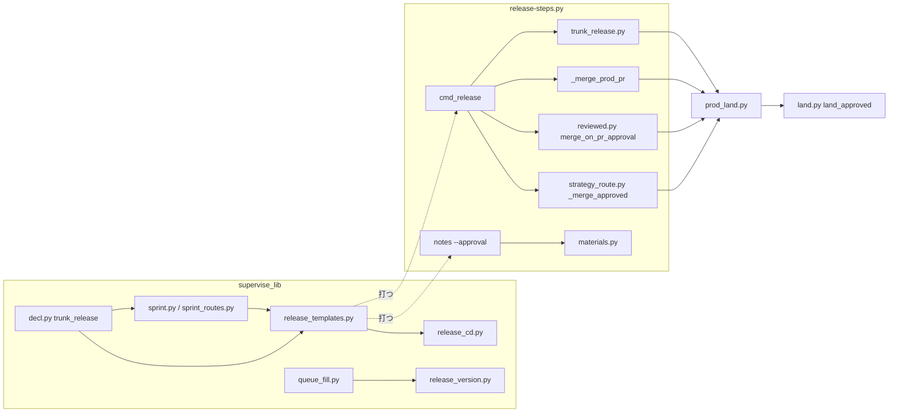
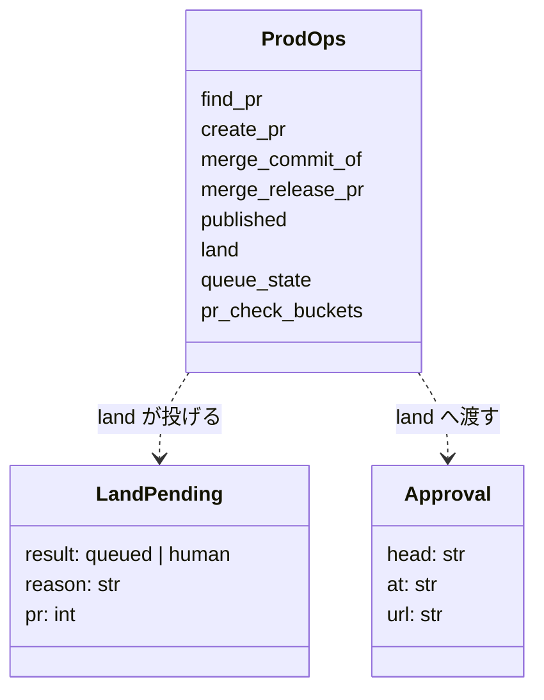
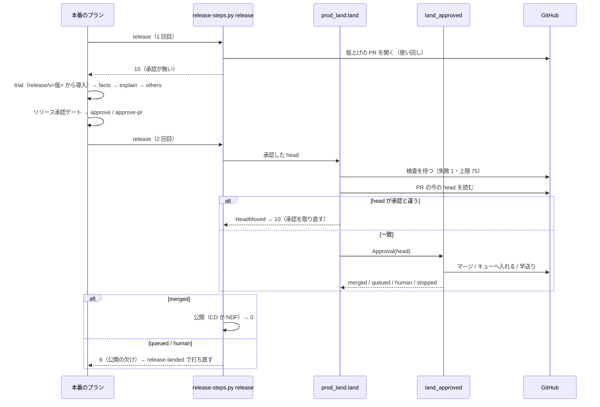
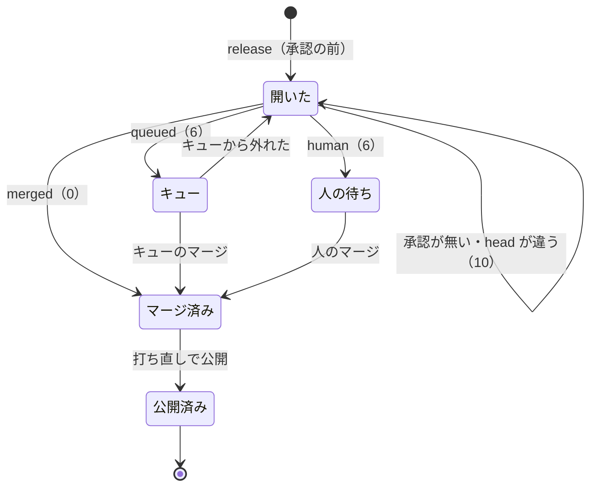
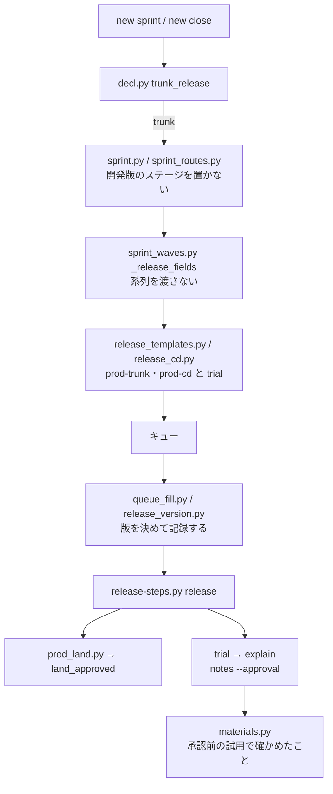

# 本番リリースのマージと trunk のスプリントの計画: 宣言のマージの主体・方式で本番へ入れ、開発版を挟まずに本番まで流す（#3703）

## 目的

- **今どうなっているか**: 本番ブランチへ入れるマージ（版上げの PR・本番の PR）は、どの経路でも `merge-when-green` の直接のマージで入り、ブランチ戦略の宣言（`.ndf/project.json` の `branch_strategy.merge`）の主体・方式（人のマージ・merge queue・履歴の作り方）を読まない。trunk の宣言でも `supervise.py new sprint` が開発版のプランを作り、そのプランは `release --channel dev` の前提の不足（終了コード 3）で止まる
- **誰に効くか**: ブランチ戦略を宣言して NDF のスプリントで本番まで出すリポジトリ。ai-plugins は 2026-11-17 に trunk・merge queue の宣言へ移った
- **変えると何が成り立つか**: 本番ブランチへ入れるマージが宣言どおりの主体・方式で 1 か所（`land_approved`）を通り、trunk のスプリントは開発版を作らず、版上げの PR の head で導入を確かめてから承認を取り、本番まで流れる

## 適用範囲

- **働く範囲**: NDF 10 系（`plugins/ndf/`）を使うすべてのリポジトリ。11.0（`plugins/ndf-next/`）は #3681 が扱う
- **プロジェクトごとに違うもの**: マージの主体・方式・履歴の作り方、取り込み方（trunk か否か）、CD の有無、`pace: fast`・`auto` の導入の確認のコマンドは、どれも設定（`.ndf/project.json`・`.ndf/pace.json`）で受ける。引数で受けるのは版（`--version`）と CI の待ちの上限（`--ci-wait`）だけ
- **当たるモード**: リリースの雛形（`release.form: package-plugin`）を通るスプリントのすべてのモード（`standard`・`light`・`legacy-refactor`）

### 代表のリポジトリでの振る舞い

| 代表のリポジトリ | 設定の要点 | 直した後に起きること | この種類で扱えなくなること |
| --- | --- | --- | --- |
| Web サービス | リリースの雛形を持たず、経路 merge（ベースブランチ → 本番チャネルのリリースの Pull Request を `merged-steps.py promote` で入れる）か手動の経路で届ける | 本番の取り込みは `release-steps.py release` だけを変えるため、この種類の届け方は変わらない。trunk の宣言なら、計画からチャネル `dev` のプランが無くなる（雛形の無い経路は今も開発版を置かない） | 無し |
| モバイルアプリ | ストアへの提出を手動の経路（`kind: manual`）で宣言する | 同上。手動の経路のステージは変わらない | 無し |
| 業務文書だけ | リリースの経路が `none`（届けない） | リリースのプランを作らないため、どちらの変更も当たらない | 無し |

### ai-plugins だけの事情

| 値 | 置く所 | 持つ Issue |
| --- | --- | --- |
| 取り込み方 trunk・`merge.actor: ndf`・`merge.method: merge-queue`・`merge.commit: merge`・CD あり（`release-cd.yml`）・承認数 0 | `.ndf/project.json` の `branch_strategy`（この変更では書き換えない） | #3672 |
| `pace: fast`・`auto` の導入の確認 `verify-install --ref {ref} --runtimes claude,codex` | `.ndf/pace.json` の `fast.verify`・`auto.verify` | #3672 |

## あるべき姿の根拠

| 根拠 | 種類 | 何を示すか |
| --- | --- | --- |
| PRD1 | 外部の一次情報 | merge queue へ入れた PR は、その場ではマージされず、合成のブランチの検査が通った後に入る。入れた時点で公開まで進めない |
| PRD1 | 外部の一次情報 | キューの取り込み方（merge・squash・rebase）は ruleset が持つ。宣言の履歴の作り方と食い違えば、入れる前に止める必要がある（`land_approved` の `ruleset_mismatch` が持つ） |
| PRD2 | 外部の一次情報 | 合流の列（GitLab の merge train）でも、head へ新しいコミットが積まれた要求は列から外れる。承認した head と今の head が違えば入れない形は業界の取り込みの列と同じ |
| `plugins/ndf/scripts/release-steps.py:672` | 実測 | trunk で `--channel dev` を打つと 3 で止まる。計画が開発版のプランを作ると、そのステージから先へ進めない |
| 利用者の指示の原文（#3703 の依頼の 1 段落目） | 利用者の指示の原文 | 「本番リリースのマージと trunk のスプリントの計画を、#3672 の宣言どおりに動かす」 |

要求と受け入れ条件は #3703 の本文にある（コピーは `issues/issue-3703-requirements.md`）。この文書は「どう作るか」だけを扱う。
決定の記録は [issue-3703-design-decisions.md](issue-3703-design-decisions.md) にある。

## ドメインモデル

### コンテキスト

| コンテキスト | 何の語が 1 つの意味に決まるか |
| --- | --- |
| リリース（`ndf-release`） | 版上げの PR・承認したコミット・本番の取り込み |
| 開発の工程（`ndf-workflow`） | スプリントの計画・ステージ・プラン・キューの版の差し込み・承認前の試用 |

開発の工程が顧客、リリースが供給者の関係（顧客 / 供給者）。開発の工程はリリースのコマンド（`release-steps.py release`・`verify-install`）を呼ぶプランを組み、リリースはそのコマンドの終了コードと結果 JSON を約束として渡す。

### 集約

| 集約 | 持ち主（書き換えてよいもの） | 根 | エンティティ | 値オブジェクト |
| --- | --- | --- | --- | --- |
| 本番の取り込み | `release_lib/prod_land.py`（新設）。中で `land_approved` を呼ぶ | 版上げの PR（本番ブランチ宛て） | — | 承認した head・取り込みの結果（`merged`・`queued`・`human`・`stopped`） |
| スプリントの計画 | `supervise_lib/sprint.py`（ステージの並び） | 計画（`sprint.json`） | ステージ・プラン | プランの「版」の欄 |
| 版の記録 | `supervise_lib/queue_fill.py` | プランの状態ディレクトリの `version.json` | — | 版・決め方（`explicit`・`series`・`decided`） |

### 不変条件

| # | 集約 | 条件 | 破れたときの扱い |
| --- | --- | --- | --- |
| I1 | 本番の取り込み | `release-steps.py release --channel prod` が本番ブランチへ入れる経路は、下の「本番ブランチへ入れる経路」の 4 か所の呼び出しで全部であり、すべて本番の取り込みを通って `land_approved` に入る。`wait_and_merge` を本番ブランチ宛ての PR に使わない | 該当の経路のテストが落ちる |
| I2 | 本番の取り込み | trunk の経路では、本番ブランチへ入る head は承認の記録・証跡の SHA と完全に一致する。入れる直前に版上げの PR の今の head と照らす | 承認ゲート（10）で止まり、承認を取り直す依頼を出す。本番ブランチもキューも変えない |
| I9 | 本番の取り込み | ベースブランチと本番ブランチが分かれた CD の無い経路では、本番ブランチへ入る head は、承認したコミットから比べて許容に収まった先端（`verdict.tip`）と同じ。入れる直前に本番の PR の今の head と照らす（この扱いが要求に合うかは「人へ残す判断」の 1） | 先端が動いていれば比べ直し、今の回数を超えたら承認ゲート（10）で止まる。本番ブランチもキューも変えない |
| I3 | 本番の取り込み | 承認した head の検査がそろうまで入れない。中身の失敗は 1、上限までの基盤の待ちは 75 | 本番ブランチを変えずに止まる |
| I4 | 本番の取り込み | 取り込みの結果が `queued`・`human` のとき、タグと GitHub Release を作らない | 公開を欠けとして返し（6）、打ち直しでマージ済みを見つけてから公開する |
| I5 | スプリントの計画 | trunk の宣言では、どの進め方の計画にも「版」の「チャネル」が `dev` のプランが無い | 計画のテストと契約の写しが落ちる |
| I6 | スプリントの計画 | trunk の本番のプランは、版上げの PR を開いた後・承認資料を作る前に、その head（`release/v<版>`）から導入を確かめるステップを持つ | 計画のテストが落ちる |
| I7 | 版の記録 | trunk の本番のプランの版は、明示の版か、記録が無いときに origin から決めた版である。一度書いた記録は承認の後に決め直さない | 版が既に出ていれば流さずに止まる（今の `taken` と同じ） |
| I8 | 本番の取り込み | ベースブランチへ入れるマージ（開発版の PR・`-sync` の PR・戻すマージ）は今の `wait_and_merge` のまま | 該当の経路のテストが落ちる |

#### 本番ブランチへ入れる経路

今の `wait_and_merge` の呼び出しを検索し（`grep -rn 'wait_and_merge' plugins/ndf/scripts --include=*.py`、テストを除く）、本番ブランチ宛ての呼び出しを次の 4 か所と確かめた。ほかの 2 か所（`release-steps.py:599` の開発版の PR、`release-steps.py:639` の `-sync` の PR）はベースブランチ宛てで、I8 の対象である。

| # | 呼び出し（今の位置） | 経路 | 呼び出し元 |
| --- | --- | --- | --- |
| 1 | `release-steps.py` の `_merge_prod_pr`（`:657`） | 分かれた経路の CD の無い本番 | `cmd_release` |
| 2 | `release_lib/reviewed.py` の `merge_on_pr_approval`（`:244`） | CD のある本番 | `reviewed.release_prod`（trunk と分かれた経路）と `strategy_route._merge_exact`（選んで集める取り込み方）の 2 つ |
| 3 | `release_lib/strategy_route.py` の `_merge_approved`（`:238`） | 選んで集める取り込み方の CD の無い本番 | `strategy_route.release_selected` |
| 4 | `release_lib/trunk_release.py`（新設。今は 1 の呼び出しを通る） | CD の無い trunk の本番 | `cmd_release` |

### ドメインイベント

| # | イベント | 発生元 | 受け手 |
| --- | --- | --- | --- |
| E1 | スプリントの計画を作った | `supervise.py new sprint`・`new close` | キュー |
| E2 | 版上げのブランチで版を上げ、push した | 本番のプランの bump・changelog・notes | 本番のプランの release |
| E3 | 版上げの PR を開いて止まった | `release-steps.py release`（承認の前） | 本番のプランの trial |
| E4 | 版上げの PR の head から導入を確かめた | 本番のプランの trial | 本番のプランの facts |
| E5 | 承認資料を作った | 本番のプランの facts・explain・others | リリース承認ゲート |
| E6 | リリースを承認した | 人・MVV 判定（approve・approve-pr） | 本番のプランの release |
| E7 | 承認した head の検査がそろった | 本番の取り込み（検査の待ち） | `land_approved` |
| E8 | 宣言の主体と方式で本番ブランチへ入れた | `land_approved` | 本番の取り込み |
| E9 | キューか人が版上げの PR をマージした | merge queue・人 | `release-steps.py release` の打ち直し |
| E10 | タグと GitHub Release を作った | CD か NDF（`_published`） | 本番のプランの cd-result・record |

### 用語

| 用語 | 意味 | 用語集への反映 |
| --- | --- | --- |
| 本番の取り込み | 承認した head を、検査がそろうのを待ってから、ブランチ戦略の宣言のマージの主体と方式（`land_approved`）で本番ブランチへ入れること。結果は入れた・キューへ入れた・人のマージを待つ・止まったのどれか | 追加（`ndf-release`） |

「承認前の試用」（リリース承認ゲートの前に変更を入れて使えるところ。`ndf-workflow`）は用語集の意味のまま使う。trunk のプラグインでは、その場所は版上げの PR の head（`release/v<版>`）で、本番のプランのステップ `trial` がそこからの導入を確かめる。

## 外部の調査

| 種類 | 調べるか | 理由 |
| --- | --- | --- |
| 標準・仕様 | 調べない | 本番ブランチへの取り込みの順序と承認の照らし方に、公開の規格・RFC は無い（調べる対象を持たない）。業界の形は主要な製品の取り込みの列が持つ |
| 主要な製品 | 調べる | 宣言の `merge-queue` の相手は GitHub の merge queue そのもので、キューへ入れた後の振る舞い（いつ入るか・何で外れるか・取り込み方の置き場）が公開の時期とキューの扱いの決定を決める |
| ライブラリとサービス | 調べない | 取り込みの本体（`land_approved`・`GhPort`）と待ち（`waits.wait_until`・`wait_ci_except`）はこのリポジトリに既にあり、この変更は呼ぶ場所を集めるだけで新しい機能を得ない |

### 主要な製品

| # | 製品 | どう解いているか | 設計への反映 | 出典 |
| --- | --- | --- | --- | --- |
| PRD1 | GitHub merge queue | キューへ入れた PR は、前に並ぶ PR と合わせた合成のブランチ（merge group）の検査が通った後に本番ブランチへ入る。検査の失敗・衝突・時間切れ・人の操作でキューから外れ、理由は PR のタイムラインに出る。取り込み方（merge・rebase・squash）はキューの設定が持つ | `queued` の時点では公開しない（決定 3）。打ち直しでキューに残っていれば待ち、外れていれば止める（決定 3）。取り込み方の食い違いは `land_approved` の `ruleset_mismatch` に任せる | https://docs.github.com/en/repositories/configuring-branches-and-merges-in-your-repository/configuring-pull-request-merges/managing-a-merge-queue ・ https://docs.github.com/en/pull-requests/collaborating-with-pull-requests/incorporating-changes-from-a-pull-request/merging-a-pull-request-with-a-merge-queue （2026-11-17） |
| PRD2 | GitLab merge trains | 列へ入れた要求は、パイプラインが通り、前の要求がすべて入った後にマージされる。ソースブランチが更新されると列から外れ、パイプラインが落ちると外れて入れ直しが要る | 承認の後に head が動いたら入れずに承認を取り直す（決定 2）形が、列の取り込みの一般の扱いと同じであることの裏付け | https://docs.gitlab.com/ci/pipelines/merge_trains/ （2026-11-17） |

### 確かめられなかったこと

| 対象 | 試した手段 | 結果と理由 |
| --- | --- | --- |
| キューがマージした後の PR の状態（merged か closed か） | PRD1 の 2 つの URL | 取得できた（HTTP 200）が、ページに記載が無い。打ち直しの判定は `pull.merged`（REST の `merged`）で読むため、閉じた形でも `merged` が真であることを実装のテスト（偽の Port）と、ai-plugins の次の正式版のリリースで確かめる（「未確認のまま残ること」） |
| キューにある PR の head へ push したときの GitHub の扱い | PRD1 の 2 つの URL | 取得できた（HTTP 200）が、ページに記載が無い。この変更は承認の後の push を版上げのブランチへ積まない（本番のプランは承認の外のコミットを積まない。#3572）ため、扱いに依らない |
| キューに入っている PR で、PR の項目 `isInMergeQueue` が真になること | GitHub の GraphQL API の実測（下の「キューにあるかの読み方」） | 項目があり、マージ済みの PR で偽・`mergeQueueEntry` が `null` を返すことは確かめた。照会の時点で本番ブランチのキューが空（`totalCount: 0`）だったため、キューに入っている PR での真の値は観測できていない。実装のテスト（偽の Port）と、ai-plugins の次の正式版のリリースで確かめる（「未確認のまま残ること」） |

### キューにあるかの読み方

打ち直しで版上げの PR がキューにあるかは、GitHub の GraphQL API の PR の項目 `isInMergeQueue` で読む。キューの一覧（`repository.mergeQueue(branch).entries`）は今の `land.py` の `GhPort.queue` が既に読んでいるが、キューに無い承認済みの版上げの PR も行に足すため（`approved_release: true`）、1 つの PR の在否には使わない。

実測（2026-11-17、devbasex/ai-plugins）:

```bash
gh api graphql -f query='{repository(owner:"devbasex",name:"ai-plugins"){pullRequest(number:3713){number merged state isInMergeQueue mergeQueueEntry{state}}}}'
# {"data":{"repository":{"pullRequest":{"number":3713,"merged":true,"state":"MERGED","isInMergeQueue":false,"mergeQueueEntry":null}}}}

gh api graphql -f query='query($owner:String!,$name:String!,$branch:String!){repository(owner:$owner,name:$name){mergeQueue(branch:$branch){id entries(first:5){totalCount nodes{state position pullRequest{number headRefOid}}}}}}' -f owner=devbasex -f name=ai-plugins -f branch=main
# {"data":{"repository":{"mergeQueue":{"id":"MQ_kwDOSII3uc4ABYuo","entries":{"totalCount":0,"nodes":[]}}}}}
```

調べた量: 候補 2 件・取得の試み 3 回・API の照会 2 回。

## 機能一覧

| # | 機能 | 誰が使うか |
| --- | --- | --- |
| F1 | 本番リリースのマージが、宣言の主体（NDF・人）と方式（merge queue・strict・direct）と履歴の作り方で本番ブランチへ入る | リリースを出す conductor・本番のプラン |
| F2 | キューへ入れた・人のマージを待つときは公開を欠けとして返し、打ち直すとマージ済みを見つけて公開する | 本番のプラン・conductor |
| F3 | 承認した head の検査を待ってから入れ、承認の後に動いた head は入れずに承認を取り直させる | 本番のプラン |
| F4 | trunk の宣言で、スプリントの計画が開発版のプランを作らずに本番まで組まれる | `supervise.py new sprint`・`new close` を打つ人と conductor |
| F5 | trunk の本番のプランが版上げの PR を開いて止まり、その head で導入を確かめ、承認資料を作ってから承認を待つ | 本番のプラン・承認する人 |
| F6 | 開発版のプランが無くても、本番のプランの版がキューの流す時点に決まる | キュー |

## 構成要素

| 要素 | 責務 |
| --- | --- |
| `release_lib/prod_land.py`（新設） | 本番の取り込み。承認した head の検査を待ち、PR の今の head と照らし、`land_approved` を GitHub 版の Port で呼び、結果を「マージコミット」「先端が動いた」「公開の欠け（`queued`・`human`）」「止まった」へ写す。打ち直しでは `ProdOps.queue_state` で PR の状態を読み、キューにある PR は上限までマージを待つ |
| `release-steps.py` の `cmd_release` | trunk の本番を、承認を読む前の分岐で trunk の経路へ回す。公開の欠けを `stopped`・6 で返す |
| `release-steps.py` の `_merge_prod_pr` | 分かれた経路の CD の無い本番。マージを本番の取り込みへ替える。比べ直しの繰り返しは今のまま |
| `release_lib/trunk_release.py`（新設） | CD の無い trunk の本番。版上げの PR を開き（使い回し）、承認の記録が無い・head と違えば検査を待って承認ゲート（10）で止まり、一致すれば本番の取り込みへ渡す |
| `release_lib/reviewed.py` の `merge_on_pr_approval`・`ProdOps` | CD のある本番。呼び出し元は `reviewed.release_prod`（trunk と分かれた経路）と `strategy_route._merge_exact`（選んで集める取り込み方）で、どちらもこの関数の中でマージする。`ProdOps.wait_and_merge` を `ProdOps.land` へ替え、迂回の記録は `land_approved` が書く。`ProdOps.queue_state` を足す |
| `release_lib/strategy_route.py` の `_merge_approved` | 選んで集める取り込み方の CD の無い本番。マージを `ops.land` へ替える。同じファイルの `_merge_exact` は `merge_on_pr_approval` を呼ぶだけで、自分ではマージしない |
| `release_lib/materials.py`・`release-steps.py notes --approval` | 承認資料の欄「承認前の試用で確かめたこと」に ref・版・結果を書く。書くのは本番のプランの explain のステップ（`notes --approval <承認資料> --verified <並び> --ref release/v<版>`）で、trial の後に動く。bump の後の notes のステップは `--approval` を渡さず、この欄を書かない |
| `supervise_lib/decl.py` の `trunk_release(a)`（新設） | 計画の引数のブランチ戦略のスナップショットから、trunk の経路か（版上げの PR があり、ベースブランチへの開発版の PR が無い）を返す |
| `supervise_lib/sprint.py`・`sprint_routes.py` | trunk では開発版のステージ（normal の「デプロイ」、fast・auto・close の「開発版」）と、normal の CD の無い場合のリリース承認ゲートのステージを置かない。リリース承認ゲートでの止まり方は「リリース承認ゲートでの止まり方」の節 |
| `supervise_lib/sprint_waves.py` の `_release_fields` | trunk の本番のプランへ系列（開発版のプランの名前）を渡さない |
| `supervise_lib/release_templates.py` | trunk の本番のプランの種類（`prod-trunk`）、版の欄の決め方、承認前の試用のステップ（`trial`）、キューへ入れた後の打ち直しのステップ（`release-landed`） |
| `supervise_lib/release_cd.py` の `cd_prod_steps`・`cd_release_wait` | CD のある trunk の本番で、release の承認ゲートの行き先を `trial` にする |
| `supervise_lib/queue_fill.py` の `_fill_prod`・`lib/release_version.py` | 明示の版も系列も無い本番のプランの版を origin から決めて記録する |
| `skills/release/references/release-steps.md`・`skills/development-workflow/references/approval-request.md` | 欄の名前・trunk の本番の流れ・公開の欠け（6）の説明 |



## 構造



`ProdOps.wait_and_merge` は無くなり、`land(root, a, pr, head, trail_url="") -> マージコミット` に替わる。`land` は `HeadMoved`（今の型）・`LandPending`（新設）・`StepError` を投げる。`Approval` は `release_lib/land.py` の今の型をそのまま使う。

`queue_state(root, pr) -> "merged" | "queued" | "open" | "closed"` は、GitHub の GraphQL API で PR の `merged`・`state`・`isInMergeQueue` を読む（読み方の実測は「外部の調査」の「キューにあるかの読み方」）。`merged` が真なら `merged`、開いていて `isInMergeQueue` が真なら `queued`、開いていて偽なら `open`、それ以外は `closed` を返す。読めなければ `StepError` を投げ、キューに無いとはみなさない（キューに残る PR を二重に入れないため）。

## 入出力の契約

### `release-steps.py release --channel prod` の結果

| 場合 | status | 終了コード | items | 公開 |
| --- | --- | --- | --- | --- |
| 本番ブランチへ入れた（`merged`。迂回・早送りを含む） | `ok` | 0 | 版上げの PR の行 `result: merged` | 行う（CD の宣言があれば `metrics.publisher: cd`） |
| キューへ入れた（`queued`） | `stopped` | 6 | 版上げの PR の行 `result: queued` | 行わない。`gaps` に `{"kind": "publish", "name": "<タグ>", "reason": "キューのマージを待つ"}`、`next` に同じコマンドの打ち直し |
| 人のマージを待つ（`human`） | `stopped` | 6 | 版上げの PR の行 `result: human` | 行わない。`gaps` の reason は「人のマージを待つ」、`next` は人がマージした後の打ち直し |
| 打ち直しでキューにあり（`queue_state` が `queued`）、上限までにマージされた | `ok` | 0 | `result: merged` | 行う |
| 打ち直しでキューにあり、上限までにマージされない | `stopped` | 75 | `result: queued` | 行わない |
| 打ち直しでキューから外れていた（`queue_state` が `open`） | 入れ直した結果の行と同じ | 入れ直した結果の行と同じ | 入れ直した結果の行 | 入れ直した結果の行と同じ |
| 打ち直しで PR が閉じていた（`queue_state` が `closed`） | `stopped` | 1 | 理由を summary に載せる | 行わない |
| マージ済み（キュー・人・前の実行） | `ok` | 0 | `result: already_merged` | 無いものだけを行う（今の再開の経路） |
| 承認が無い・承認した head と今の head が違う | `gate` | 10 | 今と同じ | 行わない |
| 検査の中身が失敗 / 上限まで基盤の待ち | `stopped` | 1 / 75 | 今と同じ | 行わない |
| `land_approved` が `stopped`（ruleset の食い違い・ドラフト・閉じた PR など） | `stopped` | 1 | 理由を summary に載せる | 行わない |

キューから外れていた PR は、1 回目と同じく検査の待ちと head の照合からやり直して `land_approved` を打ち直す。返す行は、その実行の結果に当たる上の行（キューへ入れたなら `stopped`・6・`result: queued`、入れたなら `ok`・0）か下の行（10・1・75）である。

`release-steps.py land --pr <番号>` の引数・結果 JSON の形・終了コードは変えない（受け入れ条件 14）。

### プランのステップ（trunk の本番のプラン）

| ステップ | 打つもの | 行き先 |
| --- | --- | --- |
| bump → bump-others → changelog → notes → snapshot →（sync） | 今と同じ。notes は `--approval` を渡さず、版の説明だけを書く（承認資料の欄は書かない） | release |
| release（1 回目） | `release-steps.py release --channel prod --version <版> --ci-wait <秒>`（CD の無い場合は `--approval <承認資料>` も） | 10 → `trial`、6 → `release-landed`、75 → 止まる |
| trial | normal は `verify-install --ref release/v<版> --expect <版> --runtimes <並び>`。fast・auto は `.ndf/pace.json` の `verify` の `{ref}` を `release/v<版>` へ置き換えたもの | facts（失敗は judge） |
| facts → explain → others | 今の `_dev_approval_steps` を `--head release/v<版>` で組んだもの。facts が承認資料を作り、explain（`notes --approval <承認資料> --verified <並び> --ref release/v<版>`）が欄「承認前の試用で確かめたこと」に trial の ref・版・結果を書く | CD のある場合は approval-post、無い場合は下の行 |
| （CD の無い場合）承認 | normal はここで終えてリリース承認ゲートへ（止まり方は下の節）。承認の後に `run <プラン> --from approve`。fast・auto は MVV 判定 → approve | approve → release |
| approve | `release-steps.py approve --approval <承認資料> --facts-from '{queue_state?:release-prod}' --by user|mvv` | release |
| release（2 回目）・release-landed | 1 回目と同じコマンド | 0 → cd-result、10 → 止まる（承認ゲート）、6（release-landed）→ 止まる |

欄「承認前の試用で確かめたこと」を書くのは trial の後の explain だけである。bump の後の notes は trial より前に動くため、欄を書かない。

### リリース承認ゲートでの止まり方（CD の無い trunk の本番のプラン）

計画にリリース承認ゲートのステージを置かない代わりに、本番のプランの結果を「関門」（承認ゲート）にして止める。今の CD のある本番のプラン（`release_cd.cd_release_wait`）と同じ仕組みを使い、新しい終了コードや状態は足さない。

| 進め方 | release（1 回目）の 10 の受け方 | プランの終わり方 | 後続のステージ |
| --- | --- | --- | --- |
| normal | `gate_next: trial`。実行の基盤（`supervise_lib/engine.py`）がこのステップを承認ゲートとして記録する | others の `next: end` で終わる。承認ゲートを記録したステップがあるため、完了で終えても結果は「関門」になる（`engine._final_result`）。キューの結果は `gate` | 前のステージのプランがすべて完了したときだけ次のステージが流れる（キューの規則。`skills/development-workflow/references/glossary.md` の「ステージ」）。「関門」のプランがある間は、後続のステージ（スプリントの終わりの計画など）は流れない。プランの中の cd-result・record は release（2 回目）の 0 の後にしか進まない |
| fast・auto | `on_exit: {"10": "trial"}`。承認ゲートとして数えず、others の後の MVV 判定に任せる（今の `cd_release_wait` の MVV 判定のプランと同じ扱い） | MVV 判定が通せば approve → release（2 回目）へ進み、完了で終わる。通さなければ MVV 判定のステップが承認ゲート（`gate_next: end`）を返し、結果は「関門」 | normal と同じ |

承認の後は、利用者の承認を記録してから `run <本番のプラン> --from approve` を打つ。approve が承認したコミットを記録し、release（2 回目）が受け入れ条件 1〜6 の取り込みへ進む（受け入れ条件 12）。承認の前に approve・release（2 回目）が動かないのは、プランが others の後で終わり、続きを `--from approve` でしか始めないためである。

## 処理の流れ



版上げの PR の状態と、`release` の 1 回の実行の結果:



計画を組んで流す流れ（trunk の宣言）:



図に含めない要素は、説明の文書 2 つ（`release-steps.md`・`approval-request.md`）である。

trunk の判定は計画の側（`trunk_release(a)`）とリリースの側（`_release_route(root).sync` が偽）の 2 か所で読むが、どちらも同じ正本（`strategy_route.route_of`）から決まる。計画の側は計画の引数のスナップショットを読み、壊れていれば今の `sprint_flow` と同じく `DeclError` で計画を書かずに止まる。

## 非機能の実現方式

| 大項目 | 条件 | 実現方式 |
| --- | --- | --- |
| 運用・保守性 | 止まったときの結果に理由と次に打つコマンドが載る。本番ブランチへ入れる経路が 1 か所 | 公開の欠け（6）・承認ゲート（10）・基盤の待ち（75）のどれも `next` に打ち直しのコマンドを載せる。本番ブランチ宛ての 4 か所の呼び出しを `prod_land.land` の 1 つに集める（I1） |
| 移行性 | ai-plugins の宣言と `.ndf/pace.json` を書き換えずに本番まで流れる | trial の置き換えは `{ref}` の文字列だけを `release/v<版>` へ替え、宣言の形を変えない。版の決め方は宣言を足さずに取り込み方から決める |
| セキュリティ | 承認した head の外のコミットを本番ブランチへ入れない。C1〜C8・P1・P2 の扱いを変えない | 入れる直前に PR の今の head を読み、承認した head と違えば入れない（trunk は I2）。キューへ入れる前にも `land_approved` が同じ照合をする。分かれた CD の無い経路は許容に収まった先端を入れる（I9）。これが条件に合うかは「人へ残す判断」の 1 |

## 決定の記録

[issue-3703-design-decisions.md](issue-3703-design-decisions.md) にある。

## テスト設計

| 受け入れ条件・不変条件 | どの振る舞いで縛るか | どう壊したら落ちるべきか |
| --- | --- | --- |
| 1・I4 | 宣言 `merge-queue`、証跡が head にあり検査が成功の偽の Port で release を打つと、キューへの投入が 1 回・直接のマージが 0 回・結果に `queued` の行・終了コード 6・タグを作る呼び出しが 0 回 | `queued` を `merged` と同じに扱って公開へ進めると落ちる |
| 2 | 1 の後に PR をマージ済みにして打ち直すと、公開へ進み、CD の宣言があれば `metrics.publisher` が `cd`、無ければタグを作る | マージ済みの判定を外すと落ちる |
| 3 | 宣言 `merge.actor: human` で、マージもキューへの投入も 0 回・終了コード 6・理由に人のマージ。マージ済みにして打ち直すと公開へ進む | 主体を読まずにマージすると落ちる |
| 4 | `strict`・`direct` と `merge.commit` の 3 値で、Port のマージに渡る履歴の作り方が宣言と同じ | 履歴の作り方を固定値にすると落ちる |
| 5・I3 | 検査が実行中なら待ってから入れる。失敗で 1、上限で 75、どちらもマージ・キューへの投入が 0 回 | 待ちを外す、または失敗でも入れると落ちる |
| 6・I2 | 承認の後に head が動いた偽の PR で、trunk は 10・マージ 0 回・キューへの投入 0 回、`next` に承認の取り直し | 今の head を照らさずに入れると落ちる |
| I9 | 分かれた CD の無い経路で、比べた先端と PR の今の head が違う偽の PR は、比べ直しの回数を超えると 10・マージ 0 回・キューへの投入 0 回 | 今の head を照らさずに入れると落ちる |
| 7・I1 | 「本番ブランチへ入れる経路」の 4 か所のそれぞれで、本番ブランチ宛てのマージが `prod_land.land` を経て `land_approved` を 1 回呼び、`wait_and_merge` を本番ブランチ宛てに呼ばない。2（`merge_on_pr_approval`）は呼び出し元の `reviewed.release_prod` と `strategy_route._merge_exact` の両方から確かめる | どれか 1 経路を `wait_and_merge` に戻すと落ちる |
| 打ち直し | 偽の Port の `queue_state` が `queued` なら待ってマージ済みで 0・上限で 75、`open` なら `land_approved` を 1 回打ち直してその結果の行を返し、`closed` なら 1 | キューに残る PR を入れ直す、外れた PR を待ち続けると落ちる |
| 8・I5 | trunk の宣言で `new sprint` を `normal`・`fast`・`auto` で打ち、`new close` を打つと、書いた計画にチャネル `dev` のプランが 0 件 | trunk の判定を外すと落ちる |
| 9・I7 | 8 の計画で `--version` を渡さずにキューの版の差し込みを埋めると止まらずに版が決まり、2 回目の埋めは記録の版を使う | 系列を求めたままにすると `no_series` で落ちる |
| 10・I6 | 8 の本番のプランで、release の 10 の行き先が trial、trial が facts の前。fast・auto では trial のコマンドに `{ref}` が残らず `release/v<版>` が入る | trial を外す、置き換えを外すと落ちる |
| 11 | 8 の本番のプランが CD の有無によらず facts（承認資料を書く）をリリース承認ゲートより前に持ち、trial の後の explain（`notes --approval`）が欄「承認前の試用で確かめたこと」に `release/v<版>` の ref・版・結果を書く。bump の後の notes は `--approval` を持たない | 欄を書かない、ref を本番ブランチのままにする、欄を書くステップを trial より前に置くと落ちる |
| 12 | 8 の本番のプランを偽のコマンドで流すと、1 回目の release が 10 で trial へ進み、normal は others の後に結果「関門」で終わって approve・release（2 回目）・cd-result を打たない。`--from approve` で続けると release が取り込みへ進む | 1 回目に承認資料を求めて 3 で止める、10 を承認ゲートとして記録せずに完了で終える、others の後に approve へ進むと落ちる |
| 13・I8 | 分かれた宣言で `new sprint` の計画に開発版のプランが残り、開発版の PR と `-sync` の PR のマージは `wait_and_merge` を呼ぶ | 開発版のマージまで本番の取り込みへ替えると落ちる |
| 14 | `release-steps.py land` の今のテストが変更なしで通る | `land_approved` に待ちを入れると落ちる |
| 15 | 範囲のテスト（`release`・`land`・`supervise`・`sprint` の各テストと契約の写し）が通る | — |
| 16 | 決定の記録に 7 つの問いの答えがある（設計の検査と設計レビューで確かめる。`.md` の文言のテストは書かない） | — |

## 設計の結果

| 課題 | 扱い | 取り込み先 | 触るファイル |
| --- | --- | --- | --- |
| #3703 | 実装する | — | `plugins/ndf/scripts/release_lib/prod_land.py`（新設）、`plugins/ndf/scripts/release_lib/trunk_release.py`（新設）、`plugins/ndf/scripts/release-steps.py`、`plugins/ndf/scripts/release_lib/reviewed.py`、`plugins/ndf/scripts/release_lib/strategy_route.py`、`plugins/ndf/scripts/release_lib/materials.py`、`plugins/ndf/scripts/lib/release_version.py`、`plugins/ndf/scripts/supervise_lib/decl.py`、`plugins/ndf/scripts/supervise_lib/sprint.py`、`plugins/ndf/scripts/supervise_lib/sprint_routes.py`、`plugins/ndf/scripts/supervise_lib/sprint_waves.py`、`plugins/ndf/scripts/supervise_lib/release_templates.py`、`plugins/ndf/scripts/supervise_lib/release_cd.py`、`plugins/ndf/scripts/supervise_lib/queue_fill.py`、`plugins/ndf/skills/release/references/release-steps.md`、`plugins/ndf/skills/development-workflow/references/approval-request.md`、`plugins/ndf/scripts/tests/test_release_steps.py`、`plugins/ndf/scripts/tests/test_release_cd.py`、`plugins/ndf/scripts/tests/test_release_selected.py`、`plugins/ndf/scripts/tests/test_release_production_flow.py`、`plugins/ndf/scripts/tests/test_release_version.py`、`plugins/ndf/scripts/tests/test_release_materials.py`、`plugins/ndf/scripts/tests/test_supervise_new.py`、`plugins/ndf/scripts/tests/test_supervise_contract.py`、`plugins/ndf/scripts/tests/fixtures/supervise-contract/plans/sprint/sprint.json`、`plugins/ndf/scripts/tests/fixtures/supervise-contract/plans/sprint/8-release.json`、`plugins/ndf/scripts/tests/fixtures/supervise-contract/plans/sprint/10-release-prod.json`、`plugins/ndf/scripts/tests/fixtures/supervise-contract/plans/close/sprint.json`、`plugins/ndf/scripts/tests/fixtures/supervise-contract/plans/close/3-release.json`、`plugins/ndf/scripts/tests/fixtures/supervise-contract/plans/close/4-release-prod.json`、`plugins/ndf/scripts/tests/fixtures/release_notes/approval-1863.txt`、`docs/glossary/glossary.json`、`docs/glossary.md` |

## 人へ残す判断

| # | 判断すること | 設計が置いた前提 | 前提が否定されたときに変わる所 |
| --- | --- | --- | --- |
| 1 | ベースブランチと本番ブランチが分かれた CD の無い経路で、承認したコミット（開発版の承認資料）から比べて許容（#2221。`docs/`・`issues/` だけを触るコミット）に収まった先端を、承認の延長として本番ブランチへ入れてよいか。要求の前提 1 はこの経路も本番リリースのマージに含め、前提 2 は承認した head と PR の今の head の一致で判定するとし、受け入れ条件 6 と非機能のセキュリティは承認していないコミットを本番ブランチへ入れないとしている。この経路では、承認の後に本番のプランが積む版上げ・変更履歴の更新と、許容に収まるコミットが本番ブランチへ入る。また、人が承認していない SHA（`verdict.tip`）から `land_approved` へ渡す承認（`Approval`）を組むため、#3672 の I5（承認の証跡と head の照合）が照らす SHA の意味が「人が承認した head」から「許容で決めた先端」へ広がる | 要求を「分かれた経路では、今の許容の比べ方を承認の延長とみなす」と読む（決定 2・I9）。比べ方は今の `_merge_prod_pr`・`_merge_approved` と同じで、入れる手段だけを `land_approved` へ替える | 分かれた経路も完全な一致だけで入れる場合、本番のプランが承認の後に積む版上げのコミットのため、どのリリースも承認ゲートへ戻る。版上げを承認の前へ移すか、承認の取り直しを本番のプランへ組み込む設計が要る（決定 2・I9・テスト設計の I9 の行を書き直す） |
| 2 | `supervise.py new close`（スプリントの終わりの計画）からも、trunk では開発版のステージを外すか。要求の対象範囲と受け入れ条件 8 は `new sprint` だけを挙げている | 対象範囲に `new close` を足す（決定 12）。同じ計画の組み立てを使い、残すと trunk のスプリントの終わりが同じ終了コード 3 で止まるため | `new close` を範囲から外す場合、`close_waves` を変えず、テスト設計の 8 の行と契約の写し（`plans/close/`）を変更の対象から外す。trunk のスプリントの終わりは今のまま終了コード 3 で止まる |

## 未確認のまま残ること

| 項目 | 内容 |
| --- | --- |
| キューがマージした後の PR の REST の `merged` | GitHub の文書に記載が無い（外部の調査の「確かめられなかったこと」）。打ち直しの判定が `merged` を読むため、ai-plugins の次の正式版のリリースで、キューのマージの後に `release` を打ち直して公開へ進むことをリリース後テストで確かめる |
| キューに入っている PR の `isInMergeQueue` | 照会の時点でキューが空で、真の値は観測できていない（外部の調査の「確かめられなかったこと」）。打ち直しの `queue_state` が読むため、同じリリースで、キューに入れた直後に打ち直して `queued` と判定されることを確かめる |
| 実物の merge queue での `queued` から公開までの所要 | キューの検査の時間はリポジトリの CI で決まり、手元で測れない。`release-landed` の待ちの上限（`--ci-wait`）で足りるかを、同じリリースで実測する |
| 計画の契約の写しの番号 | 開発版のステージを外すとプランの番号（`8-release.json` など）が詰まる。写しのファイル名の並びは実装で計画を作り直した結果で決まる |
