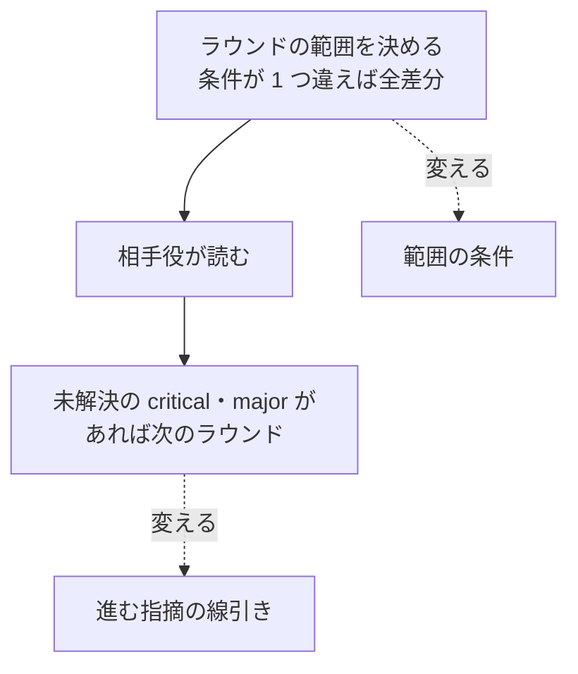
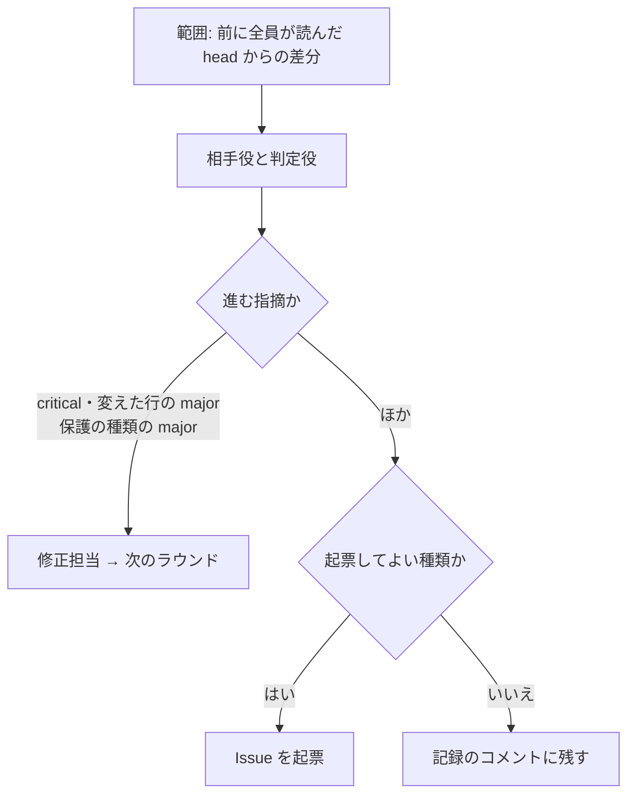
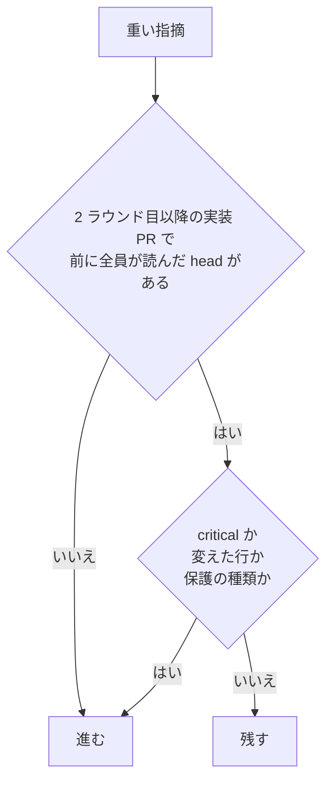

# cross-review: 2 ラウンド目以降は直した箇所を確かめて終わる（#3780）

2 ラウンド目以降も差分の全体を読み直すことがあり、直しと関係の無い細部の指摘でラウンドが伸びる。実装の Pull Request では範囲を前のラウンドからの差分に絞り、次のラウンドへ進む指摘を critical・変えた行への major・見落としの害が大きい major に限る。残りは起票するか記録のコメントに残し、上限の既定は 4 にする。調査と採らなかった案は、決定の記録と末尾の外部の調査にある。

## 今の姿

何が起きたか・目的・受け入れ条件は要求仕様（[issue-3780-requirements.md](./issue-3780-requirements.md)、正は #3780 の本文）にある。この文書は「どう解くか」と「なぜその解き方か」だけを書く。

- 範囲の起点は `scope_decide.read_by_all_head` が決める。比較基点・相手役（レビューする AI）・重点・単位の指示・PR・MVV のどれかが前に読んだラウンドと違うか、MVV の根拠の確認が終わっていなければ、起点が無くなり全差分になる
- 同じ条件の関数を、前回の収束をそのまま返すかの判定（`_reusable`）と `review-scope` も使う
- 次のラウンドへ進むかは `journal.handable` が重要度だけで決める。指摘の行と、そのラウンドで変わった行は突き合わせない
- 上限の既定は `contracts/limits/cross-review.max-rounds.json` の 3 で、実装と設計を分けない

## 文脈と制約

- 1 ラウンド目の範囲と、設計の Pull Request（`--purpose` が設計のプラン）の範囲は変えない
- 指摘の重要度は変えない（下げる条件は #4363 が持つ）。指摘の種類（`track`）は #4363 の判定役（指摘を確かめる読むだけの AI）の回答を使う
- 起票は課題の一覧を膨らませない（MVV の Value 6）。公開のリポジトリへ書く文は、記録のコメントと同じ伏せ字の処理を通す
- 起票に失敗しても指摘を失わない

## 解き方の全体像

- 範囲を全差分に戻すのは、一度も読まれていない内容が残る場合だけになる
- 2 ラウンド目以降、直しと関係の無い指摘では次のラウンドへ進まず、収束する
- 残した指摘は、Issue の URL か記録のコメントの URL が結果に載る。この「残し方」は #2468 も使う

## ドメインモデル

コンテキストは「NDF の cross-review」の 1 つである。

### 集約

| 集約 | オーナー（書き換えてよいもの） | 根 | エンティティ | 値オブジェクト |
| --- | --- | --- | --- | --- |
| 指摘のジャーナル | `journal.FindingJournal` | ジャーナル | 指摘 | 変えた行・残し方 |

### 不変条件

| # | 集約 | 条件 | 破れたときの扱い |
| --- | --- | --- | --- |
| I1 | 指摘のジャーナル | 直さずに残す指摘は、修正担当へ渡さない。収束を止めず、欠けにもしない。PR のスレッドにせず、次の実行へも引き継がない | — |
| I2 | 指摘のジャーナル | 一度進むと決めた指摘は、直すか見送るまで進むままである | 後のラウンドで行が変わらなくても外さない |
| I3 | 指摘のジャーナル | 直さずに残す指摘は、Issue の URL か記録のコメントのどちらかに必ずある | 起票に失敗したら記録のコメントに残し、次の起動で起票し直す |

### ドメインイベント

| # | イベント | 発生元 | 受け手 |
| --- | --- | --- | --- |
| E1 | ラウンドの範囲を決めた | 駆動 | 相手役 |
| E2 | 指摘を、進むものと進まないものに分けた | ジャーナル | 収束の判定 |
| E3 | 進まない指摘を残した | 記録の公開 | GitHub・結果 JSON |
| E4 | 収束と判定した | 収束の判定 | 呼び出し元 |

## 構成要素

| 要素 | 責務 |
| --- | --- |
| 範囲の判断（`scope_decide.py`・`round_scope.py`） | 範囲の起点の条件と、前回の収束を返す条件を分ける |
| 変えた行（`changes.py`） | 前に全員が読んだ head から今の head までに変わった行を、ファイルごとに返す |
| 線引きの判断（`leftover_decide.py`、新設） | 指摘が進むか、残すなら起票か記録かを決める。外部のコマンドを打たない |
| 起票（`leftover.py`、新設） | 起票の本文を組み、伏せ字を通して起票し、URL を指摘の行に書く |
| ジャーナル（`journal.py`） | 残す指摘に `parked` を付ける。残した指摘が出し直されて進む条件に当たれば外す |
| 終わり方（`finish_decide.py`）・記録（`report_decide.py`）・スレッド（`threads.py`） | `parked` の指摘を欠けとスレッドから除き、記録の表に残し方と URL を出す |
| 上限の既定（`cli.py`・`settings.py`・`contracts/limits/`） | `--max-rounds` を省いたときの既定を、PR の目的で決める |
| 手順書（`skills/cross-review/`） | 範囲・判定・終わり方の決まりを書き換える |

## データ構造

状態ファイルの指摘の行に次を足す。無い行は今のとおり読む。

| キー | 中身 |
| --- | --- |
| `parked` | 直さずに残す指摘なら真 |
| `issue` | 起票した Issue の URL |
| `issue_error` | 起票に失敗した理由。成功したら消す |

記録のコメントの末尾に埋める一覧には、起票済みの指摘（番号・本文・URL）も載せる。別の状態の保存先で始めた実行は、これを未解決の指摘として引き継がず、同じ指摘が出たときに URL を戻すためだけに使う。

## 入出力のコントラクト

| 呼び出し | 変えること |
| --- | --- |
| `ndf cross-review run` の結果 JSON の `items`（`kind: finding`） | 残した指摘に `disposition`（`issue` か `comment`）と `url` を足す |
| `ndf cross-review run`・`review-scope` の範囲 | 実装の PR は下の表のとおり変わる |
| `--max-rounds` を省いたとき | 設計のプランは 3、それ以外は 4 |
| 要約の行 | 「残した指摘 N（起票 M）」を足す |

### 範囲の起点の条件（実装の PR）

| 起きたこと | 範囲 |
| --- | --- |
| 前に全員が読んだラウンドが無い・その head が今の head の祖先でない | 全差分 |
| そのラウンドを読んでいない相手役が今回いる・読んだ PR が違う | 全差分 |
| 比較基点・重点・単位の指示・MVV が違う・MVV の根拠の確認が終わっていない | 前の head からの差分 |

前の head からの差分は、PR が変えるファイル（前のラウンドの時点と今の両方）に絞る。ベースブランチを取り込んだラウンドで、PR に関係の無い変更を読ませないためである。

### 起票の形

題は指摘の本文の先頭、本文は指摘の本文・起きること・場所・PR の URL・目印（`<!-- ndf:cross-review-leftover <発生の値> -->`）である。ラベルは付けない。

## 処理の流れ

| 用語・場合 | 決まり |
| --- | --- |
| 変えた行 | 前に全員が読んだラウンドの head から今の head までに足した行と、書き換えた行。行を消しただけの箇所は、前後の行を数える |
| 指摘に行が無く、パスがある | そのファイルが変わっていれば進む |
| 指摘にパスも無い | 進む |
| 保護の種類 | 判定役の `track` が `secret`・`authz`・`user_data`・`irreversible` |
| 判定役の回答が無い | 進む |
| NDF が機械で作った指摘・引き継いだ指摘・戻ってきた指摘のうち条件に当たるもの | 進む |
| minor・nit | 今と同じく修正へ回さない。残し方は記録のコメントである |

| 残し方 | 当たる指摘 |
| --- | --- |
| 起票 | 残す指摘のうち、判定役の `track` が空でないもの |
| 記録のコメント | ほかのすべて |

起票は、記録のコメントを書く処理（PR ごとのロックの中）で行う。行に `issue` があれば起票しない。失敗したら `issue_error` と警告を残して記録のコメントに載せ、次の起動か `ndf cross-review report` で打ち直す。課題の保存先（`.ndf/project.json` の `issues.primary`）が GitHub Issues でないプロジェクトでは、起票せず記録に残す。

## 決定の記録

### 決定 1: 一度読んだ内容を読み直さないため、範囲の起点の条件を前回の収束の再利用の条件から分ける

- **質問**: 重点や MVV が変わったときに、全差分を読み直すか
- **選んだ案**: 範囲の起点は、相手役と PR と履歴だけで決める（要求仕様の条件 1）。前回の収束を相手役なしで返す条件は、今の厳しい条件のまま変えない。設計の PR は両方とも今のまま
- 採らなかった案: 再利用の条件もゆるめる（重点や MVV を足した後の打ち直しが、一度もレビューせずに収束を返す）
- **代償**: 足した重点と新しい MVV の観点では、前に読んだ行を見直さない。head が同じで重点だけが変わった打ち直しは、空の差分を読むラウンドになる
- 根拠: Value 2（MVV バージョン 11）。PRD1

### 決定 2: 直しと関係の無い指摘で止まらないため、変えた行は前に全員が読んだ head との差分で数える

- **質問**: 「そのラウンドで変えた行」の起点と、行の分からない指摘の扱い
- **選んだ案**: 起点は相手役の全員が読んだ最後のラウンドの head とする。範囲が全差分に戻ったラウンドでも、この head があれば線引きする。行もパスも分からない指摘は進める
- 採らなかった案: PR の差分の行すべてを「変えた行」とする（今と変わらず、ほぼすべての指摘が進む）
- 採らなかった案: 行の分からない指摘は残す（設計全体への重い指摘が、直されずに収束する）
- **代償**: 行を書かない指摘は線引きを通り抜ける。直しが影響する離れた行の major は残す側になる
- 根拠: Value 5 / Value 7（MVV バージョン 11）。PRD2 / PRD3

### 決定 3: 設計の食い違いを残したまま承認へ進まないため、線引きは実装の PR だけに当てる

- **質問**: 進む指摘の線引きを、設計の Pull Request にも当てるか
- **選んだ案**: 当てない。当てるのは `--purpose` が設計のプランでない PR
- 採らなかった案: 設計の PR にも当てる（設計の指摘は、変えていないセクションと変えたセクションの食い違いが中心である。範囲の決まりも要求仕様の対象外である）
- **代償**: 設計の PR のラウンドは今と同じように伸びうる
- 根拠: Value 7 / Value 8（MVV バージョン 11）

### 決定 4: 細部で伸びる経路を MVV の指摘にも残さないため、MVV に反する major も同じ線で分ける

- **質問**: MVV の Value などに反すると固定した major を、変えていない行でも進めるか
- **選んだ案**: 進めない。受け入れ条件 2・5 のとおり、critical・変えた行・保護の種類だけを進める。残した指摘は MVV の記録と結果 JSON の `outputs.mvv.findings` に未解決として残り、承認する人が見る。必ず人の承認が要る操作の指摘と、根拠の行の誤りの扱いは今のまま
- 採らなかった案: MVV に反する指摘は常に進める（受け入れ条件 2 の例外になり、重複や冗長の指摘でラウンドが続く）
- **代償**: 変えていない行の MVV 違反は、理由 `mvv_unresolved` でプランが止まることがなくなる。設計承認ゲートで確かめる
- 根拠: Value 6 / Value 7（MVV バージョン 11）

### 決定 5: 課題の一覧を膨らませず必要な指摘は失わないため、起票は判定役が種類を付けた指摘だけにする

- **質問**: 残す指摘のどれを起票するか。「利用者に届いた不具合か」を誰が決めるか
- **選んだ案**: #4363 の判定役の回答の `track`（利用者に届いた不具合・人の安全・秘密・認証認可・利用者のデータ・戻せない操作・承認資料の正しさ）が空でないものだけを起票する。種類の並びは NDF の決まりとして持ち、利用先の MVV の番号に依らない
- 採らなかった案: 相手役に種類を書かせる（書けば起票されるので、申告が増える向きに偏る）
- 採らなかった案: すべて起票する（Value 6 に反する）
- 採らなかった案: 分類のためだけに AI をもう 1 回起動する（判定役の同じ回答で足りる）
- **代償**: 判定役が回答しなかった指摘は残す側にせず、進む指摘として扱うので、そのラウンドは短くならない。minor は確かめないので起票されない
- 根拠: Value 6 / Value 2（MVV バージョン 11）

### 決定 6: 打ち直しをまたいでも 4 回で終わるため、実装の PR の上限の既定を 4 にする

- **質問**: 上限の既定の値
- **選んだ案**: 設計のプランは 3 のまま、それ以外は 4。`--max-rounds` を渡せばその値が勝つ。後で実装する #2468 の変更で、上限は収束していない打ち直しの合計に掛かる。プロジェクトが `.ndf/review.json` に上限を書いた場合の扱いは #2468 が持つ
- 採らなかった案: 3 のまま（合計の上限になると、全差分の 1 回の後に直しを確かめる回が 2 回しか残らない）
- 採らなかった案: 5 以上（#4014 の後の実行は中央値が 3 ラウンドで、上限を広げる材料が無い）
- **代償**: 収束しない PR は、1 回の起動で 1 ラウンド分の費用が増える
- 根拠: Value 2 / Value 5（MVV バージョン 11）

## 影響と危険

- **働く範囲**: NDF を使うすべてのリポジトリの cross-review
- **プロジェクトごとに違うもの**: 課題の保存先（`.ndf/project.json`）、上限（`--max-rounds`）
- **当たるモード**: cross-review を通るモード。線引きと範囲は実装の PR だけ

互換は残さない。壊れうる箇所と扱いは次のとおりである。

| 箇所 | 扱い |
| --- | --- |
| 収束と判定されるのが早くなる。変えていない行の major が直されずに残る | 記録のコメントと結果の `items` に必ず出す |
| MVV の指摘で止まる場合が減る（決定 4） | 設計承認ゲートで確かめる |
| 起票は GitHub への書き込みが増える | 同じ行は 1 回だけ起票する。公開向けの伏せ字の処理を通す |
| #4363・#2468 と同じファイルを変える | #4363 の後、#2468 の前に実装する |

### 代表のリポジトリでの振る舞い

| 代表のリポジトリ | 設定の要点 | 直した後に起きること | この種類で扱えなくなること |
| --- | --- | --- | --- |
| Web サービス | GitHub Issues | 2 ラウンド目以降は直した行を確かめて収束する。一部が起票される | 無し |
| モバイルアプリ | 課題の保存先が GitHub 以外のことがある | その場合は起票せず記録のコメントに残る | 無し |
| 業務文書だけ | Markdown の PR を実装の目的で回す | 変えていない文への指摘は記録に残る | 無し |

### このリポジトリだけの事情

- 無し（起票する種類は NDF の決まりとして持ち、このリポジトリの MVV の番号を参照しない）

## 用語

| 用語 | 意味 | 用語集への反映 |
| --- | --- | --- |
| 直さずに残す指摘 | cross-review で、重くても次のラウンドへ進めず、起票か記録のコメントに残して終える指摘 | 追加 |

## テスト設計

| 受け入れ条件・不変条件 | どの振る舞いで縛るか | どう壊したら落ちるべきか |
| --- | --- | --- |
| 条件 1 | 比較基点・重点・指示・MVV・根拠の確認が違っても範囲は前の head からになる。読んでいない相手役・PR の違い・祖先でない head では全差分になる | 起点の条件を再利用の条件と同じに戻すと落ちる。読んでいない相手役を無視すると落ちる |
| 条件 2 | 変えていない行の major と minor だけのラウンドは収束し、`track` のあるものは起票、ほかは記録の URL が結果に載る | 重要度だけで進めると落ちる。全部起票すると落ちる |
| 条件 3 | 省けば実装 4・設計 3、`--max-rounds` を渡せばその値 | 既定を 1 つに戻すと落ちる |
| 条件 4 | 1 ラウンド目は全差分で、線引きしない | 1 ラウンド目に線引きを当てると落ちる |
| 条件 5 | critical・変えた行の major・保護の種類の major は修正へ回る | 行の判定を逆にすると落ちる |
| I1 | 残した指摘は欠け・スレッド・引き継ぎに出ない | 未解決として数えると落ちる |
| I2 | 進むと決めた指摘は、後のラウンドでも修正へ回る | ラウンドごとに分け直すと落ちる |
| I3 | 起票の失敗で指摘が記録に残り、打ち直しで 1 回だけ起票する | 失敗で行を落とすと落ちる。打ち直しで 2 件起票すると落ちる |

## 設計の結果

| 課題 | 扱い | 統合先 | 触るファイル |
| --- | --- | --- | --- |
| #3780 | 実装する | — | `plugins/ndf/src/ndf/domains/crossreview/scope_decide.py`、`plugins/ndf/src/ndf/domains/crossreview/round_scope.py`、`plugins/ndf/src/ndf/domains/crossreview/changes.py`、`plugins/ndf/src/ndf/domains/crossreview/leftover_decide.py`（新設）、`plugins/ndf/src/ndf/domains/crossreview/leftover.py`（新設）、`plugins/ndf/src/ndf/domains/crossreview/drive.py`、`plugins/ndf/src/ndf/domains/crossreview/journal.py`、`plugins/ndf/src/ndf/domains/crossreview/finish_decide.py`、`plugins/ndf/src/ndf/domains/crossreview/report_decide.py`、`plugins/ndf/src/ndf/domains/crossreview/threads.py`、`plugins/ndf/src/ndf/domains/crossreview/cli.py`、`plugins/ndf/src/ndf/domains/crossreview/settings.py`、`plugins/ndf/contracts/limits/cross-review.max-rounds.json`、`plugins/ndf/contracts/limits/cross-review.max-rounds.design.json`（新設）、`plugins/ndf/contracts/schemas/io/cross-review.result.schema.json`、`plugins/ndf/contracts/schemas/io/cross-review.args.schema.json`、`plugins/ndf/skills/cross-review/SKILL.md`、`plugins/ndf/skills/cross-review/docs/01-state-and-review.md`、`plugins/ndf/skills/cross-review/docs/02-fix-and-rotation.md`、`plugins/ndf/tests/domains/crossreview/test_crossreview_scope.py`、`plugins/ndf/tests/domains/crossreview/test_crossreview_leftover.py`（新設）、`plugins/ndf/tests/domains/crossreview/test_crossreview_run.py`、`plugins/ndf/tests/domains/crossreview/test_crossreview_finish.py`、`plugins/ndf/tests/domains/crossreview/test_crossreview_report.py` |

## 未確認のまま残ること

| 項目 | 内容 |
| --- | --- |
| #3779 の 2・3 ラウンドが全差分になった原因 | 状態ファイルが残っておらず分からない。範囲の起点の条件のうち、全差分に残る 4 つに当たった場合は直らない |
| ラウンド数の減り方 | リリース後の実行の記録で分かる |
| 起票される件数 | 判定役の分類の偏りは動かすまで分からない。リリース後の実行の起票を数える |

## 外部の調査

| 種類 | 調べるか | 理由 |
| --- | --- | --- |
| 標準・仕様 | 調べる | 止めない指摘の書き方がある |
| 主要な製品 | 調べる | 再レビューの範囲と、変えた行に限る扱いを比べる |
| ライブラリとサービス | 調べない | 差分の行は git の出力から取れ、読む処理（`changes.py`）は既にある |

### 標準・仕様

| # | 標準・仕様 | 何を定めているか | 設計への反映 | 出典 |
| --- | --- | --- | --- | --- |
| STD1 | Google の Code Review の標準 | 全体が良くなる変更は通し、細部の指摘は「Nit:」を付けて任意にする | 細部の指摘で止めない向きに合わせる | https://raw.githubusercontent.com/google/eng-practices/master/review/reviewer/standard.md （2026-11-27） |

### 主要な製品

| # | 製品 | どう解いているか | 設計への反映 | 出典 |
| --- | --- | --- | --- | --- |
| PRD1 | CodeRabbit | `review` は前回のレビューの後のコミットだけを読み、全体を読み直すのは `full review` を指示したときである | 2 回目以降は差分を既定にする | https://docs.coderabbit.ai/reference/review-commands.md （2026-11-27） |
| PRD2 | SonarQube | 品質ゲートを新しいコード（足した・変えたコード）に当てる | 止める指摘を変えた行に限る | https://docs.sonarsource.com/sonarqube-server/10.7/core-concepts/clean-as-you-code/overview.md （2026-11-27） |
| PRD3 | GitHub の code scanning | PR で変えた行の新しいアラートを注記として出す | 変えた行を指摘の位置と突き合わせる | https://docs.github.com/en/code-security/how-tos/manage-security-alerts/manage-code-scanning-alerts/triage-alerts-in-pull-requests （2026-11-27） |

### ライブラリとサービス

調べていない（理由は上の表）。

### 確かめられなかったこと

| 対象 | 試した手段 | 結果と理由 |
| --- | --- | --- |
| CodeRabbit が差分の外の指摘をどう扱うか | 検索「CodeRabbit incremental review outside diff range comments」 | 該当する公式の記述を取得できなかった |

調べた量: 候補 4 件・取得の試み 7 回。
