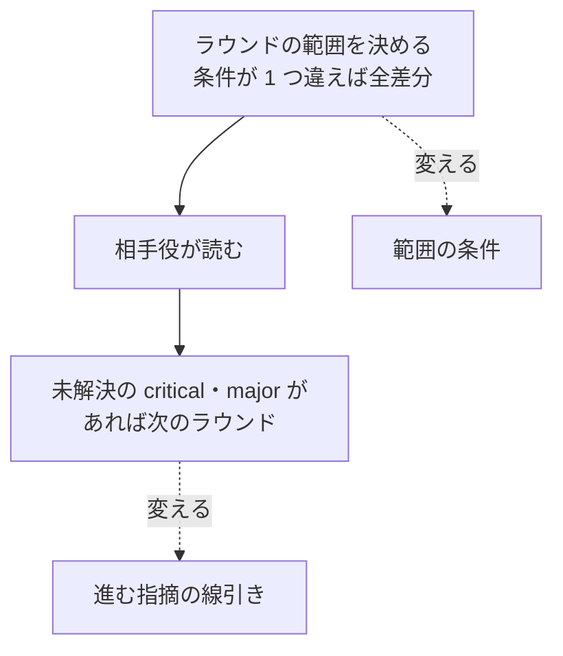
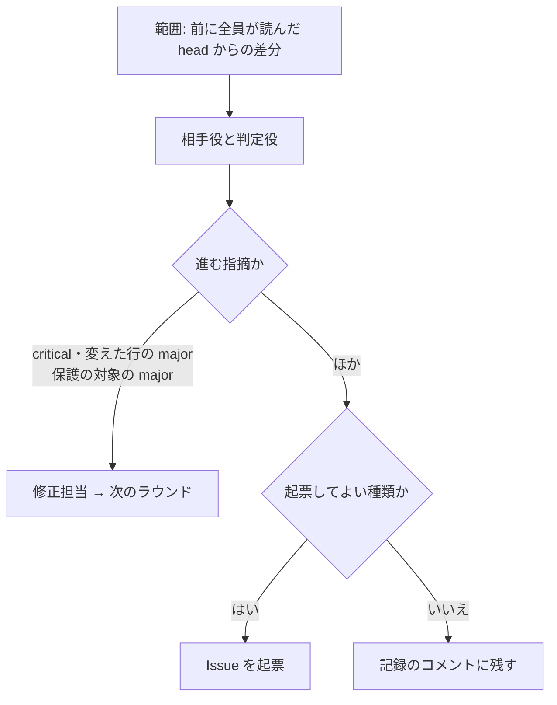
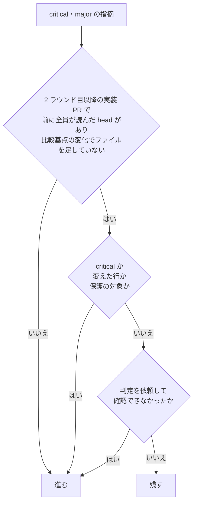

# cross-review: 2 ラウンド目以降は直した箇所を確かめて終わる（#3780）

2 ラウンド目以降も差分の全体を読み直すことがあり、直しと関係の無い細部の指摘でラウンドが伸びる。実装の Pull Request では範囲を前のラウンドからの差分に絞り、次のラウンドへ進む指摘を critical・変えた行への major・保護の対象（秘密など、見落としの害が大きい種類）の major に限る。残りは起票するか記録のコメントに残し、上限の既定は 4 にする。調査と採らなかった案は、決定の記録と末尾の外部の調査にある。

## 今の姿

何が起きたか・目的・受け入れ条件は要求仕様（[issue-3780-requirements.md](./issue-3780-requirements.md)、正は #3780 の本文）にある。この文書は「どう解くか」と「なぜその解き方か」だけを書く。

- 範囲の起点は `scope_decide.read_by_all_head` が決める。比較基点・相手役（レビューする AI）・重点・単位の指示・PR・MVV のどれかが前に読んだラウンドと違うか、MVV の根拠の確認が終わっていなければ、起点が無くなり全差分になる（語の意味は下の表）
- 同じ条件の関数を、前回の収束をそのまま返すかの判定（`_reusable`）と `review-scope` も使う
- 次のラウンドへ進むかは `journal.handable` が重要度だけで決める。指摘の行と、そのラウンドで変わった行は突き合わせない
- 上限の既定は `contracts/limits/cross-review.max-rounds.json` の 3 で、実装と設計を分けない

| 語 | 意味 |
| --- | --- |
| 重点 | プロジェクトが `.ndf/review.json` の `focus` に書くレビューの観点 |
| 単位の指示 | 作業を分けて出す PR のレビューで、この PR の担当範囲を書いて渡す指示 |
| 別の保存先の実行 | 状態ファイルの保存先（`--state-dir`）を変えて始めた実行。前の状態ファイルを読めないので、指摘は PR のスレッドと記録のコメントから引き継ぐ |
| MVV の根拠の確認 | PR が足した「根拠: Value 5（MVV バージョン 11）」の形の行が、承認済みの MVV と合うかを NDF が機械で確かめること |
| 欠け | 結果の `gaps`。直したとも見送ったとも決まらない指摘などで、残ると収束にならない |
| 実装の PR・設計の PR | `--purpose design` で起動したものが設計の PR である。ほかの値（`code`・省略時の `cross-review` など）はすべて実装の PR である。判定は今の `cli._every_section` の 1 つを使う。この設計の線引き・範囲・上限の既定は、すべてこの分け方に従う |
| 指摘の種類・保護の対象の指摘 | 行の `protect` と判定役の `tracks` を合わせたものが指摘の種類で、秘密・認証認可・利用者のデータ・戻せない操作・人の安全のどれかを含むものが保護の対象である（[#4363 の「回答の形」](./issue-4363-design.md)） |

## 文脈と制約

- 1 ラウンド目の範囲と、設計の PR の範囲は変えない
- 指摘の重要度は変えない（下げる条件は #4363 が持つ）。指摘の種類は、#4363 が定める行の `protect`（保護の種類）と判定役（指摘を確かめる読むだけの AI）の `tracks` を使う
- 起票は課題の一覧を膨らませない（MVV の Value 6）。公開のリポジトリへ書く文は、記録のコメントと同じ伏せ字の処理を通す
- 起票に失敗しても指摘を失わない

## 解き方の全体像

- 範囲を全差分に戻すのは、一度も読まれていない内容が残る場合だけになる
- 2 ラウンド目以降、直しと関係の無い指摘では次のラウンドへ進まず、収束する
- 残した指摘は、Issue の URL か記録のコメントの URL が結果に載る。この「残し方」は #2468 も使う

## ドメインモデル

コンテキストは「NDF の cross-review」の 1 つである。

### 集約

| 集約 | オーナー（書き換えてよいもの） | 根 | エンティティ | 値オブジェクト |
| --- | --- | --- | --- | --- |
| 指摘のジャーナル | `journal.FindingJournal` | ジャーナル | 指摘 | 変えた行・残し方 |

### 不変条件

| # | 集約 | 条件 | 破れたときの扱い |
| --- | --- | --- | --- |
| I1 | 指摘のジャーナル | 直さずに残す指摘は、修正担当へ渡さない。収束とレビューの停止理由（欠けと `mvv_unresolved`）から除く。PR のスレッドにせず、次の実行へも引き継がない。MVV に反する指摘は、MVV の記録と結果の `outputs.mvv.findings` には未解決のまま残す | — |
| I2 | 指摘のジャーナル | 一度進むと決めた指摘は、直すか見送るまで進むままである | 後のラウンドで行が変わらなくても外さない |
| I3 | 指摘のジャーナル | 直さずに残す指摘は、Issue の URL か記録のコメントのどちらかに必ずある | 起票に失敗したら記録のコメントに残し、次の起動で起票し直す。起票済みの Issue が無いと確認できない場合も起票せず、記録のコメントに残す |

### ドメインイベント

| # | イベント | 発生元 | 受け手 |
| --- | --- | --- | --- |
| E1 | ラウンドの範囲を決めた | 駆動 | 相手役 |
| E2 | 指摘を、進むものと進まないものに分けた | ジャーナル | 収束の判定 |
| E3 | 進まない指摘を残した | 記録の公開 | GitHub・結果 JSON |
| E4 | 収束と判定した | 収束の判定 | 呼び出し元 |

この設計で「指摘の行」や、項目を持つ「行」は、状態ファイルの指摘 1 件分の記録を指す。「変えた行」と「指摘に行が無い」の行は、ソースの行である。

## 構成要素

| 要素 | 責務 |
| --- | --- |
| 範囲の判断（`scope_decide.py`・`round_scope.py`） | 範囲の起点の条件と、前回の収束を返す条件を分ける |
| 変えた行（`changes.py`） | 前に全員が読んだ head から今の head までに変わった行を、ファイルごとに返す |
| 線引きの判断（`leftover_decide.py`、新設） | 指摘が進むか、残すなら起票か記録かを決める。外部のコマンドを打たない |
| 起票（`leftover.py`、新設） | 起票の本文を組み、伏せ字を通して起票し、URL を指摘の行に書く |
| ジャーナル（`journal.py`） | 残す指摘に `parked` を付ける。残した指摘が出し直されて進む条件に当たれば外す |
| 終わり方（`finish_decide.py`）・記録（`report_decide.py`）・スレッド（`threads.py`） | `parked` の指摘を欠け（MVV の欠けを含む）とスレッドから除き、記録の表に残し方と URL を出す。MVV に反する `parked` の指摘は、`outputs.mvv.findings` に残したまま、番号・MVV の項目・URL を結果の `decisions` に 1 件ずつ載せる |
| 上限の既定（`cli.py`・`settings.py`・`contracts/limits/`） | `--max-rounds` を省いたときの既定を、PR の目的で決める |
| 手順書（`skills/cross-review/`） | 範囲・判定・終わり方の決まりを書き換える |

## データ構造

状態ファイルの指摘の行に次を足す。無い行は今のとおり読む。

| キー | 中身 |
| --- | --- |
| `parked` | 直さずに残す指摘なら真 |
| `issue` | 起票した Issue の URL |
| `issue_error` | 起票に失敗した理由。成功したら消す |

状態ファイルの全体には次を足す。

| キー | 中身 |
| --- | --- |
| `issue_logins` | この状態ファイルで起票に使った login の並び。Issue を作る前に保存する |
| `issue_record_id` | 起票の記録のコメント（下の「起票の形」）の番号。2 回目からは、コメントの一覧を読まずにこの番号で読む |
| `issue_list_full` | 作成の結果が分からない候補を確かめるときに、一覧がページ数の上限を超えた場合の、その上限の値。確かめ終えたら消す |

記録のコメントの末尾に埋める一覧には、起票済みの指摘（番号・本文・URL）も載せる。そのうち直さずに残す指摘（`parked`）は、別の状態の保存先で始めた実行が未解決の指摘として引き継がず、同じ指摘が出たときに URL を戻すためだけに使う。起票済みでも未解決の指摘（#2468 の上限で残ったもの）は、未解決の指摘として引き継ぐ。

## 入出力のコントラクト

| 呼び出し | 変えること |
| --- | --- |
| `ndf cross-review run` の結果 JSON の `items`（`kind: finding`） | 残した指摘に `disposition`（`issue` か `comment`）と `url` を足す |
| `ndf cross-review run`・`review-scope` の範囲 | 実装の PR は下の表のとおり変わる |
| `--max-rounds` を省いたとき | `--purpose design` は 3、ほかは 4 |
| `.ndf/project.json` の `issues.primary` | `github` のときだけ PR のリポジトリへ起票する。未設定は起票しない（下の「処理の流れ」） |
| 要約の行 | 「残した指摘 N（起票 M）」を足す |

### 範囲の起点の条件（実装の PR）

| 起きたこと | 範囲 |
| --- | --- |
| 前に全員が読んだラウンドが無い・その head が今の head の祖先でない | 全差分 |
| そのラウンドを読んでいない相手役が今回いる・読んだ PR が違う | 全差分 |
| 比較基点・重点・単位の指示・MVV が違う・MVV の根拠の確認が終わっていない | 前の head からの差分。比較基点が違うときは下の分を足す |

比較基点が違うときは、前の head からの差分を PR が変えるファイル（前のラウンドの時点と今の両方）に絞る。ベースブランチを取り込んだラウンドで、PR に関係の無い変更を読ませないためである。比較基点が同じなら、この差分に出るファイルはどれも PR の変更なので、絞るための一覧を読まない。PR に既にあるインラインのコメントも、渡す差分と同じファイルの範囲で選ぶ。

比較基点が変わると、前の head からの差分に出ない箇所が PR の変更になることがある。PR の比較先を変えた場合と、ベースブランチの取り込みで競合を解消して前の head の内容に戻した場合である。そこで比較基点が前のラウンドと違うときは、既読の差分にも今回渡す差分にも無い変更を、次の手順で探す。

1. 3 つの差分を作る。既読の差分は `<前の比較基点>...<前の head>`、今の PR の差分は `<今の比較基点>...<今の head>`、今回渡す差分は `<前の head>..<今の head>` である
2. 今の PR の差分にある足した行と消した行を、1 行ずつ確かめる
    - 足した行は、次のどちらかに当たれば、読んだか、今回読む。今回渡す差分が、同じ位置で同じ行を足している。または、今回渡す差分の対応を使って前の head の行番号に直した位置で、既読の差分が同じ行を足している
    - 消した行は、既読の削除と今回の削除を合わせて照らす。手順は[詳細設計の「処理の手順」](./issue-3780-design-detail.md#処理の手順)に従う
3. ファイルの変更の種別（追加・削除・変更・リネームなど）、リネームの元と先のパス、変更前後のファイルのモードも、同じように既読の差分か今回渡す差分にあるかを確かめる。行で比べられないファイル（バイナリなど）は、今の PR の差分の変更前の内容が、既読の差分か今回渡す差分の変更前の内容と同じなら当たる。違えば、その内容は相手役に渡っていないので当たらない。今回渡す差分が実行権限や名前だけを変える場合は、中身を渡さないので、既読の差分とだけ比べる。相手役は、差分に載る変更前後の内容の ID（blob ID）を使って、作業場所のリポジトリから中身を読む
4. 当たらない行か変更が 1 つでもあるファイルを、**新しく PR の変更になったファイル**とする。今の PR の差分のうち、そのファイルの分も相手役へ渡す。既読の差分にしか無いファイル（PR の差分から消えただけのファイル）は含まれない

[#2468 の上限で終わる起動](./issue-2468-design.md)も、読んだかの判定に同じ手順を使う。競合の無いベースブランチの取り込みでは、新しく PR の変更になったファイルは無い。足して渡したラウンドは線引きをせず、重い指摘をすべて進める。前の比較基点か前の head のコミットが手元に無く、比べられないときは全差分にする。

### 起票の形

題は指摘の本文の先頭、本文は指摘の本文・起きること・場所・PR の URL・目印（`<!-- ndf:cross-review-leftover <識別値> -->`）である。ラベルは付けない。

秘密を伏せる処理（伏せ字）は、指摘の本文の**全文**に先に当て、その結果から題の先頭を切り出す。起きること・場所も、切り詰める前の全文に当てる。先に切り出すと、途中で切れた秘密は秘密の形に当たらなくなり、伏せられないまま公開されうるためである。PR の URL には、元の PR（状態ファイルの `pr`）の URL を必ず書く。PR を巻き直した（閉じて新しい番号で出し直した）後の起票では、今の PR の URL も添える。

識別値は、状態ファイルの元の PR 番号と、指摘の本文の全体（空白をまとめ、大文字小文字をそろえた値）をつないだ文字列の SHA-256 の先頭 12 字である。本文の先頭だけを使うと、書き出しが同じ別の指摘が同じ値になる。指摘の発生の値（`occurrence`）は、指摘が戻ったときと別の保存先で引き継いだときに変わるので使わない。

起票の前に、この指摘を扱う Issue がすでにあるかを調べる。調べる元は、元の PR に置く**起票の記録**である。これは元の PR（状態ファイルの `pr`）の専用のコメントで、作成を試みた指摘の識別値、試みた時刻、起票できた Issue の URL を持つ。状態の保存先が違っても同じコメントを読むので、別の保存先で打ち直しても、作成を試みたことが分かる。

起票は次の順で行う。コメントの読み書きは、起票の記録を置く元の PR（状態ファイルの `pr`）の番号で取る公開のロックの中で行う。記録のコメントの公開は今の PR 番号（`current_pr`）でロックを取るので、番号が違えば（PR を巻き直した後）、今の番号のロックに続けて元の番号のロックも取る。今の番号のロックだけでは、巻き直しの前に始まった公開と後の公開が、同じ起票の記録を同時に読むためである。

1. 起票の記録を読む
2. 記録に無い識別値は、まだ作成を試みていない。起票する識別値を記録へ書き足してから作成する。試みた時刻は、コメントを書いた応答の更新時刻にする（実行するマシンの時計に依らない）。記録を書けなければ作成しない
3. URL がある識別値は起票せず、その URL を使う
4. 識別値があって URL が無い候補は、作成の結果が分からない。次の順で調べる
    1. 識別値で本文を検索する（`GET search/issues?q=repo:{owner}/{repo} is:issue "<識別値>" in:body`）。時間が経っていれば、検索に反映されている
    2. 見つからなければ、検索の反映が遅れている場合のために、Issue の一覧を新しく作られた順に読み、作成時刻が試みた時刻より前のものに達したら止める（`repos/{owner}/{repo}/issues?state=all&sort=created&direction=desc&per_page=100`）。作成時刻が試みた時刻以後（同じ時刻を含む）の Issue をすべて読んでも無ければ、記録の試みた時刻を書き直してから起票する
5. 起票できた URL を記録へ書く。GitHub が作成をはっきり拒んだ（4xx）識別値は、記録から消す

読む範囲を試みた時刻以後に作られた Issue に限るのは、無関係な Issue の更新が多いリポジトリでも、打ち直しで確かめ終えられるようにするためである。一覧がページ数の上限 `github.list-pages` を超えた場合は、`issue_error` に理由を書き、`issue_list_full` にその上限の値を残して保留する。`issue_list_full` がある間、自動の公開は一覧を読まない。検索で見つかるか、今の `github.list-pages` がその値より大きいか、利用者が `ndf cross-review report` を打てば進む。本文の HTML コメントの中の文字列も検索に当たることは、2026-11-27 にこのリポジトリで確かめた。

起票の記録と Issue は、次に挙げる作者のものだけを使う。

- リポジトリの所有者・メンバー・共同作業者（`author_association` が `OWNER`・`MEMBER`・`COLLABORATOR`）
- 実行している login 自身
- `issue_logins` にある login。bot が起票した後に、人のアカウントで打ち直しても見つけるためである

公開のリポジトリで、第三者が目印を書いた Issue やコメントが起票を止めないようにする。目印を含むだけでは、同じ指摘を扱う Issue とはみなさない。次のすべてを満たす Issue だけを使う。

- Pull Request でない（REST の一覧は Pull Request も返す）
- 本文の最後の空でない行が、目印だけの行である
- 引用（`>` で始まる行）でもコードブロックの中でもない所に、元の PR の URL と、指摘の本文（伏せ字を通した後の形）がある

条件を満たす Issue がある指摘は起票せず、その URL を `issue` に書く。

記録の公開 1 回で、起票のために足す API の呼び出しは次のとおりである。起票の候補が無ければ呼ばない。作成の結果が分からない候補が無ければ、検索も Issue の一覧の取得もしない。

| 呼び出し | 回数 |
| --- | --- |
| 起票の記録の読み取り（GET） | 1 回。`issue_record_id` が無いときは、元の PR のコメントの一覧をページごとに読んで探す |
| 起票の記録の書き込み | 作成の前に 1 回、作成の結果を書くのに 1 回 |
| 識別値の検索（GET） | 作成の結果が分からない候補ごとに 1 回 |
| 新しく作られた順の Issue の一覧（GET） | 作成の結果が分からない候補が検索で見つからないときだけ。試みた時刻に達するまでのページで、最大 `github.list-pages` 回。同じ起動の候補で共有する |
| 実行している login の取得 | 同じ起動でまだ読んでいないときだけ、最大 1 回。スレッドの書き手を確かめるために読む `viewer`（`threads.GitHubPort`）を使い回す |
| Issue の作成（POST） | 起票の記録に無いか、無いと確認できた候補ごとに、最大 1 回 |

記録か検索か一覧の読み取りに失敗した場合と、無いと確認できない場合は起票せず、`issue_error` に理由を書いて次の起動か `ndf cross-review report` で打ち直す。検索の API には 1 分あたりの回数の上限があるので、上限に当たった残りの候補も同じ扱いにする。

## 処理の流れ

| 用語 | 決まり |
| --- | --- |
| 変えた行 | 前に全員が読んだラウンドの head から今の head までに足した行と、書き換えた行。行を消しただけの箇所は、前後の行を数える |
| 保護の対象の指摘 | 指摘の種類に `secret`・`authz`・`user_data`・`irreversible`・`safety` のどれかがある |
| 判定を依頼して確認できなかった指摘 | 判定役へ渡したのに有効な回答が無い（失敗・読めない回答・不正な回答・資料が足りない・上限で起動しなかった） |
| 判定対象外の指摘 | 判定役へ渡さないと決めた指摘（[#4363 の「処理の流れ」](./issue-4363-design.md)）。回答が無いことを理由に進めない |

線引きは、次の表を上の行から順に当てる。

| 順 | 指摘 | 扱い |
| --- | --- | --- |
| 1 | 必ず人の承認が要る操作の指摘 | 線引きしない。今の扱い（修正担当が見送りを決められず、人の判断を待つ）のままで、`parked` を付けない |
| 2 | NDF が機械で作った指摘（MVV の根拠の行の誤り） | 進む。直るまで残れば、今と同じく `mvv_unresolved` で止まる |
| 3 | 前の実行から引き継いだ未解決の指摘 | 進む（前の実行で進むと決まっていた。I2） |
| 4 | 直した後にもう一度出た指摘 | 進む（直しが足りていない） |
| 5 | critical・変えた行への major・保護の対象の major（出し直しの `protect` を含む） | 進む。直さずに残した指摘の出し直しなら `parked` を外す |
| 6 | 指摘に行が無くパスがあり、そのファイルが変わっている major。パスも無い major | 5 と同じ |
| 7 | 判定を依頼して確認できなかった major | 5 と同じ |
| 8 | ほかの major（判定対象外を含む） | 残す。直さずに残した指摘の出し直しは、残したままにする |
| — | minor・nit | 今と同じく修正へ回さない。残し方は記録のコメントである |

| 残し方 | 当たる指摘 |
| --- | --- |
| 起票 | 残す major のうち（minor・nit は種類にかかわらず起票しない）、指摘の種類に `delivered`・`safety`・`secret`・`user_data`・`irreversible`・`approval` のどれかがあるもの |
| 記録のコメント | ほかのすべて |

起票は、記録のコメントを書く処理（PR ごとのロックの中）で行う。行に `issue` があれば起票しない。無ければ上の起票の記録を確かめてから起票する。失敗したら `issue_error` と警告を残して記録のコメントに載せ、次の起動か `ndf cross-review report` で打ち直す。起票するかは、メインディレクトリの `.ndf/project.json` の `issues.primary` で決める。起票先は PR のリポジトリ（状態ファイルの `target_repo`）である。`issues.others` は起票の判断に使わない。

| `issues.primary` | 扱い |
| --- | --- |
| 文字列 `github` | 起票する |
| ほかの文字列（`markdown`・`redmine`・`external` など） | 起票せず記録のコメントに残す |
| 未設定（ファイルが無い、`issues` が無いか null、決められない値 `unknown`） | 起票せず記録のコメントに残し、起票するには `github` を設定することを警告に出す |

## 決定の記録

### 決定 1: 一度読んだ内容を読み直さないため、差分の起点を決める条件を、前回の収束結果を使い回す条件とは別にする

- **質問**: 重点や MVV が変わったときに、全差分を読み直すか
- **選んだ案**: 範囲の起点は、相手役と PR と履歴だけで決める（要求仕様の条件 1）。前回の収束を相手役なしで返す条件は、今の厳しい条件のまま変えない。設計の PR は両方とも今のまま
- 採らなかった案: 再利用の条件もゆるめる（重点や MVV を足した後の打ち直しが、一度もレビューせずに収束を返す）
- **代償**: 足した重点と新しい MVV の観点では、前に読んだ行を見直さない。head が同じで重点だけが変わった打ち直しは、空の差分を読むラウンドになる。足した重点でのレビューは行われず、未解決の指摘が無ければ収束しうる
- 根拠: Value 2（MVV バージョン 11）。PRD1

### 決定 2: 直しと関係の無い指摘で止まらないため、変えた行は前に全員が読んだ head との差分で数える

- **質問**: 「そのラウンドで変えた行」の起点と、行の分からない指摘の扱い
- **選んだ案**: 起点は相手役の全員が読んだ最後のラウンドの head とする。範囲が全差分に戻ったラウンドでも、この head があれば線引きする（比較基点が移って PR の変更が増えたラウンドを除く）。行もパスも分からない指摘は進める
- 採らなかった案: PR の差分の行すべてを「変えた行」とする（今と変わらず、ほぼすべての指摘が進む）
- 採らなかった案: 行の分からない指摘は残す（設計全体への重い指摘が、直されずに収束する）
- **代償**: 行を書かない指摘は線引きを通り抜ける。直しが影響する離れた行の major は残す側になる
- 根拠: Value 5 / Value 7（MVV バージョン 11）。PRD2 / PRD3

### 決定 3: 設計の食い違いを残したまま承認へ進まないため、線引きは実装の PR だけに当てる

- **質問**: 進む指摘の線引きを、設計の Pull Request にも当てるか
- **選んだ案**: 当てない。当てるのは実装の PR（`--purpose` が `design` でないもの）だけである
- 採らなかった案: 設計の PR にも当てる（設計の指摘は、変えていないセクションと変えたセクションの食い違いが中心である。範囲の決まりも要求仕様の対象外である）
- **代償**: 設計の PR のラウンドは今と同じように伸びうる
- 根拠: Value 7 / Value 8（MVV バージョン 11）

### 決定 4: 細かい指摘でラウンドが増えないため、MVV に反する major も、変えていない行なら直さずに残す

- **質問**: MVV の Value などに反すると固定した major を、変えていない行でも進めるか
- **選んだ案**: 進めない。受け入れ条件 2・5 のとおり、critical・変えた行・保護の対象だけを進める。MVV に反する major かを固定するのは今と同じで、相手役が指摘に MVV の項目を挙げ、ジャーナル（`journal._classify`）が重さを固定する。残した指摘は、修正ラウンドとレビューの停止理由から除き、MVV の記録と `outputs.mvv.findings` に未解決として残す。承認する人は、実装の PR のリリース承認で、記録のコメントの表（MVV の項目と URL）と結果の `decisions` を読み、残してよいかを確かめる。必ず人の承認が要る操作の指摘の扱いは変えない。MVV の根拠の行の誤り（NDF が作る指摘）は常に進み、残れば `mvv_unresolved` で止まる
- 採らなかった案: MVV に反する指摘は常に進める（受け入れ条件 2 の例外になり、重複や冗長の指摘でラウンドが続く）
- **代償**: 変えていない行の MVV 違反は、理由 `mvv_unresolved` でプランが止まることがなくなる。人が見るのはリリース承認になる
- 根拠: Value 6 / Value 7（MVV バージョン 11）

### 決定 5: 課題の一覧を膨らませず必要な指摘は失わないため、起票は判定役が種類を付けた指摘だけにする

- **質問**: 残す指摘のどれを起票するか。「利用者に届いた不具合か」を誰が決めるか
- **選んだ案**: 指摘の種類に、MVV の Value 6 が挙げるもの（利用者に届いた不具合 `delivered`・人の安全 `safety`・秘密 `secret`・利用者のデータ `user_data`・戻せない操作 `irreversible`・承認資料の正しさ `approval`）が 1 つでもある指摘だけを起票する。認証認可 `authz` だけの指摘は起票しない。認証認可は修正へ進める保護の対象だが、Value 6 が起票を増やしてよいとする種類には無いためである。保護の対象は変えた行でなくても修正へ進むので、線引きで残って起票されるのは `delivered`・`approval` の指摘である。種類の並びは NDF の決まりとして持ち、利用先の MVV の番号に依らない
- 採らなかった案: 相手役に種類を書かせる（書けば起票されるので、申告が増える向きに偏る）
- 採らなかった案: すべて起票する（Value 6 に反する）
- 採らなかった案: 分類のためだけに AI をもう 1 回起動する（判定役の同じ回答で足りる）
- **代償**: 判定を依頼して確認できなかった指摘は残す側にせず、進む指摘として扱うので、そのラウンドは短くならない。判定対象外の指摘は `tracks` を持たないので、行の `protect` だけで起票を決める。minor は確かめないので起票されない
- 根拠: Value 6 / Value 2（MVV バージョン 11）

### 決定 6: #2468 の後に打ち直しの合計が上限になっても直しを確かめる回が残るように、実装の PR の上限の既定を 4 にする

- **質問**: 上限の既定の値
- **選んだ案**: `--purpose design` は 3 のまま、ほかは 4。`--max-rounds` を渡せばその値が勝つ。後で実装する #2468 の変更で、上限は収束していない打ち直しの合計に掛かる。プロジェクトが `.ndf/review.json` に上限を書いた場合の扱いは #2468 が持つ
- 採らなかった案: 3 のまま（合計の上限になると、全差分の 1 回の後に直しを確かめる回が 2 回しか残らない）
- 採らなかった案: 5 以上（4 ラウンド目より先の効き目を示す実測が無い）
- 実測: 2026-11-24〜27 にこのマシンに残った状態ファイルを数えた（重複を除いて 280 件。保存先のパスに `design` を含むものを設計とした）。実装の 211 件のうち、3 ラウンド目で修正が要ると判定されたのは 56 件で、4 ラウンド目を回した 30 件のうち 10 件がそのラウンドで収束した。4 ラウンド目の claude の費用は中央値で約 0.7 ドル（19 件）、1〜3 ラウンドの合計の中央値は約 4.6 ドルである。codex と kiro の費用は読めないので含まない。範囲と線引きを変える前の記録なので、変更後の割合は分からない
- **代償**: 3 ラウンドで収束しない実装の PR は、相手役の起動が各 1 回、判定役の起動が最大 1 回、修正が要れば修正担当の起動が 1 回増える。上の実測では、そのうち約 3 割（30 件中 10 件）が 4 ラウンド目で収束した
- 根拠: Value 2 / Value 5（MVV バージョン 11）

## 影響と危険

- **働く範囲**: NDF を使うすべてのリポジトリの cross-review
- **プロジェクトごとに違うもの**: 課題の保存先（`.ndf/project.json`）、上限（`--max-rounds`）
- **当たるモード**: cross-review を通るモード。線引きと範囲は実装の PR だけ

互換は残さない。壊れうる箇所と扱いは次のとおりである。

| 箇所 | 扱い |
| --- | --- |
| 収束と判定されるのが早くなる。変えていない行の major が直されずに残る | 記録のコメントと結果の `items` に必ず出す |
| MVV の指摘で止まる場合が減る（決定 4） | 残した指摘を記録のコメントと `decisions` に出し、リリース承認で人が確かめる |
| 起票は GitHub への書き込みが増える（Issue と、元の PR の起票の記録のコメント） | 同じ指摘は 1 回だけ起票する。公開向けの伏せ字の処理を通す。起票の記録には識別値・時刻・URL だけを書く |
| #4363・#2468 と同じファイルを変える | #4363 の後、#2468 の前に実装する |

### 代表のリポジトリでの振る舞い

| 代表のリポジトリ | 設定の要点 | 直した後に起きること | この種類で扱えなくなること |
| --- | --- | --- | --- |
| Web サービス | GitHub Issues | 2 ラウンド目以降は直した行を確かめて収束する。一部が起票される | 無し |
| モバイルアプリ | 課題の保存先が GitHub 以外のことがある | その場合は起票せず記録のコメントに残る | 無し |
| 業務文書だけ | Markdown の PR を実装の目的で回す | 変えていない文への指摘は記録に残る | 無し |

### このリポジトリだけの事情

- 無し（起票する種類は NDF の決まりとして持ち、このリポジトリの MVV の番号を参照しない）

## 用語

| 用語 | 意味 | 用語集への反映 |
| --- | --- | --- |
| 直さずに残す指摘 | cross-review で、修正担当へ渡さず、次のラウンドを始める理由にも数えない指摘。Issue か PR の記録のコメントに残す | 追加 |

## テスト設計

| 受け入れ条件・不変条件 | どの振る舞いで縛るか | どう壊したら落ちるべきか |
| --- | --- | --- |
| 条件 1 | 比較基点・重点・指示・MVV・根拠の確認が違っても範囲は前の head からになる。分岐したブランチへ比較先を変えると、新しく PR の変更になったファイルの今の差分も渡して線引きしない。競合の無いベースブランチの取り込みでは足して渡さない。取り込みの競合を解消して前の head の内容に戻したファイルは、前の head からの差分に出ないので足して渡す。head が同じまま比較先を変えて、実行権限の変更が新しく PR の変更になると、そのファイルを渡す。読んでいない相手役・PR の違い・祖先でない head では全差分になる | 起点の条件を再利用の条件と同じに戻すと落ちる。読んでいない相手役を無視すると落ちる。増えた分を渡さないと落ちる。旧い比較基点側の差分を渡すと落ちる。追加・削除行の本文だけを比べると落ちる（同じ文の追加が、同じファイルの別の関数に現れる場合を確かめる） |
| 条件 2 | 変えていない行の major と minor だけのラウンドは収束し、起票の種類がある major は起票、ほかは記録の URL が結果に載る。残し方を決める関数は、種類が `authz` だけなら起票せず、`authz` と `delivered` の両方なら起票する（`authz` を持つ major は線引きでは常に進むので、関数を直接確かめる。残るのは #2468 の上限で残る場合などである） | 重要度だけで進めると落ちる。全部起票すると落ちる。`authz` だけで起票すると落ちる |
| 条件 3 | 省けば `--purpose design` は 3・ほか（`code`・省略時）は 4、`--max-rounds` を渡せばその値 | 既定を 1 つに戻すと落ちる |
| 条件 4 | 1 ラウンド目は全差分で、線引きしない | 1 ラウンド目に線引きを当てると落ちる |
| 条件 5 | critical・変えた行の major・保護の対象（人の安全を含む）の major は修正へ回る | 行の判定を逆にすると落ちる |
| I1 | 残した指摘は欠け（MVV の欠けを含む）・スレッド・引き継ぎに出ない。MVV に反する残した指摘は `outputs.mvv.findings` に未解決で載り、`decisions` にも出る | 未解決として数えると落ちる。MVV の結果から消すと落ちる |
| I2 | 進むと決めた指摘は、後のラウンドでも修正へ回る | ラウンドごとに分け直すと落ちる |
| 確認できない指摘と判定対象外 | 判定を依頼して確認できなかった、変えていない行の major は修正へ回る（直さずに残した指摘の出し直しも `parked` を外す）。判定対象外の指摘は、回答が無いことを理由に進めない | 2 つを区別せずに回答の無い指摘をすべて進めるか、すべて残すと落ちる |
| 起票の伏せ字 | 題の切り出しの長さの境目をまたぐ偽の秘密を本文に持つ指摘を起票すると、題にも本文にも秘密の断片が残らない | 題を切り出してから伏せると落ちる |
| 承認の要る操作の指摘（線引きの順 1） | 必ず人の承認が要る操作の指摘は、変えていない行の major で起票する種類を持っていても `parked` が付かず、起票されず、人の判断を待つ。以前の確認で指摘の種類（`check.tracks`）が付いた行、直さずに残した行に、後の出し直しで承認の要る操作が指摘された場合も同じで、`parked` が外れる | 線引きの順で承認の要る操作を後ろに置くと落ちる。残っている `check.tracks` や `parked` を優先すると落ちる |
| I3 | 起票の失敗で指摘が記録に残り、打ち直しで 1 回だけ起票する。起票に成功して URL の保存に失敗した後の打ち直しは、同じ保存先でも別の保存先でも、PR を巻き直した後でも、URL を戻して起票しない。検索に反映される前は一覧で見つける。無関係な Issue の更新が多くても、読むページは試みた時刻より後に作られた分だけである。起票の記録を書けなければ起票しない。作成を試みていない候補だけなら、検索も Issue の一覧の取得もしない。`author_association` が当たらない bot で起票し、同じ保存先を別のアカウントで打ち直しても同じである。目印を引用しただけの Issue と、目印を持つ Pull Request は使わない。`issues.primary` が `github` でないか未設定なら起票しない | 失敗で行を落とすと落ちる。打ち直しで 2 件起票すると落ちる。作成の前に記録を書かないと落ちる。記録を状態ファイルだけに持つと落ちる。元の PR の作成時刻から読むと落ちる。作成を試みていない候補で検索すると落ちる。作った人で絞ると落ちる。`issue_logins` を読まないと落ちる。読み済みの login があるのに取り直すと落ちる。目印の一致だけで URL を使うと落ちる。未設定で起票すると落ちる |

## 設計の結果

詳細設計（ファイルと関数の粒度）は [issue-3780-design-detail.md](./issue-3780-design-detail.md) にある。触るファイルのうち、`cli.py` の分離、起票済みの引き継ぎ、読み手の追加、生成物、テストの偽物は詳細設計でコードを読んで足した（理由は詳細設計の地図）。

| 課題 | 扱い | 統合先 | 触るファイル |
| --- | --- | --- | --- |
| #3780 | 実装する | — | `plugins/ndf/src/ndf/domains/crossreview/scope_decide.py`、`plugins/ndf/src/ndf/domains/crossreview/round_scope.py`、`plugins/ndf/src/ndf/domains/crossreview/changes.py`、`plugins/ndf/src/ndf/domains/crossreview/leftover_decide.py`（新設）、`plugins/ndf/src/ndf/domains/crossreview/leftover.py`（新設）、`plugins/ndf/src/ndf/domains/crossreview/drive.py`、`plugins/ndf/src/ndf/domains/crossreview/journal.py`、`plugins/ndf/src/ndf/domains/crossreview/finish_decide.py`、`plugins/ndf/src/ndf/domains/crossreview/report_decide.py`、`plugins/ndf/src/ndf/domains/crossreview/threads.py`、`plugins/ndf/src/ndf/domains/crossreview/cli.py`、`plugins/ndf/src/ndf/domains/crossreview/settings.py`、`plugins/ndf/contracts/limits/cross-review.max-rounds.json`、`plugins/ndf/contracts/limits/cross-review.max-rounds.design.json`（新設）、`plugins/ndf/contracts/schemas/io/cross-review.result.schema.json`、`plugins/ndf/contracts/schemas/io/cross-review.args.schema.json`、`plugins/ndf/skills/cross-review/SKILL.md`、`plugins/ndf/skills/cross-review/docs/01-state-and-review.md`、`plugins/ndf/skills/cross-review/docs/02-fix-and-rotation.md`、`plugins/ndf/tests/domains/crossreview/test_crossreview_scope.py`、`plugins/ndf/tests/domains/crossreview/test_crossreview_leftover.py`（新設）、`plugins/ndf/tests/domains/crossreview/test_crossreview_run.py`、`plugins/ndf/tests/domains/crossreview/test_crossreview_finish.py`、`plugins/ndf/tests/domains/crossreview/test_crossreview_report.py`、`plugins/ndf/src/ndf/domains/crossreview/local_scope.py`（新設）、`plugins/ndf/src/ndf/domains/crossreview/prior_decide.py`、`plugins/ndf/contracts/data/review-criteria.json`、`plugins/ndf/contracts/limits/github.list-pages.json`、`plugins/ndf/docs/contracts/commands.md`、`plugins/ndf/tests/domains/crossreview/test_crossreview_prior.py`、`plugins/ndf/tests/domains/crossreview/conftest.py` |

## 未確認のまま残ること

| 項目 | 内容 |
| --- | --- |
| PR #3779 の 2・3 ラウンドが全差分を読んだ原因 | 状態ファイルが残っておらず分からない。直した後も全差分に戻る 4 つの場合（前に全員が読んだラウンドが無い・その head が今の head の祖先でない・読んでいない相手役がいる・PR が違う）に当たっていたなら直らない |
| ラウンド数の減り方 | リリース後の実行の記録で分かる |
| 起票される件数 | 判定役の分類の偏りは動かすまで分からない。リリース後の実行の起票を数える |
| 読んでいないレビュー担当の AI を足したラウンド | 範囲は全差分に戻るが、決定 2 により線引きは当たるので、足した相手役が挙げた、変えていない行の major は直さずに残る。要求仕様の受け入れ条件 1・2 の読み合わせを、設計の承認で確かめる。詳細設計は、線引きの起点を「相手役の顔ぶれを問わず、全員が結果を返した最後のラウンド」とする |
| 起票の記録のコメントを人が編集した場合 | 時刻の無い項目の「試みた時刻」はコメントの更新時刻から取るので、人が編集すると時刻が後ろへ動く。作成済みの Issue が一覧の読み取りから漏れ、検索にも反映されていなければ、2 件目を作りうる。この場合の扱いは定めていない |

## 外部の調査

| 種類 | 調べるか | 理由 |
| --- | --- | --- |
| 標準・仕様 | 調べる | 止めない指摘の書き方がある |
| 主要な製品 | 調べる | 再レビューの範囲と、変えた行に限る扱いを比べる |
| ライブラリとサービス | 調べない | 差分の行は git の出力から取れ、読む処理（`changes.py`）は既にある |

### 標準・仕様

| # | 標準・仕様 | 何を定めているか | 設計への反映 | 出典 |
| --- | --- | --- | --- | --- |
| STD1 | Google の Code Review の標準 | 全体が良くなる変更は通し、細部の指摘は「Nit:」を付けて任意にする | 細部の指摘で止めない向きに合わせる | https://raw.githubusercontent.com/google/eng-practices/master/review/reviewer/standard.md （2026-11-27） |

### 主要な製品

| # | 製品 | どう解いているか | 設計への反映 | 出典 |
| --- | --- | --- | --- | --- |
| PRD1 | CodeRabbit | `review` は前回のレビューの後のコミットだけを読み、全体を読み直すのは `full review` を指示したときである | 2 回目以降は差分を既定にする | https://docs.coderabbit.ai/reference/review-commands.md （2026-11-27） |
| PRD2 | SonarQube | 品質ゲートを新しいコード（足した・変えたコード）に当てる | 止める指摘を変えた行に限る | https://docs.sonarsource.com/sonarqube-server/10.7/core-concepts/clean-as-you-code/overview.md （2026-11-27） |
| PRD3 | GitHub の code scanning | PR で変えた行の新しいアラートを注記として出す | 変えた行を指摘の位置と突き合わせる | https://docs.github.com/en/code-security/how-tos/manage-security-alerts/manage-code-scanning-alerts/triage-alerts-in-pull-requests （2026-11-27） |

### ライブラリとサービス

調べていない（理由は上の表）。

### 確かめられなかったこと

| 対象 | 試した手段 | 結果と理由 |
| --- | --- | --- |
| CodeRabbit が差分の外の指摘をどう扱うか | 検索「CodeRabbit incremental review outside diff range comments」 | 該当する公式の記述を取得できなかった |

調べた量: 候補 4 件・取得の試み 7 回。
