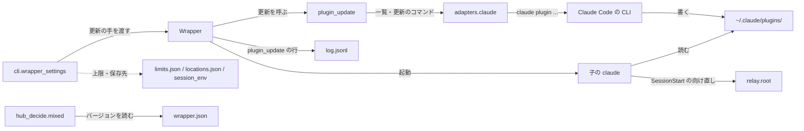
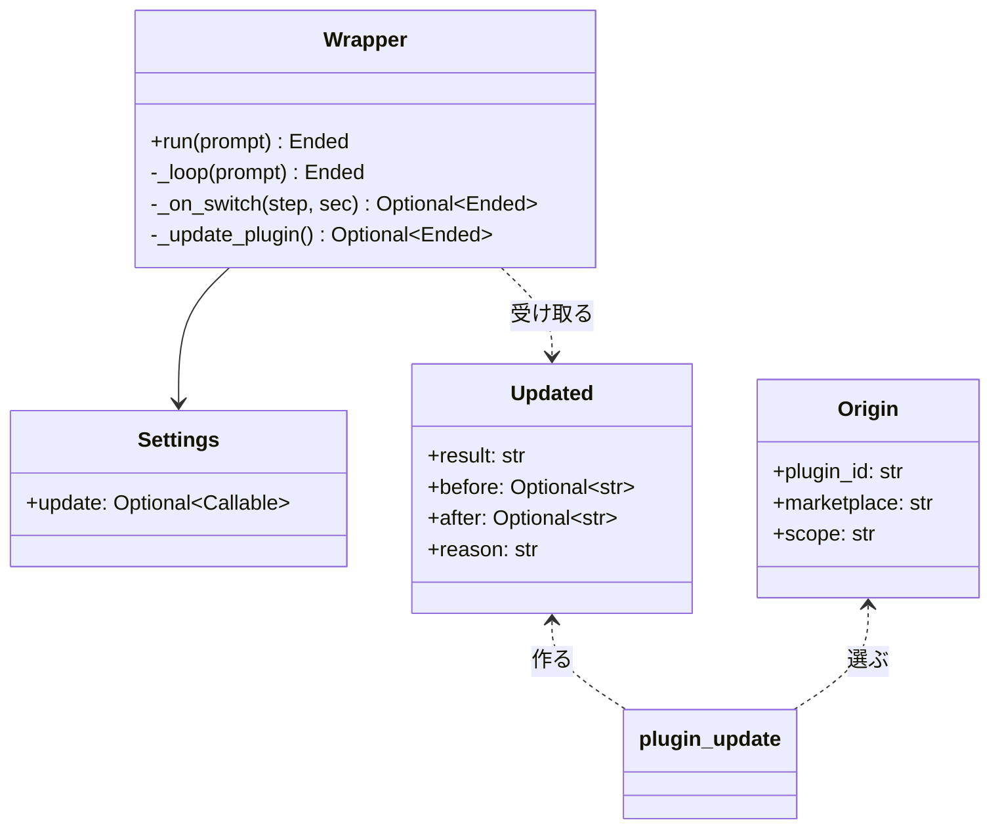
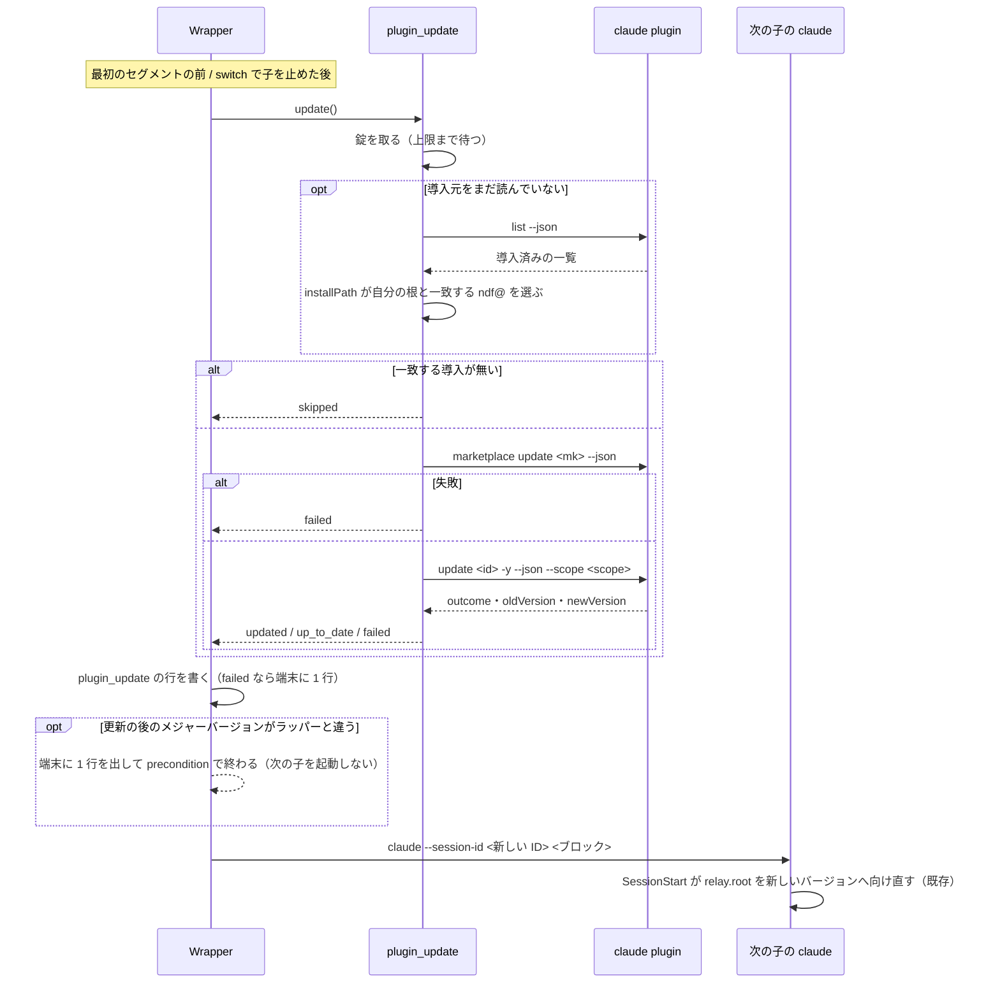

# 中継: リリースの後のカットポイントから、次のセグメントを新しいバージョンで始める（#3812）

## 目的

- **今どうなっているか**: 11 系のラッパー（`ndf relay`。claude を包み、会話の切れ目（カットポイント）で次の claude を新しい会話（セグメント）として起動する）はプラグインを更新しない。バージョンを出しても、ラッパーの下のセグメントは古いバージョンの hook と Skill で続き、11.0.6・11.0.7 の直しは誰かが手で更新したセッションでしか効かない。手順書 `relay.md` は 10 系の更新とラッパーの入れ替え（`reexec`・`handover.json`）を書いたままである
- **誰に効くか**: ラッパーの下で開発のループとレーンを回す利用者
- **変えると何が成り立つか**: リリースした直しが、利用者の操作なしで次のカットポイントから動いているレーンへ届く。手順書は 11 系の振る舞いだけを書く

## 適用範囲

- **働く範囲**: NDF を Claude Code に入れてラッパーを使う、すべての利用先のリポジトリ。中継は Claude Code だけで、Codex には無い
- **プロジェクトごとに違うもの**: 無し。マーケットプレイスの名前とプラグインの ID は、ラッパーの起動時に `claude plugin list --json` から読む（設定も引数も足さない）
- **当たるモード**: モードに依らない（ラッパーの振る舞い）

### 代表のリポジトリでの振る舞い

| 代表のリポジトリ | 設定の要点 | 直した後に起きること | この種類で扱えなくなること |
| --- | --- | --- | --- |
| Web サービス | ラッパーの有無は利用者が決める（`/ndf:install-wrapper`） | カットポイントで次のセグメントが新しいバージョンで始まる。更新に失敗しても今のバージョンで続く | 無し |
| モバイルアプリ | 同上 | 同上 | 無し |
| 業務文書だけ | 同上 | 同上 | 無し |

### ai-plugins だけの事情

- 無し（ai-plugins もマーケットプレイス `ai-plugins` から NDF を入れて使う利用者の 1 つで、この変更に ai-plugins だけの値は無い）

## 目指す姿

- ラッパーは、最初のセグメントの前とカットポイントで、マーケットプレイスと NDF を `claude plugin` のコマンドで最新へ上げてから次の claude を起動する。次のセグメントは出したバージョンの hook と Skill で始まる
- 更新の結果は `log.jsonl` の `plugin_update` の行に残り、失敗しても今のバージョンのまま止まらずに続く（端末に 1 行だけ出る）
- ラッパー自身のコードは入れ替えない。`relay.root` は、利用者が打つ `claude` がどのバージョンのラッパーを起動するかを決める 1 行のファイルである。次のセグメントの SessionStart がこれを新しいバージョンへ向け直すので、利用者が次に `claude` を打ち直すと新しいバージョンのラッパーになる。11 系どうしのバージョンの違いでは、新しいラッパーの起動もレーンの `spawn`・`restart` も断られない。メジャーバージョンが上がったときだけ、ラッパーは次のセグメントを起動せずに打ち直しを求める
- 手順書 `relay.md` は 10 系の入れ替えと記録の形を書かず、11 系の更新・記録・ラッパーのバージョンの変わり方だけを書く

要求と受け入れ条件は #3812 の本文にある（コピーは [issue-3812-requirements.md](./issue-3812-requirements.md)）。この文書は「どう作るか」だけを扱う。詳細設計は [issue-3812-design-detail.md](./issue-3812-design-detail.md) にある。

## 目指す姿の根拠

| 根拠 | 種類 | 何を示すか |
| --- | --- | --- |
| Claude Code の自動の更新は、既定でマーケットプレイス `ai-plugins` には働かず、働くときも最初のメッセージから最長 10 分後に走る（PRD1） | 外部の一次情報 | Claude Code の仕組みに任せても、カットポイントの次のセグメントが新しいバージョンで始まる保証が無い。ラッパーが自分で更新する必要がある |
| 更新したバージョンは「次の起動から読み込まれる」。旧いバージョンの導入先は `.orphaned_at` を付けて 14 日後に消える（PRD1） | 外部の一次情報 | 次のセグメントの claude を起動する前に更新すれば、その claude は新しいバージョンを読む。動いているラッパーは旧い導入先のまま 14 日は動ける |
| `claude plugin marketplace update ai-plugins --json` は 4.0 秒で `{"outcome":"ok"}`、`claude plugin update ndf@ai-plugins -y --json` は 0.7 秒で `{"outcome":"ok","updateOutcome":"up_to_date","oldVersion":"11.0.7","newVersion":"11.0.7"}`、存在しない ID では `{"outcome":"failed","failureCode":"not_found"}` と終了コード 1。`--scope user` を付けても同じ結果で、導入の無いスコープ（`--scope project`）は `failureCode` が `not_installed_at_scope`、終了コード 1。`claude plugin list --json` の要素は `id`・`version`・`scope`・`enabled`・`installPath` を持つ（2026-11-19 に Claude Code 2.1.328 で実測） | 実測 | 2 つのコマンドの結果を JSON で読め、失敗を終了コードで見分けられる。導入元を `installPath` と `scope` で選べる。成功したときのカットポイントの遅れは数秒で済む |
| 「10 系の課題を引きずらず、11 系の設計思想に合わせる」（#3812 の本文が写す利用者の方針） | 利用者の指示の原文 | 10 系の入れ替え（reexec）を再現せず、判断を純粋な関数に置く 11 系の形で作る |

## ドメインモデル

### コンテキスト

| コンテキスト | 何の語が 1 つの意味に決まるか |
| --- | --- |
| ndf-relay | ラッパー・セグメント・カットポイントの切り替え・プラグインの更新・`log.jsonl` の行 |

### 集約

| 集約 | オーナー（書き換えてよいもの） | 根 | エンティティ | 値オブジェクト |
| --- | --- | --- | --- | --- |
| ラッパー 1 本の実行 | `Wrapper`（`wrapper.py`） | `Wrapper` | `Section`（今のセグメント） | `Launch`・`Updated`（更新の結果） |
| 導入済みのプラグイン | Claude Code（`~/.claude/plugins/`）。NDF は `claude plugin` のコマンドでだけ変え、ファイルを直に書かない | `installed_plugins.json` | 導入の 1 件（ID・バージョン・導入先・スコープ） | `Origin`（ラッパーの導入元） |
| 動いているラッパーの一覧 | リレーハブと各ラッパー（`wrapper.json`） | 登録簿 | 名前つきのラッパー | バージョン |

### 不変条件

| # | 集約 | 条件 | 破れたときの扱い |
| --- | --- | --- | --- |
| I1 | ラッパー 1 本の実行 | 新しいセッションで始めるセグメント（最初のセグメントとカットポイントの切り替え）の claude は、その直前のプラグインの更新が終わった（成功・失敗・対象外のどれでも）後にだけ起動する | テストが落ちる。実装は更新を呼んでから `_start` を呼ぶ順で書く |
| I2 | ラッパー 1 本の実行 | プラグインの更新の失敗はラッパーを止めない。次のセグメントは今のバージョンで起動する | テストが落ちる |
| I3 | ラッパー 1 本の実行 | 同じ会話を `--resume` で続ける手（`account`・`restart`）では更新しない | テストが落ちる |
| I4 | 導入済みのプラグイン | ラッパーが更新するのは、自分が動いている導入先と同じ導入の 1 件（`installPath` が一致する ID とスコープ）だけである。一致する導入が無ければ更新しない | `plugin_update` の行が `skipped` になり、更新のコマンドを打たない |
| I5 | 導入済みのプラグイン | 同じ設定の保存先（`~/.claude`）を使うラッパーどうしは、更新のコマンドを 1 本ずつ打つ | 錠を取れないまま上限を過ぎたら、そのラッパーは更新を `failed` として今のバージョンで続ける |
| I6 | 動いているラッパーの一覧 | バージョンの違いで起動を断るのは、旧い NDF（登録したバージョンが無い）とメジャーバージョンの違うラッパーが動いているときだけである | テストが落ちる |
| I7 | ラッパー 1 本の実行 | 更新の後のメジャーバージョンがラッパーのメジャーバージョンと違えば、次のセグメントを起動しない | テストが落ちる |

### ドメインイベント

| # | イベント | 発生元 | 受け手 |
| --- | --- | --- | --- |
| E1 | ラッパーが自分の導入元（マーケットプレイスとプラグインの ID）を読んだ | `Wrapper`（最初の更新の中） | `Wrapper`（以後の更新で使い回す） |
| E2 | ラッパーがプラグインを更新した | `Wrapper` | `log.jsonl`・端末（失敗のときだけ） |
| E3 | ラッパーが今のセグメントの子を止めた | `Wrapper`（`switch` の手） | — |
| E4 | ラッパーが次のセグメントの子を起動した | `Wrapper` | 子の claude |
| E5 | 次のセグメントの SessionStart が `relay.root` を更新後のバージョンへ向け直した | 子の claude の hook（#3807、既存） | 複製 `relay.py` |
| E6 | 利用者が次に打った `claude` が更新後のバージョンのラッパーで動いた | 利用者 | リレーハブのバージョンの混ざりの判定 |

### 用語

| 用語 | 意味 | 用語集への反映 |
| --- | --- | --- |
| プラグインの更新 | ラッパーが最初のセグメントの前とカットポイントで、マーケットプレイスと NDF を `claude plugin` のコマンドで最新のバージョンへ上げること。失敗しても今のバージョンで次のセグメントを起動する | 追加 |

## 外部の調査

| 種類 | 調べるか | 理由 |
| --- | --- | --- |
| 標準・仕様 | 調べない | プラグインの導入はランタイム（Claude Code）固有の仕組みで、倣う業界の標準が無い |
| 主要な製品 | 調べる | 更新を受ける側の Claude Code が、いつ・どう更新し、更新したバージョンがいつ効くかで作り方が決まる |
| ライブラリとサービス | 調べる | 更新を行う手段（Claude Code の CLI と、それを使わない手段）を比べる |

### 主要な製品

| # | 製品 | どう解いているか | 設計への反映 | 出典 |
| --- | --- | --- | --- | --- |
| PRD1 | Claude Code のプラグインの読み込みと自動の更新 | 自動の更新は対話のセッションで最初のメッセージの後、最長 10 分の待ちの後に走り、今のセッションは読み込んだバージョンのまま「次の起動で新しいバージョンを読む」。既定で働くのは Anthropic の公式のマーケットプレイスだけ。更新・削除した旧いバージョンの導入先には `.orphaned_at` を付けて 14 日後に消す | 自動の更新には任せず、次のセグメントを起動する前にラッパーが更新する（決定 1）。旧い導入先で動き続けるラッパーの寿命は「未確認のまま残ること」へ | https://code.claude.com/docs/en/plugins/loading.md （2026-11-19） |
| PRD2 | Claude Code のマーケットプレイスの運用 | 自動の更新が無いとき、利用者は `/plugin marketplace update <name>` か `claude plugin update <plugin>@<name>` で受け取る | 2 つのコマンドをこの順で打つ（決定 1） | https://code.claude.com/docs/en/plugins/host-marketplace.md （2026-11-19） |

### ライブラリとサービス

| # | 候補 | バージョン | ライセンス | 最後のリリースの日付 | 終了のアナウンス | 要件を満たすか | 出典 |
| --- | --- | --- | --- | --- | --- | --- | --- |
| LIB1 | Claude Code の CLI（`claude plugin marketplace update`・`claude plugin update -y --json`・`claude plugin list --json`） | 2.1.328 | Claude Code の利用規約 | 不明（手元のバージョン） | 無し | 満たす。結果を 1 行の JSON で返し、失敗は終了コード 1。`-y` で入力を待たない | `claude plugin update --help` と実測（2026-11-19） |
| LIB2 | マーケットプレイスの複製を `git pull` し、導入先へファイルを写す自前の処理 | — | — | — | — | 満たさない。`installed_plugins.json` と導入先を Claude Code の外から書き換えることになり、Claude Code のバージョンの計算・依存の導入・旧いバージョンの片付けと食い違う | PRD1 の「Find plugins on disk」（2026-11-19） |

### 確かめられなかったこと

| 対象 | 試した手段 | 結果と理由 |
| --- | --- | --- |
| 同じ `~/.claude` を共有する複数のコンテナ（devbase）から同時に `claude plugin update` を打ったときの振る舞い | 試していない | 公式の文書に記述が無い。手元で再現する手段が無い |

調べた量: 候補 4 件・取得の試み 3 回。

## 機能一覧

| # | 機能 | 誰が使うか |
| --- | --- | --- |
| F1 | 最初のセグメントの前とカットポイントでプラグインを更新する | ラッパー（利用者は操作しない） |
| F2 | 更新の結果を `log.jsonl` に残し、失敗を端末に 1 行で出す | 利用者・記録を読む AI |
| F3 | 11 系どうしのバージョンの違いでラッパーの起動を断らない | 利用者・リレーハブ |
| F4 | 手順書を 11 系の更新・記録・ラッパーのバージョンの変わり方へ直す | 利用者・手順書を読む AI |

## 構成要素

| 要素 | 責務 |
| --- | --- |
| `plugin_update`（新設。`domains/relay/plugin_update.py`） | 導入済みの一覧から自分の導入元を選ぶ判断と、2 つのコマンドの結果から更新の結果を決める判断（純粋な関数）。2 つのコマンドを錠の中で順に打つ手順 |
| `ndf.adapters.claude`（変更） | `claude plugin` のサブコマンドを上限の秒で 1 回打ち、終了コードと標準出力を返す（外部のコマンドの呼び出し） |
| `Wrapper`（変更。`wrapper.py`） | 最初のセグメントの前と `switch` で子を止めた後に更新を呼び、結果を `log.jsonl` と端末へ出してから次の子を起動する |
| `cli.wrapper_settings`（変更。`cli.py`） | 更新の手（導入元・環境・上限・錠の保存先を閉じ込めた関数）を組んで `Settings` へ渡す |
| `session_env`（変更） | `claude plugin` のコマンドへ渡す環境（子へ渡さない変数を外し、NDF が入れる値は入れない） |
| `hub_decide.mixed`（変更） | バージョンの混ざりの判定をメジャーバージョンで行う |
| `contracts/limits.json`（変更） | 更新の上限 `relay.plugin-update` を足し、読み手の無い `relay.handover-prepare`・`relay.runtime-install` を消す |
| `contracts/domains/locations.json`（変更） | 更新の錠の保存先 `ndf/plugin-update.lock`（設定の保存先 `${CLAUDE_CONFIG_DIR:-~/.claude}` の下）を足す |
| 手順書 `relay.md`・`relay-accounts.md`（変更） | 11 系の更新・記録・ラッパーのバージョンの変わり方を書く |
| 用語集（`docs/glossary/glossary.json` と生成した文書） | 「プラグインの更新」を足す |

## 構造

`Updated.result` は次の 4 つである。

| 値 | 意味 |
| --- | --- |
| `updated` | バージョンが上がった |
| `up_to_date` | 新しいバージョンが無かった |
| `skipped` | 更新の対象外 |
| `failed` | 失敗した |

## 入出力のコントラクト

**`log.jsonl` の `plugin_update` の行**（ラッパーが更新を呼ぶたびに 1 行。既存の行と同じく `at`・`section` が付く。最初のセグメントの前は `section` が null）

| キー | 値 |
| --- | --- |
| `kind` | `"plugin_update"` |
| `result` | `updated` / `up_to_date` / `skipped` / `failed` |
| `from`・`to` | 更新の前と後のバージョン（Claude Code の `oldVersion`・`newVersion`）。分からなければ null |
| `reason` | 1 行の理由（`skipped`・`failed` の理由、成功なら結果の要約）。導入先のパスと認証情報を含めない |
| `seconds` | 錠を待ち始めてから結果が出るまでの秒（小数第 1 位） |

**端末の 1 行**（子が居ない間に出す）:

| いつ | 1 行 |
| --- | --- |
| `result` が `failed` | `ndf-relay: プラグインを更新できなかった（<理由>）。今のバージョンで次のセグメントを起動する` |
| 更新の後のメジャーバージョンがラッパーと違う | `ndf-relay: メジャーバージョンが <前> から <後> に上がった。次のセグメントを起動しない。claude を打ち直す`（ラッパーは停止理由 `precondition` で終わる。終了コードは停止理由の表のとおり 3） |

**バージョンの混ざりの判定**（`hub_decide.mixed`）: 次のラッパーが動いていれば断る。旧い NDF（登録したバージョンが無い）と、メジャーバージョン（バージョンの最初の `.` の前）の違うラッパーである。理由の文は今と同じ形（動いている名前とバージョンを並べる）。

`ndf relay` のサブコマンドと引数・結果 JSON・終了コードは変わらない。

## 処理の流れ

`switch` の手では、子を止める → 更新 → 起動の順になる（今の `_replace` は止めると起動の 2 つで、その間に更新を入れる）。`account`・`restart` の手は今のまま `_replace` で、更新を呼ばない。停止シグナルファイルがあるときは `switch` を打たないので（既存の `STOP_HELD`）、更新もしない。

## 非機能の実現方式

| 大項目 | 条件 | 実現方式 |
| --- | --- | --- |
| 性能・拡張性 | 2 つのコマンドはそれぞれ上限 120 秒 | 上限は `limits.json` の `relay.plugin-update`（`seconds: 120`）。錠の待ちも同じ上限を使う。成功したときの実測は 1 回 5 秒ほど（新しいバージョンが無くてもマーケットプレイスの更新の 4 秒は毎回かかる）。ネットワークが切れていれば git の失敗で早く終わり、最悪は錠の待ちと 2 つのコマンドの上限を足した 6 分である。最悪の場合も止まらずに次のセグメントを起動する |
| 可用性 | 更新の失敗でラッパーもレーンも止まらない | 起動できない・時間切れ・終了コード・JSON の読めなさをすべて `failed` に畳み、例外を `Wrapper` へ上げない |

## 決定の記録

### 決定 1: バージョンを出した後の次のセグメントを新しいバージョンで始めるため、ラッパーが Claude Code の CLI で更新する

Claude Code の自動の更新は、既定でマーケットプレイス `ai-plugins` に働かない。働いても最初のメッセージから最長 10 分後で、カットポイントの次のセグメントに間に合う保証が無い（PRD1）。ラッパーが次の claude を起動する前に 2 つのコマンド（`claude plugin marketplace update`・`claude plugin update -y --json`）を打てば、次の claude は更新後の導入先を読む（PRD2）。結果は 1 行の JSON と終了コードで読める（実測）。

自動の更新を利用者に有効にしてもらう案は、時刻が決まらず、利用者に操作を求めるので採らない。マーケットプレイスを自前で `git pull` して導入先へ写す案（LIB2）は、Claude Code の導入の記録と食い違うので採らない。

- 作り方: ライブラリやサービスを使う
- 比べた候補: LIB1 / LIB2 / PRD1 / PRD2

根拠: Value 1・Value 5（MVV バージョン 1）

### 決定 2: 会話の途中でバージョンを替えないため、更新するのは新しいセッションで始めるときだけにする

更新するのは、最初のセグメントの前と `switch`（次のセグメントを新しいセッションで始める）だけである。`account`（上限でアカウントを替えて同じ会話を `--resume`）と `restart`（子の終了・止まりから同じ会話を `--resume`）では更新しない。同じ会話の前半と後半で Skill の手順や hook が替わると、会話が覚えている手順と実際の振る舞いが食い違う。

`account`・`restart` でも更新する案は、課題の受け入れ条件が求めておらず、食い違いの危険だけが増えるので採らない。

根拠: Value 3（MVV バージョン 1）

### 決定 3: 更新の失敗でレーンを止めないため、失敗しても今のバージョンで次のセグメントを起動する

ネットワークの切れ・認証の失敗・時間切れで更新できなくても、今のバージョンで作業は続けられる。止めると無人のレーンが人の操作を待つ。失敗は `log.jsonl` の行と端末の 1 行で見える。10 系はカットポイントの更新の失敗でラッパーを終えていた（`update-failed`）が、その形は引き継がない。

失敗で止める案は、バージョンの古さより作業の停止のほうが損が大きいので採らない。

根拠: Value 1・Value 5（MVV バージョン 1）

### 決定 4: 開発のチェックアウトを誤って上げないため、更新する導入を自分の導入先との一致で選ぶ

導入元は、最初の更新で `claude plugin list --json` を 1 回読んで決め、以後の更新で使い回す。選ぶのは、`ndf@` で始まる ID のうち `installPath` がラッパーの動いているプラグインの根と一致する 1 件（ID・マーケットプレイス・スコープ）である。一致しなければ（`--plugin-dir` や開発のチェックアウトから動いている）、更新しない（`skipped`）。マーケットプレイスの名前を決め打たないので、`ai-plugins` 以外の名前で入れた利用者にも働く。

過去のバージョンへ固定した利用者（`docs/versioning-and-distribution.md` の「利用者が過去の版へ戻る」のとおり、取得元をタグへ固定するか、別名のマーケットプレイスで `ref` を指す）は、マーケットプレイスの更新がその `ref` のまま読み直すので、固定したバージョンから動かない（PRD2 の「Hold users on one version」）。固定を外す操作は足さない。

マーケットプレイスの名前を設定に書かせる案は、利用者に値を求めるので採らない。一致を見ずに最初の `ndf@` を上げる案は、別のスコープの導入や開発中のプラグインを上げるので採らない。

根拠: Value 4（MVV バージョン 1）

### 決定 5: 11 系の設計思想に合わせるため、ラッパー自身の入れ替えを作らない

conductor の決定（#3812 の本文の「決めたこと」）どおり、10 系の reexec と `handover.json` は作らない。子の claude は更新後の導入先を読むので、受け入れ条件はラッパーの入れ替えなしで満たせる。ラッパー自身のコードの変更は、次のセグメントの SessionStart が `relay.root` を向け直した後、利用者が `/exit` して `claude` を打ち直したときに効く。手順書の「ラッパーの入れ替え」のセクションはこの振る舞いへ書き直し、読み手の無い上限 `relay.handover-prepare`・`relay.runtime-install` を消す。

入れ替えを作る案は、バージョンごとの環境の用意・申し送り・exec の失敗の扱いを持ち込み、受け入れ条件に要らない仕組みを増やすので採らない。

根拠: Value 3・Value 6（MVV バージョン 1）

### 決定 6: 自動の更新の後もレーンを足せるように、バージョンの混ざりはメジャーバージョンで判定する

自動の更新の後は、動いているラッパー（起動したバージョンのコード）と更新後のバージョンのセッションが必ず並ぶ。バージョンが完全に一致することを求める今の判定は、リリースのたびに新しいラッパーの起動・`spawn`・`restart` を「旧いラッパーを止めて」と断り、レーンを足せなくする。判定が守りたかったのは 10 系と 11 系の混ざり（#3341 の 3341-2）なので、旧い NDF（登録したバージョンが無い）とメジャーバージョンの違いだけを断る。

自動の更新の後は「起動したバージョンのラッパー」と「更新後のバージョンの hook」の組が毎回できる。そのため、ラッパーと hook のあいだのファイル（シグナルファイル・マーカー・`wrapper.json`）の形は、同じメジャーバージョンの中では古いラッパーが読める形のまま変える（キーを足すだけにする。要求の前提 3）。読めない形へ変えるときはメジャーバージョンを上げる。

メジャーバージョンが上がったときに古いラッパーが新しい hook と組まないよう、更新の結果の `to` のメジャーバージョンがラッパーのメジャーバージョンと違えば、ラッパーは次のセグメントを起動せずに終わる（停止理由 `precondition`、端末に「メジャーバージョンが上がった。`claude` を打ち直す」の 1 行）。止まるのはメジャーバージョンを上げたリリースの後の最初のカットポイントだけで、利用者が打ち直すと新しいバージョンのラッパーで続く。無人のレーンは止まった状態として一覧に出る。

完全一致のまま残す案は、自動の更新と組むと並列のレーンが常に断られるので採らない。

根拠: Value 4・Value 5（MVV バージョン 1）

### 決定 7: 同じ導入を同時に書き換えないため、更新を設定の保存先の錠で 1 本ずつにする

並列のレーンが同じ時刻にカットポイントへ来ると、複数のラッパーが同じ `~/.claude/plugins/` を同時に更新する。錠は書き換える導入と同じ設定の保存先に置く（`${CLAUDE_CONFIG_DIR:-~/.claude}/ndf/plugin-update.lock`。中継の複製 `relay.py` と同じ置き場で、既存の `signals.held` で取る）。devbase のように `~/.claude` を共有するコンテナどうしも同じ錠で 1 本ずつ打つ。状態の保存先（コンテナごと）に置く案は、共有の `~/.claude` を守らないので採らない。後のラッパーは先の更新の後に打つので、`up_to_date` ですぐ終わる。錠を上限の秒まで取れなければ `failed` として今のバージョンで続ける。

錠を置かない案は、Claude Code の CLI が同時の更新をどう扱うかを確かめられないので採らない。

- 作り方: 自前で作る
- 比べた候補: LIB1

根拠: Value 3（MVV バージョン 1）

### 決定 8: 判断を端末と外部のコマンドから離して確かめられるよう、読み取りを純粋な関数に置く

導入元の選び方と、2 つのコマンドの終了コード・出力から結果を決める読み取りは、値を受けて値を返す純粋な関数（`plugin_update`）に置く。コマンドを打つのはアダプター（`ndf.adapters.claude`）、手を打つのは `Wrapper` である。11 系の中継の形（`switch_decide`・`account_decide` は判断、`wrapper.py` は手を打つだけ。#2962）に揃える。

根拠: Value 9（MVV バージョン 1）

### 決定 9: 手順書の食い違いを半分だけ直さないため、この変更で直すセクションを更新と記録と入れ替えに絞り、#3813・#3816 を満たす

`plugin_update` の行を記録の表に足すには、表を 11 系の形へ書き直す必要がある。11 系の形は、保存先 `<状態の保存先>/relay/wrappers/<名前>/log.jsonl` とキー `kind` で、#3816 の受け入れ条件と重なる。「ラッパーの入れ替え」のセクションの書き直しは #3813 と重なる。半分だけ 10 系の表を残すと読み手を誤らせるので、この変更で両方を満たす。次の 3 つは更新と関わらないので含めない。「上限」（#3815）・「承認ゲートを越えない守り」の本体（#3814）・リレーハブ（#3818）である。冒頭の例の `/exit` の語は #3814 の範囲なので、更新の語だけを直す。

根拠: Value 6（MVV バージョン 1）

## テスト設計

| 受け入れ条件・不変条件 | どの振る舞いで縛るか | どう壊したら落ちるべきか |
| --- | --- | --- |
| 受け入れ条件 1・I1 | `ndf-next` のマーカーで切り替えると、更新の手が 1 回呼ばれ、その後に次の子が起動する（呼ばれた順を記録する偽の手と偽の `spawn`） | `_on_switch` から更新を外す・起動の後に呼ぶと落ちる |
| 受け入れ条件 1 | 2 つのコマンドがマーケットプレイスの更新 → NDF の更新の順で、導入元の ID・マーケットプレイス・スコープを付けて打たれる（偽の実行の手） | 順を入れ替える・`-y` を外す・スコープを渡さないと落ちる |
| 受け入れ条件 2・I1 | 最初のセグメントの起動の前に更新の手が 1 回呼ばれる | `_loop` の最初の更新を外すと落ちる |
| 受け入れ条件 3・I2 | 更新の手が `failed` を返しても次の子が起動し、`plugin_update` の行の `result` が `failed`、端末に `ndf-relay:` の 1 行が出る | 失敗で `Ended` を返す・行を書かないと落ちる |
| 受け入れ条件 3 | 終了コードが 0 でない・時間切れ・起動できない・JSON でない出力・`outcome` が `failed` のどれも `failed` に畳まれ、例外が上がらない（読み取りの関数の単体） | 例外を通す・`up_to_date` と読むと落ちる |
| 受け入れ条件 4・I3 | 上限でアカウントを替える手と、子の終了から起動し直す手では、更新の手が呼ばれない | `_replace` に更新を入れると落ちる |
| 受け入れ条件 5・I6 | 同じメジャーでバージョンの違うラッパーは断らず、旧い NDF とメジャーの違うラッパーは断る（`mixed` の単体） | 完全一致の比較に戻すと落ちる |
| 受け入れ条件 6・I4 | `installPath` が自分の根と一致する `ndf@` の行だけを導入元に選び、一致が無ければ `skipped` でコマンドを打たない | 最初の `ndf@` を選ぶ・一致が無いのにコマンドを打つと落ちる |
| I5 | 錠を別のプロセスが持つ間は更新のコマンドを打たず、上限を過ぎたら `failed` を返す | 錠を取らずに打つと落ちる |
| 受け入れ条件 11・I7 | 更新の手が別のメジャーバージョンへの `updated` を返すと、次の子を起動せず `precondition` で終わる。同じメジャーなら起動する | メジャーの比べを外す・完全一致で比べると落ちる |
| `plugin_update` の行の形 | 行が `kind`・`result`・`from`・`to`・`reason`・`seconds` を持ち、`reason` に導入先のパスを含めない | キーを欠く・パスを入れると落ちる |
| 受け入れ条件 7・8・9 | 手順書の文言はテストで照らさない（`AGENTS.md` の DON'T）。参照切れは既存の検査、`jq` の例は実装の後に手元の記録へ打って確かめる | — |
| 受け入れ条件 10 | 既存の中継のテストがすべて通る | — |

## 設計の結果

| 課題 | 扱い | 統合先 | 触るファイル |
| --- | --- | --- | --- |
| #3812 | 実装する | — | `plugins/ndf/src/ndf/domains/relay/plugin_update.py`（新設）、`plugins/ndf/src/ndf/domains/relay/wrapper.py`、`plugins/ndf/src/ndf/domains/relay/cli.py`、`plugins/ndf/src/ndf/domains/relay/session_env.py`、`plugins/ndf/src/ndf/domains/relay/hub_decide.py`、`plugins/ndf/src/ndf/adapters/claude.py`、`plugins/ndf/contracts/limits.json`、`plugins/ndf/contracts/domains/locations.json`、`plugins/ndf/skills/development-workflow/references/relay.md`、`plugins/ndf/skills/development-workflow/references/relay-accounts.md`、`plugins/ndf/tests/domains/relay/test_relay_plugin_update.py`（新設）、`plugins/ndf/tests/domains/relay/test_relay_wrapper.py`、`plugins/ndf/tests/domains/relay/test_relay_decide.py` |
#3813 と #3816 の受け入れ条件は、この実装で満たす（決定 9）。2 つはこのスプリントの課題に入っていないため表に載せない。スプリントへ足して `マージする`（統合先 #3812）の行にするかは、スプリントの課題の組み方を持つ conductor が決める。

## 人へ残す判断

無し

## 未確認のまま残ること

| 項目 | 内容 |
| --- | --- |
| 旧い導入先で動き続けるラッパー | 更新した旧いバージョンの導入先は 14 日後に Claude Code が消す（PRD1）。それより長く動くラッパーは、まだ読み込んでいないモジュールを読めずに落ちうる。落ちると子の claude も終わり、無人のレーンは止まった状態で一覧（`ndf relay ls`）に出る。打ち直すと新しいバージョンで戻る。14 日を超えて動くラッパーがどれだけあるかは、リリース後に `wrapper.json` の起動の時刻を集めれば分かる |
| 共有の `~/.claude` での錠 | `flock` の錠が同じ `~/.claude` を共有するコンテナどうしで効くことは、同じホストのカーネルを使うときだけ確かである。devbase の共有の方式（同じホストのボリュームか、ネットワークのファイルシステムか）は確かめていない。リリース後テストで、2 つのコンテナから同時にカットポイントを出して `plugin_update` の行の `seconds` が錠を待った値になるかで分かる |
| 次のセグメントが新しいバージョンで始まること | 単体のテストは「更新の後に起動する」順までを縛る。実際に新しいバージョンの導入先が読まれることは、リリース後テストでラッパーの下の `ndf-next` の後に `claude plugin list --json` と `log.jsonl` を見て確かめる |
