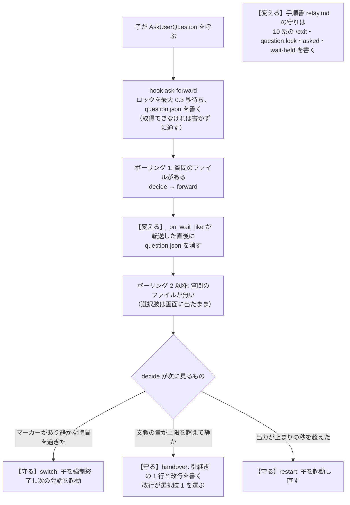
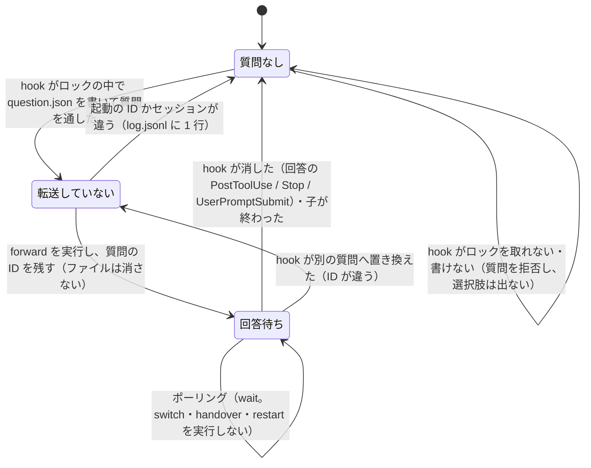
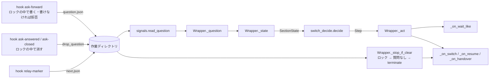
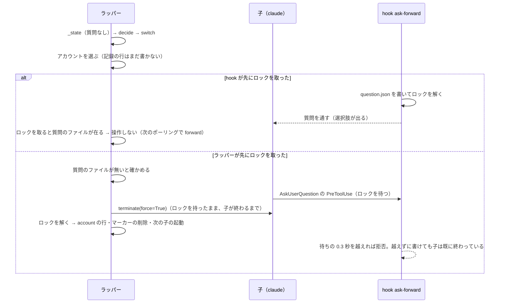

# 中継: 質問の表示中は回答が済むまで子を止めず、子の端末へ書かない（#3814）

中継のラッパーは質問を転送した直後に質問のファイルを消すため、承認ゲートの質問の表示中でも子を強制終了して次の会話へ移り、文脈の上限では改行を書いて人の代わりに選択肢 1 を選んでしまう。この設計は、質問のファイルを質問が閉じるまで残してその間は子を止めない。質問の hook とラッパーは同じロックで順番をそろえる。hook はロックの中で質問のファイルを書けたときだけ質問を通し、ラッパーはロックを持ったまま質問が無いと確かめてから子を止め終える。質問が閉じたことは hook が知って質問のファイルを消す（回答は `AskUserQuestion` の PostToolUse、回答されずに閉じた質問は Stop・UserPromptSubmit）。引継ぎは子の端末へ書かず、同じ会話を起動し直して引数で頼み、手順書の守りを 11 系の振る舞いだけに書き直す。採らなかった案は「決定の記録」に、関数の細部は詳細設計（[issue-3814-design-detail.md](./issue-3814-design-detail.md)）にある。

何が起きて誰が困ったか・何を満たせば終わりかは、要求仕様（[issue-3814-requirements.md](./issue-3814-requirements.md)、正は #3814 の本文）にある。この文書は「どう解くか」と「なぜその解き方か」だけを書く。

## 今の姿

ラッパーのポーリング・質問の受け渡し・切り替えの仕組みは、要求仕様の「今の姿」にある。設計に要るのは、質問のファイルを誰が書き、誰がいつ消し、その後のポーリングが何を実行するかの流れである。

**根本原因**: 質問を転送する操作（`wrapper.py` の `_on_wait_like`）が、転送した直後に質問のファイルを消す。判定（`switch_decide.decide`）は質問を最初に見て、ほかの判断より先に止める作りになっているが、ファイルが消えた次のポーリングからは質問が無いと読み、マーカー・文脈の上限・止まりの判断（`switch`・`restart`・`handover`）のとおりに子を止めるか子の端末へ書く。守りはポーリング 1 回分（0.5 秒）しか続かない。偽の子での再現は要求仕様の「事象」にある。既存のテストは「質問のファイルがあれば `forward`」だけを確かめ、転送した後のポーリングを見ていなかったので拾えなかった。手順書は 10 系の仕組みを書いていたため、読み手もこの欠けに気づけなかった。

**同じ形の箇所**: 判定と操作のあいだにも同じ穴がある。ポーリングが質問なしと読んでから子を止めるか子の端末へ書くまでの間に、hook は質問を書け、子は選択肢を画面に出せる。hook がロックを取れずに質問を記録しなかったとき（書き込みの失敗を含む）は、質問を通すので、ラッパーは質問が無いと読んだまま選択肢が出る。hook の枠組みも同じ向きに倒れる。guard の例外は通す側へ倒れ、予算の締め切りを過ぎると後の guard を呼ばず、同じ拒否は 2 回を超えると案内へ下がる（`dispatch.run`）。子の端末へ書いた引継ぎの 1 行は、書き終えても子がいつ読むかは決まらず、選択肢が出た後に読まれれば改行が回答を決める（2026-11-20 の実測で、質問が出る前に送った Enter が、出た質問の 1 番目を選んだ）。ポーリングの例外の経路（`_loop` の `config_broken`）も、質問を確かめずに子を止める。直すのは子を止める 3 つの操作（`switch`・`account`・`restart`）・子の端末へ書く操作（`handover`）・例外の経路・質問の hook のすべてである。

## 文脈と制約

- **hook を変えてよい。** 前の版は「hook は変えない」を制約にしていたが、計画 p8-5 の触る場所の都合（hook がほかのレーンの範囲だった）から出たもので、方針ではなかった。2026-11-20 の利用者の決定で外し、hook の場所（`plugins/ndf/src/ndf/domains/hooks/`・`plugins/ndf/tests/domains/hooks/`・`plugins/ndf/contracts/hooks/`）をこのレーンの触る場所へ移した。同じ場所を触るほかの Pull Request（#3870）との競合は、後からマージする側が解く
- **質問のファイルを消す経路は hook だけにする。** 会話の記録から回答の無い質問を推し量ることと、質問のファイルを手で消すコマンドは置かない（2026-11-20、利用者の決定。下の実測を見て選んだ）
- **`AskUserQuestion` の hook の振る舞い**（Claude Code 2.1.329 の対話の起動で実測、2026-11-20。要求の前提 3）:

  | 質問の閉じ方 | PostToolUse | 後に動く hook |
  | --- | --- | --- |
  | 選択肢を選ぶ・自由入力 | 回答の時点で動く（`tool_response.answers`） | 応答を終えたとき Stop |
  | Chat about this | 動かない（PostToolUseFailure も） | 応答を終えたとき Stop |
  | Esc | 動かない（PostToolUseFailure も） | 人が次に入力を送ったとき UserPromptSubmit |
  | Ctrl+C | 質問は閉じない | — |

  PreToolUse は選択肢の表示の前に動き、拒否すると選択肢は出ない
- **判断は純粋な関数に置く。** `switch_decide.decide` は何も読まず、`wrapper.py` が読んだ値を受ける（#2962）。`ndf relay decide` は入力の JSON をこの関数へ渡すので、足す項目には既定値を置く
- **強制終了は子の端末へ何も書かない**（ptyprocess 0.7.0。外部の調査の LIB1）。`terminate(force=True)` は SIGHUP・SIGCONT・SIGINT・SIGKILL を 0.1 秒おきに送り、子が終わった時点で戻る（最大でおよそ 0.4 秒）。質問の回答を代わりに送るおそれがあるのは、端末へ書く操作（`handover`）だけである
- **子の端末へ書いた入力を子がいつ読むかは、ラッパーから決められない。** 書き込みが終わったことは、擬似端末の入力の待ち行列へ入ったことしか示さない
- **hook の予算**: PreToolUse は締め切り 1 秒・余白 0.5 秒・登録の timeout 3 秒（`hook.budget.pre-tool-use`）。質問の hook のロックの待ちは 0.3 秒（`hook.ask-forward`）。「転送は中継が待ち、hook は待たない」が `limits.json` の取り決めで、この設計でも転送は待たない
- **利用者の方針**: 「10 系の課題を引きずらず、11 系の設計思想に合わせる」（要求の「依頼（原文）」）。10 系の守りを作り直さず、要るものだけを 11 系の形で作る
- マーカーの後の入力・背景の作業で切り替えを取り消さない（要求の「対象範囲」の含まない。#2438 の「`/goal` が未達でも切り替える」）

## 解き方の全体像

**質問の ID**は 1 つの質問を見分ける値で、質問のファイルの `tool_use_id`、無ければ質問を書いた時刻 `at` である。ラッパーは転送した質問の ID を覚え、質問のファイルの ID と比べて、同じ質問か・別の質問へ置き換わったかを見分ける。

1. **質問のファイルを質問が閉じるまで残す。** 転送した後はファイルを消さず、転送した質問の ID を残す。判定は、転送していない質問なら `forward`、転送した質問なら `wait` を返す。質問は判定の最初に見るので、`wait` の間は切り替え・起動し直し・引継ぎの送信がすべて止まる。切り替えは今のとおり強制終了で、`/exit` を書かない（決定 1）
2. **質問の hook とラッパーの順番を、同じロックでそろえる。** 質問の hook（`ask-forward`）は、ロック `question.json.lock` を取れて質問のファイルを書けたときだけ質問を通し、取れない・書けないときは質問を拒否する。この guard は失敗したら止める側へ倒し、締め切りを過ぎても呼び、拒否を案内へ下げない。ラッパーが子を止める操作は、同じロックを取ってから質問のファイルが無い（壊れたファイルは在るとみなす）と確かめ、ロックを持ったまま `terminate(force=True)` で子を止め終える。こうして「選択肢が画面に出ている」ことと「質問のファイルが在る」ことが一致し、確かめてから止め終えるまでのあいだに選択肢は出ない（決定 2）
3. **引継ぎは子の端末へ書かない。** 文脈の上限での引継ぎは、2 と同じ手順で子を止め、同じ会話を `claude --resume <ID> <引継ぎの 1 行>` で起動し直して頼む（今の `restart` と同じ起動の形）。ラッパーが子の端末へ書く操作は無くなる（決定 2）
4. **質問が閉じたら hook が消す。** `AskUserQuestion` の PostToolUse の hook は同じ `tool_use_id` の質問のファイルを、Stop と UserPromptSubmit の hook は同じ `session_id` と同じ起動の ID の質問のファイルを、ロックの中で読み直して消す。壊れたファイルはどの hook でも消す。ラッパーが消すのは、子が終わったときと、質問が今の子のものでない（起動の ID かセッションが違う）ときだけである（決定 3）
5. **質問の状態を読めないときも子を止めない。** 質問のファイルが壊れていれば回答待ちとして扱い、例外の経路も 2 の確かめを通ったときだけ子を止める（決定 5）
6. **手順書の守りを 11 系だけで書き直す。** `relay.md` の「承認ゲートを越えない守り」を、判定の順と hook の 4 つ（`ask-forward`・質問のファイルを消す hook・`relay-marker`・`stop-wait`）の振る舞いだけで書く（決定 4）

直すのは症状の出た切り替えの操作ではなく、質問のファイルを早く消す原因の側と、判定と操作のあいだの穴である。

## ドメインモデル

### 不変条件

テスト設計の行が指す。

| # | 対象 | 条件 | 破れたときの扱い |
| --- | --- | --- | --- |
| I1 | ラッパー 1 本の実行 | 回答待ちの質問がある間は、`switch`・`account`・`restart`・`handover` の操作をしない（子を止めず、子の端末へ書かない） | テストが落ちる |
| I2 | ラッパー 1 本の実行 | 1 つの質問（`tool_use_id`、無ければ `at`）について、質問を転送する操作（`forward`）は 1 回だけ実行し、`log.jsonl` の `forward` の行を 1 つだけ書く。続けて別の質問が来ても、その質問の `forward` の行を省かない | テストが落ちる |
| I3 | 中継のシグナルファイル | ラッパーが `question.json` を消すのは、子が終わった・質問の起動の ID（無ければ `session_id`）が今の子と違う、のどちらかのときだけである | テストが落ちる |
| I4 | ラッパー 1 本の実行 | ラッパーが子を止める（`switch`・`account`・`restart`・`handover`・例外の経路）のは、ロック `question.json.lock` を取り、質問のファイルが無い（壊れたファイルは在るとみなす）と確かめたときだけで、ロックは子が終わるまで持つ。取れない・在るなら、そのポーリングでは操作しない（マーカー・`account` の行・起動の回数はそのまま）。次の子を起動するのは、前の子の終わりを確かめたときだけである | テストが落ちる |
| I5 | 中継のシグナルファイル | `question.json` を消すのは（ラッパーでも hook でも）、ロックを保持したまま読み直した質問が、消すと決めた質問と同じ（ラッパーは質問の ID と起動の ID、PostToolUse は `tool_use_id`、Stop と UserPromptSubmit は `session_id` と起動の ID）か、壊れているときだけである | テストが落ちる |
| I6 | ラッパー 1 本の実行 | ラッパーは子の端末へ自分から書かない。書くのは利用者が端末で打った入力を渡すとき（`_pump`）だけである | テストが落ちる |
| I7 | 質問の hook | 中継の下（`NDF_RELAY_DIR` がある）で `AskUserQuestion` を通すのは、ロックの中で質問のファイルを書けたときだけである。書けるのは、hook の起動の ID が今の起動の記録と同じときだけである。ロックを取れない・書けない・guard の例外・予算の締め切りのどれでも拒否し、拒否を案内へ下げない | テストが落ちる |

イベント（マーカーを書いた・質問を出した・転送した・質問が閉じた・消した・切り替えた）は要求仕様の「ドメインイベント」にある。

## 構成要素

関数の仕様と異常系は詳細設計にある。

| 要素 | 責務 |
| --- | --- |
| `switch_decide.SectionState`・`decide`（変更） | 転送した回答待ちの質問があれば `wait` を返す（転送していなければ今のとおり `forward`。理由の文に質問の ID を入れる） |
| `wrapper.Wrapper._question`（新設）・`_state`（変更） | 質問のファイルを読み、子の終わり・起動の ID の違いで消し、回答待ちか・転送したか・質問の ID を `SectionState` へ渡す。壊れた質問のファイルは回答待ちとして渡す |
| `wrapper.Wrapper._on_wait_like`（変更） | 質問を転送したら、質問のファイルを消さずに転送した質問の ID を残す。転送するのは `_question` が読んだ質問そのもの（コピー）である |
| `wrapper.Wrapper._stop_if_clear`（新設）・`_stop_child`（変更） | ロックを取り、質問のファイルが無いと確かめ、ロックを持ったまま子を止め終える。止めて終わりを確かめた・止めなかった・止めても終わらない、のどれかを返す（I4）。`terminate(force=True)` の戻り値を捨てず、偽なら `relay.child-exit` の秒まで子の終わりを待つ |
| `wrapper.Wrapper._on_switch`・`_on_resume`・`_on_handover`（変更） | `_stop_if_clear` で子を止めてから次の子を起動する。アカウントの選択は止める前、`account` の行・マーカーの削除は止めた後。止めなければ何もせずに戻る。止めても子が終わらなければ次の子を起動せず `refused` で終わる。`_on_handover` は端末へ書かず、同じ会話を引継ぎの 1 行で起動し直す |
| `wrapper.Wrapper._start`（変更） | 子ごとに起動の ID を作り、環境変数 `NDF_RELAY_LAUNCH` で子へ渡す |
| `wrapper.Wrapper._loop`（変更） | 例外の経路は `_stop_if_clear` が通るまで子を止めず、操作を止めて待つ（決定 5） |
| `signals.read_question`・`question_id`・`question_present`（新設） | 質問のファイルを読む（無ければ None、壊れている・読めない（権限・I/O・不正な UTF-8）なら `SignalError`）。質問の ID を取り出す。在るかを読めなくても在る側へ倒して答える |
| `signals.write_question`（変更）・`set_launch`・`current_launch`（新設） | 起動の ID（`NDF_RELAY_LAUNCH`）を質問のファイルの `launch` に書く。ロックの中で今の起動の記録（`launch.json`）と照らし、違えば書かない |
| `signals.drop_question`（新設） | ロックの中で質問を読み直し、渡した条件に合うか壊れているときだけ消す。ラッパーと hook が共に使う |
| hook `ask-forward`（`hooks/guards/ask.py`、変更） | 中継の下で質問のファイルを書けなければ `AskUserQuestion` を拒否する（I7） |
| hook `ask-answered`・`ask-closed`（`hooks/guards/ask_clear.py`、新設） | `AskUserQuestion` の PostToolUse で同じ `tool_use_id` の、Stop と UserPromptSubmit で同じ `session_id` と同じ起動の ID（`NDF_RELAY_LAUNCH`）の質問のファイルを消す。いつも通す |
| `hooks.dispatch`・`guards.json`（変更） | guard の表に列 `fail_closed` を足す。真の guard は、予算の締め切りを過ぎても呼び、例外を拒否として扱い、拒否を案内へ下げない |
| `relay.md`（変更） | 「承認ゲートを越えない守り」を 11 系へ書き直す |

## 処理の流れ

### 判定の後に質問が出る競合

ポーリングが質問なしと読んでから操作するまでの間に子が `AskUserQuestion` を呼んでも、ロックがどちらか一方を先にする。

子が終わった後に残った hook のプロセスは、新しい子の質問を上書きできない。ラッパーは子を止めたロックの中で今の起動の記録（`launch.json`）を外し、次の子の起動の前に新しい起動の ID を記録する。hook はロックの中で自分の起動の ID（`NDF_RELAY_LAUNCH`）が今の起動と同じときだけ書くので、止めた子の hook がロックを待っていても遅れて動いても拒否になる。引継ぎで同じ `session_id` の会話を起動し直すときも、起動の ID は子ごとに違う。`launch` の無い質問とラッパーの前の実行が残した質問は、次の子の最初のポーリングが消す（`stale_question`）。

### 引継ぎ

文脈の量が上限を超えて静かなときは、子の端末へ書かず、上と同じ手順で子を止め、同じ会話を `claude --resume <ID> <引継ぎの 1 行>` で起動し直す。新しい子は引数の 1 行を最初の入力として受け取るので、選択肢が出ている画面へ改行が届くことは無い。起動し直した後のセグメントは引継ぎを頼んだ（`handover_asked`）として続け、起動し直しの回数（`starts`）には数えない。

### 質問が閉じる

| 閉じ方 | 消す hook | 消す条件（ロックの中で読み直す） |
| --- | --- | --- |
| 回答（選択・自由入力） | `ask-answered`（PostToolUse） | `tool_use_id` が hook の入力と同じか、壊れている |
| Chat about this | `ask-closed`（Stop） | `session_id` が hook の入力と同じで、`launch` が hook の `NDF_RELAY_LAUNCH` と同じか、壊れている。`--resume` の前後で会話の ID は同じなので、起動の ID も照らし、前の起動で遅れて動いた hook に新しい子の質問を消させない |
| Esc | `ask-closed`（人が次に入力を送ったときの UserPromptSubmit） | 同上 |

Esc の後は、人が次に入力を送るか子が終わるまで質問のファイルが残り、ラッパーは子を止めない（要求の非機能の条件「可用性」）。止めない側に倒れるので、選択肢を越えることは無い。

## 決定の記録

### 決定 1: 承認ゲートの質問を答えるまで残すため、切り替えは強制終了のままにし、質問のファイルを質問が閉じるまで残して回答待ちの間は `wait` を返す

- **問い**: 切り替えを `/exit` で行うか強制終了のままにするか（要求の「依頼（原文）」の決めること）。質問の表示中にどう操作を止めるか
- **選んだ案**: 切り替えは強制終了（`terminate(force=True)`。子の端末へ何も書かずにシグナルで止める）のままにする。強制終了は子の端末へ何も書かないので（LIB1）、10 系が `/exit` の改行に備えて要した時刻（`asked`）・`wait-held.json` は要らない。11 系で欠けていたのは、質問を転送した直後に質問のファイルを消すことだけである。ファイルを質問が閉じるまで残し、`decide` が転送した質問のあいだは `wait` を返せば、切り替え・起動し直し・引継ぎがすべて止まる。`forward` で計画のリクエストへ載せる中身は、ID を取り出したのと同じ読みのコピーにし、ID と載せた中身が食い違わないようにする
- 採らなかった案: `/exit` へ戻す（10 系の守りを作り直すことになる）
- 採らなかった案: マーカーの後の利用者の入力や背景の作業で切り替えを取り消す（#2438 の「`/goal` が未達でも切り替える」と食い違う。要求の起票者の推定 S4）
- **代償**: 回答待ちの間は、文脈の上限を超えても引継ぎの送信が回答の後へずれる（要求の「影響」の既存の振る舞い）
- 根拠: Value 1「人の判断を、読み切れる量の大事な所だけにする」（MVV バージョン 9）

### 決定 2: 判定と操作のあいだに出た質問も守るため、質問の hook とラッパーを同じロックで順に並べ、hook は書けなければ質問を拒否し、引継ぎは起動し直して頼む

- **問い**: ポーリングの判定だけでは、`_state` が質問なしと読んでから子を止める・子の端末へ書くまでの間に、子が選択肢を出す競合が残る。hook が質問を記録できなかったとき（ロックの待ちを越えた・書き込みの失敗・guard の例外・予算の締め切り）も含めて、時間の制約や子が入力を読む順に頼らずにどう閉じるか
- **選んだ案**: 質問の hook とラッパーの操作を、同じロック `question.json.lock` で一方ずつにする
  - hook（`ask-forward`）は、ロックを待ちの上限（0.3 秒）のうちに取れて質問のファイルを書けたときだけ質問を通す。取れない・書けない（`OSError`）ときは `AskUserQuestion` を拒否し、理由に「中継が子を止めている途中で質問を記録できなかった。もう一度呼ぶ」を返す。PreToolUse は選択肢の表示の前に動き、拒否された質問は選択肢を出さない（文脈と制約の実測）。この guard は guard の表の新しい列 `fail_closed` を真にし、`dispatch.run` は予算の締め切りを過ぎても呼び、例外を拒否として扱い、拒否を数えず案内へ下げない（今の 3 つの経路はどれも質問を通す側へ倒れる）
  - ラッパーが子を止める操作（`_on_switch`・`_on_resume`・`_on_handover`・例外の経路）は、`_stop_if_clear` でロックを待たずに取り、質問のファイルが無い（壊れていても在るとみなす）と確かめ、ロックを持ったまま `terminate(force=True)` で子を止め終える。取れない・在るなら操作せず、次のポーリングで決め直す（I4）
  - これで「選択肢が画面に出ている」なら「質問のファイルが在る」。hook が先にロックを取れば、ラッパーはファイルを見て止めない。ラッパーが先に取れば、hook はロックを待つあいだ質問を通さず、子はその間に止め終わる。確かめてから止め終えるまでラッパーがスケジューラーにどれだけ待たされても、hook はロックを待つか拒否するだけで、選択肢は出ない。安全は時間に依らず、時間で決まるのは「拒否が起きるか」だけである
  - 引継ぎは子の端末へ書かず、同じ手順で子を止め、同じ会話を `claude --resume <ID> <引継ぎの 1 行>` で起動し直して頼む（今の `restart` と同じ起動の形）。ラッパーが子の端末へ自分から書く操作は無くなるので、書いた入力を子が選択肢の後に読む競合は起きない（I6）
  - 子ごとに起動の ID を作って環境変数 `NDF_RELAY_LAUNCH` で渡し、hook は質問のファイルの `launch` に書く。ラッパーは今の起動の ID を `launch.json` に記録し、子を止めたロックの中で外す。hook はロックの中で自分の起動の ID が今の起動と同じときだけ書く。止めた子の残った hook のプロセスは、同じ `session_id` で起動し直した後でも、新しい子の質問を上書きできない
- 採らなかった案: 子を一時停止（SIGSTOP）させてから、判定の後の出力・質問のファイル・会話の記録の回答の無い質問を確かめて SIGKILL を送る（前の版の案。hook を変えずに閉じるための案で、会話の記録の推し量りと、判定より前に出た選択肢が静かな時間のうちに記録へ書かれる見込みに頼る。止まった子の孫のプロセスが描かないことにも頼る。hook を変えてよくなったので、hook が書けなければ拒否する方が少ない前提で閉じる）
- 採らなかった案: ロックの中で確かめ、ロックを保持する時間を hook の待ちの半分未満に制約する（その前の版の案。hook がロックを取れないと質問を書かずに通すので、時刻を確かめた直後にラッパーが待たされると選択肢が出る）
- 採らなかった案: hook のロックの待ちを延ばして拒否を減らす（拒否が起きるのは子を止めている最中だけで、拒否された子はその直後に止まる。延ばしても安全は変わらず、PreToolUse の予算を食う）
- 採らなかった案: 子を止めた後もロックを持ったまま次の子を起動する（残った hook のプロセスを書かせないため。起動の時間だけ、ほかのセッションの質問が拒否されうる。今の起動の記録をロックの中で外せば、ロックを長く持たずに同じ効果が得られる）
- 採らなかった案: 残った hook の書いた質問を、次のポーリングが起動の ID の違いで消すだけにする（前の版の案。残った hook が新しい子の質問より後に書くと、回答待ちの新しい質問を上書きし、次のポーリングがそれを古いとして消すので、選択肢の表示中に子を止められる）
- **代償**: ラッパーが子を止めている最中に子が出した質問は拒否される（その子は直後に止まる）。PreToolUse の hook がプロセスとして動かない（NDF の環境が無く `boot.py` が通す・ランタイムの timeout で打ち切られる）ときは、今と同じく質問のファイルの無いまま選択肢が出る（「影響と危険」）
- **代償**: 引継ぎの度に子を起動し直すので、同じ会話の読み込み（`--resume`）の時間がかかる。入力欄に利用者が打ちかけた文は消える（切り替えと同じ）
- 根拠: Value 1「人の判断を、読み切れる量の大事な所だけにする」（MVV バージョン 9）

### 決定 3: 質問が閉じたことを確実に知るため、hook が質問のファイルを消す（回答は PostToolUse、回答されずに閉じた質問は Stop と UserPromptSubmit）

- **問い**: 質問のファイルを消してよい時点（質問が閉じたこと）をどう知るか。回答されずに閉じた質問で、レーンを止め続けないにはどうするか
- **選んだ案**: 質問が閉じたことは Claude Code が hook で知らせる。実測（文脈と制約）では、回答（選択・自由入力）では PostToolUse が回答の時点で動き、回答されずに閉じた質問では PostToolUse が動かず、Chat about this の後は Stop、Esc の後は人が次に入力を送ったときの UserPromptSubmit が動く。どちらも質問の表示中には動かない（Stop は応答を終えたとき、UserPromptSubmit は質問の表示中には起きず、質問の欄へ打った文は自由入力の回答になる）。そこで 2 つの guard を足す
  - `ask-answered`（PostToolUse、Tool は `AskUserQuestion`）: ロックの中で読み直した質問の `tool_use_id` が入力と同じか、壊れていれば消す
  - `ask-closed`（Stop・UserPromptSubmit）: ロックの中で読み直した質問の `session_id` が入力と同じで、`launch` が hook の起動の ID（`NDF_RELAY_LAUNCH`）と同じか、壊れていれば消す。`--resume` で起動し直すと会話の ID は変わらないので、`session_id` だけでは前の起動の遅れた hook が新しい子の質問を消せる
  - どちらも中継の下（`NDF_RELAY_DIR` がある）だけで働き、いつも通す。ロックを取れなければ消さずに通す（ラッパーは止めない側に倒れ、次の閉じる事象で消える）
  - ラッパーが自分で消すのは、子が終わったときと、起動の ID（無ければ `session_id`）が今の子と違うときだけにする
- 採らなかった案: 会話の記録の `tool_result` と質問の後のマーカーの書き直しで完了を検知する（前の版の案。記録は非同期に書かれ遅れうるうえ、記録が読めないか末尾の外にあると確かめられず、手で消すコマンドが要った）
- 採らなかった案: 会話の記録の `tool_result` を質問の `tool_use_id` で照らして、Esc の後も人を待たずに消す（Esc の後は人が端末の前にいて次に打つ。記録を読む処理と試験が残る。2026-11-20 の利用者の決定で hook だけにした）
- 採らなかった案: 手で消すコマンド `ndf relay question-done` を置く（前の版の案。hook が閉じる事象をすべて知らせるので要らない）
- 採らなかった案: 画面の出力の再開を回答の検知に使う（質問の表示中も画面の描き直しで出力が出て、回答の前に消してしまう）
- **代償**: Esc で閉じた質問は、人が次に入力を送るか子が終わるまで残り、その間は切り替え・起動し直し・引継ぎが止まる。guard が 2 つ増え、Stop と UserPromptSubmit の hook が中継の下でロックを 1 回取る
- 根拠: Value 7「不具合が根本原因から直される」（MVV バージョン 9）

### 決定 4: 手順書が 11 系だけを書くよう、守りの表を判定の順と hook の振る舞いで書き直す

- **問い**: 手順書 `relay.md` の「承認ゲートを越えない守り」を、10 系の仕組みに代えて何で書くか
- **選んだ案**: 守りの表は `decide` の判断の順を書く。順は、質問 → 上限と認証の失敗 → マーカー → 子の終わり → 文脈の上限 → 止まり である。あわせて hook の 4 つ（`ask-forward`・`ask-answered` と `ask-closed`・`relay-marker`・`stop-wait`）の振る舞いを書き、10 系の `question.lock`（11 系のロックは `question.json.lock` で、hook とラッパーが共に使う）・`asked`・`wait-held.json`・`/exit` の書き込み・`log.jsonl` の `prose_wait` の行・`ndf-gate` の自動の付与を消す（要求の受け入れ条件 8）。10 系の 2 行（マーカーの後の入力・背景の作業で待つ）は、11 系の振る舞い（入力では取り消さず、背景の作業が残る間は Stop の hook がマーカーを書かない）へ書き直す
- 採らなかった案: 手順書の 10 系の守りをコードに作って手順書をそのまま残す（決定 1 の `/exit` へ戻す案と同じく、強制終了では要らない守りを作り直すことになる）
- **代償**: 10 系の守りを読んで運用していた読み手は、表の読み替えが要る
- 根拠: Value 14「判断の理由が残り、語がそろっている」（MVV バージョン 9）

### 決定 5: 質問の状態を読めないときも選択肢を守るため、壊れた質問のファイルは回答待ちとして扱い、例外の経路もロックの中の確かめを通ったときだけ子を止める

- **問い**: 質問のファイルが壊れている（`read_question` の `SignalError`）と、今の `_loop` は例外の経路（`config_broken`）で `_stop_child()` を直接呼び、質問の表示中でも子を止める。ほかのシグナルファイル（`next.json`）やアカウントの設定が壊れたときも同じ経路を通る。質問の状態を読めないときに、受け入れ条件 1〜3 の守りをどう保つか
- **選んだ案**: 2 つにする
  - 壊れた・読めない（権限・I/O・不正な UTF-8）質問のファイルは、`read_question` がどれも `SignalError` にそろえ、`_question` が `SignalError` を受けて回答待ちとして扱う（転送はしない。`wait`）。`log.jsonl` に `question_broken` の行を 1 つ書く。質問が閉じれば `ask-answered`・`ask-closed` が壊れたファイルを消し、hook が次の質問を書けば置き換わり、子が終われば消える
  - 例外の経路（`config_broken`）は、子を止めるのに `_stop_if_clear` を使う。確かめが外れる間（ロックを取れない・質問のファイルがある・壊れている）は子を止めず、状態のファイルを `waiting`（理由は例外の文）にして、ほかの操作をせずにポーリングで子の出力と利用者の入力をそのまま渡し続ける。確かめが通るか子が終わったら、今と同じ `config_broken`（終了コード 2）で終える
- 採らなかった案: 壊れた質問のファイルを今と同じ `config_broken` で止める（質問の表示中に子を止める）
- 採らなかった案: 壊れた質問のファイルを質問が無いとみなす（hook の書いた質問が読めないまま、切り替えと起動し直しが進む）
- **代償**: 設定が壊れたときに質問が出ていると、ラッパーは質問が閉じるか子が終わるまで終わらない
- 根拠: Value 1「人の判断を、読み切れる量の大事な所だけにする」（MVV バージョン 9）

## 影響と危険

- 公開インタフェースが変わる（互換あり）。`ndf relay decide` の入力に 2 項目（`question_forwarded` は既定で偽、`question_id` は既定で None）が増え、今の入力の JSON も読める。中継の下の `AskUserQuestion` は、ラッパーが子を止めている最中なら拒否される。guard の表（`guards.json`）に列 `fail_closed` が増える（既定で偽、今の行の振る舞いは変わらない）
- 子の環境変数が 1 つ（`NDF_RELAY_LAUNCH`）、質問のファイルの項目が 1 つ（`launch`）、中継の作業ディレクトリのファイルが 1 つ（今の起動の記録 `launch.json`）増える
- 中継の下の Stop と UserPromptSubmit の hook が、質問のファイルがあればロックを 1 回取る（待ちの上限 0.3 秒。Stop の予算は締め切り 3.5 秒、UserPromptSubmit は 1 秒）
- 質問が無いときの切り替え・上限・認証の失敗の判断は変えない（`decide` は質問の分岐だけを変える）
- 引継ぎが子の端末への書き込みから、同じ会話の起動し直しに変わる（決定 2 の代償）。引継ぎの 1 行が届くのは新しい子の最初の入力で、ラッパーは子の端末へ自分から書かなくなる
- 設定が壊れたとき、質問が出ていれば子を止めずに待つ（決定 5 の代償）
- PreToolUse の hook がプロセスとして動かない（NDF の環境が無く `boot.py` が通す・登録の timeout 3 秒で打ち切られる）ときは、質問のファイルの無いまま選択肢が出て、今と同じく守れない。枠組みの中の失敗（例外・締め切り・拒否の数え）は I7 が閉じる
- 同じ hook の場所を触る #3870（別の guard）と競合しうる。後からマージする側が解く

## 用語

「回答待ちの質問」は要求仕様の「用語」にある。用語集（[ndf-relay.md](../docs/glossary/ndf-relay.md)）へは設計 Pull Request で足した。

## テスト設計

| 受け入れ条件・不変条件 | どの振る舞いで確かめるか | どう壊したら落ちるべきか |
| --- | --- | --- |
| 1、I1（再現のテスト。今は落ちる） | マーカーがあり静かな時間を過ぎても、転送した回答待ちの質問があれば `switch` が出ず子が生きている | 転送した後に質問のファイルを消すと落ちる（今の振る舞い） |
| 2、I1 | 回答待ちの間、文脈の量が上限を超えても子の端末へ書かない | `decide` で文脈の上限を質問より先に見ると落ちる |
| 3、I1 | 回答待ちの間、止まりの秒を超えても `restart` が出ない | 同上 |
| 4、I5 | `ask-answered` に同じ `tool_use_id` の PostToolUse の入力を渡すと消え、別の `tool_use_id` では消えない。`ask-closed` に同じ `session_id` と同じ `NDF_RELAY_LAUNCH` の Stop・UserPromptSubmit の入力を渡すと消え、別の `session_id` では消えない。同じ `session_id` で `NDF_RELAY_LAUNCH` が違う（`--resume` で起動し直す前の起動の hook が遅れて動いた）と、新しい子の質問は消えない。壊れたファイルはどれでも消える。中継の外（`NDF_RELAY_DIR` が無い）では何もしない。消えた次のポーリングでマーカーがあれば `switch` | 照らす値を取り違える・`ask-closed` が `session_id` だけで照らすと落ちる |
| 4、I5 | hook が質問 A を読み直す前に質問 B へ置き換える（`drop_question` の読み直しの前に B を書く）と、`ask-answered` は A の `tool_use_id` で B を消さない | ロックの中で同じ質問かを確かめずに消すと落ちる |
| 4 | 実際の hook の入力の形（2026-11-20 の実測の PostToolUse の JSON。`tool_name`・`tool_use_id`・`tool_response.answers`）を `ndf.domains.hooks.main` へ通すと消える。Stop・UserPromptSubmit も同じ | 入力のキーを取り違えると落ちる |
| 5、I2 | 1 つの質問で `forward` と `plan_question` の行が 1 つずつ | ポーリングごとに転送すると落ちる |
| 5、I2 | 質問 A を転送した次のポーリングまでに、hook が A を消して質問 B を書く（間に別の判断の行が無い）。`forward` の行が A と B で 1 つずつ、`plan_question` の行も 1 つずつ | `forward` の理由に質問の ID を入れないと、`_note` が B の行を省いて落ちる |
| 6、I3 | 子が終わると質問のファイルが消える。起動の ID の違う質問（同じ `session_id` の引継ぎの後を含む）と、`launch` が無くセッションの違う質問は消え、`log.jsonl` に 1 行 | 消さない・行を書かない・`session_id` だけで比べると落ちる |
| 7 | 切り替えで子の `written` が空のまま `terminate` が呼ばれる（`/exit` を書かない） | `/exit` を書くと落ちる |
| 8 | レビューで、`relay.md` の守りの表と箇条が受け入れ条件 8 の挙げる 10 系の語を持たず、判定の順と hook の振る舞いだけを書くことを見る。リンクは `python3 scripts/check-markdown-links.py` で見る | 文言のテストは書かない |
| 9 | 既存の中継と hook のテストがすべて通る | — |
| 10、I7 | 中継の下で、ロックを別のプロセスが持つ・`write_question` が `OSError` を出す・guard が例外を出すと、`ask-forward` が拒否し、PreToolUse の出力が `permissionDecision: deny`。同じ拒否を上限より多く繰り返しても、数え手が使えなくても、予算の締め切りを先の guard で使い切っても拒否のまま。中継の外では今と同じく通す | 案内へ下げる・締め切りで飛ばす・例外で通すと落ちる |
| 10、I7 | 起動 L1 の子を止めて起動 L2 の子が質問 Q2 を書いた後に、止めていた L1 の hook を再開すると、L1 の hook は拒否し `question.json` は Q2 のまま、次のポーリングは Q2 の `forward` で L2 の子が生きている | 今の起動を照らさずに書くと、Q2 が L1 の質問で上書きされ、次のポーリングが古い質問として消して落ちる |
| 10、I4 | `_state` が質問なしと読んだ直後（`decide` の後・操作の前）に hook の `signals.write_question` で質問を書く（`_state` を包んで書く）。`switch`・`account`・`restart`・`handover` のどれでも子が生きていて `terminate` が呼ばれない。次のポーリングで `forward` が出る | ロックの中で確かめ直さないと落ちる |
| 10、I4 | ラッパーが `_stop_if_clear` でロックを持つ間に、別のスレッドの `write_question`（待ち 0.3 秒）が偽を返し、`terminate` が終わってからロックが解ける（偽の子の `terminate` の中でロックが保持されていることを確かめる）。ロックを別のスレッドが持つ間は `_stop_if_clear` が `"held"` で、マーカー・`account` の行・起動の回数が変わらない | `terminate` の前にロックを解く・ロックを取らずに止めると落ちる |
| 1・2・3、I4 | 偽の子の `terminate(force=True)` が偽を返し `isalive()` が真のまま（SIGKILL の後も終わらない）とき、`switch`・`restart`・`handover` のどれでも次の子の `spawn` が呼ばれず、`refused` で終わる。`terminate` が偽でも `relay.child-exit` の秒のうちに `isalive()` が偽になれば今と同じく次の子を起動する | `terminate` の戻り値を捨てる・終わりを確かめずに成功とすると落ちる |
| I6 | 文脈の上限の `handover` で、子の `written` が空のまま子が止められ、次の子が `--resume <同じ ID> <引継ぎの 1 行>` で起動され、`handover_asked` が真・起動し直しの回数が変わらない。テストの全体で、利用者の入力を渡すとき（`_pump`）のほかに `child.write` が呼ばれない | 引継ぎを端末へ書くと落ちる |
| 1・2・3、決定 5 | 質問のファイルを壊す（不正な JSON・不正な UTF-8・読む権限を外す（root では飛ばす））と、どれでも `switch`・`restart`・`handover` が出ず `question_broken` の行が 1 つ。`ask-closed` が壊れたファイルを消すと次のポーリングで `switch` | 壊れたファイルで `config_broken` へ落ちる・質問なしとみなす・`PermissionError` や `UnicodeDecodeError` を `SignalError` にそろえないと落ちる |
| 決定 5 | 回答待ちの質問がある間に `next.json` を壊すと、子を止めず `terminate` が呼ばれず、状態のファイルが `waiting`。hook が質問を消すと子を止めて `config_broken` で終わる | 例外の経路で `_stop_child` を直接呼ぶと落ちる |
| `decide` の入力（`ndf relay decide`） | `question_forwarded` の無い今の JSON が読め、`question` が真で転送していなければ `forward` | 既定値を外すと落ちる |

## 設計の結果

| 課題 | 扱い | 統合先 | 触るファイル |
| --- | --- | --- | --- |
| #3814 | 実装する | — | `plugins/ndf/src/ndf/domains/relay/wrapper.py`、`plugins/ndf/src/ndf/domains/relay/switch_decide.py`、`plugins/ndf/src/ndf/domains/relay/signals.py`、`plugins/ndf/src/ndf/domains/hooks/guards/ask.py`、`plugins/ndf/src/ndf/domains/hooks/guards/ask_clear.py`（新設）、`plugins/ndf/src/ndf/domains/hooks/dispatch.py`、`plugins/ndf/contracts/hooks/guards.json`、`plugins/ndf/contracts/limits.json`（`relay.child-exit`）、`plugins/ndf/tests/domains/relay/test_relay_wrapper.py`、`plugins/ndf/tests/domains/relay/test_relay_decide.py`、`plugins/ndf/tests/domains/relay/test_relay_parts.py`、`plugins/ndf/tests/domains/hooks/`（ask-forward・ask-answered・ask-closed・`fail_closed` のテスト）、`plugins/ndf/skills/development-workflow/references/relay.md` |

## 未確認のまま残ること

| 項目 | 内容 |
| --- | --- |
| 実際の claude での質問の守り | 偽の子でしか確かめていない。リリース後テストで、ラッパーの下で `ndf-next` を出した応答の続きに `AskUserQuestion` を呼び、答えるまで切り替わらず、答えた後に切り替わること、Esc の後は次の入力まで待つこと、文脈の上限の引継ぎが `--resume` の引数で届くことを見る |
| 拒否された質問の後の claude の振る舞い | 子を止めている最中の拒否の後、子は直後に止まる見込みである。止め終える前に claude が拒否の理由を読んで質問を出し直しても、hook はまたロックを待つので選択肢は出ない。リリース後テストで、切り替えの直前に質問を出させて、次の子で質問が出直すか（会話を `--resume` したときの振る舞い）を見る |
| hook の場所のほかの変更との合わせ | #3870 が同じ hook の場所の別の guard を触る。`guards.json` と `dispatch.py` の競合は、後からマージする側が解く |

## 外部の調査

| 種類 | 調べるか | 理由 |
| --- | --- | --- |
| 標準・仕様 | 調べない | ラッパーと Claude Code のあいだの取り決めで、業界の標準が定める領域ではない |
| 主要な製品 | 調べる | 質問の表示と閉じ方で動く hook は Claude Code の振る舞いに依る |
| ライブラリとサービス | 調べる | 強制終了の形は、依存している ptyprocess が決める |

### 主要な製品

| # | 製品 | どう解いているか | 設計への反映 | 出典 |
| --- | --- | --- | --- | --- |
| PRD1 | Claude Code の hook | PreToolUse の入力に `tool_use_id` が入り、拒否（`permissionDecision: deny`）で Tool を止める。Stop は「Claude が応答を終えたとき」に動く | 質問の hook が書けなければ拒否する。Stop で回答されずに閉じた質問を消す | https://code.claude.com/docs/en/hooks（2026-11-19） |
| PRD2 | Claude Code 2.1.329 の実測 | `AskUserQuestion` の PostToolUse は回答（選択・自由入力）でだけ動き、`tool_response.answers` を持つ。Esc・Chat about this では PostToolUse も PostToolUseFailure も動かない。Esc の後は UserPromptSubmit まで hook が動かない。質問が出る前に送った Enter は、出た質問の 1 番目を選んだ | 決定 2（引継ぎを端末へ書かない）・決定 3 | 使い捨てのプロジェクトに記録だけの hook を置き、tmux で対話の claude を動かして確かめた（2026-11-20） |

### ライブラリとサービス

| # | 候補 | バージョン | ライセンス | 最後のリリースの日付 | 終了のアナウンス | 要件を満たすか | 出典 |
| --- | --- | --- | --- | --- | --- | --- | --- |
| LIB1 | ptyprocess（既に依存） | 0.7.0 | ISC | 2020-12-28 | 無し（リポジトリはアーカイブされていない。最後の push 2026-08-26） | 満たす。`PtyProcess.terminate(force=True)` は SIGHUP・SIGCONT・SIGINT・SIGKILL を 0.1 秒おきに送り、子が終わった時点で戻る。子の端末へは何も書かない | https://pypi.org/pypi/ptyprocess/json・https://api.github.com/repos/pexpect/ptyprocess・手元の `inspect.getsource(PtyProcess.terminate)`（2026-11-19） |

### 確かめられなかったこと

| 対象 | 試した手段 | 結果と理由 |
| --- | --- | --- |
| 拒否された `AskUserQuestion` を claude が出し直すまでの時間 | 試していない | 拒否は子を止めている最中だけに起き、出し直してもロックを待つので、この設計の安全には効かない |

調べた量: 候補 2 件・取得の試み 4 回・実測 7 回（回答 3 回・Esc 2 回・Chat about this 1 回・Ctrl+C 1 回）。
