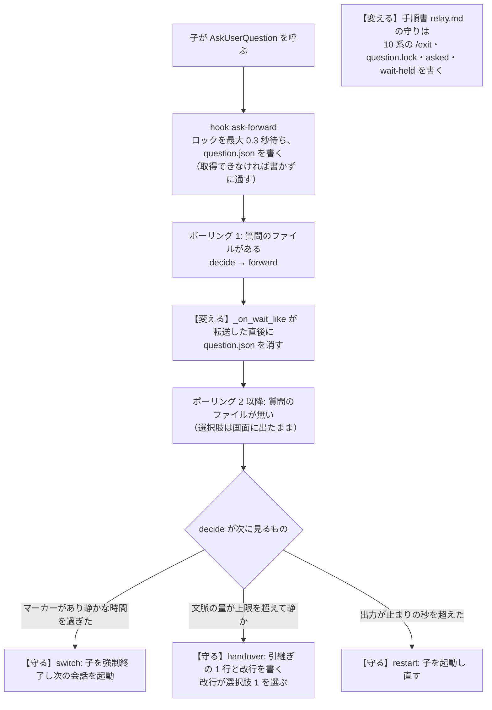
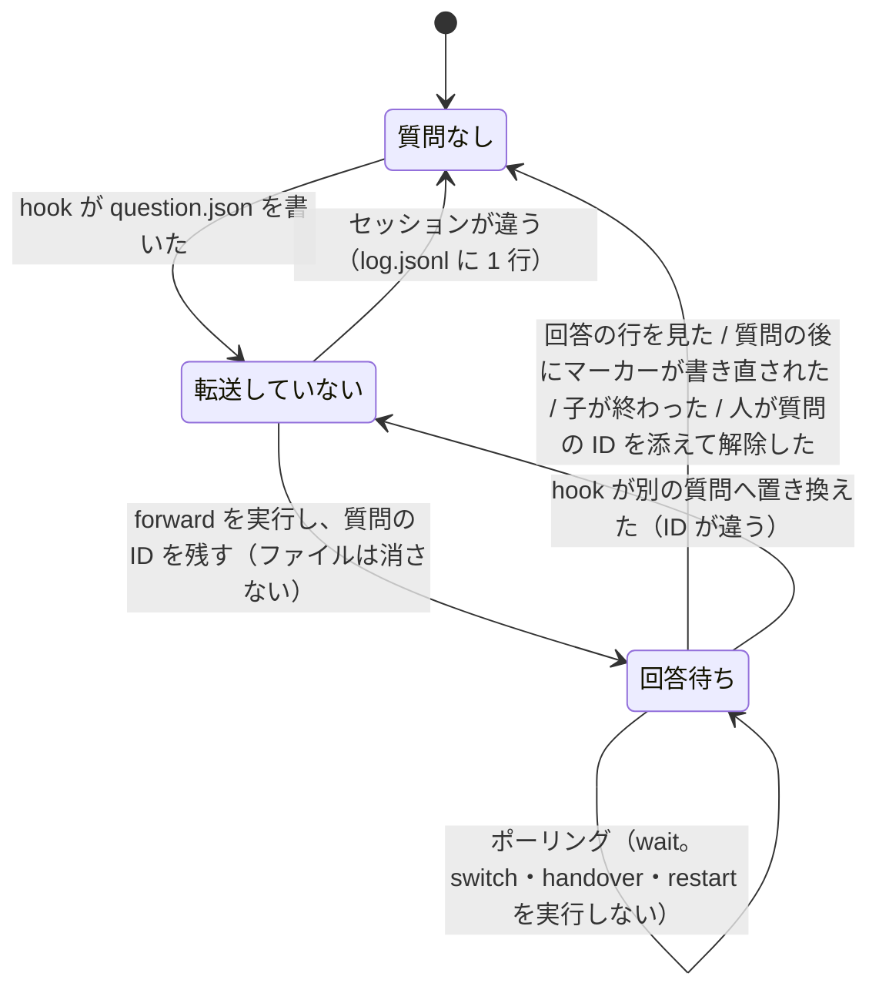
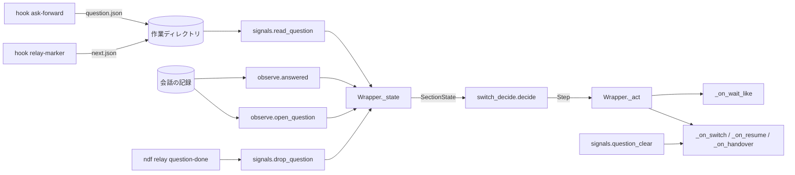
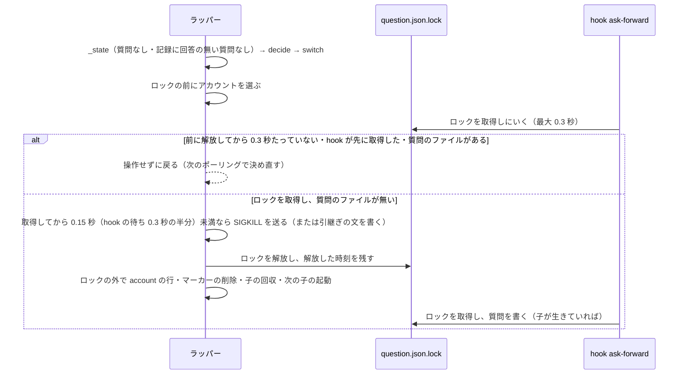

# 中継: 質問の表示中は回答が済むまで子を止めず、子の端末へ書かない（#3814）

中継のラッパーは質問を転送した直後に質問のファイルを消すため、承認ゲートの質問の表示中でも子を強制終了して次の会話へ移り、文脈の上限では改行を書いて人の代わりに選択肢 1 を選んでしまう。この設計は、質問のファイルを回答が済むまで残してその間は子を止めず子の端末へ書かず、子を止めるか子の端末へ書く直前には hook と同じロックの中で質問が無いことを確かめ直す。回答が済んだことは hook を変えずに会話の記録とマーカーの書き直しで知り、どちらも読めないときのために手動で解除するコマンドを足し、手順書の守りを 11 系の振る舞いだけに書き直す。採らなかった案は「決定の記録」に、ロックを保持する時間の制約の細部は詳細設計（[issue-3814-design-detail.md](./issue-3814-design-detail.md)）にある。

何が起きて誰が困ったか・何を満たせば終わりかは、要求仕様（[issue-3814-requirements.md](./issue-3814-requirements.md)、正は #3814 の本文）にある。この文書は「どう解くか」と「なぜその解き方か」だけを書く。

## 今の姿

ラッパーのポーリング・質問の受け渡し・切り替えの仕組みは、要求仕様の「今の姿」にある。設計に要るのは、質問のファイルを誰が書き、誰がいつ消し、その後のポーリングが何を実行するかの流れである。

**根本原因**: 質問を転送する操作（`wrapper.py` の `_on_wait_like`）が、転送した直後に質問のファイルを消す。判定（`switch_decide.decide`）は質問を最初に見て、ほかの判断より先に止める作りになっているが、ファイルが消えた次のポーリングからは質問が無いと読み、マーカー・文脈の上限・止まりの判断（`switch`・`restart`・`handover`）のとおりに子を止めるか子の端末へ書く。守りはポーリング 1 回分（0.5 秒）しか続かない。偽の子での再現は要求仕様の「事象」にある。既存のテストは「質問のファイルがあれば `forward`」だけを確かめ、転送した後のポーリングを見ていなかったので拾えなかった。手順書は 10 系の仕組みを書いていたため、読み手もこの欠けに気づけなかった。

**同じ形の箇所**: 判定と操作のあいだにも同じ穴がある。ポーリングが質問なしと読んでから、子を止めるか子の端末へ書くまでの間に、hook は質問を書ける。hook がロックを取得できずに質問を記録しなかったときも、ラッパーは質問が無いと読む。直すのは子を止める 3 つの操作（`switch`・`account`・`restart`）と子の端末へ書く操作（`handover`）のすべてである。

## 文脈と制約

- **hook は変えない。** 要求の「境界」で、hook（`plugins/ndf/src/ndf/domains/hooks/`）の変更は「確認してから行う」とし、この変更ではしない。hook はロック `question.json.lock` を最大 0.3 秒（`hook.ask-forward`）待ち、取得できなければ質問を書かずに通す。「転送は中継が待ち、hook は待たない」が `limits.json` の取り決めである
- **判断は純粋な関数に置く。** `switch_decide.decide` は何も読まず、`wrapper.py` が読んだ値を受ける（#2962）。`ndf relay decide` は入力の JSON をこの関数へ渡すので、足す項目には既定値を置く
- **強制終了は子の端末へ何も書かない**（ptyprocess 0.7.0。外部の調査の LIB1）。質問の回答を代わりに送るおそれがあるのは、端末へ書く操作（`handover`）だけである
- **回答は会話の記録に残る。** `type` が `user` の行の `message.content[]` に `{"type": "tool_result", "tool_use_id": "toolu_…", "content": "Your questions have been answered: …"}` の要素として残り、行の最上位には `toolUseResult`・`sessionId` なども並ぶ（手元の記録 3 件で確かめた。2026-11-19）
- **会話の記録は非同期に書かれ、遅れうる**（外部の調査の PRD1）。Stop の hook は応答を終えたときに動き、質問に答えるまで応答は終わらない
- **利用者の方針**: 「10 系の課題を引きずらず、11 系の設計思想に合わせる」（要求の「依頼（原文）」）。10 系の守りを作り直さず、要るものだけを 11 系の形で作る
- マーカーの後の入力・背景の作業で切り替えを取り消さない（要求の「対象範囲」の含まない。#2438 の「`/goal` が未達でも切り替える」）

## 解き方の全体像

**質問の ID**は 1 つの質問を見分ける値で、質問のファイルの `tool_use_id`、無ければ質問を書いた時刻 `at` である。ラッパーは転送した質問の ID を覚え、質問のファイルの ID と比べて、同じ質問か・別の質問へ置き換わったかを見分ける。

1. **質問のファイルを回答が済むまで残す。** 転送した後はファイルを消さず、転送した質問の ID を残す。判定は、転送していない質問なら `forward`、転送した質問なら `wait` を返す。質問は判定の最初に見るので、`wait` の間は切り替え・起動し直し・引継ぎの送信がすべて止まる。切り替えは今のとおり強制終了で、`/exit` を書かない（決定 1）
2. **回答の済みを 2 つのイベントで検知する。** 会話の記録に質問の `tool_use_id` を持つ `tool_result` が出たか、質問の `at` より後に Stop の hook がマーカーの `written_at` を書き直したら、質問のファイルを消す。子が終わったときとセッションが違うときも消す。消すときは hook と同じロックの中で、同じ質問かを確かめる（決定 1・決定 3）
3. **操作の直前にロックの中で確かめ直す。** 子を止める操作と子の端末へ書く操作は、hook と同じロックを待たずに取得し、質問のファイルが無いことを確かめ直してから、ロックを保持したまま `SIGKILL` を送るか引継ぎの文を書く。ロックを保持する時間と取得し直す間隔を hook の待ちに合わせて制約し、hook が待ちを越える前に操作が終わるようにする。子を止める最初のシグナルは、今の SIGHUP（`terminate(force=True)` の 1 つ目）から SIGKILL に変わり、回収の `terminate(force=True)` はロックの後に残る（決定 2）
4. **hook が記録できなかった質問も守る。** 質問のファイルが無くても、会話の記録の末尾に回答の無い `AskUserQuestion` があれば、回答待ちとして `wait` にする（決定 2）
5. **完了を自動で検知できないときは手動で解除する。** 会話の記録を読めないときは、質問の ID を含む解除のコマンド `ndf relay question-done` を状態と記録に出し、質問の ID が一致するときだけ消す（決定 3）
6. **手順書の守りを 11 系だけで書き直す。** `relay.md` の「承認ゲートを越えない守り」を、判定の順と hook の 3 つ（`ask-forward`・`relay-marker`・`stop-wait`）の振る舞いだけで書く（決定 4）

直すのは症状の出た切り替えの操作ではなく、質問のファイルを早く消す原因の側と、判定と操作のあいだの穴である。

## ドメインモデル

### 不変条件

テスト設計の行が指す。

| # | 対象 | 条件 | 破れたときの扱い |
| --- | --- | --- | --- |
| I1 | ラッパー 1 本の実行 | 回答待ちの質問がある間は、`switch`・`account`・`restart`・`handover` の操作をしない（子を止めず、子の端末へ書かない） | テストが落ちる |
| I2 | ラッパー 1 本の実行 | 1 つの質問（`tool_use_id`、無ければ `at`）について、質問を転送する操作（`forward`）は 1 回だけ実行し、`log.jsonl` の `forward` の行を 1 つだけ書く。続けて別の質問が来ても、その質問の `forward` の行を省かない | テストが落ちる |
| I3 | 中継のシグナルファイル | ラッパーが `question.json` を消すのは、回答の行を見た・質問の後にマーカーが書き直された・子が終わった・質問のセッションが今のセグメントと違う、のどれかのときだけである | テストが落ちる |
| I4 | 中継のシグナルファイル | ラッパーが子を止める（`switch`・`account`・`restart`）・子の端末へ書く（`handover`）ときは、ロック `question.json.lock` を保持したまま質問のファイルが無いことを確かめ直し、ロックを保持したまま `SIGKILL` を送るか引継ぎの文を 1 回で書く。ロックの中ではこのほかの処理（アカウントの選択・マーカーの削除・子の回収・記録の行）をしない。ロックを取得できないか質問があれば、そのポーリングでは操作しない | テストが落ちる |
| I5 | 中継のシグナルファイル | `question.json` を消すのは（ラッパーでも手動の解除でも）、ロック `question.json.lock` を保持したまま読み直した質問が、消すと決めた質問と同じ（`session_id` と質問の ID が同じ）ときだけである | テストが落ちる |
| I6 | 中継のシグナルファイル | ラッパーが I4 の操作をするのは、ラッパーが前にロックを解放してから hook の待ち（`hook.ask-forward` の秒）以上たったことをロックを取得する前に確かめてからロックを取得し、取得してから操作の直前までが hook の待ちの半分未満のときだけである。外れたら操作せずにロックを解放し、次のポーリングで決め直す | テストが落ちる |
| I7 | ラッパー 1 本の実行 | 質問のファイルが無くても、会話の記録の末尾に `tool_result` の無い `AskUserQuestion` の `tool_use` があれば、回答待ちの質問として扱い I1 の操作をしない（hook が質問を記録できなかったとき） | テストが落ちる |

イベント（マーカーを書いた・質問を出した・転送した・回答が済んだ・消した・切り替えた）は要求仕様の「ドメインイベント」にある。

## 構成要素

関数の仕様と異常系は詳細設計にある。

| 要素 | 責務 |
| --- | --- |
| `switch_decide.SectionState`・`decide`（変更） | 転送した回答待ちの質問があれば `wait` を返す（転送していなければ今のとおり `forward`。理由の文に質問の ID を入れる） |
| `wrapper.Wrapper._state`（変更） | 質問のファイルを読み、回答の済み・子の終わり・セッションの違いで消し、回答待ちか・転送したか・質問の ID を `SectionState` へ渡す。質問のファイルが無くても会話の記録に回答の無い質問があれば回答待ちとして渡し、`log.jsonl` に `unrecorded_question` の行を質問ごとに 1 つ書く |
| `wrapper.Wrapper._on_wait_like`（変更） | 質問を転送したら、質問のファイルを消さずに転送した質問の ID を残す。転送するのは `_state` が読んだ質問そのもの（コピー）である |
| `wrapper.Wrapper._on_switch`・`_on_resume`・`_on_handover`（変更） | ロックの中で、`SIGKILL` を送るか子の端末へ書く。アカウントの選択はロックの前、マーカーの削除・子の回収・記録の行はロックの後。ロックを取得できない・質問がある・時間の制約（I6）を外れたら操作せずに戻る |
| `signals.read_question`（新設） | 質問のファイルを読む（無ければ None、壊れていれば `SignalError`） |
| `signals.question_clear`（新設） | `with` 文でロックを保持する区間を作る部品（Python の文脈マネージャー）。ロックを待たずに取得し、質問のファイルが無く時間の制約の内かを確かめる関数を区間の中へ渡す。区間を抜けるまでロックを保持する |
| `signals.drop_question`（新設） | ロックの中で質問を読み直し、渡した質問と同じときだけ消す |
| `observe.answered`（新設） | 会話の記録の末尾に、質問の `tool_use_id` を持つ `tool_result` の要素があるか。記録を読めなければ None |
| `observe.open_question`（新設） | 会話の記録の末尾で、回答の無い `AskUserQuestion` の `tool_use` の id。無ければ None |
| `ndf relay question-done`（新設） | 手動の解除。質問の ID が一致するときだけ質問のファイルを消す |
| `relay.md`（変更） | 「承認ゲートを越えない守り」を 11 系へ書き直し、「落ちたときの続け方」に手動の解除の 1 行を載せる |

## 処理の流れ

### 判定の後に質問が出る競合

ポーリングが質問なしと読んでから操作するまでの間に hook が質問を書いても、操作はロックの中で質問を見て、子を止めず子の端末へ書かない。次のポーリングが質問を読んで `forward` する。

hook が待ちを越えて質問を記録せずに返る前に、ラッパーの操作が終わることの議論と、引継ぎの文の短い書き込みの扱いは、詳細設計の `signals.question_clear` と `_on_handover` の構成要素にある。

### 回答の済みを確かめられないとき

会話の記録が読めず、回答の後の応答が `ndf-next` を持たないと、自動で検知できるのは子の終わりだけになる。ラッパーは質問を残したまま、状態のファイルの待ちの理由（`wrapper.json` の `waiting` の理由）と `log.jsonl` の `question_unconfirmed` の行（質問ごとに 1 行）に、読めなかった記録のパスと解除の手順 `ndf relay question-done --dir <NDF_RELAY_DIR> --session <session_id> --question-id <tool_use_id>` を書く。コマンドはロックの中で読み直した質問の `session_id` と質問の ID が渡した値と同じときだけ消し（I5）、消せたら次のポーリングで今と同じ判断へ戻る。手順書の「落ちたときの続け方」にも同じ行を載せる。

## 決定の記録

### 決定 1: 承認ゲートの質問を答えるまで残すため、切り替えは強制終了のままにし、質問のファイルを回答が済むまで残して回答待ちの間は `wait` を返す

- **問い**: 切り替えを `/exit` で行うか強制終了のままにするか（要求の「依頼（原文）」の決めること）。質問の表示中にどう操作を止めるか
- **選んだ案**: 切り替えは強制終了（子の端末へ何も書かずにシグナルで止める）のままにする。最初に送るシグナルは決定 2 で SIGHUP から SIGKILL に変わるが、端末へ何も書かないことは変わらない。強制終了は子の端末へ何も書かないので（LIB1）、10 系が `/exit` の改行に備えて要したロック（`question.lock`）・時刻（`asked`）・`wait-held.json` は要らない。11 系で欠けていたのは、質問を転送した直後に質問のファイルを消すことだけである。ファイルを回答が済むまで残し、`decide` が転送した質問のあいだは `wait` を返せば、切り替え・起動し直し・引継ぎの送信がすべて止まる。消すときは hook と同じロックを使い（`signals.drop_question`）、ロックの中で読み直した質問が消すと決めた質問（`session_id` と質問の ID）と同じときだけ消す。読んだ後に hook が別の質問へ置き換えていれば消さず、ID が違うので次のポーリングで転送する。`forward` で計画のリクエストへ載せる中身も、ID を取り出したのと同じ読みのコピーにし、ID と載せた中身が食い違わないようにする
- 採らなかった案: `/exit` へ戻す（10 系の守りを作り直すことになる）
- 採らなかった案: マーカーの後の利用者の入力や背景の作業で切り替えを取り消す（#2438 の「`/goal` が未達でも切り替える」と食い違う。要求の起票者の推定 S4）
- **代償**: 回答待ちの間は、文脈の上限を超えても引継ぎの送信が回答の後へずれる（要求の「影響」の既存の振る舞い）
- 根拠: Value 1「人の判断を、読み切れる量の大事な所だけにする」（MVV バージョン 9）

### 決定 2: 判定と操作のあいだに出た質問も守るため、子を止める操作と子の端末へ書く操作は hook と同じロックの中で確かめ直し、ロックを保持する時間を hook の待ちより短く制約する

- **問い**: ポーリングの判定だけでは、`_state` が質問なしと読んでから子を止める・子の端末へ書くまでの間に hook が質問を書く競合が残る。hook を変えずにどう閉じるか
- **選んだ案**: 子を止める操作（`_on_switch`・`_on_resume`）と子の端末へ書く操作（`_on_handover`）は、hook が書くときと同じロック `question.json.lock` を待たずに取得し（`signals.question_clear`）、ロックの中で質問のファイルが無いことを確かめ直してから、ロックを保持したまま `SIGKILL` を送るか引継ぎの文を 1 回で書く。ロックを取得できない（hook が書いている）か質問があれば操作せずに戻り、次のポーリングが質問を読んで `forward` する。待たずに取得するのは、hook のロックの待ち（0.3 秒）をポーリングで消費しないためである。ロックを長く保持すると hook が待ちを越えて質問を記録せずに返り、ラッパーの操作と選択肢の表示が重なるので、ロックの中の処理を確かめ直しと 1 つの操作だけにし（I4）、ロックを保持する時間を hook の待ちの半分未満に、ロックを解放してから次に取得するまでを hook の待ち以上に制約する（I6）。`_on_switch` のアカウントの選択はロックの前に、`account` の行・マーカーの削除・子の回収はロックの後に移す。それでも hook が記録できない質問（ロックの待ちを越えた・書き込みが `OSError` で失敗した）は残るが、選択肢は回答まで画面に残り、会話の記録には回答の無い `AskUserQuestion` の `tool_use` が書かれる。切り替え・引継ぎ・起動し直しは静かな時間か止まりの秒を待ってから出るので、`_state` が記録の末尾を読み（`observe.open_question`）、見つけたら回答待ちとして `wait` にする（I7）。このとき質問のファイルが無いので転送せず、`log.jsonl` に `unrecorded_question` の行を質問ごとに 1 つ書く。回答の `tool_result` が記録に出るか子が終わると抜ける
- 採らなかった案: hook がロックを取得できないときに質問を拒否する（確実だが hook を変える。要求の「境界」で hook の変更は「確認してから行う」とし、この変更ではしない）
- 採らなかった案: hook のロックの待ちを延ばす（「転送は中継が待ち、hook は待たない」という `hook.ask-forward` の取り決めに反するうえ、時間で決まることに変わりない）
- **代償**: 子を止める最初のシグナルが変わる。今は `_stop_child` の `terminate(force=True)` が SIGHUP・SIGCONT・SIGINT を 0.1 秒おきに送り、それでも終わらなければ SIGKILL を送る（要求の前提 2）。この設計ではロックの中でいきなり SIGKILL を送るので、切り替え・アカウントの替え・起動し直しのどれでも、claude は SIGHUP を受けて後始末する機会を持たない。最後の応答は Stop の hook の前に会話の記録へ書き終わっており（要求の前提 1）、切り替えは静かな時間の後なので、失うのは静かな時間の後に書かれる行だけと見ている（「未確認のまま残ること」）
- **代償**: 時間の制約を外れたポーリングは操作せずに次のポーリングへ送るので、操作がポーリング 1 回分（`relay.tick` の 0.5 秒）遅れうる。制約の議論は「hook のプロセスが 0.3 秒のあいだ一度も動けないことは無い」を前提にする（「未確認のまま残ること」）
- 根拠: Value 1「人の判断を、読み切れる量の大事な所だけにする」（MVV バージョン 9）

### 決定 3: hook を変えずに回答の済みを知るため、会話の記録の `tool_result` と質問の後のマーカーの書き直しの 2 つで完了を検知し、どちらも出ないときは質問の ID を添えた手動の解除を出す

- **問い**: 質問のファイルを消してよい時点（回答が済んだこと）を、hook を変えずにどう知るか。完了を検知できないときにレーンを止め続けないにはどうするか
- **選んだ案**: 会話の記録の `tool_result` は回答そのものを示すが、記録は非同期に書かれ遅れうる（PRD1）。Stop は Claude が応答を終えたときに動き（PRD1）、質問に答えるまで応答は終わらないので、質問の `at` より後にマーカーの `written_at` が書き直されていれば回答は済んでいる。2 つのどちらかを見たら消す。会話の記録が読めず、回答の後の応答が `ndf-next` を持たない（Stop の hook がマーカーを書かない）と、どちらも出ず、自動で検知できるのは子の終わりだけになる。hook を変えずに完了を検知できるものはほかに無い（Stop の hook のうち中継の保存先へ書くのは `relay-marker` だけで、ブロックの無い応答では書かない）。そこで `observe.answered` は記録を読めないとき None を返し、ラッパーは「処理の流れ」の「回答の済みを確かめられないとき」のとおり、対象の質問の ID を含む解除のコマンドを出す。人かオーガナイザーがコマンドを打てば、質問の ID が一致するときだけ消える。こうして、会話の記録が読めなくても、質問の後の Stop・子の終わり・手順のある手動の解除のどれかで待ちが解ける（要求の非機能の条件「可用性」）
- 採らなかった案: 画面の出力の再開を回答の検知に使う（質問の表示中も画面の描き直し（端末の大きさの変化など）で出力が出て、回答の前に消してしまう）
- 採らなかった案: PostToolUse の hook で質問のファイルを消す（`AskUserQuestion` で PostToolUse が動くかを確かめられなかった（外部の調査の「確かめられなかったこと」）。加えて、hook のコードはこのスプリントの計画で触ってよいファイルの外にある）
- 採らなかった案: 手動の解除を `rm` で消す手順にする（回答済みと確かめた後に hook が同じパスへ置いた未回答の質問まで消し、次のポーリングが切り替えや引継ぎを進める）
- **代償**: 会話の記録が読めず回答の後の応答が `ndf-next` を持たないときは、人かオーガナイザーが 1 行を打つまでレーンが待つ。公開インタフェースにサブコマンドが 1 つ増える
- 根拠: Value 7「不具合が根本原因から直される」（MVV バージョン 9）

### 決定 4: 手順書が 11 系だけを書くよう、守りの表を判定の順と hook の 3 つの振る舞いで書き直す

- **問い**: 手順書 `relay.md` の「承認ゲートを越えない守り」を、10 系の仕組みに代えて何で書くか
- **選んだ案**: 守りの表は `decide` の判断の順を書く。順は、質問 → 上限と認証の失敗 → マーカー → 子の終わり → 文脈の上限 → 止まり である。あわせて hook の 3 つ（`ask-forward`・`relay-marker`・`stop-wait`）の振る舞いを書き、`question.lock`・`asked`・`wait-held.json`・`/exit` の書き込み・`log.jsonl` の `prose_wait` の行・`ndf-gate` の自動の付与を消す（要求の受け入れ条件 8）。10 系の 2 行（マーカーの後の入力・背景の作業で待つ）は、11 系の振る舞い（入力では取り消さず、背景の作業が残る間は Stop の hook がマーカーを書かない）へ書き直す
- 採らなかった案: 手順書の 10 系の守りをコードに作って手順書をそのまま残す（決定 1 の `/exit` へ戻す案と同じく、強制終了では要らない守りを作り直すことになる）
- **代償**: 10 系の守りを読んで運用していた読み手は、表の読み替えが要る
- 根拠: Value 14「判断の理由が残り、語がそろっている」（MVV バージョン 9）

## 影響と危険

- 公開インタフェースが変わる（互換あり）。足すのはサブコマンド `ndf relay question-done` と、`ndf relay decide` の入力の 2 項目（`question_forwarded` は既定で偽、`question_id` は既定で None）で、今の入力の JSON も読める。重さと既存の振る舞いの変化は要求の「影響」にある
- 質問が無いときの切り替え・上限・認証の失敗の判断は変えない（`decide` は質問の分岐だけを変える）
- 子を止める最初のシグナルが SIGHUP から SIGKILL に変わる（決定 2 の代償）。切り替え・アカウントの替え・起動し直しのすべてに当たる
- 子を止める操作がロックと時間の制約で見送られたときは、ポーリング 1 回分（0.5 秒）遅れる
- ロックを保持する時間の議論は、hook のプロセスがスケジューラーに 0.3 秒のあいだ一度も動かされないことは無い、を前提にする。崩れても選択肢が出たままなら会話の記録の確かめ（I7）が操作を止める（「未確認のまま残ること」）

## 用語

「回答待ちの質問」は要求仕様の「用語」にある。用語集（[ndf-relay.md](../docs/glossary/ndf-relay.md)）へは設計 Pull Request で足した。

## テスト設計

| 受け入れ条件・不変条件 | どの振る舞いで確かめるか | どう壊したら落ちるべきか |
| --- | --- | --- |
| 1、I1（再現のテスト。今は落ちる） | マーカーがあり静かな時間を過ぎても、転送した回答待ちの質問があれば `switch` が出ず子が生きている | 転送した後に質問のファイルを消すと落ちる（今の振る舞い） |
| 2、I1 | 回答待ちの間、文脈の量が上限を超えても子の端末へ書かない | `decide` で文脈の上限を質問より先に見ると落ちる |
| 3、I1 | 回答待ちの間、止まりの秒を超えても `restart` が出ない | 同上 |
| 4、I3 | 会話の記録に `tool_result` を足すか、質問の `at` より後の `written_at` でマーカーを書き直すと、質問のファイルが消え次のポーリングで `switch` が出る | 2 つのイベントのどちらかを読まないと落ちる。質問の前の `written_at` で消すと落ちる |
| 4、I3 | 実際の形の行（`{"type": "user", "message": {"role": "user", "content": [{"type": "tool_result", "tool_use_id": "toolu_A", "content": "Your questions have been answered: …"}]}, "toolUseResult": …}`）で消え、`tool_use_id` が別の質問（`toolu_X`）の行・`type` が `assistant` の行の `tool_use`・最上位にだけ `tool_use_id` がある行では消えない | 行の最上位や別の質問の id で照らすと落ちる |
| 4・6、I5 | ラッパーが質問 A を読み、消す前に hook が質問 B へ置き換える（`signals.drop_question` の読み直しの前に B を書く）。B のファイルが残り、次のポーリングで B の `forward` が 1 回出る | ロックの中で同じ質問かを確かめずに消すと落ちる |
| 5、I2 | 1 つの質問で `forward` と `plan_question` の行が 1 つずつ | ポーリングごとに転送すると落ちる |
| 5、I2 | 質問 A を転送した次のポーリングまでに、A への回答の `tool_result` と質問 B のファイルが出る（間に別の判断の行が無い）。`forward` の行が A と B で 1 つずつ、`plan_question` の行も 1 つずつ | `forward` の理由に質問の ID を入れないと、`_note` が B の行を省いて落ちる |
| 6、I3 | 子が終わると質問のファイルが消える。セッションの違う質問は消え、`log.jsonl` に 1 行 | 消さない・行を書かないと落ちる |
| I3 | マーカーの `written_at` が無い・null・数・タイムゾーンの無い時刻・読めない文字列、質問の `at` が同じ形のとき、例外を出さず質問を残す | `nxt["written_at"]` で読む・タイムゾーンの無い時刻を比べると落ちる |
| 7 | 切り替えで子の `written` が空のまま、ロックの中で `kill(SIGKILL)`、ロックの後で `terminate` が呼ばれる。受け入れ条件 7 の「今と同じ強制終了」は、子の端末へ何も書かずにシグナルで止めることとして照らす（最初のシグナルが SIGKILL に変わることは決定 2 の代償） | `/exit` を書くと落ちる |
| 8 | レビューで、`relay.md` の守りの表と箇条が受け入れ条件 8 の挙げる 10 系の語（`question.lock`・`asked`・`wait-held.json`・`/exit` の書き込み・`prose_wait` の行・`ndf-gate` の自動の付与）を持たず、判定の順と hook の 3 つだけを書くことを見る。リンクは `python3 scripts/check-markdown-links.py` で見る | 文言のテストは書かない |
| 9 | 既存の中継のテストがすべて通る | — |
| 10、I5 | `ndf relay question-done` に質問 A の ID を渡し、ファイルが B のとき、B が残り `ndf-relay:` の 1 行に B の ID が出て終了コード 1。A のときは消えて 0、次のポーリングで `switch` | ID を比べずに消すと落ちる |
| 非機能の条件「可用性」 | 会話の記録が無いまま転送した質問で、`wrapper.json` の `waiting` の理由に記録のパスと質問の ID を含む `ndf relay question-done` の 1 行が入り、`question_unconfirmed` の行が 1 つ。その 1 行で解除すると次のポーリングで `switch` が出る | 解除の後も転送した質問の ID で `wait` を続けると落ちる。理由の文に質問の ID が無いと落ちる |
| 1・2・3、I4 | `_state` が質問なしと読んだ直後（`decide` の後・操作の前）に hook の `signals.write_question` で質問を書く（`_state` を包んで書く）。`switch`・`account`・`restart` では子が生きていて `terminate` が呼ばれず、`handover` では子の `written` が空。次のポーリングで `forward` が出る | 操作の中で確かめ直さないと落ちる。ロックの外で確かめると、ロックを保持する別のスレッドが書いた場合に落ちる |
| I4 | 別のスレッドが `question.json.lock` を保持する間に `switch` が出ても、子を止めず、ロックが解放された後のポーリングで切り替える | ロックを待たずに実行すると落ちる |
| I4 | `switch` で、子の `kill(SIGKILL)` が呼ばれた時点でロックが使用中でいて（偽の子の `kill` の中で `held(lock, 0)` が偽）、`account` の行・マーカーの削除・`terminate` の時点ではロックが解放されている | アカウントの選択・マーカーの削除・回収をロックの中へ戻すと落ちる |
| I6 | 偽の時計で、ロックを取得してから操作の直前までを hook の待ちの半分以上に進めると、`switch`・`restart`・`handover` のどれも実行せず（`kill` も `write` も呼ばれず、マーカーと `account` の行はそのまま）、次のポーリングで実行する | 時間を確かめずに実行すると落ちる |
| I6 | 同じポーリングで `drop_question` がロックを解放した直後（hook の待ちより短い間）に `switch` が出ると、そのポーリングでは実行せず、待ちの後のポーリングで実行する | 前に解放した時刻を見ないと落ちる |
| I6 | `relay.tick` を hook の待ちより短くし、前に解放してから待ちが過ぎる前のポーリングが続いても、ロックを取得しにいかず解放した時刻が変わらず、待ちの後のポーリングで操作する | ロックを取得してから待ちを確かめ、取得するたびに解放した時刻を更新すると落ちる |
| I6 | `handover` の書き込みが `EAGAIN` を返す偽の子で、書かずに戻り `handover_asked` が偽のまま | 待つ形で書くと落ちる |
| I6 | `handover` の最初の書き込みが全長より短い数を返し、続きが `EAGAIN` の偽の子で、`handover_asked` が偽・残りが `handover_rest` に残り・マーカーも残る。次のポーリングで残りだけが書かれ（前半を重ねて書かない）、`\r` まで届いて `handover_asked` が真になる | 正の戻り値を成功とみなすと落ちる |
| I7 | 質問のファイルが無く、会話の記録の末尾に `tool_result` の無い `AskUserQuestion` の `tool_use` がある。マーカーがあり静かな時間を過ぎても `switch` が出ず、文脈の上限でも書かず、`unrecorded_question` の行が 1 つ。回答の `tool_result` を足すと次のポーリングで `switch` | 記録を見ないと落ちる。`tool_result` のある `tool_use`・別の Tool の `tool_use` で止めると落ちる |
| `decide` の入力（`ndf relay decide`） | `question_forwarded` の無い今の JSON が読め、`question` が真で転送していなければ `forward` | 既定値を外すと落ちる |

## 設計の結果

| 課題 | 扱い | 統合先 | 触るファイル |
| --- | --- | --- | --- |
| #3814 | 実装する | — | `plugins/ndf/src/ndf/domains/relay/wrapper.py`、`plugins/ndf/src/ndf/domains/relay/switch_decide.py`、`plugins/ndf/src/ndf/domains/relay/signals.py`、`plugins/ndf/src/ndf/domains/relay/observe.py`、`plugins/ndf/src/ndf/domains/relay/cli.py`、`plugins/ndf/tests/domains/relay/test_relay_wrapper.py`、`plugins/ndf/tests/domains/relay/test_relay_decide.py`、`plugins/ndf/tests/domains/relay/test_relay_parts.py`、`plugins/ndf/tests/domains/relay/test_relay_cli.py`、`plugins/ndf/skills/development-workflow/references/relay.md` |

## 未確認のまま残ること

| 項目 | 内容 |
| --- | --- |
| hook のプロセスがロックの待ちのあいだ動けること | I6 の議論は、hook のプロセスが 0.3 秒のあいだ一度も動けないことは無い、を前提にする。崩れても選択肢が出たままなら I7 が操作を止めるが、会話の記録の書き込みが静かな時間より遅れたときは止まらない。プロセスの割り当てはスケジューラーが決め、テストで確かめられない |
| 会話の記録へ質問が書かれる時刻 | I7 は、選択肢を出した `AskUserQuestion` の `tool_use` が静かな時間（既定 5 秒）のうちに会話の記録へ書かれると見ている（PRD1 は書き込みが遅れうるとだけ書く）。リリース後テストで、hook が書けないようにした質問で切り替えが止まることを見る |
| 引継ぎの 1 行と PreToolUse の hook の重なり | ロックの中で質問が無いと確かめて書いた 1 行と改行は、選択肢が出る前に擬似端末へ入る。claude は hook の終わりを待つ間も端末を読むので入力欄へ入ると見ているが、実際の claude では確かめていない。リリース後テストで、hook の途中に書いた改行が選択肢を決めないことを見る |
| 実際の claude での質問の守り | 偽の子でしか確かめていない。リリース後テストで、ラッパーの下で `ndf-next` を出した応答の続きに `AskUserQuestion` を呼び、答えるまで切り替わらないことを見る |
| SIGHUP を受けずに止まる claude の会話の記録の書き切り | 変える。今は SIGHUP から送るが、この設計はロックの中でいきなり SIGKILL を送る（決定 2 の代償）。SIGHUP を受けた claude が記録を書き切るかも、SIGKILL で失う行があるかも、外部の文書に記述が無い。最後の応答は Stop の前に書き終わり（要求の前提 1）、切り替えは静かな時間（既定 5 秒）の後なので失う行は無いと見ている。リリース後テストで、切り替えた会話の記録の末尾が最後の応答で終わり、`claude --resume` で続けられることを見る |

## 外部の調査

| 種類 | 調べるか | 理由 |
| --- | --- | --- |
| 標準・仕様 | 調べない | ラッパーと Claude Code のあいだの取り決めで、業界の標準が定める領域ではない |
| 主要な製品 | 調べる | 回答の済みと会話の記録の書き終わりは Claude Code の振る舞いに依る |
| ライブラリとサービス | 調べる | 強制終了の形は、依存している ptyprocess が決める |

### 主要な製品

| # | 製品 | どう解いているか | 設計への反映 | 出典 |
| --- | --- | --- | --- | --- |
| PRD1 | Claude Code の hook | PreToolUse の入力に `tool_use_id` が入る。Stop は「Claude が応答を終えたとき」に動く。会話の記録は非同期に書かれ、hook の時点で最新の行を含まないことがあり、最後の応答は Stop の `last_assistant_message` で読むよう勧める | 回答の済みを会話の記録だけに頼らず、質問の後の Stop（マーカーの書き直し）でも知る。切り替えは今のとおり静かな時間を待ってから行う | https://code.claude.com/docs/en/hooks（2026-11-19） |

### ライブラリとサービス

| # | 候補 | バージョン | ライセンス | 最後のリリースの日付 | 終了のアナウンス | 要件を満たすか | 出典 |
| --- | --- | --- | --- | --- | --- | --- | --- |
| LIB1 | ptyprocess（既に依存） | 0.7.0 | ISC | 2020-12-28 | 無し（リポジトリはアーカイブされていない。最後の push 2026-08-26） | 満たす。`PtyProcess.terminate(force=True)` は SIGHUP・SIGCONT・SIGINT を 0.1 秒おきに送ってから SIGKILL を送り、子の端末へは何も書かない | https://pypi.org/pypi/ptyprocess/json・https://api.github.com/repos/pexpect/ptyprocess・手元の `inspect.getsource(PtyProcess.terminate)`（2026-11-19） |

### 確かめられなかったこと

| 対象 | 試した手段 | 結果と理由 |
| --- | --- | --- |
| `AskUserQuestion` で PostToolUse が動くか | PRD1 の文書（先頭の 10 万字） | 文書に `AskUserQuestion` の記述が無い。この設計は PostToolUse に頼らない |
| SIGHUP を受けた claude が会話の記録を書き切ってから終わるか | 試していない | 外部の文書に記述が無い。この設計は最初のシグナルを SIGKILL に変えるので（決定 2 の代償）、問いは「SIGKILL で失う行があるか」に変わる。切り替えは Stop の後に静かな時間（既定 5 秒）を待つので、失う行は無いと見ている（「未確認のまま残ること」） |

調べた量: 候補 2 件・取得の試み 4 回。
