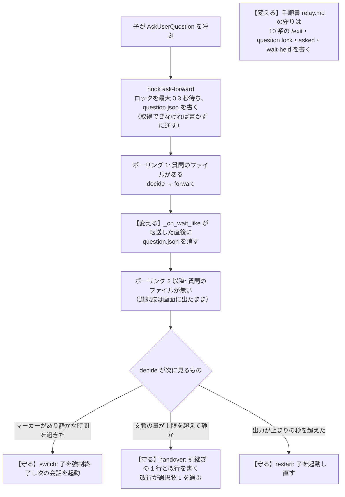
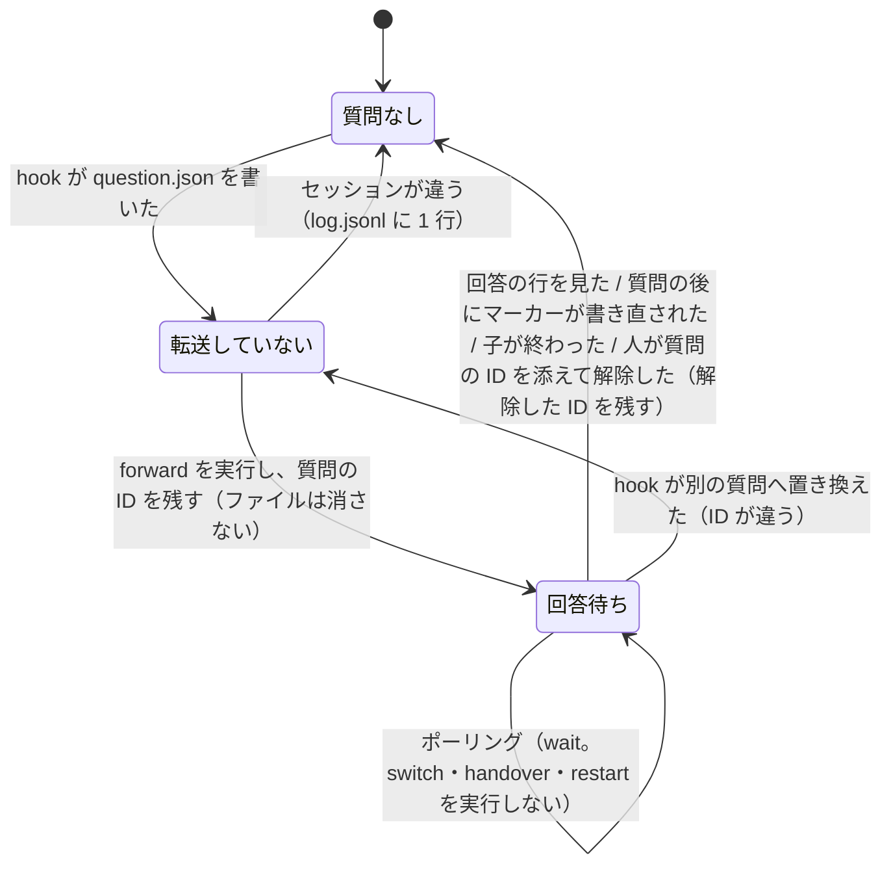
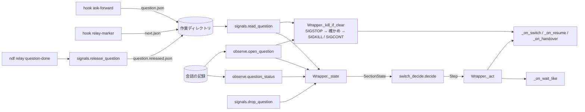
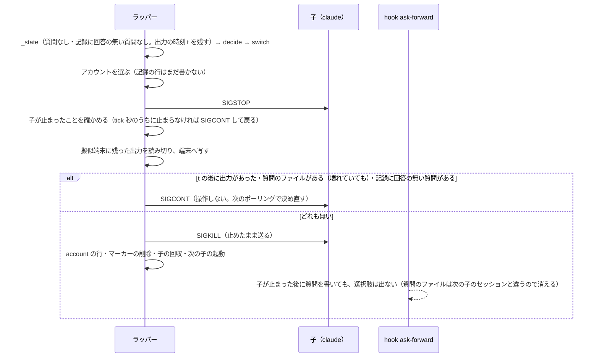

# 中継: 質問の表示中は回答が済むまで子を止めず、子の端末へ書かない（#3814）

中継のラッパーは質問を転送した直後に質問のファイルを消すため、承認ゲートの質問の表示中でも子を強制終了して次の会話へ移り、文脈の上限では改行を書いて人の代わりに選択肢 1 を選んでしまう。この設計は、質問のファイルを回答が済むまで残してその間は子を止めず、子を止める直前には子を一時停止（SIGSTOP）させてから、判定の後に画面への出力が無く質問も無いことを確かめて止める。引継ぎは子の端末へ書かず、同じ会話を起動し直して引数で頼むので、ラッパーが子の端末へ書く操作は無くなる。回答が済んだことは hook を変えずに会話の記録とマーカーの書き直しで知り、確かめられないときのために手動で解除するコマンドを足し、手順書の守りを 11 系の振る舞いだけに書き直す。採らなかった案は「決定の記録」に、一時停止の手順の細部は詳細設計（[issue-3814-design-detail.md](./issue-3814-design-detail.md)）にある。

何が起きて誰が困ったか・何を満たせば終わりかは、要求仕様（[issue-3814-requirements.md](./issue-3814-requirements.md)、正は #3814 の本文）にある。この文書は「どう解くか」と「なぜその解き方か」だけを書く。

## 今の姿

ラッパーのポーリング・質問の受け渡し・切り替えの仕組みは、要求仕様の「今の姿」にある。設計に要るのは、質問のファイルを誰が書き、誰がいつ消し、その後のポーリングが何を実行するかの流れである。



**根本原因**: 質問を転送する操作（`wrapper.py` の `_on_wait_like`）が、転送した直後に質問のファイルを消す。判定（`switch_decide.decide`）は質問を最初に見て、ほかの判断より先に止める作りになっているが、ファイルが消えた次のポーリングからは質問が無いと読み、マーカー・文脈の上限・止まりの判断（`switch`・`restart`・`handover`）のとおりに子を止めるか子の端末へ書く。守りはポーリング 1 回分（0.5 秒）しか続かない。偽の子での再現は要求仕様の「事象」にある。既存のテストは「質問のファイルがあれば `forward`」だけを確かめ、転送した後のポーリングを見ていなかったので拾えなかった。手順書は 10 系の仕組みを書いていたため、読み手もこの欠けに気づけなかった。

**同じ形の箇所**: 判定と操作のあいだにも同じ穴がある。ポーリングが質問なしと読んでから、子を止めるか子の端末へ書くまでの間に、hook は質問を書け、子は選択肢を画面に出せる。hook がロックを取得できずに質問を記録しなかったとき（書き込みの失敗を含む）も、ラッパーは質問が無いと読む。子の端末へ書いた引継ぎの 1 行は、書き終えても子がいつ読むかは決まらず、選択肢が出た後に読まれれば改行が回答を決める。ポーリングの例外の経路（`_loop` の `config_broken`）も、質問を確かめずに子を止める。直すのは子を止める 3 つの操作（`switch`・`account`・`restart`）・子の端末へ書く操作（`handover`）・例外の経路のすべてである。

## 文脈と制約

- **hook は変えない。** 要求の「境界」で、hook（`plugins/ndf/src/ndf/domains/hooks/`）の変更は「確認してから行う」とし、この変更ではしない。hook はロック `question.json.lock` を最大 0.3 秒（`hook.ask-forward`）待ち、取得できなければ質問を書かずに通す。「転送は中継が待ち、hook は待たない」が `limits.json` の取り決めである
- **判断は純粋な関数に置く。** `switch_decide.decide` は何も読まず、`wrapper.py` が読んだ値を受ける（#2962）。`ndf relay decide` は入力の JSON をこの関数へ渡すので、足す項目には既定値を置く
- **強制終了は子の端末へ何も書かない**（ptyprocess 0.7.0。外部の調査の LIB1）。質問の回答を代わりに送るおそれがあるのは、端末へ書く操作（`handover`）だけである
- **子の端末へ書いた入力を子がいつ読むかは、ラッパーから決められない。** 書き込みが終わったことは、擬似端末の入力の待ち行列へ入ったことしか示さない。読む前に選択肢が出れば、改行はその選択肢を決める
- **選択肢を画面に出すのは、ラッパーが起動した子のプロセスそのものである。** 動いている中継の子（11.0.8、2026-11-19）を `ps -eo pid,ppid,pgid,sid,stat,args --forest` で見ると、ラッパーの直下の子は `claude` の本体（セッションの先頭）で、その下にあるのは MCP のサーバーだけだった。画面に何かを出すには、子が擬似端末へ書く必要がある。止まった（SIGSTOP を受けた）プロセスは書けない
- **回答は会話の記録に残る。** `type` が `user` の行の `message.content[]` に `{"type": "tool_result", "tool_use_id": "toolu_…", "content": "Your questions have been answered: …"}` の要素として残り、行の最上位には `toolUseResult`・`sessionId` なども並ぶ（手元の記録 3 件で確かめた。2026-11-19）
- **会話の記録は非同期に書かれ、遅れうる**（外部の調査の PRD1）。Stop の hook は応答を終えたときに動き、質問に答えるまで応答は終わらない
- **利用者の方針**: 「10 系の課題を引きずらず、11 系の設計思想に合わせる」（要求の「依頼（原文）」）。10 系の守りを作り直さず、要るものだけを 11 系の形で作る
- マーカーの後の入力・背景の作業で切り替えを取り消さない（要求の「対象範囲」の含まない。#2438 の「`/goal` が未達でも切り替える」）

## 解き方の全体像

**質問の ID**は 1 つの質問を見分ける値で、質問のファイルの `tool_use_id`、無ければ質問を書いた時刻 `at` である。ラッパーは転送した質問の ID を覚え、質問のファイルの ID と比べて、同じ質問か・別の質問へ置き換わったかを見分ける。



1. **質問のファイルを回答が済むまで残す。** 転送した後はファイルを消さず、転送した質問の ID を残す。判定は、転送していない質問なら `forward`、転送した質問なら `wait` を返す。質問は判定の最初に見るので、`wait` の間は切り替え・起動し直し・引継ぎの送信がすべて止まる。切り替えは今のとおり強制終了で、`/exit` を書かない（決定 1）
2. **回答の済みを 2 つのイベントで検知する。** 会話の記録に質問の `tool_use_id` を持つ `tool_result` が出たか、質問の `at` より後に Stop の hook がマーカーの `written_at` を書き直したら、質問のファイルを消す。子が終わったときとセッションが違うときも消す。消すときは hook と同じロックの中で、同じ質問かを確かめる（決定 1・決定 3）
3. **子を一時停止させてから確かめ、止める。** 子を止める操作は、子へ SIGSTOP を送って止まったことを確かめ、擬似端末に残った出力を読み切る。判定の後に出力が 1 バイトも無く、質問のファイルが無く、会話の記録に回答の無い質問が無ければ、止めたまま SIGKILL を送る。どれかが外れたら SIGCONT で戻して操作しない。止まった子は選択肢を描けないので、確かめと SIGKILL のあいだに時間がかかっても、その間に選択肢は出ない（時間の制約に頼らない）。子を止める最初のシグナルは、今の SIGHUP（`terminate(force=True)` の 1 つ目）から SIGSTOP と SIGKILL に変わり、回収の `terminate(force=True)` は後に残る（決定 2）
4. **引継ぎは子の端末へ書かない。** 文脈の上限での引継ぎは、3 と同じ手順で子を止め、同じ会話を `claude --resume <ID> <引継ぎの 1 行>` で起動し直して頼む（今の `restart` と同じ起動の形）。ラッパーが子の端末へ書く操作は無くなり、書いた入力を子が選択肢の後に読む競合も、短い書き込みの残りも無くなる（決定 2）
5. **hook が記録できなかった質問も守る。** 質問のファイルが無くても、会話の記録の末尾に回答の無い `AskUserQuestion` があれば、回答待ちとして `wait` にする。人が解除した質問の ID は除く（決定 2・決定 3）
6. **完了を確かめられないときは手動で解除する。** 回答待ちの間は、状態のファイルの待ちの理由に、質問の ID を含む解除のコマンド `ndf relay question-done` を出す。会話の記録を読めないか、読めても質問も回答も見つからないときは、`log.jsonl` にも 1 行を書く。コマンドは質問の ID が一致するときだけ質問のファイルを消し、解除した ID を残す（決定 3）
7. **質問の状態を読めないときも子を止めない。** 質問のファイルが壊れていれば回答待ちとして扱い、例外の経路も 3 の確かめを通ったときだけ子を止める（決定 5）
8. **手順書の守りを 11 系だけで書き直す。** `relay.md` の「承認ゲートを越えない守り」を、判定の順と hook の 3 つ（`ask-forward`・`relay-marker`・`stop-wait`）の振る舞いだけで書く（決定 4）

直すのは症状の出た切り替えの操作ではなく、質問のファイルを早く消す原因の側と、判定と操作のあいだの穴である。

## ドメインモデル

### 不変条件

テスト設計の行が指す。

| # | 対象 | 条件 | 破れたときの扱い |
| --- | --- | --- | --- |
| I1 | ラッパー 1 本の実行 | 回答待ちの質問がある間は、`switch`・`account`・`restart`・`handover` の操作をしない（子を止めず、子の端末へ書かない） | テストが落ちる |
| I2 | ラッパー 1 本の実行 | 1 つの質問（`tool_use_id`、無ければ `at`）について、質問を転送する操作（`forward`）は 1 回だけ実行し、`log.jsonl` の `forward` の行を 1 つだけ書く。続けて別の質問が来ても、その質問の `forward` の行を省かない | テストが落ちる |
| I3 | 中継のシグナルファイル | ラッパーが `question.json` を消すのは、回答の行を見た・質問の後にマーカーが書き直された・子が終わった・質問のセッションが今のセグメントと違う、のどれかのときだけである | テストが落ちる |
| I4 | ラッパー 1 本の実行 | ラッパーが子を止める（`switch`・`account`・`restart`・`handover`・例外の経路）のは、子へ SIGSTOP を送って止まったことを確かめ、擬似端末に残った出力を読み切った後に、判定のときから出力が 1 バイトも無く、質問のファイルが無く（壊れたファイルも在るとみなす）、会話の記録に回答の無い質問（解除した ID を除く）が無いと確かめたときだけで、止めたまま SIGKILL を送る。外れたら SIGCONT を送り、そのポーリングでは操作しない（マーカー・`account` の行・起動の回数はそのまま） | テストが落ちる |
| I5 | 中継のシグナルファイル | `question.json` を消すのは（ラッパーでも手動の解除でも）、ロック `question.json.lock` を保持したまま読み直した質問が、消すと決めた質問と同じ（`session_id` と質問の ID が同じ。壊れたファイルは `--broken` の解除で読み直しても壊れているとき）ときだけである | テストが落ちる |
| I6 | ラッパー 1 本の実行 | ラッパーは子の端末へ自分から書かない。書くのは利用者が端末で打った入力を渡すとき（`_pump`）だけである | テストが落ちる |
| I7 | ラッパー 1 本の実行 | 質問のファイルが無くても、会話の記録の末尾に `tool_result` の無い `AskUserQuestion` の `tool_use` があり、その id を人が解除していなければ、回答待ちの質問として扱い I1 の操作をしない（hook が質問を記録できなかったとき） | テストが落ちる |
| I8 | ラッパー 1 本の実行 | 回答待ちの間、状態のファイルの待ちの理由は、そのまま打てる解除の 1 行（パスは引用する）を持つ | テストが落ちる |

イベント（マーカーを書いた・質問を出した・転送した・回答が済んだ・消した・切り替えた）は要求仕様の「ドメインイベント」にある。

## 構成要素

関数の仕様と異常系は詳細設計にある。

| 要素 | 責務 |
| --- | --- |
| `switch_decide.SectionState`・`decide`（変更） | 転送した回答待ちの質問があれば `wait` を返す（転送していなければ今のとおり `forward`。理由の文に質問の ID を入れる） |
| `wrapper.Wrapper._state`（変更） | 質問のファイルを読み、回答の済み・子の終わり・セッションの違いで消し、回答待ちか・転送したか・質問の ID を `SectionState` へ渡す。質問のファイルが無くても会話の記録に回答の無い質問（解除した ID を除く）があれば回答待ちとして渡し、`log.jsonl` に `unrecorded_question` の行を質問ごとに 1 つ書く。壊れた質問のファイルは回答待ちとして渡す。判定のときの出力の時刻を残す |
| `wrapper.Wrapper._on_wait_like`（変更） | 質問を転送したら、質問のファイルを消さずに転送した質問の ID を残す。転送するのは `_state` が読んだ質問そのもの（コピー）である。回答待ちの `wait` では、待ちの理由に解除の 1 行を書く |
| `wrapper.Wrapper._kill_if_clear`（新設） | 子を一時停止させて確かめ、確かめが通れば SIGKILL、外れれば SIGCONT。止めたかを返す（I4） |
| `wrapper.Wrapper._on_switch`・`_on_resume`・`_on_handover`（変更） | `_kill_if_clear` で子を止めてから次の子を起動する。アカウントの選択は止める前、`account` の行・マーカーの削除・子の回収は止めた後。止めなければ何もせずに戻る。`_on_handover` は端末へ書かず、同じ会話を引継ぎの 1 行で起動し直す |
| `wrapper.Wrapper._loop`（変更） | 例外の経路は `_kill_if_clear` が通るまで子を止めず、操作を止めて待つ（決定 5） |
| `signals.read_question`（新設） | 質問のファイルを読む（無ければ None、壊れていれば `SignalError`） |
| `signals.drop_question`（新設） | ロックの中で質問を読み直し、渡した質問と同じときだけ消す |
| `signals.release_question`・`read_released`（新設） | 手動の解除。ロックの中で質問を読み直し、一致すれば消し、解除した質問の ID を `question.released.json` へ残す。ラッパーは残った ID を読む |
| `observe.question_status`（新設） | 会話の記録の末尾で、質問の `tool_use_id` が回答済み・未回答・確かめられない（記録を読めないか、質問も回答も見つからない）のどれか |
| `observe.open_question`（新設） | 会話の記録の末尾で、回答の無い `AskUserQuestion` の `tool_use` の id（除く id を受ける）。無ければ None |
| `ndf relay question-done`（新設） | 手動の解除。質問の ID が一致するときだけ質問のファイルを消し、解除した ID を残す。壊れた質問のファイルは `--broken` で消す |
| `relay.md`（変更） | 「承認ゲートを越えない守り」を 11 系へ書き直し、「落ちたときの続け方」に手動の解除の 1 行を載せる |



## 処理の流れ

### 判定の後に質問が出る競合

ポーリングが質問なしと読んでから操作するまでの間に、子が選択肢を出す（hook が質問を書いた・書けなかったのどちらでも）と、操作は子を止めず、次のポーリングが質問を読んで `forward` するか `wait` する。選択肢を出すには子が擬似端末へ書く必要があり、止まった子は書けないので、確かめと SIGKILL のあいだにラッパーがどれだけ待たされても、その間に選択肢は出ない。



hook が書けなかった質問（ロックの待ちを越えた・`OSError`）でも、選択肢を出す出力が `t` の後にあれば止めない。`t` より前に出た選択肢は、静かな時間（既定 5 秒）のあいだに会話の記録へ書かれた `tool_use` で止める（I7）。一時停止の確かめの細部は詳細設計の `Wrapper._kill_if_clear` にある。

### 引継ぎ

文脈の量が上限を超えて静かなときは、子の端末へ書かず、上と同じ手順で子を止め、同じ会話を `claude --resume <ID> <引継ぎの 1 行>` で起動し直す。新しい子は引数の 1 行を最初の入力として受け取るので、選択肢が出ている画面へ改行が届くことは無い。起動し直した後のセグメントは引継ぎを頼んだ（`handover_asked`）として続け、起動し直しの回数（`starts`）には数えない。

### 回答の済みを確かめられないとき

回答の済みを自動で検知できないのは、会話の記録を読めないときだけではない。記録を読めても、質問の `tool_use` も回答の `tool_result` も末尾（`relay.transcript-tail`）に無ければ、回答を確かめられない。回答の後の応答が `ndf-next` を持たないと、自動で検知できるのは子の終わりだけになる。

そこでラッパーは、回答待ちの間はいつも、状態のファイルの待ちの理由（`wrapper.json` の `waiting` の理由）に解除の 1 行を書く。

```text
ndf relay question-done --dir '/home/u/.local/state/ndf/relay/wrappers/w 1' --session 7f61a97d-4040-4544-9fa2-c4bdf8a4067e --question-id toolu_01AbC
```

値は `shlex.quote` で引用するので、空白を含むパスでもこの 1 行をそのまま打てる（I8）。回答を確かめられない（記録を読めない・質問も回答も見つからない）ときは、`log.jsonl` にも `question_unconfirmed` の行（質問ごとに 1 行、記録のパスと同じ 1 行）を書く。hook が記録できなかった質問（I7）でも、会話の記録の `tool_use` の id を質問の ID として同じ 1 行を出す。

コマンドは `signals.release_question` を呼び、ロックの中で質問のファイルを読み直す。

| ロックの中の質問のファイル | 扱い | 終了コード |
| --- | --- | --- |
| `session_id` と質問の ID が渡した値と同じ | 消し、`question.released.json` に `session_id` と質問の ID を残す | 0 |
| 無い | 消すものは無いが、`question.released.json` に残す（I7 の質問の解除） | 0 |
| 別の質問 | 消さず、残さない。今の質問の ID を `ndf-relay:` の 1 行で出す | 1 |
| 壊れている | `--question-id` では消さない。`--broken` を渡したときだけ消す（決定 5） | 1（`--broken` なら 0） |

ラッパーは次のポーリングで `question.released.json` を読み、今のセグメントの `session_id` のものなら ID を解除した ID の集まりへ足す。会話の記録の末尾に同じ質問の `tool_use` が回答の無いまま残っていても、解除した ID は `open_question` が除くので、`wait` へ戻らず今と同じ判断へ戻る。手順書の「落ちたときの続け方」にも同じ行を載せる。

## 決定の記録

### 決定 1: 承認ゲートの質問を答えるまで残すため、切り替えは強制終了のままにし、質問のファイルを回答が済むまで残して回答待ちの間は `wait` を返す

- **問い**: 切り替えを `/exit` で行うか強制終了のままにするか（要求の「依頼（原文）」の決めること）。質問の表示中にどう操作を止めるか
- **選んだ案**: 切り替えは強制終了（子の端末へ何も書かずにシグナルで止める）のままにする。最初に送るシグナルは決定 2 で SIGHUP から SIGSTOP と SIGKILL に変わるが、端末へ何も書かないことは変わらない。強制終了は子の端末へ何も書かないので（LIB1）、10 系が `/exit` の改行に備えて要したロック（`question.lock`）・時刻（`asked`）・`wait-held.json` は要らない。11 系で欠けていたのは、質問を転送した直後に質問のファイルを消すことだけである。ファイルを回答が済むまで残し、`decide` が転送した質問のあいだは `wait` を返せば、切り替え・起動し直し・引継ぎがすべて止まる。消すときは hook と同じロックを使い（`signals.drop_question`）、ロックの中で読み直した質問が消すと決めた質問（`session_id` と質問の ID）と同じときだけ消す。読んだ後に hook が別の質問へ置き換えていれば消さず、ID が違うので次のポーリングで転送する。`forward` で計画のリクエストへ載せる中身も、ID を取り出したのと同じ読みのコピーにし、ID と載せた中身が食い違わないようにする
- 採らなかった案: `/exit` へ戻す（10 系の守りを作り直すことになる）
- 採らなかった案: マーカーの後の利用者の入力や背景の作業で切り替えを取り消す（#2438 の「`/goal` が未達でも切り替える」と食い違う。要求の起票者の推定 S4）
- **代償**: 回答待ちの間は、文脈の上限を超えても引継ぎの送信が回答の後へずれる（要求の「影響」の既存の振る舞い）
- 根拠: Value 1「人の判断を、読み切れる量の大事な所だけにする」（MVV バージョン 9）

### 決定 2: 判定と操作のあいだに出た質問も守るため、子を一時停止させてから確かめて止め、引継ぎも子の端末へ書かずに起動し直して頼む

- **問い**: ポーリングの判定だけでは、`_state` が質問なしと読んでから子を止める・子の端末へ書くまでの間に、子が選択肢を出す競合が残る。hook が質問を記録できなかったとき（ロックの待ちを越えた・書き込みが `OSError` で失敗した）も含めて、hook を変えずにどう閉じるか。時間の制約や、子が入力を読む順に頼らずに閉じられるか
- **選んだ案**: 確かめと操作のあいだに子が何もできないようにする。子を止める操作（`_on_switch`・`_on_resume`・`_on_handover`）は、子へ SIGSTOP を送り、子が止まったことを `os.waitid(P_PID, pid, WSTOPPED | WEXITED | WNOWAIT)` で確かめてから（`WNOWAIT` なので、子の終わりは ptyprocess の回収に残る）、擬似端末に残った出力を読み切る。判定のときから出力が無く、質問のファイルが無く（壊れていても在るとみなす）、会話の記録に回答の無い質問（解除した ID を除く）が無ければ、止めたまま SIGKILL を送る。どれかが外れたら SIGCONT で戻し、次のポーリングで決め直す（I4）。選択肢を画面に出すには子が擬似端末へ書く必要があり、止まった子は書けないので、確かめから SIGKILL までラッパーがスケジューラーにどれだけ待たされても、その間に選択肢は出ない。止める前に子が書いた出力は擬似端末に残っているので読み切りで拾え、hook が質問を書けなかったときも「判定の後の出力」として操作を止める。引継ぎは子の端末へ書かず、同じ手順で子を止め、同じ会話を `claude --resume <ID> <引継ぎの 1 行>` で起動し直して頼む（今の `restart` と同じ起動の形）。ラッパーが子の端末へ自分から書く操作は無くなるので、書いた入力を子が選択肢の後に読む競合と、短い書き込みの残りを後で書き足す競合は、どちらも起きない（I6）。`_on_switch` のアカウントの選択は止める前に、`account` の行・マーカーの削除・子の回収は止めた後に置く。判定より前（静かな時間より前）に出た選択肢は、会話の記録の末尾を読み（`observe.open_question`）、見つけたら回答待ちとして `wait` にする（I7）。このとき質問のファイルが無いので転送せず、`log.jsonl` に `unrecorded_question` の行を質問ごとに 1 つ書く。回答の `tool_result` が記録に出る・子が終わる・人が解除すると抜ける
- 採らなかった案: hook と同じロック `question.json.lock` の中で確かめ、ロックを保持する時間を hook の待ちの半分未満に制約する（前の版の案。時刻を確かめた直後にラッパーがスケジューラーに止められると、操作が終わる時刻を制約できない。端末へ書く引継ぎは、書き込みが終わっても子が読む時刻を決めないので、選択肢の後に読まれれば改行が回答を決める。hook が書けなかった質問も守れない。2026-11-19 の設計レビューの指摘）
- 採らなかった案: 子を一時停止させたまま引継ぎの 1 行を端末へ書き、SIGCONT で戻す（止めている間に書いた入力は、戻った子が最初に読むと見込めるが、選択肢を描くより先に読むことは Claude Code の内部の順序に依り、外から確かめられない。起動し直せば入力の順序に依らない）
- 採らなかった案: hook がロックを取得できないときに質問を拒否する（確実だが hook を変える。要求の「境界」で hook の変更は「確認してから行う」とし、この変更ではしない）
- 採らなかった案: hook のロックの待ちを延ばす（「転送は中継が待ち、hook は待たない」という `hook.ask-forward` の取り決めに反するうえ、時間で決まることに変わりない）
- **代償**: 子を止める最初のシグナルが変わる。今は `_stop_child` の `terminate(force=True)` が SIGHUP・SIGCONT・SIGINT を 0.1 秒おきに送り、それでも終わらなければ SIGKILL を送る（要求の前提 2）。この設計では SIGSTOP の後にいきなり SIGKILL を送るので、切り替え・アカウントの替え・起動し直し・引継ぎのどれでも、claude は SIGHUP を受けて後始末する機会を持たない。最後の応答は Stop の hook の前に会話の記録へ書き終わっており（要求の前提 1）、切り替えは静かな時間の後なので、失うのは静かな時間の後に書かれる行だけと見ている（「未確認のまま残ること」）
- **代償**: 引継ぎの度に子を起動し直すので、同じ会話の読み込み（`--resume`）の時間がかかる。入力欄に利用者が打ちかけた文は消える（切り替えと同じ）
- **代償**: 確かめが外れたポーリングは操作せずに次のポーリングへ送るので、操作が遅れうる。外れるのは子が出力したか質問がある・子が `tick` 秒のうちに止まらないときだけで、どれも子を止めない側に倒れる
- 根拠: Value 1「人の判断を、読み切れる量の大事な所だけにする」（MVV バージョン 9）

### 決定 3: hook を変えずに回答の済みを知るため、会話の記録の `tool_result` と質問の後のマーカーの書き直しの 2 つで完了を検知し、どちらも出ないときは質問の ID を添えた手動の解除を出す

- **問い**: 質問のファイルを消してよい時点（回答が済んだこと）を、hook を変えずにどう知るか。完了を検知できないときにレーンを止め続けないにはどうするか
- **選んだ案**: 会話の記録の `tool_result` は回答そのものを示すが、記録は非同期に書かれ遅れうる（PRD1）。Stop は Claude が応答を終えたときに動き（PRD1）、質問に答えるまで応答は終わらないので、質問の `at` より後にマーカーの `written_at` が書き直されていれば回答は済んでいる。2 つのどちらかを見たら消す。会話の記録が読めないか、読めても末尾に質問も回答も無く、回答の後の応答が `ndf-next` を持たない（Stop の hook がマーカーを書かない）と、どちらも出ず、自動で検知できるのは子の終わりだけになる。hook を変えずに完了を検知できるものはほかに無い（Stop の hook のうち中継の保存先へ書くのは `relay-marker` だけで、ブロックの無い応答では書かない）。そこで `observe.question_status` は回答済み・未回答・確かめられないの 3 つを返し、ラッパーは回答待ちの間いつも、待ちの理由へ対象の質問の ID を含むそのまま打てる解除の 1 行を書き、確かめられないときは `log.jsonl` にも書く（「処理の流れ」の「回答の済みを確かめられないとき」）。人かオーガナイザーがコマンドを打てば、質問の ID が一致するときだけ消え、解除した ID が `question.released.json` に残る。ラッパーは解除した ID を会話の記録の回答の無い質問から除くので、記録に同じ質問が残っていても待ちへ戻らない。こうして、会話の記録が読めなくても、質問の後の Stop・子の終わり・手順のある手動の解除のどれかで待ちが解ける（要求の非機能の条件「可用性」）
- 採らなかった案: 記録を読めないとき（None）だけ解除の 1 行を出す（前の版の案。記録を読めても回答が末尾の外にあるか書かれないと、解除の案内が出ないまま待ち続ける。2026-11-19 の設計レビューの指摘）
- 採らなかった案: 解除で質問のファイルを消すだけにする（前の版の案。会話の記録に同じ質問の `tool_use` が回答の無いまま残っていると、次のポーリングの `open_question` が同じ質問を見つけて待ちへ戻る）
- 採らなかった案: 画面の出力の再開を回答の検知に使う（質問の表示中も画面の描き直し（端末の大きさの変化など）で出力が出て、回答の前に消してしまう）
- 採らなかった案: PostToolUse の hook で質問のファイルを消す（`AskUserQuestion` で PostToolUse が動くかを確かめられなかった（外部の調査の「確かめられなかったこと」）。加えて、hook のコードはこのスプリントの計画で触ってよいファイルの外にある）
- 採らなかった案: 手動の解除を `rm` で消す手順にする（回答済みと確かめた後に hook が同じパスへ置いた未回答の質問まで消し、次のポーリングが切り替えや引継ぎを進める）
- **代償**: 会話の記録が読めず回答の後の応答が `ndf-next` を持たないときは、人かオーガナイザーが 1 行を打つまでレーンが待つ。公開インタフェースにサブコマンドが 1 つ増える
- 根拠: Value 7「不具合が根本原因から直される」（MVV バージョン 9）

### 決定 4: 手順書が 11 系だけを書くよう、守りの表を判定の順と hook の 3 つの振る舞いで書き直す

- **問い**: 手順書 `relay.md` の「承認ゲートを越えない守り」を、10 系の仕組みに代えて何で書くか
- **選んだ案**: 守りの表は `decide` の判断の順を書く。順は、質問 → 上限と認証の失敗 → マーカー → 子の終わり → 文脈の上限 → 止まり である。あわせて hook の 3 つ（`ask-forward`・`relay-marker`・`stop-wait`）の振る舞いを書き、`question.lock`・`asked`・`wait-held.json`・`/exit` の書き込み・`log.jsonl` の `prose_wait` の行・`ndf-gate` の自動の付与を消す（要求の受け入れ条件 8）。10 系の 2 行（マーカーの後の入力・背景の作業で待つ）は、11 系の振る舞い（入力では取り消さず、背景の作業が残る間は Stop の hook がマーカーを書かない）へ書き直す
- 採らなかった案: 手順書の 10 系の守りをコードに作って手順書をそのまま残す（決定 1 の `/exit` へ戻す案と同じく、強制終了では要らない守りを作り直すことになる）
- **代償**: 10 系の守りを読んで運用していた読み手は、表の読み替えが要る
- 根拠: Value 14「判断の理由が残り、語がそろっている」（MVV バージョン 9）

### 決定 5: 質問の状態を読めないときも選択肢を守るため、壊れた質問のファイルは回答待ちとして扱い、例外の経路も一時停止の確かめを通ったときだけ子を止める

- **問い**: 質問のファイルが壊れている（`read_question` の `SignalError`）と、今の `_loop` は例外の経路（`config_broken`）で `_stop_child()` を直接呼び、質問の表示中でも子を止める。ほかのシグナルファイル（`next.json`）やアカウントの設定が壊れたときも同じ経路を通る。質問の状態を読めないときに、受け入れ条件 1〜3 の守りをどう保つか
- **選んだ案**: 2 つにする
  - 壊れた質問のファイルは、`_question` が `SignalError` を受けて回答待ちとして扱う（転送はしない。`wait`）。`log.jsonl` に `question_broken` の行を 1 つ書き、待ちの理由へ解除の 1 行 `ndf relay question-done --dir … --session … --broken` を書く。`--broken` はロックの中で読み直しても壊れているときだけ消す（hook が正しい質問へ置き換えていれば消さず、その ID を出して終了コード 1）。hook が次の質問を書けば置き換わり、子が終われば消える
  - 例外の経路（`config_broken`）は、子を止めるのに `_kill_if_clear` を使う。確かめが外れる間（出力がある・質問のファイルがある・壊れている・記録に回答の無い質問がある）は子を止めず、状態のファイルを `waiting`（理由は例外の文）にして、ほかの操作をせずにポーリングで子の出力と利用者の入力を写し続ける。確かめが通るか子が終わったら、今と同じ `config_broken`（終了コード 2）で終える
- 採らなかった案: 壊れた質問のファイルを今と同じ `config_broken` で止める（質問の表示中に子を止める）
- 採らなかった案: 壊れた質問のファイルを質問が無いとみなす（hook の書いた質問が読めないまま、切り替えと起動し直しが進む）
- **代償**: 設定が壊れたときに質問が出ていると、ラッパーは回答が済むか子が終わるまで終わらない。公開インタフェースに `--broken` が増える
- 根拠: Value 1「人の判断を、読み切れる量の大事な所だけにする」（MVV バージョン 9）

## 影響と危険

- 公開インタフェースが変わる（互換あり）。足すのはサブコマンド `ndf relay question-done --dir --session (--question-id | --broken)` と、`ndf relay decide` の入力の 2 項目（`question_forwarded` は既定で偽、`question_id` は既定で None）で、今の入力の JSON も読める。重さと既存の振る舞いの変化は要求の「影響」にある
- 中継の作業ディレクトリのファイルが 1 つ増える（`question.released.json`。解除した質問の ID）
- 質問が無いときの切り替え・上限・認証の失敗の判断は変えない（`decide` は質問の分岐だけを変える）
- 子を止める最初のシグナルが SIGHUP から SIGSTOP と SIGKILL に変わる（決定 2 の代償）。切り替え・アカウントの替え・起動し直し・引継ぎのすべてに当たる
- 引継ぎが子の端末への書き込みから、同じ会話の起動し直しに変わる（決定 2 の代償）。引継ぎの 1 行が届くのは新しい子の最初の入力で、ラッパーは子の端末へ自分から書かなくなる
- 設定が壊れたとき、質問が出ていれば子を止めずに待つ（決定 5 の代償）
- 判定より前に出た選択肢を hook が記録できず、会話の記録へ書かれるのが静かな時間より遅れると、守れない（「未確認のまま残ること」）

## 用語

「回答待ちの質問」は要求仕様の「用語」にある。用語集（[ndf-relay.md](../docs/glossary/ndf-relay.md)）へは設計 Pull Request で足した。

## テスト設計

| 受け入れ条件・不変条件 | どの振る舞いで確かめるか | どう壊したら落ちるべきか |
| --- | --- | --- |
| 1、I1（再現のテスト。今は落ちる） | マーカーがあり静かな時間を過ぎても、転送した回答待ちの質問があれば `switch` が出ず子が生きている | 転送した後に質問のファイルを消すと落ちる（今の振る舞い） |
| 2、I1 | 回答待ちの間、文脈の量が上限を超えても子の端末へ書かない | `decide` で文脈の上限を質問より先に見ると落ちる |
| 3、I1 | 回答待ちの間、止まりの秒を超えても `restart` が出ない | 同上 |
| 4、I3 | 会話の記録に `tool_result` を足すか、質問の `at` より後の `written_at` でマーカーを書き直すと、質問のファイルが消え次のポーリングで `switch` が出る | 2 つのイベントのどちらかを読まないと落ちる。質問の前の `written_at` で消すと落ちる |
| 4、I3 | 実際の形の行（`{"type": "user", "message": {"role": "user", "content": [{"type": "tool_result", "tool_use_id": "toolu_A", "content": "Your questions have been answered: …"}]}, "toolUseResult": …}`）で消え、`tool_use_id` が別の質問（`toolu_X`）の行・`type` が `assistant` の行の `tool_use`・最上位にだけ `tool_use_id` がある行では消えない | 行の最上位や別の質問の id で照らすと落ちる |
| 4・6、I5 | ラッパーが質問 A を読み、消す前に hook が質問 B へ置き換える（`signals.drop_question` の読み直しの前に B を書く）。B のファイルが残り、次のポーリングで B の `forward` が 1 回出る | ロックの中で同じ質問かを確かめずに消すと落ちる |
| 5、I2 | 1 つの質問で `forward` と `plan_question` の行が 1 つずつ | ポーリングごとに転送すると落ちる |
| 5、I2 | 質問 A を転送した次のポーリングまでに、A への回答の `tool_result` と質問 B のファイルが出る（間に別の判断の行が無い）。`forward` の行が A と B で 1 つずつ、`plan_question` の行も 1 つずつ | `forward` の理由に質問の ID を入れないと、`_note` が B の行を省いて落ちる |
| 6、I3 | 子が終わると質問のファイルが消える。セッションの違う質問は消え、`log.jsonl` に 1 行 | 消さない・行を書かないと落ちる |
| I3 | マーカーの `written_at` が無い・null・数・タイムゾーンの無い時刻・読めない文字列、質問の `at` が同じ形のとき、例外を出さず質問を残す | `nxt["written_at"]` で読む・タイムゾーンの無い時刻を比べると落ちる |
| 7 | 切り替えで子の `written` が空のまま、`kill(SIGSTOP)`・`kill(SIGKILL)` の順に呼ばれ、その後で `terminate` が呼ばれる。受け入れ条件 7 の「今と同じ強制終了」は、子の端末へ何も書かずにシグナルで止めることとして照らす（最初のシグナルが変わることは決定 2 の代償） | `/exit` を書くと落ちる |
| 8 | レビューで、`relay.md` の守りの表と箇条が受け入れ条件 8 の挙げる 10 系の語（`question.lock`・`asked`・`wait-held.json`・`/exit` の書き込み・`prose_wait` の行・`ndf-gate` の自動の付与）を持たず、判定の順と hook の 3 つだけを書くことを見る。リンクは `python3 scripts/check-markdown-links.py` で見る | 文言のテストは書かない |
| 9 | 既存の中継のテストがすべて通る | — |
| 10、I5 | `ndf relay question-done` に質問 A の ID を渡し、ファイルが B のとき、B が残り `question.released.json` が書かれず、`ndf-relay:` の 1 行に B の ID が出て終了コード 1。A のときは消えて A の ID が残り 0、次のポーリングで `switch` | ID を比べずに消すと落ちる |
| 非機能の条件「可用性」、I8 | 会話の記録が無いまま転送した質問と、記録は読めるが末尾に質問も回答も無い転送した質問の 2 つで、`wrapper.json` の `waiting` の理由に記録のパスと質問の ID を含む `ndf relay question-done` の 1 行が入り、`question_unconfirmed` の行が 1 つ。作業ディレクトリのパスに空白を含めても、理由の 1 行を `shlex.split` して `cli.main` へ渡すと引数エラーにならず解除でき、次のポーリングで `switch` が出る | 解除の後も転送した質問の ID で `wait` を続けると落ちる。理由の文に質問の ID が無い・オプション名が CLI と違う・パスを引用しないと落ちる |
| 非機能の条件「可用性」、I7 | 転送した質問 A を手動で解除した後も、会話の記録の末尾に A の `tool_use` が回答の無いまま残る。次のポーリングで `wait` へ戻らず `switch` が出る。質問のファイルが無く記録に回答の無い質問 B だけがあるとき（I7）も、待ちの理由の 1 行で B を解除すると `switch` が出る | 解除した ID を `open_question` から除かないと落ちる |
| 1・2・3、I4 | `_state` が質問なしと読んだ直後（`decide` の後・操作の前）に hook の `signals.write_question` で質問を書く（`_state` を包んで書く）。`switch`・`account`・`restart`・`handover` のどれでも子が生きていて `kill(SIGKILL)` と `terminate` が呼ばれず、`kill(SIGCONT)` が呼ばれる。次のポーリングで `forward` が出る | 一時停止の後に確かめ直さないと落ちる |
| 1・2・3、I4（hook の書き込みの失敗と操作が重なる） | 質問のファイルを書かずに、`_state` の直後に偽の子が選択肢の画面のバイト列を出す（hook が `OSError` で書けなかった形）。`switch`・`restart`・`handover` のどれでも子を止めず `kill(SIGCONT)` が呼ばれ、出力は端末へ写される。偽の子の `kill(SIGSTOP)` の中で出力を足す形（止まる直前に描いた）でも同じ | 判定の後の出力を見ないと落ちる。SIGSTOP の後に擬似端末を読み切らないと落ちる |
| I4 | `kill(SIGSTOP)` の後に偽の時計を `hook.ask-forward` の秒より大きく進めても、確かめが通れば `kill(SIGKILL)` が呼ばれる（時間で外さない）。偽の子が `tick` 秒のうちに止まったと返さなければ、`kill(SIGCONT)` を呼んで操作しない | 時間の制約で操作を外す・止まったことを確かめずに確かめへ進むと落ちる |
| I4 | `switch` で、`account` の行・マーカーの削除・`terminate` が `kill(SIGKILL)` の後に、確かめが外れたときは書かれない | アカウントの記録・マーカーの削除・回収を止める前へ戻すと落ちる |
| I6 | 文脈の上限の `handover` で、子の `written` が空のまま子が止められ、次の子が `--resume <同じ ID> <引継ぎの 1 行>` で起動され、`handover_asked` が真・起動し直しの回数が変わらない。テストの全体で、利用者の入力を渡すとき（`_pump`）のほかに `child.write` が呼ばれない | 引継ぎを端末へ書くと落ちる |
| I7 | 質問のファイルが無く、会話の記録の末尾に `tool_result` の無い `AskUserQuestion` の `tool_use` がある。マーカーがあり静かな時間を過ぎても `switch` が出ず、文脈の上限でも止めず、`unrecorded_question` の行が 1 つ。回答の `tool_result` を足すと次のポーリングで `switch` | 記録を見ないと落ちる。`tool_result` のある `tool_use`・別の Tool の `tool_use` で止めると落ちる |
| 1・2・3、決定 5 | 質問のファイルを壊すと、`switch`・`restart`・`handover` のどれも出ず `question_broken` の行が 1 つ、待ちの理由に `--broken` の 1 行。`--broken` で消すと次のポーリングで `switch`。読み直すと正しい質問なら `--broken` は消さず 1 | 壊れたファイルで `config_broken` へ落ちる・質問なしとみなすと落ちる |
| 決定 5 | 回答待ちの質問がある間に `next.json` を壊すと、子を止めず `kill(SIGKILL)` も `terminate` も呼ばれず、状態のファイルが `waiting`。回答の `tool_result` を足すと子を止めて `config_broken` で終わる | 例外の経路で `_stop_child` を直接呼ぶと落ちる |
| `decide` の入力（`ndf relay decide`） | `question_forwarded` の無い今の JSON が読め、`question` が真で転送していなければ `forward` | 既定値を外すと落ちる |

## 設計の結果

| 課題 | 扱い | 統合先 | 触るファイル |
| --- | --- | --- | --- |
| #3814 | 実装する | — | `plugins/ndf/src/ndf/domains/relay/wrapper.py`、`plugins/ndf/src/ndf/domains/relay/switch_decide.py`、`plugins/ndf/src/ndf/domains/relay/signals.py`、`plugins/ndf/src/ndf/domains/relay/observe.py`、`plugins/ndf/src/ndf/domains/relay/cli.py`、`plugins/ndf/tests/domains/relay/test_relay_wrapper.py`、`plugins/ndf/tests/domains/relay/test_relay_decide.py`、`plugins/ndf/tests/domains/relay/test_relay_parts.py`、`plugins/ndf/tests/domains/relay/test_relay_cli.py`、`plugins/ndf/skills/development-workflow/references/relay.md` |

## 未確認のまま残ること

| 項目 | 内容 |
| --- | --- |
| 会話の記録へ質問が書かれる時刻 | 判定より前に出て hook が記録できなかった選択肢は、I7 だけが守る。I7 は、選択肢を出した `AskUserQuestion` の `tool_use` が静かな時間（既定 5 秒）のうちに会話の記録へ書かれると見ている（PRD1 は書き込みが遅れうるとだけ書く）。判定の後に出た選択肢は、出力の確かめ（I4）が時刻に依らず守る。リリース後テストで、hook が書けないようにした質問で切り替えが止まることを見る |
| 選択肢を描くのが子のプロセスそのものであること | I4 は、選択肢を擬似端末へ書くのがラッパーの直下の子（止めたプロセス）だと見ている。動いている中継の子（11.0.8、2026-11-19）の `ps --forest` で、直下の子が `claude` の本体で、下にあるのは MCP のサーバーだけだと確かめた。Claude Code が描く処理を別のプロセスへ移すと崩れる（止めていない孫のプロセスが描きうる）。リリース後テストで、実際の claude を選択肢を描く途中で一時停止させ、止めている間に画面の出力が 1 バイトも出ないことを見る |
| 実際の claude での質問の守り | 偽の子でしか確かめていない。リリース後テストで、ラッパーの下で `ndf-next` を出した応答の続きに `AskUserQuestion` を呼び、答えるまで切り替わらないこと、文脈の上限の引継ぎが `--resume` の引数で届くことを見る |
| SIGHUP を受けずに止まる claude の会話の記録の書き切り | 変える。今は SIGHUP から送るが、この設計は SIGSTOP の後にいきなり SIGKILL を送る（決定 2 の代償）。SIGHUP を受けた claude が記録を書き切るかも、SIGKILL で失う行があるかも、外部の文書に記述が無い。最後の応答は Stop の前に書き終わり（要求の前提 1）、切り替えは静かな時間（既定 5 秒）の後なので失う行は無いと見ている。リリース後テストで、切り替えた会話の記録の末尾が最後の応答で終わり、`claude --resume` で続けられることを見る |

## 外部の調査

| 種類 | 調べるか | 理由 |
| --- | --- | --- |
| 標準・仕様 | 調べない | ラッパーと Claude Code のあいだの取り決めで、業界の標準が定める領域ではない |
| 主要な製品 | 調べる | 回答の済みと会話の記録の書き終わりは Claude Code の振る舞いに依る |
| ライブラリとサービス | 調べる | 強制終了の形は、依存している ptyprocess が決める |

### 主要な製品

| # | 製品 | どう解いているか | 設計への反映 | 出典 |
| --- | --- | --- | --- | --- |
| PRD1 | Claude Code の hook | PreToolUse の入力に `tool_use_id` が入る。Stop は「Claude が応答を終えたとき」に動く。会話の記録は非同期に書かれ、hook の時点で最新の行を含まないことがあり、最後の応答は Stop の `last_assistant_message` で読むよう勧める | 回答の済みを会話の記録だけに頼らず、質問の後の Stop（マーカーの書き直し）でも知る。切り替えは今のとおり静かな時間を待ってから行う | https://code.claude.com/docs/en/hooks（2026-11-19） |

### ライブラリとサービス

| # | 候補 | バージョン | ライセンス | 最後のリリースの日付 | 終了のアナウンス | 要件を満たすか | 出典 |
| --- | --- | --- | --- | --- | --- | --- | --- |
| LIB1 | ptyprocess（既に依存） | 0.7.0 | ISC | 2020-12-28 | 無し（リポジトリはアーカイブされていない。最後の push 2026-08-26） | 満たす。`PtyProcess.terminate(force=True)` は SIGHUP・SIGCONT・SIGINT を 0.1 秒おきに送ってから SIGKILL を送り、子の端末へは何も書かない | https://pypi.org/pypi/ptyprocess/json・https://api.github.com/repos/pexpect/ptyprocess・手元の `inspect.getsource(PtyProcess.terminate)`（2026-11-19） |

### 確かめられなかったこと

| 対象 | 試した手段 | 結果と理由 |
| --- | --- | --- |
| `AskUserQuestion` で PostToolUse が動くか | PRD1 の文書（先頭の 10 万字） | 文書に `AskUserQuestion` の記述が無い。この設計は PostToolUse に頼らない |
| 実際の claude で、端末へ書いた入力と選択肢の表示の順序 | 試していない | この設計はラッパーが子の端末へ自分から書く操作を無くすので（決定 2）、順序に依らない |
| SIGHUP を受けた claude が会話の記録を書き切ってから終わるか | 試していない | 外部の文書に記述が無い。この設計は最初のシグナルを SIGSTOP と SIGKILL に変えるので（決定 2 の代償）、問いは「SIGKILL で失う行があるか」に変わる。切り替えは Stop の後に静かな時間（既定 5 秒）を待つので、失う行は無いと見ている（「未確認のまま残ること」） |

調べた量: 候補 2 件・取得の試み 4 回。
