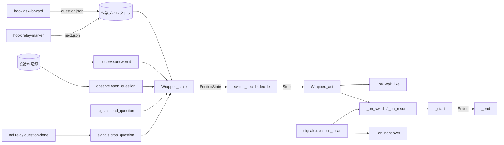
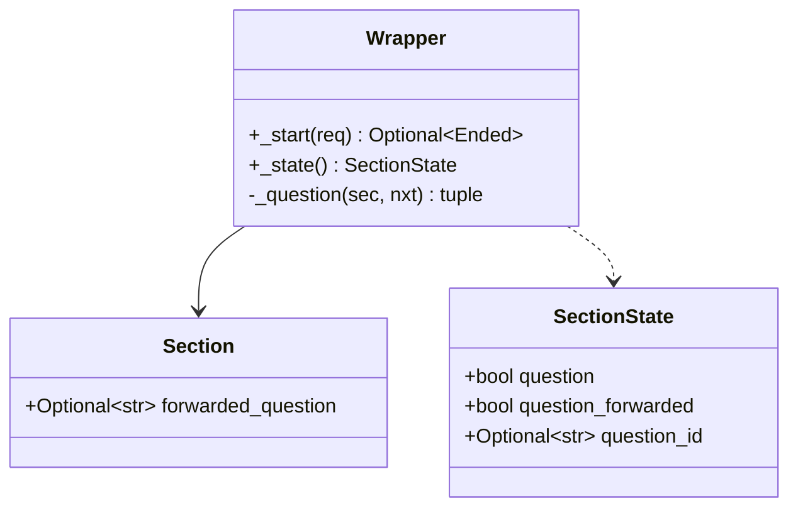
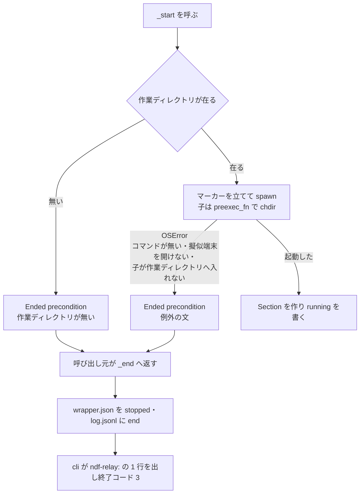
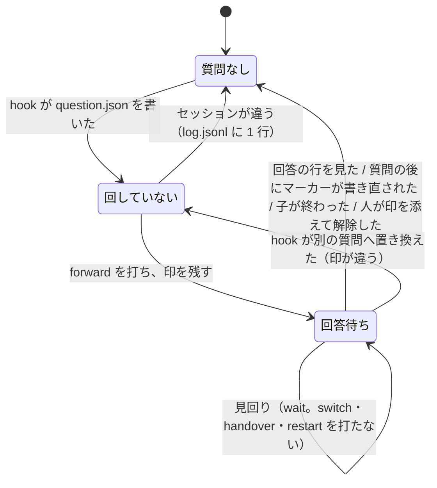
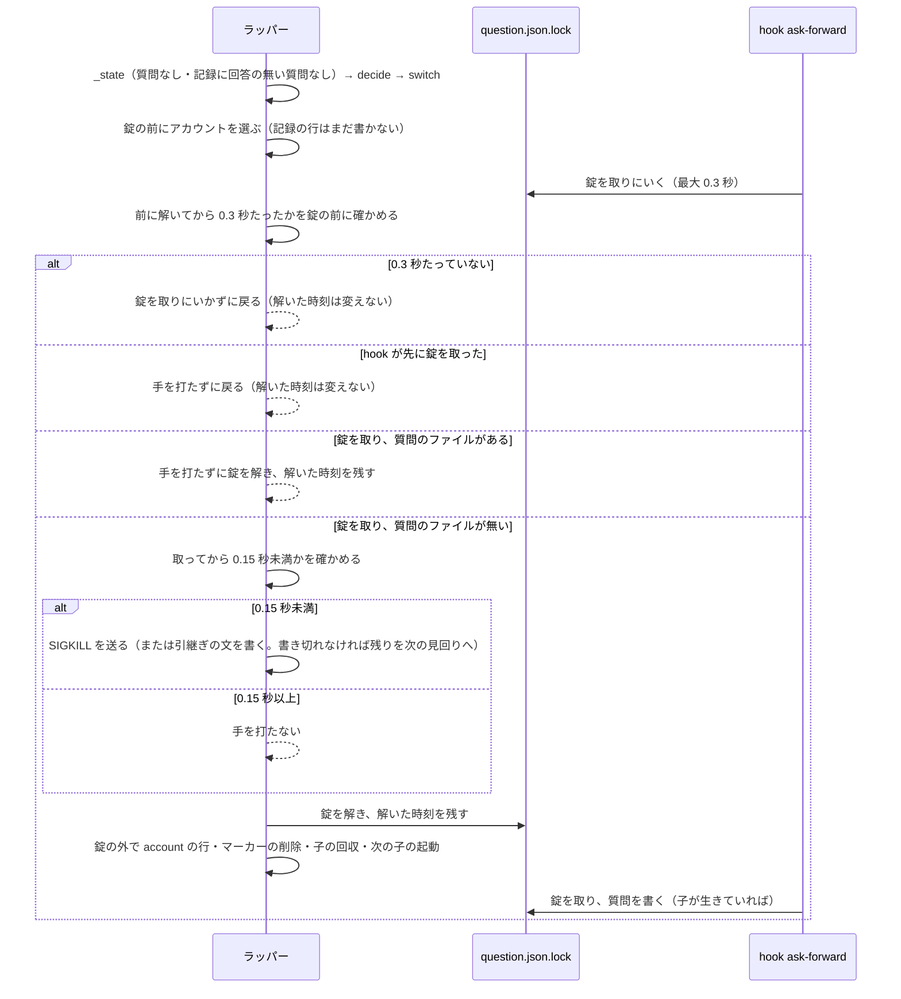

# 中継: 起動できないときは理由の 1 行で終わり、質問の表示中は切り替えず、手順書と確定仕様が 11 系だけを書く（#3842 #3846 #3847 #3814）

## 目的

- **今どうなっているか**: 中継のラッパー（`ndf relay`）は、claude を擬似端末の下で動かし、会話の切れ目（カットポイント。応答が `ndf-next` のブロックで終わり、Stop の hook がマーカー `next.json` を書いた時点）で、次の claude を新しい会話（セグメント）として起動する。子の claude を起動できないと、Python のトレースバックで終わるか、起動し直しを繰り返す（#3842）。質問（`AskUserQuestion`）の hook が書く質問のファイル（`question.json`）を、ラッパーは人かオーガナイザーへ回した直後に消す。そのため、質問の表示中でも子を強制終了して切り替える（#3814）。手順書と確定仕様・用語集は、11 系に無い 10 系の守り・記録のキー・ラッパーの入れ替えを書いたままである（#3814 #3846 #3847）
- **誰に効くか**: ラッパーの下で開発のループとレーンを回す利用者と、手順書・確定仕様を読んで記録を引く利用者と AI
- **変えると何が成り立つか**: 起動できないときは理由の 1 行と終了コード 3 で終わる。承認ゲートの質問は答えるまで残る。手順書と確定仕様が 11 系の振る舞いだけを書く

## 適用範囲

- **働く範囲**: NDF を Claude Code に入れてラッパーを使う、すべての利用先のリポジトリ。中継は Claude Code だけで、Codex には無い
- **プロジェクトごとに違うもの**: 無し（設定も引数も足さない）
- **当たるモード**: モードに依らない（ラッパーの振る舞いと文書）

### 代表のリポジトリでの振る舞い

| 代表のリポジトリ | 設定の要点 | 直した後に起きること | この種類で扱えなくなること |
| --- | --- | --- | --- |
| Web サービス | ラッパーの有無は利用者が決める（`/ndf:install-wrapper`） | 起動できないときに理由の 1 行で終わる。質問は答えるまで残り、答えた後に切り替わる | 無し |
| モバイルアプリ | 同上 | 同上 | 無し |
| 業務文書だけ | 同上 | 同上 | 無し |

### ai-plugins だけの事情

- 無し（ai-plugins もマーケットプレイスから NDF を入れて使う利用者の 1 つで、この変更に ai-plugins だけの値は無い）

## 目指す姿

- ラッパーは子を起動する前に作業ディレクトリを確かめ、子の側の `chdir` の失敗も親へ返して、擬似端末の起動の `OSError` を捕まえる。起動できなければ打ち直さず、終了コード 3（`precondition`）で終わる。理由は `ndf-relay:` の 1 行・`log.jsonl` の `end` の行・`wrapper.json` に同じ文で残る
- ラッパーは質問のファイルを、回答が会話の記録に出るか、質問の後に Stop の hook がマーカーを書き直すか、子が終わるか、人が質問の印を添えて解除するまで残す。その間は質問を 1 回だけ回し、子を止めず、子の端末へ書かない。子を止める手と子の端末へ書く手は、hook と同じ錠の中で質問が無いことを確かめ直してから、hook の錠の待ちより短い間に打ち、質問のファイルを消すときも錠の中で同じ質問かを確かめる。hook が質問を記録できなかったときも、会話の記録に回答の無い質問があれば手を打たない。切り替えは今のとおり強制終了で、`/exit` を書かない
- 手順書 `relay.md`・`relay-accounts.md` と中継の確定仕様・用語集は、11 系のラッパーと hook の振る舞いだけを書く

要求と受け入れ条件は #3842 #3846 #3847 #3814 の本文にある。コピーは次の 4 つで、この文書は「どう作るか」だけを扱う。

- [issue-3842-requirements.md](./issue-3842-requirements.md)・[issue-3846-requirements.md](./issue-3846-requirements.md)・[issue-3847-requirements.md](./issue-3847-requirements.md)・[issue-3814-requirements.md](./issue-3814-requirements.md)
- 詳細設計: [issue-3842-3846-3847-3814-design-detail.md](./issue-3842-3846-3847-3814-design-detail.md)

## 目指す姿の根拠

| 根拠 | 種類 | 何を示すか |
| --- | --- | --- |
| ptyprocess 0.7.0 の `PtyProcess.spawn` は、PATH に無いコマンドと実行できないファイルで親に `FileNotFoundError` を出すが、無い作業ディレクトリでは親に例外を出さず、fork した子の Python がトレースバックを擬似端末へ出して終了コード 1 で終わる（2026-11-19 に打って確かめた） | 実測 | 例外を捕まえるだけでは作業ディレクトリの欠けを拾えない。起動の前に確かめる必要がある |
| ptyprocess 0.7.0 は `cwd` を渡すと fork した子で `preexec_fn` より前に `chdir` し、その失敗を親へ返さない。`cwd` を渡さず `preexec_fn` の中で `chdir` すると、検索の権限の無いディレクトリ（`is_dir()` は真）で親に `PermissionError`、無いディレクトリで `FileNotFoundError` が届き、例外の文は `preexec_fn` が上げた文のままである。`chdir` の後の `execvpe` と、親で `which` が解くコマンドの場所は変わらない（2026-11-19 に打って確かめた。`inspect.getsource(PtyProcess.spawn)` の 271〜285 行） | 実測 | 事前の確かめを通った後に作業ディレクトリが消えても、子の側の `chdir` の失敗を `OSError` として親で捕まえられる |
| AskUserQuestion の hook は `signals.write_question` → `signals.write_json` で、錠 `question.json.lock` を最大 0.3 秒（`limits.json` の `hook.ask-forward`）待って書く。取れなければ書かずに通す（`hooks/guards/ask.py`） | 実測 | ラッパーが同じ錠を取れば、hook の書き込みとラッパーの確かめ・止める・消すの順序を決められる。錠を持つ時間は 0.3 秒より短くする |
| 偽の子で、マーカーを書いた後に質問を出した子が `forward` → `wait` → `switch` の順で強制終了された（終了コード -9。2026-11-19、`test_relay_wrapper.py` の部品で再現） | 実測 | 質問のファイルを回した直後に消すと、守りが見回り 1 回分しか続かない |
| 回答は、会話の記録の `type` が `user` の行の `message.content[]` に、`{"type": "tool_result", "tool_use_id": "toolu_…", "content": "Your questions have been answered: …"}` の要素として残る。行の最上位には `toolUseResult`・`sessionId` なども並ぶ（手元の記録 3 件で確かめた。2026-11-19） | 実測 | hook を足さずに、ラッパーが会話の記録から回答の済みを知れる。照らすのは `message.content[]` の `tool_result` の要素の `tool_use_id` である |
| 会話の記録は非同期に書かれ、hook が動いた時点では最新の行を含まないことがある（PRD1） | 外部の一次情報 | 回答の行の出現は遅れうる。質問の後の Stop のマーカーの書き直しを、もう 1 つの済みの印にする |
| `PtyProcess.terminate(force=True)` は SIGHUP・SIGCONT・SIGINT を 0.1 秒おきに送ってから SIGKILL を送る（LIB1） | 外部の一次情報 | 強制終了は子の端末へ何も書かない。質問の回答を代わりに送るおそれが無く、10 系の `question.lock` などの守りが要らない |
| 「10 系の課題を引きずらず、11 系の設計思想に合わせる」（#3812・#3814 の本文が写す利用者の方針） | 利用者の指示の原文 | 10 系の守り・入れ替え・逃がしを作り直さず、要るものだけを 11 系の形（判断は純粋な関数）で作る |

## ドメインモデル

### コンテキスト

| コンテキスト | 何の語が 1 つの意味に決まるか |
| --- | --- |
| ndf-relay | ラッパー・セグメント・カットポイントの切り替え・質問のシグナルファイル・回答待ちの質問・子の起動の失敗・`log.jsonl` の行 |

### 集約

| 集約 | オーナー（書き換えてよいもの） | 根 | エンティティ | 値オブジェクト |
| --- | --- | --- | --- | --- |
| ラッパー 1 本の実行 | `Wrapper`（`wrapper.py`） | `Wrapper` | `Section`（今のセグメント。回した質問の印を持つ） | `Launch`・`Ended`・`SectionState`・`Step` |
| 中継のシグナルファイル | 書くのは hook（`question.json`・`next.json`）、消すのはラッパー | 作業ディレクトリ `NDF_RELAY_DIR` | `question.json`・`next.json` | 質問の `tool_use_id`・`at`、マーカーの `written_at` |
| 中継の文書 | 手順書は `plugins/ndf/skills/development-workflow/references/`、確定仕様は `docs/specifications/`、用語集は `docs/glossary/glossary.json`（生成物は `ndf records glossary render` が書く） | 各文書 | — | — |

### 不変条件

| # | 集約 | 条件 | 破れたときの扱い |
| --- | --- | --- | --- |
| I1 | ラッパー 1 本の実行 | 作業ディレクトリがディレクトリとして在るときだけ `spawn` を呼ぶ。在っても子が入れなければ（事前の確かめの後に消えた・検索の権限が無い）、子は claude を実行せず、失敗は親の `OSError` になる | テストが落ちる |
| I2 | ラッパー 1 本の実行 | 子を起動できなかったら、同じ起動を打ち直さず `Ended("precondition", <理由>)` で終わる。理由は端末・`log.jsonl`・`wrapper.json` で同じ文である | テストが落ちる |
| I3 | ラッパー 1 本の実行 | 回答待ちの質問がある間は、`switch`・`account`・`restart`・`handover` の手を打たない（子を止めず、子の端末へ書かない） | テストが落ちる |
| I4 | ラッパー 1 本の実行 | 1 つの質問（`tool_use_id`、無ければ `at`）について、質問を回す手（`forward`）は 1 回だけ打ち、`log.jsonl` の `forward` の行を 1 つだけ書く。続けて別の質問が来ても、その質問の `forward` の行を省かない | テストが落ちる |
| I5 | 中継のシグナルファイル | ラッパーが `question.json` を消すのは、回答の行を見た・質問の後にマーカーが書き直された・子が終わった・質問のセッションが今のセグメントと違う、のどれかのときだけである | テストが落ちる |
| I6 | 中継の文書 | 手順書・確定仕様・用語集が書く記録の行とキー・ファイル・守りは、11 系のコードと hook に在るものだけである | 受け入れ条件の `grep` とレビューで見る |
| I7 | 中継のシグナルファイル | ラッパーが子を止める（`switch`・`account`・`restart`）・子の端末へ書く（`handover`）ときは、錠 `question.json.lock` を持ったまま質問のファイルが無いことを確かめ直し、錠を持ったまま `SIGKILL` を送るか引継ぎの文を 1 回で書く。錠の中ではこのほかの処理（アカウントの選択・マーカーの削除・子の回収・記録の行）をしない。錠を取れないか質問があれば、その見回りでは手を打たない | テストが落ちる |
| I8 | 中継のシグナルファイル | `question.json` を消すのは（ラッパーでも手での解除でも）、錠 `question.json.lock` を持ったまま読み直した質問が、消すと決めた質問と同じ（`session_id` と印が同じ）ときだけである | テストが落ちる |
| I9 | 中継のシグナルファイル | ラッパーが I7 の手を打つのは、ラッパーが前に錠を解いてから hook の待ち（`hook.ask-forward` の秒）以上たったことを錠を取る前に確かめてから錠を取り、取ってから手を打つ直前までが hook の待ちの半分未満のときだけである。外れたら手を打たずに錠を解き、次の見回りで決め直す | テストが落ちる |
| I10 | ラッパー 1 本の実行 | 質問のファイルが無くても、会話の記録の末尾に `tool_result` の無い `AskUserQuestion` の `tool_use` があれば、回答待ちの質問として扱い I3 の手を打たない（hook が質問を記録できなかったとき） | テストが落ちる |

### ドメインイベント

| # | イベント | 発生元 | 受け手 |
| --- | --- | --- | --- |
| E1 | ラッパーが子を起動すると決めた（#3842 の E1） | `Wrapper`（最初・`switch`・`account`・`restart`） | `Wrapper._start` |
| E2 | ラッパーが作業ディレクトリを確かめた（#3842 の E2） | `Wrapper._start` | — |
| E3 | ラッパーが子の claude を起動した（#3842 の E3） | `Wrapper._start` | 子の claude |
| E4 | ラッパーが起動できずに終わった（#3842 の E4） | `Wrapper._start` → `_end` | 端末・`log.jsonl`・`wrapper.json` |
| E5 | Stop の hook がマーカーを書いた（#3814 の E1） | hook `relay-marker` | `Wrapper`（見回り） |
| E6 | 子が質問を出した（#3814 の E2） | hook `ask-forward` | `Wrapper`（見回り） |
| E7 | ラッパーが質問を人かオーガナイザーへ回した（#3814 の E3） | `Wrapper._on_wait_like` | 計画のリクエスト（計画のレーン） |
| E8 | 質問に回答が済んだ（#3814 の E4） | 子の claude（会話の記録）・hook `relay-marker` | `Wrapper`（見回り） |
| E9 | ラッパーが質問のファイルを消した（#3814 の E5） | `Wrapper` | `log.jsonl`（セッションが違うときと回答を見たとき） |
| E10 | ラッパーが子を止めて次のセグメントを始めた（#3814 の E6） | `Wrapper._on_switch` | 次の子 |

#3846 と #3847 のイベント（記録を引いた・用語を消した）は文書の直しで、ラッパーの集約を変えない。

### 用語

| 用語 | 意味 | 用語集への反映 |
| --- | --- | --- |
| 子の起動の失敗 | ラッパーが子の claude を起動できなかったこと。作業ディレクトリが無いか、擬似端末の起動が `OSError` を出した。ラッパーは打ち直さずに `precondition` で終わる | 追加 |
| 回答待ちの質問 | 子が出した `AskUserQuestion` のうち、回答の `tool_result` がまだ会話の記録に無いもの。ラッパーはこの間、子を止めず、子の端末へ書かない | 追加 |
| ランチャー | `~/.claude/ndf/relay.py`（`ndf relay install` が置く複製）。隣の `relay.root` が指すプラグインの `bin/ndf relay` を呼ぶだけのエントリポイント | 意味の変更（`relay_lib` を読み込む 10 系の意味から） |
| プラグインの入れ替え | 作り直した `plugins/ndf-next/` を `plugins/ndf/` へ移した変更。意味の末尾「ラッパーの入れ替えとは別」を消す | 意味の変更 |
| `ラッパーのバージョンディレクトリ`・`ラッパーの入れ替え`・`入れ替えの申し送り` | 11 系に無い 10 系の仕組み | 廃止（エントリを消す） |

## 外部の調査

| 種類 | 調べるか | 理由 |
| --- | --- | --- |
| 標準・仕様 | 調べない | ラッパーと Claude Code のあいだの取り決めで、業界の標準が定める領域ではない |
| 主要な製品 | 調べる | 回答の済みと会話の記録の書き終わりは Claude Code の振る舞いに依る |
| ライブラリとサービス | 調べる | 起動の失敗と強制終了の形は、依存している ptyprocess が決める |

### 主要な製品

| # | 製品 | どう解いているか | 設計への反映 | 出典 |
| --- | --- | --- | --- | --- |
| PRD1 | Claude Code の hook | PreToolUse の入力に `tool_use_id` が入る。Stop は「Claude が応答を終えたとき」に動く。会話の記録は非同期に書かれ、hook の時点で最新の行を含まないことがあり、最後の応答は Stop の `last_assistant_message` で読むよう勧める | 回答の済みを会話の記録だけに頼らず、質問の後の Stop（マーカーの書き直し）でも知る。切り替えは今のとおり静かな時間を待ってから行う | https://code.claude.com/docs/en/hooks（2026-11-19） |

### ライブラリとサービス

| # | 候補 | バージョン | ライセンス | 最後のリリースの日付 | 終了のアナウンス | 要件を満たすか | 出典 |
| --- | --- | --- | --- | --- | --- | --- | --- |
| LIB1 | ptyprocess（既に依存） | 0.7.0 | ISC | 2020-12-28 | 無し（リポジトリはアーカイブされていない。最後の push 2026-08-26） | 満たす。コマンドの欠けは `FileNotFoundError`、擬似端末の欠けは `OSError` で親へ届く。作業ディレクトリの欠けは届かないので、起動の前に確かめる | https://pypi.org/pypi/ptyprocess/json・https://api.github.com/repos/pexpect/ptyprocess・手元の `inspect.getsource(PtyProcess.spawn)`（2026-11-19） |

### 確かめられなかったこと

| 対象 | 試した手段 | 結果と理由 |
| --- | --- | --- |
| `AskUserQuestion` で PostToolUse が動くか | PRD1 の文書（先頭の 10 万字） | 文書に `AskUserQuestion` の記述が無い。この設計は PostToolUse に頼らない |
| SIGHUP を受けた claude が会話の記録を書き切ってから終わるか | 試していない | 外部の文書に記述が無い。切り替えは Stop の後に静かな時間（既定 5 秒）を待つので、今の振る舞いを変えない |

調べた量: 候補 2 件・取得の試み 4 回。

## 機能一覧

| # | 機能 | 誰が使うか |
| --- | --- | --- |
| F1 | 子を起動できないときに理由の 1 行と終了コード 3 で終わる（#3842） | ラッパーを使う利用者・一覧と耐久ワークフロー |
| F2 | 回答待ちの質問がある間は子を止めず、子の端末へ書かない（#3814） | 承認ゲートの質問に答える利用者・オーガナイザー |
| F3 | 手順書の守りと落ちたときの続け方を 11 系へ書き直す（#3814 #3842） | 手順書を読む利用者と AI |
| F4 | `relay-accounts.md` の記録の読み方を 11 系の `log.jsonl` に合わせる（#3846） | 記録を引く利用者と AI |
| F5 | 確定仕様と用語集から入れ替えと `update-failed` を消す（#3847） | 確定仕様と用語集を読む利用者と AI |

## 構成要素

| 要素 | 責務 |
| --- | --- |
| `wrapper.spawn_pty`（変更） | `cwd` を ptyprocess へ渡さず、`preexec_fn` の中で `chdir` する。入れなければ子は claude を実行せず、親の `spawn` が `OSError` を上げる |
| `wrapper.Wrapper._start`（変更） | 作業ディレクトリを確かめ、`spawn` の `OSError` を捕まえ、起動できなければ `Ended` を返す |
| `wrapper.Wrapper` の起動の呼び出し元（`_loop`・`_on_switch`・`_on_resume`。変更） | `_start` が返した `Ended` をそのまま返して終わる |
| `wrapper.Wrapper._state`（変更） | 質問のファイルを読み、回答の済み・子の終わり・セッションの違いで消し、回答待ちか・回したか・質問の印を `SectionState` へ渡す |
| `wrapper.Wrapper._on_wait_like`（変更） | 質問を回したら、質問のファイルを消さずに `Section` へ回した印を残す。回すのは `_state` が読んだ質問そのもの（写し）である |
| `wrapper.Wrapper._on_switch`・`_on_resume`・`_on_handover`（変更） | `signals.question_clear` の錠の中で、`SIGKILL` を送るか子の端末へ書く（短い書き込みの残りは次の見回りで書き足す）。アカウントの選択は錠の前、マーカーの削除・子の回収・記録の行は錠の後。錠を取れない・質問がある・I9 の時間を外れたら手を打たずに戻る |
| `switch_decide.SectionState`・`decide`（変更） | 回した回答待ちの質問があれば `wait` を返す（回していなければ今のとおり `forward`。理由の文に質問の印を入れる） |
| `signals.read_question`（新設） | 質問のファイルを読む（無ければ None、壊れていれば `SignalError`） |
| `signals.question_clear`（新設） | 錠 `question.json.lock` を待たずに取り、質問のファイルが無く I9 の時間の内かを確かめる関数を渡す文脈。抜けるまで錠を持ち、解いた時刻を返す |
| `signals.drop_question`（新設） | 錠 `question.json.lock` の中で質問を読み直し、渡した質問と同じときだけ消す |
| `ndf relay question-done`（新設） | 手での解除。`--dir`・`--session`・`--mark` を受け、`signals.drop_question` で印が一致するときだけ消す。一致しなければ消さず、今の質問の印を 1 行で出して終了コード 1 |
| `observe.answered`（新設） | 会話の記録の末尾の `type: user` の行の `message.content[]` に、質問の `tool_use_id` を持つ `tool_result` の要素があるか。記録を読めなければ None |
| `observe.open_question`（新設） | 会話の記録の末尾で、`assistant` の行の `AskUserQuestion` の `tool_use` のうち、後の `user` の行に同じ `tool_use_id` の `tool_result` が無いものの id。無ければ None |
| `relay.md`（変更） | 「承認ゲートを越えない守り」を 11 系へ書き直し、「落ちたときの続け方」に起動の失敗の 1 行を足す |
| `relay-accounts.md`（変更） | 記録の行とキーの記述を 11 系に合わせる |
| 確定仕様 8 本と用語集（変更） | 入れ替え・`update-failed`・`start-failed` の記述を消すか 11 系へ書き直す。用語集は設計 Pull Request で直した |

## 構造

`Section.forwarded_question` は回した質問の印（`tool_use_id`、無ければ `at`）。`SectionState.question_forwarded` は既定を偽、`question_id`（今の質問の印）は既定を None にし、`ndf relay decide` の今の入力の JSON も読める。`question_id` は `forward` の理由の文に入り、質問ごとに理由が変わるので、直前と同じ理由を省く `_note` でも別の質問の `forward` の行が残る。

## 処理の流れ

### 子の起動（#3842）

### 質問の表示中（#3814）

消す手は錠の中で同じ質問かを確かめる（`signals.drop_question`）。読んだ後に hook が別の質問へ置き換えていれば消さず、次の見回りで新しい質問として回す。

質問のファイルが無くても、会話の記録の末尾に回答の無い `AskUserQuestion` があれば（hook が錠を取れなかった・書けなかった）、`_state` は回答待ちとして渡し、`decide` は `wait` を返す（I10）。ファイルが無いので回さず、`log.jsonl` に `unrecorded_question` の行を質問ごとに 1 つ書く。回答の `tool_result` が記録に出るか子が終わると抜ける。

### 判定の後に質問が出る競合（#3814）

見回りの `_state` が質問なしと読んでから、手を打つまでの間にも hook は質問を書ける。子を止める手と子の端末へ書く手は、hook と同じ錠の中で確かめ直す。

AskUserQuestion の選択肢が画面に出るのは PreToolUse の hook が返った後である。hook が錠を取れずに返る（質問を記録せずに選択肢が出る）のは、錠を取りにいった最初の時刻から 0.3 秒のあいだ、試すたびに錠がふさがっていたときだけである。錠を持つのは hook とラッパーだけで、ラッパーの錠の持ち方は I9 で縛る。

- ラッパーが錠を取る前の 0.3 秒、ラッパーは錠を持っていない。その前から待っていた hook は、その 0.3 秒のうちに錠を取るか待ちを終える（hook は待ちを終える前に必ずもう一度試す）。
- ラッパーが錠を取った後に待ち始めた hook は、早くても取った時刻から 0.3 秒後まで返らない。ラッパーは取ってから 0.15 秒未満で `SIGKILL` を送り終えるか書き終えるので、hook が返るより先に子は止まる合図を受けているか、引継ぎの文が端末へ入っている。
- `SIGKILL` は送った時点で子が利用者のコードへ戻らないので、止める手のあとに選択肢は描かれない。強制終了の続き（`terminate(force=True)` の回収）は錠の外で行い、錠の時間に数えない。
- 引継ぎの文（約 180 バイト）は待たない形（`O_NONBLOCK`）の書き込みで擬似端末へ入れる。1 バイトも書けなければ（`EAGAIN`）書かずに戻る。擬似端末は全長より短い数を返すことがある（入力の待ち行列の空きが足りない）。そのときは 0.15 秒の内で `EAGAIN` でない間だけ続きを書き、書き切れなければ残りをラッパーに残して錠を解く。端末に入った前半は末尾の `\r` が無いので送信されず入力欄に残る。次の見回りで同じ確かめ（錠・質問のファイル・時間）を通ってから残りだけを書き足し、`\r` まで書けたときに初めて引継ぎを頼んだ（`handover_asked`）とする。前半は消さない（消す手も端末へ書く手で、同じ縛りを受けるため、書き足す方が手が少ない）。
- 前に解いた時刻の確かめは錠を取る前に行い、錠を取りにいかなかったときと取れなかったときは解いた時刻を変えない。錠を取ってから確かめると、見回りの間隔（`relay.tick`）が hook の待ちより短い設定では、見回りのたびに錠を取り直して待ちを延ばし、手がいつまでも打たれない。

上の議論の前提は、hook のプロセスが 0.3 秒のあいだ一度も動けないことは無い、である（「未確認のまま残ること」）。前提が崩れて hook が記録せずに返っても、選択肢が出たままなら I10 の会話の記録の確かめが次の手を止める。

### 回答の済みを確かめられないとき（#3814）

会話の記録が読めず（ファイルが無い・読めない）、回答の後の応答が `ndf-next` を持たないと、自動の印は子の終わりだけになる。ラッパーはこのとき質問を残したまま、`wrapper.json` の `waiting` の理由と `log.jsonl` の `question_unconfirmed` の行（質問ごとに 1 行）に、読めなかった記録のパスと解除の手順を書く。解除の手順は対象の質問の印を含む 1 行のコマンド `ndf relay question-done --dir <NDF_RELAY_DIR> --session <session_id> --mark <tool_use_id>` である。

コマンドは `signals.drop_question` を呼び、錠の中で読み直した質問の `session_id` と印が渡した値と同じときだけ消す（I8）。回答済みと確かめた後に hook が別の質問を同じパスへ置いていれば消さず、`ndf-relay: 質問が置き換わっている（今の印 <印>）。消さない` と出して終了コード 1 で終わる。錠を取れなければ消さずに打ち直しを促し、同じく終了コード 1 にする。消せたら、次の見回りで質問なしと読み、今と同じ判断へ戻る。`rm` で消す手順は書かない。手順書 `relay.md` の「落ちたときの続け方」に同じ行を載せる。

## 決定の記録

### 決定 1: 起動の失敗を 1 つの読み方で扱うため、停止理由の種類を `precondition` の 1 つにする

ラッパーが起動を止めるほかの場合（メジャーバージョンの変化・バージョンの混ざり）も `precondition` で、手順書「落ちたときの続け方」の最後の行と終了コード 3 がそのまま当たる。理由の違い（作業ディレクトリが無い・コマンドが無い・擬似端末を開けない）は 1 行の文で分かる。

`claude` が無いときだけ `deps_missing`（69）にする案は採らない。手順書の続け方は終了コードでなく 1 行の文で分けるうえ、`FileNotFoundError` はコマンドが実行できないときも出る。`contracts/causes.json` へ種類を足す案も採らない。

根拠: Value 3「同じ手順は毎回同じ結果になる」（MVV バージョン 9）

### 決定 2: 作業ディレクトリの欠けを拾うため、子を起動する前にラッパーが確かめる

ptyprocess は作業ディレクトリが無くても親に例外を出さない（LIB1）。fork した子の Python が親のコードのまま例外を上げて終了コード 1 で終わり、ラッパーはそれを子の失敗と読んで起動し直す。起動の前に `Path.is_dir()` で確かめれば、ふつうの欠けでは fork の前に止まれ、受け入れ条件 3 の「`spawn` を呼ばない」も成り立つ。

事前の確かめだけでは足りない。`is_dir()` が真になってから子が `chdir` するまでに消えたディレクトリと、検索の権限の無いディレクトリ（`is_dir()` は真）では、子の `chdir` が失敗する。そのため `spawn_pty` は `cwd` を ptyprocess へ渡さず、`preexec_fn` の中で `chdir` する。ptyprocess は `preexec_fn` の例外を、例外の型の名前と文のまま親へ返して上げ直す（根拠の表の実測）。`preexec_fn` は `OSError` を `作業ディレクトリ {cwd} に入れない: {strerror}` の文で同じ型のまま上げ直すので、親の `_start` は擬似端末の失敗と同じ `except OSError` で受け、`Ended("precondition", …)`・終了コード 3・停止の記録で終わる。`chdir` の後に `execvpe` する順と、親で `which` が解くコマンドの場所は ptyprocess の `cwd` と同じで、起動の引数・環境・作業ディレクトリは変わらない（#3842 の受け入れ条件 7）。

ptyprocess の `cwd` のままにして子の例外を見分ける案（子の終了コード 1 と画面のトレースバックを読む）は、claude 自身の終了コード 1 と区別できないので採らない。10 系のようにメインディレクトリや親へ逃がす案は、別の作業場所で会話が続くので採らない（#3842 の S6）。

- 作り方: 自前で作る
- 比べた候補: LIB1

根拠: Value 7「不具合が根本原因から直される」（MVV バージョン 9）

### 決定 3: 承認ゲートの質問を答えるまで残すため、切り替えは強制終了のままにし、回答待ちの間は手を打たない

強制終了は子の端末へ何も書かない（LIB1）。`/exit` で切り替えると、質問の表示中に書いた改行が選択肢 1 を決める。そのため 10 系は、ロック（`question.lock`）・時刻（`asked`）・`wait-held.json` を要した。11 系で欠けていたのは、質問を回した直後に質問のファイルを消すことだけである。ファイルを回答が済むまで残し、`decide` が回した質問のあいだは `wait` を返せば、切り替え・起動し直し・引継ぎの送信がすべて止まる（`decide` は質問を最初に見る）。

見回りの判定だけでは、`_state` が質問なしと読んでから子を止める・子の端末へ書くまでの間に hook が質問を書く競合が残る。そこで、子を止める手（`_on_switch`・`_on_resume`）と子の端末へ書く手（`_on_handover`）は、hook が書くときと同じ錠 `question.json.lock` を待たずに取り（`signals.question_clear`）、錠の中で質問のファイルが無いことを確かめ直してから、錠を持ったまま `SIGKILL` を送るか引継ぎの文を 1 回で書く。錠を取れない（hook が書いている）か質問があれば手を打たずに戻り、次の見回りが質問を読んで `forward` する。待たずに取るのは、hook の錠の待ち（0.3 秒）を見回りで食わないためである。

錠を長く持つと、hook が待ちを越えて質問を記録せずに返り、ラッパーの手と選択肢の表示が重なる。そこで錠の中の処理を確かめ直しと 1 つの手だけにし（I7）、錠を持つ時間を hook の待ちの半分未満に、錠を解いてから次に取るまでを hook の待ち以上に縛る（I9）。こうすると、hook が待ちを越えるより先にラッパーの手が終わる（「判定の後に質問が出る競合」）。`_on_switch` のアカウントの選択は錠の前に、`account` の行・マーカーの削除・子の回収は錠の後に移す。時間を外れた見回りは手を打たずに次へ回すので、遅れは見回り 1 回分（`relay.tick` の 0.5 秒）である。

それでも hook が記録できない質問は残る（錠の待ちを越えた・書き込みが `OSError` で失敗した）。そのときも選択肢は回答まで画面に残り、会話の記録には回答の無い `AskUserQuestion` の `tool_use` が書かれる。切り替え・引継ぎ・起動し直しは静かな時間（既定 5 秒）か止まりの秒を待ってから出るので、`_state` が記録の末尾を読み（`observe.open_question`）、見つけたら回答待ちとして `wait` にする（I10）。

hook が錠を取れないときに質問を拒否する案は、確実だが hook を変えるので採らない。要件で hook（`plugins/ndf/src/ndf/domains/hooks/`）の変更は「確認してから行う」とし、この変更ではしない。錠の待ちを延ばす案は、「転送は中継が待ち、hook は待たない」という `hook.ask-forward` の取り決め（`contracts/limits.json`）に反するうえ、時間で決まることに変わりないので採らない。

質問のファイルを消すときも同じ錠を使う（`signals.drop_question`）。錠の中で読み直した質問が、消すと決めた質問（`session_id` と印）と同じときだけ消す。読んだ後に hook が別の質問へ置き換えていれば消さず、印が違うので次の見回りで回す。`forward` で計画のリクエストへ載せる中身も、印を取ったのと同じ読みの写しにし、印と載せた中身が食い違わないようにする。

`/exit` へ戻す案は 10 系の守りを作り直すことになり、採らない。マーカーの後の利用者の入力や背景の作業で切り替えを取り消す案は、#2438 の「`/goal` が未達でも切り替える」と食い違うので採らない（#3814 の S4）。

根拠: Value 1「人の判断を、読み切れる量の大事な所だけにする」（MVV バージョン 9）

### 決定 4: hook を変えずに回答の済みを知るため、会話の記録の `tool_result` と、質問の後のマーカーの書き直しの 2 つを印にする

会話の記録の `tool_result` は回答そのものの印だが、記録は非同期に書かれ遅れうる（PRD1）。Stop は Claude が応答を終えたときに動く（PRD1）。質問に答えるまで応答は終わらないので、質問の `at` より後にマーカーの `written_at` が書き直されていれば回答は済んでいる。2 つのどちらかを見たら消す。

2 つの印は、会話の記録が読めず、回答の後の応答が `ndf-next` を持たない（Stop の hook がマーカーを書かない）と、どちらも出ない。このとき自動で残る印は子の終わりだけで、子が生きている限り `wait` が続く。hook を変えずに使える完了の印はほかに無い（Stop の hook のうち中継の保存先へ書くのは `relay-marker` だけで、ブロックの無い応答では書かない）。そこで、記録を読めないと分かった質問には運用の解除の手順を出す。`observe.answered` は記録を読めないとき None を返し、ラッパーは `waiting` の理由と `log.jsonl` の `question_unconfirmed` の行（質問ごとに 1 行）に、記録のパスと、対象の質問の印を含む解除のコマンド（`ndf relay question-done … --mark <tool_use_id>`）を書く。人かオーガナイザーがコマンドを打てば、印が一致するときだけ消え、次の見回りで質問なしと読む。`rm` で消す手順にすると、回答済みと確かめた後に hook が同じパスへ置いた未回答の質問まで消し、次の見回りが切り替えや引継ぎを進めるので採らない。こうして、会話の記録が読めなくても、質問の後の Stop・子の終わり・手順のある手での解除のどれかで待ちが解ける（#3814 の非機能の条件「可用性」）。

画面の出力の再開を回答の印にする案は採らない。質問の表示中も画面の描き直し（端末の大きさの変化など）で出力が出て、回答の前に消してしまう。

PostToolUse の hook で質問のファイルを消す案は採らない。`AskUserQuestion` で PostToolUse が動くかを確かめられなかった（「確かめられなかったこと」）。加えて、hook のコードはこのスプリントの計画で触ってよいファイルの外にある。

- 作り方: 自前で作る
- 比べた候補: PRD1

根拠: Value 7「不具合が根本原因から直される」（MVV バージョン 9）

### 決定 5: 手順書と確定仕様が 11 系だけを書くよう、10 系の記述は消して 11 系の正を指し、範囲の外は別の課題にする

手順書 `relay.md` の守りの表は `decide` の判断の順を書く。順は、質問 → 上限と認証の失敗 → マーカー → 子の終わり → 文脈の上限 → 止まり である。あわせて hook の 3 つ（`ask-forward`・`relay-marker`・`stop-wait`）を書く。`relay-accounts.md` の記録の読み方は `account` の行だけを書き、行の種類の一覧は `relay.md` の「記録の読み方」を指す。`account` の行は、カットポイントで替えた（`_account_for_next`）ときも利用上限で替えた手（`_note`）のときも、`{"at": …, "section": …, "kind": "account", "reason": …}` の形である。`at` は `signals.append_jsonl`、`section` は `Wrapper._log` がどの行にも付ける共通のキーで、`account` の行に固有のキーは `kind` と `reason` だけである。手順書にはこの 2 つを分けて書き、#3846 の受け入れ条件 2 の「`kind` と `reason` だけ」は固有のキーの意味で読む。確定仕様は入れ替え・`update-failed`・`start-failed` を消す。11 系の振る舞いは `relay.md` と `ndf-relay-plugin-update.md` を指す。

`ndf-relay-segment-restart.md` を `docs/archive/` へ移す案は、触ってよい範囲の外の 15 か所の参照が切れるので採らない。`relay-accounts.md` と確定仕様のほかの 10 系の記述は、作るか消すかの判断が要るため #3864・#3865 へ分けた。

根拠: Value 14「判断の理由が残り、語がそろっている」（MVV バージョン 9）

### 決定 6: 語をそろえるため、用語集の追加と廃止を設計 Pull Request で行う

設計の手順は、新しい語・意味の変わった語・廃止する語を同じ変更で用語集へ反映すると決めている。3 つの用語は自分の定義の外から参照が 0 件なので、設計 Pull Request で消しても読み手が迷わない。

根拠: Value 14「判断の理由が残り、語がそろっている」（MVV バージョン 9）

## テスト設計

| 受け入れ条件・不変条件 | どの振る舞いで縛るか | どう壊したら落ちるべきか |
| --- | --- | --- |
| #3842 の 1・2、I2 | `spawn` が `FileNotFoundError` を出すと、`Wrapper.run` が `Ended("precondition", …)` を返し、`log.jsonl` の最後が `end` の行、`wrapper.json` が `stopped`、`cli._ended` が `ndf-relay:` の 1 行と 3 を返す | 例外を捕まえない・`running` のまま残す・理由の文を 3 か所で変えると落ちる |
| #3842 の 3、I1 | 無い作業ディレクトリで、最初・`switch`・`restart` のどれでも `spawn` が呼ばれない | 確かめを最初のセグメントだけに置くと落ちる |
| #3842 の 1・2・3、I1 | 本物の `spawn_pty` で、(a) 検索の権限の無いディレクトリ（`is_dir()` は真。root では飛ばす）、(b) `is_dir()` が真を返した後・`spawn_pty` の前にディレクトリを消す（`spawn` を包んで消してから本物を呼ぶ）の 2 つで、`Wrapper.run` が `Ended("precondition", "子の claude を起動できない（作業ディレクトリ … に入れない: …）")` を返し、`cli._ended` が 3、`log.jsonl` の最後が `end`、`wrapper.json` が `stopped`、トレースバックが端末へ出ない、`spawn` は 1 回 | `cwd` を ptyprocess へ渡す形へ戻すと（子が例外で終わり `restart` が出る）落ちる |
| #3842 の 7 | 起動できる作業ディレクトリで、本物の `spawn_pty` の子が `pwd` で作業ディレクトリを出す | `preexec_fn` の `chdir` を外すと落ちる |
| #3842 の 4 | 次のセグメントの起動に失敗したとき、前の子が止まっている | `_stop_child` を `_start` の後へ動かすと落ちる |
| #3842 の 5 | 起動に失敗したとき `spawn` の呼び出しが 1 回 | 失敗を子の終わりとして起動し直すと落ちる |
| #3842 の 6、#3814 の 8、#3846、#3847 | 受け入れ条件の `grep`・`ndf records glossary render --check`・`meanings`・`python3 scripts/check-markdown-links.py` | 文言のテストは書かない |
| #3842 の 7、#3814 の 9 | 既存の中継のテストがすべて通る | — |
| #3814 の 1、I3 | マーカーがあり静かな時間を過ぎても、回した回答待ちの質問があれば `switch` が出ず子が生きている | 回した後に質問のファイルを消すと落ちる（今の振る舞い） |
| #3814 の 2、I3 | 回答待ちの間、文脈の量が上限を超えても子の端末へ書かない | `decide` で文脈の上限を質問より先に見ると落ちる |
| #3814 の 3、I3 | 回答待ちの間、止まりの秒を超えても `restart` が出ない | 同上 |
| #3814 の 4、I5 | 会話の記録に `tool_result` を足すか、質問の `at` より後の `written_at` でマーカーを書き直すと、質問のファイルが消え次の見回りで `switch` が出る | 印のどちらかを読まないと落ちる。質問の前の `written_at` で消すと落ちる |
| #3814 の 1・2・3、I7 | `_state` が質問なしと読んだ直後（`decide` の後・手を打つ前）に hook の `signals.write_question` で質問を書く（`_state` を包んで書く）。`switch`・`account`・`restart` では子が生きていて `terminate` が呼ばれず、`handover` では子の `written` が空。次の見回りで `forward` が出る | 手の中で確かめ直さないと落ちる。錠の外で確かめると、錠を持つ別のスレッドが書いた場合に落ちる |
| I7 | 別のスレッドが `question.json.lock` を持つ間に `switch` が出ても、子を止めず、錠が解けた後の見回りで切り替える | 錠を待たずに打つと落ちる |
| I7 | `switch` で、子の `kill(SIGKILL)` が呼ばれた時点で錠がふさがっていて（偽の子の `kill` の中で `held(lock, 0)` が偽）、`account` の行・マーカーの削除・`terminate` の時点では錠が解けている | アカウントの選択・マーカーの削除・回収を錠の中へ戻すと落ちる |
| I9 | 偽の時計で、錠を取ってから手の直前までを hook の待ちの半分以上に進めると、`switch`・`restart`・`handover` のどれも打たず（`kill` も `write` も呼ばれず、マーカーと `account` の行はそのまま）、次の見回りで打つ | 時間を確かめずに打つと落ちる |
| I9 | 同じ見回りで `drop_question` が錠を解いた直後（hook の待ちより短い間）に `switch` が出ると、その見回りでは打たず、待ちの後の見回りで打つ | 前に解いた時刻を見ないと落ちる |
| I9 | `handover` の書き込みが `EAGAIN` を返す偽の子で、書かずに戻り `handover_asked` が偽のまま | 待つ形で書くと落ちる |
| I9 | `handover` の最初の書き込みが全長より短い数を返し、続きが `EAGAIN` の偽の子で、`handover_asked` が偽・残りが `handover_rest` に残り・マーカーも残る。次の見回りで残りだけが書かれ（前半を重ねて書かない）、`\r` まで届いて `handover_asked` が真になる | 正の戻り値を成功とみなすと落ちる |
| I9 | `relay.tick` を hook の待ちより短くし、前に解いてから待ちが過ぎる前の見回りが続いても、錠を取りにいかず解いた時刻が変わらず、待ちの後の見回りで手を打つ | 錠を取ってから待ちを確かめ、取るたびに解いた時刻を更新すると落ちる |
| I10 | 質問のファイルが無く、会話の記録の末尾に `tool_result` の無い `AskUserQuestion` の `tool_use` がある。マーカーがあり静かな時間を過ぎても `switch` が出ず、文脈の上限でも書かず、`unrecorded_question` の行が 1 つ。回答の `tool_result` を足すと次の見回りで `switch` | 記録を見ないと落ちる。`tool_result` のある `tool_use`・別の Tool の `tool_use` で止めると落ちる |
| I8（手での解除） | `ndf relay question-done` に質問 A の印を渡し、ファイルが B のとき、B が残り `ndf-relay:` の 1 行に B の印が出て終了コード 1。A のときは消えて 0、次の見回りで `switch` | 印を比べずに消すと落ちる |
| #3814 の 4・6、I8 | ラッパーが質問 A を読み、消す前に hook が質問 B へ置き換える（`signals.drop_question` の読み直しの前に B を書く）。B のファイルが残り、次の見回りで B の `forward` が 1 回出る | 錠の中で同じ質問かを確かめずに消すと落ちる |
| #3814 の 5、I4 | 1 つの質問で `forward` と `plan_question` の行が 1 つずつ | 見回りごとに回すと落ちる |
| #3814 の 5、I4 | 質問 A を回した次の見回りまでに、A への回答の `tool_result` と質問 B のファイルが出る（間に別の判断の行が無い）。`forward` の行が A と B で 1 つずつ、`plan_question` の行も 1 つずつ | `forward` の理由に質問の印を入れないと、`_note` が B の行を省いて落ちる |
| #3814 の 4、I5 | 実際の形の行（`{"type": "user", "message": {"role": "user", "content": [{"type": "tool_result", "tool_use_id": "toolu_A", "content": "Your questions have been answered: …"}]}, "toolUseResult": …}`）で消え、`tool_use_id` が別の質問（`toolu_X`）の行・`type` が `assistant` の行の `tool_use`・最上位にだけ `tool_use_id` がある行では消えない | 行の最上位や別の質問の id で照らすと落ちる |
| #3814 の非機能「可用性」 | 会話の記録が無いまま回した質問で、`wrapper.json` の `waiting` の理由に記録のパスと質問の印を含む `ndf relay question-done` の 1 行が入り、`question_unconfirmed` の行が 1 つ。その 1 行で解除すると次の見回りで `switch` が出る | 解除の後も回した印で `wait` を続けると落ちる。理由の文に印が無いと落ちる |
| I5 | マーカーの `written_at` が無い・null・数・タイムゾーンの無い時刻・読めない文字列、質問の `at` が同じ形のとき、例外を出さず質問を残す | `nxt["written_at"]` で読む・タイムゾーンの無い時刻を比べると落ちる |
| #3814 の 6、I5 | 子が終わると質問のファイルが消える。セッションの違う質問は消え、`log.jsonl` に 1 行 | 消さない・行を書かないと落ちる |
| #3814 の 7 | 切り替えで子の `written` が空のまま `terminate` が呼ばれる | `/exit` を書くと落ちる |
| `decide` の入力（`ndf relay decide`） | `question_forwarded` の無い今の JSON が読め、`question` が真で回していなければ `forward` | 既定値を外すと落ちる |

## 設計の結果

| 課題 | 扱い | 統合先 | 触るファイル |
| --- | --- | --- | --- |
| #3842 | 実装する | — | `plugins/ndf/src/ndf/domains/relay/wrapper.py`、`plugins/ndf/tests/domains/relay/test_relay_wrapper.py`、`plugins/ndf/skills/development-workflow/references/relay.md` |
| #3814 | 実装する | — | `plugins/ndf/src/ndf/domains/relay/wrapper.py`、`plugins/ndf/src/ndf/domains/relay/switch_decide.py`、`plugins/ndf/src/ndf/domains/relay/signals.py`、`plugins/ndf/src/ndf/domains/relay/observe.py`、`plugins/ndf/src/ndf/domains/relay/cli.py`、`plugins/ndf/tests/domains/relay/test_relay_wrapper.py`、`plugins/ndf/tests/domains/relay/test_relay_decide.py`、`plugins/ndf/tests/domains/relay/test_relay_parts.py`、`plugins/ndf/tests/domains/relay/test_relay_cli.py`、`plugins/ndf/skills/development-workflow/references/relay.md` |
| #3846 | 実装する | — | `plugins/ndf/skills/development-workflow/references/relay-accounts.md` |
| #3847 | 実装する | — | `docs/specifications/ndf-relay-segment-restart.md`、`docs/specifications/ndf-development-loop-limits.md`、`docs/specifications/ndf-relay-multi-session-supervisor.md`、`docs/specifications/ndf-relay-lane-parent-session-env.md`、`docs/specifications/ndf-relay-auth-failure.md`、`docs/specifications/ndf-relay-install-and-restart.md`、`docs/specifications/ndf-relay-launch-target.md` |

## 人へ残す判断

無し

## 未確認のまま残ること

| 項目 | 内容 |
| --- | --- |
| hook のプロセスが錠の待ちのあいだ動けること | I9 の議論は、hook のプロセスが 0.3 秒のあいだ一度も動けないことは無い、を前提にする。崩れても選択肢が出たままなら I10 が手を止めるが、会話の記録の書き込みが静かな時間より遅れたときは止まらない。プロセスの割り当てはスケジューラーが決め、テストで縛れない |
| 会話の記録へ質問が書かれる時刻 | I10 は、選択肢を出した `AskUserQuestion` の `tool_use` が静かな時間（既定 5 秒）のうちに会話の記録へ書かれると見ている（PRD1 は書き込みが遅れうるとだけ書く）。リリース後テストで、hook が書けないようにした質問で切り替えが止まることを見る |
| 引継ぎの 1 行と PreToolUse の hook の重なり | 錠の中で質問が無いと確かめて書いた 1 行と改行は、選択肢が出る前に擬似端末へ入る。claude は hook の終わりを待つ間も端末を読むので入力欄へ入ると見ているが、実際の claude では確かめていない。リリース後テストで、hook の途中に書いた改行が選択肢を決めないことを見る |
| 実際の claude での質問の守り | 偽の子でしか確かめていない。リリース後テストで、ラッパーの下で `ndf-next` を出した応答の続きに `AskUserQuestion` を呼び、答えるまで切り替わらないことを見る |
| SIGHUP を受けた claude の会話の記録の書き切り | 外部の文書に記述が無い。今の振る舞い（Stop の後に静かな時間を待って強制終了）を変えないので、この変更で悪くはならない |
