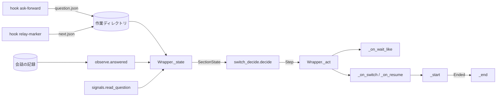
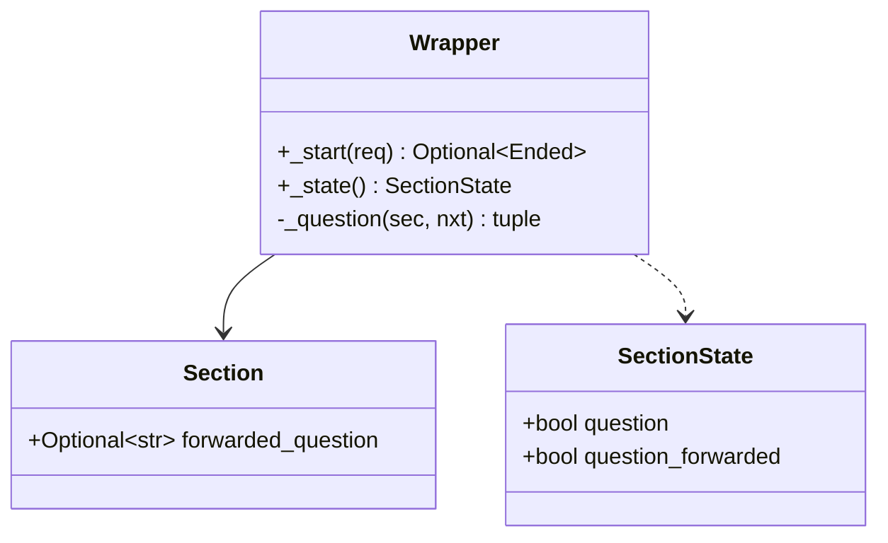
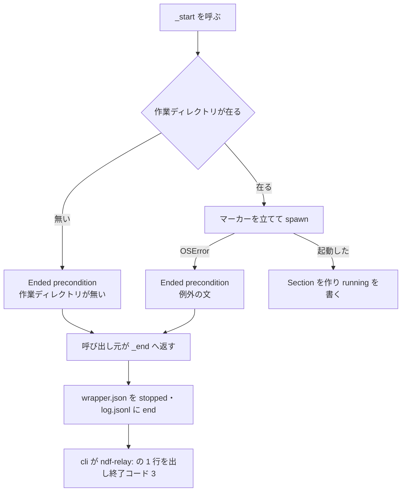
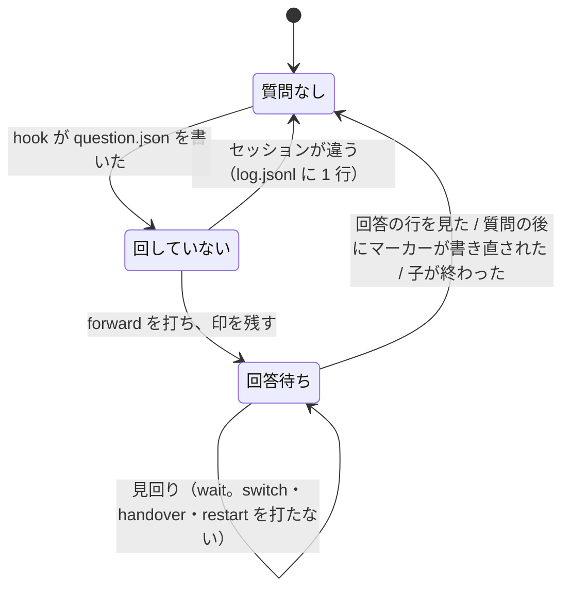

# 中継: 起動できないときは理由の 1 行で終わり、質問の表示中は切り替えず、手順書と確定仕様が 11 系だけを書く（#3842 #3846 #3847 #3814）

## 目的

- **今どうなっているか**: 中継のラッパー（`ndf relay`）は、claude を擬似端末の下で動かし、会話の切れ目（カットポイント。応答が `ndf-next` のブロックで終わり、Stop の hook がマーカー `next.json` を書いた時点）で、次の claude を新しい会話（セグメント）として起動する。子の claude を起動できないと、Python のトレースバックで終わるか、起動し直しを繰り返す（#3842）。質問（`AskUserQuestion`）の hook が書く質問のファイル（`question.json`）を、ラッパーは人かオーガナイザーへ回した直後に消す。そのため、質問の表示中でも子を強制終了して切り替える（#3814）。手順書と確定仕様・用語集は、11 系に無い 10 系の守り・記録のキー・ラッパーの入れ替えを書いたままである（#3814 #3846 #3847）
- **誰に効くか**: ラッパーの下で開発のループとレーンを回す利用者と、手順書・確定仕様を読んで記録を引く利用者と AI
- **変えると何が成り立つか**: 起動できないときは理由の 1 行と終了コード 3 で終わる。承認ゲートの質問は答えるまで残る。手順書と確定仕様が 11 系の振る舞いだけを書く

## 適用範囲

- **働く範囲**: NDF を Claude Code に入れてラッパーを使う、すべての利用先のリポジトリ。中継は Claude Code だけで、Codex には無い
- **プロジェクトごとに違うもの**: 無し（設定も引数も足さない）
- **当たるモード**: モードに依らない（ラッパーの振る舞いと文書）

### 代表のリポジトリでの振る舞い

| 代表のリポジトリ | 設定の要点 | 直した後に起きること | この種類で扱えなくなること |
| --- | --- | --- | --- |
| Web サービス | ラッパーの有無は利用者が決める（`/ndf:install-wrapper`） | 起動できないときに理由の 1 行で終わる。質問は答えるまで残り、答えた後に切り替わる | 無し |
| モバイルアプリ | 同上 | 同上 | 無し |
| 業務文書だけ | 同上 | 同上 | 無し |

### ai-plugins だけの事情

- 無し（ai-plugins もマーケットプレイスから NDF を入れて使う利用者の 1 つで、この変更に ai-plugins だけの値は無い）

## 目指す姿

- ラッパーは子を起動する前に作業ディレクトリを確かめ、擬似端末の起動の `OSError` を捕まえる。起動できなければ打ち直さず、終了コード 3（`precondition`）で終わる。理由は `ndf-relay:` の 1 行・`log.jsonl` の `end` の行・`wrapper.json` に同じ文で残る
- ラッパーは質問のファイルを、回答が会話の記録に出るか、質問の後に Stop の hook がマーカーを書き直すか、子が終わるまで残す。その間は質問を 1 回だけ回し、子を止めず、子の端末へ書かない。切り替えは今のとおり強制終了で、`/exit` を書かない
- 手順書 `relay.md`・`relay-accounts.md` と中継の確定仕様・用語集は、11 系のラッパーと hook の振る舞いだけを書く

要求と受け入れ条件は #3842 #3846 #3847 #3814 の本文にある。コピーは次の 4 つで、この文書は「どう作るか」だけを扱う。

- [issue-3842-requirements.md](./issue-3842-requirements.md)・[issue-3846-requirements.md](./issue-3846-requirements.md)・[issue-3847-requirements.md](./issue-3847-requirements.md)・[issue-3814-requirements.md](./issue-3814-requirements.md)
- 詳細設計: [issue-3842-3846-3847-3814-design-detail.md](./issue-3842-3846-3847-3814-design-detail.md)

## 目指す姿の根拠

| 根拠 | 種類 | 何を示すか |
| --- | --- | --- |
| ptyprocess 0.7.0 の `PtyProcess.spawn` は、PATH に無いコマンドと実行できないファイルで親に `FileNotFoundError` を出すが、無い作業ディレクトリでは親に例外を出さず、fork した子の Python がトレースバックを擬似端末へ出して終了コード 1 で終わる（2026-11-19 に打って確かめた） | 実測 | 例外を捕まえるだけでは作業ディレクトリの欠けを拾えない。起動の前に確かめる必要がある |
| 偽の子で、マーカーを書いた後に質問を出した子が `forward` → `wait` → `switch` の順で強制終了された（終了コード -9。2026-11-19、`test_relay_wrapper.py` の部品で再現） | 実測 | 質問のファイルを回した直後に消すと、守りが見回り 1 回分しか続かない |
| 回答は、質問の `tool_use_id` を持つ `tool_result` の行として会話の記録に残る（手元の記録 3 件で確かめた。2026-11-19） | 実測 | hook を足さずに、ラッパーが会話の記録から回答の済みを知れる |
| 会話の記録は非同期に書かれ、hook が動いた時点では最新の行を含まないことがある（PRD1） | 外部の一次情報 | 回答の行の出現は遅れうる。質問の後の Stop のマーカーの書き直しを、もう 1 つの済みの印にする |
| `PtyProcess.terminate(force=True)` は SIGHUP・SIGCONT・SIGINT を 0.1 秒おきに送ってから SIGKILL を送る（LIB1） | 外部の一次情報 | 強制終了は子の端末へ何も書かない。質問の回答を代わりに送るおそれが無く、10 系の `question.lock` などの守りが要らない |
| 「10 系の課題を引きずらず、11 系の設計思想に合わせる」（#3812・#3814 の本文が写す利用者の方針） | 利用者の指示の原文 | 10 系の守り・入れ替え・逃がしを作り直さず、要るものだけを 11 系の形（判断は純粋な関数）で作る |

## ドメインモデル

### コンテキスト

| コンテキスト | 何の語が 1 つの意味に決まるか |
| --- | --- |
| ndf-relay | ラッパー・セグメント・カットポイントの切り替え・質問のシグナルファイル・回答待ちの質問・子の起動の失敗・`log.jsonl` の行 |

### 集約

| 集約 | オーナー（書き換えてよいもの） | 根 | エンティティ | 値オブジェクト |
| --- | --- | --- | --- | --- |
| ラッパー 1 本の実行 | `Wrapper`（`wrapper.py`） | `Wrapper` | `Section`（今のセグメント。回した質問の印を持つ） | `Launch`・`Ended`・`SectionState`・`Step` |
| 中継のシグナルファイル | 書くのは hook（`question.json`・`next.json`）、消すのはラッパー | 作業ディレクトリ `NDF_RELAY_DIR` | `question.json`・`next.json` | 質問の `tool_use_id`・`at`、マーカーの `written_at` |
| 中継の文書 | 手順書は `plugins/ndf/skills/development-workflow/references/`、確定仕様は `docs/specifications/`、用語集は `docs/glossary/glossary.json`（生成物は `ndf records glossary render` が書く） | 各文書 | — | — |

### 不変条件

| # | 集約 | 条件 | 破れたときの扱い |
| --- | --- | --- | --- |
| I1 | ラッパー 1 本の実行 | 作業ディレクトリがディレクトリとして在るときだけ `spawn` を呼ぶ | テストが落ちる |
| I2 | ラッパー 1 本の実行 | 子を起動できなかったら、同じ起動を打ち直さず `Ended("precondition", <理由>)` で終わる。理由は端末・`log.jsonl`・`wrapper.json` で同じ文である | テストが落ちる |
| I3 | ラッパー 1 本の実行 | 回答待ちの質問がある間は、`switch`・`account`・`restart`・`handover` の手を打たない（子を止めず、子の端末へ書かない） | テストが落ちる |
| I4 | ラッパー 1 本の実行 | 1 つの質問（`tool_use_id`、無ければ `at`）について、質問を回す手（`forward`）は 1 回だけ打つ | テストが落ちる |
| I5 | 中継のシグナルファイル | ラッパーが `question.json` を消すのは、回答の行を見た・質問の後にマーカーが書き直された・子が終わった・質問のセッションが今のセグメントと違う、のどれかのときだけである | テストが落ちる |
| I6 | 中継の文書 | 手順書・確定仕様・用語集が書く記録の行とキー・ファイル・守りは、11 系のコードと hook に在るものだけである | 受け入れ条件の `grep` とレビューで見る |

### ドメインイベント

| # | イベント | 発生元 | 受け手 |
| --- | --- | --- | --- |
| E1 | ラッパーが子を起動すると決めた（#3842 の E1） | `Wrapper`（最初・`switch`・`account`・`restart`） | `Wrapper._start` |
| E2 | ラッパーが作業ディレクトリを確かめた（#3842 の E2） | `Wrapper._start` | — |
| E3 | ラッパーが子の claude を起動した（#3842 の E3） | `Wrapper._start` | 子の claude |
| E4 | ラッパーが起動できずに終わった（#3842 の E4） | `Wrapper._start` → `_end` | 端末・`log.jsonl`・`wrapper.json` |
| E5 | Stop の hook がマーカーを書いた（#3814 の E1） | hook `relay-marker` | `Wrapper`（見回り） |
| E6 | 子が質問を出した（#3814 の E2） | hook `ask-forward` | `Wrapper`（見回り） |
| E7 | ラッパーが質問を人かオーガナイザーへ回した（#3814 の E3） | `Wrapper._on_wait_like` | 計画のリクエスト（計画のレーン） |
| E8 | 質問に回答が済んだ（#3814 の E4） | 子の claude（会話の記録）・hook `relay-marker` | `Wrapper`（見回り） |
| E9 | ラッパーが質問のファイルを消した（#3814 の E5） | `Wrapper` | `log.jsonl`（セッションが違うときと回答を見たとき） |
| E10 | ラッパーが子を止めて次のセグメントを始めた（#3814 の E6） | `Wrapper._on_switch` | 次の子 |

#3846 と #3847 のイベント（記録を引いた・用語を消した）は文書の直しで、ラッパーの集約を変えない。

### 用語

| 用語 | 意味 | 用語集への反映 |
| --- | --- | --- |
| 子の起動の失敗 | ラッパーが子の claude を起動できなかったこと。作業ディレクトリが無いか、擬似端末の起動が `OSError` を出した。ラッパーは打ち直さずに `precondition` で終わる | 追加 |
| 回答待ちの質問 | 子が出した `AskUserQuestion` のうち、回答の `tool_result` がまだ会話の記録に無いもの。ラッパーはこの間、子を止めず、子の端末へ書かない | 追加 |
| ランチャー | `~/.claude/ndf/relay.py`（`ndf relay install` が置く複製）。隣の `relay.root` が指すプラグインの `bin/ndf relay` を呼ぶだけのエントリポイント | 意味の変更（`relay_lib` を読み込む 10 系の意味から） |
| プラグインの入れ替え | 作り直した `plugins/ndf-next/` を `plugins/ndf/` へ移した変更。意味の末尾「ラッパーの入れ替えとは別」を消す | 意味の変更 |
| `ラッパーのバージョンディレクトリ`・`ラッパーの入れ替え`・`入れ替えの申し送り` | 11 系に無い 10 系の仕組み | 廃止（エントリを消す） |

## 外部の調査

| 種類 | 調べるか | 理由 |
| --- | --- | --- |
| 標準・仕様 | 調べない | ラッパーと Claude Code のあいだの取り決めで、業界の標準が定める領域ではない |
| 主要な製品 | 調べる | 回答の済みと会話の記録の書き終わりは Claude Code の振る舞いに依る |
| ライブラリとサービス | 調べる | 起動の失敗と強制終了の形は、依存している ptyprocess が決める |

### 主要な製品

| # | 製品 | どう解いているか | 設計への反映 | 出典 |
| --- | --- | --- | --- | --- |
| PRD1 | Claude Code の hook | PreToolUse の入力に `tool_use_id` が入る。Stop は「Claude が応答を終えたとき」に動く。会話の記録は非同期に書かれ、hook の時点で最新の行を含まないことがあり、最後の応答は Stop の `last_assistant_message` で読むよう勧める | 回答の済みを会話の記録だけに頼らず、質問の後の Stop（マーカーの書き直し）でも知る。切り替えは今のとおり静かな時間を待ってから行う | https://code.claude.com/docs/en/hooks（2026-11-19） |

### ライブラリとサービス

| # | 候補 | バージョン | ライセンス | 最後のリリースの日付 | 終了のアナウンス | 要件を満たすか | 出典 |
| --- | --- | --- | --- | --- | --- | --- | --- |
| LIB1 | ptyprocess（既に依存） | 0.7.0 | ISC | 2020-12-28 | 無し（リポジトリはアーカイブされていない。最後の push 2026-08-26） | 満たす。コマンドの欠けは `FileNotFoundError`、擬似端末の欠けは `OSError` で親へ届く。作業ディレクトリの欠けは届かないので、起動の前に確かめる | https://pypi.org/pypi/ptyprocess/json・https://api.github.com/repos/pexpect/ptyprocess・手元の `inspect.getsource(PtyProcess.spawn)`（2026-11-19） |

### 確かめられなかったこと

| 対象 | 試した手段 | 結果と理由 |
| --- | --- | --- |
| `AskUserQuestion` で PostToolUse が動くか | PRD1 の文書（先頭の 10 万字） | 文書に `AskUserQuestion` の記述が無い。この設計は PostToolUse に頼らない |
| SIGHUP を受けた claude が会話の記録を書き切ってから終わるか | 試していない | 外部の文書に記述が無い。切り替えは Stop の後に静かな時間（既定 5 秒）を待つので、今の振る舞いを変えない |

調べた量: 候補 2 件・取得の試み 4 回。

## 機能一覧

| # | 機能 | 誰が使うか |
| --- | --- | --- |
| F1 | 子を起動できないときに理由の 1 行と終了コード 3 で終わる（#3842） | ラッパーを使う利用者・一覧と耐久ワークフロー |
| F2 | 回答待ちの質問がある間は子を止めず、子の端末へ書かない（#3814） | 承認ゲートの質問に答える利用者・オーガナイザー |
| F3 | 手順書の守りと落ちたときの続け方を 11 系へ書き直す（#3814 #3842） | 手順書を読む利用者と AI |
| F4 | `relay-accounts.md` の記録の読み方を 11 系の `log.jsonl` に合わせる（#3846） | 記録を引く利用者と AI |
| F5 | 確定仕様と用語集から入れ替えと `update-failed` を消す（#3847） | 確定仕様と用語集を読む利用者と AI |

## 構成要素

| 要素 | 責務 |
| --- | --- |
| `wrapper.Wrapper._start`（変更） | 作業ディレクトリを確かめ、`spawn` の `OSError` を捕まえ、起動できなければ `Ended` を返す |
| `wrapper.Wrapper` の起動の呼び出し元（`_loop`・`_on_switch`・`_on_resume`。変更） | `_start` が返した `Ended` をそのまま返して終わる |
| `wrapper.Wrapper._state`（変更） | 質問のファイルを読み、回答の済み・子の終わり・セッションの違いで消し、回答待ちかと回したかを `SectionState` へ渡す |
| `wrapper.Wrapper._on_wait_like`（変更） | 質問を回したら、質問のファイルを消さずに `Section` へ回した印を残す |
| `switch_decide.SectionState`・`decide`（変更） | 回した回答待ちの質問があれば `wait` を返す（回していなければ今のとおり `forward`） |
| `signals.read_question`（新設） | 質問のファイルを読む（無ければ None、壊れていれば `SignalError`） |
| `observe.answered`（新設） | 会話の記録の末尾に、質問の `tool_use_id` を持つ `tool_result` の行があるか |
| `relay.md`（変更） | 「承認ゲートを越えない守り」を 11 系へ書き直し、「落ちたときの続け方」に起動の失敗の 1 行を足す |
| `relay-accounts.md`（変更） | 記録の行とキーの記述を 11 系に合わせる |
| 確定仕様 8 本と用語集（変更） | 入れ替え・`update-failed`・`start-failed` の記述を消すか 11 系へ書き直す。用語集は設計 Pull Request で直した |

## 構造

`Section.forwarded_question` は回した質問の印（`tool_use_id`、無ければ `at`）。`SectionState.question_forwarded` は既定を偽にし、`ndf relay decide` の今の入力の JSON も読める。

## 処理の流れ

### 子の起動（#3842）

### 質問の表示中（#3814）

## 決定の記録

### 決定 1: 起動の失敗を 1 つの読み方で扱うため、停止理由の種類を `precondition` の 1 つにする

ラッパーが起動を止めるほかの場合（メジャーバージョンの変化・バージョンの混ざり）も `precondition` で、手順書「落ちたときの続け方」の最後の行と終了コード 3 がそのまま当たる。理由の違い（作業ディレクトリが無い・コマンドが無い・擬似端末を開けない）は 1 行の文で分かる。

`claude` が無いときだけ `deps_missing`（69）にする案は採らない。手順書の続け方は終了コードでなく 1 行の文で分けるうえ、`FileNotFoundError` はコマンドが実行できないときも出る。`contracts/causes.json` へ種類を足す案も採らない。

根拠: Value 3「同じ手順は毎回同じ結果になる」（MVV バージョン 9）

### 決定 2: 作業ディレクトリの欠けを拾うため、子を起動する前にラッパーが確かめる

ptyprocess は作業ディレクトリが無くても親に例外を出さない（LIB1）。fork した子の Python が親のコードのまま例外を上げて終了コード 1 で終わり、ラッパーはそれを子の失敗と読んで起動し直す。起動の前に `Path.is_dir()` で確かめれば、fork の前に止まれる。

`preexec_fn` で子の側の失敗を親へ返す案は働かない。ptyprocess は `preexec_fn` より前に `chdir` し、その失敗を親へ返さない。`cwd` を渡さずに `preexec_fn` で `chdir` する案は、起動の形を変えるので採らない。10 系のようにメインディレクトリや親へ逃がす案は、別の作業場所で会話が続くので採らない（#3842 の S6）。

- 作り方: 自前で作る
- 比べた候補: LIB1

根拠: Value 7「不具合が根本原因から直される」（MVV バージョン 9）

### 決定 3: 承認ゲートの質問を答えるまで残すため、切り替えは強制終了のままにし、回答待ちの間は手を打たない

強制終了は子の端末へ何も書かない（LIB1）。`/exit` で切り替えると、質問の表示中に書いた改行が選択肢 1 を決める。そのため 10 系は、ロック（`question.lock`）・時刻（`asked`）・`wait-held.json` を要した。11 系で欠けていたのは、質問を回した直後に質問のファイルを消すことだけである。ファイルを回答が済むまで残し、`decide` が回した質問のあいだは `wait` を返せば、切り替え・起動し直し・引継ぎの送信がすべて止まる（`decide` は質問を最初に見る）。

`/exit` へ戻す案は 10 系の守りを作り直すことになり、採らない。マーカーの後の利用者の入力や背景の作業で切り替えを取り消す案は、#2438 の「`/goal` が未達でも切り替える」と食い違うので採らない（#3814 の S4）。

根拠: Value 1「人の判断を、読み切れる量の大事な所だけにする」（MVV バージョン 9）

### 決定 4: hook を変えずに回答の済みを知るため、会話の記録の `tool_result` と、質問の後のマーカーの書き直しの 2 つを印にする

会話の記録の `tool_result` は回答そのものの印だが、記録は非同期に書かれ遅れうる（PRD1）。Stop は Claude が応答を終えたときに動く（PRD1）。質問に答えるまで応答は終わらないので、質問の `at` より後にマーカーの `written_at` が書き直されていれば回答は済んでいる。2 つのどちらかを見たら消し、会話の記録が読めなくても止まり続けない。

PostToolUse の hook で質問のファイルを消す案は採らない。`AskUserQuestion` で PostToolUse が動くかを確かめられなかった（「確かめられなかったこと」）。加えて、hook のコードはこのスプリントの計画で触ってよいファイルの外にある。

- 作り方: 自前で作る
- 比べた候補: PRD1

根拠: Value 7「不具合が根本原因から直される」（MVV バージョン 9）

### 決定 5: 手順書と確定仕様が 11 系だけを書くよう、10 系の記述は消して 11 系の正を指し、範囲の外は別の課題にする

手順書 `relay.md` の守りの表は `decide` の判断の順を書く。順は、質問 → 上限と認証の失敗 → マーカー → 子の終わり → 文脈の上限 → 止まり である。あわせて hook の 3 つ（`ask-forward`・`relay-marker`・`stop-wait`）を書く。`relay-accounts.md` の記録の読み方は `account` の行（`kind` と `reason`）だけを書き、行の種類の一覧は `relay.md` の「記録の読み方」を指す。確定仕様は入れ替え・`update-failed`・`start-failed` を消す。11 系の振る舞いは `relay.md` と `ndf-relay-plugin-update.md` を指す。

`ndf-relay-segment-restart.md` を `docs/archive/` へ移す案は、触ってよい範囲の外の 15 か所の参照が切れるので採らない。`relay-accounts.md` と確定仕様のほかの 10 系の記述は、作るか消すかの判断が要るため #3864・#3865 へ分けた。

根拠: Value 14「判断の理由が残り、語がそろっている」（MVV バージョン 9）

### 決定 6: 語をそろえるため、用語集の追加と廃止を設計 Pull Request で行う

設計の手順は、新しい語・意味の変わった語・廃止する語を同じ変更で用語集へ反映すると決めている。3 つの用語は自分の定義の外から参照が 0 件なので、設計 Pull Request で消しても読み手が迷わない。

根拠: Value 14「判断の理由が残り、語がそろっている」（MVV バージョン 9）

## テスト設計

| 受け入れ条件・不変条件 | どの振る舞いで縛るか | どう壊したら落ちるべきか |
| --- | --- | --- |
| #3842 の 1・2、I2 | `spawn` が `FileNotFoundError` を出すと、`Wrapper.run` が `Ended("precondition", …)` を返し、`log.jsonl` の最後が `end` の行、`wrapper.json` が `stopped`、`cli._ended` が `ndf-relay:` の 1 行と 3 を返す | 例外を捕まえない・`running` のまま残す・理由の文を 3 か所で変えると落ちる |
| #3842 の 3、I1 | 無い作業ディレクトリで、最初・`switch`・`restart` のどれでも `spawn` が呼ばれない | 確かめを最初のセグメントだけに置くと落ちる |
| #3842 の 4 | 次のセグメントの起動に失敗したとき、前の子が止まっている | `_stop_child` を `_start` の後へ動かすと落ちる |
| #3842 の 5 | 起動に失敗したとき `spawn` の呼び出しが 1 回 | 失敗を子の終わりとして起動し直すと落ちる |
| #3842 の 6、#3814 の 8、#3846、#3847 | 受け入れ条件の `grep`・`ndf records glossary render --check`・`meanings`・`python3 scripts/check-markdown-links.py` | 文言のテストは書かない |
| #3842 の 7、#3814 の 9 | 既存の中継のテストがすべて通る | — |
| #3814 の 1、I3 | マーカーがあり静かな時間を過ぎても、回した回答待ちの質問があれば `switch` が出ず子が生きている | 回した後に質問のファイルを消すと落ちる（今の振る舞い） |
| #3814 の 2、I3 | 回答待ちの間、文脈の量が上限を超えても子の端末へ書かない | `decide` で文脈の上限を質問より先に見ると落ちる |
| #3814 の 3、I3 | 回答待ちの間、止まりの秒を超えても `restart` が出ない | 同上 |
| #3814 の 4、I5 | 会話の記録に `tool_result` を足すか、質問の `at` より後の `written_at` でマーカーを書き直すと、質問のファイルが消え次の見回りで `switch` が出る | 印のどちらかを読まないと落ちる。質問の前の `written_at` で消すと落ちる |
| #3814 の 5、I4 | 1 つの質問で `forward` と `plan_question` の行が 1 つずつ | 見回りごとに回すと落ちる |
| #3814 の 6、I5 | 子が終わると質問のファイルが消える。セッションの違う質問は消え、`log.jsonl` に 1 行 | 消さない・行を書かないと落ちる |
| #3814 の 7 | 切り替えで子の `written` が空のまま `terminate` が呼ばれる | `/exit` を書くと落ちる |
| `decide` の入力（`ndf relay decide`） | `question_forwarded` の無い今の JSON が読め、`question` が真で回していなければ `forward` | 既定値を外すと落ちる |

## 設計の結果

| 課題 | 扱い | 統合先 | 触るファイル |
| --- | --- | --- | --- |
| #3842 | 実装する | — | `plugins/ndf/src/ndf/domains/relay/wrapper.py`、`plugins/ndf/tests/domains/relay/test_relay_wrapper.py`、`plugins/ndf/skills/development-workflow/references/relay.md` |
| #3814 | 実装する | — | `plugins/ndf/src/ndf/domains/relay/wrapper.py`、`plugins/ndf/src/ndf/domains/relay/switch_decide.py`、`plugins/ndf/src/ndf/domains/relay/signals.py`、`plugins/ndf/src/ndf/domains/relay/observe.py`、`plugins/ndf/tests/domains/relay/test_relay_wrapper.py`、`plugins/ndf/tests/domains/relay/test_relay_decide.py`、`plugins/ndf/tests/domains/relay/test_relay_parts.py`、`plugins/ndf/skills/development-workflow/references/relay.md` |
| #3846 | 実装する | — | `plugins/ndf/skills/development-workflow/references/relay-accounts.md` |
| #3847 | 実装する | — | `docs/specifications/ndf-relay-segment-restart.md`、`docs/specifications/ndf-development-loop-limits.md`、`docs/specifications/ndf-relay-multi-session-supervisor.md`、`docs/specifications/ndf-relay-lane-parent-session-env.md`、`docs/specifications/ndf-relay-auth-failure.md`、`docs/specifications/ndf-relay-install-and-restart.md`、`docs/specifications/ndf-relay-launch-target.md` |

## 人へ残す判断

無し

## 未確認のまま残ること

| 項目 | 内容 |
| --- | --- |
| 実際の claude での質問の守り | 偽の子でしか確かめていない。リリース後テストで、ラッパーの下で `ndf-next` を出した応答の続きに `AskUserQuestion` を呼び、答えるまで切り替わらないことを見る |
| SIGHUP を受けた claude の会話の記録の書き切り | 外部の文書に記述が無い。今の振る舞い（Stop の後に静かな時間を待って強制終了）を変えないので、この変更で悪くはならない |
