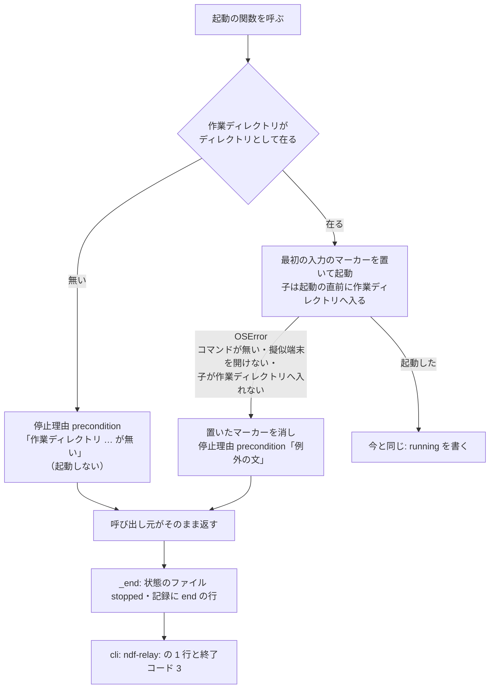

# 中継: 子の claude を起動できないときは、理由の 1 行と終了コード 3 で終わる（#3842）

中継のラッパーは子の claude を起動できないと、Python のトレースバックで終わるか、作業ディレクトリが無いときは起動し直しを今日の上限まで繰り返す。この設計は、起動する関数（`Wrapper._start`）で作業ディレクトリを起動の前に確かめ、子の側で作業ディレクトリへ入る失敗も親の例外として受け取り、どの失敗も打ち直さずに停止理由 `precondition`（終了コード 3）で終える。止まり方は、メジャーバージョンの変化で止まるときと同じ 1 行・記録・状態のファイルの形にそろう。採らなかった案は「決定の記録」に、起動に使うライブラリの調べは「外部の調査」にある。

何が起きて誰が困ったか・何を満たせば終わりかは、要求仕様（[issue-3842-requirements.md](./issue-3842-requirements.md)、正は #3842 の本文）にある。この文書は根本原因と、どう直すかだけを書く。関数ごとの仕様は詳細設計（[issue-3842-design-detail.md](./issue-3842-design-detail.md)）にある。

## 今の姿

ラッパーが子を起動する経路と、ラッパーが自分で止まるときの経路は次のとおりである。【変える】が付いた箇所をこの設計で直す。

**根本原因**: 起動の関数は、子を起動する 1 行（`self.spawn(argv, env, self.s.cwd)`）の失敗を扱わない。失敗には 2 つの形がある（要求の「事象」の実測）。

1. コマンドが無い・実行できない・擬似端末を開けない: 起動に使うライブラリ（ptyprocess）が親で `OSError` を上げるが、起動の関数・呼び出し元・コマンドの入口のどれも捕まえない
2. 作業ディレクトリが無い: ptyprocess は fork した子の中で作業ディレクトリへ移り（`cwd` を渡したとき）、その失敗を親へ返さない。親から見ると、起動できた子がすぐ終了コード 1 で終わったのと区別がつかず、ラッパーは子の失敗として `--resume` で起動し直す

既存のテストは偽の起動（`Spawner`）で起動が必ず成功する形だけを通しており、どちらの形も一度も通っていなかった。

**同じ形の箇所**: 基点の公開 CLI（`ndf relay run`）は、ラッパーを作る前に設定の生成（`cli.wrapper_settings`）で `Path.cwd()` を読む。シェルの作業ディレクトリが起動の前に消えていると、ここで `FileNotFoundError` が上がり、起動の関数の確かめに届かずにトレースバックで終わる。プラグインの更新（`_before_start` の `Updater`）も最初の起動の前に作業ディレクトリでコマンドを打つ。どちらも起動の関数より前にあるので、作業ディレクトリの確かめは設定の生成と起動の準備まで広げる。ラッパーを挟まない起動（`_passthrough`）は `exec` の失敗を受けて理由の 1 行と終了コード 127 で終わっており、この欠けは無い。ラッパーが起動の前に止まるほかの場合（メジャーバージョンの変化・停止のシグナルファイル）は、起動の準備（`_before_start`）が既に停止理由を返す。欠けているのは起動そのものだけである。

## 文脈と制約

- **判断は純粋な関数に置き、`wrapper.py` は端末・時計・ファイルを読んで操作するだけにする**（`wrapper.py` の冒頭の説明、#2962）。起動の失敗はファイルとプロセスの操作なので、`wrapper.py` の中で扱う
- **停止理由の種類（[contracts/causes.json](../plugins/ndf/contracts/causes.json)）は足さない**。今ある `precondition`（終了コード 3）を使う（決定 1）
- **起動の引数・環境・作業ディレクトリは変えない**（要求の受け入れ条件 7）。ptyprocess への渡し方を変えても、子が `claude` を実行するときの状態は今と同じにする
- **起動は差し替えられる**。ラッパーは起動の関数（`spawn`）を引数で受け、テストは偽の起動を渡す。本物の擬似端末の振る舞いは、本物の `spawn_pty` を呼ぶテストでだけ確かめられる
- **作業ディレクトリを別の場所へ逃がさず、起動の打ち直しもしない**（要求の「対象範囲」の含まない、S5・S6）
- プロジェクトの MVV の Value を基準にする。Value 3（同じ手順は毎回同じ結果になる）・Value 7（不具合が根本原因から直される）

## 解き方の全体像

1. 設定の生成は作業ディレクトリを例外なしで読む（消えていれば消えたパスの名前を持つ）。起動の準備（`_before_start`）と起動の関数は、プラグインの更新と起動の前に作業ディレクトリがディレクトリとして在るかを確かめ、無ければ起動せずに停止理由を返す（決定 2）
2. 擬似端末の起動は、作業ディレクトリを ptyprocess へ渡さず、子の側で起動の直前に移る形にする。移れなければ、ptyprocess がその例外を親へ返すので、事前の確かめの後に消えたディレクトリや入る権限の無いディレクトリも親の `OSError` になる（決定 2）
3. 起動の関数は `OSError` を受け、ラッパーが送った最初の入力のマーカーを消して、停止理由を返す。返り値の型は「無し」から「停止理由か無し」（`Optional[Ended]`）に変わる
4. 3 つの呼び出し元は、受けた停止理由をそのまま返し、ポーリングの繰り返しが今の止まり方（`_end`）で終える。どの失敗も種類は `precondition` の 1 つで、理由の違いは 1 行の文で分かる（決定 1）。打ち直さない
5. 手順書の「落ちたときの続け方」に、起動できないときの 1 行と続け方を足す

直すのは失敗の起きる起動の関数で、コマンドの入口（`cli.py` の `main`）で例外を広く捕まえる形にはしない。入口では状態のファイルと記録の行を、ラッパーの止まり方と同じ形で書けないためである。

## 構成要素

| 要素 | 責務 |
| --- | --- |
| 擬似端末の起動（`wrapper.spawn_pty`。変更） | 作業ディレクトリを ptyprocess へ渡さず、子の側の起動の直前（`preexec_fn`）で移る。移れなければ子は claude を実行せず、親の起動が `OSError` を上げる |
| 設定の生成（`cli.wrapper_settings`・`_cwd`。変更と新設） | 作業ディレクトリを例外なしで読み、消えていれば消えたパスの名前（読めなければ `（不明）`）を設定に入れる |
| 起動の準備（`wrapper.Wrapper._before_start`。変更） | プラグインの更新の前に作業ディレクトリを確かめ、無ければ停止理由を返す |
| 子を起動する関数（`wrapper.Wrapper._start`。変更） | 作業ディレクトリを確かめ、起動の `OSError` を受け、起動できなければ停止理由を返す |
| 起動の呼び出し元（`_loop`・`_on_switch`・`_on_resume`。変更） | 起動の関数が返した停止理由をそのまま返して終わる |
| 手順書（`relay.md`。変更） | 「落ちたときの続け方」に起動の失敗の 1 行を足す |

## 決定の記録

### 決定 1: 起動の失敗を 1 つの読み方で扱うため、停止理由の種類を `precondition` の 1 つにする

- **問い**: 起動の失敗（コマンドが無い・作業ディレクトリが無い・擬似端末を開けない）を、どの停止理由の種類と終了コードで終えるか
- **選んだ案**: 理由に依らず `precondition`（終了コード 3）の 1 つにする。ラッパーが起動を止めるほかの場合（メジャーバージョンの変化・バージョンの混ざり）も `precondition` で、手順書「落ちたときの続け方」の最後の行と終了コード 3 がそのまま当たる。理由の違いは 1 行の文で分かる
- 採らなかった案: `claude` が無いときだけ `deps_missing`（終了コード 69）にする（手順書の続け方は終了コードでなく 1 行の文で分けるうえ、`FileNotFoundError` はコマンドが実行できないときも出る）
- 採らなかった案: 停止理由の種類を `contracts/causes.json` へ足す（今の `precondition` の意味「前提が無い」に収まり、種類を足すと契約の変更が増える）
- **代償**: 利用者と耐久ワークフローは、終了コードだけでは起動の失敗とバージョンの変化を区別できない。区別は 1 行の文で行う
- 根拠: Value 3「同じ手順は毎回同じ結果になる」（MVV バージョン 9）

### 決定 2: 作業ディレクトリの欠けを拾うため、子を起動する前にラッパーが確かめ、子の側で入る失敗も親へ返す

- **問い**: ptyprocess が親に例外を出さない作業ディレクトリの欠けを、どう拾うか
- **選んだ案**: 2 つを組み合わせる
  - 起動の前に `Path.is_dir()` で確かめる。ふつうの欠けでは fork の前に止まれ、受け入れ条件 3 の「`spawn` を呼ばない」も成り立つ
  - 事前の確かめだけでは、`is_dir()` が真になってから子が移るまでに消えたディレクトリと、入る権限の無いディレクトリ（`is_dir()` は真）を拾えない。そこで `spawn_pty` は作業ディレクトリを ptyprocess へ渡さず、`preexec_fn` の中で移る。ptyprocess は `preexec_fn` の例外を、例外の型の名前と文のまま親へ返して上げ直す（外部の調査 LIB1 と、その下の実測）。`preexec_fn` は `OSError` を「作業ディレクトリ {cwd} に入れない: {strerror}」の文で同じ型のまま上げ直すので、親の起動の関数は擬似端末の失敗と同じ `except OSError` で受ける。移った後に `execvpe` する順と、親で `which` が解くコマンドの場所は ptyprocess の `cwd` と同じで、起動の引数・環境・作業ディレクトリは変わらない（受け入れ条件 7）
- 採らなかった案: ptyprocess の `cwd` のままにして、子の終了コード 1 と画面のトレースバックで子の例外を見分ける（claude 自身の終了コード 1 と区別できない）
- 採らなかった案: 10 系のようにメインディレクトリや親のディレクトリへ逃がして起動する（別の作業場所で会話が続く。要求の S6）
- 採らなかった案: 事前の確かめだけにする（確かめの後に消えたディレクトリと、入る権限の無いディレクトリで、今と同じ起動し直しが残る）
- **代償**: 作業ディレクトリへ移る処理を ptyprocess から自前の 1 関数（`_enter`）へ移し、ptyprocess の `preexec_fn` の振る舞い（例外を親へ返す）に依る。この依りどころは本物の擬似端末のテストで確かめる
- 作り方: 自前で作る（比べた候補: LIB1）
- 根拠: Value 7「不具合が根本原因から直される」（MVV バージョン 9）

## 影響と危険

- **すべての起動の経路が変わる。** 作業ディレクトリへ移る場所が ptyprocess の中から `preexec_fn` へ移るので、起動できる場合の振る舞いが変わらないことを、本物の擬似端末で子が作業ディレクトリを出すテストと、既存の中継のテスト（受け入れ条件 7）で確かめる
- **起動できないときの終了コードが 1 から 3 へ変わる**（要求の「影響」の公開インタフェースの行）。終了コードで分けている利用者の処理は、手順書の 1 行で続け方を読む
- **カットポイントの次のセグメントの起動に失敗しても、前の子は既に止めてある。** 呼び出し元は前の子を止めて（`_stop_child`）から起動の関数を呼ぶ今の順を変えない（受け入れ条件 4）
- **同じファイルを #3814 も変える。** #3814（質問の表示中は切り替えない）は同じ呼び出し元（`_on_switch`・`_on_resume`）の、起動の関数を呼ぶ前の部分を変える。この設計が変えるのは呼び出し元の「起動の関数の返りをそのまま返す」1 点だけで、実装の順で衝突したときは両方の変更を残して合わせる

## テスト設計

| 受け入れ条件 | どの振る舞いで確かめるか | どう壊したら落ちるべきか |
| --- | --- | --- |
| 1・2（再現のテスト。今は落ちる） | 偽の起動が `FileNotFoundError` を出すと、`Wrapper.run` が `Ended("precondition", …)` を返し、`log.jsonl` の最後が `end` の行、`wrapper.json` が `stopped`、`cli._ended` が `ndf-relay:` の 1 行と 3 を返す。理由の文は 3 か所で同じ | 例外を捕まえない・`running` のまま残す・理由の文を 3 か所で変えると落ちる |
| 3 | 無い作業ディレクトリで、最初・`switch`・`account`・`restart` のどれでも `spawn` もプラグインの更新も呼ばれない | 確かめを最初のセグメントだけに置く・更新の後に置くと落ちる |
| 1・2・3（設定の生成から） | 作業ディレクトリへ入ってから消し、`cli.main(["run", …])` を呼ぶ（偽の起動と偽の更新）。終了コード 3・`ndf-relay: 子の claude を起動できない（作業ディレクトリ <消したパス> が無い）`・`log.jsonl` の最後が `end`・`wrapper.json` が `stopped`・トレースバックが出ない | 設定の生成で `Path.cwd()` を読むと `FileNotFoundError` で落ちる。`Path(".")` へ倒すと（消えたディレクトリでも `is_dir()` が真）起動へ進んで落ちる |
| 1・2・3 | 本物の `spawn_pty` で、(a) 入る権限の無いディレクトリ（`is_dir()` は真。root では飛ばす）、(b) `is_dir()` が真を返した後・`spawn_pty` の前にディレクトリを消す（`spawn` を包んで消してから本物を呼ぶ）の 2 つで、`Wrapper.run` が `Ended("precondition", "子の claude を起動できない（作業ディレクトリ … に入れない: …）")` を返し、`cli._ended` が 3、`log.jsonl` の最後が `end`、`wrapper.json` が `stopped`、トレースバックが端末へ出ない、`spawn` は 1 回 | 作業ディレクトリを ptyprocess へ渡す形へ戻すと（子が例外で終わり `restart` が出る）落ちる |
| 4 | 次のセグメントの起動に失敗したとき、前の子が止まっている | `_stop_child` を起動の関数の後へ動かすと落ちる |
| 5 | 起動に失敗したとき `spawn` の呼び出しが 1 回 | 失敗を子の終わりとして起動し直すと落ちる |
| 6 | レビューで「落ちたときの続け方」の表に 1 行・状態・続け方があることを見る。リンクは `python3 scripts/check-markdown-links.py` | 文言のテストは書かない |
| 7 | 起動できる作業ディレクトリで、本物の `spawn_pty` の子が `pwd` で作業ディレクトリを出す。既存の中継のテストがすべて通る | `preexec_fn` で移る処理を外すと落ちる |

## 設計の結果

| 課題 | 扱い | 統合先 | 触るファイル |
| --- | --- | --- | --- |
| #3842 | 実装する | — | `plugins/ndf/src/ndf/domains/relay/wrapper.py`、`plugins/ndf/src/ndf/domains/relay/cli.py`、`plugins/ndf/tests/domains/relay/test_relay_wrapper.py`、`plugins/ndf/tests/domains/relay/test_relay_cli.py`、`plugins/ndf/skills/development-workflow/references/relay.md` |

## 外部の調査

| 種類 | 調べるか | 理由 |
| --- | --- | --- |
| 標準・仕様 | 調べない | ラッパーと子のプロセスのあいだの取り決めで、業界の標準が定める領域ではない |
| 主要な製品 | 調べない | 起動の失敗の形は Claude Code ではなく、起動に使うライブラリが決める |
| ライブラリとサービス | 調べる | 起動の失敗の形は、依存している ptyprocess が決める |

| # | 候補 | バージョン | ライセンス | 最後のリリースの日付 | 終了のアナウンス | 要件を満たすか | 出典 |
| --- | --- | --- | --- | --- | --- | --- | --- |
| LIB1 | ptyprocess（既に依存） | 0.7.0 | ISC | 2020-12-28 | 無し（リポジトリはアーカイブされていない。最後の push 2026-08-26） | 満たす。コマンドの欠けは `FileNotFoundError`、擬似端末の欠けは `OSError` で親へ届く。作業ディレクトリの欠けは `cwd` で渡すと届かないので、起動の前に確かめ、`preexec_fn` で移る | https://pypi.org/pypi/ptyprocess/json・https://api.github.com/repos/pexpect/ptyprocess・手元の `inspect.getsource(PtyProcess.spawn)`（2026-11-19） |

実測（2026-11-19、`inspect.getsource(PtyProcess.spawn)` の 271〜285 行と打って確かめた）: ptyprocess 0.7.0 は `cwd` を渡すと fork した子で `preexec_fn` より前に移り、その失敗を親へ返さない。`cwd` を渡さず `preexec_fn` の中で移ると、入る権限の無いディレクトリ（`is_dir()` は真）で親に `PermissionError`、無いディレクトリで `FileNotFoundError` が届き、例外の文は `preexec_fn` が上げた文のままである。移った後の `execvpe` と、親で `which` が解くコマンドの場所は変わらない。

調べた量: 候補 1 件。
