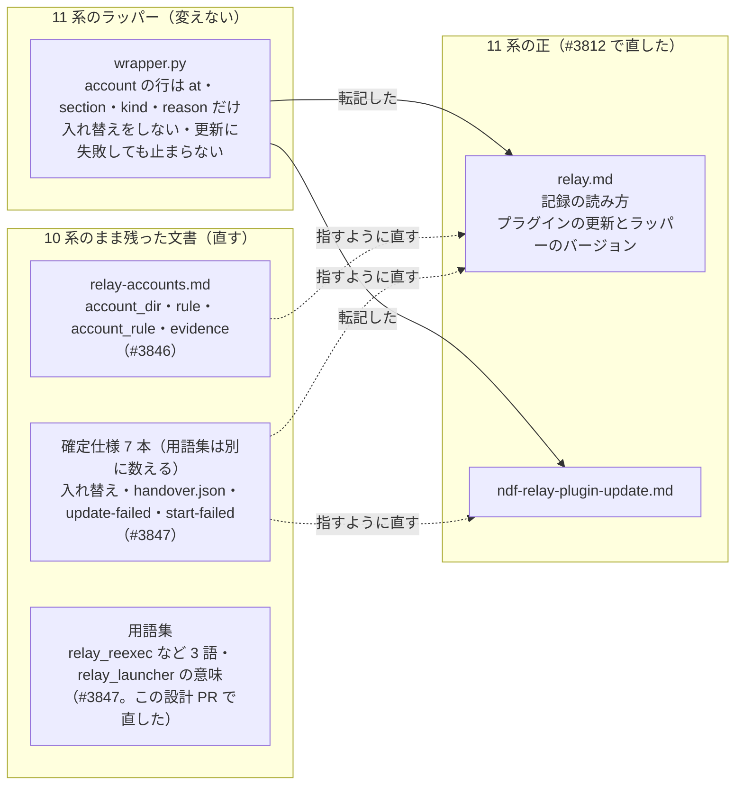

# 中継の手順書・確定仕様・用語集を、11 系のラッパーが実際に書く記録と振る舞いだけにする（#3846 #3847）

11.0.0 の作り直しで中継のラッパーを作り直したとき、中継の文書（手順書 `relay-accounts.md`・中継の確定仕様・用語集）を書き直さなかったため、文書が 11 系のラッパーに無い 10 系の記録のキーとラッパーの入れ替えを今の振る舞いとして書いている。この設計は、10 系の記述を消して 11 系の正（手順書 `relay.md` と確定仕様 `ndf-relay-plugin-update.md`）を指す形に直し、作るか消すかの判断が要るほかの 10 系の記述は #3864・#3865 へ分ける。ラッパーのコードは変えない。採らなかった案は「決定の記録」にある。

何が起きて誰が困ったか・何を満たせば終わりかは、要求仕様（[issue-3846-requirements.md](./issue-3846-requirements.md)・[issue-3847-requirements.md](./issue-3847-requirements.md)、正は #3846・#3847 の本文）にある。この文書は根本原因と、どう直すかだけを書く。

## 今の姿

**根本原因**: 11.0.0 の作り直し（#3304）で中継のラッパーを作り直したとき、10 系のラッパーの振る舞いを書いた中継の文書を書き直さなかった。そのあと #3812（11.0.8）が手順書 `relay.md` だけを 11 系へ直したため、`relay.md` と、それが指す・それと並ぶ文書のあいだで、同じ記録と同じ仕組みについて 11 系と 10 系の 2 つの説明が並んでいる。文書の記述をコードと照らす検査は無く（`.md` の文言を照らすテストは書かない決まり）、#3812 の実装の途中で初めて見つかった。

**2 つの課題をまとめた理由**: #3846（手順書の記録のキー）と #3847（確定仕様と用語集の入れ替え）は、上の根本原因が同じで、直し方も同じ（10 系の記述を消し、11 系の正を指す）である。#3868 の決定 7（複数の課題を 1 本の設計書にまとめてよいのは、根本原因が共通（同じ部品の同じ欠け）のときだけ）に当たるので、1 本の設計書にした。

**同じ形の箇所**: 同じ原因で残った 10 系の記述は、ほかにもある。`relay-accounts.md` のアカウントの選び方・上限と認証の失敗での切り替え・`ndf plan` の API キー（#3864）と、`ndf-relay-segment-restart.md` ほかの 10 系の置き場（`relay_lib`・`relay.current`）・再起動ループ・記録の形と、`ndf-parallel-plan-ledger.md` の `relay.current`（#3865）である。どれも 11 系で作るか消すかの判断が要るので、この設計の範囲に入れない（決定 1）。

## 文脈と制約

- ラッパーのコードは変えない。10 系のキーや入れ替えをラッパーに足して文書に合わせる側では直さない（要求の起票者の推定 S1。#3812 の本文が写す利用者の方針「10 系の課題を引きずらず、11 系の設計思想に合わせる」）
- 11 系の振る舞いの正は `relay.md` の「記録の読み方」と「プラグインの更新とラッパーのバージョン」、確定仕様 `ndf-relay-plugin-update.md` である。直した文書はこれらを指し、中身を写さない
- 起動に失敗したときの 11 系の振る舞い（停止理由 `precondition`・終了コード 3）は、同じ設計 Pull Request の #3842 が決める。`ndf-relay-segment-restart.md` の `start-failed` はそれに合わせる
- `ndf-relay-segment-restart.md` は確定仕様と手順書の 15 か所から参照されている
- 用語集の正は `docs/glossary/glossary.json` で、`docs/glossary/*.md` は `ndf records glossary render` が書く生成物である。手で直さない
- `.md` の文言を照合するテストは書かない（`AGENTS.md` の DON'T）。確かめは `grep` と検査のコマンドで行う
- 同じ worktree で #3842（子の claude を起動できないときの終わり方）・#3814（質問の表示中に切り替えない）の文書を別に書いている。`relay.md` は #3814 と #3842 が直すので、この設計は `relay.md` を変えずに、その節を指すだけにする

## 解き方の全体像

1. `relay-accounts.md` は、記録の行として `account` の行だけを書き、行の種類とキーの一覧は `relay.md` の「記録の読み方」を指す。11 系に無い行（`account_dir`・`api_key` など）とキー（`rule`・`account_rule`・`evidence`・`to_key` など）と、それを述べる文と画面の 1 行は文ごと消す
2. 中継の確定仕様 7 本は、ラッパーの入れ替え・`update-failed`・`start-failed` の記述を消すか 11 系の振る舞いへ書き直し、11 系の振る舞いは `relay.md` と `ndf-relay-plugin-update.md` を指す
3. 用語集は、10 系の 3 語を消し、2 語の意味を 11 系へ直す。これは実装を待たず、この設計 Pull Request で行った（決定 2）

## 決定の記録

### 決定 1: 中継の文書が 11 系だけを書くように、10 系の記述は消して 11 系の正を指し、作るか消すかの判断が要る残りは別の課題にする

- **問い**: 11 系に無い記録と仕組みを書いた手順書と確定仕様を、どの形に直すか。どこまでをこの変更で直すか
- **選んだ案**: `relay-accounts.md` の記録の読み方は `account` の行だけを書き、行の種類の一覧は `relay.md` の「記録の読み方」を指す。`account` の行は、カットポイントで替えた（`_account_for_next`）ときも利用上限で替えた（`_note`）ときも、`{"at": …, "section": …, "kind": "account", "reason": …}` の形である。`at` は `signals.append_jsonl`、`section` は `Wrapper._log` がどの行にも付ける共通のキーで、`account` の行に固有のキーは `kind` と `reason` だけである。手順書にはこの 2 つを分けて書く（#3846 の受け入れ条件 2 は、設計レビューの指摘でこの 4 つのキーへ直した）。確定仕様は入れ替え・`update-failed`・`start-failed` を消し、11 系の振る舞いは `relay.md` と `ndf-relay-plugin-update.md` を指す。`relay-accounts.md` と確定仕様のほかの 10 系の記述は、作るか消すかの判断が要るため #3864・#3865 へ分けた
- 採らなかった案: ラッパーに 10 系のキーと入れ替えを足して、文書に合わせる（11 系の設計思想に合わせる利用者の方針に反し、使われていない仕組みを作り直すことになる）
- 採らなかった案: `ndf-relay-segment-restart.md` を `docs/archive/` へ移す（触ってよい範囲の外の 15 か所の参照が切れる）
- 採らなかった案: 記録の行の名前だけを 11 系の名前へ替えて文を残す（11 系に無い振る舞いを 11 系の記録が示すと読める。要求の起票者の推定 S3）
- 採らなかった案: `relay-accounts.md` と確定仕様の 10 系の記述をこの変更ですべて直す（アカウントの選び方・再起動ループなどは作るか消すかの設計が要り、記録の読み方の直しと判断が混ざる）
- **代償**: #3864・#3865 が閉じるまで、同じ文書に 10 系の記述が一部残る。読み手は、直した箇所と残った箇所が並ぶ文書を読む
- 根拠: Value 14「判断の理由が残り、語がそろっている」（MVV バージョン 9）

### 決定 2: 語をそろえるため、用語集の追加と廃止を設計 Pull Request で行う

- **問い**: 10 系の 3 語の廃止と 2 語の意味の変更を、いつ用語集へ反映するか
- **選んだ案**: 設計の手順は、新しい語・意味の変わった語・廃止する語を同じ変更で用語集へ反映すると決めている。それに従い、この設計 Pull Request で用語集を直した（用語は下の「用語」の表）。3 つの用語は自分の定義の外から参照が 0 件なので、設計 Pull Request で消しても読み手が迷わない
- 採らなかった案: 実装の Pull Request で用語集を直す（設計の手順の「同じ変更で反映する」に反し、設計が使う語と用語集が実装まで食い違う）
- **代償**: 設計 Pull Request の差分に、#3847 の実装の一部（用語集）が入る。実装の Pull Request は確定仕様だけを触る
- 根拠: Value 14「判断の理由が残り、語がそろっている」（MVV バージョン 9）

## 影響と危険

- 変えるのは手順書 1 本・確定仕様 7 本・用語集だけで、ラッパーの振る舞いと公開インタフェースは変わらない
- `relay.md` は同じ設計 Pull Request の #3814・#3842 が直す。この設計は `relay.md` の節（「記録の読み方」「プラグインの更新とラッパーのバージョン」）へのリンクを置くので、節の名前が変わるとリンクが切れる。リンクの検査（`check-markdown-links.py`）が見出しまで照らすので、切れれば検査が落ちる

## 用語

| 用語 | 意味 | 用語集への反映 |
| --- | --- | --- |
| ランチャー（`relay_launcher`） | `~/.claude/ndf/relay.py`（`ndf relay install` が置く複製）。隣の `relay.root` が指すプラグインの `bin/ndf relay` を呼ぶだけのエントリポイント | 意味の変更（`relay_lib` を読み込む 10 系の意味から） |
| プラグインの入れ替え | 作り直した `plugins/ndf-next/` を `plugins/ndf/` へ移した変更。意味の末尾「ラッパーの入れ替えとは別」を消す | 意味の変更 |
| ラッパーのバージョンディレクトリ（`relay_version_dir`）・ラッパーの入れ替え（`relay_reexec`）・入れ替えの申し送り（`relay_handover`） | 11 系に無い 10 系の仕組み | 廃止（エントリを消す） |

## テスト設計

テストのコードは足さない。どれも文書の直しで、確かめは検査のコマンドで行う。

#3846 の受け入れ条件 1 の `grep` は、消す `api_key` の行と `rule` のキーを探さない。`api_key` は、`relay-accounts.md` で #3864 へ残す API キーの説明（使用量ログの `api_key` の列。215 行）にも出るので、0 件を条件にできない。`rule` だけで探すと、同じ `grep` が探す `account_rule`・`launch_rule` にも部分一致して区別できない（`rule` だけの記述は 133・172・235 行。2026-11-19 に `grep -n rule` で確かめた）。この 2 つは受け入れ条件 2（記録の行は `account` の行だけ・`reason` を規則の名前として書かない）のレビューで見る。

| 受け入れ条件 | どの振る舞いで確かめるか | どう壊したら落ちるべきか |
| --- | --- | --- |
| #3846 の 1・#3847 の 1・4 | 要求の受け入れ条件の `grep` が 0 件（#3847 の 4 はプラグインの入れ替えの意味だけ） | 10 系のキーか入れ替えの記述が 1 つでも残る |
| #3846 の 2・3、#3847 の 2 | 実装の Pull Request のレビューで、直した文を `wrapper.py` の `_account_for_next`・`_note`、`relay.md` の「プラグインの更新とラッパーのバージョン」、#3842 の起動の失敗の振る舞いと照らす | `reason` を規則の名前として書く・`start-failed` か終了コード 2 を書く |
| #3846 の 4・5、#3847 の 6 | `python3 scripts/check-markdown-links.py` が通る | `relay.md` の節へのリンクが切れる |
| #3847 の 3・5 | `ndf records glossary render --check` と `ndf records glossary meanings` が `ok` | 生成物を作り直さない・消した語を参照する定義が残る |

## どこを変えるか

（新設する関数 0・シグネチャを変える関数 0 で、コードを変えない。#3868 の決定 6（新設する関数が 1 以下でシグネチャを変える関数が 0 なら、詳細設計を設計書に畳む）の条件により、詳細設計は別ファイルにせず、このセクションに畳む）

| ファイル | 変える中身 | 決定 |
| --- | --- | --- |
| `plugins/ndf/skills/development-workflow/references/relay-accounts.md` | 48・106・125・133・171〜173・235〜237 行（要求 #3846 の「事象」の表）の、`account_dir`・`api_key` の行、`rule`・`account_rule`・`evidence`・`to_key`・`launch_rule`・`local_only` のキー、画面の「替えて続ける」「を使わない」の 1 行を文ごと消す。記録を書く箇所は `account` の行（共通の `at`・`section` と、固有の `kind`・`reason`）だけを書き、行の種類とキーの一覧として `relay.md` の「記録の読み方」を指す。ほかの 10 系の記述は #3864 へ残す | 1 |
| `docs/specifications/ndf-relay-segment-restart.md` | ラッパーの入れ替え・`update-failed`・`start-failed` の記述を消す。プラグインの更新に失敗しても次のセグメントを起動すると書き、`relay.md` と `ndf-relay-plugin-update.md` を指す。起動の失敗は #3842 の振る舞い（停止理由 `precondition`・終了コード 3）を書く。置き場 `relay_lib`・再起動ループ・記録の形 `event`・導入の形は #3865 へ残す | 1 |
| `docs/specifications/ndf-development-loop-limits.md` | 上限「ラッパーの入れ替えの用意の待ち」（`relay_lib/handover.py`）の行と、「新しい版の判定は、ラッパーの入れ替えの後に効く」を消すか 11 系へ直す。`relay_lib` を指すほかの行は #3865 へ残す | 1 |
| `docs/specifications/ndf-relay-multi-session-supervisor.md` | 入れ替えの後の `claim_hub`・`hub-log.jsonl` の `version-switched`・#1587 への参照を消すか 11 系へ書き直す | 1 |
| `docs/specifications/ndf-relay-lane-parent-session-env.md` | `handover.py` の `startup_env` と、図の「ラッパーの入れ替えの後か」の分岐を消すか 11 系へ書き直す | 1 |
| `docs/specifications/ndf-relay-auth-failure.md` | `Relay.from_handover` の記述を消すか 11 系へ書き直す | 1 |
| `docs/specifications/ndf-relay-install-and-restart.md` | 「動いているラッパーは入れ替えない」を、11 系の振る舞い（入れ替えを作らず、ラッパー自身の変更は `claude` を打ち直した後に効く）へ書き直す | 1 |
| `docs/specifications/ndf-relay-launch-target.md` | 区切りの置き場としての `handover.py` を消すか 11 系へ書き直す | 1 |
| `docs/glossary/glossary.json` と生成物 | 「用語」の表のとおり。この設計 Pull Request で直し、`ndf records glossary render` で生成物を作り直した | 2 |

## 設計の結果

| 課題 | 扱い | 統合先 | 触るファイル |
| --- | --- | --- | --- |
| #3846 | 実装する | — | `plugins/ndf/skills/development-workflow/references/relay-accounts.md` |
| #3847 | 実装する | — | `docs/specifications/ndf-relay-segment-restart.md`、`docs/specifications/ndf-development-loop-limits.md`、`docs/specifications/ndf-relay-multi-session-supervisor.md`、`docs/specifications/ndf-relay-lane-parent-session-env.md`、`docs/specifications/ndf-relay-auth-failure.md`、`docs/specifications/ndf-relay-install-and-restart.md`、`docs/specifications/ndf-relay-launch-target.md` |
