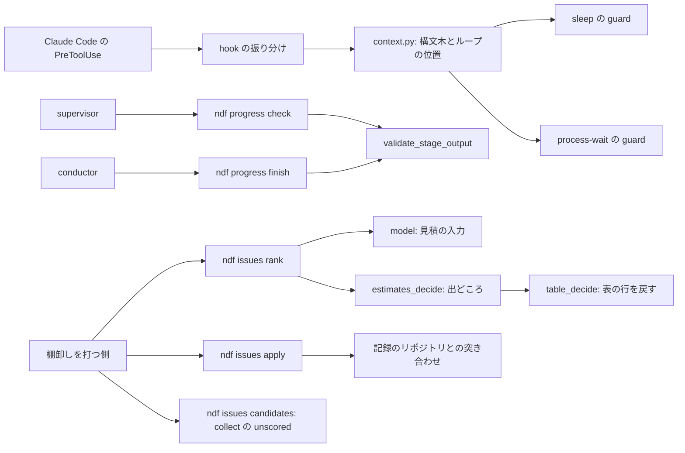
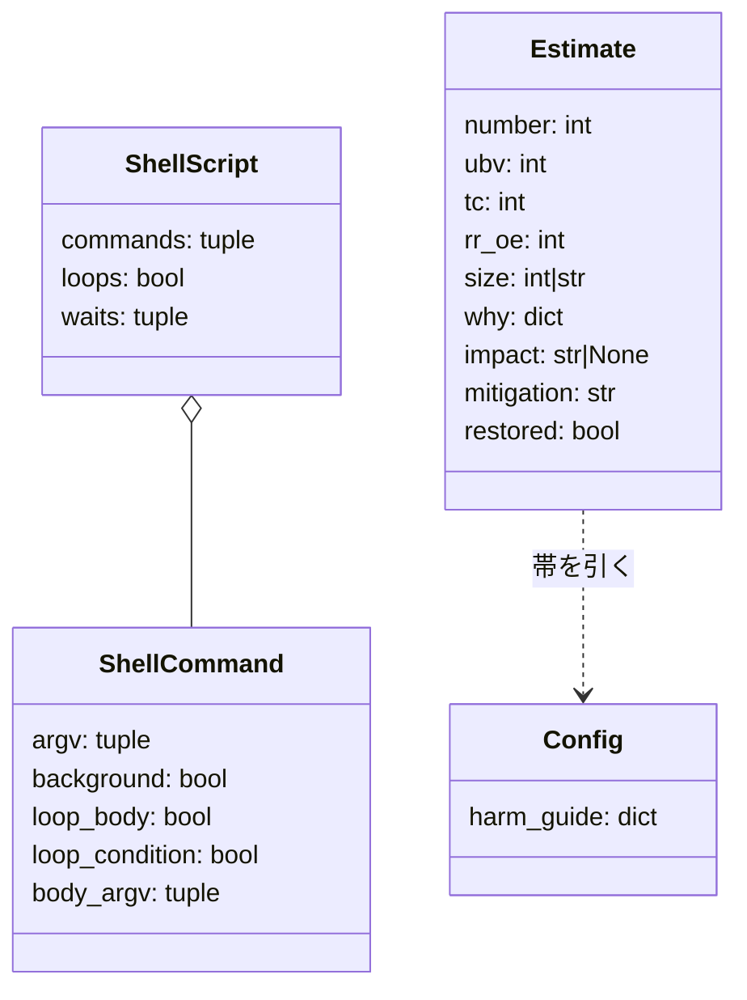
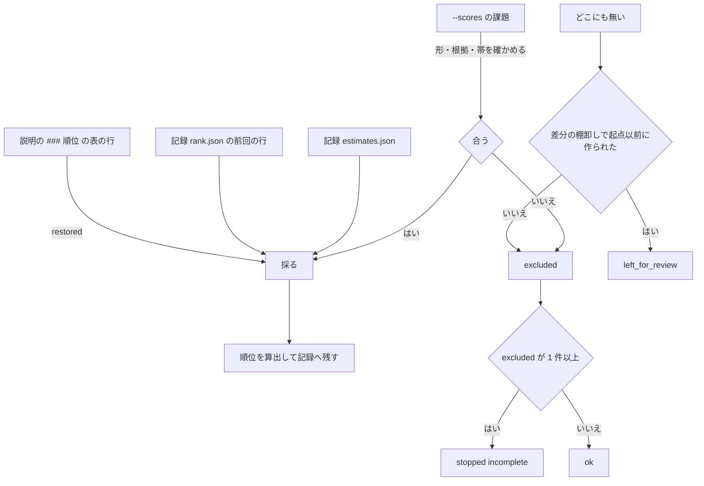

# 待ち・工程の出力・棚卸しの順位: 11 系のコードが手順書のとおりに止め、確かめ、算出する（#3851 #3856 #3854）

## 目的

- **今どうなっているか**: 11.0.0 の作り直しの後、3 か所でコードが手順書の振る舞いを持たない。hook はループの中の `sleep` とプロセス名の待ち（`pgrep -f`）を止めず、待ちが 2 時間止まった（#3851）。supervisor は工程の出力を `finish` と同じ規則で確かめる手段を持たず、conductor の `ndf progress finish` が規約外のキーで止まった（#3856）。`ndf issues rank` / `apply` は手順書の見積の入力の形・`--since-ref`・順位の表からの読み戻し・plan の `repo` を持たず、手順書どおりに打つと順位が出ない（#3854）
- **誰に効くか**: 3 層（conductor → supervisor → worker）で工程を通す利用者と、棚卸しを打つ利用者
- **変えると何が成り立つか**: 手順書が禁じる待ちを hook が止め、supervisor が工程の出力の誤りを返す前に知り、`backlog-refinement` の手順 2C（順位を算出する）と手順 3（反映する）が手順書のとおりに通る

## 適用範囲

- **働く範囲**: NDF を入れたすべての利用先のリポジトリ。hook は Claude Code だけで働く（Codex・Kiro・agy は手順書の規約だけ）。`ndf progress` と `ndf issues` は両方のランタイムで同じ
- **プロジェクトごとに違うもの**: 実害の目安（`harm_guide`）を `.ndf/backlog.json` で受ける（既定値を持つ）。待ちの上限の秒は今の `limits.json` のまま。ほかに設定も引数も足さない
- **当たるモード**: モードに依らない（hook・工程の出力の確かめ・棚卸しのコマンド）

### 代表のリポジトリでの振る舞い

| 代表のリポジトリ | 設定の要点 | 直した後に起きること | この種類で扱えなくなること |
| --- | --- | --- | --- |
| Web サービス | 待ちは Claude Code の Bash。棚卸しは GitHub の課題とマイルストーン | ループの中の `sleep` とプロセス名の待ちが hook に止められ、`Monitor` か背景の起動を案内される。supervisor は工程の出力を返す前に確かめる。棚卸しの順位が手順書の入力の形で出る | 無し |
| モバイルアプリ | 同上（ビルドの待ちも `Monitor` か背景で待つ） | 同上 | 無し |
| 業務文書だけ | 同上 | 同上 | 無し |

### ai-plugins だけの事情

- 無し（ai-plugins も 1 つの利用先で、3 件の直しに ai-plugins だけの値は無い）

## 目指す姿

- hook の `sleep` の guard は、フォアグラウンドの `while` / `until` のループの本体の `sleep` を秒によらず止め、`bash -c` 系・`eval` の中身とラッパーのコマンドの後ろの `sleep` も同じに判定する。新しい guard `process-wait` が、ループの条件か本体の `pgrep -f` / `pkill -f` を止め、「終わりはファイルで待つ」を案内する。`waiting.md` の「hook」の表はこの 2 つの guard の今の値を書く
- `ndf progress check <ID> "<工程>" --output <ファイル>` が、ステートマシンを書かずに `finish` と同じ規則で工程の出力を確かめ、その工程の定義のキーを返す。supervisor は工程の出力を書くたびにこれを打ち、`ok` になってから、フェーズレポートの欄 `終えた工程` に足す（`agent-layers.md` の supervisor の規則 15「工程を終えるたびに出力の JSON を書く」と supervisor の定義）
- `ndf issues rank` は手順書の見積の入力の形（列ごとの `step` と `why`、`ubv.impact`）だけを読み、根拠の欠けと実害の目安の帯の外れを外す。差分の棚卸しでは `--since-ref` の時刻以前の見積の無い課題を `left_for_review` へ回し、見積の 3 つ目の出どころとしてマイルストーンの説明の `### 順位` の表を読む。`apply` は plan の `repo` を受け、記録のリポジトリと照らしてから書く。手順書は 11 系に無い 4 つの記述を消し、返りを 11 系の終了コードで書く

要求と受け入れ条件は #3851・#3856・#3854 の本文にある（コピーは [issue-3851-requirements.md](./issue-3851-requirements.md)・[issue-3856-requirements.md](./issue-3856-requirements.md)・[issue-3854-requirements.md](./issue-3854-requirements.md)）。この文書は「どう作るか」だけを扱う。詳細設計は [issue-3851-3856-3854-design-detail.md](./issue-3851-3856-3854-design-detail.md) にある。

## 目指す姿の根拠

| 根拠 | 種類 | 何を示すか |
| --- | --- | --- |
| `bash -c 'pgrep -fa "zz-unique-pattern-q"'` は、そのパターンを持つプロセスが他に無いのに、Claude Code が包んだ `/bin/bash -c … eval '…pgrep -fa "zz-unique-pattern-q"…'` の 1 行に一致した（2026-11-19、procps-ng 4.0.4 で実測） | 実測 | `pgrep -f` は自分を除いても、待つ側のシェルのコマンド行に一致する。ループの条件に置くと終わらない。一致を避ける書き方（`pgrep -f '[z]z-…'`）を書き手が毎回選ぶ前提には頼れないため、hook で止める |
| 課題の再現の入力 `until ! pgrep -f "ndf ci watch --pr 1" >/dev/null; do sleep 20; done` を今の判定の関数へ渡すと通る。`bash -c 'sleep 600'`・`timeout 590 sleep 600` も通る（2026-11-19、main 2e43af7bc。[調査](#外部の調査)の STD2） | 実測 | 11 系の guard がループ・`bash -c`・ラッパーのコマンドを見ていない。10 系の判定（`976513356^:plugins/ndf/scripts/hook_lib/shell_checks.py:36-102`）はどれも見ていた |
| `validate_stage_output` に振り返りの出力 `{"outputs": {"retrospective_comment": …}}` を渡すと、`finish` と同じ `Additional properties are not allowed` を返す（2026-11-19、Python から直に呼んで実測） | 実測 | 検査の関数は既にあり、書かずに呼べる。コマンドのエントリポイントを足すだけで、書いた側が同じ判定を得る |
| 10 系の `upkeep_rank_*.py`（`ndf--v10.27.77`）は、4 列の `{"step","why"}`・`impact` の帯の確かめ・`rank --since-ref` と `left_for_review`・説明の表からの読み戻し・plan の `repo` の突き合わせを持っていた | 外部の一次情報（このリポジトリの履歴） | 4 点は手順書が意図した振る舞いで、作り直しで落ちた。作り直しの設計（#1142）に外した記述は無い（`issues/issue-1142-design.md` を `grep -n -E '見積|順位|backlog'` で探し、当たりは移すファイルの一覧の 4 行だけ） |

## ドメインモデル

### コンテキスト

| コンテキスト | 何の語が 1 つの意味に決まるか |
| --- | --- |
| ndf-context | 待ち方・禁じる待ち方・hook の guard・プロセス名の待ち |
| ndf-durable | 工程・工程の出力・文脈のキー・工程の定義のキー・工程の出力の確かめ |
| ndf-issue-upkeep | 棚卸し・見積の入力・見積の根拠・実害の区分・順位の表・差分の棚卸しの起点 |

3 つは互いの語を使わない（別々の利用者の操作に効く）。ndf-durable の `ndf progress` と ndf-issue-upkeep の `ndf issues` は、どちらも結果 JSON のコントラクト（`result.schema.json`）を共有の核として使う（共有カーネル）。

### 集約

| 集約 | オーナー（書き換えてよいもの） | 根 | エンティティ | 値オブジェクト |
| --- | --- | --- | --- | --- |
| hook の 1 回の判定 | hook の振り分け（`dispatch.py`）。guard は判定を返すだけで書かない | `HookContext` | — | `ShellScript`・`ShellCommand`（ループの位置を足す）・`Verdict` |
| スプリントのステートマシン | `ndf progress` の書く操作（`finish` など）。`check` は読むだけ | ステートマシン | 工程の行 | 工程の出力・工程の定義のキー |
| 棚卸しの記録 | `ndf issues`（`rank` が `estimates.json`・`rank.json` を書き、`apply` が GitHub を書く） | 記録の保存先 `.ndf/backlog/state/<repo>/` | 見積（課題ごと） | `Estimate`（根拠と区分を足す）・順位の表の行 |

### 不変条件

| # | 集約 | 条件 | 破れたときの扱い |
| --- | --- | --- | --- |
| I1 | hook の 1 回の判定 | フォアグラウンドの Bash で、`while` / `until` の本体にある `sleep`（`bash -c` 系・`eval` の中身とラッパーのコマンドの後ろを含む）は止める | 拒否して `Monitor` か背景の起動を案内する |
| I2 | hook の 1 回の判定 | 背景になる `sleep`（`run_in_background`・末尾の `&`）と、`for` の中の上限以下の `sleep` は止めない | — （止めないことが条件） |
| I3 | hook の 1 回の判定 | `-f` を付けた `pgrep` / `pkill` が `while` / `until` の条件か本体にあれば、前景でも背景でも止める | 拒否して完了マーカーか `Monitor` を案内する |
| I4 | hook の 1 回の判定 | 判定に失敗した（構文木を作れない・入力を読めない）ときは止めない | 通す（実装で `dispatch.py` の扱いを確かめ、テストで縛る） |
| I5 | スプリントのステートマシン | `check` はステートマシンの行と履歴を書かない | — |
| I6 | スプリントのステートマシン | `check` と `finish` は同じ関数（`validate_stage_output`）で確かめ、同じ出力に同じ誤りを返す | — |
| I7 | 棚卸しの記録 | `--scores` の見積は 4 列のすべてに空でない `why` を持つ。持たない課題は順位に入らない | `excluded` に理由を添える |
| I8 | 棚卸しの記録 | `ubv.impact` を持つ見積の UBV は実害の目安の帯の中にある（`mitigation: 防いでいる` は 1 つ下の帯まで。例: `機能`（5〜8）で `防いでいる` なら `表示` の帯を足した 2〜8） | `excluded` に理由を添える |
| I9 | 棚卸しの記録 | 差分の棚卸しで、見積がどこにも無く起点以前に作られた課題は、`excluded` にも順位にも入らない | `metrics.left_for_review` へ番号を返す |
| I10 | 棚卸しの記録 | `apply` は記録のリポジトリ以外へ 1 件も書かない | 書く前に `precondition` で止める |

### ドメインイベント

| # | イベント | 発生元 | 受け手 |
| --- | --- | --- | --- |
| E1 | Bash の呼び出しを hook が受けた（#3851 の E1） | Claude Code（PreToolUse） | hook の振り分け |
| E2 | 禁じる待ち方を見つけて止めた（#3851 の E3・E4） | `sleep` / `process-wait` の guard | エージェント（理由と代わりの待ち方） |
| E3 | supervisor が工程の出力を確かめた（#3856 の E3） | `ndf progress check` | supervisor |
| E4 | conductor が工程を終えた（#3856 の E5） | `ndf progress finish` | ステートマシン |
| E5 | 見積の入力を読み、出どころを決めた（#3854 の E2・E3） | `ndf issues rank` | 記録・結果 JSON |
| E6 | plan を読んで書き込み先を照らした（#3854 の E5） | `ndf issues apply` | GitHub |

### 用語

| 用語 | 意味 | 用語集への反映 |
| --- | --- | --- |
| プロセス名の待ち | `pgrep -f` / `pkill -f` を `while` / `until` のループの条件か本体に置いて、プロセスの終わりを待つ形 | 追加（ndf-context） |
| 工程の出力の確かめ | 工程の出力の JSON を、ステートマシンへ書かずに `ndf progress finish` と同じ規則で確かめること（`ndf progress check`） | 追加（ndf-durable） |
| 見積の入力 | `ndf issues rank --scores` に渡す、課題ごとの見積の段階と根拠の JSON | 追加（ndf-issue-upkeep） |
| 見積の根拠 | 見積の入力の列ごとの `why`。段階を付けた理由の 1 行 | 追加（ndf-issue-upkeep） |
| 実害の区分 | 見積の入力の `ubv.impact`。UBV の帯（実害の目安）を引く区分 | 追加（ndf-issue-upkeep） |

既存の語のうち、この文書で多く使うもの（用語集の ndf-issue-upkeep と ndf-durable にある）:

| 語 | この文書での意味 |
| --- | --- |
| 見積の 4 列 | 遅延コストの 3 要素 UBV（利用者・業務の価値）・TC（時間の重要度）・RR/OE（リスクの低減・機会）と大きさ Size。段階（`step`）は設定の尺度（既定 1, 2, 3, 5, 8, 13, 20）の値 |
| 差分の棚卸し / 見直し | 棚卸しの深さ。`--depth diff`（前のリリースからの差分だけ）と `--depth review`（open の全件） |
| 記録のリポジトリ | 棚卸しの記録 `candidates.json` の `metrics.repo` に残った、候補を集めたリポジトリ |
| 文脈のキー / 定義のキー | 文脈のキーは工程どうしで渡す値の名前（`context.schema.json` の 12 個）。定義のキーはそのうち、ある工程が書くと工程の定義（`contracts/workflow/stages/<工程>.json`）に挙げたもの |

## 外部の調査

| 種類 | 調べるか | 理由 |
| --- | --- | --- |
| 標準・仕様 | 調べる | `pgrep` の一致の範囲と Bash の構文の欄の名前が判定の前提になる |
| 主要な製品 | 調べない | 3 件とも既存の NDF の部品（hook・ステートマシン・棚卸し）の欠けた振る舞いを足す変更で、製品の解き方を比べて形を選ぶ判断が無い |
| ライブラリとサービス | 調べる | 構文木（tree-sitter-bash）と JSON Schema の検査（jsonschema）を使い続けるかを確かめる |

### 標準・仕様

| # | 標準・仕様 | 何を定めているか | 設計への反映 | 出典 |
| --- | --- | --- | --- | --- |
| STD1 | procps-ng の `pgrep` / `pkill`（4.0.4） | `-f`（`--full`）は名前でなくコマンド行の全体と照らす。`pgrep` は自分のプロセスを結果から除くが、親のシェルは除かない | `-f` の付いた形だけを止め、`-x` などは止めない（決定 2）。束ねたフラグ（`-af`）と `--full` も `-f` と読む | `pgrep -V` と `bash -c 'pgrep -fa "zz-unique-pattern-q"'` の実測（2026-11-19） |
| STD2 | tree-sitter-bash 0.25.1 の構文の欄 | `until` は `while_statement` として読まれ、条件の欄が `condition`、本体の欄が `body`。`until_statement` という種類は無い | ループの位置を欄の名前で決める（決定 1）。`_LOOP_NODES` から存在しない `until_statement` を外す | `Language.id_for_node_kind` と `until … do … done` の構文木の実測（2026-11-19、`python -I -c` で `tree_sitter_bash` の `Language.id_for_node_kind` を打った） |

### ライブラリとサービス

| # | 候補 | バージョン | ライセンス | 最後のリリースの日付 | 終了のアナウンス | 要件を満たすか | 出典 |
| --- | --- | --- | --- | --- | --- | --- | --- |
| LIB1 | tree-sitter-bash（既に依存） | 0.25.1 | MIT | 確かめていない | 無し | 満たす。欄の名前で条件と本体を分けられる（STD2） | `uv.lock` の `tree-sitter-bash` の行（2026-11-19） |
| LIB2 | jsonschema（既に依存） | 4.26.0 | MIT | 確かめていない | 無し | 満たす。`finish` の検査が既に使い、`check` も同じ検証器を使う | `uv.lock` の `jsonschema` の行（2026-11-19） |

### 確かめられなかったこと

| 対象 | 試した手段 | 結果と理由 |
| --- | --- | --- |
| LIB1・LIB2 の最後のリリースの日付 | 試していない | 既に依存している版を変えないため、比べる材料に使わない |
| `pgrep(1)` の man の本文 | `man pgrep` | この環境に `col` が無く本文を整形できなかった。振る舞いは実測で確かめた |

調べた量: 候補 4 件・取得の試み 5 回。

## 機能一覧

| # | 機能 | 誰が使うか |
| --- | --- | --- |
| F1 | ループの中の `sleep` を秒によらず止める（`bash -c` 系・`eval`・ラッパーのコマンドの後ろを含む） | Claude Code のエージェント（hook が止める） |
| F2 | プロセス名の待ちを止める | 同上 |
| F3 | 工程の出力を書かずに確かめ、定義のキーを返す | supervisor |
| F4 | 手順書の形の見積の入力を読み、根拠と帯を確かめる | 棚卸しを打つ利用者・supervisor |
| F5 | 差分の棚卸しの起点で、古い見積の無い課題を見直しへ回す | 同上 |
| F6 | マイルストーンの説明の順位の表から見積を戻す | 同上 |
| F7 | plan の `repo` を受け、書き込み先を記録のリポジトリと照らす | 同上 |

## 構成要素

| 要素 | 責務 |
| --- | --- |
| `hooks/context.py`（変更） | シェルの単純コマンドごとに、`while` / `until` の本体・条件の中かを持たせる。`bash -c` 系・`eval` の中身を同じ構文木の解析で読み直し、ループの位置と背景を引き継いで `ShellScript.waits` に入れる（`commands` は外側だけのまま）。ラッパーを外した本体の語を持たせる |
| `hooks/guards/sleep.py`（変更） | `waits` のうち本体の語が `sleep` の単純コマンドを、ループの本体なら秒によらず、外なら上限で止める |
| `hooks/guards/process_wait.py`（新設） | `waits` のうち本体の語が `pgrep` / `pkill` で `-f` を持ち、ループの条件か本体にある単純コマンドを止める |
| `contracts/hooks/guards.json`（変更） | `process-wait` の行（順・勧める Tool・`deny_key`）を足し、`sleep` の要約を今の判定に合わせる |
| `progress/command.py`（変更） | `ndf progress check` を足す。`finish` と同じ `validate_stage_output` を呼び、書かずに返す |
| `backlog/model.py`（変更） | 見積の入力の形（`{"step","why"}`・`impact`・`mitigation`）を読み、根拠と区分を持つ `Estimate` を作る。実害の目安を設定から読む |
| `backlog/estimates_decide.py`（変更） | 見積の出どころに説明の順位の表を足し、起点以前の見積の無い課題を `left_for_review` へ分ける |
| `backlog/table_decide.py`（変更） | 11 系の順位の表の行を読み、段階を戻す（書く側の `render` と対の関数） |
| `backlog/cli.py`・`cli_input.py`・`collect.py`（変更） | `rank --since-ref`・`metrics.left_for_review`・`excluded` の返り・候補の `unscored` の絞り込みと `metrics.since`・plan の `repo` と書き込み先の突き合わせ |
| コントラクト（変更） | `backlog.schema.json` に `harm_guide`、`issues.result.schema.json` に `left_for_review`・`since`、`progress.result.schema.json` の `metrics` に `outputs`、`docs/contracts/commands.md` に `progress check` と `rank --since-ref` |
| 手順書（変更） | `waiting.md` の「hook」の表、`agent-layers.md` の規則 15、`agents/supervisor.md`・`supervisor-waits.md`、`backlog-refinement` の `SKILL.md`・`ranking.md`・`depths.md` |



図は呼び出しの関係だけを描き、`guards.json`・コントラクトのスキーマ・手順書（読まれるだけのもの）は載せない。

## 構造

変える型は 4 つで、どれも値オブジェクトである。



- `ShellScript.commands` と `loops` は外側の単純コマンドだけで、今のまま。`waits` は外側と内側（`bash -c` 系・`eval` の中身）の単純コマンドを合わせた列で、内側の単純コマンドは外側の `background`・`loop_body`・`loop_condition` を論理和で引き継ぐ
- `ShellCommand.body_argv` はラッパーのコマンド（`timeout`・`nohup` など）とその引数を外した語。`argv` は今のまま残し、script-chain の guard の判定を変えない
- `Estimate.restored` は順位の表から戻した見積の印で、根拠を持たない。帯の確かめをしない

## 入出力のコントラクト

### `ndf progress check`（新設）

```text
ndf progress check <machine_id> <stage> --output <ファイル> [--cwd <パス>]
```

| 場合 | `status` | `cause.kind` | 終了コード | `metrics` | `warnings` |
| --- | --- | --- | --- | --- | --- |
| 規約に合う | `ok` | — | 0 | `machine_id`・`stage`・`outputs`（定義のキーの一覧） | 定義しない文脈のキー（`finish` が捨てるもの） |
| 規約に合わない | `stopped` | `refused` | 1 | 同上 | — |
| ステートマシン・工程が無い | `stopped` | 今の `finish` と同じ | 今の `finish` と同じ | — | — |
| ファイルを読めない | `stopped` | 今の `finish` と同じ | 今の `finish` と同じ | — | — |

`metrics.outputs` は今の `progress.result.schema.json` に無い（`outputs` は `items` の要素だけが持ち、`metrics` は `additionalProperties: false`）。そのため `metrics` に `outputs`（文字列の配列。`check` だけが出す）を足す。`machine_id`・`stage` は既に `metrics` にあり、`warnings` は共通の `result.schema.json` が文字列の配列で受ける。`ok` の結果と `refused` の結果の両方を、テストで `progress.result.schema.json` に通す。

`summary` は、合わないときに `finish` と同じ「<工程> の出力が規約に合わない: <誤り>」を出す。`outputs` のキーの扱いは 3 つに分かれ、`finish` と同じである。

| `outputs` のキー | 例 | `check` | `finish` |
| --- | --- | --- | --- |
| 工程の定義のキー | 設計の `design_pr` | `ok` | 文脈へ書く |
| 文脈のキーだが工程の定義のキーでない | 振り返りの `pr` | `ok` と `warnings` | 捨てて警告 |
| 文脈のキーでない | 振り返りの `retrospective_comment` | `refused` | `refused` |

### `ndf issues rank`（変更）

| 項目 | 今 | 変えた後 |
| --- | --- | --- |
| 引数 | — | `--since-ref <タグか SHA>` を足す（`--depth diff` のときだけ効く） |
| 見積の入力の 4 列 | 整数 | `{"step": <尺度の値>, "why": "<根拠>"}`。`ubv` は任意の `impact`（`harm_guide` のキー）を持つ。`size` の `step` は尺度の値か `"over"` |
| 見積の入力の任意の項目 | `waiting_decision`・`observed_harm`・`depends_on`・`digest` | 左に `mitigation`（`防いでいる` / `部分的` / `無い`、既定 `無い`）を足す。`milestones`・`needs_detail` は読まない（手順書から消す） |
| `metrics` | `backward, depth, digest, dropped, excluded, forward, order, rejected_stale, repo, sized` | 左に `left_for_review`（番号の配列。差分の棚卸しで `--since-ref` を渡したときだけ要素を持つ）を足す。`digest` の材料に入れない |
| 返り | 見直しで `excluded` があれば `stopped`/`incomplete`、差分の棚卸しは `ok` | 深さによらず `excluded` があれば `stopped`/`incomplete`（終了コード 6）。`gaps` に外した課題と理由 |

### `ndf issues candidates`（変更）

`--depth diff --since-ref <ref>` のとき、`unscored` の経路は `<ref>` のコミットの時刻より後に作られた課題だけを拾い、`metrics.since`（ISO 8601 の時刻）を返す。

### `ndf issues apply`（変更）

| 場合 | 返り |
| --- | --- |
| plan の `repo` が記録のリポジトリと同じ（または plan に `repo` が無い）で、書き込み先も同じ | 今のとおり書く |
| 記録（`candidates.json`）が無い | 1 件も書かずに `stopped`/`precondition`（終了コード 3） |
| `--repo` か plan の `repo` が記録の `metrics.repo` と違う | 同上 |

### 設定 `.ndf/backlog.json`（変更）

`harm_guide`: 区分の名前 → `[下限, 上限]`（どちらも尺度の値）。既定は `{"全体": [13, 20], "機能": [5, 8], "表示": [2, 3], "なし": [1, 1]}`。

## 処理の流れ



見積の出どころは上から順に採る（`--scores` → `estimates.json` → `rank.json` → 説明の表）。見直し（`--depth review`）は今のとおり、要約値の違う記録と戻した見積を `excluded` にする。

## 決定の記録

### 決定 1: ループの中の `sleep` を秒によらず止めるため、単純コマンドにループの位置を持たせる

**結論**: `parse_shell` が単純コマンドを集めるとき、祖先をたどって `while_statement` の `body` の欄の中にあれば `loop_body`、`condition` の欄の中にあれば `loop_condition` を立てる。`for_statement` はループに数えない（上限だけで判定する）。`bash -c` 系・`eval` の引数の文字列は同じ構文木の読み方で読み直し（深さ 5 まで）、外側の単純コマンドの状態をすべて引き継ぐ。引き継ぐのはループの位置（`loop_body`・`loop_condition`）と背景（`background`）の 3 つで、内側の値と論理和を取る。`bash -c 'while :; do sleep 1; done' &` の内側の `sleep` は外側の `&` を引き継いで背景になり、止めない。

内側の単純コマンドは、今の `ShellScript.commands` に混ぜない。`ShellScript` に欄 `waits`（外側と内側の単純コマンドを合わせた列）を足し、待ちの guard（`sleep`・`process-wait`）だけが `waits` を見る。`commands` と `loops` は外側の単純コマンドだけのまま残し、`commands` を見る既存の guard（`script-chain`・`full-test`、`sleep` の「sleep の後に NDF のコマンドを打つ並び」の判定）の入力を変えない。

**理由**: 判定は構文木の位置で決まり、語の並びでは決まらない。欄の名前は tree-sitter-bash が持つ（STD2）。10 系も同じ規則（本体だけ・`for` は数えない・`-c` を引き継ぐ）で、手順書はこの規則を書いている。

**採らなかった案**: ループの有無（今の `ShellScript.loops`）だけで止める案は、`for` の中の上限以下の `sleep` と、ループの条件だけを持つ文を巻き込む。内側の単純コマンドを `commands` に足す案は、`script-chain` と `full-test` が見る列を変える（`bash -c 'ndf ci watch …'` の中身を連結の判定に数え始める）ため採らない。ループの位置だけを引き継ぐ案は、外側の `&` を失い、背景の待ちを前景として止める。`bash -c` の中身を `strict.py` の shlex の字句で読む案は、構文木と別の読み方が 2 つ並び、ループの位置を引き継げない。

作り方: 既存の `parse_shell` を広げる
比べた候補: LIB1（既に依存）。10 系の `shell_checks.py`（別の構文木の作り方で、移さない）

根拠: Value 3「同じ手順は毎回同じ結果になる」（MVV バージョン 9。プロジェクト MVV の本文は [.ndf/mvv.md](../.ndf/mvv.md)）

### 決定 2: 自分に一致する待ちだけを防ぐため、プロセス名の待ちを新しい guard で止める

**結論**: guard `process-wait` を足す。本体の語が `pgrep` / `pkill` で、`-f`・`--full`・`-f` を含む束ねた短いフラグ（`-af` など）を持ち、`loop_condition` か `loop_body` が立つ単純コマンドを止める。`run_in_background` でも、末尾の `&` でも止める。外し方は `NDF_HOOK_OFF=process-wait`。

**理由**: 自分に一致して終わらないのは、前景でも背景でも同じである（根拠の実測）。単発の `pgrep -f` は一度返るので害が無く、`-x` は名前の完全一致で待つ側に一致しない（STD1）。`sleep` の guard と止める条件と案内が違うため、別の guard にすると `NDF_HOOK_OFF` で片方だけを外せる。

**採らなかった案**: `sleep` の guard に足す案は、外し方が 1 つになり、`sleep` を含まない `until ! pgrep -f x; do :; done` を `sleep` の guard の名前で止めることになる。`pgrep -f` をすべて止める案は、単発の確かめ（課題の文書の受け入れ条件の確かめ）を巻き込む。

作り方: 自前で作る（既存の guard と同じ形の 1 モジュール）
比べた候補: STD1。既存の guard の部品（`guards/shell.py`）

根拠: Value 3「同じ手順は毎回同じ結果になる」（MVV バージョン 9）

### 決定 3: ラッパーのコマンドの後ろの `sleep` と `pgrep` を見るため、ラッパーを外した本体の語を単純コマンドに持たせる

**結論**: `ShellCommand.body_argv` を足す。先頭からラッパーのコマンド（`weight.WRAPPERS` の集合）を外す。引数の外し方はラッパーごとの表（値を取らないオプション・値を取るオプション・オプションの後の前置きの語）で決め、`--` でオプションを終える。値を取るオプションは、別の語で値を取る形（`timeout --signal TERM 590 sleep 600` の `TERM`）も値として外す。表に無いオプションに当たったら本体の語を空にし、判定しない（読めない入力で止めない I4 と同じ向き）。表は詳細設計の「ラッパーの引数の読み方」にある。`sleep` と `process-wait` の guard は `body_argv` を見る。

**理由**: ラッパーのコマンドの語の集合は `plugins/ndf/src/ndf/testing/weight.py` と `strict.py` が既に共有している。`argv` を書き換えると script-chain の guard の判定が変わる。

**採らなかった案**: `argv` そのものを書き換える案（他の guard の振る舞いが変わる）。後ろの語を先頭の文字（`-`・数字・`=` を含む）だけで飛ばす案は、別の語で値を取るオプション（`timeout --signal TERM` の `TERM`・`env -u HOME` の `HOME`）で止まり、本体の語に届かない。表に無いオプションを値を取らないものと見なす案は、値をコマンドと読み違えて無関係の語で止める。

作り方: 既存の集合 `weight.WRAPPERS` を使う
比べた候補: `strict.py` の `_after_wrapper`（`gh`・シェル・`eval` の位置だけを探し、ラッパーのコマンドの引数を飛ばさないため使えない）

根拠: Value 11「重複と冗長が無い」（MVV バージョン 9）

### 決定 4: 上限の秒は今の値を保ち、手順書を 11 系の値へ合わせる

**結論**: ループの外の上限は `limits.json` の `hook.sleep`（30 秒）のまま。`waiting.md` の「hook」の表から `NDF_SLEEP_GUARD`・`NDF_SLEEP_MAX_SEC`（既定 5）を消し、上限の出所と外し方 `NDF_HOOK_OFF=<guard>` を書く。`process-wait` の行を足す。

**理由**: 11 系の設計（#1142）が閾値を `limits.json` に置き、環境変数で受けないと決めた。課題が求めるのはループの中の止め方で、上限の値ではない。

**採らなかった案**: 10 系の既定 5 秒へ戻す案（値を変える根拠の実測が無い）。

根拠: Value 14「判断の理由が残り、語がそろっている」（MVV バージョン 9）

### 決定 5: 書いた側が同じ判定を得るため、`ndf progress check` を新しいサブコマンドにする

**結論**: `ndf progress check <ID> <工程> --output <ファイル>` を足し、`finish` と同じ `validate_stage_output` を呼んで書かずに返す。`metrics.outputs` に工程の定義のキーを載せ、定義しない文脈のキーを `warnings` に載せる。

**理由**: 判定の関数は既にあり、エントリポイントを足すだけで済む（根拠の実測）。`finish` に `--check` を付ける案は、`--reason` が必須のままで確かめに理由を書かせるか、引数の要否を条件で変えることになる。定義のキーを返すと、supervisor は `ndf progress show` を読まずに置いてよいキーを知る（#3856 の受け入れ条件 1 の「知る手段」）。

**採らなかった案**: `finish --check`（上の理由）。`ndf contracts emit --outputs` を使う案（結果 JSON の語彙で、工程の出力の語彙と違う）。工程の出力を書くサブコマンドを新設して形を強制する案（supervisor が書く JSON の中身は工程ごとに違い、書く側を 1 つにまとめる利点が確かめのエントリポイントより小さい）。

作り方: 既存の `validate_stage_output` を呼ぶ
比べた候補: LIB2（既に依存）

根拠: Value 13「確かめたことだけが済んだとされる」（MVV バージョン 9）

### 決定 6: 起動指示に規則が無くても確かめるため、supervisor の定義から規則 15 を指す

**結論**: `agent-layers.md` の規則 15 に「書いた後に `ndf progress check` を打ち、`ok` になってから `終えた工程` に足す。`refused` なら直して打ち直す」を足す。`agents/supervisor.md`・`supervisor-waits.md` に、CI テストの段落と同じ形で「工程の出力は規則 15 で書き、`ndf progress check` で確かめる」の段落を足す（規則の本文は写さず、規則 15 を指す）。

**理由**: #3812（中継のプラグインの更新）の仕上げのフェーズでは起動指示が規則 15 を渡さなかった。定義の本文は起動指示によらず毎回読まれる。定義は規則を写さない方針なので、手段の名前と規則の番号だけを書く。

**採らなかった案**: conductor の起動指示を検査する hook（範囲外。課題の受け入れ条件は supervisor の側で分かることを求める）。定義しないキーを `finish` で断る案（#3856 の前提 3「定義の外のキーは今のとおり捨てて警告にする」。今の `finish` とプランの検査の振る舞いを変える）。

根拠: Value 3「同じ手順は毎回同じ結果になる」（MVV バージョン 9）

### 決定 7: 棚卸しの手順書を SSOT にするため、4 点ともコードを手順書と 10 系の振る舞いに合わせる

**結論**: 見積の入力の形・`--since-ref` と `left_for_review`・説明の表からの読み戻し・plan の `repo` の 4 点は、コードを手順書に合わせる。手順書に書かれ 11 系にも 10 系の意図にも当たらない記述（入力の `milestones`・`needs_detail`）と、11 系が別の手段で持つ記述（`### 並列の組（見込み）` の依存は入力の `depends_on` とサブイシューで読む）と、使い手の無い返り（前回の表からの変化）は手順書から消す。返りの表は 11 系の終了コード（0・6・2）で書く。

**理由**: 4 点とも 10 系が手順書のとおりに持ち、作り直しで落ちた（根拠の 10 系）。作り直しの同等版は意図した振る舞いと同じであり、落ちた振る舞いを手順書から消すと、根拠の 1 行・帯の確かめ・差分の棚卸しの絞り込み・書き込み先の守りがどこにも無くなる。`rank` を打つのは `backlog-refinement` の手順書だけで、ほかの呼び手を壊さない。

**採らなかった案**: 手順書をコードに合わせる案。根拠と帯の確かめが無くなり、差分の棚卸しが初回と同じく全件を外し、記録の無い手元で表を持つ課題の見積がすべて消える（#3854 の「影響」）。

根拠: Value 7「不具合が根本原因から直される」（MVV バージョン 9）

### 決定 8: 見積の入力を 1 つの形にするため、`--scores` は整数の形を読まない

**結論**: `--scores` の 4 列は `{"step", "why"}` だけを読み、整数を「形が違う」で外す。記録 `estimates.json` は根拠と区分を持つ形で書く。11.0.x が書いた整数の記録は、根拠の無い記録の見積として採り、帯を確かめない。見直しでも、要約値が今の課題と同じなら採る（前回の表から戻した見積と違い、外さない）。

**理由**: 2 つの形を受けると、手順書の例と違う形でも通り、根拠の欠けが見えなくなる。普及の前で後方互換は要らない。記録の旧い形は利用者が手で書いたものでなく、次の `rank` で書き直される。

**採らなかった案**: 整数の形も受ける案（上の理由）。旧い記録を捨てる案（記録の無い課題が一斉に「見積が無い」になり、#3854 の影響と同じ欠けを生む）。

根拠: Value 11「重複と冗長が無い」（MVV バージョン 9）

### 決定 9: 説明の表から戻すのは 11 系の表の形だけにする

**結論**: 見積の 4 つ目の出どころとして、課題のマイルストーンの説明の `### 順位` の表の行（`table_decide.render` が書く 8 列）を読む。`（ラベル）`（ラベルが決める UBV の下限、設定 `label_floor`）・`（被依存）`（依存される数から決めた RR/OE）の付いた段階は尺度の最小へ戻し、`（見積もり）` の付いた Size は印を外した値を採る。10 系の 12 列の表は読まない。

**理由**: 印の付いた段階は見積でなく、下限と被依存で押し上げた実効の値である（10 系の `restore_from_row` と同じ扱い）。10 系の表は今開いているマイルストーンに無い（調査: 開いている 15 本は 10 系の表も 11 系の表も持たない）。11 系の表は、次の棚卸しの `apply` から書かれ、その後の記録の無い手元と別のマシンで見積を戻す。

**採らなかった案**: 10 系の表も読む案（読み手のいない形の解析を足す）。

根拠: Value 8「正しいデータ構造で作られる」（MVV バージョン 9）

### 決定 10: 差分の棚卸しで外した課題を見落とさないため、`excluded` があれば深さによらず `incomplete` で返す

**結論**: `rank` は `excluded` が 1 件以上あれば、差分の棚卸しでも `stopped`/`incomplete`（終了コード 6）で返す。`left_for_review` は `excluded` に数えない。

**理由**: 手順書は「外れた課題に段階を付けて打ち直す」を返りで分けていた（10 系の終了コード 20・`gate`）。11 系の差分の棚卸しは 308 件を外しても 0 で返し、打ち直しを促す返りが無い。起点以前の課題を `left_for_review` へ分ければ、差分の棚卸しの `excluded` はこの回に採点すべき新しい課題だけになる。

差分の棚卸しで `--since-ref` を省くと起点が無いため、見積の無い課題はすべて `excluded` に入る。手順書の「`rank` を打ったことが無い初回は全件が採点の対象になる」と同じ扱いで、`incomplete` が採点を促す。

**採らなかった案**: 10 系の `gate`（20）を戻す案。11 系の結果のコントラクトで `gate` は人の承認を待つ区分で、採点し直しは `incomplete` に当たる（`docs/contracts/exit-codes.md`）。

根拠: Value 13「確かめたことだけが済んだとされる」（MVV バージョン 9）

### 決定 11: 3 件を 1 本の設計にまとめる

**結論**: 3 件の設計を 1 本の設計 Pull Request と 1 組の設計文書に置く。実装は課題ごとに別の触るファイルで流す（「設計の結果」）。

**理由**: 3 件はどれも 11 系の作り直しで手順書の振る舞いがコードに移らなかった不具合で、同じマイルストーンにあり、設計レビューを 1 回で済ませられる。触るファイルで重なるのは `plugins/ndf/docs/contracts/commands.md`（#3856 は `progress check`、#3854 は `rank` の行。別の節）だけで、そのファイルを持つ #3856 と #3854 の実装は 1 本ずつ流れ、#3851 は並べて流せる。

**採らなかった案**: 3 本の設計 Pull Request（レビューと承認が 3 回になり、同じ前提を 3 回書く）。

根拠: Value 2「安く使える」（MVV バージョン 9）

## テスト設計

| 受け入れ条件・不変条件 | どの振る舞いで縛るか | どう壊したら落ちるべきか |
| --- | --- | --- |
| #3851 条件 1・I1 | `while true; do sleep 1; done`・`until [ -s out ]; do sleep 5; done`・入れ子のループの本体の `sleep` を前景で渡すと拒否される | 本体の判定を外す・`until` を数え漏らす |
| #3851 条件 2・I2 | `sleep 5` は通り `sleep 600` は止まる。`for i in 1 2; do sleep 3; done` は通る | `for` をループに数える・上限の判定を外す |
| #3851 条件 3 | `bash -c 'while true; do sleep 1; done'`・`eval 'while :; do sleep 1; done'`・`timeout 590 sleep 600`・`timeout --signal TERM 590 sleep 600`・`nohup sleep 600` が止まる | 中身を読み直さない・ラッパーのコマンドを外さない・値を取るオプションの値を外さない |
| #3851 条件 4・I2 | `run_in_background` の呼び出しと `while true; do sleep 1; done &`・`bash -c 'while :; do sleep 1; done' &` は通る | 背景の判定を本体の判定より後に置く・内側へ外側の `&` を引き継がない |
| #3851 条件 9（退行） | `bash -c 'ndf ci watch --pr 1'` などの入力で、`ShellScript.commands` と `loops` が今と同じ値になり、`script-chain` と `full-test` の判定が変わらない | 内側の単純コマンドを `commands` に足す |
| #3851 条件 5・I3 | 再現手順 1 のコマンドが前景でも背景でも拒否され、`pkill --full`・`pgrep -af` も止まる | 背景を通す・束ねたフラグを読まない |
| #3851 条件 6 | ループの外の `pgrep -f x`・`pgrep -x dockerd >/dev/null 2>&1 \|\| echo x`・`until ! pgrep -x dockerd; do sleep 1; done &` は通る | `-f` の無い形や単発を止める |
| #3851 条件 7 | `NDF_HOOK_OFF=process-wait` で再現手順 1 のコマンドが `process-wait` に止められない | guard の名前を一覧に載せない |
| I4 | 構文木を作れない入力で拒否が出ない | 例外を拒否に変える |
| #3856 条件 1・2・I6 | 規約に合う出力で `ok` と定義のキー、合わない出力（文脈のキーに無いキー・定義のキーの欠け・`summary` の欠け）で `finish` と同じ誤りの文の `refused`。`ok` と `refused` の両方の結果 JSON が `progress.result.schema.json` に通る | `check` が別の検査を使う・`metrics.outputs` をスキーマに足さない |
| #3856 条件 3・I5 | `check` の前後で `show` の `items` と `history` が同じ | `check` が事象を書く |
| #3856 条件 4 | 振り返りに `pr` を置いた出力で `ok` と `warnings` | 捨てるキーを返さない |
| #3856 条件 7 | `finish` とプランの工程の検査の既存テストが通る | `finish` の検査を変える |
| #3854 条件 1 | `ranking.md` の例の形の入力で課題が順位に入る | 整数だけを読む |
| #3854 条件 2・I7 | `why` が空・無い列、整数の形の課題が `excluded` に理由つきで入る | 根拠を見ない |
| #3854 条件 3・4・I8 | `impact` が帯の外の UBV は外れ、`mitigation: 防いでいる` は 1 つ下の帯で通る。`harm_guide` を書いた設定をスキーマが受け、値が帯を変える | 帯を設定から読まない・スキーマが拒む |
| #3854 条件 5 | `rank` の後の `estimates.json` が根拠と区分を持ち、次の回に記録から採った見積が帯で確かめられる | 根拠を記録へ写さない |
| #3854 条件 6・I9 | `--since-ref` の時刻以前に作られた見積の無い課題が `left_for_review` に入り、`excluded` と順位に入らない。時刻より後の課題は `excluded` に入る | 作成の時刻で分けない |
| #3854 条件 7 | 差分の棚卸しの候補の `unscored` が時刻より後の課題だけで、`metrics.since` を返す | 候補の側を絞らない |
| #3854 条件 8 | `excluded` が 1 件以上なら差分の棚卸しでも `incomplete`、0 件なら `ok` | 深さで分岐する |
| #3854 条件 9・10 | 記録の無い保存先で、説明の表に行を持つ課題の段階が採られ、`apply` の後の表から行が消えない。印の付いた段階は尺度の最小へ戻る | 説明を読まない・印を外さない |
| #3854 条件 11・I10 | plan の `repo` か `--repo` が記録と違う・記録が無いと、書き込みが 0 件で `precondition` | 突き合わせを書き込みの後に置く |

## 設計の結果

| 課題 | 扱い | 統合先 | 触るファイル |
| --- | --- | --- | --- |
| #3851 | 実装する | — | `plugins/ndf/src/ndf/domains/hooks/context.py`、`plugins/ndf/src/ndf/domains/hooks/guards/sleep.py`、`plugins/ndf/src/ndf/domains/hooks/guards/process_wait.py`（新設）、`plugins/ndf/contracts/hooks/guards.json`、`plugins/ndf/skills/development-workflow/references/waiting.md`、`plugins/ndf/tests/domains/hooks/test_guards.py`、`plugins/ndf/tests/domains/hooks/test_context.py` |
| #3856 | 実装する | — | `plugins/ndf/src/ndf/progress/command.py`、`plugins/ndf/contracts/schemas/io/progress.result.schema.json`、`plugins/ndf/docs/contracts/commands.md`、`plugins/ndf/skills/development-workflow/references/agent-layers.md`、`plugins/ndf/agents/supervisor.md`、`plugins/ndf/agents/supervisor-waits.md`、`plugins/ndf/tests/progress/test_command.py`、`plugins/ndf/tests/progress/test_command_parser.py` |
| #3854 | 実装する | — | `plugins/ndf/src/ndf/domains/backlog/model.py`、`plugins/ndf/docs/contracts/commands.md`、`plugins/ndf/src/ndf/domains/backlog/estimates_decide.py`、`plugins/ndf/src/ndf/domains/backlog/table_decide.py`、`plugins/ndf/src/ndf/domains/backlog/cli.py`、`plugins/ndf/src/ndf/domains/backlog/cli_input.py`、`plugins/ndf/src/ndf/domains/backlog/collect.py`、`plugins/ndf/contracts/schemas/ndf-settings/backlog.schema.json`、`plugins/ndf/contracts/schemas/io/issues.result.schema.json`、`plugins/ndf/skills/backlog-refinement/SKILL.md`、`plugins/ndf/skills/backlog-refinement/references/ranking.md`、`plugins/ndf/skills/backlog-refinement/references/depths.md`、`plugins/ndf/tests/domains/backlog/test_issues_cli.py`、`plugins/ndf/tests/domains/backlog/test_selection_estimates.py`、`plugins/ndf/tests/domains/backlog/test_apply_actions.py`、`plugins/ndf/tests/domains/backlog/test_routes.py` |

## 人へ残す判断

無し

## 未確認のまま残ること

| 項目 | 内容 |
| --- | --- |
| `select` のループ | tree-sitter-bash で `select` がどの種類になるかを確かめていない。実装のテストで決め、`for` と同じ扱い（上限だけ）にする |
| 判定の例外の扱い | hook の振り分けが guard の例外をどう扱うか（I4）を読んでいない。実装で `dispatch.py` を読み、通さないならテストで縛る |
| 10 系の `pgrep -f` の guard | 10 系に有ったかは確かめていない。設計は 10 系の有無に依らない |
