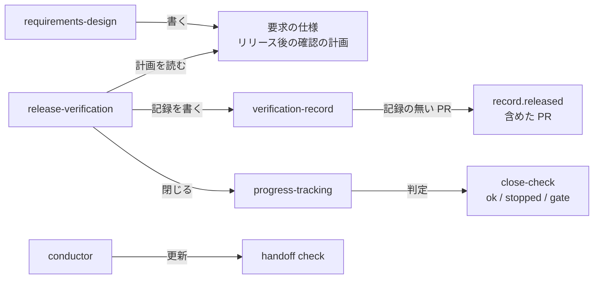
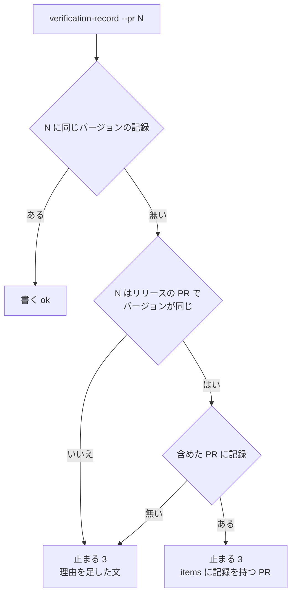
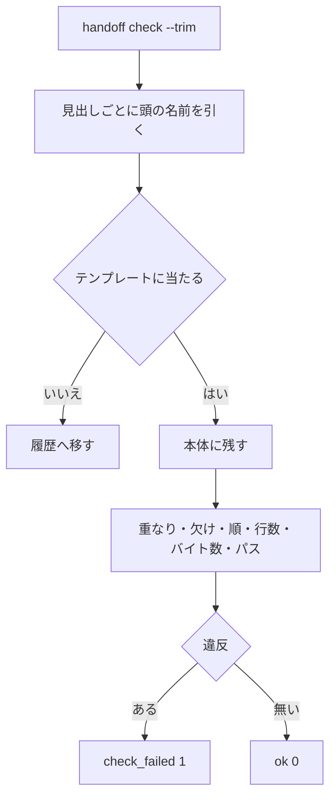

# リリース後の記録と引継ぎ文書の検査: 記録の置き先・保留・時点つきの見出しを、手順とコマンドが同じ規則で扱う（#3852 #3853 #3855 #3843）

## 目的

- **今どうなっているか**: スプリントの仕上げ（リリース後テスト・スプリントを閉じる）と引継ぎ文書の更新で、手順書とコマンドの規則が食い違っている。CD の形ではリリースの PR へリリース後テストの記録を書こうとして止まり、止まった結果から書く先が分からない（#3852）。届け方を変える変更で、旧いバージョンが新しい処理を動かす前提のリリース後テストを計画する（#3853）。保留（`not_run`）の条件を持つ課題に `close-check` が「閉じてよい」を返す（#3855）。`## 現在地（2026-11-19）` を `--trim` が履歴へ移し、必須のセクションの欠けた本体を検査が通す（#3843）
- **誰に効くか**: 仕上げのフェーズを回す conductor・supervisor と、引継ぎ文書で会話をつなぐ conductor
- **変えると何が成り立つか**: 記録を書く先・確かめられる時点・閉じるかの判定・引継ぎ文書の形を、手順書とコマンドの結果が同じ規則で示す。止まったときは結果だけで次の手が決まる

## 適用範囲

- **働く範囲**: NDF を使うすべてのリポジトリ（`release-verification`・`requirements-design`・`progress-tracking`・`release` の Skill と、`ndf release-steps verification-record`・`ndf records close-check`・`ndf records handoff check`）
- **プロジェクトごとに違うもの**: リリースの形（ブランチ戦略の設定の `release`）と本番ブランチ（`branches.production`）。#3852 の書き分けと PR の探し方はこの設定から読み、引数を足さない
- **当たるモード**: リリース後テストとスプリントを閉じる工程を通るモード（`standard`・`legacy-refactor`・`documentation`・`operation`）。引継ぎ文書はモードに依らない

### 代表のリポジトリでの振る舞い

| 代表のリポジトリ | 設定の要点 | 直した後に起きること | この種類で扱えなくなること |
| --- | --- | --- | --- |
| Web サービス（CD でデプロイする形） | リリースの形が workflow でリリースする形、本番ブランチがある | リリース後テストの記録は含めた PR へ書き、リリースの PR を渡すと記録を持つ PR の番号が返る。保留の条件を持つ課題は人が決める課題として残る | 無し |
| モバイルアプリ（ストアの審査を経る形） | 版上げの PR の本文にリリース記録を置く形 | 記録の置き先の手順は今と同じ（リリース記録を置いた PR）。審査待ちで確かめられない条件は保留として人が決める課題に残る | 無し |
| 業務文書だけ | リリースの形が文書を渡す形、リリース後テストは文書を渡した後 | 引継ぎ文書の検査と閉じる判定の変更だけが当たる。リリースの PR を持たない形では #3852 の PR の探し方は働かず、今と同じく止まる（止まる文には、記録を持つ PR を示せない理由が足される） | 無し |

### このリポジトリだけの事情

- 無し（この設計は ai-plugins の運用の値を足さない。ai-plugins が workflow でリリースする形であることはブランチ戦略の設定の値で、作るものの既定に入れない）

## 目指す姿

- `release-verification` の「出力物」は、記録を置く PR をリリースの形ごとに表で示す。workflow でリリースする形では含めた PR のどれかへ書き、リリースの PR へは書かない
- リリースの PR を `verification-record` へ渡すと、何も書かずに止まり、同じバージョンのリリース記録を持つ含めた PR の番号を結果の `summary` と `items[]` に返す
- 要求の仕様は、リリース後に確かめる条件ごとに経路を動かすバージョンと確かめる時点を「リリース後の確認の計画」に書く。旧いバージョンが動かす条件は、最初から次のリリースの後に確かめる保留として計画され、リリース後テストはその理由のまま `not_run` で記録する
- `close-check` は課題ごとに「閉じてよい（ok）」「閉じない（stopped）」「人が決める（gate）」の 3 つを返し、`progress-tracking` と `release-verification` の閉じる条件はこの 3 つと同じ語で書かれる
- `ndf records handoff check` は見出しの頭でセクションを見分け、時点を足した「現在地」を本体に残し、必須のセクションの欠けと順の逆を終了コード 1 で返す

要求と受け入れ条件は #3852・#3853・#3855・#3843 の本文にある（コピーは [issue-3852-requirements.md](./issue-3852-requirements.md)・[issue-3853-requirements.md](./issue-3853-requirements.md)・[issue-3855-requirements.md](./issue-3855-requirements.md)・[issue-3843-requirements.md](./issue-3843-requirements.md)）。この文書は「どう作るか」だけを扱う。ファイルと関数の粒度は詳細設計 [issue-3852-3853-3855-3843-design-detail.md](./issue-3852-3853-3855-3843-design-detail.md) にある。

## 目指す姿の根拠

| 根拠 | 種類 | 何を示すか |
| --- | --- | --- |
| 11.0.8 のリリース後テストで `ndf release-steps verification-record --pr 3849` が終了コード 3 で止まり、記録は #3845・#3848 にあった（#3852 の再現手順） | 実測 | リリースの PR は workflow の形でリリース記録を持たず、止まった結果から書く先が分からない |
| `plugins/ndf/src/ndf/domains/release/record.py` の `write` が含めた PR の各々へ書き、`released` がリリースの PR から含めた PR を決める | 実測（コードを読んだ。2026-11-19） | 含めた PR は既存の判定で引け、新しい読み方は要らない |
| 11.0.7 のラッパーは更新の処理を持たず、11.0.8 の更新の条件は 11.0.9 のリリースの後まで保留になった（#3853 の目的） | 実測 | 届け方を変える変更では、配ったバージョンの処理が動くのは次のリリースの後である |
| `ndf records close-check 3812 --verification <記録> --require` が `not_run` の行を持つ #3812 に「閉じてよい」を返した（#3855） | 実測 | 結果から人が決める場面が読めない |
| `close_decide.py` の 25 行目のコメント「not_run は閉じるかを人が決めるので数えない」 | 実測（コードを読んだ） | 人が決めるという意図は既にあり、結果に出ていないだけである |
| `handoff.md` の「セクションの形」の「セクションは見出しの頭で見分ける」と、必須の列と「順の逆は終了コード 1」 | 実測（SSOT を読んだ） | 見分け方・欠け・順の規則は SSOT が既に決め、実装だけが追いついていない |
| 一時リポジトリで `--trim` が `## 現在地（2026-11-19）` を移し `status: ok` を返した（#3843 の事象） | 実測 | 見出しの全体を完全一致で比べていることが原因である |

## ドメインモデル

### コンテキスト

| コンテキスト | 何の語が 1 つの意味に決まるか |
| --- | --- |
| `ndf-release`（リリース） | リリース記録・リリースの PR・含めた PR・リリース後テストの記録・経路を動かすバージョン |
| `ndf-workflow`（工程） | スプリント課題・閉じる条件・閉じるかの判定（閉じてよい / 閉じない / 人が決める） |
| `ndf-relay`（中継） | 引継ぎ文書・テンプレートのセクション・必須のセクション |

`ndf-workflow` は `ndf-release` の下流（顧客と供給者）である。閉じる判定はリリース後テストの記録の JSON の `result` の語（`passed` / `failed` / `not_run`）をそのまま読み、言い換えない。

### 集約

| 集約 | オーナー（書き換えてよいもの） | 根 | エンティティ | 値オブジェクト |
| --- | --- | --- | --- | --- |
| リリース記録 | `ndf release-steps record`（workflow） | リリースの PR | 含めた PR | バージョン・単位 |
| リリース後テストの記録 | `ndf release-steps verification-record`（会話のセッション） | 記録を持つ PR | 課題ごとの行 | `result` |
| 要求の仕様 | `requirements-design`（課題の本文） | 課題 | 受け入れ条件・リリース後の確認の計画の行 | 経路を動かすバージョン・確かめる時点 |
| 引継ぎ文書の本体 | conductor | 本体のファイル | セクション | 見出しの頭の名前 |

### 不変条件

| # | 集約 | 条件 | 破れたときの扱い |
| --- | --- | --- | --- |
| I1 | リリース後テストの記録 | 同じバージョンのリリース記録を持つ PR にだけ書く | `verification-record` が書かずに `precondition` で止まる（今と同じ）。リリースの PR なら記録を持つ PR を示す |
| I2 | リリース後テストの記録 | 課題に `failed` の行があれば閉じない。`not_run` の行があり `failed` が無ければ人が決める | `close-check` が `stopped`（`refused`）か `gate` を返す |
| I3 | 要求の仕様 | 経路を動かすバージョンが利用者の手元の旧いバージョンの条件は、確かめる時点が次のリリースの後である | 規則だけで守る（検査を置かない。#3853 の起票者の推定 S2） |
| I4 | 引継ぎ文書の本体 | 必須のセクションをすべて持ち、テンプレートの順に並び、同じセクションを 2 つ持たない | `check` が `check_failed`（1） |
| I5 | 引継ぎ文書の本体 | 見出しの頭がテンプレートのセクションに当たるセクションは `--trim` で移さない | 移した後の検査が I4 で落ちる |

### ドメインイベント

| # | イベント | 発生元 | 受け手 |
| --- | --- | --- | --- |
| E1（#3852 E3・E4） | 記録を持たない PR への書き込みを断り、記録を持つ PR を示した | `verification-record` | リリース後テストを書く担い手 |
| E2（#3853 E1・E2） | 受け入れ条件ごとに経路を動かすバージョンと確かめる時点を書いた | `requirements-design` | `release-verification`・リリースの承認資料 |
| E3（#3853 E3） | 次のリリースの後に確かめる条件を保留として記録した | `release-verification` | `close-check`（E4） |
| E4（#3855 E2・E3） | 課題を閉じてよいかを 3 つのどれかで判定した | `close-check` | 「スプリントを閉じる」の担い手 |
| E5（#3843 E2・E3） | 見出しの頭でセクションを見分けて移し、本体の形を確かめた | `handoff check` | conductor |

### 用語

| 用語 | 意味 | 用語集への反映 |
| --- | --- | --- |
| 経路を動かすバージョン | リリース後に確かめる受け入れ条件の経路を実際に動かすコードのバージョン。配ったバージョンか、利用者の手元の旧いバージョンのどちらか。旧いバージョンなら確かめる時点は次のリリースの後 | 追加（`ndf-release`） |
| リリース記録 | 用語集のとおり | — |
| リリースの PR | 用語集のとおり | — |
| リリース後テストの記録 | 用語集のとおり | — |
| スプリント課題 | 用語集のとおり | — |
| 引継ぎ文書 | 用語集のとおり | — |

## 外部の調査

省く: 外部の判断が要らない変更である。4 つとも、NDF の中の取り決め（リリース記録の置き先・確認の区分・閉じる条件・引継ぎ文書のテンプレート）に手順とコマンドをそろえるだけである。形はプロジェクトの SSOT（`release-steps.md`・`handoff.md`・リリース後テストの記録のスキーマ）が決めている。

## 機能一覧

| # | 機能 | 誰が使うか |
| --- | --- | --- |
| F1 | 記録を置く PR をリリースの形ごとに示す手順（#3852） | リリース後テストを書く担い手 |
| F2 | 記録の無い PR で止まったときに記録を持つ PR を示す（#3852） | 同上 |
| F3 | リリース後の確認の計画（経路を動かすバージョンと確かめる時点）を要求に書く規則と、それを読んで保留を記録する手順（#3853） | 要求を書く担い手・リリース後テストを書く担い手 |
| F4 | 閉じるかの判定を 3 つで返す（#3855） | 「スプリントを閉じる」の担い手 |
| F5 | 引継ぎ文書のセクションを見出しの頭で見分け、欠けと順の逆を返す（#3843） | conductor |

## 構成要素

| 要素 | 責務 |
| --- | --- |
| `release-verification` の SKILL.md（変える） | 記録を置く PR の書き分け（F1）、リリース後の確認の計画を読んで保留を記録する手順（F3）、閉じる判定の書き方を `progress-tracking` へ寄せる（F4） |
| `release` の SKILL.md（変える） | 手順 3 と「出力物」の「リリースの PR の本文へ置く」から workflow でリリースする形を除く（F1） |
| `requirements-design` の `references/spec-template.md`・`references/acceptance-criteria.md`（変える） | 仕様の任意のセクション「リリース後の確認の計画」と書く規則（F3） |
| `progress-tracking` の SKILL.md（変える） | 閉じる条件 2 と手順 3 を、`close-check` の 3 つの結果で書く（F4） |
| `quality-gates` の SKILL.md（変える） | 閉じる判定の 1 文を 3 つの結果に合わせる（F4。`マージ前` の条件の扱いは変えない） |
| `handoff.md`（変える） | `check` の終了コードの表の違反に、欠けと順の逆を足す（F5） |
| `ndf.domains.release.record`（変える） | 記録の無い PR がリリースの PR のとき、含めた PR から記録を持つ PR を探す（F2） |
| `ndf.domains.release.cli` の `cmd_verification_record`（変える） | ブランチ戦略の設定から本番ブランチと書式を渡し、記録を持つ PR を `items[]` に載せて止まる（F2） |
| `ndf.domains.records.close_decide`（変える） | 閉じるかの判定を 3 つの値で返す（F4） |
| `ndf.domains.records.cli` の `_close_check`（変える） | 判定を `ok` / `stopped` / `gate` へ写す（F4） |
| `ndf.domains.records.handoff_decide`（変える） | 見出しの頭による見分けと、必須・順の検査（F5） |
| 用語集 `docs/glossary/glossary.json`（変える） | 「経路を動かすバージョン」を足す |

図に含めない要素: `release`・`quality-gates` の SKILL.md、`handoff.md`、用語集。文の書き直しだけで、呼び出しの関係を変えない。`requirements-design` の 2 つの参照は図の `requirements-design` に、`close_decide` と `_close_check` は `close-check` に、`record` と `cmd_verification_record` は `verification-record` と `record.released` に、`handoff_decide` は `handoff check` に含める。

## 入出力のコントラクト

### `ndf release-steps verification-record`

引数は変えない。止まったときの結果だけが変わる。

| 場合 | status・終了コード | `cause.kind` | `summary` | `items[]` |
| --- | --- | --- | --- | --- |
| 同じバージョンのリリース記録を持つ PR（今と同じ） | `ok`・0 | — | `#<PR> へリリース後テストの記録を書いた: <URL>` | 無し |
| リリースの PR で、含めた PR のどれかが記録を持つ（新しい） | `stopped`・3 | `precondition` | `#<PR> はリリースの PR で、v<バージョン> のリリース記録を持たない。記録は含めた PR の各々にある: #<N>, #<M>。--pr にそのどれかを渡す` | `{"kind": "pull", "number": <N>}` を記録を持つ PR ごとに 1 つ |
| それ以外で記録が無い（文を足す） | `stopped`・3 | `precondition` | 今の文（持つバージョン）に、`workflow でリリースする形ではリリース記録は含めた PR の各々にある` と、記録を持つ PR を示せない理由（リリースの PR でない・バージョンが違う・含めた PR のどれも持たない・ブランチ戦略の設定が読めない）を足す | 無し |

### `ndf records close-check`

引数は変えない。

| 課題の行 | status・終了コード | `items[0]` | `routes` |
| --- | --- | --- | --- |
| `failed` が 1 行以上（`not_run` の有無に依らない） | `stopped`・3（`refused`。今と同じ） | `closable: false`・`reason` | — |
| `failed` が無く `not_run` が 1 行以上（新しい） | `gate`・10 | `closable: false`・`reason: "保留（not_run）の行が N 件ある。閉じるかを人が決める"` | `{"approved": null, "rejected": null}`（閉じる操作は `gh issue close` で、ndf のコマンドを持たない） |
| どちらも無い（`passed` だけ・行が無い） | `ok`・0（今と同じ） | `closable: true` | — |
| 記録が無い | 今と同じ（`--require` なら `refused`、無ければ `ok`） | — | — |

`gate` の終了コードは結果の既定（承認ゲートの区分の最初の値 10）を使う。読み手（`progress-tracking` の手順 3）は今と同じく「`ok` でなければ閉じない」で動き、`gate` のときは報告の「閉じなかった」の理由に人が決めることを載せる。

### `ndf records handoff check`

引数・終了コード・`items[]` の形は変えない。`items[].violation` の文が 2 種類増える。

| 違反 | `violation` の文 |
| --- | --- |
| 必須のセクションが無い（新しい） | `必須のセクションが無い: <名前>` |
| 順が逆（新しい） | `セクションの順が逆: <後ろの名前> が <前の名前> より前にある` |
| テンプレートに無い・重なる（今と同じ。重なりは見出しの頭の名前で数える） | 今と同じ |

## 処理の流れ

## 決定の記録

**決定の中の参照の読み方。** 「起票者の推定 S<番号>」「前提 <番号>」「E<番号>」は、各課題の要求のコピー（`issue-<番号>-requirements.md`）の同じ名前のセクションの行を指す。決定の最後の「根拠: Value <番号>（MVV バージョン 9）」は、ai-plugins のプロジェクト MVV（`.ndf/mvv.md`）の Value の項目である。Value 7 は不具合が根本原因から直される、13 は確かめたことだけが済んだとされる、14 は判断の理由が残り語がそろっている。

### 決定 1: 記録を書く先の取り違えを手順で防ぐため、「出力物」にリリースの形ごとの置き先の表を置く

`release-verification` の「出力物」の単数の「リリース記録を置いた PR」を、2 行の表（workflow でリリースする形は含めた PR のどれか・それ以外の形はリリース記録を置いた PR）に置き換える。表の行は `release-steps.md` の「デプロイの後にリリース記録を置く」の 2 行と同じ分け方にし、書き分けの根拠をそこへ指す。あわせて `release` の SKILL.md の 2 か所（手順 3 と「出力物」）の「リリースの Pull Request の本文へ置く」に、workflow でリリースする形を除くと書く（#3852 の起票者の推定 S2）。

採らなかった案: `release-verification` に置き先を写さず `release-steps.md` を指すだけにする。読み手は「出力物」を読んで PR を選ぶため、指すだけでは #3852 の取り違えが残る。

根拠: Value 14（MVV バージョン 9）

### 決定 2: 止まった結果から書く先が分かるよう、記録の無い PR がリリースの PR なら、含めた PR のうち記録を持つ PR を探して示す

`write_verification` は、渡した PR に同じバージョンのリリース記録が無いとき、その PR を `record.released`（`record` が含めた PR を決めるのと同じ判定）で読む。本番ブランチへマージしたリリースの PR で、head のバージョンが記録の `version` と同じなら、含めた PR（単位ごとの行があればそのバージョンの単位の PR）を調べる。信用する書き手のコメントに同じバージョンのリリース記録を持つ PR を集め、`summary` と `items[]` に載せて止まる。書く先を自動で選び直さない（書く先は打つ側が決める。#3852 の「含まない」）。リリースの PR と見分けられない（`NotReleased`・ブランチ戦略の設定が読めない）ときは、今の文に理由を足して止まる。

「単位」は、1 回のリリースで複数のプラグインを別々のバージョンへ上げる形での、プラグインごとのまとまりである（リリースのコミットに単位ごとの行が書かれ、リリース記録も単位ごとに書かれる）。`strict` の squash は、リリースの PR をマージせずに閉じ、同じ中身のコミットを本番ブランチへ早送りで入れるマージの方式である。この形の PR は「マージ済み」にならないため、本番へ入れたコミットを渡さないと `released` がリリースの PR と読めない。

本番ブランチと名前の書式は、`record` と同じくブランチ戦略の設定（`branches.production`・`release`）から読み、`verification-record` の引数を足さない。設定が読めないことで書ける場合まで止めないよう、設定は記録が無いと分かった後にだけ読む。

採らなかった案: (a) GitHub の検索でマーカーの行を持つコメントを探す。HTML のコメントの行は検索の対象として確かでなく、信用する書き手の判定（`GitHub.trusts`）も通らない。(b) リリースの PR を渡されたら含めた PR へ自動で書く。書いた先を打つ側が知らないまま記録が増え、どの PR へ書いたかの判断が手順から消える。

根拠: Value 7（MVV バージョン 9）

### 決定 3: 旧いバージョンが動かす経路を計画の時点で見分けるため、要求の仕様に任意のセクション「リリース後の確認の計画」を置く

`requirements-design` の仕様のテンプレートに、リリース後に確かめる条件があるときだけ作るセクション `## リリース後の確認の計画`（`| 条件 | 経路を動かすバージョン | 確かめる時点 |`）を足す。`経路を動かすバージョン` は `配ったバージョン` か `利用者の手元の旧いバージョン`、`確かめる時点` は `このリリースの後` か `次のリリースの後`。旧いバージョンの行は必ず `次のリリースの後` にし、それが保留の理由になる（#3853 の受け入れ条件 2）。書く規則は `acceptance-criteria.md` に置き、どの変更で旧いバージョンが経路を動かすか（更新の処理・ラッパー・hook など、利用者の手元で動いているコードが新しいバージョンを取りに行く経路）を例で示す。

`release-verification` は手順 2 でこのセクションを読み、`次のリリースの後` の行は確かめずに `保留（理由: 経路を動かすのは利用者の手元の旧いバージョン <バージョン>。<次のバージョン> のリリースの後に確かめる）` と記録し、JSON を `not_run` にする。`not_run` は決定 4 で人が決める課題になる。次のリリースのバージョンがまだ決まっていなければ、`<次のバージョン>` の代わりに「次のリリース」と書く（バージョンはスプリントの中身が固まってから決まる）。

旧いバージョンが動かす経路の書き落としを検査で止めない。どの変更が届け方を変えるか（利用者の手元のコードが新しいバージョンを取りに行く経路に触れるか）は、差分の語やファイルの名前から機械では見分けられず、検査を置くと誤検知か見逃しが出る。当たる変更は少なく、要求の工程で書く担い手と、設計承認ゲート・リリース承認ゲートで人が見る（#3853 の起票者の推定 S2）。

採らなかった案: (a) 確認の区分（`## 受け入れ条件の確認` の表、`マージ前` / `リリース後`）に 3 つ目の区分か列を足す。表は `ndf loop acceptance record` が書き直すため、手で足した列は打ち直しで消え、区分を足すにはコマンドと読み手（`inputs_decide`・`acceptance_decide`）を変える。起票者の推定 S2 のとおり規則で足りる。(b) 受け入れ条件の文に動かすバージョンを書き込む。条件の文と確かめる計画が混ざり、受け入れ条件の突き合わせ（番号とチェックボックス）を読む側が文の違いを拾えない。

根拠: Value 13（MVV バージョン 9）

### 決定 4: 保留の条件を持つ課題が確かめないまま閉じられないよう、`close-check` は `not_run` の行に `gate` を返す

`close_decide` の判定を真偽の 2 値から 3 つの値（閉じてよい / 閉じない / 人が決める）へ変え、CLI は順に `ok` / `stopped`（`refused`）/ `gate` へ写す。`failed` があれば `not_run` の有無に依らず閉じない（悪い方を優先する）。`gate` の `routes` は閉じる・閉じないの両方を `null` にする（閉じる操作は `gh issue close` で、ndf のコマンドを持たない）。`closable` は `ok` のときだけ `true` にし、項目の形は変えない。

読み手は人へ問えない supervisor も含むため、`progress-tracking` の手順 3 は今の「`ok` でなければ閉じない」のまま動き、`gate` の課題を報告の「閉じなかった」に理由つきで載せる。人は報告を読んで、確かめてから手で閉じるか開いたまま残す（今の「閉じなかった」の扱いと同じ）。

`gate`（終了コード 10）は、承認を待って止まる合図として使わない。`close-check` はプランのステップから打たれず、`progress-tracking` の手順の中で担い手が打つだけである。担い手（supervisor・conductor）は止まらずに次の課題へ進み、棚卸しへ進む。人へは、`progress-tracking` の手順 5 の報告の「閉じなかった」の行（理由に「保留（not_run）の行が N 件ある。閉じるかを人が決める」）と、それを畳んだ conductor の報告で届く。`stopped` との違いは `status` に出るため、報告の行の理由を書き分けられる。

文書は振る舞いへそろえる。`progress-tracking` の閉じる条件 2 を「`failed` が無く、`not_run` も無い。`not_run` があれば人が決める」に、`release-verification` の「受け入れ条件の番号のすべてに合格の行があることを見る」を、閉じる判定が記録の JSON の課題ごとの `result` を読むことと `progress-tracking` の条件 2 を指す文に書き直す。表に受け入れ条件 1 つにつき 1 行以上を置く規則は、記録の読み手（人）のために残す。

採らなかった案: (a) `not_run` を `refused` で返す。「閉じない」と「人が決める」が同じ結果になり、#3855 の受け入れ条件 1 を満たさない。(b) `ok` のまま `reason` の文だけを変える。結果の `status` だけで次の手を決める読み手（結果 JSON の規約）には違いが見えない。(c) 記録の JSON に受け入れ条件の番号を足して「番号のすべてに合格」を機械で見る。スキーマと記録の書き手を変える大きな変更で、#3855 の範囲を超える（課題の前提 1）。

根拠: Value 13（MVV バージョン 9）

### 決定 5: SSOT の「見出しの頭で見分ける」を実装するため、名前の直後が空白か開き括弧のときだけ頭が当たるとする

見出しがテンプレートのセクションの名前と一致するか、名前の直後に空白・`（`・`(` が続くとき、そのセクションとして扱う。単なる前方一致にしない（`## 現在地メモ` を「現在地」にしない。#3843 の前提 1）。テンプレートの名前は 7 つ（必須の `進め方（利用者の指示）`・`課題の順`・`現在地`・`次にやること`・`次に実行するコマンド` と、任意の `今の会話の進み`・`運用の知見`）である。どの 2 つを取っても、一方が他方の頭にならない（7 つの名前の全組で前方一致を調べ、当たりは 0 組だった。2026-11-19）。そのため 1 つの見出しが 2 つのセクションに当たることは無い。

`check_body` は見出しを頭の名前へ写してから、テンプレートに無い・重なる・必須の欠け・順の逆を数える。必須は SSOT の表の「必須」の列の 5 つで、定数として `TEMPLATE_SECTIONS` の隣に置く。`trim` は頭の名前を持たない見出しだけを移す。順の検査は SSOT が「順の逆は終了コード 1」と書くため同じ変更に含める（#3843 の前提 2）。

必須と順の検査は、今ある引継ぎ文書のうち形の違うものを、次の更新のときに落とす。2026-11-19 のメインディレクトリの `.ndf/handoff/` では、テンプレートの見出しで書いた文書にも必須のセクションを欠くもの（`issue-2783.md`・`issue-3232.md` は「課題の順」と「現在地」が無い）がある。引継ぎ文書はコミットせず、`check` を打つのは conductor が更新するときだけで、落ちたときは `handoff.md` の表のとおり違反のセクションを直して打ち直す。移す手当ては置かない（文書を書き直すのは更新する conductor で、検査はその時点で欠けを知らせる。今は欠けたまま次のセッションへ渡っている）。時点を足した見出しを禁じる案（採らなかった案 b）は、SSOT どおりに書いた文書まで落とす点で違う。

採らなかった案: (a) 見出しの `（` より前だけを比べる。`進め方（利用者の指示）` の名前自体が括弧を持つため、名前を切り詰めて比べることになり、別の語を同じセクションと読む。(b) 時点を足した見出しを禁じて SSOT を直す。SSOT の「見出しに時点を足してよい」は conductor の書き方として既に使われ（#3843 の由来）、禁じると既存の文書が落ちる。

根拠: Value 7（MVV バージョン 9）

## テスト設計

| 受け入れ条件・不変条件 | どの振る舞いで縛るか | どう壊したら落ちるべきか |
| --- | --- | --- |
| #3852 の 2・I1 | 偽の GitHub に、記録を持たないマージ済みのリリースの PR と、記録を持つ含めた PR・持たない含めた PR を置き、`verification-record` を打つ | 記録を書く・`items[]` に記録を持たない PR を載せる・終了コードが 3 でない |
| #3852 の 3 | リリースの PR でない PR・バージョンの違うリリースの PR・含めた PR のどれも記録を持たないリリースの PR を渡す | `items[]` を持つ・書く・理由の無い文 |
| #3852 の 4 | 記録を持つ PR を渡す | 書かない・含めた PR を読みに行く |
| #3855 の 1・I2 | `not_run` だけの行の課題で `close-check` | `ok` を返す・`closable` が `true`・`routes` が無い |
| #3855 の 3 | `failed` と `not_run` の両方・`passed` だけ・行が無い・記録が無い | `failed` で `gate` を返す・`passed` で `ok` でない |
| #3843 の 1・I5 | `## 現在地（2026-11-19）` と `## 次にやること 2026-11-19` を持つ本体で `--trim` | 移す・テンプレートに無いと数える |
| #3843 の 2・I4 | 必須のセクションを 1 つずつ欠いた本体 | `ok` を返す・欠けた名前を挙げない |
| #3843 の 3 | 順を入れ替えた本体・見出しの頭で同じセクションに当たる 2 つの見出し | `ok` を返す |
| #3843 の 4 | テンプレートに無いセクション・`前の会話の進み`・`## 現在地メモ` | 移さない |
| #3852 の 1・#3853 の 1〜3・I3・#3855 の 2 | 無し（文書の規則だけ。`.md` の文言を照らすテストは書かない。参照切れは CI の検査が見る） | — |

## 設計の結果

| 課題 | 扱い | 統合先 | 触るファイル |
| --- | --- | --- | --- |
| #3852 | 実装する | — | `plugins/ndf/skills/release-verification/SKILL.md`、`plugins/ndf/skills/release/SKILL.md`、`plugins/ndf/src/ndf/domains/release/record.py`、`plugins/ndf/src/ndf/domains/release/cli.py`、`plugins/ndf/tests/domains/release/test_release_record.py` |
| #3853 | 実装する | — | `plugins/ndf/skills/requirements-design/references/spec-template.md`、`plugins/ndf/skills/requirements-design/references/acceptance-criteria.md`、`plugins/ndf/skills/release-verification/SKILL.md`、`docs/glossary/glossary.json`（と `ndf records glossary render` が作る文書） |
| #3855 | 実装する | — | `plugins/ndf/src/ndf/domains/records/close_decide.py`、`plugins/ndf/src/ndf/domains/records/cli.py`、`plugins/ndf/skills/progress-tracking/SKILL.md`、`plugins/ndf/skills/release-verification/SKILL.md`、`plugins/ndf/skills/quality-gates/SKILL.md`、`plugins/ndf/tests/domains/records/test_close.py`、`plugins/ndf/tests/domains/records/test_cli.py` |
| #3843 | 実装する | — | `plugins/ndf/src/ndf/domains/records/handoff_decide.py`、`plugins/ndf/skills/development-workflow/references/handoff.md`、`plugins/ndf/tests/domains/records/test_handoff.py` |

## 人へ残す判断

無し

## 未確認のまま残ること

| 項目 | 内容 |
| --- | --- |
| `strict` の squash のリリースの PR | 本番へ入れたコミットを受けない `verification-record` では、PR を閉じて本番へ入れる形のリリースの PR を `released` が読めず、決定 2 の探し方が働かない（#3852 の前提 2）。その形のリポジトリで打つまで、止まる文が足りるかは分からない |
| 実物の GitHub での探し方 | 決定 2 の探し方は偽の GitHub のテストで確かめる。実物では次のリリースのリリース後テストで、リリースの PR を渡したときに含めた PR の番号が出るかで分かる |
