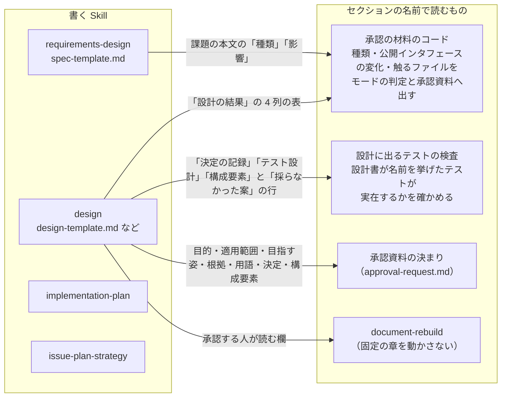
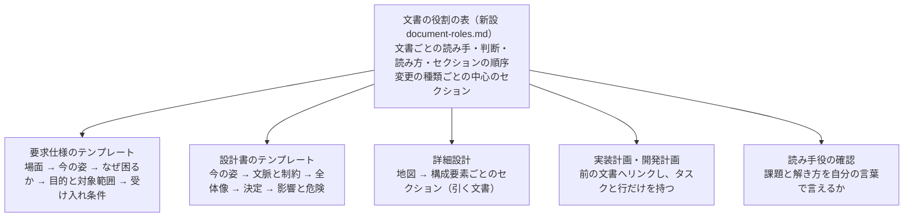

# 開発の文書の書き方: 読み手と判断からセクションを決め、初めて読む人が課題と解き方を言える形にする（#3868）

何が起きて誰が困ったか・何を満たせば終わりかは、要求仕様（[issue-3868-requirements.md](./issue-3868-requirements.md)、正は #3868 の本文）にある。この文書は「どう解くか」と「なぜその解き方か」だけを書く。

## 今の姿

NDF の 5 つの文書（要求仕様・設計書・詳細設計書・実装計画・開発計画）と、それを書く Skill の一覧は、要求仕様の「今の姿」の表にある。設計に要るのは、その周りで**機械と他の文書がセクションの名前を読んでいる**ことである。名前を変えると、次の箇所が黙って空振りする。

`design` の手順書（[deliverables.md](../plugins/ndf/skills/design/references/deliverables.md)）は `standard` の変更に 15 の成果物を「必須」とし、対象が無ければ「無い」と書かせる。詳細設計（[detailed-design.md](../plugins/ndf/skills/design/references/detailed-design.md)）は当たらないセクションも見出しを残させる。この 2 つが、#3866 の 30 を超えるセクションと「無し」の並びを生んだ。

## 文脈と制約

- **コードが読む見出しは名前を変えない。** 課題の本文の「種類」「影響」（`公開インタフェース` の行）、設計書の「設計の結果」（4 列）・「決定の記録」・「テスト設計」・「構成要素」、決定の中の「採らなかった案」で始まる行である。コードは直さない（要求の受け入れ条件 8、公開インタフェースを変えない）
- **要求仕様の見出しは Issue の記載項目の名前で書く。** 記載項目の定義（[ndf-issue-items.md](../docs/specifications/ndf-issue-items.md)）は、仕様のテンプレートとフォームが定義の項目名で見出しを書き、受け持つ種類の必須の項目をすべて含み、項目に無い見出しを持たないことを求める（常に成り立つ条件 I4）。そのため、今ある項目（事象・期待する結果・再現手順・環境・影響・目的・対象範囲・受け入れ条件・用語・検証手段・起票者の推定・リクエスト（原文）など）の名前は変えない。定義のデータ（`issue-items.json`）と一致の検査・起票の guard のコードは、11.0.0 の作り直し（#3304）で `plugins/ndf` から外れ、移し替えの残り（`scripts/ndf-next-parity/parity/features.json` の `entrypoint:scripts/issue-items.py`）として戻る予定である。今の CI はこの一致を見ないが、戻ったときに通る名前にする（決定 10）
- **承認ゲートの数と、承認資料が載せる項目の種類は変えない。** 項目の出所のセクションだけを、新しいテンプレートのセクションへ付け替える
- **別のレーン（同じリポジトリで同時に進めている別の開発の流れ）が同じファイルを触る**（扱いは「影響と危険」）。lrelay のレーンのブランチ（#3867）へは push しない
- **読み手はその機能を初めて見る人である**（要求の「何が起きたか」の利用者の補足）。読み手役の確認もその前提で立てる
- プロジェクトの MVV の Value を基準にする。Value 1（人の判断を、読み切れる量の大事な所だけにする）・Value 2（安く使える）・Value 3（同じ手順は毎回同じ結果になる）・Value 4（どのプロジェクトでもそのまま使える）・Value 5（速く届く）

## 解き方の全体像

1. 5 つの文書の「誰が・何を判断するために・どう読むか」と、変更の種類（新規作成・機能追加・不具合）ごとに中心に置くセクションを、1 つの表（`requirements-design/references/document-roles.md`）に置く。各テンプレートはこの表の順序でセクションを並べ、表を指す
2. どのテンプレートもセクションを「必ず書く」と「当たるときだけ」の 2 つに分け、当たらないセクションは見出しごと消す。前の文書にある事実は書かずにリンクする
3. `document-rebuild` の読み手役が、要求なら課題と終わりの条件を、設計なら解き方と採らなかった案を言い直し、言えなければ書き手が直す
4. 新しい形で書き直した例を種類ごとに 1 つ、この設計 PR に置く（この文書と要求仕様も、その形で書いた最初の実物である）

### 文書の役割の表の中身

実装で `document-roles.md` に置く表である。［ ］は当たるときだけ書くセクションで、ほかは必ず書く。

| 文書 | 読み手 | 読み手が下す判断 | 読み方 | セクションの順序 |
| --- | --- | --- | --- | --- |
| 要求仕様 | 承認する人。その機能を初めて見る | この問題を、この終わりの条件で解いてよいか | 頭から 1 回通して読む | 何が起きたか → 種類 → 今の姿（新規作成では「今はどうしているか」に代え、両方は置かない）→ 種類ごとの中心（下の表）→ なぜ困るか → 目的 → 対象範囲 → 受け入れ条件 → 共通の後半。種類ごとの全体の順は下の「種類ごとの見出しの順」。解き方は書かない |
| 設計書 | 承認する人とレビュー担当 | この解き方でよいか。採らなかった案より良いか | 頭から読み、決定で立ち止まる | 今の姿（要求へのリンクと、変更の位置が分かる図）→ 文脈と制約 → 解き方の全体像 → ［ドメインモデル・構成要素・データ構造・入出力のコントラクト・処理の流れ・非機能の実現方式］→ 決定の記録 → 影響と危険 → ［用語］→ テスト設計 → ［どこを変えるか］→ 設計の結果 → ［未確認のまま残ること］→ 外部の調査 |
| 詳細設計書 | 実装する人とコードレビュー担当 | どこに何を作るか | 要る箇所を引く。通読しない | 地図（ファイル配置と依存の向き）→ 構成要素ごとの小見出し（関数の仕様・異常系・［処理の手順・内部のデータ・並行と排他・ログ］・単体テストの観点） |
| 実装計画 | 実装する人（worker）とコードレビュー担当 | どの順で、どのタスクに分けて作るか | タスクごとに引く | 関連リンク（要求・設計）→ 修正対象 → タスク分解（満たす受け入れ条件は番号で指す）→ ［リスクと対処］→ ［切り戻し手順］→ 完了の定義 |
| 実行計画 | オーケストレーター（conductor）と、進み具合を見る人 | どの行を今起動するか | 工程が終わるたびに表を引く | 行 → 変更重複 → 見直し（今の形のまま） |
| 並列の計画 | オーガナイザーと、計画を見る人 | どのレーンを同時に流すか | 設定を引く | 今の JSON の形のまま |

| 変更の種類 | 要求仕様の中心（今の姿の後ろ） | 設計書の中心 | 詳細設計書 | 実装計画の最初のタスク | 終わりの確かめ |
| --- | --- | --- | --- | --- | --- |
| 新規作成 | 今はどうしているか（手作業・別の手段・何も無い）→ 誰が・どんな場面で困るか。範囲の境界は「対象範囲」の含む・含まないに書く | 全体の構造の図と、構造の水準の代案 | 多くは別ファイル | 場面 1 つを通しで動かす | 場面ごとに使える |
| 機能追加 | 何を足すか・変えるか（前と後の表）→ 今の利用者への影響と互換 | 変更の位置の図・変わる入出力・既存の決定との関係 | 変更が大きいときだけ別ファイル | 今の振る舞いを縛る退行テスト | 足した振る舞いが動き、今の振る舞いが壊れない |
| 不具合 | 事象（起きたこと。コマンドと出力）→ 期待する結果（本来の振る舞い。根拠の SSOT は今の姿で示す）→ 再現手順 → 環境。重さは「影響」の表の行に書く | 根本原因（どの部品で何が起き、なぜ検査で拾えなかったか）・どこで直すか（症状か原因か）・同じ形の箇所 | 多くは設計書の「どこを変えるか」に畳む | 再現のテスト（今は落ちる） | 再現手順で起きず、再発を防ぐテストがある |

要求仕様の種類ごとの見出しの順は次のとおりで、テンプレートと `document-roles.md` はこの順だけを持つ。［ ］は当たるときだけ書く。

| 変更の種類 | 見出しの順 |
| --- | --- |
| 新規作成 | 何が起きたか → 種類 → 今はどうしているか → 誰が・どんな場面で困るか → なぜ困るか → 目的 → 対象範囲 → 共通の後半 |
| 機能追加 | 何が起きたか → 種類 → 今の姿 → 何を足すか・変えるか → ［今の利用者への影響と互換］→ なぜ困るか → 目的 → 対象範囲 → 共通の後半 |
| 不具合 | 何が起きたか → 種類 → 今の姿 → 事象 → 期待する結果 → 再現手順 → 環境 → なぜ困るか → 目的 → 対象範囲 → 共通の後半 |
| 共通の後半 | ［前提］→ 受け入れ条件 → ［非機能の条件］→ 影響 → ［用語］→ ［ドメインイベント］→ 検証手段 → ［前提とする取り決め］→ ［境界］→ ［方針の分け方］→ ［未決］→ ［起票者の推定］→ リクエスト（原文） |

「種類」は場面のすぐ後ろに置く。読み手は種類を知ってから、その種類の中心のセクションを読むためである。共通の後半の当たるときだけのセクション（前提・非機能の条件・ドメインイベントなど）は、今のテンプレートにあるものを名前を変えずに上の位置へ移す。受け入れ条件の前に置くのは、受け入れ条件が前提を参照する「前提」だけである。

開発計画（実行計画と並列の計画）は 1 つの変更でなくスプリントやレーンを扱うため、変更の種類で形を変えない。

**どの文書にも当たる書き方**: 識別子（`stage-out`・規則の番号など）は普通の言葉の後ろに括弧で添え、識別子だけで文を作らない。前の文書にある事実は書かずにリンクで指す。1 つの課題に 2 つの種類が混ざるときは、主の種類で書き、従の部分をセクションで足す。

## 決定の記録

### 決定 1: 文書ごとの書き方を 1 か所で決めるため、読み手と判断と種類の表を `requirements-design` の参照に新設する

- **問い**: 5 つの文書は 4 つの Skill に分かれている。読み手・判断・セクションの順序の表をどこに置くか
- **選んだ案**: `plugins/ndf/skills/requirements-design/references/document-roles.md` を新設し、5 つの文書の行と、変更の種類の 3 列を置く。`design`・`implementation-plan`・`issue-plan-strategy`・`document-rebuild` はこの表を指し、写さない。種類を決めるのは最初の文書（要求仕様）なので、その Skill に置く
- 採らなかった案: 各 Skill に自分の文書の行だけを書く（3 文書で言い直しをやめる決まりそのものが 4 か所に割れる。表を並べないと「設計は要求の何を繰り返さないか」が書けない）
- 採らなかった案: `document-style` に置く（`document-style` は NDF の工程に依らない Markdown 全般の書き方で、工程の文書の読み手を持たない）
- 採らなかった案: `development-workflow` の [document-types.md](../plugins/ndf/skills/development-workflow/references/document-types.md) に足す（`documentation` モードの 6 つの文書タイプの表で、同じファイルに置くと 2 つの軸が混ざる）
- **代償**: 4 つの Skill から別の Skill の参照へのリンクが増える。前例は `requirements-design` から `design` の `design-template.md` を指すリンクである
- 根拠: Value 1・Value 3（MVV バージョン 9）。arc42 の FAQ B-1 と Diátaxis（読み手の要求で文書の種類を分け、混ぜない。外部の調査の STD4・STD6）

### 決定 2: テンプレートを選ぶ軸を足すため、変更の種類を新規作成・機能追加・不具合の 3 つにし、課題の本文の「種類」のセクションに書く

- **問い**: 種類を何個にし、既存の「Issue の種類」（不具合・機能・調査・運用）とどう関係させるか
- **選んだ案**: 変更の種類を 3 つにする。Issue の種類の「機能」を新規作成と機能追加に分け、「不具合」はそのまま、「調査」と「運用」は種類に入れない（調査は設計を書かず、運用は `operation` モードが書き方を持つ）。値は課題の本文の `## 種類` のセクションの 1 行目に書く。承認の材料のコードは、このセクションの最初の行を自由な文字列として読むため（`materials/collect.py` の `issue_kind`）、コードは変わらない。種類のラベル（`bug`・`enhancement`）は変えない。手順書とコードが食い違うときは、直す側で決める。コードに引数・キー・振る舞いを足して手順書に合わせるなら機能追加、手順書を今のコードに合わせて直すなら不具合とする
- 採らなかった案: Issue の種類を 3 つに作り直す（記載項目の定義とラベルの意味が変わり、起票の検査（[ndf-issue-items.md](../docs/specifications/ndf-issue-items.md)）の範囲まで広がる）
- 採らなかった案: `legacy-refactor` を 4 つ目の種類にする（このモードは受け入れ条件を持たず、設計書の書き方を既に別に持つ。要求の「非目標」）
- **代償**: 「種類」という語が Issue の種類と変更の種類の 2 つを指す。用語集では別の語として登録し（下の「用語」）、テンプレートでは「変更の種類」と書く
- 根拠: Value 4（MVV バージョン 9）。Mozilla の不具合報告の欄（期待の結果と実際の結果を分ける。外部の調査の STD7）

### 決定 3: 当たらないセクションが並ばないように、セクションの水準を「必ず書く」と「当たるときだけ」の 2 つにし、当たらないセクションは見出しごと消す

- **問い**: 今の「必須」「該当時」と、詳細設計の「見出しを残して `省く:` と書く」をどう直すか
- **選んだ案**: どのテンプレートもセクションに「必ず書く」か「当たるときだけ」を付け、当たらないセクションは見出しも消す。「無し」「省く:」と書かない。必ず書くセクションは少なく保つ（設計書では 今の姿・文脈と制約・解き方の全体像・決定の記録・影響と危険・テスト設計・設計の結果・外部の調査の 8 つ）。[deliverables.md](../plugins/ndf/skills/design/references/deliverables.md) の要否表の `standard` の列を、この 8 つとそれ以外の「当たるとき」に直す
- 採らなかった案: 「必須」の意味を残し、対象が無いときに理由を書かせる（今の形。#3866 で「無し」が並び、読み手が書くことの無いセクションを読まされた）
- **代償**: 書き忘れと当たらないことを、見出しの有無では見分けられない。見分けるのは cross-review（codex と kiro がレビューし、Claude が直す設計 PR のレビュー）と設計承認ゲートの人である。必ず書くセクションを 8 つに絞るので、見分ける対象は「当たるときだけ」のセクションに限られる。受け入れ条件 4 の例外として、外部の調査だけは、省くときも `省く: <理由>` の 1 行を残す（調べずに自前で作る決定を防ぐ `design` の手順 2 が、この 1 行を見るため）
- 根拠: Value 1（MVV バージョン 9）。arc42 FAQ B-1 "Please don't fill in everything"、MADR の任意のセクション（外部の調査の STD4・STD3）

### 決定 4: 承認する人が最初に解き方を読めるように、設計書を 今の姿 → 文脈と制約 → 解き方の全体像 → 決定 → 影響と危険 の順にし、承認資料の出所を付け替える

- **問い**: 今の「目的 → 適用範囲 → 目指す姿 → 目指す姿の根拠 → ドメインモデル → … 」をどう並べ直すか
- **選んだ案**: 上の順にする。目的は要求仕様が持つので設計書には書かずリンクする。目指す姿は「解き方の全体像」（図 1 枚と 3〜5 行）に、目指す姿の根拠は決定ごとの「根拠」の行に、適用範囲と代表のリポジトリの表は「影響と危険」に入れる。決定は「問い・選んだ案・採らなかった案・代償・根拠」の形にする。機能をどう得るかを選んだ決定（自前で作る・ライブラリやサービスを使う・標準に倣う）には、代償の行と根拠の行の間に `作り方:` と `比べた候補:` の 2 行を今のまま置き、作り方に「自前で作る」を含む決定は比べた候補を必ず 1 つ以上並べる（外部の調査を `省く:` で省いた課題は除く）。[external-survey.md](../plugins/ndf/skills/design/references/external-survey.md) と [decisions.md](../plugins/ndf/skills/design/references/decisions.md) の「作り方と比べた候補」の決まりは、置く位置を「理由の段落の後」から「代償の行の後」に読み替えるだけで変えない（根拠の前に置くのは今と同じ）。「承認する人が読む欄」のセクションの名前は残し（承認資料の先頭に載る欄で、supervisor の規則 13（設計の工程をこの欄に従わせる。`agent-layers.md`）と `pr` の手順がこの名前のアンカーを指す）、中身を新しい欄（題・今の姿・解き方の全体像・決定の見出し・影響と危険）に書き換える。[approval-request.md](../plugins/ndf/skills/development-workflow/references/approval-request.md) の「判断に使うもの」は、項目を変えずに出所の列を次の表に付け替え、出所が当たるときだけのセクションの行には、無いときの出し方を足す

| 承認資料の項目 | 新しい出所 | 出所の水準と、無いときの出し方 |
| --- | --- | --- |
| 目的 | 要求仕様のコピーの「目的」 | 必ず書く |
| 用語 | 設計書の「用語」の、反映が「追加」「意味の変更」の行 | 当たるときだけ。無ければ「無し（足した語・意味を変えた語が無い）」 |
| 適用範囲 | 設計書の「影響と危険」（働く範囲・当たるモードと、代表のリポジトリでの振る舞いの表） | 必ず書く |
| 目指す姿 | 設計書の「解き方の全体像」と、要求仕様のコピーへのリンク | 必ず書く |
| 目指す姿の根拠 | 決定ごとの「根拠」の行 | 必ず書く（決定の記録が必ず書くため） |
| 起票者の推定 | 要求仕様のコピーの「起票者の推定」（今のまま） | 当たるときだけ。無ければ「無し」 |
| 決めたこと | 決定の記録の見出し（今のまま） | 必ず書く |
| 作るもの | 設計書の「構成要素」。無ければ「どこを変えるか」の表、詳細設計を別ファイルにしたときは詳細設計書の地図。新設と変更は、ファイルの「（新設）」の印で分ける | 3 つのどれか 1 つは必ずある（詳細設計を別ファイルにするか、「どこを変えるか」に畳むかを決定 6 が必ず決めるため）。構成要素は当たるときだけ |
| 満たすこと | 要求仕様のコピーの「受け入れ条件」の件数（今は設計文書から数えるが、受け入れ条件は要求仕様だけが持つ） | 必ず書く |
| 未確認のまま残ること | 設計書の同名のセクション（今のまま） | 当たるときだけ。無ければ「0 件」 |
| 収束の状態・本文との一致・MVV 判定 | 今のまま（設計書のセクションから取らない） | 今のまま |

- 採らなかった案: セクションの名前を残して順だけ変える（「目的」と「目指す姿」が要求の目標と同じことを繰り返す。要求仕様が挙げた「3 つの文書が同じ事実を言い直す」が残る）
- 採らなかった案: Amazon の PR/FAQ のように、結果の姿（プレスリリース）から書き始める（読み手がその機能を初めて見る前提では、変える前の姿が無いと前後の差が読めない。要求の利用者の補足）
- **代償**: 承認資料の決まりと `document-rebuild` の固定の章の一覧（[related-skills.md](../plugins/ndf/skills/document-rebuild/references/related-skills.md)・[common.md](../plugins/ndf/skills/document-rebuild/references/common.md) の K3（別の Skill が固定した章を動かさない決まり））を同じ実装で直す。直し漏れると承認資料の行が「無し」になる（止まりはしない）
- 根拠: Value 1（MVV バージョン 9）。Google の Design Doc は文脈を設計の前に、採らなかった案を設計の後に置く。ADR は Context を Decision の前に置き、MADR は検討した案ごとに長所と短所を書く（外部の調査の STD2・STD3）

### 決定 5: 3 つの文書が言い直さないように、文書ごとに持つ事実を決め、前の文書にある事実はリンクで渡す

- **問い**: 要求の「期待する結果」・設計の「目指す姿」・決定・詳細設計が同じ内容を繰り返すのをどう止めるか
- **選んだ案**: 要求仕様は「何が起きたか・今の姿・なぜ困るか・目的・対象範囲・受け入れ条件」を持つ。設計書は「どう解くか・なぜその解き方か」、詳細設計は「どこに何を作るか」を持つ。実装計画は「どの順でどのタスクにするか」だけを持つ。後の文書は前の文書のセクションをリンクで指す。今の姿は要求仕様に書き、設計書の今の姿はリンクと設計に要る構造（図）だけにする。実装計画のテンプレートから、要求と設計に既にあるセクション（目的と非目的・前提・受け入れ条件・代替案と採否・ドメイン用語・不変条件）を消し、受け入れ条件は番号で指す
- 採らなかった案: 各文書を単独で読めるように要点を写す（写した要点が片方だけ直され、食い違う。今の `implementation-plan` の形）
- **代償**: 1 つの文書だけでは全体が読めない。最初の段落に前の文書へのリンクを置いて補う
- 根拠: Value 1・Value 3（MVV バージョン 9）。Diátaxis の参照はリンクで他の種類を渡す、Google の "This isn't a requirements doc"（外部の調査の STD6・STD2）

### 決定 6: 分量を変更の大きさに合わせるため、詳細設計を「別ファイルが要るとき」だけにし、要らないときは設計書の「どこを変えるか」のセクションに畳む

- **問い**: 小さな直しで、要求と設計を 1 本にまとめる形をどう選べるようにするか
- **選んだ案**: 要求仕様と設計書のファイルは分けたまま、詳細設計を別ファイルにするかを変更の大きさで決める。新設する関数が 2 つ以上あるか、既存の関数のシグネチャ・責務・失敗の扱いを変える変更だけ `issue-<番号>-design-detail.md` を書く。それ以外は設計書に「どこを変えるか」のセクション（触るファイルと変える中身の表）を置く。新設する関数が 1 つだけのときは、その行に関数の入力・返り・異常系を書いて畳む（関数 1 つの仕様は表の 1 行に収まり、別ファイルにすると #3856 のように 1 関数のために別の文書を開かせる）。工程「詳細設計」は残し、畳んだときはその工程の出力に「設計書のセクションに畳んだ」と書く。種類ごとの目安（不具合は多くは畳む、新規作成は多くは別ファイル）を決定 1 の表に置く
- 採らなかった案: 要求と設計を 1 つのファイルにする（要求の正は課題の本文で、承認の材料のコードが設計書の「設計の結果」を `issues/issue-<番号>-design*.md` から読む。1 ファイルにすると、どちらかの仕組みを作り直すことになる）
- 採らなかった案: 行数の上限を文書ごとに置く（大きさの正しい指標は行数ではなく触る範囲で、上限を置くと詰め込むか分割する）
- **代償**: 「詳細設計を畳むか」の判断が設計者に残る。cross-review が見る
- 根拠: Value 1・Value 2（MVV バージョン 9）。Google の mini design doc（小さい変更は 1〜3 ページ。外部の調査の STD2）

### 決定 7: 1 本の設計文書が 1 つの問題を扱うように、課題をまとめてよいのは根本原因が共通のときだけにし、設計 PR をまとめることとは分ける

- **問い**: #3866 のように関係の薄い 3 課題を 1 本の設計にした形をどう防ぐか
- **選んだ案**: `design` の Skill に「1 本の設計文書は 1 つの問題を扱う。複数の課題を 1 本の設計文書にまとめてよいのは、根本原因が共通（同じ部品の同じ欠け）のときだけで、そのときは共通の原因を題と今の姿の筋にする」を書く。スプリントの都合で設計 PR を 1 本にするのは今のまま許し、その PR に課題ごとの設計文書を並べる。共通かどうかは設計者が設計の工程の最初に決め、まとめた理由（共通の原因）を今の姿に書く。cross-review と設計承認ゲートがその理由を見る
- 採らなかった案: 設計 PR も 1 課題 1 本にする（設計承認ゲートの承認の回数が増え、`issue-plan-strategy` の実行計画のバンドルの組み方まで変わる）
- **代償**: 1 本の設計 PR に複数の設計文書があるとき、PR の題を作る頭のファイルがどれかが曖昧になる（「未確認のまま残ること」）
- 根拠: Value 1（MVV バージョン 9）。ADR（1 件 1 決定）、Mozilla "Open a new bug report for each issue!"（外部の調査の STD3・STD7）

### 決定 8: 読めたかを確かめるため、読み手役に課題と解き方を言い直させ、言えなければ書き手が直して 1 回だけ読み直させる

- **問い**: 今の読み手役の確認（要点の言い直し・分からなかった語）の合否に、何を足すか
- **選んだ案**: `document-rebuild` の「読み手役に読ませる」に、要求仕様・設計書のときの言い直しの問いを足す。要求なら「何が起きて誰が困ったか、何を満たせば終わりか」、設計なら「どう解くか、何を採らなかったか、なぜか」。読み手役に渡すのは文書と「その機能を初めて見る人」という読み手の説明だけで、リンク先とリポジトリは読ませない。言い直しが受け入れ条件・決定の見出しと食い違えば、書き手が直して 1 回だけ読み直させる（今の「1 回」を最大 2 回にする）。2 回目も食い違えば直さずに報告に残し、承認する人が判断する
- 採らなかった案: 言えるまで繰り返す（費用の上限が無くなる。Value 2）
- 採らなかった案: 今の 1 回のまま、食い違いを報告に残すだけにする（#3866 のように、読めない文書が承認ゲートまで届く）
- **代償**: 設計 1 本あたり読み手役の呼び出しが最大 1 回増える
- 根拠: Value 1・Value 2（MVV バージョン 9）

### 決定 9: 新しい形を読んで確かめられるように、書き直しの例を種類ごとに 1 つこの設計 PR に置き、#3867 の書き直しは承認の後に lrelay のレーンへ渡す

- **問い**: 書き直しの例と、lrelay の設計 PR #3867 の書き直しをどこで行うか
- **選んだ案**: 例は `issues/issue-3868-example-<種類>.md` の 3 本にし、前（今の文書）はリンクで指して写さず、後（新しい形の要求仕様と設計書）を全文で書く。不具合は #3856（#3866 で読めなかった実物）。機能追加は #3854（ラベルは `bug` だが、`ndf issues rank` に引数とキーを足して手順書に合わせるので、決定 2 の境目で機能追加に当たる）。新規作成は #2086（文書の組み直しの Skill の形式別・目的別のガイドを新しく作った課題で、要求と設計がそろって残る。既にあった組み直しの Skill を改名して広げた面もあるが、中身の大半は新設である）。利用者が挙げたもう 1 つの機能追加の候補 #3846 は、手順書だけを直すので不具合に当たり、例にしない。#3867 の文書は、設計承認ゲートでこの形が承認された後に、conductor が lrelay のレーンへ「新しいテンプレートで書き直す」と渡す
- 採らなかった案: この課題の中で #3867 のブランチを書き直す（別のレーンのブランチで、lrelay の conductor が稼働中。テンプレートが承認される前に書き直すと、承認の結果でもう一度書き直す）
- 採らなかった案: 前の文書を例のファイルに写す（例 1 本が倍の長さになり、前の文書は main とコミットでいつでも読める）
- **代償**: lrelay の設計承認は、この設計 PR のマージを待つ
- 根拠: Value 1・Value 5（MVV バージョン 9）

### 決定 10: 起票の検査とフォームを壊さないため、要求仕様の見出しは今の記載項目の名前を使い、新しいセクションだけを該当時の項目として定義に足す

- **問い**: 新しい並びの見出し（何が起きたか・今の姿・起きたこと・再現の手順・目標と非目標など）と、記載項目の定義（[ndf-issue-items.md](../docs/specifications/ndf-issue-items.md)）の項目名と種類ごとの必須の項目をどう合わせるか
- **選んだ案**: 意味が今の項目と同じセクションは、今の項目名をそのまま見出しにする。今の項目に無いセクションだけを、記載項目として定義に足す。足す項目はどの Issue の種類でも「該当時」（条件は「`requirements-design` が要求仕様として書き直すとき」で、機械では判定しない）にし、必須の項目は変えない。フォーム（`.github/ISSUE_TEMPLATE/*.yml`）と `out-of-scope` の骨格は、必須の項目が変わらないので直さない。対応は次の表のとおりで、例 3 本と要求仕様もこの名前で書く

| 新しい並びでの役割 | 見出し | 記載項目の定義の扱い |
| --- | --- | --- |
| 不具合の起きたこと（コマンドと出力） | 事象 | 今のまま（不具合で必須） |
| 不具合の本来の振る舞い | 期待する結果 | 今のまま（不具合で必須）。根拠の SSOT へのリンクは今の姿に置き、ここでは 1〜2 行で本来の振る舞いだけを書く |
| 不具合の再現 | 再現手順 | 今のまま（不具合で必須） |
| 不具合の環境 | 環境 | 今のまま（不具合で必須） |
| 不具合の重さ | 影響（表に「重さ」の行を足す） | 今のまま（不具合・運用で必須） |
| 目標 | 目的 | 今のまま（機能・調査・運用で必須） |
| 非目標と範囲の境界 | 対象範囲（含む・含まない） | 今のまま（機能・調査・運用で必須） |
| 場面 | 何が起きたか | 足す（該当時） |
| 今の姿・今はどうしているか（新規作成で今の姿に代える） | 今の姿 / 今はどうしているか | 足す（該当時） |
| 新規作成の中心 | 誰が・どんな場面で困るか | 足す（該当時） |
| 機能追加の中心 | 何を足すか・変えるか、今の利用者への影響と互換 | 足す（該当時） |
| 放置したときに起きること | なぜ困るか | 足す（該当時） |

- 採らなかった案: 定義の項目名を新しい見出しに改める（事象 → 起きたこと、目的と対象範囲 → 目標と非目標 など）。名前の言い換えだけで中身は同じなのに、定義・3 つのフォーム・骨格・仕様のテンプレートと、移し替えの後の検査を同時に直すことになる。調査と運用は変更の種類に入らず、今の目的・対象範囲のまま残るので、2 つの名前が並ぶ
- 採らなかった案: 足すセクションを必須の項目にする（人がフォームで起票するときにも今の姿などを求め、フォームと骨格の必須欄を足すことになる。要求仕様で必ず書くかは、記載項目の水準でなく文書の役割の表が決める）
- **代償**: 記載項目の水準（起票の時点の必須・該当時）と、文書の役割の表の「必ず書く」（`requirements-design` が書くとき）が別の物差しになる。表の「必ず書く」のセクションは、記載項目では該当時か必須のどちらかで、必須の項目を「当たるときだけ」にはしない
- 根拠: Value 3・Value 4（MVV バージョン 9）。Mozilla の不具合報告の欄（STD7）は、今の事象・期待する結果・再現手順と同じ切り方である

## 影響と危険

- **働く範囲**: NDF を入れたすべてのリポジトリで、AI が書く要求仕様・設計書・詳細設計・実装計画・開発計画のセクションと順序が変わる。リポジトリごとに違う値は無く、設定も引数も足さない
- **当たるモード**: `standard` と、設計 PR を分ける `legacy-refactor`（承認する人が読む欄だけ）。`light`・`operation` は設計書を作らないので変わらない。`documentation` は文書タイプの書き方を持つので変わらない
- **書きかけの文書**: 設計の途中にある課題（lclose の #3869、lrelay の #3867）は今のテンプレートのまま進み、承認資料の行のいくつかが「無し」と出る（止まらない）。#3867 は決定 9 のとおり書き直す
- **同じファイルの衝突**: #3869 が先にマージされれば、実装の PR は `spec-template.md` の「リリース後の確認の計画」のセクションを新しい並びの「受け入れ条件」の後ろに置き直す。用語集は #3867 と同じファイルに語を足すので、後からマージする側が両方を残して解く

### 代表のリポジトリでの振る舞い

| 代表のリポジトリ | 設定の要点 | 直した後に起きること | この種類で扱えなくなること |
| --- | --- | --- | --- |
| Web サービス | `standard` で設計 PR を出す | 要求仕様と設計書が新しい順で書かれ、承認資料の行の出所が新しいセクションになる | 無し |
| モバイルアプリ | 同上 | 同上 | 無し |
| 業務文書だけ | `documentation` モードで文書タイプの書き方を使う | 変わらない（読み手役の確認の言い直しは、要求仕様・設計書のときだけ当たる） | 無し |

## 用語

「変更の種類」と「今の姿」は要求仕様の「用語」にあり、用語集へ足してある。この設計で足す語は次の 1 つである。

| 用語 | 意味 | 用語集への反映 |
| --- | --- | --- |
| 文書の役割の表 | 5 つの文書ごとの読み手・判断・読み方・セクションの順序と、変更の種類ごとの中心のセクションを並べた表（`document-roles.md`） | 追加 |

## テスト設計

| 受け入れ条件 | どの振る舞いで縛るか | どう壊したら落ちるべきか |
| --- | --- | --- |
| 1（出典と採否） | この文書の付録「外部の調査」の行ごとに、出典と「設計への反映」がある | 行を消すと cross-review と承認する人が拾う（機械の検査は置かない） |
| 2・3・4（表と順序と水準） | 文書の役割の表のセクションの順序と、各テンプレートの見出しの順序が一致する | テンプレートのセクションを入れ替えると、実装の完了判定（`quality-gates` が実装の差分を設計書と突き合わせる工程）が拾う。`.md` の文言のテストは書かない |
| 5（まとめる条件） | `design` の SKILL.md に条件が 1 か所ある | — |
| 6（読み手役） | 次の設計 PR の `document-rebuild` の報告に、言い直しと合否が載る | リリース後テストで確かめる |
| 7（例） | 設計承認ゲートで利用者が例を読み、課題と解き方を言える | 手動確認（マージ前） |
| 8（退行しない） | コードを変えず、コードが読む 7 つの見出し（「種類」「影響」「公開インタフェース」「設計の結果」「決定の記録」「テスト設計」「構成要素」）と「採らなかった案」の行の書き出しが新しいテンプレートに残る | 既存のテスト（`plugins/ndf/tests/domains/materials/`・`tests/domains/loop/`）はコードの中の文字列で見出しを作るので、テンプレートの見出しを変えても CI は落ちない。実装の完了判定で、7 つの見出しをテンプレートの中で `grep` して残っていることと、仕様のテンプレートの見出しがすべて `ndf-issue-items.md` の項目の一覧にあることを確かめる |

## どこを変えるか

（詳細設計は決定 6 によりこのセクションに畳む。新設・変更する関数が無く、変えるのは Markdown の手順書だけのため）

| ファイル | 変える中身 | 決定 |
| --- | --- | --- |
| `plugins/ndf/skills/requirements-design/references/document-roles.md`（新設） | 5 つの文書の読み手・判断・読み方・セクションの順序の表、変更の種類ごとの中心のセクションと詳細設計の要否の表、言い直しの問い | 1・2・6・8 |
| `plugins/ndf/skills/requirements-design/references/spec-template.md` | セクションを「文書の役割の表の中身」の「種類ごとの見出しの順」（何が起きたか → 種類 → 今の姿か今はどうしているか → 種類ごとの中心 → なぜ困るか → 目的 → 対象範囲 → 共通の後半）にする。セクションごとに「必ず書く／当たるときだけ」を付ける。原文は `
` で畳んでよい | 2・3・5 |
| `docs/specifications/ndf-issue-items.md` | 記載項目の一覧と区分に、決定 10 の表の「足す（該当時）」の項目を足す。必須の項目・フォーム・骨格は変えない | 10 |
| `plugins/ndf/skills/requirements-design/SKILL.md` | 手順 1a（起票者の推定を本文の後ろへ）・3a（ドメインイベントを当たるときだけ）・6・7 を新しい並びに合わせ、手順の頭で変更の種類を決める段を足す | 2・3 |
| `plugins/ndf/skills/design/references/design-template.md` | テンプレートを決定 4 の順に書き換え、「承認する人が読む欄」の中身を新しい欄に、「分量」に決定 6 を書く | 3・4・6 |
| `plugins/ndf/skills/design/references/deliverables.md` | 要否表の水準を「必ず書く／当たるときだけ」にし、`standard` の必ず書くセクションを 8 つにする | 3 |
| `plugins/ndf/skills/design/references/decisions.md` | 決定の形を「問い・選んだ案・採らなかった案・代償・根拠」にする。「作り方と比べた候補」の 2 行は、機能をどう得るかを選んだ決定で代償の行と根拠の行の間に置く（自前で作るときは候補が必須のまま） | 4 |
| `plugins/ndf/skills/design/references/detailed-design.md`・`detail-template.md` | 別ファイルにする条件（決定 6）を書き、当たらないセクションの見出しを消す決まりにする。テンプレートを「地図 → 構成要素ごと」の順にする | 3・6 |
| `plugins/ndf/skills/design/references/domain-model.md`・`external-survey.md` | 置く位置を新しい並び（ドメインモデルは当たるとき、外部の調査は付録）に合わせる | 3・4 |
| `plugins/ndf/skills/design/SKILL.md` | 手順 3 の書く順・手順 6 の詳細設計の条件・まとめる条件（決定 7） | 4・6・7 |
| `plugins/ndf/skills/implementation-plan/SKILL.md` | 実装計画のフォーマットから重なるセクションを消し、前の文書へのリンクと受け入れ条件の番号で指す。種類ごとの最初のタスク（不具合は再現テスト） | 1・5 |
| `plugins/ndf/skills/issue-plan-strategy/references/execution-plan.md`・`parallel-plan.md` | 冒頭に読み手と判断の行を置き、文書の役割の表を指す。形は変えない | 1 |
| `plugins/ndf/skills/document-rebuild/SKILL.md`・`references/related-skills.md`・`references/common.md` | 読み手役の言い直しの問いと合否と回数（決定 8）、固定の章の一覧の書き換え | 4・8 |
| `plugins/ndf/skills/development-workflow/references/approval-request.md` | 「判断に使うもの」の出所の列を決定 4 の表に付け替え、当たるときだけの出所が無いときの出し方を足す | 4 |
| `plugins/ndf/skills/pr/SKILL.md` | 設計 PR の本文が指す設計書のセクションの名前 | 4 |
| `docs/glossary/glossary.json` と作り直した文書 | 「文書の役割の表」を足す | 1 |

## 設計の結果

| 課題 | 扱い | 統合先 | 触るファイル |
| --- | --- | --- | --- |
| #3868 | 実装する | — | `plugins/ndf/skills/requirements-design/references/document-roles.md`、`plugins/ndf/skills/requirements-design/references/spec-template.md`、`plugins/ndf/skills/requirements-design/SKILL.md`、`docs/specifications/ndf-issue-items.md`、`plugins/ndf/skills/design/references/design-template.md`、`plugins/ndf/skills/design/references/deliverables.md`、`plugins/ndf/skills/design/references/decisions.md`、`plugins/ndf/skills/design/references/detailed-design.md`、`plugins/ndf/skills/design/references/detail-template.md`、`plugins/ndf/skills/design/references/domain-model.md`、`plugins/ndf/skills/design/references/external-survey.md`、`plugins/ndf/skills/design/SKILL.md`、`plugins/ndf/skills/implementation-plan/SKILL.md`、`plugins/ndf/skills/issue-plan-strategy/references/execution-plan.md`、`plugins/ndf/skills/issue-plan-strategy/references/parallel-plan.md`、`plugins/ndf/skills/document-rebuild/SKILL.md`、`plugins/ndf/skills/document-rebuild/references/related-skills.md`、`plugins/ndf/skills/document-rebuild/references/common.md`、`plugins/ndf/skills/development-workflow/references/approval-request.md`、`plugins/ndf/skills/pr/SKILL.md`、`docs/glossary/glossary.json`、`docs/glossary.md`、`docs/glossary/ndf-design.md` |

## 未確認のまま残ること

| 項目 | 内容 |
| --- | --- |
| 1 本の設計 PR に複数の設計文書があるときの題 | `pr` が題を作る「頭のファイル」がどれかは、`pr` の手順の読み方に依る。実装で `pr` の SKILL.md を読み、決定 7 の形で題が決まるかを確かめる |
| 読み手役の言い直しで、書き直しの例が読めるか | 例 3 本を読み手役（文脈を持たない AI）に読ませた結果は、ドキュメント再構成の工程で得る。設計承認ゲートの利用者の確かめ（受け入れ条件 7）が最後の判定になる |

## 外部の調査

| 種類 | 調べるか | 理由 |
| --- | --- | --- |
| 標準・仕様 | 調べる | 要求・設計の文書のセクションと順序を定めた一次資料がある |
| 主要な製品 | 調べない | 文書の形はツールでなく書き方の問題で、製品の比較は判断に効かない |
| ライブラリとサービス | 調べない | 作るのは手順書で、依存を足さない |

### 標準・仕様

| # | 標準・仕様 | 何を定めているか | 設計への反映 | 出典 |
| --- | --- | --- | --- | --- |
| STD1 | ISO/IEC/IEEE 29148:2018 | 要求を利害関係者・システム・ソフトウェアの仕様書に分け、SRS は Purpose → Scope → … → Specified requirements → Verification の順。要求は「具体的・正確・曖昧でない」表現（3.1.19） | 採った: 受け入れ条件は今の `acceptance-criteria.md`（観測可能・一意・テスト可能）のまま。採らなかった: SRS のセクションの並び（製品の全体を書く文書で、1 つの変更の文書には大きすぎる）。性質の一覧の本文は確かめられなかった | https://standards.ieee.org/ieee/29148/6937/ ・公開プレビュー https://cdn.standards.iteh.ai/samples/72089/62bb2ea1ef8b4f33a80d984f826267c1/ISO-IEC-IEEE-29148-2018.pdf （2026-11-19） |
| STD2 | Design Docs at Google | Context and scope → Goals and non-goals → The actual design → Alternatives considered → Cross-cutting concerns。要求の文書ではない。小さい変更は 1〜3 ページの mini design doc | 採った: 文脈が設計の前・目標と非目標・採らなかった案（決定 4）、要求を繰り返さない（決定 5）、分量を大きさに合わせる（決定 6）。採らなかった: 設計書に目標と非目標を置く（要求仕様の「目的」と「対象範囲」が持つ） | https://www.industrialempathy.com/posts/design-docs-at-google/ （2026-11-19） |
| STD3 | ADR（Nygard 2011）と MADR 4.0.0 | Title → Context → Decision → Status → Consequences。1 件 1〜2 ページ。MADR は Considered Options と Pros and Cons、任意のセクションは消してよい | 採った: 決定ごとに問い（文脈）・選んだ案・採らなかった案・代償（Consequences）（決定 4）、任意のセクションを消す（決定 3）、1 件 1 問題（決定 7）。採らなかった: 決定を 1 件 1 ファイルにする（承認資料が決定の見出しを 1 つの文書から並べる） | https://cognitect.com/blog/2011/11/15/documenting-architecture-decisions ・ https://adr.github.io/madr/ （2026-11-19） |
| STD4 | arc42 と C4 model | arc42 は 12 セクションで「全部を埋めない」（FAQ B-1）。C4 は水準ごとに読み手を決め、Component と Code の図は価値があるときだけ | 採った: 当たらないセクションを消す（決定 3）、図は変更の位置が分かる水準だけ（設計書の今の姿）。採らなかった: arc42 の 12 セクションの並び（システムの全体を書く文書で、変更ごとの文書ではない） | https://arc42.org/overview ・ https://faq.arc42.org/questions/B-1/ ・ https://c4model.com/ （2026-11-19） |
| STD5 | Amazon の PR/FAQ | 顧客の場面から書くプレスリリース（1 ページ未満）→ 外部 FAQ → 内部 FAQ。作業の全部を説明しない | 採った: 要求仕様を場面（何が起きて誰が困ったか）から始める。採らなかった: 結果の姿から書き始める（今の姿を知らない読み手には前後の差が読めない。決定 4） | https://www.aboutamazon.com/news/workplace/an-insider-look-at-amazons-culture-and-processes （2026-11-19） |
| STD6 | Diátaxis | 文書を tutorial・how-to・reference・explanation に分け、混ぜない。reference は記述だけを持ち、他はリンクで渡す | 採った: 詳細設計は引く文書（reference）、要求と設計は通して読む文書として分ける（決定 1）、言い直さずリンクする（決定 5） | https://diataxis.fr/ ・ https://diataxis.fr/map/ ・ https://diataxis.fr/reference/ （2026-11-19） |
| STD7 | Mozilla の Bug Writing Guidelines | Summary → … → Steps to Reproduce → Actual Results → Expected Results。1 報告 1 件、観察と推測を分ける | 採った: 不具合の中心のセクション（事象・期待する結果・再現手順。今の記載項目の名前のまま）（決定 2・10）、1 文書 1 問題（決定 7）。採らなかった: 再現手順を実際の結果と期待する結果の前に置く順（初めて見る読み手には、何が起き本来どう動くか（今の姿・事象・期待する結果）が先に要る） | https://bugzilla.mozilla.org/page.cgi?id=bug-writing.html （2026-11-19） |

### 確かめられなかったこと

| 対象 | 試した手段 | 結果と理由 |
| --- | --- | --- |
| ISO/IEC/IEEE 29148 の 5.2.5〜5.2.7（要求の性質）の本文 | https://www.iso.org/standard/72089.html ・INCOSE の要約の PDF | どちらも HTTP 403。規格本文は有料 |
| Amazon の PR/FAQ のプレスリリースの下位の構成 | https://www.workingbackwards.com/resources/working-backwards-pr-faq | HTTP 403 |

調べた量: 候補 9 件（上の 7 行にまとめた）。取得の試みの回数は数えていない（調査の worker の Tool の呼び出しは、検索・取得・書き出しを合わせて 46 回）。
