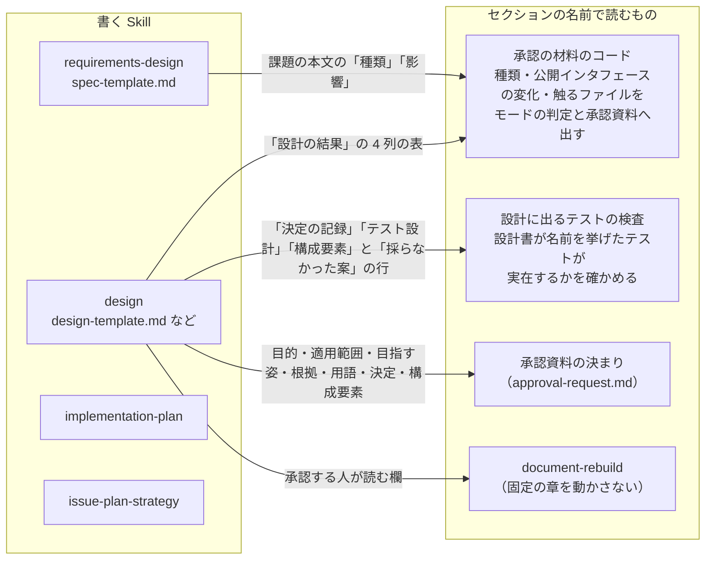
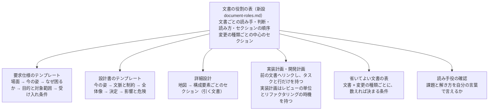

# 開発の文書の書き方: 読み手と判断からセクションを決め、初めて読む人が課題と解き方を言える形にする（#3868）

#3866 の要求・設計・詳細設計は、承認する人が何が課題で何をしようとしているのかを読み取れなかった。この設計は、5 つの文書（要求仕様・設計書・詳細設計書・実装計画・開発計画）ごとに読み手とその判断を決め、判断の順にセクションを並べ、当たらないセクションを消し、前の文書にある事実をリンクで渡す形にする。あわせて、実装計画にレビューの単位とリファクタリングの時機の欄を置き、文書ごとに省いてよい条件を、数えれば決まる形で 1 つの表に置く。文書ごとに備える内容は一次資料と過去の文書の実例で調べ（[issue-3868-survey.md](./issue-3868-survey.md)）、採らなかった案は「決定の記録」にある。

何が起きて誰が困ったか・何を満たせば終わりかは、要求仕様（[issue-3868-requirements.md](./issue-3868-requirements.md)、正は #3868 の本文）にある。この文書は「どう解くか」と「なぜその解き方か」だけを書く。

## 今の姿

NDF の 5 つの文書（要求仕様・設計書・詳細設計書・実装計画・開発計画）と、それを書く Skill の一覧は、要求仕様の「今の姿」の表にある。設計に要るのは、その周りで**機械と他の文書がセクションの名前を読んでいる**ことである。名前を変えると、次の箇所が黙って空振りする。

`design` の手順書（[deliverables.md](../plugins/ndf/skills/design/references/deliverables.md)）は `standard` の変更に 15 の成果物を「必須」とし、対象が無ければ「無い」と書かせる。詳細設計（[detailed-design.md](../plugins/ndf/skills/design/references/detailed-design.md)）は当たらないセクションも見出しを残させる。この 2 つが、#3866 の 30 を超えるセクションと「無し」の並びを生んだ。

## 文脈と制約

- **コードが読む見出しは名前を変えない。** 課題の本文の「種類」「影響」（`公開インタフェース` の行）、設計書の「設計の結果」（4 列）・「決定の記録」・「テスト設計」・「構成要素」、決定の中の「採らなかった案」で始まる行である。コードは直さない（要求の受け入れ条件 8、公開インタフェースを変えない）
- **要求仕様の見出しは Issue の記載項目の名前で書く。** 記載項目の定義（[ndf-issue-items.md](../docs/specifications/ndf-issue-items.md)）は、仕様のテンプレートとフォームが定義の項目名で見出しを書き、受け持つ種類の必須の項目をすべて含み、項目に無い見出しを持たないことを求める（常に成り立つ条件 I4）。そのため、今ある項目（事象・期待する結果・再現手順・環境・影響・目的・対象範囲・受け入れ条件・用語・検証手段・起票者の推定・依頼（原文）など）の名前は変えない。定義のデータ（`issue-items.json`）と一致の検査・起票の guard のコードは、11.0.0 の作り直し（#3304）で `plugins/ndf` から外れ、移し替えの残り（`scripts/ndf-next-parity/parity/features.json` の `entrypoint:scripts/issue-items.py`）として戻る予定である。今の CI はこの一致を見ないが、戻ったときに通る名前にする（決定 10）
- **承認ゲートの数と、承認資料が載せる項目の種類は変えない。** 項目の出所のセクションだけを、新しいテンプレートのセクションへ付け替える
- **別のレーン（同じリポジトリで同時に進めている別の開発の流れ）が同じファイルを触る**（扱いは「影響と危険」）。lrelay のレーンのブランチ（#3867）へは push しない
- **読み手はその機能を初めて見る人である**（要求の「何が起きたか」の利用者の補足）。読み手役の確認もその前提で立てる
- プロジェクトの MVV の Value を基準にする。Value 1（人の判断を、読み切れる量の大事な所だけにする）・Value 2（安く使える）・Value 3（同じ手順は毎回同じ結果になる）・Value 4（どのプロジェクトでもそのまま使える）・Value 5（速く届く）

## 解き方の全体像

1. 5 つの文書の「誰が・何を判断するために・どう読むか」と、変更の種類（新規作成・機能追加・不具合）ごとに中心に置くセクションを、1 つの表（`requirements-design/references/document-roles.md`）に置く。各テンプレートはこの表の順序でセクションを並べ、表を指す
2. どのテンプレートもセクションを「必ず書く」と「当たるときだけ」の 2 つに分け、当たらないセクションは見出しごと消す。前の文書にある事実は書かずにリンクする
3. `document-rebuild` の読み手役が、要求なら課題と終わりの条件を、設計なら解き方と採らなかった案を言い直し、言えなければ書き手が直す
4. 新しい形で書き直した例を種類ごとに 1 つ、この設計 PR に置く（この文書と要求仕様も、その形で書いた最初の実物である）
5. 実装計画に「レビューの単位」（どの差分を 1 回のレビューに掛けるか）と「リファクタリングの時機」（実装の前・TDD のステップ・スプリントの終わり）の欄を置く。文書を省いてよい条件は、課題の数・触るファイルの数・公開インタフェースに触れるか・新設する関数の数で決め、文書の役割の表に置く。工程表をこの欄と表に合わせるのは #3879（工程表の見直し）が受け持つ

### 文書の役割の表の中身

実装で `document-roles.md` に置く表である。［ ］は当たるときだけ書くセクションで、ほかは必ず書く。

| 文書 | 読み手 | 読み手が下す判断 | 読み方 | セクションの順序 |
| --- | --- | --- | --- | --- |
| 要求仕様 | 承認する人。その機能を初めて見る | この問題を、この終わりの条件で解いてよいか | 頭から 1 回通して読む | 何が起きたか → 種類 → 今の姿（新規作成では「今はどうしているか」に代え、両方は置かない）→ 種類ごとの中心（下の表）→ なぜ困るか → 目的 → 対象範囲 → 受け入れ条件 → 共通の後半。種類ごとの全体の順は下の「種類ごとの見出しの順」。解き方は書かない |
| 設計書 | 承認する人とレビュー担当 | この解き方でよいか。採らなかった案より良いか | 頭から読み、決定で立ち止まる | 要約の段落（見出しを付けない。決定 11）→ 今の姿（要求へのリンクと、変更の位置が分かる図）→ 文脈と制約 → 解き方の全体像 → ［ドメインモデル・構成要素・データ構造・入出力のコントラクト・処理の流れ・非機能の実現方式］→ 決定の記録 → 影響と危険 → ［用語］→ テスト設計 → ［どこを変えるか］→ 設計の結果 → ［未確認のまま残ること］→ 外部の調査 |
| 詳細設計書 | 実装する人とコードレビュー担当 | どこに何を作るか | 要る箇所を引く。通読しない | 地図（ファイル配置と依存の向き）→ 構成要素ごとの小見出し（満たす決定と受け入れ条件・関数の仕様・異常系・［処理の手順・内部のデータ・並行と排他・ログ］・単体テストの観点）。関数の仕様の事前条件・事後条件・副作用は当たる関数だけに書く（決定 12） |
| 実装計画 | 実装する人（worker）とコードレビュー担当 | どの順で、どのタスクに分けて作るか | タスクごとに引く | 関連リンク（要求・設計）→ 修正対象 → タスク分解（満たす受け入れ条件は番号で指す）→ レビューの単位（決定 14）→ リファクタリングの時機（決定 15）→ ［リスクと対処］→ ［切り戻し手順］→ 完了の定義 |
| 実行計画 | オーケストレーター（conductor）と、進み具合を見る人 | どの行を今起動するか | 工程が終わるたびに表を引く | 目標（1 行。決定 13）→ 行 → 変更重複 → 見直し |
| 並列の計画 | オーガナイザーと、計画を見る人 | どのレーンを同時に流すか | 設定を引く | 今の JSON の形のまま |

| 変更の種類 | 要求仕様の中心（今の姿の後ろ） | 設計書の中心 | 詳細設計書 | 実装計画の最初のタスク | 終わりの確かめ |
| --- | --- | --- | --- | --- | --- |
| 新規作成 | 今はどうしているか（手作業・別の手段・何も無い）→ 誰が・どんな場面で困るか。範囲の境界は「対象範囲」の含む・含まないに書く | 全体の構造の図と、構造の水準の代案 | 多くは別ファイル | 場面 1 つを通しで動かす | 場面ごとに使える |
| 機能追加 | 何を足すか・変えるか（前と後の表）→ 今の利用者への影響と互換 | 変更の位置の図・変わる入出力・既存の決定との関係 | 変更が大きいときだけ別ファイル | 今の振る舞いを縛る退行テスト | 足した振る舞いが動き、今の振る舞いが壊れない |
| 不具合 | 事象（起きたこと。コマンドと出力）→ 期待する結果（本来の振る舞い。根拠の SSOT は今の姿で示す）→ 再現手順 → 環境。重さは「影響」の表の行に書く | 根本原因（どの部品で何が起き、なぜ検査で拾えなかったか）・どこで直すか（症状か原因か）・同じ形の箇所 | 多くは設計書の「どこを変えるか」に畳む | 再現のテスト（今は落ちる） | 再現手順で起きず、再発を防ぐテストがある |

要求仕様の種類ごとの見出しの順は次のとおりで、テンプレートと `document-roles.md` はこの順だけを持つ。［ ］は当たるときだけ書く。

| 変更の種類 | 見出しの順 |
| --- | --- |
| 新規作成 | 何が起きたか → 種類 → 今はどうしているか → 誰が・どんな場面で困るか → なぜ困るか → 目的 → 対象範囲 → 共通の後半 |
| 機能追加 | 何が起きたか → 種類 → 今の姿 → 何を足すか・変えるか → ［今の利用者への影響と互換］→ なぜ困るか → 目的 → 対象範囲 → 共通の後半 |
| 不具合 | 何が起きたか → 種類 → 今の姿 → 事象 → 期待する結果 → 再現手順 → 環境 → なぜ困るか → 目的 → 対象範囲 → 共通の後半 |
| 共通の後半 | ［前提］→ 受け入れ条件 → ［非機能の条件］→ 影響 → ［用語］→ ［ドメインイベント］→ 検証手段 → ［前提とする取り決め］→ ［境界］→ ［方針の分け方］→ ［未決］→ ［起票者の推定］→ 依頼（原文） |

**課題のラベル（Issue の種類）が必須とする項目は、変更の種類によらず書く**（決定 10 の「ラベルの必須の項目」）。上の順に無い必須の項目は、種類ごとの中心のセクションの後ろ・「なぜ困るか」の前に、記載項目の定義の順で置く。例: ラベル `bug` の機能追加（#3854）は 今の姿 → 何を足すか・変えるか → ［今の利用者への影響と互換］→ 事象 → 期待する結果 → 再現手順 → 環境 → なぜ困るか と並ぶ。ラベル `enhancement` の不具合が必須とする目的・対象範囲・受け入れ条件は、どの種類の順にもあるので足すものは無い。

「種類」は場面のすぐ後ろに置く。読み手は種類を知ってから、その種類の中心のセクションを読むためである。共通の後半の当たるときだけのセクション（前提・非機能の条件・ドメインイベントなど）は、今のテンプレートにあるものを名前を変えずに上の位置へ移す。受け入れ条件の前に置くのは、受け入れ条件が前提を参照する「前提」だけである。

開発計画（実行計画と並列の計画）は 1 つの変更でなくスプリントやレーンを扱うため、変更の種類で形を変えない。

### 省いてよい文書と条件

`standard` の変更で、文書ごとに省いてよい条件を変更の種類ごとに置く（決定 16）。条件はすべて、下の 4 つの値を数えれば決まる。条件をすべて満たせば省いてよく、省かなくてもよい。どれか 1 つでも外れれば省かない。`standard` 以外のモードで書く文書は、今のモードの決まり（`development-workflow` の SKILL.md の工程表）のままにする。

| 値 | 読む先 | 数える時点 |
| --- | --- | --- |
| 課題の数 | 実行計画があれば、その行が扱う課題の番号の数。実行計画を省いたときは、conductor に渡されたスプリントの課題の並び（実行計画を省くかを決めたのと同じ値）の数で、省ける条件から必ず 1 になる | 要求仕様を書き終えた時点 |
| 公開インタフェースに触れるか | 要求仕様の「影響」の表の「公開インタフェース」の行（承認の材料のコードが既に読む行）。「変わらない」以外は触れるとみなす | 要求仕様を書き終えた時点 |
| 触るファイルの数（テストを含む） | 設計書を書くときは設計書の「設計の結果」の触るファイル、設計書を省くときは実装計画の「修正対象」 | 設計の工程の頭。実装の完了判定で、実際の差分（`git diff --name-only <ベース>...HEAD`）の数と照らし直す |
| 新設する関数の数と、シグネチャを変える既存の関数の数 | 設計書の「どこを変えるか」か詳細設計書の地図。設計書を省くときは実装計画の「修正対象」 | 設計の工程の頭 |

| 文書 | 新規作成 | 機能追加 | 不具合 |
| --- | --- | --- | --- |
| 要求仕様 | 省かない | 省かない | 省かない |
| 設計書 | 省かない | 課題 1・公開インタフェースに触れない・触るファイル 4 以下・新設する関数 0・シグネチャを変える関数 0 のすべてを満たすとき | 機能追加と同じ |
| 詳細設計書（別ファイル） | 新設する関数 1 以下・シグネチャを変える関数 0 のとき、設計書の「どこを変えるか」（設計書を省いたときは実装計画の「修正対象」）に畳む。責務や失敗時の扱いだけを変える関数もこの条件で決め、畳んだ先の行に変える前と後を書く（決定 6） | 新規作成と同じ | 新規作成と同じ |
| 実装計画 | 省かない | 課題 1・公開インタフェースに触れない・触るファイル 4 以下・設計書を省いていない・準備のリファクタリングをしない、のすべてを満たすとき | 機能追加と同じ |
| 実行計画 | スプリントの課題が 1 つで、Pull Request も 1 本のとき（今の `execution-plan.md` の「書かない」と同じ。変更の種類によらない） | 同じ | 同じ |
| 並列の計画 | レーンが 1 つのとき（変更の種類によらない） | 同じ | 同じ |

- **設計書と実装計画は両方を省かない。** 設計書を省くときは、実装計画の「修正対象」の頭に、直す場所と、不具合なら根本原因を 2 行で書く（決定と採らなかった案は、条件が公開インタフェースに触れない小さな変更に限るので持たない）
- **実装計画を省くときは**、レビューの単位はその課題 1 つ、リファクタリングの時機は TDD のステップだけとし、その 2 つを設計書の「どこを変えるか」の頭の 1 行に書く
- **数え直して条件を外れたら、省いた文書を書いてから先へ進む。** 実装の完了判定が差分のファイル数を数え、上限を超えていれば完了にしない
- **設計書を省いた変更の完了判定**（`design-match.md`）: 設計書を省いたときは、実装計画を `issues/issue-<番号>-plan.md` に置き、頭に `省いた文書: 設計書` の行を持たせる。完了判定は、`ndf loop design-tests` が設計文書なし（`not_applicable`）を返し、かつこの行があれば、3 つの確認を「該当なし」で満たさず、次に置き換える
  - 確認 (a) と (c) の代わりに、実装計画の「修正対象」の行（ファイル・関数・変える前と後）を差分と照らす。差分のファイル（`git diff --name-only <ベース>...HEAD`）が「修正対象」に無い、「修正対象」のファイルが差分に無い、関数の行と実装が違う、のどれかは `## 設計と違う点` に並べる（設計の箇所の列は「実装計画の修正対象」）
  - 確認 (b)（既存の確定仕様と変更履歴）は、設計文書が無くても差分から行えるので、そのまま行う
  - 差分を数え直し、設計書を省く条件（公開インタフェースに触れない・触るファイル 4 以下・新設する関数 0・シグネチャを変える関数 0）のどれか 1 つでも外れたら、完了にしない。その課題は設計の工程へ戻り、設計書（と決定 6 の条件で要るなら詳細設計書）を書いて設計 PR を出し、設計承認ゲートで承認を受ける。実装の差分は捨てずに残し、承認された設計書を相手に完了判定をやり直す。実装計画の `省いた文書: 設計書` の行は、設計書へのリンクに書き換える。戻した後に工程表のどこから流し直すかは #3879 が決める
  - `省いた文書: 設計書` の行の無い実装計画で設計文書が無ければ、今のとおり「該当なし（設計文書が無い）」とする（`standard` 以外のモードや、省く条件の前からある課題）
- 省いたことは、`省いた文書: <文書>（<満たした条件の値>）` の行で残す。置き先は 1 つに決める: **設計書があれば設計書の頭、設計書を省いたときは実装計画の頭**に、省いた文書をすべて（実行計画・並列の計画を含む）1 行ずつ書く。設計書と実装計画は両方を省かないので、置き先は必ず 1 つある。例: 課題 1 つ・PR 1 本の不具合で設計書を省けば、実装計画の頭に `省いた文書: 設計書（課題 1・公開インタフェース 変わらない・触るファイル 3・新設する関数 0・シグネチャを変える関数 0）` と `省いた文書: 実行計画（課題 1・PR 1）` の 2 行を書く。承認する人と cross-review は、この値を要求仕様と差分の数と照らす

**どの文書にも当たる書き方**: 識別子（`stage-out`・規則の番号など）は普通の言葉の後ろに括弧で添え、識別子だけで文を作らない。前の文書にある事実は書かずにリンクで指す。1 つの課題に 2 つの種類が混ざるときは、主の種類で書き、従の部分をセクションで足す。

## 決定の記録

### 決定 1: 文書ごとの書き方を 1 か所で決めるため、読み手と判断と種類の表を `requirements-design` の参照に新設する

- **問い**: 5 つの文書は 4 つの Skill に分かれている。読み手・判断・セクションの順序の表をどこに置くか
- **選んだ案**: `plugins/ndf/skills/requirements-design/references/document-roles.md` を新設し、5 つの文書の行と、変更の種類の 3 列を置く。`design`・`implementation-plan`・`issue-plan-strategy`・`document-rebuild` はこの表を指し、写さない。種類を決めるのは最初の文書（要求仕様）なので、その Skill に置く
- 採らなかった案: 各 Skill に自分の文書の行だけを書く（3 文書で言い直しをやめる決まりそのものが 4 か所に割れる。表を並べないと「設計は要求の何を繰り返さないか」が書けない）
- 採らなかった案: `document-style` に置く（`document-style` は NDF の工程に依らない Markdown 全般の書き方で、工程の文書の読み手を持たない）
- 採らなかった案: `development-workflow` の [document-types.md](../plugins/ndf/skills/development-workflow/references/document-types.md) に足す（`documentation` モードの 6 つの文書タイプの表で、同じファイルに置くと 2 つの軸が混ざる）
- **代償**: 4 つの Skill から別の Skill の参照へのリンクが増える。前例は `requirements-design` から `design` の `design-template.md` を指すリンクである
- 根拠: Value 1・Value 3（MVV バージョン 9）。arc42 の FAQ B-1 と Diátaxis（読み手の要求で文書の種類を分け、混ぜない。外部の調査の STD4・STD6）

### 決定 2: テンプレートを選ぶ軸を足すため、変更の種類を新規作成・機能追加・不具合の 3 つにし、課題の本文の「種類」のセクションに書く

- **問い**: 種類を何個にし、既存の「Issue の種類」（不具合・機能・調査・運用）とどう関係させるか
- **選んだ案**: 変更の種類を 3 つにする。Issue の種類の「機能」を新規作成と機能追加に分け、「不具合」はそのまま、「調査」と「運用」は種類に入れない（調査は設計を書かず、運用は `operation` モードが書き方を持つ）。値は課題の本文の `## 種類` のセクションの 1 行目に書く。承認の材料のコードは、このセクションの最初の行を自由な文字列として読むため（`materials/collect.py` の `issue_kind`）、コードは変わらない。種類のラベル（`bug`・`enhancement`）は変えない。不具合と機能追加の境目は、直す手段でなく、要求が満たそうとする約束が今の SSOT にあるかで決める。約束の SSOT は、呼び方の形（コマンド・引数・入力・返りのキー・終了コード）ならコマンドの契約（[commands.md](../plugins/ndf/docs/contracts/commands.md) と結果 JSON のスキーマ）、エージェントと手順の振る舞いなら手順書である。今の SSOT が既に約束している振る舞いに戻すなら不具合（既存の約束の回復）、SSOT に無い形や振る舞いを約束に足す・変えるなら機能追加（新たな約束）とする。不具合を直す手段として新しいコマンドを足すときは種類を不具合のままにし、足すコマンドは従の部分（下の「どの文書にも当たる書き方」の、2 つの種類が混ざるときの書き方）として「影響」の公開インタフェースの行に書く。手順書が契約に無い形を書いていて、コードと契約をその形へ広げるときは、契約に形を足すので機能追加とする。この基準で、#3856（規則 15 が既に約束している「規約に合う出力」に戻す。`ndf progress check` はその手段）は不具合、#3854（`ndf issues rank` の契約に無い `--since-ref`・入力の形・返りのキーと、`apply` の plan の `repo` を足す）は機能追加、#3846（手順書を今の契約に合わせて直すだけ）は不具合になる
- 採らなかった案: Issue の種類を 3 つに作り直す（記載項目の定義とラベルの意味が変わり、起票の検査（[ndf-issue-items.md](../docs/specifications/ndf-issue-items.md)）の範囲まで広がる）
- 採らなかった案: `legacy-refactor` を 4 つ目の種類にする（このモードは受け入れ条件を持たず、設計書の書き方を既に別に持つ。要求の「非目標」）
- **代償**: 「種類」という語が Issue の種類と変更の種類の 2 つを指す。用語集では別の語として登録し（下の「用語」）、テンプレートでは「変更の種類」と書く
- 根拠: Value 4（MVV バージョン 9）。Mozilla の不具合報告の欄（期待の結果と実際の結果を分ける。外部の調査の STD7）

### 決定 3: 当たらないセクションが並ばないように、セクションの水準を「必ず書く」と「当たるときだけ」の 2 つにし、当たらないセクションは見出しごと消す

- **問い**: 今の「必須」「該当時」と、詳細設計の「見出しを残して `省く:` と書く」をどう直すか
- **選んだ案**: どのテンプレートもセクションに「必ず書く」か「当たるときだけ」を付け、当たらないセクションは見出しも消す。「無し」「省く:」と書かない。必ず書くセクションは少なく保つ（設計書では 今の姿・文脈と制約・解き方の全体像・決定の記録・影響と危険・テスト設計・設計の結果・外部の調査の 8 つ）。[deliverables.md](../plugins/ndf/skills/design/references/deliverables.md) の要否表の `standard` の列を、この 8 つとそれ以外の「当たるとき」に直す
- 採らなかった案: 「必須」の意味を残し、対象が無いときに理由を書かせる（今の形。#3866 で「無し」が並び、読み手が書くことの無いセクションを読まされた）
- **代償**: 書き忘れと当たらないことを、見出しの有無では見分けられない。見分けるのは cross-review（codex と kiro がレビューし、Claude が直す設計 PR のレビュー）と設計承認ゲートの人である。必ず書くセクションを 8 つに絞るので、見分ける対象は「当たるときだけ」のセクションに限られる。受け入れ条件 4 の例外として、外部の調査だけは、省くときも `省く: <理由>` の 1 行を残す（調べずに自前で作る決定を防ぐ `design` の手順 2 が、この 1 行を見るため）
- 根拠: Value 1（MVV バージョン 9）。arc42 FAQ B-1 "Please don't fill in everything"、MADR の任意のセクション（外部の調査の STD4・STD3）

### 決定 4: 承認する人が最初に解き方を読めるように、設計書を 今の姿 → 文脈と制約 → 解き方の全体像 → 決定 → 影響と危険 の順にし、承認資料の出所を付け替える

- **問い**: 今の「目的 → 適用範囲 → 目指す姿 → 目指す姿の根拠 → ドメインモデル → … 」をどう並べ直すか
- **選んだ案**: 上の順にする。目的は要求仕様が持つので設計書には書かずリンクする。目指す姿は「解き方の全体像」（図 1 枚と 3〜5 行）に、目指す姿の根拠は決定ごとの「根拠」の行に、適用範囲と代表のリポジトリの表は「影響と危険」に入れる。決定は「問い・選んだ案・採らなかった案・代償・根拠」の形にする。機能をどう得るかを選んだ決定（自前で作る・ライブラリやサービスを使う・標準に倣う）には、代償の行と根拠の行の間に `作り方:` と `比べた候補:` の 2 行を今のまま置き、作り方に「自前で作る」を含む決定は比べた候補を必ず 1 つ以上並べる（外部の調査を `省く:` で省いた課題は除く）。[external-survey.md](../plugins/ndf/skills/design/references/external-survey.md) と [decisions.md](../plugins/ndf/skills/design/references/decisions.md) の「作り方と比べた候補」の決まりは、置く位置を「理由の段落の後」から「代償の行の後」に読み替えるだけで変えない（根拠の前に置くのは今と同じ）。「承認する人が読む欄」のセクションの名前は残し（承認資料の先頭に載る欄で、supervisor の規則 13（設計の工程をこの欄に従わせる。`agent-layers.md`）と `pr` の手順がこの名前のアンカーを指す）、中身を新しい欄（題・今の姿・解き方の全体像・決定の見出し・影響と危険）に書き換える。[approval-request.md](../plugins/ndf/skills/development-workflow/references/approval-request.md) の「判断に使うもの」は、項目を変えずに出所の列を次の表に付け替え、出所が当たるときだけのセクションの行には、無いときの出し方を足す

| 承認資料の項目 | 新しい出所 | 出所の水準と、無いときの出し方 |
| --- | --- | --- |
| 目的 | 要求仕様のコピーの「目的」 | 必ず書く |
| 用語 | 設計書の「用語」の、反映が「追加」「意味の変更」の行 | 当たるときだけ。無ければ「無し（足した語・意味を変えた語が無い）」 |
| 適用範囲 | 設計書の「影響と危険」（働く範囲・当たるモードと、代表のリポジトリでの振る舞いの表） | 必ず書く |
| 目指す姿 | 設計書の「解き方の全体像」と、要求仕様のコピーへのリンク | 必ず書く |
| 目指す姿の根拠 | 決定ごとの「根拠」の行 | 必ず書く（決定の記録が必ず書くため） |
| 起票者の推定 | 要求仕様のコピーの「起票者の推定」（今のまま） | 当たるときだけ。無ければ「無し」 |
| 決めたこと | 決定の記録の見出し（今のまま） | 必ず書く |
| 作るもの | 設計書の「構成要素」。無ければ「どこを変えるか」の表、詳細設計を別ファイルにしたときは詳細設計書の地図。新設と変更は、ファイルの「（新設）」の印で分ける | 3 つのどれか 1 つは必ずある（詳細設計を別ファイルにするか、「どこを変えるか」に畳むかを決定 6 が必ず決めるため）。構成要素は当たるときだけ |
| 満たすこと | 要求仕様のコピーの「受け入れ条件」の件数（今は設計文書から数えるが、受け入れ条件は要求仕様だけが持つ） | 必ず書く |
| 未確認のまま残ること | 設計書の同名のセクション（今のまま） | 当たるときだけ。無ければ「0 件」 |
| 収束の状態・本文との一致・MVV 判定 | 今のまま（設計書のセクションから取らない） | 今のまま |

**`legacy-refactor` の設計 PR は、上の表で出所を付け替えず、今の出所のままにする。** このモードは要求仕様を通らないので、「目的」の出所になる要求仕様のコピーが無く、「目指す姿」の出所の「解き方の全体像」も書かない（設計書は「`legacy-refactor` の書き方」の 4 セクションだけを持つ）。そのため `legacy-refactor` の設計書は、今の承認する人が読む欄（H1・目的・適用範囲・目指す姿・目指す姿の根拠）をそのまま持ち、承認資料は次のとおり拾う。欄の書き方は、新しい欄に書き換える「承認する人が読む欄」のセクションから「`legacy-refactor` の書き方」のセクションへ移して今の中身のまま残し、`approval-request.md` には出所をモードで分ける行を足す

| 承認資料の項目 | `legacy-refactor` の出所（今のまま） |
| --- | --- |
| 目的・適用範囲・目指す姿の根拠 | 設計書の同名の欄 |
| 目指す姿 | 設計書の「目指す姿」（出所は「変更後の構造」）と、欄にある対象課題へのリンク（仕様のコピーへのリンクは無い） |
| 用語・決めたこと・作るもの・未確認のまま残ること | 上の表と同じ出所（無ければ上の表の出し方） |
| 起票者の推定・満たすこと | 「無し（`legacy-refactor` は要求仕様を通らない）」 |

- 採らなかった案: セクションの名前を残して順だけ変える（「目的」と「目指す姿」が要求の目標と同じことを繰り返す。要求仕様が挙げた「3 つの文書が同じ事実を言い直す」が残る）
- 採らなかった案: Amazon の PR/FAQ のように、結果の姿（プレスリリース）から書き始める（読み手がその機能を初めて見る前提では、変える前の姿が無いと前後の差が読めない。要求の利用者の補足）
- **代償**: 承認資料の決まりと `document-rebuild` の固定の章の一覧（[related-skills.md](../plugins/ndf/skills/document-rebuild/references/related-skills.md)・[common.md](../plugins/ndf/skills/document-rebuild/references/common.md) の K3（別の Skill が固定した章を動かさない決まり））を同じ実装で直す。直し漏れると承認資料の行が「無し」になる（止まりはしない）
- 根拠: Value 1（MVV バージョン 9）。Google の Design Doc は文脈を設計の前に、採らなかった案を設計の後に置く。ADR は Context を Decision の前に置き、MADR は検討した案ごとに長所と短所を書く（外部の調査の STD2・STD3）

### 決定 5: 3 つの文書が言い直さないように、文書ごとに持つ事実を決め、前の文書にある事実はリンクで渡す

- **問い**: 要求の「期待する結果」・設計の「目指す姿」・決定・詳細設計が同じ内容を繰り返すのをどう止めるか
- **選んだ案**: 要求仕様は「何が起きたか・今の姿・なぜ困るか・目的・対象範囲・受け入れ条件」を持つ。設計書は「どう解くか・なぜその解き方か」、詳細設計は「どこに何を作るか」を持つ。実装計画は「どの順でどのタスクにするか」だけを持つ。後の文書は前の文書のセクションをリンクで指す。今の姿は要求仕様に書き、設計書の今の姿はリンクと設計に要る構造（図）だけにする。実装計画のテンプレートから、要求と設計に既にあるセクション（目的と非目的・前提・受け入れ条件・代替案と採否・ドメイン用語・不変条件）を消し、受け入れ条件は番号で指す
- 採らなかった案: 各文書を単独で読めるように要点を写す（写した要点が片方だけ直され、食い違う。今の `implementation-plan` の形）
- **代償**: 1 つの文書だけでは全体が読めない。最初の段落に前の文書へのリンクを置いて補う
- 根拠: Value 1・Value 3（MVV バージョン 9）。Diátaxis の参照はリンクで他の種類を渡す、Google の "This isn't a requirements doc"（外部の調査の STD6・STD2）

### 決定 6: 分量を変更の大きさに合わせるため、詳細設計を「別ファイルが要るとき」だけにし、要らないときは設計書の「どこを変えるか」のセクションに畳む

- **問い**: 小さな直しで、要求と設計を 1 本にまとめる形をどう選べるようにするか
- **選んだ案**: 要求仕様と設計書のファイルは分けたまま、詳細設計を別ファイルにするかを変更の大きさで決める。新設する関数が 2 つ以上あるか、既存の関数のシグネチャを変える変更だけ `issue-<番号>-design-detail.md` を書く。判定はこの 2 つの数だけで決め、書き手の判断を挟まない（決定 16 の表と同じ値）。それ以外は設計書に「どこを変えるか」のセクション（触るファイルと変える中身の表）を置く。新設する関数が 1 つだけのときは、その行に関数の入力・返り・異常系を書いて畳む（関数 1 つの仕様は表の 1 行に収まり、別ファイルにすると #3856 のように 1 関数のために別の文書を開かせる）。シグネチャを変えずに既存の関数の責務か失敗時の扱いだけを変えるときも畳み、その関数の行に変える前と後の振る舞い（どの入力で何を返すか・どの失敗をどう扱うか）を書く。設計書を省いたとき（決定 16）は、同じ中身を実装計画の「修正対象」のその関数の行に書く。工程「詳細設計」は残し、畳んだときはその工程の出力に「設計書のセクションに畳んだ」と書く。畳んだときの工程の扱いは次のとおりにし、工程を流す側の手順（`development-workflow` の SKILL.md の工程の行と [stage-notes.md](../plugins/ndf/skills/development-workflow/references/stage-notes.md)）と、詳細設計の文書を読む側（`implementation-plan` の SKILL.md、`quality-gates` の [design-match.md](../plugins/ndf/skills/quality-gates/references/design-match.md)）も同じ実装で直す。今の手順は詳細設計を `issues/issue-<番号>-design-detail.md` へ書くと定めており、`design` 側だけを直すと、別ファイルにする指示と畳む指示が同時に残るためである
  - **別ファイルにするかの判定**: 設計の工程で設計者が 2 つの数（新設する関数・シグネチャを変える関数）を数えて決め、設計書の「どこを変えるか」の頭の 1 行（畳んだとき）か、詳細設計書へのリンク（別ファイルのとき）で示す。どちらも無い設計書は、工程「詳細設計」を終えていない
  - **畳んだときの工程の完了**: 設計書に「どこを変えるか」のセクションがあり、触るファイルが「設計の結果」の触るファイルと一致し、新設する関数が 1 つあるときはその行に入力・返り・異常系があること。工程の出力は「設計書のセクションに畳んだ（<理由>）」の 1 行で、別ファイルは作らない
  - **畳んだときのレビュー対象**: 詳細設計のステップの前に設計文書だけを 1 つの AI に見せるレビューは、「どこを変えるか」を含む設計書を見る。畳んだときは詳細設計のステップで見る別の文書が無いので、このレビューが詳細設計のレビューを兼ねる。設計 PR の cross-review と設計承認ゲートは今と同じく設計 PR の全体を見る
  - **後の工程が読む先**: 実装計画の「修正対象」と、実装の完了判定（`design-match.md`）の照らし合わせは、詳細設計書があればその地図と関数の仕様を、無ければ設計書の「どこを変えるか」の表を、設計書も省いたときは実装計画の「修正対象」を読む（読む先は文書の有無だけで 1 つに決まる）。例: 新設する関数 0・シグネチャを変える関数 0 で、既存の関数の失敗時の扱いだけを変える不具合は、詳細設計書を書かない。設計書を書くなら「どこを変えるか」の行に、決定 16 の条件で設計書を省くなら実装計画の「修正対象」の行に、変える前と後の失敗時の扱いを書き、実装する人と完了判定はその行を読む

種類ごとの目安（不具合は多くは畳む、新規作成は多くは別ファイル）を決定 1 の表に置く
- 採らなかった案: 要求と設計を 1 つのファイルにする（要求の正は課題の本文で、承認の材料のコードが設計書の「設計の結果」を `issues/issue-<番号>-design*.md` から読む。1 ファイルにすると、どちらかの仕組みを作り直すことになる）
- 採らなかった案: 行数の上限を文書ごとに置く（大きさの正しい指標は行数ではなく触る範囲で、上限を置くと詰め込むか分割する）
- 採らなかった案: 責務か失敗時の扱いを変えるときも別ファイルにする（今の形。数えられない条件が残り、決定 16 の表では設計書まで省けるのに詳細設計書だけ要る、という食い違いが出る）
- **代償**: 責務を大きく変える関数も表の 1 行に畳むので、その行が長くなる。数え間違いは cross-review が見る
- 根拠: Value 1・Value 2（MVV バージョン 9）。Google の mini design doc（小さい変更は 1〜3 ページ。外部の調査の STD2）

### 決定 7: 1 本の設計文書が 1 つの問題を扱うように、課題をまとめてよいのは根本原因が共通のときだけにし、設計 PR をまとめることとは分ける

- **問い**: #3866 のように関係の薄い 3 課題を 1 本の設計にした形をどう防ぐか
- **選んだ案**: `design` の Skill に「1 本の設計文書は 1 つの問題を扱う。複数の課題を 1 本の設計文書にまとめてよいのは、根本原因が共通（同じ部品の同じ欠け）のときだけで、そのときは共通の原因を題と今の姿の筋にする」を書く。スプリントの都合で設計 PR を 1 本にするのは今のまま許し、その PR に課題ごとの設計文書を並べる。共通かどうかは設計者が設計の工程の最初に決め、まとめた理由（共通の原因）を今の姿に書く。cross-review と設計承認ゲートがその理由を見る。1 本の設計 PR に設計文書が 2 本以上あるときの承認資料は、次のように組む（決定 4 の表は設計文書 1 本ぶんの出所で、頭の 1 本だけから拾うと残りの課題の目的・決定・受け入れ条件を確かめられないため）
  - **要求と設計の対応**: 設計文書のファイル名の課題番号で、同じ番号の要求仕様のコピーと組にする（`issue-<番号>-design.md` と `issue-<番号>-requirements.md`）。根本原因が共通でまとめた設計文書（`issue-<番号1>-<番号2>-design.md`）は、名前に含む番号すべての要求仕様のコピーと組にする。組にした要求仕様のコピーが無い番号は、その課題の行を「無し（要求仕様のコピーが無い）」と出す
  - **並べる順**: 設計文書ごとに 1 つのまとまりを作り、設計文書のファイル名の最初の課題番号の昇順に並べる（同じ PR を何度組んでも同じ順になる。Value 3）。各まとまりは見出しに設計文書の H1 と課題番号を置き、決定 4 の表の項目（目的・用語・適用範囲・目指す姿・目指す姿の根拠・起票者の推定・決めたこと・作るもの・満たすこと・未確認のまま残ること）を、その組の設計文書と要求仕様のコピーから拾う。まとめた設計文書では、目的・起票者の推定・満たすことを課題番号ごとの行に分ける
  - **PR 全体で 1 回だけ出すもの**: 対象を開くためのもの（URL・題・ベースと head・変更量）、レビューの収束の状態、本文との一致、MVV 判定は PR の単位なので、まとまりの前に 1 回だけ出す。あわせて、設計文書の本数・満たすこと（受け入れ条件）の件数の合計・未確認のまま残ることの件数の合計を集計して出す
  - 承認資料の組み方は `approval-request.md` に、設計文書を並べる順は `pr` の SKILL.md（本文の Summary に設計文書を並べる順）にも同じ規則で書く
  - **先頭以外の課題番号から共有の設計を引く**: まとめた設計文書は、名前に含む番号の**どれで**引いても見つかるものとする。課題の番号で設計文書を探す箇所はすべて「`issues/issue-<番号の並び>-design*.md` のうち、`-` で区切った番号のどれかが指定と一致するもの」と読み、先頭の番号だけと照らさない（`78` のように番号の一部とは合わせない）
    - 完了判定の `ndf loop design-tests --issue <番号>` は、この読み方を既に持つ（[design_tests.py](../plugins/ndf/src/ndf/domains/loop/design_tests.py) の `DESIGN_FILE` が `issue-(\d+(?:-\d+)*)-design[^/]*\.md` で、番号のどれかが合えば読む）。`issue-7-8-design.md` を 7 でも 8 でも読み、78 では読まないことを [test_loop_design_tests.py](../plugins/ndf/tests/domains/loop/test_loop_design_tests.py) の `test_a_design_over_several_issues_is_read_for_each_issue` が縛り、この設計の作業場所で通ることを確かめた（2026-11-19）。後続の課題のテストが欠けていれば `check_failed` で止まり、設計文書なし（`not_applicable`）にはならない
    - 手順書の側（`design-match.md` の「`issue-<番号>-design*.md` を HEAD から読む」と、詳細設計の `issue-<番号>-design-detail.md`）は、同じ実装で「名前に含む番号のどれか」と書き直す。コードが読む先と手順書の言い方をそろえるためである
    - 承認の材料のコード（[collect.py](../plugins/ndf/src/ndf/domains/materials/collect.py) の `DESIGN_FILE`）は `issue-(\d+)-design` で、番号が 2 つ以上の名前には一致せず、まとめた設計文書の「設計の結果」の触るファイルを材料に出さない。この設計はコードを変えないので（受け入れ条件 8）、別の課題として起票し、`design_tests.py` と同じ正規表現にそろえる。起票するまで、まとめた設計文書の課題は「判定の根拠のファイル」の触るファイルを conductor が設計文書から書き足す（「影響と危険」）
- 採らなかった案: 頭の設計文書 1 本だけから承認資料を組み、残りはリンクで渡す（承認する人が残りの課題の目的・決定・受け入れ条件を承認資料で確かめられず、決定 4 の「承認資料で判断できる」が頭の課題にしか成り立たない）
- 採らなかった案: 設計 PR も 1 課題 1 本にする（設計承認ゲートの承認の回数が増え、`issue-plan-strategy` の実行計画のバンドルの組み方まで変わる）
- **代償**: 複数の設計文書を載せた設計 PR の承認資料は、文書の本数だけ長くなる。PR の題を作る頭のファイルを、上の並べる順の最初の 1 本にしてよいかは「未確認のまま残ること」に残す
- 根拠: Value 1（MVV バージョン 9）。ADR（1 件 1 決定）、Mozilla "Open a new bug report for each issue!"（外部の調査の STD3・STD7）

### 決定 8: 読めたかを確かめるため、読み手役に課題と解き方を言い直させ、言えなければ書き手が直して 1 回だけ読み直させる

- **問い**: 今の読み手役の確認（要点の言い直し・分からなかった語）の合否に、何を足すか
- **選んだ案**: `document-rebuild` の「読み手役に読ませる」に、要求仕様・設計書のときの言い直しの問いを足す。要求なら「何が起きて誰が困ったか、何を満たせば終わりか」、設計なら「どう解くか、何を採らなかったか、なぜか」。読み手役に渡すのは、文書と「その機能を初めて見る人」という読み手の説明である。設計書のときは、承認する人が読む順（要求仕様を読んでから設計書を読む）に合わせて、その設計書と組になる要求仕様のコピーをすべて渡す。組は決定 7 の「要求と設計の対応」と同じ規則で決める: `issue-<番号>-design.md` なら `issues/issue-<番号>-requirements.md` の 1 本、根本原因が共通でまとめた `issue-<番号1>-<番号2>-design.md` なら名前に含む番号すべての `issues/issue-<番号>-requirements.md` を、番号の昇順に渡す。コピーが無い番号は渡せないので、報告にその番号と「要求仕様のコピーが無い」を残す（承認資料の「無し（要求仕様のコピーが無い）」と同じ扱い）。それ以外のリンク先（SSOT の手順書・コード・外部の資料）とリポジトリは読ませない。設計書は要求仕様にある事実を前提にしてよく、それ以外に要る前提（変更の位置が分かる今の姿の図など）は設計書に書く。合否は問いごとに決め、問いごとに次の照合先と照らす。どれか 1 つの問いで、回答が無い・照合先の要点が欠けている・照合先と食い違う、のどれかに当たれば不合格とする（誤ったことを言わなくても、答えられなければ不合格である）

  | 文書 | 問い | 照合先 | 欠けとみなすもの |
  | --- | --- | --- | --- |
  | 要求仕様 | 何が起きて誰が困ったか | 「何が起きたか」と、種類ごとの中心のセクション | 困った人か、起きたこと（不具合なら事象）のどちらかが無い |
  | 要求仕様 | 何を満たせば終わりか | 「受け入れ条件」 | 受け入れ条件のうち、言い直しで触れていないものがある（番号でなく中身で照らす） |
  | 設計書 | どう解くか | 「解き方の全体像」と決定の見出し | 決定のうち、言い直しで触れていないものがある |
  | 設計書 | 何を採らなかったか、なぜか | 決定の本文の「採らなかった案」の行と、その行の括弧の理由 | 採らなかった案を 1 つも挙げない。挙げた案が決定の本文に無い。案に理由が添えられていないか、理由が本文の理由と食い違う |

  不合格なら、書き手が直して 1 回だけ読み直させる（今の「1 回」を最大 2 回にする）。2 回目も不合格なら直さずに、不合格の問いと理由（回答なし・欠落・食い違い）を報告に残し、承認する人が判断する
- 採らなかった案: 言えるまで繰り返す（費用の上限が無くなる。Value 2）
- 採らなかった案: 設計書だけを渡し、単体で言い直せることを求める（言い直すには要求の事実を設計書に写すことになり、言い直しをやめる決定 5 と食い違う。承認する人も設計書だけを読むわけではない）
- 採らなかった案: リンク先をすべて渡す（SSOT を読めば言える文書が合格し、今の姿の書き足りなさを拾えない）
- 採らなかった案: 今の 1 回のまま、食い違いを報告に残すだけにする（#3866 のように、読めない文書が承認ゲートまで届く）
- **代償**: 設計 1 本あたり読み手役の呼び出しが最大 1 回増え、設計書の呼び出しは組になる要求仕様の分だけ入力が増える（まとめた設計では課題の数だけ）
- 根拠: Value 1・Value 2（MVV バージョン 9）

### 決定 9: 新しい形を読んで確かめられるように、書き直しの例を種類ごとに 1 つこの設計 PR に置き、#3867 の書き直しは承認の後に lrelay のレーンへ渡す

- **問い**: 書き直しの例と、lrelay の設計 PR #3867 の書き直しをどこで行うか
- **選んだ案**: 例は `issues/issue-3868-example-<種類>.md` の 3 本にし、前（今の文書）はリンクで指して写さず、後（新しい形の要求仕様と設計書）を全文で書く。不具合は #3856（#3866 で読めなかった実物）。機能追加は #3854（ラベルは `bug` だが、`ndf issues rank` と `ndf issues apply` の契約に無い引数・入力の形・キーを足すので、決定 2 の境目で機能追加に当たる）。新規作成は #2086（文書の組み直しの Skill の形式別・目的別のガイドを新しく作った課題で、要求と設計がそろって残る。既にあった組み直しの Skill を改名して広げた面もあるが、中身の大半は新設である）。利用者が挙げたもう 1 つの機能追加の候補 #3846 は、手順書を今の契約に合わせて直すだけで新たな約束を足さないので不具合に当たり、例にしない。#3867 の文書は、設計承認ゲートでこの形が承認された後に、conductor が lrelay のレーンへ「新しいテンプレートで書き直す」と渡す
- 採らなかった案: この課題の中で #3867 のブランチを書き直す（別のレーンのブランチで、lrelay の conductor が稼働中。テンプレートが承認される前に書き直すと、承認の結果でもう一度書き直す）
- 採らなかった案: 前の文書を例のファイルに写す（例 1 本が倍の長さになり、前の文書は main とコミットでいつでも読める）
- **代償**: lrelay の設計承認は、この設計 PR のマージを待つ
- 根拠: Value 1・Value 5（MVV バージョン 9）

### 決定 10: 起票の検査とフォームを壊さないため、要求仕様の見出しは今の記載項目の名前を使い、新しいセクションだけを該当時の項目として定義に足す

- **問い**: 新しい並びの見出し（何が起きたか・今の姿・起きたこと・再現の手順・目標と非目標など）と、記載項目の定義（[ndf-issue-items.md](../docs/specifications/ndf-issue-items.md)）の項目名と種類ごとの必須の項目をどう合わせるか
- **選んだ案**: 意味が今の項目と同じセクションは、今の項目名をそのまま見出しにする。今の項目に無いセクションだけを、記載項目として定義に足す。足す項目はどの Issue の種類でも「該当時」（条件は「`requirements-design` が要求仕様として書き直すとき」で、機械では判定しない）にし、必須の項目は変えない。フォーム（`.github/ISSUE_TEMPLATE/*.yml`）と `out-of-scope` の骨格は、必須の項目が変わらないので直さない。対応は次の表のとおりで、例 3 本と要求仕様もこの名前で書く

| 新しい並びでの役割 | 見出し | 記載項目の定義の扱い |
| --- | --- | --- |
| 不具合の起きたこと（コマンドと出力） | 事象 | 今のまま（不具合で必須） |
| 不具合の本来の振る舞い | 期待する結果 | 今のまま（不具合で必須）。根拠の SSOT へのリンクは今の姿に置き、ここでは 1〜2 行で本来の振る舞いだけを書く |
| 不具合の再現 | 再現手順 | 今のまま（不具合で必須） |
| 不具合の環境 | 環境 | 今のまま（不具合で必須） |
| 不具合の重さ | 影響（表に「重さ」の行を足す） | 今のまま（不具合・運用で必須） |
| 目標 | 目的 | 今のまま（機能・調査・運用で必須） |
| 非目標と範囲の境界 | 対象範囲（含む・含まない） | 今のまま（機能・調査・運用で必須） |
| 場面 | 何が起きたか | 足す（該当時） |
| 今の姿・今はどうしているか（新規作成で今の姿に代える） | 今の姿 / 今はどうしているか | 足す（該当時） |
| 新規作成の中心 | 誰が・どんな場面で困るか | 足す（該当時） |
| 機能追加の中心 | 何を足すか・変えるか、今の利用者への影響と互換 | 足す（該当時） |
| 放置したときに起きること | なぜ困るか | 足す（該当時） |
| 原文 | 依頼（原文） | 今のまま（定義の `last`。移植前の正本 `issue-items.json` も同じ名前）。今の仕様のテンプレートと `requirements-design` の SKILL.md は「リクエスト（原文）」と書いて定義と食い違っているので、この実装でテンプレート側を「依頼（原文）」へ改名する。定義の名前は変えない |

- **ラベルの必須の項目**: 記載項目の必須は Issue の種類（ラベル）で決まり、変更の種類では決まらない。変更の種類はラベルを変えずに決めるので（決定 2）、ラベル `bug` の課題を機能追加として書くと、機能追加の順だけでは不具合の必須の項目（事象・期待する結果・再現手順・環境）が本文から落ち、テンプレートの一致の検査が通っても本文の検査（`judge_body`）では欠けになる。そこで、ラベルが必須とする項目は変更の種類によらず書き、変更の種類の順に無い項目は、種類ごとの中心のセクションの後ろ・「なぜ困るか」の前に、記載項目の定義の順で置く。中身は中心のセクションと重ねず、事象はコマンドと出力、期待する結果は本来の振る舞いを 1〜2 行で書く。この規則は `document-roles.md` の「種類ごとの見出しの順」の表の下と、仕様のテンプレートの頭（変更の種類を決めるステップ）に置く。例 3 本のうち、ラベルと変更の種類が食い違うのは #3854（ラベル `bug`・機能追加）だけで、例はこの規則で 4 項目を持つ
- **定義のデータと検査が戻るときの責任**: この実装で変えるのは記載項目の定義の文書（`ndf-issue-items.md`）だけで、検査が読む `issue-items.json` は今の `plugins/ndf` に無いので直せない。足した項目を `issue-items.json` へ登録するのは、定義のデータと一致の検査を戻す移し替えの作業（`scripts/ndf-next-parity/parity/features.json` の `data:scripts/data/issue-items.json` と `entrypoint:scripts/issue-items.py`、移行先 M6）の責任とする。その作業は、戻した実体の `issue-items.json` に対して一致の検査（`issue-items.py templates`）を仕様のテンプレートとフォームへ打ち、未知の見出しが 0 件で通ることを完了の条件にする。この条件は実装の PR で、`features.json` の 2 つの行の `feature` に「#3868 で足した該当時の項目を登録し、実体の JSON でテンプレートを検査する」と書き足して残す

- 採らなかった案: 定義の項目名を新しい見出しに改める（事象 → 起きたこと、目的と対象範囲 → 目標と非目標 など）。名前の言い換えだけで中身は同じなのに、定義・3 つのフォーム・骨格・仕様のテンプレートと、移し替えの後の検査を同時に直すことになる。調査と運用は変更の種類に入らず、今の目的・対象範囲のまま残るので、2 つの名前が並ぶ
- 採らなかった案: 足すセクションを必須の項目にする（人がフォームで起票するときにも今の姿などを求め、フォームと骨格の必須欄を足すことになる。要求仕様で必ず書くかは、記載項目の水準でなく文書の役割の表が決める）
- **代償**: 記載項目の水準（起票の時点の必須・該当時）と、文書の役割の表の「必ず書く」（`requirements-design` が書くとき）が別の物差しになる。表の「必ず書く」のセクションは、記載項目では該当時か必須のどちらかで、必須の項目を「当たるときだけ」にはしない
- 根拠: Value 3・Value 4（MVV バージョン 9）。Mozilla の不具合報告の欄（STD7）は、今の事象・期待する結果・再現手順と同じ切り方である

### 決定 11: 承認する人が最初の数行で課題と解き方をつかめるように、設計書の頭に見出しの無い要約の段落を置く

この決定と決定 12・13 は、設計承認ゲートの差し戻し（文書ごとに備えるべき内容の調査を盛り込む）を受けた調査（[issue-3868-survey.md](./issue-3868-survey.md)）で足した。決定 1〜10 は調査で変わらなかった。決定 14〜16 は、2 回目の差し戻し（2026-11-20。レビューの単位・リファクタリングの位置・省いてよい文書と条件が無い）で足した。

- **問い**: 今の姿から始めると、承認する人は図と構造を読み終えるまで、何を解いて何をするのかが分からない。頭に何を置くか
- **選んだ案**: 題の直後、最初の `##` の前に、見出しを付けない段落を 1 つ置く。中身は、何が困ったかを 1 文、どう解くかを 1〜2 文、文書ごとの調査や採らなかった案がどこにあるかを 1 文で、合わせて 4 文以内とする。課題の事実は書かずに要求仕様へリンクする（決定 5）。設計書の「必ず書く」に数える（見出しが無いので、決定 3 の 8 つのセクションには入らない）。この文書の冒頭の段落がその形である
- 採らなかった案: `## 要約` の見出しを置く（承認資料の出所とコードが読む見出しの一覧に 1 つ増え、決定 4 の「今の姿から始まる」と受け入れ条件 3 の順に見出しが割り込む）
- 採らなかった案: 置かない（今の形。調べた設計書の実例 8 件はすべて要約を持たず、#3866 で承認する人は「何が課題で何をしようとしているのか」を読み取れなかった）
- **代償**: 要約と今の姿・解き方の全体像が同じ事実を短く繰り返す。繰り返すのは 4 文以内に限り、詳しくは各セクションに書く
- 根拠: Value 1（MVV バージョン 9）。Rust の RFC・PEP 1・KEP に共通するのは、提案本文の早い位置に要約があることである（RFC は先頭の 1 段落、KEP はリリースの確認表の後、PEP は前書きの後の約 200 語の Abstract。外部の調査の STD11・STD12・STD13）。3 つはどれも要約に見出しを付け、長さの決め方も違うので、見出しを付けず 4 文以内の 1 段落にするのは出典でなく NDF の判断である（理由は上の採らなかった案）

### 決定 12: 実装する人が、作るものとそれが満たす約束を同じ場所で引けるように、詳細設計の構成要素ごとに満たす決定と受け入れ条件を書き、当たらない列を消す

- **問い**: 詳細設計の表に「無し」のセルが並ぶのと、構成要素がどの決定を実装するのかが書かれないのをどう直すか
- **選んだ案**: 構成要素ごとの小見出しの最初の行に「満たす決定: 決定 <番号>、受け入れ条件 <番号>」を書く。関数の仕様の表は 関数・保存先・種類・シグネチャ・責務 を必ず書く列にし、事前条件・事後条件・副作用は当たる関数だけ表の下に箇条で書く。異常系と単体テストの観点の表も、当たらない列（境界値など）を「無し」で埋めずに列ごと消してよい。ソースのコメントや型の定義で読める情報は、写さずに場所を指す
- 採らなかった案: 今の列のまま「無し」を許す（調べた詳細設計 8 件で「事前条件」の列の 49%、「副作用」の列の 30% が「無し」か「—」で、決定 3 が節について消した並びがセルに残る）
- 採らなかった案: 追跡を別の表（決定 × 構成要素の行列）にする（実装する人は構成要素の小見出しを引いて読むので、別の表は読み落とす）
- **代償**: 列が関数ごとに揃わなくなり、表として比べにくくなる。比べたいのは関数の仕様の 5 列で、それは揃ったまま残る
- 根拠: Value 1・Value 2（MVV バージョン 9）。CMS の詳細設計はコンポーネントごとに「満たす要求」を持ち、多くの項目をソースのコメントへの参照で済ませてよいとする。IEEE 1016 は観点を「当たるとき」だけ使う（外部の調査の STD8・STD10）

### 決定 13: 進み具合を見る人が何のためのスプリントかを読めるように、実行計画の頭に目標の行を 1 つ置く

- **問い**: 実行計画は「どの行を今起動するか」を引く表だけを持ち、スプリントが何を達成するためのものかを書く場所が無い。足すか
- **選んだ案**: 実行計画の `状態` `開始` の行に続けて `目標: <このスプリントで達成する 1 つのこと>` の 1 行を置く。セクションは足さず、行・変更重複・見直しの形は変えない。行を足す・外す見直しのときに、目標に照らして理由を見直しの表に書く。並列の計画（JSON）は変えない
- 採らなかった案: 並列の計画のスキーマに目標の欄を足す（スキーマが知らない欄を断る入力で、コードとスキーマの変更になる。レーンの目標は、レーンが流すスプリントの実行計画が持つ）
- 採らなかった案: 足さない（目標が無いと、見直しで行を外す・足すときの基準が行の依存だけになる）
- **代償**: 実行計画を書くオーケストレーターが、課題の一覧から目標を 1 文で言い表す手間が増える
- 根拠: Value 1（MVV バージョン 9）。Scrum Guide の "The Sprint Goal is the single objective for the Sprint."、Shape Up の Pitch の Problem と Appetite、IEEE 1058 と 16326 の概要の目的と目標（外部の調査の STD15・STD16・STD17・STD18）

### 決定 14: レビュー担当が 1 回で読み切れる差分にするため、実装計画に「レビューの単位」の欄を置き、単位の決め方と大きさの目安を決める

- **問い**: 今はスプリントの PR（課題の PR を全部まとめた 1 本）にコードレビューを 1 回通す。計画 p8-5 の lagent の PR #3870 は +2655 -1472 行になった。どの差分を 1 回のレビューに掛けるかを、どこで・どう決めるか
- **選んだ案**: 実装計画の「タスク分解」の後ろに「レビューの単位」の欄を必ず書く。欄は単位ごとに 1 行の表で、列は 単位の名前・含むタスク・満たす受け入れ条件（番号）・見込みの差分の行数 とする。決め方は次の順にする
  1. 1 つの課題を 1 つの単位にする
  2. 見込みの差分が 1,000 行を超える課題は、タスクの依存の向きで分け、どの単位も単独でテストが通り、終えた後も動くようにする（人やレイヤーで分けない。今の「レイヤー単位で分けない」と同じ）
  3. 同じファイルを触り、片方の後でないともう片方を読めない小さな課題（合わせて 400 行以下）は、1 つの単位に束ねてよい
  - **大きさの目安**: 1 単位の差分（追加と削除の行数の和。`git diff --shortstat` で数え、再生成で作るファイルとロックファイルは数えない。数えないパスは欄に書く）を 400 行以下とし、1,000 行を超える単位は作らない。見込みは実装計画を書くときの見積もりで、実装の後に実際の行数を欄の横に書き足す
  - 単位ごとに PR を分けて cross-review を通すこと、スプリントの PR で単位どうしのつなぎ目だけを確かめることは、工程表の側（#3879）が決める。この決定は実装計画が単位を持つことと、その決め方だけを決める
- 採らなかった案: 今のまま、スプリントの PR で 1 回だけ通す（#3870 の 4,127 行のように、レビュー担当が読み切れない大きさになる）
- 採らなかった案: 単位を行数だけで機械的に切る（依存の途中で切ると、単位が単独でテストを通らず、レビュー担当が前後の単位を読まないと判断できない）
- 採らなかった案: 目安を 100 行に寄せる（Small CLs の「たいてい妥当な大きさ」だが、1 課題が数本の PR に割れて cross-review の呼び出しが増える。Value 2）
- **代償**: 単位が増えるだけ cross-review の呼び出しが増える。見込みの行数が外れたときは、実装の途中で単位を分け直す
- 根拠: Value 1・Value 2（MVV バージョン 9）。Google の Small CLs（変更は 1 つの自己完結した単位にし、100 行はたいてい妥当、1,000 行はたいてい大きすぎる。外部の調査の STD14）

### 決定 15: リファクタリングを局所の整理で終わらせず、まとめて見る場所も持つため、実装計画に「リファクタリングの時機」の欄を置き、時機を 3 つに分ける

- **問い**: リファクタリングは今、工程表で実装の後に 1 回だけ置かれ、どの時機に何を整えるかを計画が持たない。ある程度まとめてから行う方が局所の最適にならないが、まとめすぎると単位のレビューで構造を見られない
- **選んだ案**: 実装計画に「リファクタリングの時機」の欄を必ず書く。欄は次の 3 行の表で、行ごとに 対象（ファイルや処理）・理由 を書く。準備とスプリントの終わりの行は、対象が無ければ「しない」と、そう決めた値（準備なら `pre-refactoring.md` の測れる基準の値）を書く。決定 3 の「無し と書かない」の例外で、外部の調査の `省く:` と同じく、判断したことを残すための 1 行である

  | 時機 | 何を整えるか | 計画に書くこと | 誰が見るか |
  | --- | --- | --- | --- |
  | 実装の前（準備のリファクタリング） | これから積む先の構造が危うい箇所 | [pre-refactoring.md](../plugins/ndf/skills/implementation-plan/references/pre-refactoring.md) の基準で整えると決めた対象と理由。整えるときは最初のタスクにする | その単位のレビュー |
  | 実装の中（TDD のリファクタリングのステップ） | タスクの中で書いたコードの重複と名前 | 欄には書かない（どのタスクでも `tdd-cycle` のステップとして行う）。表の行は「各タスクで行う」の 1 行 | その単位のレビュー（単位のレビューと一緒に見る） |
  | スプリントの終わり（単位をまたぐ cross-refactoring） | 単位をまたぐ重複と構造 | 計画を書いた時点で見える候補（複数の単位が触る同じファイル・同じ形の処理）。候補は `cross-refactoring` の提案の入力になるだけで、採るかは `cross-refactoring` が予算の中で決める | 単位をスプリントのブランチへ集めた後の `cross-refactoring`（予算付きで 1 回） |

  工程表の中で 3 つの時機をどの工程に置くか（スプリントの終わりの `cross-refactoring` を単位を集めた後に 1 回走らせることを含む）は #3879 が決める
- 採らなかった案: 今のまま、実装の後に 1 回だけ置く（単位ごとのレビューにすると、単位をまたぐ重複を見る場所が無くなる。スプリントの PR だけで見ると、#3870 の大きさで局所の整理と構造の整理が混ざる）
- 採らなかった案: 単位ごとに `cross-refactoring` を通す（単位の中だけを見るので局所の最適になる。呼び出しも単位の数だけ増える。Value 2）
- **代償**: 実装計画を書く時点では、スプリントの終わりの候補は見込みでしかない。外れても、`cross-refactoring` が集めた後の差分から提案するので漏れは出ない
- 根拠: Value 1・Value 2（MVV バージョン 9）。#3879 の「見直す観点」のリファクタリングの時機と同じ 3 つに分ける

### 決定 16: 文書を書くかを書き手の勘で決めないため、省いてよい文書と条件を、文書 × 変更の種類の表にし、条件を数えれば決まる値で書く

- **問い**: 今は `standard` の変更に文書がそろって求められ、`implementation-plan` の「実装計画が不要なケース」のような言葉の条件（軽微な修正など）しか無い。どの文書を、どの条件なら省いてよいか
- **選んだ案**: 「文書の役割の表の中身」の「省いてよい文書と条件」の表を `document-roles.md` に置く。条件に使う値は、課題の数・公開インタフェースに触れるか・触るファイルの数・新設する関数とシグネチャを変える関数の数の 4 つだけにする。どれも、今ある文書のセクション（実行計画の行・要求仕様の「影響」・設計書の「設計の結果」と「どこを変えるか」・実装計画の「修正対象」）から数えられ、実装の後は差分から数え直せる。決め方は次のとおりにする
  - **要求仕様は省かない。** 要求の正は課題の本文で、承認の材料のコードが「種類」と「影響」を読む
  - **新規作成は設計書と実装計画を省かない。** 構造の水準の代案を比べる文書が要る（決定 1 の表の新規作成の列）
  - **機能追加と不具合は、公開インタフェースに触れない 1 課題で、触るファイルが 4 以下（直す 2 つとそのテスト 2 つが入る数）なら、設計書か実装計画のどちらか 1 つを省いてよい**（設計書を省くには、さらに新設する関数とシグネチャを変える関数が 0 であること）。両方は省かない
  - **詳細設計書は決定 6 の条件（新設する関数 1 以下・シグネチャを変える関数 0）を満たせば畳む。** 責務や失敗時の扱いだけを変える関数は、決定 6 のとおり畳んだ先（設計書の「どこを変えるか」か、設計書を省いたときは実装計画の「修正対象」）の行に変える前と後を書く。別ファイルにするかを書き手の判断に残さない
  - **実行計画は課題 1 つ・PR 1 本なら、並列の計画はレーンが 1 つなら省いてよい。** 並べる行や同時に流すレーンが無い。実行計画を省いたときの課題の数は、conductor に渡されたスプリントの課題の並びから数える（必ず 1）。省いた記録は設計書に、設計書も省いたときは実装計画に書く
  - `implementation-plan` の SKILL.md の「実装計画が必要なケース」「不要なケース」は、この表を指す 1 行に置き換える
  - 工程表の各工程の要否（文書を省いたときに工程と承認ゲートをどう扱うか）をこの表にそろえるのは #3879 が受け持つ
- 採らなかった案: 今の言葉の条件（軽微な修正・1 ファイルで完結する）のまま置く（書き手ごとに判断が割れ、同じ変更でも文書がそろったり欠けたりする。Value 3）
- 採らなかった案: 行数を条件にする（文書を書く時点では行数が分からず、決定 6 の採らなかった案と同じく、触る範囲の方が大きさを正しく表す）
- 採らなかった案: 設計書と実装計画の両方を省けるようにする（不具合の根本原因と直す場所を書く文書が無くなり、承認する人とレビュー担当が差分だけから読み取ることになる）
- **代償**: しきい値（触るファイル 4・新設する関数 0）は実例で確かめていない。実装の後の振り返りで、省いた変更が差し戻されたかを見て直す（「未確認のまま残ること」）
- 根拠: Value 1・Value 3（MVV バージョン 9）。Google の Design Doc と RFC・PEP・KEP はどれも小さな変更・不具合の修正には設計の文書が要らないとする（外部の調査の STD2・STD11・STD12・STD13）

## 影響と危険

- **働く範囲**: NDF を入れたすべてのリポジトリで、AI が書く要求仕様・設計書・詳細設計・実装計画・開発計画のセクションと順序が変わる。リポジトリごとに違う値は無く、設定も引数も足さない
- **当たるモード**: `standard`。設計 PR を分ける `legacy-refactor` は、承認する人が読む欄の書き方を「`legacy-refactor` の書き方」のセクションへ移すだけで、欄の中身と承認資料の出所は変わらない（決定 4）。`light`・`operation` は設計書を作らないので変わらない。`documentation` は文書タイプの書き方を持つので変わらない
- **書きかけの文書**: 設計の途中にある課題（lclose の #3869、lrelay の #3867）は今のテンプレートのまま進み、承認資料の行のいくつかが「無し」と出る（止まらない）。#3867 は決定 9 のとおり書き直す
- **まとめた設計文書と承認の材料**: 承認の材料のコード（`collect.py` の `design_files`）は番号が 1 つの設計文書の名前にしか一致せず、`issue-<番号1>-<番号2>-design.md` の「設計の結果」を材料に出さない（今からある欠け。`ndf loop design-tests` は全番号で読む）。直すのはコードの変更なので別の課題にし、それまでは conductor が判定の根拠のファイルへ触るファイルを書き足す（決定 7）
- **同じファイルの衝突**: #3869 が先にマージされれば、実装の PR は `spec-template.md` の「リリース後の確認の計画」のセクションを新しい並びの「受け入れ条件」の後ろに置き直す。用語集は #3867 と同じファイルに語を足すので、後からマージする側が両方を残して解く
- **工程表の見直し（#3879）との分担**: レビューの単位・リファクタリングの時機・省いてよい文書の条件は、この設計が文書の側（実装計画の欄と文書の役割の表）だけを決め、工程の並び・動く単位・プランのテンプレート・承認ゲートの扱いは #3879 が決める。`development-workflow` の SKILL.md は両方が触る（この設計は工程「詳細設計」の行、#3879 は工程表の全体）ので、後からマージする側が工程表の新しい行へこの設計の中身を移す。#3879 が先に工程表を決めた場合も、この設計の欄と表は工程の名前に依らないので書き直さない

### 代表のリポジトリでの振る舞い

| 代表のリポジトリ | 設定の要点 | 直した後に起きること | この種類で扱えなくなること |
| --- | --- | --- | --- |
| Web サービス | `standard` で設計 PR を出す | 要求仕様と設計書が新しい順で書かれ、承認資料の行の出所が新しいセクションになる | 無し |
| モバイルアプリ | 同上 | 同上 | 無し |
| 業務文書だけ | `documentation` モードで文書タイプの書き方を使う | 変わらない（読み手役の確認の言い直しは、要求仕様・設計書のときだけ当たる） | 無し |

## 用語

「変更の種類」と「今の姿」は要求仕様の「用語」にあり、用語集へ足してある。この設計で足す語は次の 3 つである。

| 用語 | 意味 | 用語集への反映 |
| --- | --- | --- |
| 文書の役割の表 | 5 つの文書ごとの読み手・判断・読み方・セクションの順序と、変更の種類ごとの中心のセクションを並べた表（`document-roles.md`） | 追加 |
| リファクタリングの時機 | リファクタリングを置く 3 つの時機。実装の前（準備のリファクタリング）・実装の中（TDD のリファクタリングのステップ）・スプリントの終わり（単位をまたぐ `cross-refactoring`）。実装計画の欄の名前 | 追加 |
| 文書を省く条件 | `standard` の変更で、文書 × 変更の種類ごとに文書を省いてよい条件。課題の数・公開インタフェースに触れるか・触るファイルの数・新設する関数とシグネチャを変える関数の数で決まる（`document-roles.md`） | 追加 |

実装計画の欄の名前「レビューの単位」は、用語集の `ndf-branch-strategy` に同じ字の語（PR の種類ごとに掛けるレビューと対象の差分を決めた組。ブランチ運用の設定の `reviews`）がある。この設計の欄は、実装 PR に載せる差分の範囲を実装計画で決めるもので、既存の語の「対象の差分」を実装 PR について具体にする。用語集の語の意味を広げるか、欄の名前を変えるかは #3879 がプランの単位を決めるときに合わせて決める（「未確認のまま残ること」）。この設計では用語集を直さない

## テスト設計

| 受け入れ条件 | どの振る舞いで縛るか | どう壊したら落ちるべきか |
| --- | --- | --- |
| 1（出典と採否） | この文書の付録「外部の調査」の行ごとに、出典と「設計への反映」がある。5 つの文書の種類ごとに、調査で分かったことと設計への反映の行がある（調査の全文は `issue-3868-survey.md`） | 行を消すと cross-review と承認する人が拾う（機械の検査は置かない） |
| 2・3・4（表と順序と水準） | 文書の役割の表のセクションの順序と、各テンプレートの見出しの順序が一致する | テンプレートのセクションを入れ替えると、実装の完了判定（`quality-gates` が実装の差分を設計書と突き合わせる工程）が拾う。`.md` の文言のテストは書かない |
| 5（まとめる条件） | `design` の SKILL.md に条件が 1 か所ある | — |
| 6（読み手役） | 次の設計 PR の `document-rebuild` の報告に、問いごとの言い直しと合否と、不合格の理由（回答なし・欠落・食い違い）が載る | リリース後テストで確かめる |
| 7（例） | 設計承認ゲートで利用者が例を読み、課題と解き方を言える | 手動確認（マージ前） |
| 8（退行しない） | コードを変えず、コードが読む 7 つの見出し（「種類」「影響」「公開インタフェース」「設計の結果」「決定の記録」「テスト設計」「構成要素」）と「採らなかった案」の行の書き出しが新しいテンプレートに残る | 既存のテスト（`plugins/ndf/tests/domains/materials/`・`plugins/ndf/tests/domains/loop/`）はコードの中の文字列で見出しを作るので、テンプレートの見出しを変えても CI は落ちない。実装の完了判定で、7 つの見出しをテンプレートの中で `grep` して残っていることと、仕様のテンプレートの見出しがすべて `ndf-issue-items.md` の項目の一覧にあることを確かめる |
| 2（レビューの単位・リファクタリングの時機） | `implementation-plan` の SKILL.md の実装計画のフォーマットに 2 つの欄があり、文書の役割の表の実装計画の行と順が一致する | 欄を消すと実装の完了判定（`quality-gates` が差分を設計書と突き合わせる工程）が拾う。`.md` の文言のテストは書かない |
| 2・4（省いてよい文書と条件） | `document-roles.md` の表の条件が 4 つの値だけで書かれ、`implementation-plan` の「必要なケース」「不要なケース」がその表を指す 1 行になっている | 言葉の条件（軽微など）を表に足すと cross-review が拾う。省いた変更の差分のファイル数が上限を超えると、実装の完了判定が完了にしない（`design-match.md`） |
| 7・8（ラベルの必須の項目） | 例 3 本の要求仕様の見出しが、その課題のラベルの種類の必須の項目（`ndf-issue-items.md` の区分の表）をすべて含む。#3854 の例はラベル `bug` の 7 項目（題・種類・事象・期待する結果・再現手順・環境・影響）を持つ | 例から事象を消すと、設計承認ゲートの前の確かめ（例ごとに `gh issue view <番号> --json labels` でラベルを読み、区分の表の必須の項目を見出しと照らす）で欠けとして拾う。実装の完了判定でも、`document-roles.md` と仕様のテンプレートにこの規則があることを確かめる |

## どこを変えるか

（詳細設計は決定 6 によりこのセクションに畳む。新設・変更する関数が無く、変えるのは Markdown の手順書だけのため）

| ファイル | 変える中身 | 決定 |
| --- | --- | --- |
| `plugins/ndf/skills/requirements-design/references/document-roles.md`（新設） | 5 つの文書の読み手・判断・読み方・セクションの順序の表、変更の種類ごとの中心のセクションと詳細設計の要否の表、ラベルの必須の項目を足す規則（「種類ごとの見出しの順」の表の下）、言い直しの問いと照合先、省いてよい文書と条件の表と 4 つの値の読む先 | 1・2・6・8・10・16 |
| `plugins/ndf/skills/requirements-design/references/spec-template.md` | セクションを「文書の役割の表の中身」の「種類ごとの見出しの順」（何が起きたか → 種類 → 今の姿か今はどうしているか → 種類ごとの中心 → なぜ困るか → 目的 → 対象範囲 → 共通の後半）にする。セクションごとに「必ず書く／当たるときだけ」を付ける。頭に、課題のラベルが必須とする項目を変更の種類によらず書き、種類ごとの中心の後ろへ置く規則（決定 10）を書く。原文は `
` で畳んでよい。原文のセクションの見出しを「リクエスト（原文）」から定義の項目名「依頼（原文）」へ改名する | 2・3・5・10 |
| `docs/specifications/ndf-issue-items.md` | 記載項目の一覧と区分に、決定 10 の表の「足す（該当時）」の項目を足す。必須の項目・フォーム・骨格は変えない | 10 |
| `scripts/ndf-next-parity/parity/features.json` | `data:scripts/data/issue-items.json` と `entrypoint:scripts/issue-items.py` の `feature` に、戻すときに足した項目を登録し実体の JSON でテンプレートを検査することを書き足す（決定 10 の「定義のデータと検査が戻るときの責任」） | 10 |
| `plugins/ndf/skills/requirements-design/SKILL.md` | 手順 1a（起票者の推定を本文の後ろへ）・3a（ドメインイベントを当たるときだけ）・6・7 を新しい並びに合わせ、手順の頭で変更の種類を決めるステップを足す。原文を置くセクションの名前を「依頼（原文）」にする | 2・3・10 |
| `plugins/ndf/skills/design/references/design-template.md` | テンプレートを決定 4 の順に書き換えて頭に要約の段落（決定 11）を置き、「承認する人が読む欄」の中身を新しい欄に、「分量」に決定 6 を書く。今の欄（目的・適用範囲・目指す姿・目指す姿の根拠）の書き方は「`legacy-refactor` の書き方」へ移して残す | 3・4・6・11 |
| `plugins/ndf/skills/design/references/deliverables.md` | 要否表の水準を「必ず書く／当たるときだけ」にし、`standard` の必ず書くセクションを 8 つにする | 3 |
| `plugins/ndf/skills/design/references/decisions.md` | 決定の形を「問い・選んだ案・採らなかった案・代償・根拠」にする。「作り方と比べた候補」の 2 行は、機能をどう得るかを選んだ決定で代償の行と根拠の行の間に置く（自前で作るときは候補が必須のまま） | 4 |
| `plugins/ndf/skills/design/references/detailed-design.md`・`detail-template.md` | 別ファイルにする条件（決定 6）を書き、当たらないセクションの見出しを消す決まりにする。テンプレートを「地図 → 構成要素ごと」の順にし、構成要素ごとに満たす決定と受け入れ条件の行を置き、関数の仕様の事前条件・事後条件・副作用を当たる関数だけの箇条にする | 3・6・12 |
| `plugins/ndf/skills/design/references/domain-model.md`・`external-survey.md` | 置く位置を新しい並び（ドメインモデルは当たるとき、外部の調査は付録）に合わせる | 3・4 |
| `plugins/ndf/skills/design/SKILL.md` | 手順 3 の書く順・手順 6 の詳細設計の条件・まとめる条件（決定 7） | 4・6・7 |
| `plugins/ndf/skills/implementation-plan/SKILL.md` | 実装計画のフォーマットから重なるセクションを消し、前の文書へのリンクと受け入れ条件の番号で指す。種類ごとの最初のタスク（不具合は再現テスト）。詳細設計書が無いときは設計書の「どこを変えるか」から「修正対象」を作る。「タスク分解」の後ろに「レビューの単位」（決め方と大きさの目安）と「リファクタリングの時機」（3 行の表）の欄を足す。「実装計画が必要なケース」「不要なケース」を `document-roles.md` の省いてよい条件の表を指す 1 行にする。設計書を省いたときは `issues/issue-<番号>-plan.md` に置き、頭に省いた文書の行を書き、「修正対象」に関数ごとの変える前と後を書く | 1・5・6・14・15・16 |
| `plugins/ndf/skills/implementation-plan/references/pre-refactoring.md` | 判断の結果を実装計画の「リファクタリングの時機」の準備の行に書くこと、整えないときは測った値を書くことを足す | 15 |
| `plugins/ndf/skills/development-workflow/SKILL.md`・`references/stage-notes.md` | 工程「詳細設計」の行を、別ファイル（`issue-<番号>-design-detail.md`）か設計書の「どこを変えるか」へ畳むかを決定 6 の条件で選ぶ形にし、畳んだときの工程の完了とレビュー対象（設計文書だけのレビューが兼ねる）を書く | 6 |
| `plugins/ndf/skills/quality-gates/references/design-match.md` | 詳細設計書が無いときは、設計書の「どこを変えるか」の表のパスと関数を実装と照らす。文書を省いた変更では、差分のファイル数と新設した関数の数を省いた条件と照らし、超えていれば完了にしない。設計書を省いた変更（実装計画 `issues/issue-<番号>-plan.md` の頭に `省いた文書: 設計書`）では、確認 (a)(c) を実装計画の「修正対象」と差分の照合に置き換え、(b) は行い、条件を外れたら設計の工程と設計承認ゲートへ戻す（「省いてよい文書と条件」）。設計文書を探す名前を「名前に含む番号のどれか」と書く | 6・7・16 |
| `plugins/ndf/skills/issue-plan-strategy/references/execution-plan.md`・`parallel-plan.md` | 冒頭に読み手と判断の行を置き、文書の役割の表を指す。`execution-plan.md` の文書の形に `目標:` の行を足す（並列の計画の形は変えない） | 1・13 |
| `plugins/ndf/skills/document-rebuild/SKILL.md`・`references/related-skills.md`・`references/common.md` | 読み手役の言い直しの問いと合否と回数（決定 8）、固定の章の一覧の書き換え | 4・8 |
| `plugins/ndf/skills/development-workflow/references/approval-request.md` | 「判断に使うもの」の出所の列を決定 4 の表に付け替え、当たるときだけの出所が無いときの出し方を足す。`legacy-refactor` は今の出所（設計書の目的・目指す姿・対象課題へのリンク）のままにする分岐を書く。設計文書が 2 本以上の設計 PR の組み方（要求と設計の対応・並べる順・PR 全体で集計する項目。決定 7）を書く | 4・7 |
| `plugins/ndf/skills/pr/SKILL.md` | 設計 PR の本文が指す設計書のセクションの名前。設計文書が 2 本以上のときに Summary へ並べる順（決定 7） | 4・7 |
| `docs/glossary/glossary.json` と作り直した文書 | 「文書の役割の表」「リファクタリングの時機」「文書を省く条件」を足す | 1・15・16 |

## 設計の結果

| 課題 | 扱い | 統合先 | 触るファイル |
| --- | --- | --- | --- |
| #3868 | 実装する | — | `plugins/ndf/skills/requirements-design/references/document-roles.md`、`plugins/ndf/skills/requirements-design/references/spec-template.md`、`plugins/ndf/skills/requirements-design/SKILL.md`、`docs/specifications/ndf-issue-items.md`、`scripts/ndf-next-parity/parity/features.json`、`plugins/ndf/skills/design/references/design-template.md`、`plugins/ndf/skills/design/references/deliverables.md`、`plugins/ndf/skills/design/references/decisions.md`、`plugins/ndf/skills/design/references/detailed-design.md`、`plugins/ndf/skills/design/references/detail-template.md`、`plugins/ndf/skills/design/references/domain-model.md`、`plugins/ndf/skills/design/references/external-survey.md`、`plugins/ndf/skills/design/SKILL.md`、`plugins/ndf/skills/implementation-plan/SKILL.md`、`plugins/ndf/skills/implementation-plan/references/pre-refactoring.md`、`plugins/ndf/skills/development-workflow/SKILL.md`、`plugins/ndf/skills/development-workflow/references/stage-notes.md`、`plugins/ndf/skills/quality-gates/references/design-match.md`、`plugins/ndf/skills/issue-plan-strategy/references/execution-plan.md`、`plugins/ndf/skills/issue-plan-strategy/references/parallel-plan.md`、`plugins/ndf/skills/document-rebuild/SKILL.md`、`plugins/ndf/skills/document-rebuild/references/related-skills.md`、`plugins/ndf/skills/document-rebuild/references/common.md`、`plugins/ndf/skills/development-workflow/references/approval-request.md`、`plugins/ndf/skills/pr/SKILL.md`、`docs/glossary/glossary.json`、`docs/glossary.md`、`docs/glossary/ndf-design.md` |

## 未確認のまま残ること

| 項目 | 内容 |
| --- | --- |
| 1 本の設計 PR に複数の設計文書があるときの題 | 承認資料と Summary で設計文書を並べる順は決定 7 が決めた。`pr` が題を作る「頭のファイル」をその順の最初の 1 本にしてよいか（題が他の課題を表さない）は、`pr` の手順の読み方に依る。実装で `pr` の SKILL.md を読み、決定 7 の形で題が決まるかを確かめる |
| 文書を省く条件のしきい値 | 触るファイル 4・新設する関数 0 は、直す 2 ファイルとそのテストが入る数として置いた値で、実例で確かめていない。省いた変更が cross-review や承認ゲートで差し戻されたかを振り返りで見て直す（決定 16） |
| 「レビューの単位」の語 | 用語集の `ndf-branch-strategy` の同じ字の語と意味を合わせるか、欄の名前を変えるかを #3879 と決める（「用語」） |
| 読み手役の言い直しで、書き直しの例が読めるか | 例 3 本を読み手役（文脈を持たない AI）に読ませた結果は、ドキュメント再構成の工程で得る。設計承認ゲートの利用者の確かめ（受け入れ条件 7）が最後の判定になる |

## 外部の調査

| 種類 | 調べるか | 理由 |
| --- | --- | --- |
| 標準・仕様 | 調べる | 5 つの文書の種類ごとに、読み手・セクション・省いてよい条件を定めた一次資料がある |
| 主要な製品 | 調べない | 文書の形はツールでなく書き方の問題で、製品の比較は判断に効かない |
| ライブラリとサービス | 調べない | 作るのは手順書で、依存を足さない |

### 文書の種類ごとの調査

設計承認ゲートの差し戻し（文書ごとに備えるべき内容の調査を盛り込む）を受けて、5 つの文書の種類ごとに、一次資料が求める読み手・判断・セクション・省いてよい条件・分量と、このリポジトリの過去の文書（種類ごとに最近の 8 件）の数を調べた。全文と数え方は [issue-3868-survey.md](./issue-3868-survey.md) にある。下の表の番号は、その文書の出典の S の番号と同じである。

| 文書 | 調査で分かったこと | 設計への反映 |
| --- | --- | --- |
| 要求仕様 | 目的・利害関係者・範囲（採らなかった要求を含む）・試験できる尺度・未解決を共通に持つ（STD1・STD19・STD20・STD21）。実例 8 件は節が中央値 16、「無し」だけの節は 0 | 合う。変えない（目的より前に場面と今の姿を置く理由は決定 4） |
| 設計書 | RFC・PEP・KEP に共通するのは提案本文の早い位置の要約までで、ほかの節の順と名前は違う（PEP は独立した欠点の節を挙げず、KEP は確認表の後に要約を置き、未解決の事項を本文中の印で表す。STD11・STD12・STD13）。実例（課題 1 つの設計書 8 件）は節が中央値 35・最大 45 で、要約を持つものは 0（#3866 の束ねた設計書 2 本も 0）、要求仕様と同じ主題の節を中央値 5.5 持つ | 要約の段落を足した（決定 11。見出しを付けない 1 段落にするのは NDF の判断）。ほかは決定 3〜6 と合う |
| 詳細設計書 | 読み手は実装する人で、追加の情報なしにコードを書けるかを見る。コンポーネントごとに満たす要求を持ち、当たらない観点は使わず、ソースのコメントにある情報は参照で足りる（STD8・STD9・STD10）。実例 8 件は「事前条件」の列の 49% が「無し」か「—」 | 満たす決定の行を足し、当たらない列を消す（決定 12） |
| 実装計画 | タスクは人でなく依存で分け、関係するテストを含み終えた後も動く自己完結の単位にする。リスク・切り戻し・完了の条件を持つ（STD11・STD14・STD15）。実例は要求・設計と同じ主題の節を中央値 4 持ち、受け入れ条件の節 7 件のうち 6 件は要求を指すだけ | 合う（今の「機能単位で分け、独立して検証できる大きさ」と同じ）。重なる節を消す決定 5 を裏付ける。レビューの単位の大きさの目安は Small CLs の行数から決めた（決定 14） |
| 開発計画 | 目標を 1 つ置き、選んだ作業・依存と並行・範囲の外・計画の更新を持つ（STD15・STD16・STD17・STD18）。変更の重なりを項目に持つ資料は無い。実行計画の今の形は目標の行を持たない | 実行計画に目標の行を足す（決定 13）。変更重複は NDF に固有の欄として残す。並列の計画は変えない |

### 標準・仕様

| # | 標準・仕様 | 何を定めているか | 設計への反映 | 出典 |
| --- | --- | --- | --- | --- |
| STD1 | ISO/IEC/IEEE 29148:2018 | 要求を利害関係者・システム・ソフトウェアの仕様書に分け、SRS は Purpose → Scope → … → Specified requirements → Verification の順。要求は「具体的・正確・曖昧でない」表現（3.1.19） | 採った: 受け入れ条件は今の `acceptance-criteria.md`（観測可能・一意・テスト可能）のまま。採らなかった: SRS のセクションの並び（製品の全体を書く文書で、1 つの変更の文書には大きすぎる）。性質の一覧の本文は確かめられなかった | https://standards.ieee.org/ieee/29148/6937/ ・公開プレビュー https://cdn.standards.iteh.ai/samples/72089/62bb2ea1ef8b4f33a80d984f826267c1/ISO-IEC-IEEE-29148-2018.pdf （2026-11-19） |
| STD2 | Design Docs at Google | Context and scope → Goals and non-goals → The actual design → Alternatives considered → Cross-cutting concerns。要求の文書ではない。小さい変更は 1〜3 ページの mini design doc | 採った: 文脈が設計の前・目標と非目標・採らなかった案（決定 4）、要求を繰り返さない（決定 5）、分量を大きさに合わせる（決定 6）。採らなかった: 設計書に目標と非目標を置く（要求仕様の「目的」と「対象範囲」が持つ） | https://www.industrialempathy.com/posts/design-docs-at-google/ （2026-11-19） |
| STD3 | ADR（Nygard 2011）と MADR 4.0.0 | Title → Context → Decision → Status → Consequences。1 件 1〜2 ページ。MADR は Considered Options と Pros and Cons、任意のセクションは消してよい | 採った: 決定ごとに問い（文脈）・選んだ案・採らなかった案・代償（Consequences）（決定 4）、任意のセクションを消す（決定 3）、1 件 1 問題（決定 7）。採らなかった: 決定を 1 件 1 ファイルにする（承認資料が決定の見出しを 1 つの文書から並べる） | https://cognitect.com/blog/2011/11/15/documenting-architecture-decisions ・ https://adr.github.io/madr/ （2026-11-19） |
| STD4 | arc42 と C4 model | arc42 は 12 セクションで「全部を埋めない」（FAQ B-1）。C4 は水準ごとに読み手を決め、Component と Code の図は価値があるときだけ | 採った: 当たらないセクションを消す（決定 3）、図は変更の位置が分かる水準だけ（設計書の今の姿）。採らなかった: arc42 の 12 セクションの並び（システムの全体を書く文書で、変更ごとの文書ではない） | https://arc42.org/overview ・ https://faq.arc42.org/questions/B-1/ ・ https://c4model.com/ （2026-11-19） |
| STD5 | Amazon の PR/FAQ | 顧客の場面から書くプレスリリース（1 ページ未満）→ 外部 FAQ → 内部 FAQ。作業の全部を説明しない | 採った: 要求仕様を場面（何が起きて誰が困ったか）から始める。採らなかった: 結果の姿から書き始める（今の姿を知らない読み手には前後の差が読めない。決定 4） | https://www.aboutamazon.com/news/workplace/an-insider-look-at-amazons-culture-and-processes （2026-11-19） |
| STD6 | Diátaxis | 文書を tutorial・how-to・reference・explanation に分け、混ぜない。reference は記述だけを持ち、他はリンクで渡す | 採った: 詳細設計は引く文書（reference）、要求と設計は通して読む文書として分ける（決定 1）、言い直さずリンクする（決定 5） | https://diataxis.fr/ ・ https://diataxis.fr/map/ ・ https://diataxis.fr/reference/ （2026-11-19） |
| STD7 | Mozilla の Bug Writing Guidelines | Summary → … → Steps to Reproduce → Actual Results → Expected Results。1 報告 1 件、観察と推測を分ける | 採った: 不具合の中心のセクション（事象・期待する結果・再現手順。今の記載項目の名前のまま）（決定 2・10）、1 文書 1 問題（決定 7）。採らなかった: 再現手順を実際の結果と期待する結果の前に置く順（初めて見る読み手には、何が起き本来どう動くか（今の姿・事象・期待する結果）が先に要る） | https://bugzilla.mozilla.org/page.cgi?id=bug-writing.html （2026-11-19） |
| STD8 | IEEE 1016-2009 | 詳細設計の観点（構成・インターフェース・状態・アルゴリズム・資源など 12）を「当たるとき」だけ使う。完全さは関心事がどれかのビューで扱われていること | 採った: 当たらない列を消す（決定 12）。採らなかった: 12 の観点を節にする（変更ごとの文書には多すぎる） | 大学のサイトの許諾付きのコピー https://seng.cankaya.edu.tr/wp-content/uploads/sites/53/2024/09/IEEE-SDD-1016-2009.pdf （2026-11-19） |
| STD9 | ISO/IEC 12207:2008 の詳細設計と共通フレーム 2013 | 追加の情報なしにコーディングできる詳細さ。要求と方式設計への追跡（12207 は二次資料） | 採った: 構成要素ごとの追跡（決定 12）。共通フレームの 2.4.4 の本文は確かめられなかった | https://www.ipa.go.jp/files/000062659.pdf （2026-11-19） |
| STD10 | CMS の System Design Document | コンポーネントごとに満たす要求・制約（事前条件・事後条件・例外）など 14 項目。多くはソースのコメントへの参照でよい | 採った: 満たす決定の行と、コメントにある情報を写さないこと（決定 12） | https://www.cms.gov/files/document/sddpdf （2026-11-19） |
| STD11 | Kubernetes の KEP テンプレート | Release Signoff Checklist の後に Summary → Motivation（Goals・Non-Goals）→ Proposal → Design Details（Test Plan・Graduation Criteria）→ … → Drawbacks → Alternatives。未解決の事項は本文中の `<<[UNRESOLVED]>>` の印。Optional の印、最初は要約と動機だけでよい | 採った: 要約の段落（決定 11）、提案と詳細を分ける（決定 6）。採らなかった: alpha・beta・GA ごとに節を増やす形（設計と実装の間に承認ゲートは 1 つ） | https://github.com/kubernetes/enhancements/blob/master/keps/NNNN-kep-template/README.md （2026-11-19） |
| STD12 | Rust の RFC テンプレート | Summary（1 段落）→ … → Drawbacks → Rationale and alternatives → Unresolved questions（議論で決める・実装で決める・範囲外） | 採った: 要約の段落（決定 11）。代償と採らなかった案は今の決定の形のまま | https://github.com/rust-lang/rfcs/blob/master/0000-template.md （2026-11-19） |
| STD13 | Python の PEP 1 | Abstract（約 200 語）→ … → Rejected Ideas → Open Issues。1 PEP 1 提案、当たるときだけの節 | 採った: 要約の段落（決定 11）、1 文書 1 問題（決定 7） | https://peps.python.org/pep-0001/ （2026-11-19） |
| STD14 | Google の Small CLs | 変更は 1 つの自己完結した単位（テストを含み、提出後も動く）。縦に分ける。決まった上限は無いが、100 行はたいてい妥当、1,000 行はたいてい大きすぎる | タスクの分け方は今と同じで、変えない。採った: レビューの単位を依存で分け、1,000 行を超える単位を作らない（決定 14）。採らなかった: 目安を 100 行にする（cross-review の呼び出しが増える） | https://google.github.io/eng-practices/review/developer/small-cls.html （2026-11-19） |
| STD15 | Shape Up | Pitch は Problem → Appetite → Solution → Rabbit holes → No-gos。スコープは依存で分け、作り始めてから描く | 採った: 実行計画の目標（決定 13）。採らなかった: かける時間の上限（NDF の工程は時間でなく工程で区切る） | https://basecamp.com/shapeup/1.5-chapter-06 ・ https://basecamp.com/shapeup/3.3-chapter-12 （2026-11-19） |
| STD16 | The Scrum Guide 2020 | Sprint Backlog は Sprint Goal（なぜ）・選んだ項目（何を）・計画（どう）。Sprint Goal は 1 つ | 採った: 実行計画の目標の行（決定 13） | https://scrumguides.org/scrum-guide.html （2026-11-19） |
| STD17 | IEEE 1058-1998 | 作業の時間順の制約と並行できる箇所を書く。計画は版ごとに更新する | 今の実行計画の依存の列と見直しの表と同じで、変えない | 大学のサイトのコピー https://people.eecs.ku.edu/~hossein/Teaching/Stds/1058.pdf （2026-11-19） |
| STD18 | ISO/IEC/IEEE 16326 | 概要に目的・範囲・目標と外す範囲。計画は生きた文書 | 採った: 目標の行（決定 13）。2019 年版の本文は確かめられなかった | https://standards.ieee.org/ieee/16326/6769/ （2026-11-19） |
| STD19 | IPA「ユーザのための要件定義ガイド 第2版」 | 要求一覧に測定尺度と目標値、採否区分（採らなかった要求）。合意する相手を先に決める | 今の受け入れ条件と対象範囲（含まない）と同じで、変えない | https://www.ipa.go.jp/archive/publish/tn20191220.html （2026-11-19） |
| STD20 | Volere Requirements Specification Template | 目的 → 利害関係者 → … → Open Issues → Waiting Room。各要求に試験できる尺度 | 今の並びと同じで、変えない。テンプレート本体は有料で確かめていない | https://www.volere.org/templates/volere-requirements-specification-template/ （2026-11-19） |
| STD21 | ユーザーストーリー（3C・INVEST・Given-When-Then） | Card・Conversation・Confirmation。受け入れテストで完了を確かめる | 今の受け入れ条件（観測可能・テスト可能）と同じで、変えない | https://ronjeffries.com/xprog/articles/expcardconversationconfirmation/ ・ https://xp123.com/invest-in-good-stories-and-smart-tasks/ （2026-11-19） |

### 確かめられなかったこと

| 対象 | 試した手段 | 結果と理由 |
| --- | --- | --- |
| ISO/IEC/IEEE 29148 の 5.2.5〜5.2.7（要求の性質）の本文 | https://www.iso.org/standard/72089.html ・INCOSE の要約の PDF | どちらも HTTP 403。規格本文は有料 |
| Amazon の PR/FAQ のプレスリリースの下位の構成 | https://www.workingbackwards.com/resources/working-backwards-pr-faq | HTTP 403 |
| 共通フレーム 2013 の 2.4.4（ソフトウェア詳細設計プロセス）の活動と成果物 | IPA の第 3 部の PDF | 第 3 部に無い。解説の第 4 部は電子書籍の販売だけ |
| ISO/IEC/IEEE 16326 の 2019 年版の本文 | https://www.iso.org/standard/75276.html | HTTP 403。2009 年版の公開プレビューだけ確かめた |
| IPA・デジタル庁のプロジェクト計画書の公式の記載項目 | Web の検索 | 原典が見つからなかった |
| 承認する人がどの節で判断したか | 設計 PR 5 本（#3866・#3863・#3772・#3678・#3607）のコメントとレビュー | 承認する人のコメントが無かった |

調べた量: 最初の調査で候補 9 件（STD1〜STD7）、差し戻しの後の調査で 14 件（STD8〜STD21）と、このリポジトリの過去の文書（種類ごとに最近の 8 件、合わせて 50 件）。取得の試みの回数は数えていない（差し戻しの後の調査の worker の Tool の呼び出しは、3 本で合わせて 142 回）。
