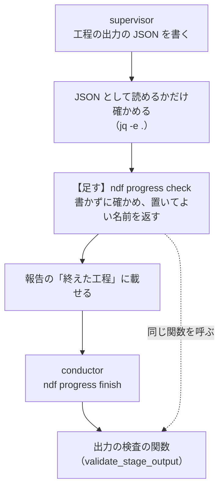

# 書き直しの例（不具合）: #3856 supervisor が書いた工程の出力が規約に合わず、conductor が工程を終えられなかった

## 前

- 要求仕様: [issue-3856-requirements.md](https://github.com/devbasex/ai-plugins/blob/8669b4ae451031fbe292b22976c38eccd4eb6826/issues/issue-3856-requirements.md) （139 行）
- 設計文書: [issue-3851-3856-3854-design.md](https://github.com/devbasex/ai-plugins/blob/8669b4ae451031fbe292b22976c38eccd4eb6826/issues/issue-3851-3856-3854-design.md) （488 行。#3856 は目指す姿・構成要素・入出力のコントラクト・決定 5 と 6・テスト設計の各セクションに分かれて載る）
- 詳細設計: [issue-3851-3856-3854-design-detail.md](https://github.com/devbasex/ai-plugins/blob/8669b4ae451031fbe292b22976c38eccd4eb6826/issues/issue-3851-3856-3854-design-detail.md) （268 行。#3856 は関数 1 つ分）
- 設計 Pull Request: [#3866](https://github.com/devbasex/ai-plugins/pull/3866)

要求仕様は冒頭が「起票者の推定」の表で、続く「事象」が「規則 15」「文脈のキー」「`stage-out`」を説明なしに使う（#3868 の原因 2・4）。設計文書は関係の薄い 3 課題を 1 本にまとめ（原因 5）、#3856 の解き方が 30 を超えるセクションに散り、目指す姿・決定・詳細設計が同じ内容を言い直す（原因 6・7）。

## 後: 要求仕様

### 何が起きたか

2026-11-19、課題 #3812 の仕上げのフェーズで、supervisor（フェーズを通すサブエージェント）が振り返りと棚卸しの工程を終え、それぞれの出力の JSON を報告に載せて返した。conductor（利用者と対話しているセッション）がその出力で工程を終えようとすると、2 つとも規約に合わないと断られた。conductor は出力の値を空にしたコピーを自分で作って先へ進んだが、conductor が出力を自分で組み立てることは手順書が禁じている。

### 種類

不具合（規則 15 が既に約束している「規約に合う出力」に戻す。確かめのコマンドを足すのは、その手段の従の部分）

### 今の姿

NDF はスプリントを工程（作業場所の用意・設計・振り返りなど）の列で進め、進み具合を `ndf progress` の記録（スプリントのステートマシン）が持つ。

- supervisor は工程を終えるたびに工程の出力の JSON を書き、報告（フェーズレポート）の「終えた工程」に工程とパスを載せる（[agent-layers.md の supervisor の規則 15](https://github.com/devbasex/ai-plugins/blob/8669b4ae451031fbe292b22976c38eccd4eb6826/plugins/ndf/skills/development-workflow/references/agent-layers.md#L197) ）。この決まりを、以下「規則 15」と呼ぶ
- 出力の値の欄（`outputs`）に置けるのは、スプリントで共有する値の名前の一覧（文脈のキー、[context.schema.json](https://github.com/devbasex/ai-plugins/blob/8669b4ae451031fbe292b22976c38eccd4eb6826/plugins/ndf/contracts/workflow/context.schema.json) ）にある名前だけで、工程ごとに書く名前が決まっている（[stages/](https://github.com/devbasex/ai-plugins/tree/8669b4ae451031fbe292b22976c38eccd4eb6826/plugins/ndf/contracts/workflow/stages) ）
- 名前には 2 種類がある。文脈のキーは「スプリントのどの工程も使える名前の一覧」で、ここに無い名前は断られる。工程の定義のキーは「その工程が必ず書く名前」で、欠けると断られる
- conductor は報告を受け、そのパスを渡して `ndf progress finish` で工程を 1 行ずつ終える。`finish` は出力をこの規約で確かめ、合わなければ断る。conductor は出力を組み立てない（[同じファイルの「終えた工程」の手順](https://github.com/devbasex/ai-plugins/blob/8669b4ae451031fbe292b22976c38eccd4eb6826/plugins/ndf/skills/development-workflow/references/agent-layers.md#L162-L170) ）

### 事象

`ndf progress finish` が返した誤り（NDF 11.0.8）:

```text
振り返り: outputs: Additional properties are not allowed ('retrospective_comment' was unexpected)
棚卸し:   outputs: Additional properties are not allowed ('apply', 'candidates', 'rank' were unexpected)
```

supervisor への起動の指示は規則 15 を渡さず、出力の例を `"outputs":{}` だけで示し、報告に振り返りのコメントの URL を求めていた。supervisor はその URL と棚卸しの結果ファイルのパスを出力の値の欄に入れ、JSON として読めるか（`jq -e .`）だけを確かめた。

### 期待する結果

supervisor が規約（上の「今の姿」の規則 15 と文脈のキー）に合う出力を書き、conductor の `finish` はそのまま通る。

### 再現手順

前提: 工程表に「振り返り」の行を持つスプリントのステートマシンがある（`ndf progress new` で作り、ID は返りの `metrics.machine_id`）。`finish` は行の状態を見る前に出力を確かめるため、振り返りの行がどの状態でも同じ結果になる。

1. 工程「振り返り」の出力として `{"steps": [], "summary": "x", "outputs": {"retrospective_comment": "https://example.invalid"}}` を書く
2. `ndf progress finish <ステートマシンの ID> "振り返り" --reason "再現" --output <そのファイル>` を打つと、`refused` で止まる（理由の `--reason` は必須の引数で、省くと出力を確かめる前に引数の不足で止まる）
3. 書いた側（supervisor）が 2 より前に同じ判定を得る手段が無い（`finish` に試し打ちの引数が無い。`ndf contracts emit --outputs` は結果 JSON の語彙で確かめ、工程の出力の語彙とは違う）

### 環境

NDF 11.0.8（main 2e43af7bc と同じ）・Claude Code・Linux

### なぜ困るか

規約に合わないことが分かるのは、supervisor が報告を返して終わった後の conductor の側だけである。その時点で直せるのは出力を書いた supervisor ではなく、直すことを禁じられた conductor である。起動の指示が規則を渡し忘れるたびに、同じ止まり方が起きる。

### 目的

supervisor が工程の出力を書いたときに、その工程で置いてよい名前を知り、規約に合わないことを報告を返す前に知る。conductor の `finish` はコピーを作らずに通る。

### 対象範囲

含む:

- supervisor が、書いた工程の出力を `finish` と同じ規約で書かずに確かめる手段
- supervisor の規則 15 と、supervisor の定義からその確かめを指すこと

含まない:

- 工程の出力の規約と、工程ごとに書く名前を変える
- 文脈のキーにあるが工程が書かない名前（振り返りの `pr` など）を断る。今の `finish` のとおり捨てて警告にする
- conductor が書く起動の指示を検査する hook

### 受け入れ条件

- [ ] 1. `ndf progress check <ID> "<工程>" --output <ファイル>` を打つと、規約に合う出力では `status: ok`（終了コード 0）を返し、`metrics` にその工程が置いてよい `outputs` のキーの一覧を載せる
- [ ] 2. 1 で規約に合わない出力（文脈のキーに無いキー・工程の定義のキー（工程ごとに書く名前）の欠け・`summary` の欠け）では、`finish` と同じ誤りの文で `status: stopped`・`cause.kind: refused` を返す。再現手順の 1 の出力で `retrospective_comment` を名指す
- [ ] 3. 1・2 のどちらでも、ステートマシンの行の状態と履歴が変わらない（打つ前と後で `ndf progress show` の `items` と `metrics.history` が同じ）
- [ ] 4. 文脈のキーにあるが工程が定義しないキーを置いた出力では、1 の `ok` に、`finish` が捨てるキーを `warnings` で添える
- [ ] 5. supervisor の規則 15（`agent-layers.md`）が、出力を書いた後に 1 を打ち、`ok` になってから「終えた工程」に足すと書く
- [ ] 6. supervisor の定義（`plugins/ndf/agents/supervisor.md`・`supervisor-waits.md`）が、起動の指示に規則が無いときも規則 15 と 1 の確かめを行うと書く
- [ ] 7. 退行しない: `ndf progress finish` の振る舞いと、プランが工程を終えるときの検査（`progress/run.py`）が変わらず、既存の `plugins/ndf/tests/progress/` のテストが CI で通る

### 影響

| 対象 | 影響 |
| --- | --- |
| 公開インタフェース | 変わる。サブコマンド `ndf progress check` を足す（足すだけで、`finish` の呼び方は変わらない） |
| 重さ | supervisor で回すフェーズの工程が、conductor の側で終えられない。先へ進むには conductor が規則の外で出力を作り直すしかなく、作り直した出力からは工程で得た値が落ちる |
| データ | 変わらない |
| 既存の振る舞い | 変わらない（`finish` とプランの工程の検査） |

### 検証手段

| 項目 | 手段 |
| --- | --- |
| テスト | PR の CI（`.ndf/project.json` の `test.ci.only`）。`ndf progress` のコマンドを一時のステートマシンで打つテスト |
| 手動確認 | リリース後テストで、supervisor のフェーズの通しの記録に `ndf progress check` の呼び出しがあり、conductor の `finish` が止まらないことを見る |

### 起票者の推定

| # | 条件 | 推した出所 | この要求での扱い |
| --- | --- | --- | --- |
| S1 | 原因は、起動の指示と報告の形が、工程ごとに置いてよい名前を supervisor に示していないことである | #3812 の仕上げの supervisor の記録 | 「事象」の 2 段落目 |
| S2 | 知る手段は手順書の参照か書き出しの検査のどちらかでよい | 課題の受け入れ条件の 1 行め | 受け入れ条件 1・5（両方を行う） |

### 依頼（原文）

原文は [#3856 の本文](https://github.com/devbasex/ai-plugins/issues/3856) にある。この例では省く。起票者の推定と照らすときは、リンク先の本文を開く。

## 後: 設計書

### 題

supervisor が工程の出力を書いた時点で、conductor と同じ規則で確かめられるようにする（#3856）

### 今の姿

何が起きたか・本来の振る舞い・終わりの条件は要求仕様（後: 要求仕様の「今の姿」と「受け入れ条件」）にある。この文書は根本原因と、どう直すかだけを書く。



**根本原因**: 工程の出力を規約で確かめる関数（`progress/definition.py` の `validate_stage_output`）は 1 つだけあり、呼ばれるのは conductor の `finish` とプランの中だけである。supervisor の側にはこの関数へのエントリポイントが無く、置いてよい名前を知るには起動の指示に頼るしかない。#3812 では起動の指示が規則 15 を渡さず、supervisor は JSON として読めるかだけを確かめた。そのため誤りは、書いた側が終わった後にしか見つからなかった。

**同じ形の箇所**: プランで流すフェーズは、プランが工程を終えるときに同じ関数で確かめる（`progress/run.py`）。書いた側と確かめる側が分かれ、書いた側に確かめる手段が無いのは supervisor のサブエージェントの経路だけである。

### 文脈と制約

- 工程の出力の規約（文脈のキーと、工程ごとに書く名前）は変えない。文脈のキーにあるが工程が書かない名前は、今の `finish` のとおり捨てて警告にする（要求の非目標）
- 検査の関数は既にあり、書かずに呼べる。振り返りの再現の出力を Python から直に渡すと、`finish` と同じ `Additional properties are not allowed` を返した（2026-11-19 に実測）
- `finish` は理由（`--reason`）を必ず取り、ステートマシンへ書く操作である
- 起動の指示が規則を渡すとは限らない。supervisor の定義の本文は、起動の指示によらず毎回読まれる

### 解き方の全体像

1. 書かずに確かめるサブコマンド `ndf progress check` を足す。`finish` と同じ関数で確かめ、その工程が置いてよい名前の一覧と、`finish` が捨てる名前（警告）を返す
2. supervisor の規則 15 に「出力を書いた後に `check` を打ち、`ok` になってから『終えた工程』に足す」を足し、supervisor の定義から規則 15 を指す

直すのは症状の出た conductor の側ではなく、出力を書く supervisor の側である。

### 決定の記録

#### 決定 1: 書いた側が同じ判定を得られるように、書かずに確かめるサブコマンド `ndf progress check` を足す

- **問い**: supervisor が `finish` と同じ判定を、ステートマシンへ書かずにどう得るか
- **選んだ案**: `ndf progress check <ID> <工程> --output <ファイル>` を足し、`finish` と同じ検査の関数を呼んで書かずに返す。結果の `metrics.outputs` に工程が置いてよい名前を、`warnings` に捨てる名前を載せる。supervisor は `ndf progress show` を読まずに置いてよい名前を知る
- 採らなかった案: `finish` に確かめだけの引数を付ける（理由が必須のままで確かめに理由を書かせるか、引数の要否を条件で変えることになる）
- 採らなかった案: `ndf contracts emit --outputs` で確かめる（結果 JSON の語彙で、工程の出力の語彙と違う）
- 採らなかった案: 工程の出力を書くサブコマンドを足して形を強制する（書く中身は工程ごとに違い、書く側を 1 つにまとめる利点が確かめのエントリポイントより小さい）
- **代償**: 結果 JSON のスキーマ（`progress.result.schema.json`）の `metrics` に、`check` だけが出す `outputs` が増える
- 根拠: Value 13「確かめたことだけが済んだとされる」（MVV バージョン 9）

#### 決定 2: 起動の指示に規則が無くても確かめるように、supervisor の定義から規則 15 を指す

- **問い**: 起動の指示が規則 15 を渡し忘れたとき、supervisor にどう確かめさせるか
- **選んだ案**: 規則 15 に「書いた後に `check` を打ち、`ok` になってから足す。`refused` なら直して打ち直す」を足す。supervisor の定義 2 つに、CI テストの段落と同じ形で「工程の出力は規則 15 で書き、`ndf progress check` で確かめる」を足す。規則の本文は写さず、手段の名前と規則の番号だけを書く
- 採らなかった案: conductor の起動の指示を検査する hook（要求の非目標。課題は supervisor の側で分かることを求める）
- 採らなかった案: 工程が書かない名前を `finish` で断る（要求の非目標。今の `finish` とプランの検査の振る舞いが変わる）
- **代償**: supervisor は工程ごとにコマンドを 1 回多く打つ。定義を読んだだけでは規則の本文が分からず、規則 15 を引く
- 根拠: Value 3「同じ手順は毎回同じ結果になる」（MVV バージョン 9）

### 影響と危険

- 足すのはサブコマンド 1 つで、`finish` の呼び方・振る舞いとプランの検査は変えない。`check` はステートマシンを読むだけで、書く操作の排他は今のまま
- `check` を打たずに返す supervisor が残れば、`finish` は今のとおり断る（止まり方は今と同じで、悪くはならない）

### テスト設計

| 受け入れ条件 | どの振る舞いで縛るか | どう壊したら落ちるべきか |
| --- | --- | --- |
| 2（再現のテスト。今は落ちる） | 再現手順の 1 の出力で `refused` と `retrospective_comment` の名指し。`finish` と同じ誤りの文 | `check` が別の検査を使う |
| 1 | 規約に合う出力で `ok` と置いてよい名前。`ok` と `refused` の結果 JSON がどちらも `progress.result.schema.json` に通る | `metrics.outputs` をスキーマに足さない |
| 3 | `check` の前後で `show` の行と履歴が同じ | `check` が事象を書く |
| 4 | 振り返りに `pr` を置いた出力で `ok` と `warnings` | 捨てる名前を返さない |
| 7 | `finish` とプランの工程の検査の既存テストが通る | `finish` の検査を変える |

### どこを変えるか

（新設する関数は `_cmd_check` の 1 つで、既存の関数のシグネチャ・責務・失敗の扱いは変えない。#3868 の決定 6 の条件により、詳細設計はこのセクションに畳み、関数の入力・返り・異常系を表の行に書く）

| ファイル | 変える中身 | 決定 |
| --- | --- | --- |
| `plugins/ndf/src/ndf/progress/command.py` | `_cmd_check` を新設。出力を読み、工程の定義で `validate_stage_output` と `keep_declared` を呼び、書かずに返す。読めない・工程が無いときは `finish` と同じ返り、合わないときは `stopped`・`refused`・終了コード 1 | 1 |
| `plugins/ndf/contracts/schemas/io/progress.result.schema.json` | `metrics` に `outputs`（文字列の配列）を足す | 1 |
| `plugins/ndf/docs/contracts/commands.md` | `progress check` の行を足す | 1 |
| `plugins/ndf/skills/development-workflow/references/agent-layers.md` | 規則 15 に `check` の確かめを足す | 2 |
| `plugins/ndf/agents/supervisor.md`・`supervisor-waits.md` | 規則 15 と `check` を指す段落を足す | 2 |
| `plugins/ndf/tests/progress/test_command.py`・`test_command_parser.py` | テスト設計の 5 行 | 1 |

### 設計の結果

（例では省く）

### 外部の調査

（例では省く）

## 前と後で変えたこと

| 変えたこと | 前 | 後 |
| --- | --- | --- |
| 要求仕様の始まり | 起票者の推定の表 → 識別子で書いた「事象」 | 何が起きて誰が困ったかの場面 → その仕組みの今の姿と SSOT へのリンク |
| 識別子 | 「規則 15」「文脈のキー」「`stage-out`」を説明なしに使う | 普通の言葉で言ってから括弧で添える |
| 設計の範囲 | 3 課題を 1 本にまとめ、#3856 は 30 を超えるセクションに散る | #3856 だけの 1 本。根本原因を今の姿の図の上に置く |
| 言い直し | 期待する結果・目指す姿・決定・詳細設計が同じ内容を繰り返す | 要求は何を・なぜ、設計は根本原因と解き方だけを持ち、要求をリンクで指す |
| 詳細設計 | 別ファイル（関数 1 つのために 268 行のファイルを読む） | 設計書の「どこを変えるか」に畳む |
| 当たらないセクション | ドメインイベント・境界・未決（無し）などを残す | 見出しごと消す |
