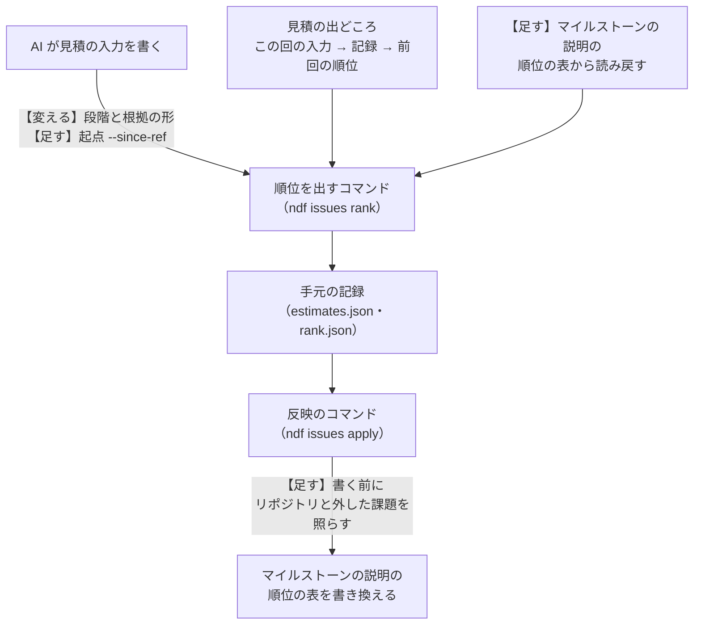

# 書き直しの例（機能追加）: #3854 課題の棚卸しで、手順書どおりに打つと着手の順位が出ないので、順位を出すコマンドを手順書に合わせて広げる

## 前

- 要求仕様: [issue-3854-requirements.md](https://github.com/devbasex/ai-plugins/blob/8669b4ae451031fbe292b22976c38eccd4eb6826/issues/issue-3854-requirements.md) （185 行）
- 設計文書: [issue-3851-3856-3854-design.md](https://github.com/devbasex/ai-plugins/blob/8669b4ae451031fbe292b22976c38eccd4eb6826/issues/issue-3851-3856-3854-design.md) （488 行。#3854 は目指す姿・ドメインモデル・構成要素・構造・入出力のコントラクト・処理の流れ・決定 7〜10・テスト設計に分かれて載る）
- 詳細設計: [issue-3851-3856-3854-design-detail.md](https://github.com/devbasex/ai-plugins/blob/8669b4ae451031fbe292b22976c38eccd4eb6826/issues/issue-3851-3856-3854-design-detail.md) （268 行。#3854 は関数 13 個分）
- 設計 Pull Request: [#3866](https://github.com/devbasex/ai-plugins/pull/3866)
- 種類: 課題のラベルは `bug` だが、#3868 の設計の決定 2 により、手順書に合わせてコードに引数・キー・読む先を足す変更は機能追加として書く

要求仕様は冒頭が「起票者の推定」の表で、続く「事象」が「`ubv`」「`left_for_review`」「`### 順位` の表」を説明なしに使い、棚卸しで順位を出す仕組みが何のためにあるかを書かない（#3868 の原因 2・4）。設計文書は関係の薄い 3 課題を 1 本にまとめ（原因 5）、#3854 の解き方が 10 を超えるセクションに散り、目指す姿・決定・詳細設計が同じ内容を言い直す（原因 6・7）。

## 後: 要求仕様

### 何が起きたか

2026-11-19、課題 #3812 の仕上げのフェーズで課題の棚卸しを行い、着手の順位を出す手順（手順 2C）を手順書のとおりに打った。手順書の例の形で見積を渡すと、7 件すべてが「尺度に無い」で外れ、順位が出なかった。見積を整数の形に書き換えて打ち直すと、7 件で順位は出たが、見積の無い課題 308 件を外したまま成功（終了コード 0）で返した。外した課題を残した順位を反映すると、マイルストーンに書いてある既存の順位の表がその数件だけの表で書き換わるため、この回は順位を反映せずに避けた。反映の計画に手順書どおり書き込み先のリポジトリを書くと、反映のコマンドが「知らないキー」で止まった（終了コード 2）。

### 種類

機能追加（順位を出すコマンドと反映のコマンドの契約に無い引数・入力の形・返りのキーを、手順書が書く形に合わせて足す）

### 今の姿

課題の棚卸し（`backlog-refinement`）は、スプリントを閉じた後に open の課題を現状に合わせ、マイルストーンの中の着手の順位を決め直す手順である。順位は、課題ごとに AI が付けた見積から算出する。

- **見積**は 4 列で、遅延コストの 3 要素（利用者・業務の価値 UBV、時間の重要度 TC、リスクの低減と他の課題の解放 RR/OE）と大きさ（Size）である。各列に、尺度（既定 1, 2, 3, 5, 8, 13, 20）から 1 つ選んだ値（段階、`step`）と、その理由の 1 行（根拠、`why`）を書く
- **UBV の帯**: UBV は、先に実害の区分（`impact`。全体の停止・一部の機能の誤動作・表示の誤り・なし）を選び、区分ごとに決まった値の範囲（帯。既定は全体 13〜20・機能 5〜8・表示 2〜3・なし 1）の中で付ける。課題どうしの比べ合いだけで付けると、全体の停止と表示の誤りが隣の値に並ぶためである。止まるのを実際に防いだ記録のある回避策があれば（`mitigation: 防いでいる`）、1 つ下の区分の帯の値も認める（[ranking.md の「列ごとの段階の意味」](https://github.com/devbasex/ai-plugins/blob/8669b4ae451031fbe292b22976c38eccd4eb6826/plugins/ndf/skills/backlog-refinement/references/ranking.md#L31-L64) ）
- AI が見積を書き、順位を出すコマンド（`ndf issues rank`）へ渡す。コマンドは順位を算出し、見積と順位を手元の記録へ残す（[SKILL.md の手順 2C](https://github.com/devbasex/ai-plugins/blob/8669b4ae451031fbe292b22976c38eccd4eb6826/plugins/ndf/skills/backlog-refinement/SKILL.md#L272-L296) ）。順位の結果には、その結果を指す要約値（`digest`）が付く
- 反映のコマンド（`ndf issues apply`）が反映の計画（plan）を読み、plan が要約値で指す順位の結果で、各マイルストーンの説明の末尾にある順位の表（`### 順位`）を書き換える（[同じファイルの手順 3](https://github.com/devbasex/ai-plugins/blob/8669b4ae451031fbe292b22976c38eccd4eb6826/plugins/ndf/skills/backlog-refinement/SKILL.md#L298-L342) ）
- 棚卸しには深さがある。毎スプリントの差分の棚卸しは、前のリリース（起点）より後に作られた課題だけに見積を付ける。起点より前の課題は、3 回に 1 回の見直しの回で付ける
- コマンドは 11.0.0 の作り直しで Python へ移った（[backlog/](https://github.com/devbasex/ai-plugins/tree/8669b4ae451031fbe292b22976c38eccd4eb6826/plugins/ndf/src/ndf/domains/backlog) ）。この文書では、作り直しの前の版を 10 系、後を 11 系と呼ぶ。10 系（最後の版 `ndf--v10.27.77`）は下の表の初めの 4 行を手順書のとおりに持っていた

### 何を足すか・変えるか

| | 今（NDF 11.0.8） | 足した後 |
| --- | --- | --- |
| 見積の形 | 4 列を整数で読み、手順書の形（段階と根拠、UBV は区分も）は外す | 手順書の形だけを読み、根拠の欠けた課題と、帯から外れた UBV の課題を外す |
| 差分の棚卸しの起点 | 候補を集めるコマンド（`ndf issues candidates`）も `rank` も起点を受けず、見積の無い課題をすべて候補（`unscored`）に入れ、`rank` はそれを外して成功で返す | `candidates` と `rank` が起点（`--since-ref`）を受ける。`candidates` は起点より後に作られた課題だけを `unscored` に入れ、起点の時刻を `metrics.since` に返す。`rank` は起点以前の見積の無い課題を外さずに、次の見直しの回で見積を付ける課題として返す（`metrics.left_for_review`） |
| 見積の読み戻し | マイルストーンの説明の順位の表を読まない | 記録の無い手元でも、表の行から見積を戻す |
| 書き込み先の照らし | plan の `repo` を「知らないキー」で断り、照らす検査も無い | plan の `repo` を受け、候補を集めたリポジトリと違えば 1 件も書かずに止まる |
| 外した課題が残るときの終わり方 | 差分の棚卸しで外した課題（`excluded`）があっても成功（終了コード 0）で返り、その部分的な結果をそのまま反映できる | `excluded` が 1 件でもあれば、棚卸しの深さによらず「未完了」（終了コード 6）で止まる。部分的な結果で既存の順位の表を書き換える事故を防ぐ |

### 今の利用者への影響と互換

- 見積の入力の整数の形は読まなくなる（互換なし）。NDF は普及の前で、後方互換を求めない
- 11.0.x が記録へ書いた整数の見積は、根拠の無い見積として読み戻す
- 差分の棚卸しで外した課題があると、成功（0）でなく「未完了」（終了コード 6）で返る

### なぜ困るか

順位を出せないと、次のスプリントへ切り出す課題を決められない。外した課題を残したまま反映すると、マイルストーンの既存の順位の表が消える。書き込み先の照らしが無いと、別のリポジトリへ書いても気づけない。手順書とコードのどちらに従えばよいかが分からず、同じ手順を打っても毎回同じ結果にならない。

### 目的

棚卸しの手順 2C（順位を出す）と手順 3（反映する）が手順書のとおりに通り、既存の順位の表を消さない。

### 対象範囲

含む:

- 「何を足すか・変えるか」の表の 5 行（見積の形・差分の棚卸しの起点・見積の読み戻し・書き込み先の照らし・外した課題が残るときの終わり方）と、それに合わせた手順書の直し。差分の棚卸しの起点は `rank` だけでなく、`candidates` の `unscored` を起点より後の課題に絞ることと `metrics.since` を返すことを含む

含まない:

- 10 系の形（12 列）の順位の表を読み戻す（今開いているマイルストーンに無い）
- 順位の表を書き換えるときの 10 系の終わりの印の扱い（#3861）
- 並列の組の依存の読み戻しと、前回の表からの変化の算出（手順書から消す）
- 見積の段階の付け方（手順 2A・2B）と、順位の式

### 受け入れ条件

- [ ] 1. `rank --scores` に `ranking.md` の例の形（4 列が `{"step", "why"}`、`ubv` が `impact` も持つ）の見積を渡すと、その課題が順位に入る
- [ ] 2. 4 列のどれかの `why` が空か無い課題、整数の形（`"ubv": 5`）の課題は、`excluded` に理由（根拠が空・形が違う）を添えて入る
- [ ] 3. 区分（`ubv.impact`）を書いた課題の UBV が、その区分の帯（`.ndf/backlog.json` の `harm_guide`、既定は「今の姿」のとおり）の外なら `excluded` に入る。例: 区分「機能」で UBV 13 は外れ、5 は入る。`mitigation` が `防いでいる` なら 1 つ下の区分の帯の値も入る（「機能」で 2 も入る）
- [ ] 4. `harm_guide` を書いた `.ndf/backlog.json` を、設定のスキーマ（`backlog.schema.json`）と `rank` が受ける
- [ ] 5. 見積の根拠と実害の区分は記録（`estimates.json`）に残り、次の回に記録から採った見積も根拠を持つ
- [ ] 6. `rank --depth diff --since-ref <ref>` で、見積がどこにも無く `<ref>` のコミットの時刻以前に作られた課題は、`excluded` にも順位にも入らず、`metrics.left_for_review` に番号で返る。結果のスキーマ（`issues.result.schema.json`）がこの項目を受ける
- [ ] 7. `candidates --depth diff --since-ref <ref>` の `unscored` は `<ref>` のコミットの時刻より後に作られた課題だけで、`metrics.since` にその時刻を返す
- [ ] 8. `rank` は、`excluded` が 1 件以上あれば棚卸しの深さによらず `status: stopped`・`cause.kind: incomplete`（終了コード 6）で返し、0 件なら `ok` で返す
- [ ] 9. この回の入力（`--scores`）にも手元の記録にも見積が無い課題は、そのマイルストーンの説明の順位の表（`### 順位`。11 系の `apply` が書く形）の行の値を見積として採る。確かめ方: 記録の無い手元（別のマシンなど）で `rank` を打ち、表に行を持つ課題が `excluded` に入らず順位に入る
- [ ] 10. 確かめ方: 一部の課題だけに見積を付けて `rank` を打ち、その順位の結果の要約値（`digest`）を plan に入れて `apply` を打つ。その後のマイルストーンの説明で、表に行を持っていた課題の行が消えていない
- [ ] 11. plan の `repo` を `apply` が受ける。書き込み先（`--repo`）か plan の `repo` が記録のリポジトリ（`candidates.json` の `metrics.repo`）と違うとき・記録が無いときは、1 件も書かずに `status: stopped`・`cause.kind: precondition`（終了コード 3）で止まる
- [ ] 12. 手順書（`SKILL.md`・`references/ranking.md`・`references/depths.md`）が、見積の入力の `milestones`・`### 並列の組（見込み）` の依存の読み戻し・前回の表からの変化・返りの 20 を書かず、8 の返りを書く
- [ ] 13. 退行しない: 既存の `plugins/ndf/tests/domains/backlog/` のテストが CI で通る（整数の形の入力を使うテストは、手順書の形へ直す）

### 影響

| 対象 | 影響 |
| --- | --- |
| 公開インタフェース | 変わる。`rank --scores` の入力の形（`互換なし`）、`rank` の引数 `--since-ref`・返りの `metrics.left_for_review`・終了コード、`candidates` の返りの `metrics.since`、plan の `repo`、設定の `harm_guide` |
| データ | 記録 `estimates.json` の見積の行が根拠と区分を持つ |
| 既存の振る舞い | 差分の棚卸しで外した課題があると `rank` が 0 でなく 6 を返す |

### 検証手段

| 項目 | 手段 |
| --- | --- |
| テスト | PR の CI（`.ndf/project.json` の `test.ci.only`）。`ndf issues` のコマンドを偽の GitHub の読み口で打つテスト |
| 手動確認 | リリース後テストで、次の棚卸しの手順 2C を手順書のとおりに打ち、見積が外れずに順位が出ることを見る |

### 起票者の推定

| # | 条件 | 推した出所 | この要求での扱い |
| --- | --- | --- | --- |
| S1 | 表の初めの 4 行は同じ原因（11.0.0 の作り直しで、順位を出すコマンドを手順書に合わせ直していない）による | 4 点とも 10 系の手順書の記述がそのまま残っている | 「今の姿」の最後の行 |
| S2 | 直す側（コードか手順書か）は設計で決める | 起票者の判断 | 設計の決定 1 |

### 依頼（原文）

（原文は #3854 の本文。この例では省く）

## 後: 設計書

### 題

課題の棚卸しの順位を出すコマンドと反映のコマンドに、手順書が書く見積の形・差分の起点・表からの読み戻し・書き込み先の照らしを足す（#3854）

### 今の姿

その仕組みの役割・今の振る舞い・足すもの・終わりの条件は要求仕様（後: 要求仕様の「今の姿」「何を足すか・変えるか」「受け入れ条件」）にある。この文書は、どこに足すかと、なぜその足し方かだけを書く。

見積の出どころを決める関数（`estimates_decide.py`）が、この回の入力 → 記録 → 前回の順位の順に採り、どこにも無い課題を外す。変更はこの関数と、見積を読む関数（`model.py`）と、2 つのコマンドのエントリポイント（`cli.py`）に集まる。

### 文脈と制約

- 順位を出すコマンドを打つのは棚卸しの手順書だけで、ほかの呼び手は無い
- 11.0.0 の作り直し（#1142）は、11 系を 10 系の意図した振る舞いと同じにする（同等版）と決めている。手順書に書かれ 10 系が持っていた振る舞いが落ちていれば、意図して外したのでなく移し漏れである。#1142 の設計に、4 点を意図して外した記述は無い（`issues/issue-1142-design.md` を `grep -n -E '見積|順位|backlog'` で探し、当たりは移すファイルの一覧の 4 行だけ）
- 結果のコントラクト（[exit-codes.md](https://github.com/devbasex/ai-plugins/blob/8669b4ae451031fbe292b22976c38eccd4eb6826/plugins/ndf/docs/contracts/exit-codes.md) ）では、`gate` は人の承認を待つ区分で、採点し直しは `incomplete` に当たる
- 普及の前で、入力の形の後方互換は要らない

### 解き方の全体像

1. 手順書を SSOT にし、4 点ともコードを手順書と 10 系の振る舞いに合わせる。11 系に無い手順書の記述（入力の `milestones`・`needs_detail`、並列の組の依存、前回の表からの変化）は手順書から消す
2. 見積の出どころを、この回の入力 → 記録 → 前回の順位 → マイルストーンの説明の順位の表 の 4 つにする。どこにも無く起点以前に作られた課題は、外さずに次の見直しの回へ回す
3. 外した課題が 1 件でもあれば深さによらず `incomplete` で返し、反映のコマンドはその順位も、候補を集めたリポジトリと違う書き込み先も、書く前に止める

### 入出力のコントラクト

| 対象 | 今 | 足した後 |
| --- | --- | --- |
| `rank` の引数 | — | `--since-ref <タグか SHA>`（`--depth diff` のときだけ効く） |
| `rank` の見積の入力 | 4 列が整数 | 4 列が `{"step", "why"}`。`ubv` は任意の `impact`、課題は任意の `mitigation`（`防いでいる` / `部分的` / `無い`、既定 `無い`） |
| `rank` の `metrics` | `backward, depth, digest, dropped, excluded, forward, order, rejected_stale, repo, sized` | `left_for_review`（次の見直しの回へ回した番号）と `restored`（前回の順位か表から戻した番号）を足す |
| `rank` の返り | 見直しだけ、外した課題があれば `stopped`/`incomplete` | 深さによらず、外した課題があれば `stopped`/`incomplete`（6） |
| `candidates` の返り | — | 差分の棚卸しで `metrics.since`（起点の時刻）を返し、`unscored` を起点より後の課題に絞る |
| `apply` | plan の `repo` を断る | 記録が無い・`--repo` か plan の `repo` が記録の `metrics.repo` と違う・plan の順位が外した課題を持つ、のどれでも書かずに `stopped`/`precondition`（3） |
| 設定 `.ndf/backlog.json` | — | `harm_guide`: 区分 → `[下限, 上限]`。書いた値の端が尺度に無ければ `invalid`（2）。書かずに尺度を変えたリポジトリでは帯を確かめず、`warnings` に 1 行載せる |

### 決定の記録

#### 決定 1: 手順書を SSOT にするため、4 点ともコードを手順書と 10 系の振る舞いに合わせる

- **問い**: 4 点の食い違いを、コードと手順書のどちらに寄せて直すか
- **選んだ案**: コードを手順書に合わせる。11 系にも 10 系の意図にも当たらない記述と、使い手の無い返りは手順書から消し、返りの表は 11 系の終了コード（0・6・2）で書く
- 採らなかった案: 手順書をコードに合わせる（根拠と帯の確かめ・差分の棚卸しの絞り込み・書き込み先の守りがどこにも無くなり、記録の無い手元で表を持つ課題の見積がすべて消える）
- **代償**: 2 つのコマンドの引数・返り・記録の形が増え、公開インタフェースが変わる
- **既存の決定との関係**: 作り直し（#1142）の同等版の決定に従い、移し漏れを足す。#1142 の決定は変えない
- 根拠: Value 7（不具合が根本原因から直される。MVV バージョン 9）

#### 決定 2: 見積の入力を 1 つの形にするため、整数の形を読まない

- **問い**: 段階と根拠の形を足すとき、今の整数の形も受けるか
- **選んだ案**: 段階と根拠の形だけを読み、整数を「形が違う」で外す。11.0.x が記録へ書いた整数の見積は、根拠の無い見積として採り、帯を確かめない
- 採らなかった案: 整数の形も受ける（手順書の例と違う形でも通り、根拠の欠けが見えなくなる）
- 採らなかった案: 旧い記録を捨てる（記録の無い課題が一斉に「見積が無い」になり、表が消えるのと同じ欠けを生む）
- **代償**: 整数の形の入力を使う既存のテストを書き直す（要求の受け入れ条件 13）
- **既存の決定との関係**: 普及の前は後方互換を求めない方針に従う
- 根拠: Value 11（重複と冗長が無い。MVV バージョン 9）

#### 決定 3: 説明の表から戻すのは 11 系の表の形だけにする

- **問い**: マイルストーンの説明の順位の表から、どの形の行を、どの値で戻すか
- **表の値と見積の違い**: 表に載る値は、AI が付けた見積そのものとは限らない。順位を出すコマンドは、重要度のラベルが決める UBV の下限（設定 `label_floor`）と、その課題を待つ課題の数から決まる RR/OE（設定 `dependents_steps`）で値を引き上げてから表に書き、引き上げた値には「（ラベル）」「（被依存）」の印を付ける。Size が見積もりの記録から来た値には「（見積もり）」の印が付く
- **選んだ案**: 11 系の反映のコマンドが書く 8 列の表だけを読む。「（ラベル）」「（被依存）」の付いた値は AI の見積でないため、その列を尺度の最小（既定 1）として戻す。「（見積もり）」の付いた Size は、印を外した値をそのまま採る
- 採らなかった案: 10 系の 12 列の表も読む（今開いている 15 本のマイルストーンはどちらの表も持たず、読み手のいない形の解析を足す）
- **代償**: 表から戻した見積は、課題の本文と照らす値を持たず、本文が変わった後の古い見積かを判定できない。外さずに戻した番号を `metrics.restored` で返し、見直しの手順書に、その課題の見積を付け直すと書く。今の「見直しは前回の表から戻した見積を外す」振る舞いは変わる
- **既存の決定との関係**: 引き上げた値を最小へ戻す扱いは 10 系と同じ
- 根拠: Value 8（正しいデータ構造で作られる。MVV バージョン 9）

#### 決定 4: 差分の棚卸しで外した課題を見落とさないため、外した課題があれば深さによらず `incomplete` で返す

- **問い**: 手順書の「外れた課題に段階を付けて打ち直す」返りを、11 系のどの区分で返すか
- **選んだ案**: 外した課題が 1 件以上なら差分の棚卸しでも `incomplete`（6）。見直しへ回した課題と戻した課題は外した数に数えない。反映のコマンドは、plan の順位が外した課題を持てば書かずに止める
- 採らなかった案: 10 系の `gate`（20）を戻す（11 系の結果のコントラクトでは、`gate` は人の承認を待つ区分）
- 採らなかった案: `incomplete` のとき記録を書かない（外した課題の一覧を打ち直しの前に読む手段がなくなる）
- 採らなかった案: 反映のコマンドが外した課題の行を残したまま書く（順位に入らない行が表に混ざり、表と記録の順位が食い違う）
- **代償**: 差分の棚卸しの既定の返りが 0 から 6 に変わる。起点を省くと見積の無い課題はすべて外れ、初回の全件採点と同じ扱いになる
- **既存の決定との関係**: 結果のコントラクト（`exit-codes.md`）の区分の意味は変えない
- 根拠: Value 13（確かめたことだけが済んだとされる。MVV バージョン 9）

### 影響と危険

- 働く範囲: マイルストーンを使うリポジトリの棚卸しの手順 2C と手順 3。マイルストーンの無いリポジトリは今のとおり算出を飛ばす
- 尺度（`scale`）を変えたリポジトリ: `harm_guide` を書いていなければ、設定を変えずに今のとおり打て、帯の確かめだけが外れる

### テスト設計

| 受け入れ条件 | どの振る舞いで縛るか | どう壊したら落ちるべきか |
| --- | --- | --- |
| 13（退行。最初に書く） | 整数の入力を手順書の形へ直した既存のテストが、今の順位・前倒しの候補・反映の結果を保つ | 出どころの順や順位の式を変える |
| 1・2 | 例の形で順位に入り、根拠の欠けと整数の形は理由つきで外れる | 整数だけを読む・根拠を見ない |
| 3・4 | 帯の外の UBV が外れ、`防いでいる` は 1 つ下の帯で通る。`harm_guide` を書いた設定をスキーマが受ける。カスタムの尺度で書かなければ `warnings`、書いて端が尺度に無ければ `invalid` | 帯を設定から読まない・スキーマが拒む |
| 5 | 次の回に記録から採った見積が根拠を持つ | 根拠を記録へ写さない |
| 6・7・8 | 起点以前の見積の無い課題が `left_for_review` へ、起点より後は `excluded` へ入る。候補が起点より後だけになる。外した課題があれば差分でも 6 | 作成の時刻で分けない・深さで分岐する |
| 9・10 | 記録の無い保存先で、表に行を持つ課題がどちらの深さでも採られ、「（ラベル）」の値は尺度の最小に戻り、反映の後の表から行が消えない。外した課題を持つ順位の plan は書き込み 0 件 | 説明を読まない・印を外さない・照らさない |
| 11 | plan の `repo` か `--repo` が記録と違う・記録が無いと書き込み 0 件 | 照らしを書き込みの後に置く |

### どこを変えるか

（新設・シグネチャを変える関数があるため、関数の仕様は詳細設計の別ファイルに書く。例では省く）

| ファイル | 変える中身 | 決定 |
| --- | --- | --- |
| `plugins/ndf/src/ndf/domains/backlog/model.py` | 見積の形・根拠・帯の確かめ、設定の `harm_guide` | 2 |
| `plugins/ndf/src/ndf/domains/backlog/estimates_decide.py`・`table_decide.py`・`cli_input.py` | 出どころに説明の表を足し、起点以前の課題を見直しへ回す | 3 |
| `plugins/ndf/src/ndf/domains/backlog/cli.py`・`collect.py` | `--since-ref`・返りの区分・候補の絞り込み・書き込み先の照らし | 1・4 |
| `plugins/ndf/contracts/schemas/` の `backlog.schema.json`・`issues.result.schema.json`、`plugins/ndf/docs/contracts/commands.md` | 足したキーと引数 | 1 |
| `plugins/ndf/skills/backlog-refinement/` の `SKILL.md`・`references/ranking.md`・`references/depths.md` | 11 系に無い記述を消し、返りを 0・6・2 で書く | 1・4 |

### 設計の結果

（例では省く）

### 外部の調査

（例では省く）

## 前と後で変えたこと

| 変えたこと | 前 | 後 |
| --- | --- | --- |
| 要求仕様の始まり | 起票者の推定の表 → 識別子で書いた「事象」の 4 行の表 | 棚卸しで何が起きたかの場面 → 順位を出す仕組みの役割と今の動きと SSOT へのリンク |
| 足すものの示し方 | 「事象」「期待する結果」「対象範囲」が同じ 4 点を 3 回書く | 前と後の 1 つの表と、今の利用者への影響と互換 |
| 設計の範囲 | 3 課題を 1 本にまとめ、#3854 は 10 を超えるセクションに散る | #3854 だけの 1 本。変更の位置を今の姿の図に【足す】で示す |
| 決定の形 | 結論・理由・採らなかった案 | 問い・選んだ案・採らなかった案・代償・既存の決定との関係・根拠 |
| 当たらないセクション | ドメインイベント・境界・未決（無し）などを残す | 見出しごと消す |
