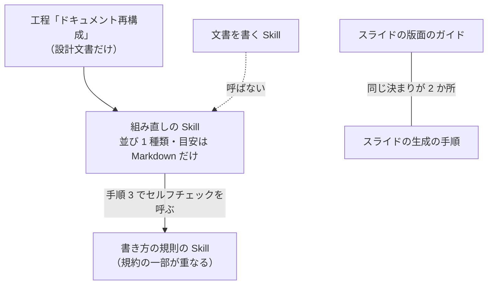
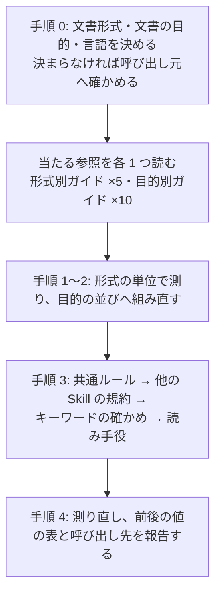

# 書き直しの例（新規作成）: #2086 AI が書いた文書を、文書の形と目的に合わせて組み直し、読み手が理解できたかを確かめる仕組みを作る

## 前

- 要求仕様: [issue-2086-requirements.md](https://github.com/devbasex/ai-plugins/blob/4e9e887a64c33338db54c0d407d1590144e23895/issues/issue-2086-requirements.md) （294 行）
- 設計書: [issue-2086-design.md](https://github.com/devbasex/ai-plugins/blob/4e9e887a64c33338db54c0d407d1590144e23895/issues/issue-2086-design.md) （515 行）

要求仕様は MVV と原文の引用から始まり、何が起きて誰が困ったかは 70 行目からの「今の Skill の問題」の表と「取り込む Issue」に割れている（原因 3: 具体的な場面が無い）。受け入れ条件は 30 あり、前提・ドメインイベント・境界・未決が並ぶ（原因 2・7）。設計書は目的 → 適用範囲 → 根拠 → ドメインモデル（不変条件 11 行）→ 機能一覧 → 構成要素（20 行）と進み、解き方の決定は 297 行目から始まる。説明は「K3」「I7」「E4」のような識別子で進む（原因 2・4・6）。

## 後: 要求仕様

### 何が起きたか

AI が書いた文書を、組み直しの Skill が決まった 1 つの並びで組み直し、読み手が困る場面が続いた。

- 仕様案のように、まだ決まっていないことを読み手と決めるための文書（議論用の文書）を組み直すと、提案が冒頭の章に置かれ、決定に読めた（#2083）
- 社外向けの発表資料の題に、公式ドキュメントに無い語「スキルプラグイン」が残り、リリースの直前に資料を作り直した（#2080、Pull Request #2072・#2076）
- 同じ規約（「対比・列挙は表」など）を書き方の規則の Skill と組み直しの Skill が別々に持ち、片方の規約を満たす直しがもう片方の目安を破った。順に掛けると、最長文が 96 字 → 111 字 → 96 字と往復した（#469、2026-09-07 の実測）

2026-10-24、利用者は「AI が作るすべての文書を、人が読みやすく分かりやすい文書に組み直す。組み直すだけで、読む人が内容を理解し納得できる」ことを Skill の目的に置き、文書を読ませる形（文書形式。Markdown・スライド・表計算・Google ドキュメント・Confluence など）と、読み手にその文書で何をしてもらうか（文書の目的。決議依頼・議論・アジェンダ・小説・エッセイ・ブログ・作業レポート・論文など）に合わせて組み直すよう求めた。

### 種類

新規作成（形と目的に合わせて組み直す仕組みと、読み手が理解できたかを確かめる手順は今は無い。今ある組み直しの Skill を土台にする）

### 今はどうしているか

- 組み直しの Skill（[document-restructuring](https://github.com/devbasex/ai-plugins/blob/4602364ff8068ccfe3919a406e70031ae5cad666/plugins/ndf/skills/document-restructuring/SKILL.md)）は、書き上げた文書を 測る → 組み直す → 整える → 測り直す の 4 手順で組み直す。章の並びは「何が決まったか → なぜ → 根拠 → 中身 → 手順 → 受け入れ条件」の 1 種類で、目安（平均文長 40 字・最長文 100 字・章 40 行）は Markdown の設計文書 3 本の実測である
- 書き方の規則は別の Skill（[markdown-writing](https://github.com/devbasex/ai-plugins/blob/4602364ff8068ccfe3919a406e70031ae5cad666/plugins/ndf/skills/markdown-writing/SKILL.md)）が持つ。組み直しの手順 3 がそのセルフチェックを呼ぶ
- スライドの文言の決まり（1 ページ 1 メッセージ・章扉など）は、版面のガイド（`layout-slide.md`）と生成の手順（`form-slide.md`）の両方に本文がある
- スライド・表計算・ページの文章量の単位と、小説・アジェンダなどの並びは無い。社外向けの語が公式の語かを確かめる手順も無く、利用者が読んで見つけ、手で直している
- 工程「ドキュメント再構成」は設計文書にだけ掛かり、文書を書く Skill（`document-drafting`）が書いた提案書やスライドの台本には掛からない
- 組み直したことを確かめる指標は文の長さ・章の行数・結論の位置で、読み手が理解し納得したかは測らない

### 誰が・どんな場面で困るか

| 誰が | どんな場面で | 何に困るか |
| --- | --- | --- |
| 議論の参加者 | 仕様案・提案書を読む | 提案が決定に読め、決めるべき論点に気づかない |
| 発表の聞き手・社外の読者 | スライド・記事・提案書を読む | 公式に無い語と、形に合わない文章量（長い文のスライドなど）に当たる |
| AI に文書を書かせる利用者 | 小説・エッセイ・ブログを含め、工程の外で組み直しを呼ぶ | 結論を先に置く並びが目的に合わない文書にも当たり、構成を手で戻す。呼び出しの名前（`/ndf:document-restructuring`）が長い |

### なぜ困るか

組み直しは AI が書いたすべての文書に掛かる最後の工程だが、並びと目安が 1 種類のため、確定した設計以外の文書では組み直すほど目的から外れる。読み手が理解し納得できたかを確かめないので、外れた文書がそのまま議論・発表・社外の読者へ届く。

### 目的

- 文書の形（Markdown・文書・ページ・スライド・表計算）と目的（決議依頼・議論・アジェンダ・小説ほか）に合った並びと文章量へ、1 つの Skill で組み直せる
- 形と目的に関わらない決まりが 1 か所にあり、他の文書系 Skill の規約と重ならない
- 組み直した文書を、文脈を持たない読み手が問い直さずに理解し納得できる

### 対象範囲

含む: 組み直しの手順・並び・目安の書き直し、形ごと・目的ごとの参照ファイル、形と目的に関わらない決まり（共通ルール）、#2083・#2080・#469 の直し、重なる規約を正本を指す形へ寄せる書き換え、工程表の「ドキュメント再構成」の行、形と目的の違う 3 本以上での試行

含まない: 形への生成そのもの（pptx・Google ドキュメントの作成、Notion・Confluence への投稿）、版面の点検の手順、文書の内容の誤りを直すことと書き足すこと、規約の点検のスクリプト化、既存の文書の一括の組み直し、`.md` の文言を照らすテスト

### 受け入れ条件

行頭の番号は #2086 の本文の受け入れ条件（1〜30）の番号で、主題ごとにまとめた。各行は、それだけで合否を見られる形に書いた。

- [ ] 1・27. 共通ルールの一覧が 1 つのファイルにあり、各行にその決まりの正本（ファイルとセクション）がある。各行は「読み手に何が成り立つか」を規則とし、手段は例として添える（パス・URL なら「表示先でリンクとして開ける」が規則で、半角スペースは例）
- [ ] 16・17・28. 題・見出し・繰り返し出る語（キーワード）を、読み手が社外なら公式ドキュメントの語、社内なら用語集と業界で流通している語と突き合わせた表（語・出所・判定）が、組み直しの報告に出る。確かめられなかった語も表に残り、手順の正本は 1 か所にある
- [ ] 2・3. 文書系 Skill ごとに「何を求めるか・組み直しのどの手順で読むか」の表があり、Skill の一覧と突き合わせて表に無いものが 0 件。組み直した前後で、他の Skill が固定した章（設計文書の承認する人が読む欄など）と出典のセクションが残る
- [ ] 4・8. 形か目的が手がかり（拡張子・置き場・呼び出し元の指定・本文の語）で決まらない文書を渡すと、推測で進まず呼び出し元へ確かめる
- [ ] 5・6・7. 形ごとに参照ファイルが 1 つずつあり、どれも文章量の単位・目安・その根拠（実測の出所か「未実測」）・題と見出しの付け方・呼び出し先の Skill を持つ。スライドのファイルは 1 ページ 1 メッセージなどの決まりを書き写さず、生成の手順のセクションを指す
- [ ] 9・10・11. 目的ごとの並びと文章量が、少なくとも確定事項を伝える文書・議論用の文書・決議依頼・アジェンダ・作業レポート・論文・ブログ・エッセイ・小説の 9 つにある。文書を書く工程（`documentation` モード）が使う 6 つの文書タイプ（提案・企画、決裁・稟議、定例報告、指標定義、運用マニュアル、説明・研修）がどの目的に当たるかの表と、目的ごとの結論の位置（議論用の文書は論点が最初、小説は対象外など）がある
- [ ] 13・14・15（#2083）. 議論用の文書を組み直すと、並びが「論点 → 事実 → 事実の解釈 → 提案 → 提案の中身 → 確認すること → 残リスク」になり、提案は冒頭の「方針」の章に置かれず「〜する案とする」の言い回しで書かれる
- [ ] 12. 形と目的の違う 3 本以上（議論用の文書・スライド・確定事項を伝える文書を含む）に掛けた前後の値の表と、目的別の並びに従ったかの判定が Pull Request に残る
- [ ] 18・19（#469）. 2 つの Skill に重なっていた規約（文書の長さ・対比と列挙の形・多義語）の正本が 1 か所ずつになり、もう片方は正本を指す。目安を超えたら理由を残して進み、整える手順と測り直しを繰り返さない
- [ ] 20・21（#469）. 統合するか呼び出しの関係を強めるかの案と推奨が設計の決定にあり、工程表の「ドキュメント再構成」の行から書き方の規則の Skill が掛かることが読み取れる
- [ ] 25・26. Claude Code で `/ndf:doc` と打った候補が `document-rebuild` 1 つになり、書き方の規則の Skill の名前が `document-style` になる。古い名前の検索が確定仕様と過去の記録の外で 0 件
- [ ] 29. 組み直しの報告に、文脈を持たない読み手役の要点の言い直し・分からなかった語と箇所・納得できなかった主張が載る
- [ ] 30. 設計文書と設計 Pull Request の題が「<対象>: <直すと何ができるようになるか>」の 1 文（目安 60 字以内）で、今の問題は題に入らない
- [ ] 22・23・24. 今の 4 手順・内容を足さない決まり・前後の値の表が残り、既存のテストと `python3 scripts/check-skill-frontmatter.py` が 0 で終わる

### 影響

| 対象 | 影響 |
| --- | --- |
| 公開インタフェース | 変わる。Skill の呼び出し名が `document-rebuild`・`document-style` になる |
| データ | 変わらない |
| 既存の振る舞い | 組み直しの並びが目的で変わる。確定事項を伝える文書は今の並びのまま |

### 用語

| 用語 | 意味 |
| --- | --- |
| 文書形式 | 文書を読ませる形。リポジトリの Markdown・文書・ページ・スライド・表計算。置き場（Notion・Confluence）とは別の軸 |
| 文書の目的 | 読み手にその文書で何をしてもらうかの種類（決議依頼・議論・アジェンダ・論文など） |
| 共通ルール | 形と目的に関わらず、組み直した文書が満たす決まり |
| 議論用の文書 | まだ決まっていないことを読み手と決めるための文書 |
| キーワード | 題・見出しと、本文で繰り返し使い、読み手が主題として受け取る語 |

### 検証手段

| 項目 | 手段 |
| --- | --- |
| テスト | `uv run --frozen --project . --all-extras pytest . -q -n 4`、`python3 scripts/check-skill-frontmatter.py`、`claude plugin validate .` |
| 手動確認（マージ前） | 受け入れ条件 12 の 3 本の前後の値の表と、読み手役の結果を実装の Pull Request で読む |
| 手動確認 | リリース後に利用者の手元の文書 1 本（スライドか社外向けの文書）へ掛け、問い直さずに読めたかを利用者が判定する |

### 起票者の推定

取り込む Issue を 3 件とすること、利用者がこれまでに指摘した 5 つを共通ルールの候補にすること、形ごとの規約を既存の Skill へ任せることは、起票者が推した条件で、利用者の原文には無い。

### 依頼（原文）

原文は [#2086 の本文](https://github.com/devbasex/ai-plugins/issues/2086) にある。この例では省く。過去の依頼と書き直した範囲は、リンク先の本文と照らして確かめる。

## 後: 設計書

### 題

document-rebuild: 文書形式と目的に合わせて組み直し、読み手が理解し納得できるかを確かめる（#2086）

### 今の姿

何が起きて誰が困ったか・何を満たせば終わりかは「後: 要求仕様」にある。設計に要るのは、組み直しの周りの Skill の関係である。

### 文脈と制約

- 今の 4 手順・内容を足さない決まり・前後の値の表・設計文書の固定の章を動かさない決まりは残す（要求の受け入れ条件 22）
- Skill の本文は 500 行・5,000 トークンに収める（`plugins/ndf/skills/AUTHORING.md`）
- 形への生成・投稿・版面は、それぞれの Skill（`release` の生成の手順・`notion-writing`・`layout-review`）が持ち、組み直しはそれらを呼び出し先として報告に書く
- 分類の切り方・統合するか・共通ルールの範囲・#2080 の手順の置き場は、利用者が設計承認ゲートで選ぶ。設計は推奨の側で書く

### 解き方の全体像

1. 組み直しの前に形と目的を決め、その 2 つに当たる参照ファイル（形式別ガイド・目的別ガイド）だけを読む。Skill の本文は手順と参照の選び方だけを持ち、形と目的の一覧を持たない
2. 形と目的に関わらない決まりは共通ルールの一覧に置き、各行は正本（書き方の規則の Skill のルールなど）を指す。他の Skill の規約は書き写さない
3. 整える手順の最後に、題とキーワードの確かめと、文脈を持たない読み手役の確かめを置く。測り直しの後には整える手順へ戻らない
4. 新しい Skill は作らず、組み直しの Skill を `document-rebuild` へ改名して参照ファイルを足す

### 決定の記録

#### 決定 1: 分類が既存の Skill とずれないように、文書形式を 5 つ・文書の目的を並びごとに 10 にする

- **問い**: 形と目的をいくつに分け、何を単位に 1 ファイルにするか
- **選んだ案**: 形は生成の手順と版面のガイドが既に持つ 4 つ（文書・ページ・スライド・表計算）に、リポジトリの Markdown を足した 5 つ。Notion・Confluence は置き場で、形はページに当たる。目的は「並びが 1 つ違えば 1 ファイル」で切り、利用者の 8 つに確定事項を伝える文書と手順書を足して 10 にする（要求の「9 つ以上」に手順書を足した数）
- 採らなかった案: 置き場ごとに形を分ける（置き場を扱う Skill（`document-systems`）と軸が重なる）
- 採らなかった案: 目的を 4 つの系統にまとめる（系統の中で並びが割れ、1 つの参照の中に分岐ができる）
- 採らなかった案: 6 つの文書タイプ（要求の受け入れ条件 9〜11）と目的を 1 つの軸にする（文書を書く Skill の「何を書くか」と組み直しの「どう並べるか」が混ざり、文書を書く工程（`documentation` モード）がタイプを決める判定まで変わる）
- **代償**: 小説・エッセイ・論文・ブログ・アジェンダの並びは、リポジトリに実物が無く試行で確かめられない。外部の一般的な形（IMRaD など）に拠る
- 根拠: 当時のプロジェクト MVV 版 2（`.ndf/mvv.md`。2026-09-29〜10-24）の Value 5（どのプロジェクトでも使える形を保つ）・Value 6（根本原因の場所で直す）

#### 決定 2: 規約の重なりと往復を直すため、2 つの Skill を統合せずに呼び出しの関係を強める

- **問い**: 組み直しの Skill と書き方の規則の Skill の重なり（#469）を、1 つの Skill にして解くか、役割を分けたまま解くか
- **選んだ案**: 書き方の規則の Skill を規則の正本、組み直しの Skill を手順・並び・目安の正本にし、重なる 4 つの規約は片方へ寄せる。往復は、規則のセルフチェックを測り直しの前に通し、測り直しの後に整える手順へ戻らないことで止める
- 採らなかった案: 1 つの Skill に統合する（本文が約 6,100 トークンになり上限 5,000 を超える。Pull Request の本文を書く最中に規則だけを読む場面も残る）
- 採らなかった案: 2 つを同時に掛ける 3 つ目の Skill を足す（組み直しの手順 3 が既にその役を持つ）
- **代償**: 2 つの Skill に分かれたままなので、掛け忘れを防ぐ行を工程表と文書を書く Skill の手順 4 の 2 か所に書く
- 根拠: 同じ版の Value 6（根本原因の場所で直す）・Value 1（まず届ける）

#### 決定 3: 共通ルールがどの形と目的にも成り立つように、範囲を 10 行に絞る

- **問い**: 利用者がこれまでに指摘した 5 つと書き方の規則のルールのうち、どれを形と目的に関わらない決まりにするか
- **選んだ案**: 共通ルールは 10 行（読み手の問う順・内容を足さない・固定の章を動かさない・実物の例・流通している語・パスと URL がリンクとして開ける など）にする。「判断を求める前に材料を示す」は決議依頼と議論の目的別ガイドに置く
- 採らなかった案: 書き方の規則のルールとスライドの規約をすべて共通ルールにする（小説やスライドに当たらない行を「関わらず守る」と書くことになる）
- **代償**: 判断を求めない文書（小説・手順書）には、材料を先に示す決まりが掛からない
- 根拠: 同じ版の Value 5・Value 6

#### 決定 4: 呼び出しやすくするため、組み直しの Skill を `document-rebuild` へ改名し、他の文書系 Skill をスラッシュコマンドの一覧から外す

- **問い**: 利用者の「呼び出しがめんどくさい」（2026-10-24）にどう応えるか
- **選んだ案**: 組み直しの Skill を `document-rebuild`、書き方の規則の Skill を `document-style` へ改名し、書く・出典・置き場・書き方の 4 つの Skill に `user-invocable: false` を付ける。利用者が改名と一覧から外すことの両方を選んだ
- 採らなかった案: 書き方の規則の Skill を組み直しの Skill の参照へ統合する（規則だけを読みたい場面でも組み直しの Skill を読み込む）
- 採らなかった案: 名前を `document` だけにする（何をする Skill かが名前から読めない）
- **代償**: 一覧から外す設定は Claude Code だけが解釈し、Codex・Kiro・agy の一覧は変わらない。古い名前を参照する約 71 ファイルを同じ変更で直す
- 根拠: 同じ版の Value 1（まず届ける）と利用者の指示（2026-10-24）

#### 決定 5: 読む人が理解し納得できるかを確かめるため、整える手順の最後に文脈を持たない読み手役を置く

- **問い**: 形を測る指標で足りない「理解と納得」をどう確かめるか
- **選んだ案**: 組み直した文書と想定する読み手の説明だけを読み手役（Claude Code ではサブエージェント）に渡し、要点の言い直し・分からなかった語と箇所・納得できなかった主張を返させる。語と順で直せるものは直し、内容が足りないものは報告に控える
- 採らなかった案: 指標だけで確かめる（理解と納得は文長や構成の位置に現れない）
- 採らなかった案: 直した後にもう一度読ませる（指摘が出続け、往復が終わらない）
- **代償**: 確かめは 1 回で、直した結果は読み直さない。読み手役を立てられないときは書き手の点検で代え、「確かめた」とは書かない
- 根拠: #2086 の MVV の Vision（読む人が内容を完全に理解し、納得できる）と利用者の承認（2026-10-24、設計承認ゲート）

#### 省いた決定

次の 7 つも決めた。この例では問い・採らなかった案・代償の記録を省き、選んだ案だけを並べる。

- 社外向けの語の確かめを工程の早い時点で掛けるため、#2080 の手順の正本を組み直しの Skill の参照（`keyword-check.md`）に置く
- AI が作るすべての文書に掛けるため、文書を書く Skill の手順 4 で組み直しを呼ぶ
- 実測の無い目安は根拠に「未実測」と書き、試行の値で置き換える
- 提案が決定に読めないように、議論用の文書の言い回しの決まりを議論の目的別ガイドに置く
- スライドの文言の重なりを解くため、版面のガイドの行を生成の手順を指す 1 行にする
- 「目的」は要求の工程の意味のまま残し、この変更では「文書の目的」と書く
- 題を「<対象>: <直すと何ができるようになるか>」の短い 1 文にし、今の問題は題に入れない

### 影響と危険

- **働く範囲**: NDF を入れたすべてのリポジトリで、工程の中と利用者が明示して呼ぶ場合の両方。設定のキーは足さない
- **当たるモード**: `standard`（Skill の本文の手順を変える安定版の変更）
- **危険**: 文書・ページ・表計算とスライドの字数の目安は未実測で、試行で測れるのはスライドとリポジトリの Markdown だけである。「案」「提案」の語は確定事項を伝える文書にも出るため、呼び出し元の指定が無い場面で議論用と誤って決める割合は、試行の 1 本では測れない

### テスト設計

| 受け入れ条件 | どの振る舞いで縛るか | どう壊したら落ちるべきか |
| --- | --- | --- |
| 1・7・17 | 共通ルールと形式別ガイドが指す正本のセクションが実在する（`scripts/check-markdown-links.py`） | 指す先の見出しを変えるとリンクの検査が落ちる |
| 12・13〜15 | 議論用の文書の試行で、組み直した後の最初の章が論点で、提案が「案とする」で書かれる | 並びを確定事項の側にすると、最初の章が方針になる |
| 16・28 | スライドの試行で、キーワードの表（語・出所・判定）が報告に出る | 確かめを外すと表が出ない |
| 18〜19 | 試行の報告で、測り直しの後に整える手順をやり直していない | 測り直しの後にセルフチェックを置くと、前後の表と文が合わない |
| 25・26 | `user-invocable: false` があり、古い名前の検索が確定仕様と過去の記録の外で 0 件 | 参照を 1 つ直し忘れると検索に当たり、リンクの検査か Skill の一覧のテストが落ちる |
| 29 | 試行の 3 本で、読み手役の言い直しと分からなかった箇所の表が報告に出る | 読み手役に会話の文脈を渡すと、分からなかった箇所が出なくなる |
| 22〜24 | 工程名と Skill の一覧（`manifests`）を見る既存のテストと、`check-skill-frontmatter.py` が通る | 工程名を変えるか本文が上限を超えると落ちる |

### 設計の結果

（例では省く）

### 外部の調査

（例では省く）

## 前と後で変えたこと

| 変えたこと | 前 | 後 |
| --- | --- | --- |
| 要求仕様の始まり | 冒頭 69 行が MVV と原文の引用で、その後に、問題の表と取り込む Issue | 何が起きたか（3 つの場面）→ 今はどうしているか（当時の Skill へのリンク） |
| 受け入れ条件 | 30 項目をそのまま並べる | 主題ごとに 14 行へまとめ、各行で観測できる合否を書く |
| 設計書の並び | 目的 → 適用範囲 → 根拠 → ドメインモデル → 機能一覧 → 構成要素 → 決定（297 行目から） | 今の姿の図 → 文脈と制約 → 解き方の全体像 → 決定 |
| 決定の形 | 選んだ案の段落と採らなかった案。代償は書かない | 問い・選んだ案・採らなかった案・代償・根拠。主な 5 つに絞り、残り 7 つは見出しだけ並べる |
| 識別子 | 「K3」「I7」「E4」や Skill の名前だけで文を作る | 普通の言葉の後ろに括弧で添える |
