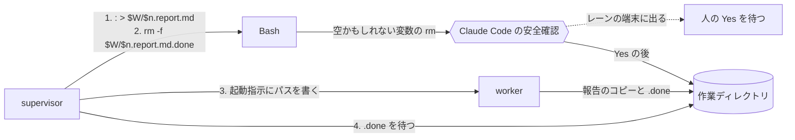
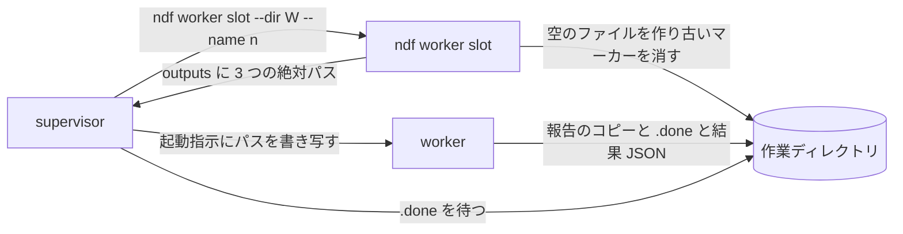
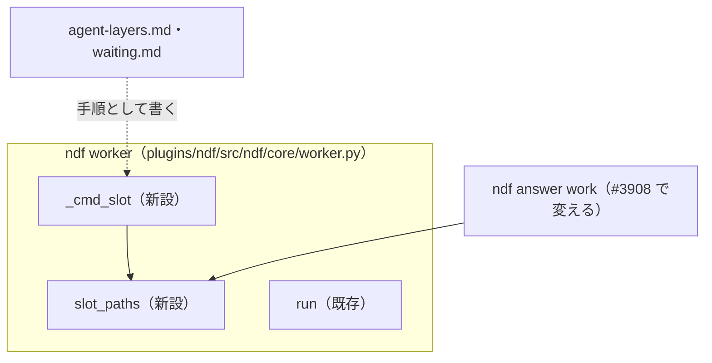
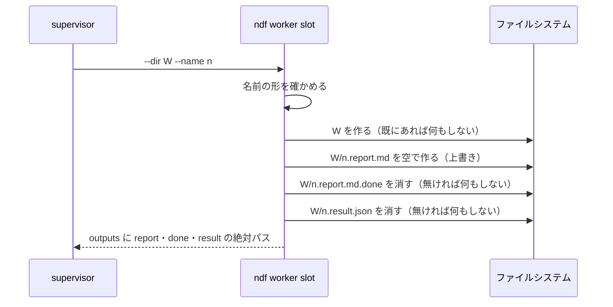

# 報告の置き場所: supervisor が `ndf` の 1 行で用意し、確認ダイアログでレーンが止まらない（#3877）

supervisor が worker へ渡す報告の置き場所を、手順書どおりシェルの変数と `rm` で用意すると、Claude Code の安全確認がレーンを止めた。置き場所のパスの決め方とファイルの始末を `ndf worker slot` のサブコマンドへ移し、手順書はそのコマンド 1 行だけを書く形にする。Bash に `rm` が現れなくなり、パスの決め方もコードが持つ。採らなかった案と、hook を足すかの判断の材料は「決定の記録」と「外部の調査」にある。

## 今の姿

何が起きたか・目的・受け入れ条件は要求仕様（[issue-3877-requirements.md](./issue-3877-requirements.md)、正は #3877 の本文）にある。この文書は「どう解くか」と「なぜその解き方か」だけを書く。

supervisor が worker へ作業を出すときの置き場所の用意は、手順書の 2 行だけが持つ。

| ファイル:行 | 何を書いているか |
| --- | --- |
| `plugins/ndf/skills/development-workflow/references/agent-layers.md:235` | 起動指示の「置く場所」の欄。`: > <置く場所>; rm -f <置く場所>.done` を書く唯一の行 |
| `plugins/ndf/skills/development-workflow/references/waiting.md:229` | 待ち方の手順。同じ 2 つのコマンドを書く |

エージェントの定義（`plugins/ndf/agents/`）と hook には同じ形が無く、`rm` を見る guard も無い（`plugins/ndf/contracts/hooks/guards.json` の 17 件に `rm` を扱うものは無い）。



止まるのは 2 の行である。supervisor は worker ごとの置き場所をまとめて用意するため、2 つのコマンドをシェルの変数とループで書き、Claude Code の「空かもしれない変数のパスへの `rm`」の確認に当たる。確認はレーンの端末に出る画面で、モデルには届かない。

## 文脈と制約

- 確認ダイアログが開いている間、そのツールの呼び出しは結果を返さない。サブエージェントのコマンドでも確認はレーンの端末に出るため、worker へ移しても conductor へ移しても同じ画面で止まる
- 置き場所のパスは supervisor が worker の起動指示へ書き写すため、コマンドが返すパスは絶対パスで、supervisor が読み取れる形でなければならない
- worker の側の約束（報告のコピーを書き、`<置く場所>.done` を作る）は変えない。worker は `ndf` のサブコマンドを持たない経路（サブエージェント）でも動く
- `ndf` のコマンドは 1 回の Bash の呼び出しで 1 つだけ打つ（hook の `script-chain` guard）。用意も 1 回の呼び出しで終わらなければならない
- プランの経路（`ndf answer work`）は同じ保存先に `<作業名>-prompt.md`・`<作業名>-result.json` を置く。パスの決め方を 2 か所に分けない（#3908 の設計がこの決め方を使う）

## 解き方の全体像



supervisor は `ndf worker slot --dir <作業ディレクトリ> --name <worker の名前>` を 1 回打つ。コマンドは作業ディレクトリを作り、報告の置き場所を空のファイルとして作り、前の完了マーカーと前の作業の結果ファイルを消し、3 つの絶対パス（`report`・`done`・`result`）を結果の `outputs` に返す。supervisor はその 3 つを起動指示の「置く場所」「作業の結果ファイル」に書き写す。手順書からはパスを組み立てる変数と `rm` が消える。

## 構成要素

| 要素 | 責務 |
| --- | --- |
| `ndf worker slot`（新設のサブコマンド） | 作業ディレクトリと worker の名前から 3 つのパスを決め、置き場所を空で作り、古い完了マーカーと結果ファイルを消し、絶対パスを返す |
| `slot_paths`（新設の関数） | 作業ディレクトリと名前から 3 つのパスを組む。ファイルを触らない純粋な処理。`ndf answer work` もこの関数を使う（#3908） |
| `agent-layers.md` の「置く場所」「作業の結果ファイル」の欄（変更） | コマンド 1 行と、返りの 3 つのパスの読み方だけを書く |
| `waiting.md` の「中間通知を受けたとき」（変更） | 同じコマンド 1 行を書く |



## 入出力のコントラクト

```text
ndf worker slot --dir <作業ディレクトリ> --name <worker の名前>
```

| 引数 | 型・必須 | 意味 |
| --- | --- | --- |
| `--dir` | string・必須 | supervisor の作業ディレクトリ。無ければ作る |
| `--name` | string・必須 | worker ごとの名前。`[A-Za-z0-9._-]` の 1〜64 文字。ほかの文字があれば `invalid` で断る |

結果 JSON（`status: ok`）の `outputs`:

| キー | 値 |
| --- | --- |
| `report` | `<作業ディレクトリ>/<名前>.report.md` の絶対パス。空のファイルとして作る |
| `done` | `<作業ディレクトリ>/<名前>.report.md.done` の絶対パス。既にあれば消す（作らない） |
| `result` | `<作業ディレクトリ>/<名前>.result.json` の絶対パス。既にあれば消す（作らない） |

`items` には作ったパスと消したパスを並べる。作業ディレクトリを作れない・名前が形に合わないときは `stopped`（`invalid`）で、`summary` に理由を書く。

## 処理の流れ



同じ名前で 2 回打つと、1 回目の報告のコピーは空に上書きされ、1 回目の完了マーカーと結果ファイルは消える。supervisor が 2 回目の `.done` を待つとき、1 回目のマーカーを完了と読むことはない（受け入れ条件 3）。

## 決定の記録

### 決定 1: Bash から `rm` を無くすため、置き場所の用意を `ndf` のサブコマンドへ移す

- **質問**: supervisor が置き場所を用意するときに確認ダイアログを出さないために、どこを変えるか
- **選んだ案**: パスの決定・空のファイル・古いマーカーの始末を `ndf worker slot` のサブコマンド 1 つにまとめ、手順書はそのコマンドだけを書く
- 採らなかった案:
  - 手順書の例を `${W:?}` の形に直す（シェルの書き方を手順書で縛っても、supervisor が別の形で書けば同じ確認に当たる。手順書の文言は振る舞いを保証しない）
  - 置き場所を毎回新しいパス（連番や時刻）にして `rm` を無くす（消すマーカーは無くなるが、supervisor が前の番号を覚える必要があり、起動指示へ書き写すパスが実行ごとに変わる）
  - worker を別プロセス（`claude -p`）で起動して画面の無い実行にする（置き場所の用意の問題とは別の変更で、supervisor がサブエージェントを使う経路は残る）
- **代償**: `ndf` のサブコマンドが 1 つ増える。`ndf` を持たない環境では手順書どおりに用意できない（NDF の手順書は `ndf` があることを前提にしている）
- 作り方: 自前で作る（既存の `ndf worker` のサブコマンドに 1 つ足す）
- 比べた候補: LIB1（Python 標準ライブラリの `pathlib`・`os`。依存を足さずにパスの組み立てとファイルの始末ができる）
- 根拠: Value 3「同じ手順は毎回同じ結果になる」（判断の要らない手順は仕組みが進める）・Value 1「ワークフロー上の課題で、利用者に操作を求めない」（MVV バージョン 1）

### 決定 2: パスの取り違えを断つため、パスの決め方を 1 つの関数に置く

- **質問**: supervisor の経路（サブエージェント）とプランの経路（`ndf answer work`）で、置き場所のパスの決め方を分けるか
- **選んだ案**: `slot_paths` の 1 つの関数が、作業ディレクトリと名前から 3 つのパスを組む。`ndf worker slot` と `ndf answer work`（#3908）がどちらもこの関数を使う
- 採らなかった案: 経路ごとにパスを組む（同じ役割の決め方が 2 か所に分かれ、片方だけが変わる）
- **代償**: 2 つの課題（#3877 と #3908）が同じ関数を触るため、実装の順序が決まる（#3877 が先）
- 根拠: Value 3「同じ手順は毎回同じ結果になる」（MVV バージョン 1）

### 決定 3: 名前の形をコマンドが確かめ、作業ディレクトリの外へ出さない

- **質問**: `--name` に任意の文字列を許すか
- **選んだ案**: `[A-Za-z0-9._-]` の 1〜64 文字だけを許し、ほかは `invalid` で断る
- 採らなかった案: 何でも許してパスとして組む（`../` を含む名前が作業ディレクトリの外のファイルを消す）
- **代償**: 日本語の worker 名を使えない。supervisor は英数字の名前を付ける
- 根拠: Value 7「人を害する・秘密・利用者のデータ・戻せない操作に関わる指摘は、効率に寄与しなくても直される」（MVV バージョン 1）

### 決定 4: `rm` を見る hook は、順序を確かめてから足すかを決める

- **質問**: 空かもしれない変数を使った `rm` を PreToolUse の guard で拒否するか（要求仕様の受け入れ条件 5）
- **選んだ案**: `PreToolUse` の guard を足し、空かもしれない変数をパスに含む `rm` を `deny` して書き直しの形を返す。公式の文書が「`PreToolUse` hooks run before the permission prompt.」（STD1）と定めるため、guard は確認のダイアログより先に呼ばれる。実装の最初に実機で 1 回確かめ、先に働かなければ guard を外して結果を Pull Request に残す
- 採らなかった案:
  - `PermissionRequest` の事象で拒否する（確認を出す直前に走る（STD2）ので遅くはないが、終了コード 2 が効かず `decision` の形でしか返せない。今ある 17 件の guard はどれもこの事象を使っておらず、実績が無い）
  - guard を足さないと決める（手順書の外で supervisor が `rm` を書いたときの守りが無くなる）
  - `permissionDecision` を `"allow"` にして確認を飛ばす（公式の文書が「Recognized `rm` and `rmdir` critical-path removals, which no allow rule or `PreToolUse` hook `"allow"` approves」（STD3）と定め、この確認は hook の承認では飛ばせない）
- **代償**: 公式の文書は「`deny` のときにダイアログが出ない」とまでは書いていない（理由の宛先が Claude であることからの読み取りにとどまる）。実機の確認が要る
- 作り方: 標準に倣う（Claude Code の hook のコントラクト）
- 比べた候補: STD1・STD2・STD3
- 根拠: Value 3「手順は使うほど増えるのではなく、減っていく」（MVV バージョン 1）

## 影響と危険

- **働く範囲**: `plugins/ndf` のリリース対象。利用先のリポジトリでも、supervisor を使うすべての実行に当たる
- **プロジェクトごとに違うもの**: 無し。作業ディレクトリは supervisor が起動指示で受け取る値で、設定には置かない
- **当たるモード**: すべてのモード（supervisor が worker を使うときに当たる）

### 代表のリポジトリでの振る舞い

| 代表のリポジトリ | 設定の要点 | 直した後に起きること | この種類で扱えなくなること |
| --- | --- | --- | --- |
| Web サービス | 設定に依らない（作業ディレクトリは実行のたびに決まる） | supervisor が `ndf worker slot` を打って置き場所を用意する | 無し |
| モバイルアプリ | 同上 | 同上 | 無し |
| 業務文書だけ | 同上 | 同上（`documentation` のモードでも supervisor は worker を使う） | 無し |

### ai-plugins だけの事情

- 無し（この変更はリポジトリの運用の値を持たない）

危険:

- `agent-layers.md` は並行するほかのスプリントも触る文書である。設計 Pull Request のマージの時点で衝突しうるため、実装では該当の 2 行だけを変える
- 置き場所のパスの形（`<名前>.report.md`）を変えると、今動いている supervisor の起動指示と食い違う。形は今の手順書の例と同じにする

## 用語

| 用語 | 意味 | 用語集への反映 |
| --- | --- | --- |
| 置き場所 | supervisor が worker へ渡す、報告のコピー・完了マーカー・作業の結果ファイルの 3 つのパスの組 | 追加 |

## テスト設計

| 受け入れ条件・不変条件 | どの振る舞いで縛るか | どう壊したら落ちるべきか |
| --- | --- | --- |
| 1（コマンド 1 回で済む） | `ndf worker slot --dir D --name n` が `status: ok` を返し、`outputs` に `report`・`done`・`result` の 3 つの絶対パスが入る | 返りから `result` を落とすと落ちる |
| 2（確認の条件に当たらない） | 手順書（`agent-layers.md`・`waiting.md`）に、置き場所のパスを組み立てる変数と `rm` が残っていない | 手順書に `rm -f` の行を戻すと落ちる |
| 3（前のマーカーを読まない） | 同じ `--dir` と `--name` で 2 回打つと、1 回目に作った `.done` と `.result.json` が消え、`report` は空になる | 2 回目で消さないようにすると落ちる |
| 4（絶対パスを返す） | `--dir` に相対パスを渡しても、`outputs` の 3 つは絶対パスで返る | 相対パスのまま返すと落ちる |
| 4（作業ディレクトリを作る） | `--dir` が無いディレクトリでも作って用意する | 作らずに `stopped` にすると落ちる |
| 決定 3（名前の形） | `--name` に `../x` や空文字を渡すと `stopped`（`invalid`）で、ファイルを 1 つも触らない | 形を確かめずにパスへ組むと落ちる |
| 5（hook の拒否） | 実測で順序を確かめた後に書く。先に働くなら、空かもしれない変数の `rm` を含むコマンドで guard が `deny` を返す | guard の条件から変数の判定を外すと落ちる |

## どこを変えるか

詳細設計はこのセクションに畳む（新設する関数 2・シグネチャを変える関数 0）。

| ファイル | 変える中身 | 決定 |
| --- | --- | --- |
| `plugins/ndf/src/ndf/core/worker.py` | `slot_paths(dir: Path, name: str) -> tuple[Path, Path, Path]`（新設）: 作業ディレクトリと名前から報告・完了マーカー・結果ファイルの 3 つの絶対パスを組む。名前が `[A-Za-z0-9._-]{1,64}` でなければ `model.Refused` を上げる。ファイルを触らない。`_cmd_slot(argv) -> int`（新設）: `--dir`・`--name` を読み、`slot_paths` でパスを組み、作業ディレクトリを作り、報告を空で作り、完了マーカーと結果ファイルを消し、`outputs` に 3 つのパスを入れた結果 JSON を返す。名前の誤りは `stopped`（`invalid`）で、ファイルを触らずに返す | 1・2・3 |
| `plugins/ndf/docs/contracts/commands.md` | `ndf worker slot` の節（`ndf check --write-spec` が生成する） | 1 |
| `plugins/ndf/skills/development-workflow/references/agent-layers.md` | 「置く場所」「作業の結果ファイル」の欄を、`ndf worker slot` の 1 行と返りの 3 つのパスの読み方に書き換える | 1 |
| `plugins/ndf/skills/development-workflow/references/waiting.md` | 「中間通知を受けたとき」の用意の記述を同じコマンドに書き換える | 1 |
| `plugins/ndf/tests/core/test_worker_slot.py`（新設） | 上のテスト設計の 6 行 | 1・3 |
| `plugins/ndf/contracts/hooks/guards.json`・`plugins/ndf/src/ndf/domains/hooks/guards/rm_variable.py`（新設） | 決定 4 の実測で「hook が先に働く」と確かめられたときだけ足す。空かもしれない変数をパスに含む `rm` を `deny` し、`${W:?}` の形か固定のパスへの書き直しを案内する | 4 |

## 設計の結果

| 課題 | 扱い | 統合先 | 触るファイル |
| --- | --- | --- | --- |
| #3877 | 実装する | — | `plugins/ndf/src/ndf/core/worker.py`、`plugins/ndf/docs/contracts/commands.md`、`plugins/ndf/skills/development-workflow/references/agent-layers.md`、`plugins/ndf/skills/development-workflow/references/waiting.md`、`plugins/ndf/tests/core/test_worker_slot.py`（新設）、`plugins/ndf/contracts/hooks/guards.json`、`plugins/ndf/src/ndf/domains/hooks/guards/rm_variable.py`（新設） |

## 未確認のまま残ること

| 項目 | 内容 |
| --- | --- |
| hook と確認の順序 | NDF の `PreToolUse` の guard が、Claude Code の「Dangerous rm operation on possibly-empty variable path」の確認より先に働くかは、実機で打つまで分からない。公式の記述は外部の調査の STD の表にある。実装の最初に、確認の出ない安全な形（別のプロセスで `rm -f $UNSET/x` を打つ）で確かめ、結果を実装の Pull Request に残す |
| `PermissionRequest` の事象 | 事象の登録とコントラクト（`plugins/ndf/contracts/hooks/runtimes.json:21-27`）はあるが、使っている guard が 1 件も無く、呼ばれる時点の実績が無い |

## 外部の調査

| 種類 | 調べるか | 理由 |
| --- | --- | --- |
| 標準・仕様 | 調べる | 確認のダイアログを出すのは Claude Code で、hook と permission の順序はその仕様が決める（決定 4 の分かれ目） |
| 主要な製品 | 調べない | 置き場所の用意は NDF の手順書の中だけの取り決めで、ほかの製品が同じ問題を解く形を持たない |
| ライブラリとサービス | 調べる | 自前で作る決定（決定 1）があるため、パスの組み立てとファイルの始末を担う候補を比べる |

### 標準・仕様

| # | 標準・仕様 | 何を定めているか | 設計への反映 | 出典 |
| --- | --- | --- | --- | --- |
| STD1 | Claude Code の permissions（hook と確認の順序） | 「PreToolUse hooks run before the permission prompt. The hook output can deny the tool call, force a prompt, or skip the prompt to let the call proceed.」。終了コード 2 の hook は「stops the tool call before permission rules are evaluated」 | 決定 4。`PreToolUse` の guard を足す根拠 | https://code.claude.com/docs/en/permissions （2026-11-23） |
| STD2 | Claude Code の hooks（`PreToolUse` と `PermissionRequest` の決定） | `PreToolUse` の `permissionDecision` は `allow`・`deny`・`ask`・`defer` の 4 値で、優先は `deny` > `defer` > `ask` > `allow`。理由の宛先は `ask` が利用者、`deny` が Claude。`PermissionRequest` は「Runs when Claude Code is about to ask you for permission to use a tool.」で、終了コード 2 は効かない | 決定 4。`PermissionRequest` を採らず `PreToolUse` を使う根拠 | https://code.claude.com/docs/en/hooks （2026-11-23） |
| STD3 | Claude Code の permission modes（どのモードでも自動承認しない行為） | 「Claude Code doesn't auto-approve the following in any mode, including `bypassPermissions`」の一覧に「Recognized `rm` and `rmdir` critical-path removals, which no allow rule or `PreToolUse` hook `"allow"` approves, and Bash commands flagged `Dangerous rm operation not ruled out`」 | 決定 4。`"allow"` で確認を飛ばす案を採らない根拠。#3877 で止まったのがこの確認である | https://code.claude.com/docs/en/permission-modes （2026-11-23） |

### ライブラリとサービス

| # | 候補 | バージョン | ライセンス | 最後のリリースの日付 | 終了のアナウンス | 要件を満たすか | 出典 |
| --- | --- | --- | --- | --- | --- | --- | --- |
| LIB1 | Python 標準ライブラリの `pathlib`・`os` | Python 3 の標準ライブラリ | Python Software Foundation License | 標準ライブラリのため個別のリリース日なし | 無し | 満たす。パスの組み立て・ディレクトリの作成・ファイルの削除がそろい、依存を足さない | https://docs.python.org/3/library/string.html の標準ライブラリの一覧（2026-11-23） |

### 確かめられなかったこと

| 対象 | 試した手段 | 結果と理由 |
| --- | --- | --- |
| 「`PreToolUse` の `deny` で確認のダイアログが出ない」の明示の文 | https://code.claude.com/docs/en/hooks を 3 回、https://code.claude.com/docs/en/permissions を 1 回取得 | 見つからない。`"deny" prevents the tool call.` と、理由の宛先が Claude であることまでしか書かれていない。hooks のページは 293,973 文字で、取得の上限に当たり後半を読んでいない |
| `Dangerous rm operation not ruled out` の節の定義の原文 | https://code.claude.com/docs/en/permission-modes を取得 | その節は取得した範囲（先頭 100,000 文字）の外で切れた。箇条書きからの引用にとどまる。理由: 上限 |

調べた量: 候補 4 件・取得の試み 7 回。
