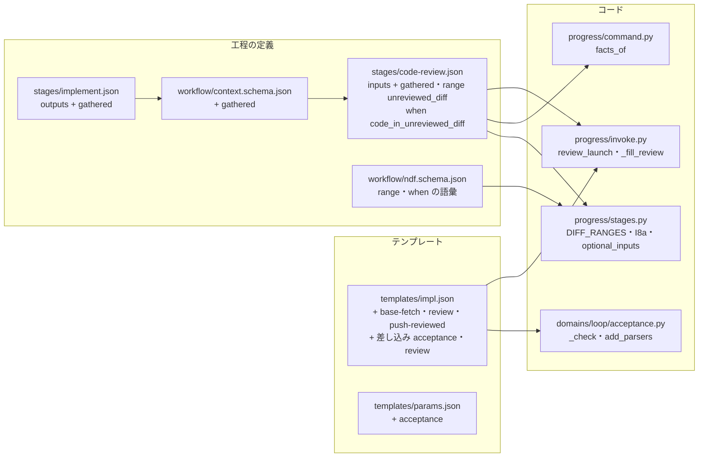

# 詳細設計: 工程表のレビューの単位とリファクタリングの時機（#3879）

設計書 [issue-3879-design.md](./issue-3879-design.md) の決定を、どのファイルのどの関数・ステップで実装するかを引けるように並べる。なぜその形かは設計書の決定にあり、ここでは繰り返さない。

## 地図

依存の向きは今のまま（テンプレートと定義はデータで、コードがそれを読む）。新しいモジュールは作らない。

## 構成要素

### 1. 実装のテンプレート（`plugins/ndf/contracts/templates/impl.json`・`params.json`）

満たす決定: 決定 2・決定 6、受け入れ条件 1

| 変更 | 中身 |
| --- | --- |
| ステップの並び | `… → push → pr → conflict-check → base-fetch → review → push-reviewed → ci → end`。今の `ci` の `next: end` は `push-reviewed` の後の `ci` に移す |
| `base-fetch`（新設） | `["git", "fetch", "{{remote}}", "{{base}}"]`。レビューの起点 `<リモート>/<base>` を新しくする |
| `review`（新設） | `{"id": "review", "run": ["{{review}}"], "on_cause": {"incomplete": "push-reviewed"}}`。収束しないまま上限に達したら先へ進み、結果に残す（検査のテンプレートの `review` と同じ扱い） |
| `push-reviewed`（新設） | 共有の `push` を使い、レビューの直しのコミットを送る |
| `acceptance` | `["ndf", "loop", "acceptance", "check", "{{acceptance}}"]`。`params` に `acceptance` を足す |
| `params.json` | `acceptance`: 「受け入れ条件の確かめの引数の並び。既定は `--issue <issue>`。単位が課題の一部なら `--criteria <課題>:<条件>`、課題を束ねた単位なら課題ごとの `--issue` を足す」（`list: true`）。`issue` から既定を補う処理は構成要素 4 |

単体テストの観点（`tests/route/test_templates.py`）:

| 観点 | 期待 |
| --- | --- |
| 組んだプランのステップの順 | `pr` の後に `base-fetch → review → push-reviewed → ci` の順 |
| `acceptance` を渡さない | `acceptance` のステップの引数が `--issue <issue>` |
| `--add acceptance=--criteria --add acceptance=1:2` | 引数の後ろが `--criteria 1:2` |

### 2. 工程の定義（`stages/implement.json`・`stages/code-review.json`・`workflow/ndf.schema.json`・`workflow/context.schema.json`）

満たす決定: 決定 3、受け入れ条件 2・3・5

| ファイル | 変更 |
| --- | --- |
| `context.schema.json` | `gathered` を足す（40 桁の 16 進のコミット。説明「すべての単位の PR をスプリントブランチへマージした時点のスプリントブランチのコミット」） |
| `implement.json` | `metadata.ndf.outputs` に `gathered` を足す |
| `code-review.json` | `metadata.ndf.optional_inputs` に `gathered` を置く（文脈に無くても流せる入力。走り中のスプリントのため）。`metadata.ndf.when` に `code_in_unreviewed_diff` を置く。`do[0].metadata.ndf.range` を `unreviewed_diff` にする |
| `ndf.schema.json` | `range` の `enum` に `unreviewed_diff`、`when` の語彙に `code_in_unreviewed_diff`、`metadata.ndf` に `optional_inputs`（文脈のキーの並び）を足し、説明を書く |

- 今の入力（`inputs`）は、文脈に無いキーがあると `resolve_inputs`（`invoke.py` 216 行）が `StageInputMissing` で断る。そのため必須の `inputs` とは別の欄にし、構成要素 4 の `resolve_inputs` が、文脈にあるときだけ渡す

単体テストの観点（`tests/progress/test_definition.py`）: 5 つのモードの定義が読み込める。`range` と `when` に知らない語を書いた工程の定義は今のとおり断られる。

### 3. 工程の条件の語（`plugins/ndf/src/ndf/progress/command.py`）

満たす決定: 決定 3、受け入れ条件 3

| 関数 | 種類 | シグネチャ | 責務 |
| --- | --- | --- | --- |
| `facts_of` | 変更 | 今のまま | `known` に `code_in_unreviewed_diff` を足す。文脈に `gathered` があれば `range_diff_kinds(git, f"{gathered}..HEAD", cwd)["code_in_diff"]`、無ければ `sprint_diff_kinds(context, cwd)["code_in_diff"]`（走り中のスプリントは今のとおり） |

- 範囲を `..`（2 点）にするのは、起点が HEAD の祖先のコミットで、分岐点を求める必要が無いためである。差分が空なら `code_in_diff` は偽になる（`diff_kinds` の今の規則）
- `git` を作る場所は `_sprint_range` と同じ（工程の作業場所）

異常系:

| 起きること | 扱い |
| --- | --- |
| `gathered` がコミットとして読めない | `FactUnknown`（今の工程の条件の扱いで、工程は判定できないとして止まる）。ベースブランチへ倒さない（倒すと、つなぎ目だけのはずが全差分になり、費用が黙って増える） |

単体テストの観点（`tests/progress/test_command.py`）:

| 観点 | 期待 |
| --- | --- |
| `gathered` の後にコードのコミットがある | 真 |
| `gathered` の後に文書のコミットだけ | 偽 |
| `gathered` の後にコミットが無い | 偽 |
| 文脈に `gathered` が無い | スプリントの差分の `code_in_diff` と同じ値 |
| `gathered` が存在しないコミット | `FactUnknown` |

### 4. レビューの起動の組み方（`plugins/ndf/src/ndf/progress/invoke.py`）

満たす決定: 決定 2・決定 3・決定 6、受け入れ条件 1・3

| 関数 | 種類 | シグネチャ | 責務 |
| --- | --- | --- | --- |
| `review_launch` | 変更 | 今のまま | 変えない（`base` に渡した値をそのまま `--base` にする） |
| `resolve_inputs` | 変更 | 今のまま | `stage.optional_inputs` のキーのうち文脈にあるものも取り、形を確かめて返す。無いキーは断らない |
| `_fill_review` | 変更 | `_fill_review(t, values, wanted, inputs: Mapping[str, Any])` | テンプレートが `impl` なら `base` を `<remote>/<base>`（`remote` が決まらなければ `origin`）にして `review_launch` へ渡す。文脈に `gathered` があり、テンプレートが `cross-review` なら `base` を `gathered` にする。値が設定（`workflow.launch.review`）から入っているときは、その並びの後ろに `--base <起点>` を足す（`gathered` があるときだけ） |
| `_fill_acceptance`（新設） | 新設 | `_fill_acceptance(values: Mapping[str, route.Value], wanted: Mapping[str, str]) -> dict[str, route.Value]` | `acceptance` が求められ、値が無く、`issue` があれば `["--issue", str(issue)]` を返す |

- `_fill_review` の呼び出し元（`invoke.py` 466 行。工程から組むときの差し込みの組み立て）は `run.inputs` を渡す。`gathered` はテンプレートの差し込みの名前に無いので、`values` には入らず `run.inputs` から読む。単発の `ndf route render` の経路（`route.derived`）は文脈を持たないので、`gathered` の分岐は工程から組むときだけ働く
- 事後条件: テンプレートが `impl` でも `cross-review` でもなく、`gathered` も無いときの値は今と同じ並び（既存のテストが通る）

異常系:

| 起きること | 扱い |
| --- | --- |
| `impl` で `base` が決まらない | 今のまま `{{review}}` を埋めず、プランを組む時点に差し込みの欠けで止まる |
| 設定の起動の並びが `--base` を受けない | cross-review 以外の起動を設定に書いたリポジトリの責任とし、`ndf` は並びを書き換えない（足した `--base` で起動が失敗すれば、レビューのステップの失敗として止まる） |

単体テストの観点（`tests/progress/test_invoke.py`）:

| 観点 | 期待 |
| --- | --- |
| `impl` で `base=sprint/x` | `{{review}}` の `--base` が `origin/sprint/x` |
| `cross-review` で文脈に `gathered=<sha>` | `--base <sha>` |
| `optional_inputs` の `gathered` が文脈に無い | `resolve_inputs` が断らず、入力に `gathered` が無い |
| `cross-review` で文脈に `gathered` が無い | 今のまま `--base <ベースブランチ>` |
| 設定に `workflow.launch.review` があり `gathered` がある | 設定の並びの後ろに `--base <sha>` |
| `acceptance` を渡さず `issue=12` | `acceptance` が `--issue 12` |

### 5. 範囲の語と順序の検査（`plugins/ndf/src/ndf/progress/stages.py`）

満たす決定: 決定 3、受け入れ条件 3・5

| 名前 | 種類 | 変更 |
| --- | --- | --- |
| `DIFF_RANGES` | 定数 | `("sprint_diff", "issue_diff", "unreviewed_diff")`。I9 の文言の括弧の中も同じ並びにする |
| `StageDef` と定義の読み込み（`definition.py` 321 行の近く） | 変更 | `metadata.ndf.optional_inputs` を `StageDef.optional_inputs`（既定は空のタプル）に読む |
| I8a の検査（`check_order` の中、154〜175 行の関数） | 変更 | 「同じ範囲の review がリリースより後ろにある」を照らすとき、`unreviewed_diff` の review を `sprint_diff` をリリースするステップと照らす（`unreviewed_diff` は `sprint_diff` の一部で、同じリリースで届く） |

単体テストの観点（`tests/progress/test_definition.py`）:

| 観点 | 期待 |
| --- | --- |
| `unreviewed_diff` の review がデプロイより前 | 通る |
| `unreviewed_diff` の review をデプロイの後ろへ動かした定義 | I8a で断られる |

### 6. 受け入れ条件の確かめ（`plugins/ndf/src/ndf/domains/loop/acceptance.py`）

満たす決定: 決定 6、受け入れ条件 1

| 関数 | 種類 | シグネチャ | 責務 |
| --- | --- | --- | --- |
| `add_parsers` | 変更 | — | `check` の `--issue` を繰り返せるようにする（`action="append"`）。`check` に `--criteria`（`<課題>:<条件>` の形、繰り返し）を足す。`record`・`show` の `--issue` は 1 つのまま |
| `_check` | 変更 | 今のまま | 課題ごとに今の照らしを行い、結果を 1 つにまとめる。`--criteria` にその課題の番号の組があれば、その条件だけを照らす。どれか 1 つの課題に欠けがあれば `incomplete`、欠けの `name` は `<課題>:<条件>` |

- 事後条件: `--issue` 1 つ・`--criteria` なしの結果は今と同じ（`name` も今の条件の番号だけ）
- `--criteria` に、渡した `--issue` に無い課題か、本文に無い条件の番号があれば `invalid` で止まる（単位の満たす条件の写し誤りを黙って通さない）

単体テストの観点（`tests/domains/loop/test_loop_acceptance.py`）:

| 観点 | 期待 |
| --- | --- |
| 課題 1 の条件 1・2 に記録があり 3 に無い本文で `--issue 1 --criteria 1:1 1:2` | `ok` |
| 同じ本文で `--criteria` なし | `incomplete`（今のまま） |
| 課題 1・2 を `--issue 1 --issue 2`、課題 2 に欠け | `incomplete`、欠けの `name` が `2:<番号>` |
| `--criteria 1:9`（本文に無い） | `invalid` |

### 7. 手順書（Markdown）

満たす決定: 決定 1・2・4・5、受け入れ条件 2・4・5

| ファイル | 変える所 |
| --- | --- |
| `development-workflow/SKILL.md` | 「工程が動く単位」の表を設計書の「工程表の変わる所」の表にする。「工程ごとの決まり」のリファクタリング・コードレビューの行を、単位の PR のレビューとつなぎ目のレビューに書き直す。要求と受け入れ条件・設計・詳細設計・計画の行に、文書の要否は #3868 の `document-roles.md` を指す 1 文と、設計書を省いたときの扱い（決定 5 の表）を足す。完了判定の行に、省いた条件が外れたときの流し直し（決定 5）を足す |
| `development-workflow/references/parallel-work.md` | 「工程が動く単位」の表を SKILL.md と同じにし、「課題の PR はコードレビューを通さない」と `fast` の列を消す |
| `development-workflow/references/stage-notes.md` | リファクタリングのセクションに 3 つの時機を書き、「cross-refactoring を通したら次のコードレビューを重ねて呼ばない」をつなぎ目のレビューの説明に替える |
| `development-workflow/references/workflow-modes.md` | 「標準フロー」の図を、単位ごとの実装とレビュー → 集めた後のリファクタリング → つなぎ目のレビューの順にする |
| `development-workflow/references/agent-layers.md` | フェーズの表の実装の行（単位「レビューの単位」、終わりの条件「すべての単位の PR をスプリントブランチへマージした」）と検査の行（始まりの条件を同じ字に、工程を「リファクタリング（スプリントの終わり）/ コードレビュー（つなぎ目）」）。実装のフェーズの supervisor が単位ごとに `ndf route render implement` を組む引数（`branch`・`base`・`issue`・`acceptance`）と、工程「実装」の出力に `gathered` を書くこと |
| `implementation-plan/SKILL.md` | #3868 が足すレビューの単位の欄の後に、欄の行が実行計画の実装の行と実装のプランになること、満たす受け入れ条件が実装のプランの `acceptance` へ渡ることを 1 文で書く |
| `issue-plan-strategy/references/execution-plan.md` | 実装の行を「設計の見直しで仮の行（課題ごと）、計画の後の見直しでレビューの単位から置き直す」にする |
| `docs/glossary/glossary.json`・`docs/glossary/ndf-branch-strategy.md`・`docs/glossary.md` | 設計書の「用語」の 4 語を反映し、`ndf records glossary render` で作り直す |
