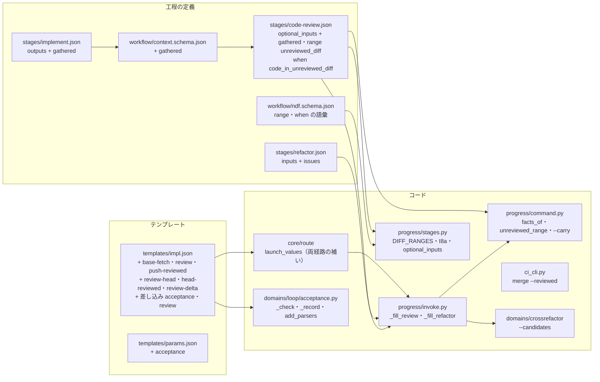

# 詳細設計: 工程表のレビューの単位とリファクタリングの時機（#3879）

設計書 [issue-3879-design.md](./issue-3879-design.md) の決定を、どのファイルのどの関数・ステップで実装するかを引けるように並べる。なぜその形かは設計書の決定にあり、ここでは繰り返さない。

## 地図

依存の向きは今のまま（テンプレートと定義はデータで、コードがそれを読む。`progress` は `core.route` を使い、逆は無い）。新しいモジュールは作らない。

## 構成要素

### 1. 実装のテンプレート（`plugins/ndf/contracts/templates/impl.json`・`params.json`）

満たす決定: 決定 2・決定 6、受け入れ条件 1

| 変更 | 中身 |
| --- | --- |
| ステップの並び | `… → push → pr → conflict-check → base-fetch → review → push-reviewed → review-head → ci → head-reviewed → end`。今の `ci` の `next: end` は `head-reviewed` に移す |
| `base-fetch`（新設） | `["git", "fetch", "{{remote}}", "{{base}}"]`。レビューの起点 `<リモート>/<base>` を新しくする |
| `review`（新設） | `{"id": "review", "run": ["{{review}}"], "on_cause": {"incomplete": "push-reviewed"}}`。収束しないまま上限に達したら先へ進み、結果に残す（検査のテンプレートの `review` と同じ扱い） |
| `push-reviewed`（新設） | 共有の `push` を使い、レビューの直しのコミットを送る |
| `review-head`（新設） | `["sh", "-c", "git rev-parse HEAD > \"$0\"", "{state_dir}/reviewed-head"]`。レビューを経た HEAD を書く |
| `head-reviewed`（新設） | `["sh", "-c", "test \"$(cat \"$0\")\" = \"$(git rev-parse HEAD)\"", "{state_dir}/reviewed-head"]`、`exit_cause: {"1": "unreviewed"}`、`on_cause: {"unreviewed": "review-delta"}`、`next: end`。CI が通った後に、レビュー後のコミット（`ci-fix`・`base-sync` の後の `fix-push` など）が載っていれば先へ進めない |
| `review-delta`（新設） | `["sh", "-c", "b=$(cat \"$0\") && exec \"$@\" --base \"$b\" --state-dir {state_dir}/cross-review-delta", "{state_dir}/reviewed-head", "{{review}}"]`、`on_cause: {"incomplete": "push-reviewed"}`、`next: push-reviewed`。cross-review は後に書いた引数が勝つので、起点はレビューした HEAD になり、状態ディレクトリも最初のレビューと分かれる。`push-reviewed` → `review-head` → `ci` → `head-reviewed` を通り直す。周回の数は今の `ci` の予算（`ci_budget`）と `repeat-check` が縛る |
| `acceptance` | `["ndf", "loop", "acceptance", "check", "{{acceptance}}"]`。`params` に `acceptance` を足す |
| `params.json` | `acceptance`: 「受け入れ条件の確かめの引数の並び。既定は `--issue <issue>`。渡すときは `--issue` を必ず含め、`--criteria <課題>:<条件>` は値 1 つごとに繰り返す（例 `--issue 1 --criteria 1:1 --criteria 1:2`）。課題を束ねた単位は課題ごとの `--issue`」（`list: true`）。補いと形の確かめは構成要素 4 |

単体テストの観点（`tests/route/test_templates.py`）:

| 観点 | 期待 |
| --- | --- |
| 組んだプランのステップの順 | `pr` の後に `base-fetch → review → push-reviewed → review-head → ci → head-reviewed` の順。`head-reviewed` の `unreviewed` は `review-delta` へ、`review-delta` の次は `push-reviewed` |
| `acceptance` を渡さない | `acceptance` のステップの引数が `--issue <issue>` |
| `acceptance=["--issue", "1", "--criteria", "1:1", "--criteria", "1:2"]` | `acceptance` のステップが `ndf loop acceptance check --issue 1 --criteria 1:1 --criteria 1:2` |

単体テストの観点（`tests/route/_flow.py` を使う流れのテスト、`tests/route/test_flows.py`）:

| 観点 | 期待 |
| --- | --- |
| `ci` が通った時点で HEAD が `reviewed-head` と同じ | `head-reviewed` を通って終わる |
| `ci-fix` の後に `ci` が通り、HEAD が `reviewed-head` と違う | `review-delta` が `--base <reviewed-head>` で打たれ、`reviewed-head` を書き直してから `ci` を待ち直し、終わるときの `reviewed-head` が HEAD と同じ |

### 2. 工程の定義（`stages/implement.json`・`stages/code-review.json`・`stages/refactor.json`・`workflow/ndf.schema.json`・`workflow/context.schema.json`）

満たす決定: 決定 3、受け入れ条件 2・3・5

| ファイル | 変更 |
| --- | --- |
| `context.schema.json` | `gathered` を足す（40 桁の 16 進のコミット。説明「すべての単位の PR をスプリントブランチへマージした時点のスプリントブランチのコミット」） |
| `implement.json` | `metadata.ndf.outputs` に `gathered` を足す |
| `code-review.json` | `metadata.ndf.optional_inputs` に `gathered` を置く（文脈に無くても流せる入力。走り中のスプリントのため）。`metadata.ndf.when` に `code_in_unreviewed_diff` を置く。`do[0].metadata.ndf.range` を `unreviewed_diff` にする |
| `refactor.json` | `metadata.ndf.inputs` を `["worktree", "branch", "issues"]` にする。今の入力は `worktree` と `branch` だけで、`resolve_inputs` は宣言したキーだけを `StageRun.inputs` に入れるため、足さないと構成要素 5 の `_fill_refactor` が課題の一覧を読めない。`issues` はステートマシンの作成（`ndf progress new`）が必ず書くキーなので、必須の `inputs` に置く |
| `ndf.schema.json` | `range` の `enum` に `unreviewed_diff`、`when` の語彙に `code_in_unreviewed_diff`、`metadata.ndf` に `optional_inputs`（文脈のキーの並び）を足し、説明を書く |

- 今の入力（`inputs`）は、文脈に無いキーがあると `resolve_inputs`（`invoke.py` 216 行）が `StageInputMissing` で断る。そのため必須の `inputs` とは別の欄にし、構成要素 5 の `resolve_inputs` が、文脈にあるときだけ渡す

単体テストの観点（`tests/progress/test_definition.py`）: 5 つのモードの定義が読み込める。`range` と `when` に知らない語を書いた工程の定義は今のとおり断られる。読み込んだ工程「リファクタリング」の `inputs` に `issues` がある。

### 3. 工程の条件の語と範囲（`plugins/ndf/src/ndf/progress/command.py`）

満たす決定: 決定 3、受け入れ条件 3

| 関数 | 種類 | シグネチャ | 責務 |
| --- | --- | --- | --- |
| `unreviewed_range`（新設） | 新設 | `unreviewed_range(context: Mapping[str, Any], cwd: Path) -> tuple[Git, str, str]` | つなぎ目の範囲を確かめて返す（`git`、範囲 `<gathered>..<先端>`、`gathered`）。`git` は `_sprint_range` と同じく文脈の `worktree`（無ければ `cwd`）で作る。先端は文脈の `branch`（無ければ `HEAD`）。次のどれかなら `FactUnknown`: `gathered` がコミットとして読めない／文脈に `branch` があり、worktree でチェックアウトしたブランチ（`git rev-parse --abbrev-ref HEAD`）と違う／`git merge-base --is-ancestor <gathered> <先端>` が偽 |
| `facts_of` | 変更 | 今のまま | `known` に `code_in_unreviewed_diff` を足す。文脈に `gathered` があれば `unreviewed_range` の範囲で `range_diff_kinds(...)["code_in_diff"]`、無ければ `sprint_diff_kinds(context, cwd)["code_in_diff"]`（走り中のスプリントは今のとおり） |

- 工程の条件（この関数）とレビューの起点（構成要素 5 の `_fill_review`）は、どちらも `unreviewed_range` を通す。worktree のブランチが文脈の `branch` と同じことを確かめるので、条件が見る先端と、cross-review がその worktree で読む `HEAD` は同じコミットになる。`gathered` が先端の祖先であることを確かめるので、条件の `gathered..<先端>` と cross-review の `gathered...HEAD` は同じ範囲になる
- 差分が空なら `code_in_diff` は偽になる（`diff_kinds` の今の規則）

異常系:

| 起きること | 扱い |
| --- | --- |
| `gathered` がコミットとして読めない | `FactUnknown`（今の工程の条件の扱いで、工程は判定できないとして止まる）。ベースブランチへ倒さない（倒すと、つなぎ目だけを読む工程が全差分を読み、費用が黙って増える） |
| 集めた後にスプリントブランチを書き換え、`gathered` が先端の祖先でない | `FactUnknown`。理由に `gathered` と先端のコミットを書く。工程はリベースを持たないので、起きたら conductor が利用者に知らせる |
| worktree のブランチが文脈の `branch` と違う | `FactUnknown`。理由に 2 つのブランチ名を書く |

単体テストの観点（`tests/progress/test_command.py`）:

| 観点 | 期待 |
| --- | --- |
| `gathered` の後にコードのコミットがある | 真 |
| `gathered` の後に文書のコミットだけ | 偽 |
| `gathered` の後にコミットが無い | 偽 |
| 文脈に `gathered` が無い | スプリントの差分の `code_in_diff` と同じ値 |
| `gathered` が存在しないコミット | `FactUnknown` |
| スプリントブランチを `gathered` の前から作り直した（`gathered` が祖先でない） | `FactUnknown` |
| worktree で別のブランチをチェックアウトしている | `FactUnknown` |

### 4. 差し込みの補いを 2 つの経路で共有する（`plugins/ndf/src/ndf/core/route/__init__.py`）

満たす決定: 決定 1・決定 2・決定 6、受け入れ条件 1

supervisor の組む `ndf route render implement`（`_write_plan` → `derived` → `render`）と、工程から組む `ndf.progress.invoke.template_values` の両方が、同じ関数で `review` と `acceptance` を補う。今は `review` の既定が `invoke.py` にしか無く、単発の経路ではレビューのステップが差し込みの欠けで組めない。

| 名前 | 種類 | シグネチャ | 責務 |
| --- | --- | --- | --- |
| `REVIEW_STATE`・`REVIEW_WITH_PR`・`review_launch` | 移す | 今のまま | `invoke.py` から `core.route` へ移す。`invoke.py` は `route.review_launch` を使う |
| `launch_values`（新設） | 新設 | `launch_values(t: Template, values: Mapping[str, Value]) -> dict[str, Value]` | テンプレートが使い、値の無い差し込みだけを返す。`review`: `branch` と `base`（`base` が無く `repo` があれば `default_base`）から `review_launch` で組む。テンプレートが `impl` なら起点を `<remote>/<base>`（`remote` が無ければ `origin`）にする。`acceptance`: 値が無く `issue` があれば `["--issue", str(issue)]` |
| `check_acceptance`（新設） | 新設 | `check_acceptance(values: Mapping[str, Value]) -> None` | 渡した `acceptance` の並びに `--issue` が無いか、`--issue`・`--criteria` の後に値が無ければ `RouteError`（実行の前に止める） |
| `_write_plan` | 変更 | 今のまま | `derived` の後に `values = {**values, **launch_values(t, values)}` と `check_acceptance(values)` を通してから `render` する |

単体テストの観点（`tests/route/test_cli.py`。一時のリポジトリで `route.main` を打つ）:

| 観点 | 期待 |
| --- | --- |
| 設計書の決定 1 のコマンドそのまま（`render implement --set branch=u1 --set base=sprint/x --set issue=1 --add acceptance=--issue --add acceptance=1 --add acceptance=--criteria --add acceptance=1:1 --add acceptance=--criteria --add acceptance=1:2 --out 
`） | プランが書け、`review` のステップの `--base` が `origin/sprint/x`、`acceptance` のステップが `--issue 1 --criteria 1:1 --criteria 1:2` |
| `acceptance` を省く（今の supervisor の呼び方） | プランが書け、`acceptance` のステップが `--issue 1` |
| `--add acceptance=--criteria --add acceptance=1:2`（`--issue` なし） | `RouteError` でプランを書かない |

### 5. 工程から組む経路（`plugins/ndf/src/ndf/progress/invoke.py`）

満たす決定: 決定 2・決定 3・決定 4、受け入れ条件 1・3

| 関数 | 種類 | シグネチャ | 責務 |
| --- | --- | --- | --- |
| `template_values` | 変更 | 今のまま | `route.derived` の後に `route.launch_values` と `route.check_acceptance` を通す（構成要素 4 と同じ補い）。その後に `_fill_review`・`_fill_refactor` を通す |
| `resolve_inputs` | 変更 | 今のまま | `stage.optional_inputs` のキーのうち文脈にあるものも取り、形を確かめて返す。無いキーは断らない |
| `_fill_review` | 変更 | `_fill_review(t, values, run: StageRun, cwd: Path) -> dict[str, route.Value]` | 既定の組み立ては `route.launch_values` へ移し、ここは `gathered` だけを扱う。テンプレートが `cross-review` で文脈に `gathered` があれば、`command.unreviewed_range` で確かめた `gathered` を起点にする。既定の値なら `review_launch` を `base=gathered` で組み直し、値が設定（`workflow.launch.review`）から入っているときは、その並びの後ろに `--base <gathered>` を足す |
| `_fill_refactor`（新設） | 新設 | `_fill_refactor(t, values, run: StageRun, state_dir: Path) -> dict[str, route.Value]` | テンプレートが `cross-refactoring` なら、`run.inputs["issues"]`（構成要素 2 で `refactor.json` の `inputs` に足したキー）の実装計画（`<worktree>/issues/issue-<番号>-plan.md`）から、#3868 の「リファクタリングの時機」の欄の「スプリントの終わり」の行を集め、`<state_dir>/refactor-candidates.md` に課題の番号を添えて書く。1 行でもあれば `refactor` の並びの後ろに `--candidates <そのファイル>` を足す。実装計画が無い課題・欄が無い課題は飛ばす |

- `gathered` はテンプレートの差し込みの名前に無いので、`values` には入らず `run.inputs` から読む。単発の `ndf route render` の経路は文脈を持たないので、`gathered` と候補の分岐は工程から組むときだけ働く。どちらも工程（コードレビュー・リファクタリング）から組む経路でしか使わない
- 事後条件: テンプレートが `impl`・`cross-review`・`cross-refactoring` のどれでもなく、`gathered` も無いときの値は今と同じ並び（既存のテストが通る）

異常系:

| 起きること | 扱い |
| --- | --- |
| `impl` で `base` が決まらない | 今のまま `{{review}}` を埋めず、プランを組む時点に差し込みの欠けで止まる |
| 設定の起動の並びが `--base`・`--candidates` を受けない | 設定に別の起動を書いたリポジトリの責任とし、`ndf` は並びを書き換えない（足した引数で起動が失敗すれば、そのステップの失敗として止まる） |
| `unreviewed_range` が `FactUnknown` | プランを組まずに止まる（工程の条件と同じ理由で止まる） |

単体テストの観点（`tests/progress/test_invoke.py`）:

| 観点 | 期待 |
| --- | --- |
| `impl` で `base=sprint/x` | `{{review}}` の `--base` が `origin/sprint/x`（構成要素 4 の単発の経路と同じ値） |
| `cross-review` で文脈に `gathered=<sha>` | `--base <sha>` |
| `optional_inputs` の `gathered` が文脈に無い | `resolve_inputs` が断らず、入力に `gathered` が無い |
| `cross-review` で文脈に `gathered` が無い | 今のまま `--base <ベースブランチ>` |
| 設定に `workflow.launch.review` があり `gathered` がある | 設定の並びの後ろに `--base <sha>` |
| `acceptance` を渡さず `issue=12` | `acceptance` が `--issue 12` |
| `cross-refactoring` で、課題 1 の実装計画に「スプリントの終わり」の行がある | `refactor` の後ろに `--candidates <state_dir>/refactor-candidates.md`、ファイルにその行がある |
| 実際の工程定義（`contracts/workflow/stages/refactor.json` を `definition` で読んだもの）と、`issues=[1]`・`worktree`・`branch` を持つ文脈から `resolve_inputs` → `template_values` でプランを組む（手で作った `StageRun` を使わない） | `StageRun.inputs` に `issues` があり、プランの `refactor` のステップの引数に `--candidates <state_dir>/refactor-candidates.md` がある |
| どの実装計画にも「スプリントの終わり」の行が無い | `refactor` は今のまま、ファイルを書かない |

### 6. 範囲の語と順序の検査（`plugins/ndf/src/ndf/progress/stages.py`）

満たす決定: 決定 3、受け入れ条件 3・5

| 名前 | 種類 | 変更 |
| --- | --- | --- |
| `DIFF_RANGES` | 定数 | `("sprint_diff", "issue_diff", "unreviewed_diff")`。I9 の文言の括弧の中も同じ並びにする |
| `StageDef` と定義の読み込み（`definition.py` 321 行の近く） | 変更 | `metadata.ndf.optional_inputs` を `StageDef.optional_inputs`（既定は空のタプル）に読む |
| `_context_key_errors`（`definition.py` 200 行） | 変更 | 照らす欄を `("inputs", "optional_inputs", "outputs")` にする。今は `inputs` と `outputs` だけを文脈スキーマのキーと照らすため、`optional_inputs: ["gathred"]` のような誤記が読み込みを通り、`resolve_inputs` は文脈に無いキーとして黙って落とす（つなぎ目のレビューが全差分を読む方へ倒れ、誰も気づかない）。読み込みの時点で `optional_inputs の gathred はスプリントの文脈のキーに無い` として断る |
| I8a の検査（`check_order` の中、154〜175 行の関数） | 変更 | 「同じ範囲の review がリリースより後ろにある」を照らすとき、`unreviewed_diff` の review を `sprint_diff` をリリースするステップと照らす（`unreviewed_diff` は `sprint_diff` の一部で、同じリリースで届く） |

単体テストの観点（`tests/progress/test_definition.py`）:

| 観点 | 期待 |
| --- | --- |
| `unreviewed_diff` の review がデプロイより前 | 通る |
| `unreviewed_diff` の review をデプロイの後ろへ動かした定義 | I8a で断られる |
| `optional_inputs: ["gathred"]`（文脈スキーマに無いキー）を書いた工程の定義 | 読み込みで断られ、理由に `optional_inputs` とキーの名前がある |
| `optional_inputs: ["gathered"]` | 通る |

### 7. 受け入れ条件の確かめと記録（`plugins/ndf/src/ndf/domains/loop/acceptance.py`）

満たす決定: 決定 6、受け入れ条件 1

| 関数 | 種類 | シグネチャ | 責務 |
| --- | --- | --- | --- |
| `add_parsers` | 変更 | — | `check` の `--issue` を繰り返せるようにする（`action="append"`）。`check` に `--criteria`（`<課題>:<条件>` の形。`action="append"` で値 1 つごと）を足す。`record`・`show` の `--issue` は 1 つのまま |
| `_check` | 変更 | 今のまま | 課題ごとに今の照らしを行い、結果を 1 つにまとめる。`--criteria` にその課題の番号の組があれば、その条件だけを照らす。どれか 1 つの課題に欠けがあれば `incomplete`、欠けの `name` は `<課題>:<条件>` |
| `_record` | 変更 | 今のまま | 読む・書く・読み直すを課題ごとの錠の中で行う。錠は `FileLock`（`filelock`。`records/jsonl.py` と同じもの）で、場所は `git rev-parse --git-common-dir` の下の `ndf/acceptance-<課題>.lock`（同じリポジトリの worktree のすべてが共有する）。待ちの上限は `limits.seconds("locks.append")`。書いた後に読み直し、渡した条件の区分が本文の記録にそろっていなければ、読み直した本文へ `recorded_body` を当て直して書く（`merged` が既存の記録を残すので、当て直しは他の記録を消さない）。当て直しは 3 回まで |

- **更新の消失を防ぐ範囲**: 同じ Git 共通ディレクトリ（`git rev-parse --git-common-dir`）を使うプロセスどうしの `record` に限る。並列の単位は同じリポジトリの worktree で流れるので、#3879 が生む同時の書き込みはこの範囲に収まる。別の機械の NDF・人が GitHub の画面で本文を直す編集は範囲の外で、次の順序の消失は検出できない: NDF が本文を読む → 別の書き手が条件 2 の記録を足す → NDF が古い本文に条件 1 を足して上書きする（読み直すと条件 1 はそろっているので成功し、条件 2 が消える）。GitHub の課題の更新（REST の `PATCH /repos/{owner}/{repo}/issues/{n}`・GraphQL の `updateIssue`）は版を照らす条件付きの書き込みを受けないため、範囲の外の書き手との競合を更新の時点で検出する方式はこの設計では採らない。書いた後の読み直しが見つけるのは、自分の記録が消された場合（範囲の外の書き手が NDF の書き込みを古い本文で上書きした場合）だけである。範囲の外で消えた記録は、次の `check` が欠けとして `incomplete` を返すので、黙ってマージへ進むことはない
- 事後条件: `--issue` 1 つ・`--criteria` なしの結果は今と同じ（`name` も今の条件の番号だけ）
- `--criteria` に、渡した `--issue` に無い課題か、本文に無い条件の番号があれば `invalid` で止まる（単位の満たす条件の転記の誤りを黙って通さない）
- 引数の列は構成要素 4 の `--add acceptance=…` から、テンプレートの `{{acceptance}}`、このコマンドの引数まで書き換えずに通る

異常系:

| 起きること | 扱い |
| --- | --- |
| 錠を待ちの上限までに取れない | `conflict` で止まる（記録を書かない） |
| 当て直しを 3 回しても自分の記録がそろわない（錠の外の書き手が古い本文で上書きし続ける） | `conflict` で止まる。理由にそろわない条件の番号を書く |
| 錠の外の書き手の記録を、NDF が古い本文で上書きして消す | 検出しない（上の「更新の消失を防ぐ範囲」の外）。消えた記録は次の `check` が `incomplete` として見つける |

単体テストの観点（`tests/domains/loop/test_loop_acceptance.py`）:

| 観点 | 期待 |
| --- | --- |
| 課題 1 の条件 1・2 に記録があり 3 に無い本文で `--issue 1 --criteria 1:1 --criteria 1:2` | `ok` |
| 同じ本文で `--criteria` なし | `incomplete`（今のまま） |
| 課題 1・2 を `--issue 1 --issue 2`、課題 2 に欠け | `incomplete`、欠けの `name` が `2:<番号>` |
| `--criteria 1:9`（本文に無い） | `invalid` |
| 同じ課題へ 2 つの `record`（条件 1 と条件 2）を、偽の GitHub で読んだ後・書く前に互いを割り込ませて流す | 両方の条件の記録が本文に残る |
| 錠の外で、書いた直後に本文を記録の前へ戻す偽の GitHub | 当て直して記録が残る。戻し続ければ 3 回の後に `conflict` |

### 8. レビューした HEAD でだけマージする（`plugins/ndf/src/ndf/ci_cli.py`）

満たす決定: 決定 2、受け入れ条件 1

| 関数 | 種類 | 変更 |
| --- | --- | --- |
| `_parser` の `merge` | 変更 | `--reviewed <sha>`（任意）を足す。説明「レビューを経た HEAD。PR の head と違えばマージしない」 |
| `_merge` | 変更 | `--reviewed` があり、作業場所の HEAD と違えば `refused` で止まる。同じなら今のとおり `expect_head=head` でマージする（GitHub 側で PR の head が違えば今のとおり止まる） |

supervisor は単位の実装のプランが終わった後に、プランの状態ディレクトリの `reviewed-head` を読み、`ndf ci merge --branch <単位のブランチ> --reviewed <そのコミット>` を打つ（構成要素 9 の `agent-layers.md`）。

単体テストの観点（`tests/adapters/test_ci_cli.py`）:

| 観点 | 期待 |
| --- | --- |
| `--reviewed` が HEAD と同じ | 今のとおりマージする |
| `--reviewed` が HEAD と違う | マージを呼ばずに `refused` |
| `--reviewed` なし | 今のまま |

### 9. ステートマシンの流し直しで作業場所を引き継ぐ（`plugins/ndf/src/ndf/progress/command.py`）

満たす決定: 決定 5、受け入れ条件 4

| 関数 | 種類 | 変更 |
| --- | --- | --- |
| `add_parsers` の `new` | 変更 | `--carry <ステートマシンの ID>` を足す。説明「無効にした工程の出力のキーを、中止したこのステートマシンの文脈から写す」 |
| `_prepare_new` | 変更 | `--carry` があれば、そのステートマシンを読み、無効にした工程（`--disable`）の定義の `outputs` のキーを、その文脈から新しい文脈へ写す。写した後の文脈を今のとおり `context.schema.json` で確かめる |

- **流し直しは新しいスプリント名で作る。** ステートマシンの ID は `machine_id(階層, リポジトリ, 名前)`（`progress/model.py` 242 行）で、同じリポジトリと名前からは常に同じ ID になる。`store.create_machine`（`progress/store.py` 485 行）は、その ID のステートマシンが中止済みでも残っていれば「同じステートマシンが既にある」で断る。そのため手順は `ndf progress cancel <元の ID> --reason …` の後に、元と違う名前（例: 元が `s26-3879` なら `s26-3879-redesign`）で `ndf progress new <新しい名前> --issues <同じ課題> --disable 要求と受け入れ条件=<既にある> --disable 作業場所の用意=<既にある> --carry <元の ID>` を打つ。`--carry` の写し元と同じ名前を渡したときは、`create_machine` の一般の重複の理由ではなく、`_prepare_new` が「流し直しは元と違う名前で作る」と断る

異常系（どれも `WorkflowDefError` で、ステートマシンを作らない）:

| 起きること | 扱い |
| --- | --- |
| `--carry` のステートマシンが中止されていない | 断る（走り中の作業場所を 2 つのステートマシンで共有しない） |
| 新しい名前が `--carry` のステートマシンの名前と同じ | 断る。理由に「流し直しは元と違う名前で作る」と元の名前を書く |
| `--carry` のステートマシンの `issues` が新しい `--issues` と違う | 断る |
| 無効にした工程の出力のキーが、写し元の文脈に無い | 断る。理由に工程とキーを書く |
| 出力のキーを持つ工程を無効にし、`--carry` が無い | 断る（後の工程が入力の欠けで止まるのを、作る時点に前倒す） |

単体テストの観点（`tests/progress/test_command.py`）:

| 観点 | 期待 |
| --- | --- |
| 中止したステートマシンの文脈に `worktree`・`branch` があり、`--disable 作業場所の用意=… --carry <ID>` | 新しい文脈に同じ `worktree`・`branch` が入り、工程「設計」の `resolve_inputs` が通る |
| `--disable 作業場所の用意=…` だけ（`--carry` なし） | 断られる |
| `--carry` のステートマシンが中止されていない | 断られる |
| `--carry` の写し元と同じ名前で `new` | 断られ、理由に「元と違う名前」がある |
| CLI の流れ（`ndf.progress.command.main` を一時のストアで打つ）: `new s1 --issues 1` → 工程「作業場所の用意」の `finish`（`worktree`・`branch` を出力）→ `cancel <s1 の ID> --reason …` → `new s1-redesign --issues 1 --disable 要求と受け入れ条件=… --disable 作業場所の用意=… --carry <s1 の ID>` | 最後の `new` が `ok` を返し、`show` で新しいステートマシンの文脈に写し元と同じ `worktree`・`branch` がある。同じ流れの最後を `new s1 …` にすると断られる |
| 残した差分のある worktree を写した後、工程「設計」のプランが同じ worktree・ブランチで組まれる | プランの `worktree` が写し元と同じ |

### 10. スプリントの終わりの候補を提案に載せる（`plugins/ndf/src/ndf/domains/crossrefactor/cli.py`・`prompt_decide.py`）

満たす決定: 決定 4、受け入れ条件 4

| 関数 | 種類 | 変更 |
| --- | --- | --- |
| `cli.py` の `run` の引数 | 変更 | `--candidates <ファイル>`（任意）を足す |
| `prompt_decide.propose` | 変更 | `propose(pr, touched, candidates: str = "")`。`candidates` が空でなければ、提案のプロンプトに「実装計画が挙げた候補（採るかは他の提案と同じ基準で判断する）」の節として載せる |
| `drive.py` の `_propose` | 変更 | `--candidates` のファイルを読んで `propose` に渡す |

単体テストの観点（`tests/domains/crossrefactor/test_prompt_decide.py`）: `candidates` を渡すとプロンプトに候補の節があり、渡さなければ今と同じ文字列。

### 11. 手順書（Markdown）

満たす決定: 決定 1・2・4・5、受け入れ条件 2・4・5

| ファイル | 変える所 |
| --- | --- |
| `development-workflow/SKILL.md` | 「工程が動く単位」の表を設計書の「工程表の変わる所」の表にする。「工程ごとの決まり」のリファクタリング・コードレビューの行を、単位の PR のレビューとつなぎ目のレビューに書き直す。リファクタリングの行に、実装計画の「スプリントの終わり」の候補はプランを組むときに `--candidates` で提案へ渡ること（構成要素 5・10）を書く。要求と受け入れ条件・設計・詳細設計・計画の行に、文書の要否は #3868 の `document-roles.md` を指す 1 文と、設計書を省いたときの扱い（決定 5 の表）を足す。完了判定の行に、省いた条件が外れたときの流し直し（決定 5。`ndf progress cancel` の後に、元と違うスプリント名で `--disable … --carry <ID>` を付けて `ndf progress new`）を足す |
| `development-workflow/references/parallel-work.md` | 「工程が動く単位」の表を SKILL.md と同じにし、「課題の PR はコードレビューを通さない」と `fast` の列を消す |
| `development-workflow/references/stage-notes.md` | リファクタリングのセクションに 3 つの時機と、スプリントの終わりの候補の読み元（実装計画の欄）と渡し方（`refactor-candidates.md` と `--candidates`）を書き、「cross-refactoring を通したら次のコードレビューを重ねて呼ばない」をつなぎ目のレビューの説明に替える |
| `development-workflow/references/workflow-modes.md` | 「標準フロー」の図を、単位ごとの実装とレビュー → 集めた後のリファクタリング → つなぎ目のレビューの順にする |
| `development-workflow/references/agent-layers.md` | フェーズの表の実装の行（単位「レビューの単位」、終わりの条件「すべての単位の PR をスプリントブランチへマージした」）と検査の行（始まりの条件を同じ字に、工程を「リファクタリング（スプリントの終わり）/ コードレビュー（つなぎ目）」）。実装のフェーズの supervisor が単位ごとに打つコマンド（設計書の決定 1 の `ndf route render implement` の例をそのまま。`acceptance` は `--issue` を含む並び全体を `--add` で 1 つずつ渡す）、単位の欄が無い実装計画は課題 1 つを 1 単位にすること、単位のマージは `ndf ci merge --reviewed <reviewed-head>` で打つこと、工程「実装」の出力に `gathered` を書くこと |
| `implementation-plan/SKILL.md` | #3868 が足すレビューの単位の欄の後に、欄の行が実行計画の実装の行と実装のプランになること、満たす受け入れ条件が実装のプランの `acceptance` へ渡ること、「スプリントの終わり」の行が工程「リファクタリング」の提案へ渡ることを書く |
| `issue-plan-strategy/references/execution-plan.md` | 実装の行を「設計の見直しで仮の行（課題ごと）、計画の後の見直しでレビューの単位から置き直す。実装計画を省いた課題と、単位の欄が無い実装計画の課題は仮の行をそのまま実装の行にする（備考に『単位の欄なし。課題 1 つを 1 単位』）」にする |
| `docs/glossary/glossary.json`・`docs/glossary/ndf-branch-strategy.md`・`docs/glossary.md` | 設計書の「用語」の 4 語を反映し、`ndf records glossary render` で作り直す |
