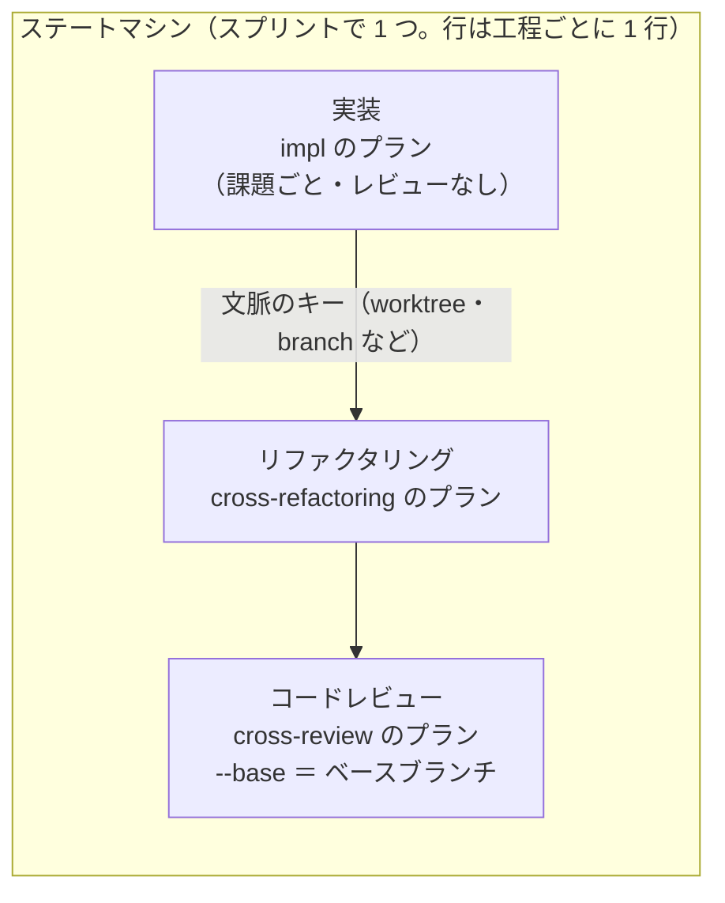
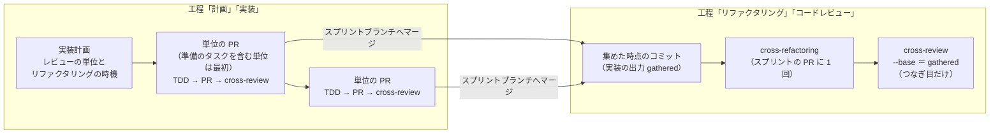

# 工程表: コードレビューを実装計画が決めた単位の PR ごとに掛け、リファクタリングを 3 つの時機に置く（#3879）

スプリントの PR に 1 回だけ掛けていたコードレビューが、#3870 で 4,127 行（追加と削除の和）を 1 本で読ませた。この設計は、課題ごとの実装計画が決めたレビューの単位ごとに PR を出し、その PR を実装の工程の中で cross-review に掛け、スプリントの PR では単位を集めた後に入ったコミット（つなぎ目）だけをレビューする形にする。あわせて、リファクタリングの 3 つの時機と、#3868 が決める「省いてよい文書」に合わせた工程と承認ゲートの扱いを工程表に置く。何が起きて何を満たせば終わりかは要求仕様（[issue-3879-requirements.md](./issue-3879-requirements.md)、正は #3879 の本文）に、採らなかった案は「決定の記録」にある。

## 今の姿

工程表と、そこから実装・検査が流れる仕組みは、要求仕様の「今の姿」にある。設計に要るのは、その下で**工程ごとに別々のプランが流れ、工程どうしは文脈のキーでだけ値を渡す**ことである（調べた場所は付録「調べたこと」）。

この文書では、字の近い 3 つの語を次の意味で使う。

| 語 | 何か | 誰が書く・組むか |
| --- | --- | --- |
| 実装計画 | 課題ごとの Markdown の文書（`issues/` の下）。タスク分解と、#3868 が足す「レビューの単位」「リファクタリングの時機」の欄を持つ | 工程「計画」で `implementation-plan` |
| 実行計画 | スプリントの行の表（[execution-plan.md](../plugins/ndf/skills/issue-plan-strategy/references/execution-plan.md)）。行 1 つが 1 本の PR・1 つの worktree | conductor |
| 実装のプラン | 実装のテンプレート（`contracts/templates/impl.json`）から組んだ `ndf plan` の JSON。worker → 受け入れ条件の確かめ → PR → CI を流す | supervisor が `ndf route render implement` で組む |

- **工程は行ごとに別のプランで流れる。** 工程「リファクタリング」は `cross-refactoring` のテンプレート、工程「コードレビュー」は `cross-review` のテンプレートを呼ぶ（`contracts/workflow/stages/refactor.json`・`code-review.json`）。どちらも別の状態ディレクトリを持つ。検査のテンプレート `check` はどの工程からも呼ばれず、conductor が `ndf route render check` で組む入口として残る
- **工程どうしの値は文脈のキーで渡る。** 工程の出力の `outputs` が文脈（`contracts/workflow/context.schema.json`。今のキーは `issues`・`worktree`・`branch`・`design_pr`・`pr` など 12 個）へ入り、後の工程の入力になる
- **コードレビューの起点はプランを組む時点に決まる。** `{{review}}` の既定の値は `invoke.py` の `review_launch` が `--base <ベースブランチ>` を固定した引数の並びにする。cross-review は `--base` をそのまま `git diff <base>...HEAD` の起点に使う（`drive.py` 454 行。コミットでもブランチでもよい。リモートから取り直さない）
- **ステートマシンの行は工程の名前で一意で、終えた行は戻せない。** `retry` は失敗した行だけを未着手へ戻す（`contracts/workflow/progress.json`）
- **実装のプランの受け入れ条件の確かめ（`ndf loop acceptance check --issue`）は、課題の本文の受け入れ条件すべてに「マージ前 / リリース後」の確認の区分の記録があるかを見る。** 1 つの課題を 2 本の PR に分けると、1 本目は残りの条件の記録が無くて止まる
- **手順書は一部が定義と食い違う。** [parallel-work.md](../plugins/ndf/skills/development-workflow/references/parallel-work.md) の「課題の PR はコードレビューを通さない」と `fast` の列、[stage-notes.md](../plugins/ndf/skills/development-workflow/references/stage-notes.md) の「cross-refactoring の後に次のコードレビューを重ねて呼ばない」（工程表はリファクタリングの後にコードレビューを持つ）

## 文脈と制約

- **実装計画の欄（レビューの単位・リファクタリングの時機）と、省いてよい文書の条件は #3868 が持つ**（同時に進むレーン ldocs の設計 PR [#3874](https://github.com/devbasex/ai-plugins/pull/3874) の決定 14〜16。この設計は head `e110b8c19` を読んだ）。この設計は欄と表から何を読み、工程でどう扱うかだけを決め、欄の形と条件を重ねて書かない。#3868 は工程表の側に 4 つを任せた: 単位ごとの PR とレビュー・つなぎ目の確かめ・3 つの時機の置き場・文書を省いたときの工程と承認ゲートの扱い（設計へ戻したときの流し直しを含む）
- **工程表の行名は変えない。** 行名はステートマシンの行のキーで、走り中のスプリントの記録がこの字で読む
- **承認ゲートは 2 つのままにする**（`development-workflow` の SKILL.md の「人手の承認を求める承認ゲート」）
- **11 系では進め方（`pace`）で工程の通し方が変わらない**（[pace.md](../plugins/ndf/skills/development-workflow/references/pace.md)）。この設計は `normal`・`auto`・`fast` に同じく当たる
- **11 系ではすべてのフェーズを supervisor で回す**（#3092 がステージのプランの書き出しを足すまで）。実装のフェーズの supervisor は、実装のプランを `ndf route render implement` で組んで `ndf plan` で流す
- プロジェクトの MVV（バージョン 9）の Value を基準にする。Value 1（人の判断を、読み切れる量の大事な所だけにする）・Value 2（安く使える。役に立たない繰り返しに費用を使わない）・Value 3（同じ手順は毎回同じ結果になる）

## 解き方の全体像

1. 実装計画のレビューの単位 1 つを、実行計画の実装の行 1 つにする。supervisor は単位ごとに実装のプランを組み、そのプランは単位の PR を出した後に cross-review を収束まで回す（決定 1・2）
2. 工程「実装」は、すべての単位の PR をスプリントブランチへマージした時点のコミットを出力 `gathered` に書いて終わる。工程「コードレビュー」はそのコミットを `--base` にして、集めた後に入ったコミットだけをレビューする。つなぎ目にコードが無ければ工程を飛ぶ（決定 3）
3. リファクタリングの 3 つの時機を、工程「計画」「実装」「リファクタリング」に割り当てる（決定 4）
4. #3868 の表で文書を省いても工程の行と承認ゲートは残し、工程の出力に省いたことを指す。省いた条件を実装の後に外れたら、新しいステートマシンで工程「設計」から流し直す（決定 5）
5. 課題の一部や複数の課題を 1 つの単位にしても実装のプランが止まらないように、受け入れ条件の確かめを単位の分に絞る（決定 6）

### 工程表の変わる所

「モードごとに起動する Skill」の表の行・行名・モードごとの要否は変えない（`test_stage_table.py` は今のまま通る）。変わるのは「工程が動く単位」の表・「工程ごとの決まり」・フェーズの表（[agent-layers.md](../plugins/ndf/skills/development-workflow/references/agent-layers.md)）である。

| 工程 | 動く単位（変えた後） | リファクタリングの時機 |
| --- | --- | --- |
| 作業場所の用意（実装のフェーズ） | レビューの単位ごとに 1 つの worktree をスプリントブランチから切る | — |
| 計画 | 課題。実装計画がレビューの単位とリファクタリングの時機を決める（欄の形は #3868） | 実装の前の対象を決める |
| 実装 | レビューの単位。準備のタスクを含む単位を最初に流してスプリントブランチへマージし、残りを並列に流す。単位ごとに PR をスプリントブランチへ出し、その PR で cross-review を収束まで回してからマージする | 実装の前（準備のタスク）・実装の中（TDD の整理のステップ） |
| リファクタリング | スプリント。すべての単位を集めた後に `cross-refactoring` を予算付きで 1 回 | スプリントの終わり |
| コードレビュー | スプリント。集めた時点（`gathered`）から後のコミットだけ。そこにコードのファイルが無ければ飛ぶ | — |
| 完了判定 | スプリント（すべての課題の受け入れ条件を照らす） | — |
| Pull Request | 単位（スプリントブランチ宛て）とスプリント（ベースブランチ宛て） | — |

`parallel-work.md` の `fast` の列は消す（11 系では進め方で通し方が変わらない）。フェーズの表の実装の行は、単位を「レビューの単位」、終わりの条件を「すべての単位の PR をスプリントブランチへマージした」にし、検査の始まりの条件も同じ字にする。

## 決定の記録

### 決定 1: 実装計画が決めた単位を PR とプランの単位にするため、単位 1 つを実行計画の実装の行 1 つにし、supervisor が単位ごとの値を渡して実装のプランを組む

- **問い**: 課題ごとの Markdown である実装計画の単位を、何が PR と実装のプランの単位に変えるか
- **選んだ案**: 工程「計画」が終わった後の実行計画の見直しで、実装計画のレビューの単位から実装の行（`<バンドル>-実装<N>`）を 1 つずつ置き直す。今は設計のレビューが収束した見直しで「設計文書の分け方から」行を足すが、その時点の行は仮の行（課題ごとに 1 つ）とし、計画の後に単位の行へ置き直す。実装のフェーズの supervisor は行ごとに `ndf route render implement --set branch=<単位のブランチ> --set base=<スプリントブランチ> --set issue=<代表の課題> --add acceptance=…` で実装のプランを組む（`acceptance` は決定 6）。この設計が欄から読むのは、単位の名前・含むタスク・満たす受け入れ条件（番号）の 3 列で、#3868 の決定 14 の表にそろっている。単位どうしの順序は欄に持たせず、準備のタスク（#3868 の決定 15 で最初のタスクになる）を含む単位を最初に流す決まりだけを置く（決定 4）。実装計画を省いた課題（#3868 の決定 16）は、課題 1 つを 1 単位とする
- 採らなかった案: ステートマシンに単位ごとの行を足す（行は工程の名前で一意で、行のキーに単位を入れるとステートマシンの形と記録の読み手を作り直す。行は工程の通過を、単位の成否は実装のプランの結果を持てば足りる）
- 採らなかった案: 実装計画の表をコードが読んで実装のプランを書き出す（ステージのプランの書き出しは #3092 が足す。その前にこの課題で足すと、#3092 と同じ入口を 2 つ作る）
- 採らなかった案: ブランチ戦略の設定の `reviews`（PR の種類ごとに掛けるレビュー）で決める（PR の種類は単位の切り方を決めず、11 系のコードは `reviews` を読まない。扱いは #3881）
- **代償**: 単位の値を渡すのが supervisor の手で、写し誤りは実装のプランの受け入れ条件の確かめ（決定 6）と完了判定で拾う。単位が多いと worktree と PR が増える（同時に流す本数は今の上限のまま）
- 根拠: Value 1（MVV バージョン 9）。Google の Small CLs（変更は 1 つの自己完結した単位。外部の調査の STD14）

### 決定 2: 単位のコードレビューを工程の行を足さずに置くため、実装のテンプレートが単位の PR に cross-review を掛け、収束とマージまでを実装の完了にする

- **問い**: 単位ごとのレビューを、工程表のどの行に置くか
- **選んだ案**: 実装のテンプレート（`impl`）の `pr` の後に、手元のスプリントブランチを取り直すステップと `review` のステップを足す。`review` は単位の PR に、マージ先を `<リモート>/<スプリントブランチ>` にした cross-review を収束まで回す（手元のスプリントブランチは他の単位のマージを取り込んでいないことがあり、そのまま起点にすると他の単位の差分が混ざる）。CI はレビューの直しを送った後に待つ。工程「実装」は、すべての単位の実装のプランが終わり、単位の PR がスプリントブランチへマージされたときに終わる（マージは今と同じく supervisor が行う。スプリントブランチは本番へ届かないので承認ゲートに当たらない）。工程「コードレビュー」の行は残し、中身をつなぎ目のレビュー（決定 3）にする。単位のレビューは、モードが工程「コードレビュー」を持つ限り当たる（5 つのモードのすべて）。`operation` では実行そのものでなく、実行の記録を載せた PR が対象である。`parallel-work.md` の「課題の PR はコードレビューを通さない」を消す
- 採らなかった案: 工程表に「単位のコードレビュー」の行を足す（5 つのモードの文書・`test_stage_table.py`・ステートマシンの行・フェーズの表を同時に変える。単位ごとの成否は 1 本のプランが実装から通して持つ方が、どの単位で止まったかを 1 つの結果で読める）
- 採らなかった案: スプリントの PR の 1 回のレビューのまま、cross-review に課題ごとに範囲を分けて読ませる（読む差分の合計は減らず、指摘を課題へ割り振る仕組みを cross-review に足すことになる）
- **代償**: cross-review の起動が単位の数だけ増える（1 回の上限は 3 ラウンドのまま）。単位のレビューの後に CI の直し（`ci-fix`）が入ると、その直しはどのレビューも経ずにスプリントブランチへ入る。CI が通ることで受け止める。工程表で `legacy-refactor` のコードレビューの欄は `pr-review` だが、工程の定義は今もモードによらず cross-review を呼ぶ。単位のレビューも同じ起動を使い、この食い違いは今のまま残る
- 根拠: Value 1・Value 2（MVV バージョン 9）

### 決定 3: スプリントの PR で単位どうしのつなぎ目だけを見るため、工程「実装」の出力に集めた時点のコミットを書き、工程「コードレビュー」がそれを起点にする

- **問い**: 「つなぎ目」をどの差分として切り出し、別々のプランで流れる工程「コードレビュー」へどう渡すか
- **選んだ案**: つなぎ目は、すべての単位の PR をスプリントブランチへマージした時点（集めた時点）の後に入ったコミットとする。中身は、スプリントの終わりのリファクタリング・その後の直し・ベースブランチを取り込んだマージである。工程「実装」の出力に文脈のキー `gathered`（集めた時点のスプリントブランチのコミット）を足し、工程「実装」を終えるときに書く。工程「コードレビュー」は `gathered` を任意の入力（文脈にあるときだけ渡す）として持ち、`{{review}}` の起点（`--base`）に渡す。工程を流す時点では集めた時点が決まっているので、プランを組む時点に値を埋められる。リポジトリの設定が `workflow.launch.review` で起動を決めているときも、その並びの後ろに `--base <gathered>` を足す（cross-review の引数は後に書いた値が勝つ）。つなぎ目にコードのファイルが無ければ工程「コードレビュー」を飛ぶ。工程の条件（`when`）に `code_in_unreviewed_diff`（`gathered..HEAD` にコードのファイルがある）を足し、`code-review.json` に置く。範囲の語に `unreviewed_diff` を足し、`code-review.json` の範囲にする。順序の検査（I8a。レビューがリリースより前にあるか）は、`unreviewed_diff` のレビューを `sprint_diff` のリリースより前にあるべきものとして照らす
- 採らなかった案: 検査のテンプレート（`check`）の中で集めた時点を記録する（`check` はどの工程からも呼ばれず、工程「リファクタリング」と「コードレビュー」は別のプランで流れるので、プランの状態ディレクトリに書いた値を工程「コードレビュー」は読めない）
- 採らなかった案: スプリントの PR の差分全体を渡し、「つなぎ目だけを見る」と指示する（読む量が減らず、既にレビューした行へ指摘が出直す。Value 2 の「役に立たない繰り返し」）
- 採らなかった案: つなぎ目のレビューをやめ、CI と完了判定だけにする（スプリントの終わりのリファクタリングの差分を誰もレビューしない）
- 採らなかった案: 単位の PR のマージのコミットから起点を算出する（マージの方式（merge・squash）とブランチ戦略で求め方が変わる。記録した 1 つのコミットはどの方式でも同じ）
- **代償**: 集めた時点の後にベースブランチを取り込むと、取り込んだ変更もつなぎ目に入る（ベースブランチの側で既にレビューを経た差分）。文脈のキーが 1 つ増える
- 根拠: Value 2・Value 3（MVV バージョン 9）

### 決定 4: リファクタリングを目的ごとの時機に置くため、#3868 の欄の 3 行を工程「計画」「実装」「リファクタリング」へ割り当て、準備のタスクを含む単位を最初に流す

- **問い**: #3868 の決定 15 が実装計画に書かせる 3 つの時機を、工程表のどこに置くか
- **選んだ案**: 工程の行は足さず、「工程が動く単位」の表に「リファクタリングの時機」の列を置く（上の「工程表の変わる所」）。実装の前（準備のリファクタリング）は、#3868 の決定 15 のとおり実装計画の最初のタスクで、工程「実装」ではそのタスクを含む単位を最初に流し、単位の PR のレビューとマージを終えてから残りの単位を始める（残りの単位はスプリントブランチから切るので、マージの前に始めると準備の変更を含まない）。実装の中は TDD の整理のステップ（`tdd-cycle`）で、単位のレビューで一緒に見る。スプリントの終わりは工程「リファクタリング」（今の位置）で、すべての単位を集めた後に `cross-refactoring` を予算付きで 1 回走らせる。実装計画の欄の「スプリントの終わり」の候補は、`cross-refactoring` を起動する supervisor が提案の入力に渡す。[pre-refactoring.md](../plugins/ndf/skills/implementation-plan/references/pre-refactoring.md) の「別の課題として起票し、先に通す」を「最初のタスク」へ替えるのは #3868 の実装が行い、この課題は触らない
- 採らなかった案: 単位ごとに `cross-refactoring` を走らせる（単位の中だけを見るので局所の最適になり、費用も単位の数だけ増える。#3868 の決定 15 も採らない）
- 採らなかった案: 工程表に「準備のリファクタリング」の行を足す（要否が実装計画の判断で決まり、多くのスプリントで通らない行になる）
- **代償**: 準備のタスクを含む単位のレビューとマージが終わるまで、残りの単位が始まらない
- 根拠: Value 1・Value 2（MVV バージョン 9）。Martin Fowler の Preparatory Refactoring（外部の調査の STD22）

### 決定 5: 工程の要否と文書の要否を食い違わせないため、文書を省いても工程の行と承認ゲートを残し、省いた条件が外れたら新しいステートマシンで工程「設計」から流し直す

- **問い**: #3868 の決定 16 の表で文書を省いたとき、その文書を作る工程の行・設計 PR・設計承認ゲートをどう扱うか。実装の後に省いた条件が外れたら、どこから流し直すか
- **選んだ案**: 工程表の行とモードごとの要否は変えず、行の中身だけを次のとおり扱う。「工程ごとの決まり」の 4 つの行（要求と受け入れ条件・設計・詳細設計・計画）に、文書の要否は #3868 の `document-roles.md`（新設）を指す 1 文を置き、条件を写さない

  | 省いた文書 | 工程の扱い |
  | --- | --- |
  | 設計書 | 工程「設計」で実装計画（`issues/issue-<番号>-plan.md`。頭に #3868 の `省いた文書:` の行）を書き、要求仕様の写しとともに設計 PR に載せる。ドキュメント再構成・ドキュメントレビュー・設計承認ゲートは、その 2 つを対象に今のとおり通す。工程「詳細設計」と「計画」は、出力の `summary` に「設計 PR の実装計画に含めた」と書いて終える |
  | 詳細設計書 | 工程「詳細設計」は、出力の `summary` に「設計書の『どこを変えるか』に畳んだ」と書いて終える（#3868 の決定 6） |
  | 実装計画 | 工程「計画」は、出力の `summary` に「省いた」と書いて終える。レビューの単位は課題 1 つ（決定 1） |
  | 実行計画 | 工程の行を持たない。今の `execution-plan.md` の「書かない」と同じ |

  どの場合も、省いた条件の値は #3868 の決めた 1 か所（設計書か実装計画の頭の `省いた文書:` の行）にだけ書き、工程の出力はその行を指して写さない。実装の完了判定（`design-match.md`）が差分を数え直して設計書を省く条件から外れたら、工程「完了判定」を失敗で返す。conductor は今のステートマシンを中止し（`ndf progress cancel`）、同じ課題で新しいステートマシンを作る（`ndf progress new` に `--disable 要求と受け入れ条件=<既にある> --disable 作業場所の用意=<既にある>`）。新しいステートマシンは工程「設計」から設計承認ゲートを通り、工程「実装」は残した差分の上で実装計画の「修正対象」を設計書へのリンクに直すだけで終え、完了判定から先を今のとおり流す。設計書を省けるのは課題 1 つのスプリントだけなので、中止するステートマシンにほかの課題は無い
- 採らなかった案: 文書を省いたら工程の行もモードの並びから外す（要否が課題ごとに変わる条件を、モードごとの固定の並びで表せない。行を外すとステートマシンの行の数がスプリントごとに変わる）
- 採らなかった案: 設計書を省いたら設計 PR と設計承認ゲートも省く（承認ゲートの数を変えない制約に反し、承認する人が「この問題をこの終わりの条件で解いてよいか」を決める場所が無くなる）
- 採らなかった案: 同じステートマシンの終えた工程「設計」を開き直す（終えた行は戻せず、戻せるようにするとステートマシンの状態の表と書き手の規則を作り直す）
- **代償**: 設計書を省いた課題でも設計 PR を 1 本出す。流し直しでは、中止したステートマシンが記録に残り、課題の工程の記録が 2 つのステートマシンに分かれる
- 根拠: Value 1・Value 3（MVV バージョン 9）

### 決定 6: 課題の一部や複数の課題を 1 つの単位にしても実装のプランが止まらないように、受け入れ条件の確かめを単位の分に絞る

- **問い**: 受け入れ条件の確かめは課題の受け入れ条件のすべてに記録を求めるので、課題を 2 つの単位に分けると 1 本目が止まる。#3868 の決定 14 が許す「小さな課題を 1 つの単位に束ねる」と、2 つ目の課題の条件が確かめられない。どう直すか
- **選んだ案**: `ndf loop acceptance check` の `--issue` を繰り返し渡せるようにし、`--criteria <課題の番号>:<条件の番号>` を足して渡した条件だけを照らす。実装のテンプレートの `acceptance` のステップの引数を差し込み `acceptance`（並び）にし、既定は今と同じ `--issue <代表の課題>`。supervisor は単位の欄の「満たす受け入れ条件」から、課題を分けた単位なら `--criteria` を、課題を束ねた単位なら課題ごとの `--issue` を渡す。単位どうしで漏れた条件は、スプリントの完了判定がすべての課題の条件を照らして拾う
- 採らなかった案: 課題の最後の単位でだけ確かめる（途中の単位が自分の条件を確かめないまま PR を出す。並列に流すと最後の単位が決まらない）
- **代償**: 単位の満たす条件を supervisor が写し誤ると、その単位では確かめが抜ける
- 根拠: Value 3（MVV バージョン 9）

## 影響と危険

- **働く範囲**: NDF を入れたすべてのリポジトリの 5 つのモード（どれも工程表に「コードレビュー」を持つ）。工程「リファクタリング」の時機は、今と同じく `standard`・`legacy-refactor` で CI テストの設定があるリポジトリだけに当たる。進め方は `normal`・`auto`・`fast` に同じく当たる
- **同じファイルの衝突**: #3868（PR #3874）が `development-workflow` の SKILL.md（工程「詳細設計」の行）・`stage-notes.md`・`implementation-plan` の SKILL.md・`execution-plan.md`（目標の行）・`pre-refactoring.md` を触る。この課題が触るのは同じファイルの別のセクション（「工程が動く単位」「工程ごとの決まり」のリファクタリング・コードレビュー・計画などの行、実行計画の実装の行の作り方）である。実装は #3868 の実装が入った後のベースブランチから切り、#3868 が工程「詳細設計」の行に置いた中身を新しい「工程ごとの決まり」へ移す（#3868 の「工程表の見直しとの分担」）
- **用語集**: 「レビューの単位」の意味を置き換える（下の「用語」）。#3868 は用語集を直さず、この課題に任せた。旧い意味（ブランチ戦略の `reviews`）の語の行き先は #3881 が決める
- **走り中のスプリント**: 工程表の行名とステートマシンの形を変えないので、記録は読める。古いテンプレートで組んだ実装のプランは単位のレビューを持たず、工程「実装」の出力に `gathered` も無い。`gathered` が無いとき、工程「コードレビュー」は今のとおりベースブランチを起点にする（スプリントの差分全体をレビューする）
- **費用**: cross-review の起動が単位の数だけ増える。つなぎ目のレビューは集めた後の差分だけを読むので、読む行の合計はスプリントの差分とつなぎ目の和を超えない

### 代表のリポジトリでの振る舞い

| 代表のリポジトリ | 設定の要点 | 直した後に起きること | この種類で扱えなくなること |
| --- | --- | --- | --- |
| Web サービス | `standard`、CI テストの設定あり、スプリントブランチを使う | 単位の PR ごとに cross-review が付き、スプリントの PR はリファクタリングの差分だけをレビューする | 無し |
| モバイルアプリ | `standard`、CI テストの設定なし | 工程「リファクタリング」は今と同じく通らない。つなぎ目にコードが無いので、工程「コードレビュー」を飛ぶ | 無し |
| 業務文書だけ | `documentation` | 単位（課題）の PR ごとに cross-review が付く。工程「リファクタリング」は通らない | 無し |

## 用語

| 用語 | 意味 | 用語集への反映 |
| --- | --- | --- |
| レビューの単位 | 1 本の PR にまとめ、1 回のコードレビューを掛ける変更のまとまり。実装計画の欄が決める（欄の形は #3868） | 意味の変更（旧い意味は「PR の種類ごとに掛けるレビューと対象の差分を決めた組」。行き先は #3881） |
| 単位の PR | レビューの単位 1 つを載せ、スプリントブランチへ出す PR | 追加 |
| つなぎ目 | スプリントの PR の差分のうち、すべての単位の PR をスプリントブランチへマージした時点の後に入ったコミット | 追加 |
| 集めた時点 | すべての単位の PR をスプリントブランチへマージした時点のスプリントブランチのコミット。工程「実装」の出力 `gathered` | 追加 |

「リファクタリングの時機」は #3868 が用語集へ足す。この設計はその語をそのまま使う。

## テスト設計

| 受け入れ条件 | どの振る舞いで縛るか | どう壊したら落ちるべきか |
| --- | --- | --- |
| 1（単位ごとのレビュー） | 実装のテンプレートを組んだプランに、`pr` の後・`ci` の前の `review` のステップがあり、`{{review}}` の `--base` が `<リモート>/<base>` になる | `impl.json` から `review` を外すと、プランを組むテストが落ちる |
| 1（単位の受け入れ条件） | `acceptance check --issue 1 --criteria 1:1 1:2` が記録の無い条件 3 を照らさずに `ok` を返す。`--issue 1 --issue 2` が両方の課題を照らす。どちらも省くと今のとおり | `--criteria` を無視すると条件 3 の欠けで止まる |
| 2・3（集めた後に 1 回、つなぎ目だけ） | 文脈に `gathered` があるとき、工程「コードレビュー」のプランの `--base` が `gathered` になる。`gathered..HEAD` にコードが無ければ `code_in_unreviewed_diff` が偽で、工程が無効になる。`gathered` が無ければ今のとおりベースブランチ | 起点を埋めないと `--base` がベースブランチのままでテストが落ちる |
| 3（範囲の語と順序の検査） | 工程「コードレビュー」の定義の範囲が `unreviewed_diff` で、読み込みの検査（I9）が受ける。レビューをデプロイの後ろへ動かした定義を I8a が断る | 語を語彙から外すと定義の読み込みが落ちる。I8a の照らしを戻すと、後ろへ動かした定義が通ってテストが落ちる |
| 4（文書の要否） | 文書を作る 4 つの行の決まりが `document-roles.md` を指し、条件を写していない | 実装の完了判定で、リンクの切れ（参照の検査）と写していないことを確かめる。`.md` の文言のテストは書かない |
| 5（一致と検査） | `test_stage_table.py`・工程の定義の読み込み・`ndf check` が通る | CI が落ちる |

## 設計の結果

| 課題 | 扱い | 統合先 | 触るファイル |
| --- | --- | --- | --- |
| #3879 | 実装する | — | `plugins/ndf/skills/development-workflow/SKILL.md`、`plugins/ndf/skills/development-workflow/references/parallel-work.md`、`plugins/ndf/skills/development-workflow/references/stage-notes.md`、`plugins/ndf/skills/development-workflow/references/workflow-modes.md`、`plugins/ndf/skills/development-workflow/references/agent-layers.md`、`plugins/ndf/skills/implementation-plan/SKILL.md`、`plugins/ndf/skills/issue-plan-strategy/references/execution-plan.md`、`plugins/ndf/contracts/templates/impl.json`、`plugins/ndf/contracts/templates/params.json`、`plugins/ndf/contracts/workflow/stages/implement.json`、`plugins/ndf/contracts/workflow/stages/code-review.json`、`plugins/ndf/contracts/workflow/ndf.schema.json`、`plugins/ndf/contracts/workflow/context.schema.json`、`plugins/ndf/src/ndf/progress/stages.py`、`plugins/ndf/src/ndf/progress/definition.py`、`plugins/ndf/src/ndf/progress/command.py`、`plugins/ndf/src/ndf/progress/invoke.py`、`plugins/ndf/src/ndf/domains/loop/acceptance.py`、`plugins/ndf/tests/progress/test_invoke.py`、`plugins/ndf/tests/progress/test_command.py`、`plugins/ndf/tests/progress/test_definition.py`、`plugins/ndf/tests/domains/loop/test_loop_acceptance.py`、`plugins/ndf/tests/route/test_templates.py`、`docs/glossary/glossary.json`、`docs/glossary/ndf-branch-strategy.md`、`docs/glossary.md` |

詳細設計は [issue-3879-design-detail.md](./issue-3879-design-detail.md) にある（既存の関数を 7 つ変え、関数を 1 つ新設するため。#3868 の決定 6 の条件で別ファイルにする）。

## 未確認のまま残ること

| 項目 | 内容 |
| --- | --- |
| #3868 の設計の確定 | この設計は #3874 の head `e110b8c19` の決定 14〜16 を前提にする。#3868 の設計承認ゲートで欄の列や省く条件が変われば、決定 1・5・6 の読む先を合わせて直す |
| cross-review の `--base` にリモートの参照を渡したときの振る舞い | `drive.py` は `--base` を `git diff` と変わったセクションの算出に使うことまでを確かめた。ほかに `--base` をブランチ名として扱う箇所が無いかは、実装のテストで `<リモート>/<base>` を渡して確かめる |

## 外部の調査

| 種類 | 調べるか | 理由 |
| --- | --- | --- |
| 標準・仕様 | 調べる | レビューの単位の大きさとリファクタリングの時機には、広く引かれる一次資料がある |
| 主要な製品 | 調べない | 工程の組み方はツールでなく手順の問題で、製品の比較は判断に効かない |
| ライブラリとサービス | 調べない | 依存を足さない |

| # | 標準・仕様 | 何を定めているか | 設計への反映 | 出典 |
| --- | --- | --- | --- | --- |
| STD14 | Google の Small CLs | 変更は 1 つの自己完結した単位にし、大きな変更はレビュー前に分ける。リファクタリングは機能の変更と別の CL にする | 採った: 単位ごとの PR とレビュー（決定 1・2）。単位の大きさの目安は #3868 の決定 14 が同じ出典から決めた | https://google.github.io/eng-practices/review/developer/small-cls.html （2026-11-20） |
| STD22 | Martin Fowler「Preparatory Refactoring」 | 変更を入れやすくするために先に構造を整え、その後で変更を入れる | 採った: 準備のタスクを含む単位を最初に流し、マージしてから残りを始める（決定 4） | https://martinfowler.com/articles/preparatory-refactoring-example.html （2026-11-20） |

番号は #3868 の調査（[issue-3868-survey.md](https://github.com/devbasex/ai-plugins/blob/e110b8c19/issues/issue-3868-survey.md)）の続きにした。STD14 は同じ出典である。

## 付録: 調べたこと

| 事実 | 場所 |
| --- | --- |
| 工程表と定義の照らし | `plugins/ndf/tests/skills/test_stage_table.py` 50〜68 行 |
| 工程ごとに呼ぶテンプレート | `contracts/workflow/stages/refactor.json` 41 行・`code-review.json` 37 行 |
| 行名の一意 | `plugins/ndf/src/ndf/progress/stages.py` の `check_unique_stage_names` |
| 範囲の語彙と検査 I8a・I9 | `contracts/workflow/ndf.schema.json` 39 行、`stages.py` 134〜175 行 |
| 戻せる行（`retry` は失敗した行だけ） | `contracts/workflow/progress.json` の `events` |
| 文脈のキー | `contracts/workflow/context.schema.json` |
| レビューの起動の組み方 | `src/ndf/progress/invoke.py` の `review_launch`・`_fill_review`・`REVIEW_WITH_PR` |
| cross-review の差分の起点 | `src/ndf/domains/crossreview/drive.py` 450〜454 行 |
| 受け入れ条件の確かめ | `src/ndf/domains/loop/acceptance.py` の `_check` |
| 差分の分け方 | `src/ndf/progress/command.py` の `diff_kinds`・`range_diff_kinds`・`facts_of` |
| 単発でプランを組む入口 | `ndf route render <種類> --set <名前>=<値> --add <名前>=<値> --out <プラン>`（`conductor-entrypoints.md`） |
| PR #3870 の大きさ | `gh pr view 3870 --json additions,deletions,files`（追加 2,655・削除 1,472・50 ファイル） |
