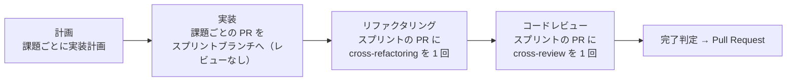

## 何が起きたか

2026-11-20、利用者は #3868（開発の文書の書き方）の設計 PR [#3874](https://github.com/devbasex/ai-plugins/pull/3874) の調査を読み、今の工程表（NDF が変更ごとにどの工程をどの順で通すかを決めた表）に合わない所を 3 つ挙げ、工程表そのものを #3868 と同時に見直すよう指示した。

1. **レビューの単位が大きすぎる。** 計画 p8-5 のレーン lagent が出した PR [#3870](https://github.com/devbasex/ai-plugins/pull/3870) は、課題 3 件（#3851 #3856 #3854）を 1 本にまとめ、追加 2,655 行・削除 1,472 行・50 ファイルになった。コードレビュー（`cross-review`）はこの 1 本に 1 回だけ掛かった
2. **リファクタリングをどこに置くかが決まっていない。** ある程度まとめてから行う方が効率がよい（局所最適にならない）が、今の工程表は実装の後の 1 か所しか持たない
3. **省いてよい文書と、省いてよい条件が無い。** 文書の側は #3868 が決める

## 種類

機能追加（工程表に「レビューの単位」と「リファクタリングの時機」の扱いを足し、工程の定義・プランのテンプレート・手順書をそれに合わせる）

## 今の姿

NDF は 1 つのバージョンとして出す課題のまとまり（スプリント）を、工程表の行の順に通す。工程表は [development-workflow の SKILL.md](../plugins/ndf/skills/development-workflow/SKILL.md) の「モードごとに起動する Skill」の表で、行名はスプリントの進み具合を持つ記録（`ndf progress` のステートマシン）の工程の名前として、コードが同じ字で読む。行ごとの定義は [`plugins/ndf/contracts/workflow/stages/`](../plugins/ndf/contracts/workflow/stages/)、モードごとの行の並びは [`modes/`](../plugins/ndf/contracts/workflow/modes/) にある。

`standard`（公開インタフェースや本番の振る舞いを変える変更のモード）の実装からマージまでは、今は次のように動く。

- **レビューは 1 スプリントに 1 回である。** 課題の PR はスプリントブランチ（`sprint/<名前>`）へコードレビューを通さずに集まり、リファクタリング・コードレビュー・完了判定はスプリントの PR（スプリントブランチからベースブランチへの PR）で 1 回ずつ通る（[parallel-work.md の「工程が動く単位」](../plugins/ndf/skills/development-workflow/references/parallel-work.md)）
- **リファクタリングの置き場は 3 か所に散っている。** 工程表の「リファクタリング」の行（実装の後、`cross-refactoring`）のほかに、実装計画のリスクの対処の「先に構造を整える」（[pre-refactoring.md](../plugins/ndf/skills/implementation-plan/references/pre-refactoring.md)。別の課題として起票して先に通す）と、テスト駆動の「整理」のステップ（[tdd-cycle](../plugins/ndf/skills/tdd-cycle/SKILL.md)）がある。工程表はこのうち実装の後の 1 か所しか示さない
- **実装計画は PR の分け方を持たない。** タスク分解はあるが、どのタスクを 1 本の PR にするかの欄が無い（[implementation-plan の SKILL.md](../plugins/ndf/skills/implementation-plan/SKILL.md) の「実装計画のフォーマット」）。PR の単位は、複数の課題をまとめて進めるときの実行計画の行が持ち、何本に分けるかは設計文書の決定が持つ（[execution-plan.md](../plugins/ndf/skills/issue-plan-strategy/references/execution-plan.md)）
- **記録はスプリントで 1 つで、行は工程ごとに 1 行である。** 課題ごと・単位ごとに行を増やす仕組みは無い

## 何を足すか・変えるか

| | 今 | 変えた後 |
| --- | --- | --- |
| コードレビューの単位 | スプリントの PR に 1 回 | 実装計画が決めたレビューの単位（#3868 が実装計画に置く欄）ごとの PR に 1 回ずつ。スプリントの PR では、単位のレビューを経ていない差分（つなぎ目）だけを見る |
| リファクタリングの時機 | 工程表には実装の後の 1 か所 | 実装の前（準備のリファクタリング）・実装の中（テスト駆動の整理）・スプリントの終わり（単位を集めた後に `cross-refactoring` を予算付きで 1 回）の 3 つが工程表から読める |
| 工程の要否と文書の要否 | 工程表と文書の Skill が別々に決める | 文書を作る工程の行の要否が、#3868 が決める文書の要否と省いてよい条件を指し、食い違わない |
| 工程の定義・テンプレート・手順書 | 手順書どうしと定義に食い違いがある（例: 「課題の PR はコードレビューを通さない」と、Draft の PR を出すステップ `pr-draft` が手順書にだけある） | 新しい工程表と一致する |

### 今の利用者への影響と互換

- スプリントの中の cross-review の回数が、単位の数だけ増える。1 回あたりに読む差分は小さくなる
- 工程表の行名（ステートマシンの工程の名前）は変えない。走り中のスプリントの記録はそのまま読める
- NDF は普及の前で、後方互換を求めない

## なぜ困るか

大きな 1 本のレビューでは、レビュー担当（codex・kiro）が差分の全体をつかめず、指摘が浅くなるか、上限 3 ラウンドの中で収束しない。#3870 では 3 課題の実装・21 項目のリファクタリング・確定仕様が 1 本に入り、どの指摘がどの課題のものかを人が追えなかった。リファクタリングの置き場が工程表から読めないと、AI は実装の後の 1 か所だけで通し、構造が危うい所の上に先に実装を積むか、課題ごとの小さな整理を重ねて局所最適になる。工程の要否と文書の要否がずれると、#3868 で省いてよくなった文書を工程が求め続ける。

## 目的

- レビューが、人と AI が一度に読み切れる大きさの単位で通り、その単位を実装計画が決める
- リファクタリングを、目的ごとの 3 つの時機に置き、どこで何を整えるかが工程表から分かる
- 工程表・工程の定義・プランのテンプレート・手順書と、#3868 の文書の要否が 1 つの形にそろう

## 対象範囲

含む:

- 工程表（「モードごとに起動する Skill」の表・「工程が動く単位」の表・「工程ごとの決まり」）
- 工程の定義（`contracts/workflow/stages/`・`modes/`・`ndf.schema.json` の語彙）、プランのテンプレート（`contracts/templates/` の実装と検査）、それを組むコード
- 手順書: `development-workflow` の `parallel-work.md`・`stage-notes.md`・`workflow-modes.md`・`agent-layers.md`、`implementation-plan` の SKILL.md と `pre-refactoring.md`、`issue-plan-strategy` の `execution-plan.md`

含まない:

- 実装計画の「レビューの単位」「リファクタリングの時機」の欄の形と、省いてよい文書の条件（#3868 が持つ。この課題はそれを指すだけで、重ねて定義しない）
- 進め方（`pace`）ごとの違い。11 系では進め方が変えるのは承認ゲートを MVV 判定で省けるかだけで、工程の通し方は `normal`・`auto`・`fast` で同じである（[pace.md](../plugins/ndf/skills/development-workflow/references/pace.md)）。この課題の変更は 3 つに同じく当たる。手順書に残る `fast` の古い単位の記述（課題ごとの完了判定・トリガーの範囲）は、この課題が書き直す「工程が動く単位」の表の中にあるので、書き直すときに 11 系の形へそろえる
- `cross-review` と `cross-refactoring` そのものの振る舞い（ラウンドの上限・予算の既定値）
- ブランチ戦略の設定の `reviews`（PR の種類ごとに掛けるレビュー。11 系のコードは読まない）の扱い（#3881）

## 受け入れ条件

- [ ] 1. 実装計画が決めたレビューの単位ごとに PR が出て、その PR で cross-review が収束まで回る（実装のプランが単位の PR にコードレビューのステップを持つ）。単位を書かない実装計画と、実装計画を作らないモードでは、課題 1 つが 1 つの単位になる
- [ ] 2. リファクタリングの 3 つの時機（実装の前・実装の中・スプリントの終わり）が工程表に置かれ、スプリントの終わりの `cross-refactoring` が単位をスプリントブランチへ集めた後に 1 回走る
- [ ] 3. スプリントの PR のコードレビューは、単位のレビューを経ていない差分（単位を集めた後のコミット）だけを範囲にし、その差分にコードのファイルが無ければ飛ぶ
- [ ] 4. 工程表の各行の要否が、#3868 の文書の要否と省いてよい条件に合っている。文書を作る工程の行は、条件を写さずに #3868 の置き場を指す
- [ ] 5. `ndf progress` の工程の定義・プランのテンプレート・手順書が新しい工程表と一致し、`ndf check` と PR の CI（工程表と工程の定義を照らすテスト `test_stage_table.py` を含む）が通る

## 影響

| 対象 | 影響 |
| --- | --- |
| 公開インタフェース | 変わる。工程の定義の語彙（ステップの範囲の値）と、実装・検査のプランのテンプレートのステップ。コマンドの引数と結果 JSON の形は変えない |
| データ | 変わらない（ステートマシンの行名は変えない） |
| 既存の振る舞い | 変わる。実装のフェーズで単位ごとに cross-review が走り、検査のフェーズのコードレビューの範囲が狭まる |
| 同じファイルを触る別のレーン | ldocs の #3868（PR [#3874](https://github.com/devbasex/ai-plugins/pull/3874)）が `development-workflow` の SKILL.md・`stage-notes.md`・`implementation-plan` の SKILL.md・`execution-plan.md` を触る |

## 用語

| 用語 | 意味 |
| --- | --- |
| レビューの単位 | 1 本の PR にまとめ、1 回のコードレビューを掛ける変更のまとまり。実装計画が決める（欄の形は #3868）。既存の用語集の「レビューの単位」（PR の種類ごとに掛けるレビューと対象の差分の組）の意味を、この課題で置き換える |
| 単位の PR | レビューの単位 1 つを載せ、スプリントブランチへ出す PR |
| つなぎ目 | スプリントの PR の差分のうち、すべての単位の PR をスプリントブランチへマージした時点の後に入ったコミット（スプリントの終わりのリファクタリングとその後の直しなど） |

## 検証手段

| 項目 | 手段 |
| --- | --- |
| テスト | PR の CI（`.ndf/project.json` の `test.ci.only`）。工程の定義とテンプレートを読むコードのテスト、`test_stage_table.py`。`.md` の文言を照らすテストは書かない |
| 手動確認 | リリース後テストで、次のスプリントの実装のフェーズで単位の PR ごとに cross-review の判定のコメントが付き、スプリントの PR のコードレビューの範囲が単位を集めた後のコミットだけであることを見る |

## 起票者の推定

| # | 条件 | 推した出所 | この要求での扱い |
| --- | --- | --- | --- |
| S1 | レビューの単位は「1 つの課題、または 1 つのまとまった変更。大きさの目安つき」 | 本文の「見直す観点（案）」 | 単位の形は #3868 の欄が持つ（含まない）。単位を書かないときの既定（課題 1 つ）だけを受け入れ条件 1 に置く |
| S2 | スプリントの PR では単位どうしのつなぎ目だけを確かめる | 同上 | 受け入れ条件 3。つなぎ目の中身（単位を集めた後のコミット）は用語で定めた |
| S3 | リファクタリングの時機を実装の前・実装の中・スプリントの終わりの 3 つに分ける | 同上 | 受け入れ条件 2 |
| S4 | 準備のリファクタリングを実装計画の `pre-refactoring.md` に置く | 同上 | 設計で置き場を決める |

## 依頼（原文）

（書き手: 起票者、日付: 2026-11-20。利用者が挙げた 3 点を起票者がまとめた本文。「見直す観点（案）」は起票者の案である）

課題の初稿

> ## 何が起きたか
>
> 2026-11-20、#3868（開発の文書の書き方）の設計 PR #3874 の調査を読んだ利用者が、今の工程表に合わない所を 3 つ挙げ、工程表そのものを #3868 と同時に見直すよう指示した。
>
> 1. **レビューの単位が大きすぎる。** 今はスプリントの PR（課題の PR を全部まとめた 1 本）にコードレビューを 1 回通す。計画 p8-5 の lagent の PR #3870 は +2655 -1472 行になった。レビューの単位は実装計画で決め、それに従えるようにする
> 2. **リファクタリングの位置付け。** ある程度まとめてから行う方が効率がよい（局所最適にならない）が、どこに置くかが決まっていない
> 3. **省いてよい文書と、省いてよい条件が無い**（文書の側は #3868 が持つ）
>
> ## 今の姿
>
> 工程表は `plugins/ndf/skills/development-workflow/SKILL.md` の「モードごとに起動する Skill」の表で、行名はスプリントのステートマシン（`ndf progress`）の `stage` の値としてスクリプトが同じ字で読む（工程ごとの定義は `plugins/ndf/contracts/workflow/stages/`）。今は「リファクタリング・コードレビュー・完了判定」をスプリントのベースブランチ宛ての PR で 1 回通す（同 SKILL.md の「工程が動く単位」）。
>
> ## 見直す観点（案）
>
> - **レビューの単位:** 実装計画で単位（1 つの課題、または 1 つのまとまった変更。大きさの目安つき）を決め、単位ごとの PR で cross-review を通す。スプリントの PR では単位どうしのつなぎ目だけを確かめる
> - **リファクタリングの時機:** 実装の前（準備のリファクタリング。実装計画の `pre-refactoring.md`）・実装の中（TDD のリファクタリングのステップ。単位のレビューと一緒に見る）・スプリントの終わり（単位をまたぐ重複と構造。単位をスプリントのブランチへ集めた後に `cross-refactoring` を予算付きで 1 回）の 3 つに分ける
> - **工程表の全体:** 上の 2 つに合わせて、工程の並び・動く単位・モードごとの要否・プランのテンプレートを見直す。#3868 が決める文書（要求仕様・設計書・詳細設計書・実装計画・開発計画）と省いてよい条件に、工程の要否をそろえる
>
> ## 受け入れ条件
>
> - [ ] 1. 実装計画が決めたレビューの単位ごとに、cross-review が通る（プランがその単位で走らせる）
> - [ ] 2. リファクタリングの 3 つの時機が工程表に置かれ、スプリントの終わりの `cross-refactoring` が単位を集めた後に 1 回走る
> - [ ] 3. 工程表の各行の要否が、#3868 の文書の要否と省いてよい条件に合っている
> - [ ] 4. `ndf progress` の工程の定義・プランのテンプレート・手順書が、新しい工程表と一致する（`ndf check` が通る）
>
> ## 関係する課題
>
> - #3868（文書の書き方。実装計画に「レビューの単位」と「リファクタリングの時機」の欄を置く）
> - #3870（大きすぎたスプリントの PR の例）

