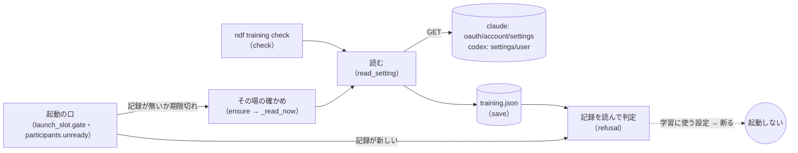
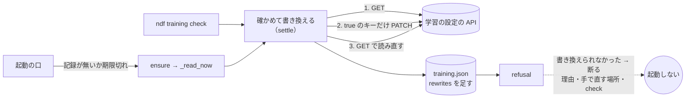
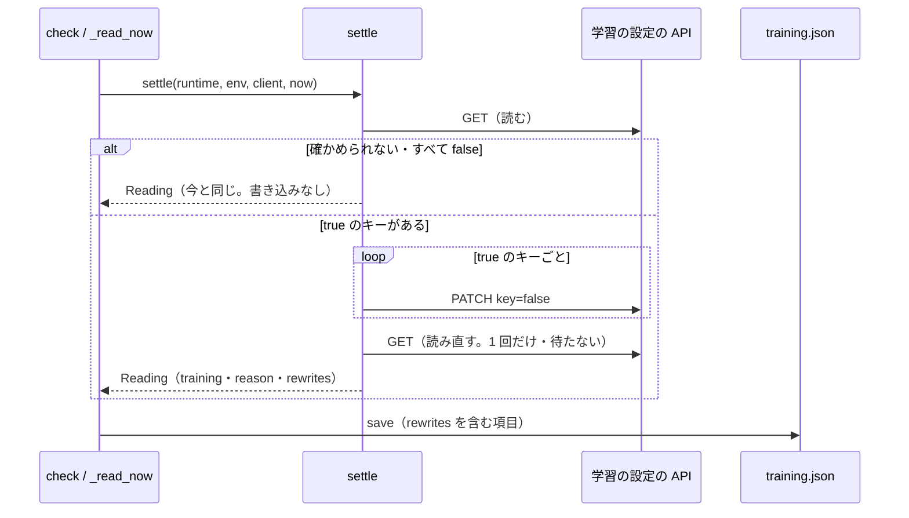

# 学習の設定の確かめ: 学習に使う設定なら Off へ書き換えてから claude・codex を起動する（#3907）

アカウントが入力を学習に使う設定（On）だと、NDF は claude・codex の起動を断り、利用者がブラウザで Off にして確かめ直すまで工程が止まる。確かめの 1 か所（`settle`）で、学習に使う設定なら true の設定だけを false へ書き込んで読み直す。false なら記録して起動を続け、そうでなければ今までどおり断って手で直す場所を示す。書き換えは時刻と前後の値つきで記録と出力に残り、書き換えを止める手段は持たせない。採らなかった案と 10 系（#1597）の実装から採ったものは「決定の記録」に、HTTP の 202 の意味と Claude Code 本体の書き込みは「外部の調査」にある。

## 今の姿

何が起きたか・目的・受け入れ条件は要求仕様（[issue-3907-requirements.md](./issue-3907-requirements.md)、正は #3907 の本文）にある。この文書は「どう解くか」と「なぜその解き方か」だけを書く。今の確かめの 2 か所・読む API・書き込みを確かめた結果の表は、要求仕様の「今の姿」にある。



変更の位置は「読む」の 1 か所である。今は読んだ結果をそのまま記録する。学習に使う設定（`training` が true）なら、`check` は `stopped`（`refused`）で終わり、起動の口は `refusal` が断る。起動の口は、claude・codex を起動する前に起動してよいかを決める箇所である。

設計に要る今の構造:

| 部品 | 置き場 | 今の振る舞い |
| --- | --- | --- |
| 読み手 | `training.py` の `read_claude`・`read_codex`（`Endpoint` の `interpret` が真偽値を 1 つ返す） | 担当ごとの要求ヘッダで `GET` を 1 回送り、学習に使うかを 1 つの真偽値にまとめる。codex は 3 つのキーのどれかが true なら true |
| 確かめの入口 | `training.py` の `check`（サブコマンド）と `_read_now`（`ensure` の既定の読み手） | どちらも `read_setting` を呼ぶ。`ensure` はテストで `read` を差し替え、テストは `_read_now` も差し替える |
| 記録 | `training_cache.py` の `Reading`・`save`・`_cached_verdict` | 担当ごとに `runtime`・`training`・`reason`・`checked_at`・`context`（認証の文脈のハッシュ）を書く。学習に使う設定の記録は、期限内なら確かめ直さずに断る |
| 時間の上限 | `contracts/limits.json` | `claude-training.call`・`codex-training.call`（1 回 3 秒。説明は「読み書き」）。`codex-training.budget`（7 秒）はどこからも読まれていない（10 系の hook の時間の名残り） |

## 文脈と制約

- 書き込む先は公開されていない API である。形は 2026-11-20 に同じ値（false → false）で確かめた（要求仕様の「書き込みを確かめた結果」）。true → false の実際の変化は確かめていない
- 起動の口は httpx を読まずに済むよう、記録を読む規則（`training_cache.py`）と外部へ送る接続（`training.py`）を分けている（#3391 の 3391-5）。書き込みは接続の側に置く
- 今のテスト（`test_training.py`・`test_training_ensure.py`）を変えずに通す（受け入れ条件 7）。テストは `training.ensure(..., read=...)` と `training._read_now` を差し替え、`Reading(runtime, training, reason)` の 3 引数で記録を作る。HTTP のモックはどの URL にも同じ応答を返す
- トークンとアカウントの識別子は要求ヘッダにだけ置き、記録・出力・理由の文に含めない（今の約束。受け入れ条件 6）
- 用語集の `ndf-training-optout` は 10 系の振る舞い（セッションの開始で書き換える・環境変数で止める）のままである

## 解き方の全体像



- `check` と起動の口のその場の確かめは、同じ `settle` を通る。`settle` は読み、学習に使う設定なら true のキーだけを false へ書き込み、1 回だけ読み直して結果を決める
- 読み直して false なら、記録は `training: false` になり、`rewrites` に書き換えたキーごとの前の値・後の値・時刻が残る。`check` は `ok`、起動の口は起動を続ける
- 書き込みが通らない・読み直しても true・読み直せないときは、記録に `training: true` と失敗の中身を残す。`check` は `stopped`（`refused`）、起動の口は断り、どちらも手で Off にする場所と `ndf training check` を示す
- 学習に使わない設定と、確かめられないとき（トークンが無い・OAuth でない接続・応答の形が違う）は、書き込みを送らない。結果は今と同じ

## 入出力のコントラクト

### `ndf training check` の結果の `items`

要素に任意の項目 `rewrites` を足す。書き込みが 1 つでも受け付けられたときだけ載り、今の 4 項目は変えない。スキーマ（`training.result.schema.json`）は要素が閉じているので、`rewrites` を `properties` に足す（`required` には足さない）。

| 項目 | 型 | 中身 |
| --- | --- | --- |
| `rewrites` | 配列 | 書き込みが受け付けられた（2xx の）キーごとに 1 要素。受け付けられなかったキーは載らず、失敗は `reason` に載る |
| `rewrites[].key` | string | 書き換えたキー（claude は `grove_enabled`、codex は `training_allowed`・`codex_training_allowed`・`codex_training_allowed_v2` のどれか） |
| `rewrites[].before` | boolean | 書き込む前に読んだ値（常に true）。値は固定だが、読み取りの結果として載せる（下の段落） |
| `rewrites[].after` | boolean か null | 読み直した値。読み直せなかった・応答にそのキーが無ければ null |
| `rewrites[].at` | string | 書き込みを送った時刻（ISO 8601、UTC、秒まで） |

`before` は true のキーしか書き込まないので、いつも true になる。それでも項目として残すのは次の 2 つのためである。受け入れ条件 1・2 は「前の値 true・後の値 false」を記録と出力に載せることを求めている。また、1 つの要素だけを読んでも、「書き込む前に読んだら true だった」という読み取りの事実が分かるようにする。項目を外して「`rewrites` にあれば前は true」という決めごとで表すと、前の値が記録に無くなり、受け入れ条件を決めごとの知識なしでは確かめられない。

`reason` に載せる読み取り元は、読み直した設定の在りか（担当の `Endpoint.place`。claude は `oauth/account/settings`、codex は `chatgpt/settings/user`）とする。あとに、書き換えたキーと、読み直して false だったキーを並べる。codex の読み直しは 3 つのキーをまとめて読むので、読み取り元を 1 つのキー（今の `source` の `chatgpt/settings/user.training_allowed`）で名指さない。書き換えない場合の `reason` は今の `source` のままにする。

例（codex の 2 つのキーが true だったとき）:

```json
{"runtime": "codex", "training": false, "reason": "chatgpt/settings/user（Off へ書き換えた: training_allowed・codex_training_allowed_v2。読み直して false: training_allowed・codex_training_allowed・codex_training_allowed_v2）", "checked_at": "2026-11-21T01:00:03+00:00",
 "rewrites": [{"key": "training_allowed", "before": true, "after": false, "at": "2026-11-21T01:00:01+00:00"},
              {"key": "codex_training_allowed_v2", "before": true, "after": false, "at": "2026-11-21T01:00:02+00:00"}]}
```

`training.json` の担当の項目も同じ `item()` から作るので、同じ `rewrites` を持つ（ほかに今の `context`）。`rewrites` の無い今の記録はそのまま読める（読む側は `rewrites` を見ない）。

### 結果の `status` と理由の文

| 場合 | `check` の結果 | 起動の口 | 理由の文の中身 |
| --- | --- | --- | --- |
| 学習に使わない設定 | `ok`（今と同じ） | 起動する | 今と同じ |
| 書き換えて読み直したら false | `ok`。`summary` に担当と「Off へ書き換えた」 | 起動する | 項目の `reason` に書き換えたキー |
| 書き込みが 2xx でない・通信の失敗 | `stopped`（`refused`） | 断る | 失敗したキーと `HTTP <状態>` か `通信の失敗（<例外の型名>）`、手で Off にする場所、`ndf training check --runtime <担当>` |
| 読み直しても true | 同上 | 断る | `書き換えた後も学習に使う設定のまま: <キー>`、場所、コマンド |
| 読み直した応答に、書き換えたキーが無い | 同上 | 断る | `書き換えた後の読み直しにキーが無い: <キー>`、場所、コマンド |
| 読み直せない | 同上 | 断る | `書き換えた後に読み直せない（<理由>）`、場所、コマンド |
| 確かめられない | `stopped`（`precondition`。今と同じ） | 断る（今と同じ） | 今と同じ |
| 同じ担当のほかの確かめが期限（claude 27 秒・codex 45 秒）までに終わらない | `stopped`（`precondition`）。確かめない | 今の記録で断る | `ほかの確かめが終わらない` |
| 確かめた後に記録できない（保存の排他の期限切れ・保存先の失敗） | `stopped`（`precondition`）。`items` には確かめた結果と `rewrites` を載せる | 断る | 項目の `reason` に `記録できなかった（<例外の型名>）`。書き換えていれば `Off へ書き換えたが記録できなかった` と、`ndf training check --runtime <担当>` |

手で Off にする場所は、担当ごとの定数（`training_cache.py` の `MANUAL_OFF`）の 1 か所に置く。`check` の `summary` と起動の口の理由（`refusal`）は、どちらもそこから文を作る。

`--runtime` を省くと両方の担当を確かめるので、担当ごとの場合が混ざる。混ざったときは次のように決める。

- `cause.kind` は今の優先のまま、確かめられない担当が 1 つでもあれば `precondition`、そうでなく学習に使う設定の担当があれば `refused` とする。今の `check` の順で、変えると「確かめられない」を縛る今の振る舞いが混在の時だけ変わる
- `summary` は優先した 1 つの種類だけでなく、断る理由のある担当をすべて並べる。確かめられない担当の理由と、書き換えに失敗した担当の理由・`off_by_hand` の案内を、`。` で区切って 1 つの文にする。例: `確かめられない: claude（トークンが無い）。学習に使う設定: codex（training_allowed が HTTP 403）。<codex の off_by_hand>`
- 書き換えて false になった担当は、ほかの担当で止まったときも `summary` に「Off へ書き換えた: <担当>」を載せる。アカウントの値が変わったことを、止まった結果からも読めるようにする
- 担当ごとの失敗の中身は、今までどおり `items` の各要素の `reason` にも残る

| 担当 | 手で Off にする場所 |
| --- | --- |
| claude | claude.ai の設定の「プライバシー」の「Help improve Claude」 |
| codex | ChatGPT の設定の「データコントロール」の「すべての人のためにモデルを改善する」と、Codex の設定のデータの学習（環境を含める設定） |

## 処理の流れ



- codex は true のキーごとに 1 回ずつ送り、1 つが失敗しても残りのキーは送る。読み直しは全部を送った後の 1 回で、結果は読み直しと送った結果から決める
- 成功は「最初に true だったキーがすべて、読み直した応答に false として明示的にある」ことで、ほかのキーにも true が無いことである。書き換えたキーが応答から消えたときは false とみなさない。その `after` は null になり、失敗として断る（codex の `codex_training_allowed`・`codex_training_allowed_v2` は応答に無くてもよいキーなので、消えても形の判定は通ってしまう）
- 同じ担当の確かめは、担当ごとの排他（`training.<担当>.lock`）の中で行う。起動の口は排他を取った後に記録を読み直し、待っている間にほかの確かめが新しい記録を書いていれば、確かめ直さずにその記録で決める。`training.json` の読み・書き換え・置き換えは、ファイル全体の排他（`training.json.lock`）の中で行う（決定 11）
- `settle` は例外を出さない（今の読み手と同じ）。書き換えを送ったときは、実行の記録（`run_log.record`）に担当・キー・結果を 1 行残す（実行の記録を開いているときだけ書かれる）

## 決定の記録

### 決定 1: check と起動の口が同じ振る舞いになるよう、書き換えを読み手の上の 1 つの関数（`settle`）に置く

- **質問**: 書き換え（読む → 書く → 読み直す）をどこに置くか
- **選んだ案**: `training.py` に `settle(runtime, env, client, now) -> Reading` を新設し、`check` と `_read_now`（`ensure` の既定の読み手）の両方が呼ぶ。`read_claude`・`read_codex`・`read_setting` は読むだけのまま残す。`ensure` の差し替え口 `read` は「1 つの担当を確かめて書き換える関数」の意味に変わる。名前と形は変えない
- 採らなかった案: `ensure` の中だけで書き換える（`ndf training check` が書き換えず、受け入れ条件 1・2 を満たさない）
- 採らなかった案: 記録を読む規則（`training_cache.refusal`）で書き換える（起動の口が新しい記録でも httpx を読む。記録の読み手と外部への接続を分けた 3391-5 の境目が崩れる）
- 採らなかった案: 書き換えのサブコマンド（`ndf training optout`）を別に足す（利用者か工程が打つまで起動の口が断り続け、要求の「工程が止まらない」を満たさない）
- 採らなかった案: `read_setting` 自体に書き込みを足す（読むだけの関数を呼ぶ今のテストが、HTTP のモックの応答しだいで書き込みを送るようになり、「読む」と「書く」が名前から読めなくなる）
- **代償**: `_read_now` は名前に反して書き込みも送る。テストが `_read_now` を差し替えているため名前を変えられない（受け入れ条件 7）。docstring に「確かめて書き換える」と書く
- 根拠: Value 9 / Value 11（MVV バージョン 1）

### 決定 2: 書き換えが本当に効いたかで起動を決めるよう、書き込みの後に 1 回だけ読み直し、待たない

- **質問**: 書き込みの成否を何で決めるか。読み直すなら待つか
- **選んだ案**: 書き込みの応答は 2xx かどうかだけを見て、本文は読まない。全部を送った後に `GET` を 1 回送り、そこで読んだ値で決める。待ちも読み直しの繰り返しも入れない
- 採らなかった案: 10 系の決定 5 のとおり読み直さず、次の起動で確かめる（今回の要求は読み直して false なら起動を続けるので、読み直さないと学習に使う設定のまま起動しうる）
- 採らなかった案: 書き込みの応答の本文（claude・codex とも書いた値を返した）で決める（応答は受け付けを示すだけで、保存されたかは示さない。claude は 202 を返し、HTTP の 202 は処理が終わっていないことを表す。外部の調査の STD1）
- 採らなかった案: 読み直して true なら数秒待って読み直す（反映の遅れがあるかは確かめておらず、待つ秒の根拠が無い。起動の口の時間が延びる）
- **代償**: 書き込みが遅れて反映される API なら、書き換えは効いたのに起動を断る。断った記録は期限内なら確かめ直されない（決定 6）ので、利用者が `ndf training check` を打ち直すまで断り続ける
- 根拠: Value 13 / 上位の原則（MVV バージョン 1）。STD1

### 決定 3: 書き換える範囲を学習に使う設定に絞るため、true だったキーだけを、確かめた形で 1 キーずつ書き込む

- **質問**: 何をどの形で書き込むか
- **選んだ案**: claude は本文 `{"grove_enabled": false}` を `PATCH https://api.anthropic.com/api/oauth/account/settings` で送る。codex は true だったキーごとに `PATCH https://chatgpt.com/backend-api/settings/account_user_setting?feature=<キー>&value=false`。要求ヘッダは読むときと同じものを使い、リダイレクトを辿らない。codex は 1 つのキーが失敗しても残りを送る
- 採らなかった案: codex の 3 つのキーを常に全部書く（false のキーへの書き込みは要らず、受け入れ条件 2 は true のキーだけを求める）
- 採らなかった案: codex で最初の失敗で止める（送れたキーだけでもアカウントは学習に使わない側へ寄り、送った結果は `rewrites` と理由に残るので、止める利点が無い）
- 採らなかった案: codex の `settings/user` へ JSON の本文で書く（形を確かめていない）
- **代償**: codex の書き込みは最大 3 回になる
- 作り方: 自前で作る（送るのは HTTP の要求で、今の httpx の読み手に足す。外部の調査の「ライブラリとサービス」）
- 比べた候補:
  - 書き込む範囲: true だったキーだけ（選んだ） / codex の 3 つのキーを常に全部
  - 失敗したときの続け方: 残りのキーも送る（選んだ） / 最初の失敗で止める
  - 要求の形: claude は `oauth/account/settings` へ JSON の本文、codex は `account_user_setting` へ問い合わせの文字列で 1 キーずつ（選んだ） / codex も `settings/user` へ JSON の本文
- 根拠: Value 13（MVV バージョン 1）。選んだ要求の形の根拠は PRD1（Claude Code 本体が同じ口へ書く）と PRD3（10 系が codex の同じ形を実物で確かめた）と、2026-11-20 の同じ値の確かめ（要求仕様）

### 決定 4: 後から確かめられるよう、書き換えをキーごとの `rewrites` として記録と出力の同じ項目に載せる

- **質問**: 書き換えた時刻と前後の値をどこにどの形で残すか
- **選んだ案**: `Reading` に任意の項目 `rewrites`（キー・前の値・後の値・時刻の並び）を足し、`item()` が `training.json` と結果の `items` の両方へ同じ形で出す。書き込みが受け付けられたキーだけを載せ、後の値は読み直した値（読めなければ null）。前の値はいつも true だが、受け入れ条件 1・2 が記録と出力に求める読み取りの結果として載せる（入出力のコントラクト）。あわせて実行の記録（`run_log.record`）に 1 行残す
- 採らなかった案: 前の値の項目を持たない（いつも true なので情報は増えない。だが受け入れ条件 1・2 の「前の値 true」が記録から読めず、「`rewrites` にあれば前は true」という決めごとを知らないと確かめられない）
- 採らなかった案: 担当ごとに `rewritten_at`・`before`・`after` を 1 つずつ持つ（codex はキーが 3 つあり、受け入れ条件 2 のキーごとの値を表せない）
- 採らなかった案: 書き換えの履歴を別のファイルへ追記する（保存先と片付けが 1 つ増える。後から見るための履歴は、30 日残る実行の記録が持つ）
- 採らなかった案: 受け入れられなかったキーも `rewrites` に載せる（アカウントの値を変えていない行が混ざり、「何を書き換えたか」が読めなくなる。失敗は理由の文が持つ）
- **代償**: `training.json` の `rewrites` は次の確かめ（期限は 24 時間）で上書きされる。実行の記録の外で打った `ndf training check` の書き換えは、その結果 JSON と次の確かめまでの記録にしか残らない
- 根拠: Value 8 / 受け入れ条件 1・2・6（MVV バージョン 1）

### 決定 5: 書き換えられないときに利用者が次にすることが分かるよう、学習に使う設定として記録し、手で直す場所を 1 か所の定数から示す

- **質問**: 書き換えに失敗したとき、記録の値と理由の文をどうするか
- **選んだ案**: 記録は `training: true`、`reason` に失敗の中身（キー・HTTP の状態か例外の型名・読み直した結果）。`check` は今と同じ `stopped`（`refused`）で終える。`summary` には担当ごとの理由・手で Off にする場所・`ndf training check --runtime <担当>` を載せる。起動の口の理由（`_cached_verdict` の学習に使う設定の文）も、記録の `reason` と同じ場所とコマンドを載せる。場所は `training_cache.py` の `MANUAL_OFF` に担当ごとに 1 つだけ置く
- 採らなかった案: 失敗を「確かめられない」（`training: null`・`precondition`）にする（受け入れ条件 4 は学習に使う設定として残すことを求める。読めたのに読めないと伝えることにもなる）
- 採らなかった案: 場所の文を `reason` に書き込んで記録に残す（今の学習に使う設定の記録・テストの記録は `reason` に場所を持たず、起動の口の文が記録しだいで場所を欠く）
- **代償**: 画面の項目の名前はサービスが変えうるので、定数を追って直す手間が残る
- 根拠: Value 1 / Value 11（MVV バージョン 1）

### 決定 6: 書き込みを 1 日に何度も送らないよう、期限内の学習に使う設定の記録では起動の口が確かめ直さない今の規則を保つ

- **質問**: 書き換えに失敗した記録があるとき、次の起動の口でもう一度書き換えを試すか
- **選んだ案**: 試さない。起動の口がその場で確かめるのは、記録が無いか期限切れのときだけ（今の `ensure` のまま）。失敗の後は、利用者が手で Off にして `ndf training check` を打つ（理由の文がそう示す）
- 採らなかった案: 学習に使う設定の記録でも起動のたびに書き換えを試す（スコープが足りない・組織が決めている設定のように直らない失敗では、起動のたびに書き込みを送り続ける。今の `test_ensure_does_not_recheck_a_fresh_refusal` が縛る振る舞いを変える）
- 採らなかった案: 一時的な失敗（通信の失敗・5xx）と恒久的な拒否（403・422 など）を分け、一時的な失敗の記録だけ期限を短くする（例: 10 分）
  - 利点: 通信が一瞬切れただけなら、短い期限の後の起動の口が書き換えをやり直し、利用者の操作なしに工程が続く
  - 採らない理由: 今は最初の読み取りの通信の失敗（`training: null`）も、期限内は 24 時間確かめ直さない。この規則は `test_verdict_marks_only_a_missing_or_expired_backup_as_stale` の `HTTP 500` の記録が縛り、受け入れ条件 7 で変えられない。書き込みの失敗だけを短くすると、同じ通信の失敗が読み取りで起きたか書き込みで起きたかで、待つ時間が 10 分と 24 時間に割れる。期限を失敗の種類で分けるなら、読み取りの失敗と合わせて記録の期限の規則として決め直すほうが一貫する。それは #3907 の受け入れ条件の外になる
- 採らなかった案: 期限内の学習に使う設定の記録でも、次の起動の口でまず読み直し（`GET` だけ）、false なら起動を続ける
  - 利点: 反映の遅れ（決定 2 の代償）と、利用者が手で Off にした後に `ndf training check` を打ち忘れた場合を、書き込みを送らずに救える
  - 採らない理由: 学習に使う設定の記録が期限内にある間、起動のたびに `GET` を送り、最大 3 秒待つ。期限内の記録では HTTP を送らないという起動の口の規則は、`test_ensure_does_not_recheck_a_fresh_refusal`（読み手が 1 回も呼ばれないこと）が縛っており、受け入れ条件 7 で変えられない
- **代償**: 一時的な失敗（通信の失敗）でも、利用者が `ndf training check` を打つまで最長 24 時間断る。人のいない実行（並列の計画のレーン・Factory の実行）では、その間止まる。これは読み取りの通信の失敗で今起きることと同じで、断る理由の文は `ndf training check --runtime <担当>` を示す
- 根拠: Value 2 / 受け入れ条件 7（MVV バージョン 1）

### 決定 7: 余白を重ねないよう、書き込みにも 1 回 3 秒の上限を使い、使われていない全体の上限（`codex-training.budget`）を消す

- **質問**: 起動の口で書き込みと読み直しが増える分の時間の上限をどうするか
- **選んだ案**: `PATCH` と読み直しの `GET` にも、読むときと同じ `claude-training.call`・`codex-training.call`（3 秒。説明は既に「読み書き」）を、今の読み取りと同じく httpx の `timeout=` へ渡す。どこからも読まれていない `codex-training.budget`（7 秒）は `limits.json` から消す
- 適用される期限: httpx の `timeout=3` は、接続・送信・受信の待ち・接続の取り出しの段階ごとに 3 秒の上限である。受信の待ちは、データが届くたびに数え直す。要求 1 回の全体の経過時間は 3 秒に収まる保証が無く、この設計も全体の経過時間を縛らない
  - 要求の数は、claude が 3 回、codex が最大 5 回である（学習に使う設定のときだけ、記録の期限の 24 時間に 1 回）
  - 段階の待ちが上限に届くまで続いた場合は、1 回で接続・送信・受信の待ちの 3 つ分（9 秒）になりうる。応答の本文は小さい（数十バイト）ので、受信の待ちが数え直しで延びる場合は通常は起きない
  - 「claude 9 秒・codex 15 秒」は、要求の数 × 3 秒の目安で、上限ではない
- 採らなかった案: 要求 1 回の全体に 3 秒の期限を足す（httpx には要求全体の期限が無い。別のスレッドか非同期の打ち切りが要る。今の読み取りも段階ごとの上限で動いており、書き込みだけを別の仕組みにすると同じ上限が 2 通りの意味を持つ）
- 採らなかった案: 担当ごとの全体の上限で打ち切る（10 系の予算は hook の 10 秒に収めるためだったが、今の起動の口には外側の時間の上限が無い。7 秒で打ち切ると codex の書き込みが途中で止まり、一部のキーだけが変わる）
- 採らなかった案: 書き込み用の上限のキーを別に足す（値が同じ 3 秒で、同じ事実を 2 か所に持つ）
- 採らなかった案: `codex-training.budget` を残す（読まれない値が「確かめ全体の上限 7 秒」と書き、目安の 15 秒と食い違う）
- **代償**: 書き換えの起きる起動は、目安で claude 9 秒・codex 15 秒遅れる。応答が細切れに届くような異常な通信では、それより長くなりうる
- 根拠: Value 2 / Value 6（MVV バージョン 1）

### 決定 8: 止めても断られ続けるだけなので、書き換えを止める手段は持たせない

- **質問**: 書き換えを利用者が止める手段（10 系の `NDF_TRAINING_OPTOUT=0`）を持たせるか（要求仕様の「未決」）
- **選んだ案**: 持たせない。止めたときの振る舞いは「今までどおり断る」で、学習に使う設定のままでは NDF は claude・codex を起動できず、止めて得られるものが無い。書き換えは `check` か起動の口が claude・codex へ作業を渡すときだけ起き、10 系のようにセッションを開くたびには起きない
- 採らなかった案: 環境変数 `NDF_TRAINING_OPTOUT=0` で止める（10 系の形。止めた利用者は断られ続けるだけで、分岐と、それを縛るテストと、用語集の語が増える）
- 採らなかった案: `ndf training check --read-only` を足す（読むだけの確かめは記録しないと起動の口が使えず、記録すれば今の `check` と同じ断りになる。使う場面が無い）
- 採らなかった案: `.ndf/` の設定に置く（学習の設定はアカウントの値でリポジトリの運用ではない。10 系の決定 4 と同じ理由）
- 採らなかった案: アカウント全体に効く変更なので、最初の 1 回だけ利用者に確かめてから書き換える（答えを記録し、以後は聞かない）
  - 無人実行への影響: 並列の計画のレーン・Factory の実行・起動の口には答える人がいない。答えが無いと今と同じく断るので、人が気づくまで止まり、要求の「工程が止まらない」を満たさない。確かめを `ndf training check` だけに置くと、起動の口の書き換えは「記録が無ければ断る」に戻る
  - 利用者が把握できるか: 最もよく把握できる。ただ、書き換えはこの要求を出した利用者自身が求めたもので、設計承認ゲート（「人へ残す判断」の C3）で同じ判断を一度問う
- 採らなかった案: 書き換えたことを目立つ形で知らせる（起動の口が標準エラーへ 1 行出す・完了の報告に載せる）
  - 無人実行への影響: 無い（止まらない）
  - 利用者が把握できるか: 起動の口の標準エラーは、レーンや Factory の実行ではセッションのログに埋もれ、人が読むとは限らない。完了の報告に載せるには、`training` の外の報告の組み立て（cross-review・cross-refactoring・委譲の各報告）へ項目を足す必要があり、#3907 の範囲を越える
  - 代わりに、知らせる先を次の 3 つにする。どれも後から確かめられる。`check` の `summary` には「Off へ書き換えた」と出す（混在して止まったときも出す。入出力のコントラクト）。`training.json` と結果の `rewrites` に残す（決定 4）。実行の記録（`run_log.record` の `rewritten`）に残す。README には、学習に使う設定なら NDF が Off へ書き換えると書く
- **代償**: アカウントを学習に使う設定のままにしておきたい利用者は、claude・codex を NDF から起動しないこと（担当に選ばない）でしか書き換えを避けられない。起動の口で書き換えたとき、利用者は `training.json`・実行の記録・`ndf training check` の結果を見ない限り、その場では気づかない
- 根拠: Value 1 / Value 11 / C3（MVV バージョン 1）

### 決定 9: 今の部品の上に足すため、10 系（#1597）の実装を写さず、確かめた形と理由だけを採る

- **質問**: 10 系の書き換えの実装と設計（`codex_training.py`・`claude_training.py`・`training_common.py`、#1597 の決定）から何を採るか
- **選んだ案**: 次の表のとおり。コードは写さず、今の `training.py` の読み手（httpx・`Endpoint`・要求ヘッダの組み立て）に書き込みを足す
- 採らなかった案: 10 系のスクリプト（標準ライブラリの `urllib`）を戻す（11 系は httpx とテストの差し替えの形を持ち、同じことを 2 通りの部品で持つことになる）
- **代償**: 10 系で確かめた形のうち、codex の `training_allowed` の true → false（2026-10-02）は 10 系の記録だけが根拠になる
- 根拠: Value 11 / Value 14（MVV バージョン 1）

| 10 系 | 扱い | 理由 |
| --- | --- | --- |
| 決定 3: SessionStart の `startup`・`resume` で書き換える | 採らない | 今の契機は `check` と起動の口で、claude・codex へ作業を渡すときだけ書き換えれば足りる |
| 決定 4: `NDF_TRAINING_OPTOUT=0` で止める | 採らない | 決定 8 |
| 決定 5: `PATCH` の後に読み直さない | 採らない | 決定 2 |
| 決定 7: 失敗を起動のたびに知らせる | 採らない | 失敗は記録に残り、起動の口が理由に出す。書き込みは決定 6 で 1 日 1 回まで |
| 決定 8: OAuth でない接続では送らない | 採る | 今の読み手が既に「確かめられない」にしており、書き込みは読めた後にしか起きない |
| 決定 9: 1 回 3 秒 | 採る | 決定 7。全体の予算は採らない |
| 決定 11: 期限切れのトークンでも送る | 採らない | 今の読み手は期限切れを「確かめられない」にしており（`_claude_token`）、読めないので書かない |
| 決定 14: codex は問い合わせの文字列の `feature` と `value` で 1 キーずつ送る | 採る | 決定 3。2026-11-20 にも同じ形が通った |
| `patch_reason`: 2xx を成功とする | 採る | 決定 2。受け付けの判定にだけ使う |

### 決定 10: 用語集を今の振る舞いに合わせるため、`ndf-training-optout` のコンテキストと 3 語を直し、止める手段の語を消す

- **質問**: 用語集の 10 系の語をどこまで直すか
- **選んだ案**: コンテキストの意味と「学習の設定の確認」「学習の設定の書き換え」を今の振る舞いへ改め、`pending_source` をこの設計に替える。「書き換えの無効化」は消す（決定 8 で手段が無い）。「OAuth でない接続」は意味の中の 10 系の識別子（`claude_accounts.FOREIGN_AUTH_ENV`）を今の `training_cache.CLAUDE_FOREIGN_AUTH` へ直す
- 採らなかった案: 「書き換え」の語だけを直す（コンテキストの意味が「セッションの開始で Off にする」のまま残り、同じコンテキストの語どうしが食い違う）
- 採らなかった案: 「書き換えの無効化」を廃止した語（`deprecated`）として残す（置き換える生きた語が無く、廃止の対応が作れない）
- **代償**: 確定仕様の無い語（`pending_source` が 10 系の文書を指す語）が残る。「学習の設定」は今の振る舞いと食い違わないので触らない
- 根拠: Value 14（MVV バージョン 1）

### 決定 11: 担当どうしの記録を消し合わず、遅れた失敗が新しい成功を上書きしないよう、記録の保存と同じ担当の確かめに排他を取る

- **質問**: 並列のレーンの起動の口や `check` が同時に確かめて保存したとき、記録をどう守るか
- **前提**: 今の `save` は `training.json` 全体を読み、担当の項目を更新し、一時ファイルから置き換える。置き換えで防げるのは書きかけの読み取りだけである
  - claude の保存と codex の保存が重なると、後から置き換えた側が、先の側の更新を含まない内容で上書きし、片方の担当の記録が消える
  - 同じ担当でも、遅れて保存された失敗の記録が、先に保存された成功の記録を上書きしうる。そうなると、書き換えは効いているのに後続の起動の口が最長 24 時間断る
  - 書き換えるようになると、確かめは数秒から十数秒かかり、重なりやすくなる
- **選んだ案**: 排他を 2 つ取る。どちらも filelock（すでに依存にあり、`records/jsonl.py` などが使う）で取る
  - 保存の排他（`training.json.lock`）: `save` の「読む・担当の項目を更新する・置き換える」をこの排他の中で行う。担当の違う保存は順に並び、互いの項目を消さない。待つ上限は新しいキー `training.save-lock`（2 秒。ファイルを読んで書くだけの短い区間で、`claude-account-dir.lock` と同じ値）
  - 同じ担当の確かめの排他（`training.<担当>.lock`）: `settle` から `save` までを、担当ごとの排他の中で行う
    - 起動の口（`ensure`）は排他を取った後に記録を読み直す。待つ間にほかの確かめが期限内の記録を書いていれば、確かめ直さずにその記録で判定する。同じ担当へ書き込みを重ねて送らず、遅れた結果が後から上書きすることも無い
    - `check` は利用者が確かめ直しを求めたコマンドなので、排他を取った後に必ず確かめる。順に並ぶので、保存の順は確かめた順と同じになり、最後に確かめた結果が残る
    - 待つ側が打ち切る期限は claude 27 秒・codex 45 秒とする。要求の数（claude 3・codex 5）× 段階の 3 つ × `call` の 3 秒で、`call` の値から計算し、新しい値を持たない。これは待つ側の期限で、排他の持ち手の処理の上限ではない。持ち手の区間は、受信の待ちがデータの届くたびに数え直されること（決定 7）と、保存の排他の待ち（最大 2 秒）を含むので、この長さを超えうる。期限は、目安（claude 9 秒・codex 15 秒。決定 7）で終わる普通の確かめを十分に待てる長さとして置く
    - 期限まで取れなければ、待つ側は確かめも保存もしない。起動の口は今の記録で判定して断り、理由に「ほかの確かめが終わらない」を足す。`check` はその担当を確かめられない（`precondition`）とし、残りの担当の確かめは続ける
    - 持ち手の確かめが期限を超えても打ち切らない。持ち手はそのまま終えて保存し、その記録が次の起動の口から使われる。期限で諦めた側は書き込みを送っていないので、同じ担当へ書き込みが重なることは無い。正常に終わる確かめの後ろで待った起動が断られることはあり、その起動は理由の文が示す `ndf training check --runtime <担当>` か次の起動で救われる
  - 保存の排他が期限（`training.save-lock`）まで取れないとき（`save` が `filelock.Timeout` を出す）の扱い。`identity.IdentityError` と `OSError` の保存の失敗も同じに扱う
    - `check` は担当ごとに保存の失敗を受け、例外を伝えない。その担当の結果は確かめられない（`precondition`）とし、`items` の要素には `settle` の結果（`training`・`rewrites`）をそのまま載せ、`reason` に「記録できなかった（<例外の型名>）」を足す。アカウントの値は書き換わっていても記録が無いので、起動の口が使えない状態を `ok` にしない。`summary` には「記録できなかった: <担当>」と、書き換えていれば「Off へ書き換えた: <担当>」を載せ、`ndf training check --runtime <担当>` で確かめ直せると示す。残りの担当の確かめは続ける
    - 起動の口（`ensure`）は今の `except (identity.IdentityError, OSError)` で受けて断る。書き換えを送っていれば、理由に「Off へ書き換えたが記録できなかった」と書き換えたキーを足す
    - 書き換えの事実は、記録に残らなくても `check` の結果 JSON と実行の記録（`run_log.record`）に残る
- 採らなかった案: 排他を取らない（今の設計。上の前提のとおり記録が消える・成功が上書きされる）
- 採らなかった案: 担当ごとに別のファイルへ記録する（保存の競合は消えるが、同じ担当の確かめの競合は残る。今の `training.json` の形と、それを書くテストの記録の形を変えることになり、受け入れ条件 7 に当たる）
- 採らなかった案: 保存の排他だけを取り、同じ担当の確かめは重ねてよいとする（遅れた失敗が新しい成功を上書きする問題が残る）
- 採らなかった案: 保存の時に記録の `checked_at` を比べ、新しいほうだけを残す（`checked_at` は確かめを始めた時刻 `now` で、遅れて終わった確かめのほうが古い時刻を持つとは限らない。書き込みを重ねて送ることも防げない）
- **代償**: 同じ担当の確かめが重なると、後の起動の口は最大で 27 秒（claude）・45 秒（codex）待ち、先の確かめがそれより延びれば断る。保存の排他が取れないと、書き換えは効いていても記録が無いため、確かめ直すまで起動の口は断る。`training.json.lock`・`training.claude.lock`・`training.codex.lock` の 3 つのファイルが状態の保存先に増える
- 根拠: Value 2 / 受け入れ条件 3・4（MVV バージョン 1）

ファイルとシグネチャの粒度は詳細設計の「並行と排他」にある。

## 影響と危険

- **働く範囲**: NDF を使うすべてのリポジトリで働く。学習の設定はアカウントの値なので、書き換えはそのアカウントのブラウザの claude.ai・ChatGPT にも効く
- **プロジェクトごとに違うもの**: 無い（設定も引数も足さない。決定 8）
- **当たるモード**: claude・codex を起動するすべての工程と `ndf training check`。工程は cross-review・cross-refactoring・外部 AI への委譲・worker など
- **壊れうる箇所と扱い**
  - 学習に使う設定のアカウントでは、利用者の操作なしにアカウントの設定が Off に変わる。claude は Off にすると会話の保存期間も変わると 10 系の要求（#1597 の前提 7）が記録している。「人へ残す判断」に載せる
  - 反映の遅れる API なら、効いた書き換えを失敗として断る（決定 2）。「未確認のまま残ること」に置く
  - 結果のスキーマに項目を足すので、全コマンドの出力をスキーマで確かめるテスト（`tests/cli/test_every_output.py`）が `rewrites` を持つ出力も通ることを確かめる。今の training のケース（`test_training_check_ok_output`）は最初から `grove_enabled: false` を返すので、`rewrites` がスキーマの確かめに届かない。CLI から `GET` で true → `PATCH` で 202 → `GET` で false を通すケースを足す（今のケースは変えない）
  - `commands.md` はスキーマから生成する（`ndf check --write-spec`）。手で直さない

### 代表のリポジトリでの振る舞い

| 代表のリポジトリ | 設定の要点 | 直した後に起きること | この種類で扱えなくなること |
| --- | --- | --- | --- |
| Web サービス | 学習の設定はアカウントの値で、リポジトリの設定を読まない | 学習に使う設定のアカウントでも、cross-review などが claude・codex を起動して進む | 無し |
| モバイルアプリ | 同上 | 同上 | 無し |
| 業務文書だけ | 同上 | 文書の工程が claude・codex を起動するときに同じく進む | 無し |

### ai-plugins だけの事情

- 無し（学習の設定はアカウントの値で、このリポジトリの運用で決めた値を使わない）

## 用語

| 用語 | 意味 | 用語集への反映 |
| --- | --- | --- |
| 学習の設定の確認 | 学習の設定を読み、学習に使う設定なら書き換えて読み直し、結果を記録すること（`ndf training check` と、記録が無いか期限切れのときの起動の口） | 意味の変更 |
| 学習の設定の書き換え | 確かめた結果が学習に使う設定のとき、true だったキーだけを false へ書き込むこと。書き込みの後に読み直して結果を決める | 意味の変更 |
| 書き換えの無効化 | （10 系の `NDF_TRAINING_OPTOUT=0`。決定 8 で手段を持たない） | 廃止（用語集から消す） |

## テスト設計

| 受け入れ条件・不変条件 | どの振る舞いで縛るか | どう壊したら落ちるべきか |
| --- | --- | --- |
| 1. claude の書き換え | `grove_enabled` が true → `PATCH` → 読み直して false の応答で、`check --runtime claude` が `ok`、記録と出力の項目の `rewrites` に `grove_enabled`・true・false・時刻が載る。送った本文が `{"grove_enabled": false}` で要求ヘッダが読むときと同じ | 書き込みを送らないようにする・読み直しを抜いて書き込みの応答で決める・`rewrites` を記録か出力の片方にしか載せない |
| 2. codex の書き換え | 3 つのうち 2 つが true のとき、その 2 キーだけに `feature=<キー>&value=false` が送られ、読み直して 3 つとも false なら `ok`、`rewrites` に 2 要素。`reason` の読み取り元が `chatgpt/settings/user` で、読み直して false のキーが並ぶ。最初に true だった `codex_training_allowed_v2` が読み直しの応答から消えると、その `after` が null で `stopped`（`refused`） | 3 キーを全部送る・1 キー目の失敗で残りを送らない・キーごとでなく 1 要素にまとめる・読み直しを「残ったキーがすべて false」で判定する |
| 3. 起動の口のその場の確かめ | 記録が無いとき、`_read_now`（差し替えない）が HTTP のモックで true → 書き換え → false を受け、起動が続き、記録に `rewrites` が残る | `_read_now` が `settle` でなく読むだけの関数を呼ぶ |
| 4. 失敗のとき断る | 書き込みが 403・通信の失敗・読み直しても true・読み直しが 500 の 4 つで、記録が `training: true`、`check` が `stopped`（`refused`）、`summary` と `refusal` の理由に失敗の中身・`MANUAL_OFF` の場所・`ndf training check --runtime <担当>` が載る | 失敗を `training: null` にする・場所かコマンドを理由から落とす・失敗を `ok` にする |
| 5. 書き込みを送らない場合 | false のとき・トークンが無い・OAuth でない接続・応答の形が違うときに、モックが受けた要求が `GET` だけ（または 0 件） | true でない読み取りでも書き込みを送る |
| 6. 秘密を含めない | 書き換えた場合と失敗した場合の記録・出力・理由の文に、トークンとアカウントの識別子（`account_id`）が現れない | 理由の文に要求ヘッダや応答の本文をそのまま入れる |
| 7. 今のテスト | `test_training.py`・`test_training_ensure.py` を変えずに通す | `Reading` の 3 引数の形・`ensure` の `read`・`_read_now` の名前と形を変える |
| 混在の `summary` | `--runtime` を省き、claude がトークンなしで確かめられず、codex の書き込みが 403 のとき、`cause.kind` が `precondition` で、`summary` に claude の理由と codex の失敗の中身・`MANUAL_OFF` の場所・`ndf training check --runtime codex` の両方が載る | `summary` を優先した 1 つの種類の担当だけにする |
| 並行の保存と確かめ（決定 11） | claude と codex の `save` を同時に走らせても、両方の項目が残る。同じ担当の起動の口が 2 つ重なると、`settle` は 1 回だけ呼ばれ、後の起動の口は先の記録で判定する | 保存の排他を外す・排他を取った後に記録を読み直さない |
| スキーマ | `rewrites` を持つ `check` の出力が `training.result.schema.json` を通り、項目の足りない `rewrites` の要素が通らない。`tests/cli/test_every_output.py` に、CLI から `GET` で true → `PATCH` で 202 → `GET` で false を通すケースがある | `rewrites` をスキーマに足し忘れる・要素を開いたままにする |

詳細設計は [issue-3907-design-detail.md](./issue-3907-design-detail.md) にある（新設する関数が 2 つ以上で、`Reading` と `Endpoint` の形を変えるため）。

## 設計の結果

| 課題 | 扱い | 統合先 | 触るファイル |
| --- | --- | --- | --- |
| #3907 | 実装する | — | `plugins/ndf/src/ndf/adapters/training.py`、`plugins/ndf/src/ndf/adapters/training_cache.py`、`plugins/ndf/contracts/schemas/io/training.result.schema.json`、`plugins/ndf/contracts/limits.json`、`plugins/ndf/docs/contracts/commands.md`、`plugins/ndf/README.md`、`plugins/ndf/tests/adapters/test_training_optout.py`（新設）、`plugins/ndf/tests/cli/test_every_output.py`（ケースを足す） |

用語集は決定 10 のとおり、この設計の Pull Request で直した。実装では触らない（`docs/glossary/glossary.json` と、そこから作る `docs/glossary.md`・`docs/glossary/ndf-training-optout.md`）。

## 人へ残す判断

| 判断 | 当たるレッドライン | なぜ当たるか |
| --- | --- | --- |
| 学習に使う設定のアカウントで、利用者の操作なしにアカウントの学習の設定を Off へ書き換え、止める手段を持たせない（決定 8） | C3 | アカウントの設定は利用者のデータで、ブラウザの claude.ai・ChatGPT にも効き、claude では会話の保存期間も変わりうる |
| 実装の後、リリースの前に、利用者のアカウントを一度 On にして実際の書き換えを確かめる（要求仕様の「検証手段」の「実際の書き換え」） | C3 | 2026-11-20 の承認は同じ値（false → false）を書く範囲だけで、On にして書き換える確かめはその範囲の外にある |

## 未確認のまま残ること

| 項目 | 内容 |
| --- | --- |
| true → false の実際の変化 | claude の `grove_enabled` と codex の `codex_training_allowed`・`codex_training_allowed_v2` は false → false だけを確かめた（2026-11-20）。codex の `training_allowed` の true → false は 10 系が 2026-10-02 に確かめた。モックでは分からない。実装の後、リリースの承認の前に、要求仕様の「検証手段」の「実際の書き換え」で確かめ、結果をリリースの判断に使う |
| 書き込みの反映の遅れ | claude は 202 を返す。直後の読み直しで新しい値が返るかは、false → false では分からない。上と同じ確かめで、読み直しの `after` が false かで分かる |
| 手で直す場所の項目の名前 | codex の 2 つのキーと Codex の設定の画面の項目の対応は名前からの推定（10 系の未確認と同じ）。画面の名前はサービスが変えうる |
| Team・Enterprise のアカウント | 組織が学習の設定を決めるアカウントで書き込みが拒まれるかは確かめていない。拒まれれば決定 5 の失敗として断る |

## 外部の調査

| 種類 | 調べるか | 理由 |
| --- | --- | --- |
| 標準・仕様 | 調べる | 書き込みの応答の状態（202）が何を約束するかで、読み直すかの判断が変わる |
| 主要な製品 | 調べる | 書き込む先は公開されていない API で、同じ API を書いている製品の形だけが根拠になる |
| ライブラリとサービス | 調べない | 送るのは HTTP の要求 3〜5 回で、プロジェクトが既に使う httpx（0.28.1、`uv.lock`）で足りる。比べる候補になる層が無い |

### 標準・仕様

| # | 標準・仕様 | 何を定めているか | 設計への反映 | 出典 |
| --- | --- | --- | --- | --- |
| STD1 | RFC 9110 の 15.3.3「202 Accepted」 | 202 は要求を処理のために受け付けたが処理は終わっていないことを表し、後で処理されないこともありうる | 書き込みの応答では成否を決めず、読み直しで決める（決定 2） | https://www.rfc-editor.org/rfc/rfc9110.txt（2026-11-20） |

### 主要な製品

| # | 製品 | どう解いているか | 設計への反映 | 出典 |
| --- | --- | --- | --- | --- |
| PRD1 | Claude Code 2.1.329 | Grove の通知から `updateGroveSettings` で `oauth/account/settings` へ書き込み、失敗を `api_grove_settings_update` として記録する | claude の書き込みの口と形（決定 3） | 本体の `strings` に `updateGroveSettings failed`・`api_grove_settings_update` があること（`~/.local/share/claude/versions/2.1.329`、2026-11-20）と、要求仕様の「書き込みを確かめた結果」 |
| PRD2 | codex（CLI） | 学習の設定を読む口だけを持ち、書き込まない | codex の書き込みの形は CLI から採れず、10 系の実測と 2026-11-20 の確かめに頼る | 要求仕様の「書き込みを確かめた結果」 |
| PRD3 | NDF 10 系（#1597） | SessionStart の hook で読んで `PATCH` し、読み直さない。codex は問い合わせの文字列で 1 キーずつ送る | 採るものと採らないものは決定 9 | `issues/old/issue-1597-design-decisions.md`・`git show 976513356^:plugins/ndf/scripts/lib/codex_training.py`（2026-11-20） |

### 確かめられなかったこと

| 対象 | 試した手段 | 結果と理由 |
| --- | --- | --- |
| Claude Code 本体の書き込みの本文と要求ヘッダ | 本体のバイナリを前後の文字つきで `grep` | 120 秒で終わらず打ち切った。形は 2026-11-20 の確かめ（要求仕様）で代える |
| claude・ChatGPT の設定画面の項目の名前の公式の説明 | 試していない | 定数の文は 10 系の記録と要求仕様の語から作る。未確認のまま残ること |

調べた量: 候補 4 件・取得の試み 4 回。
