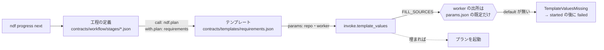
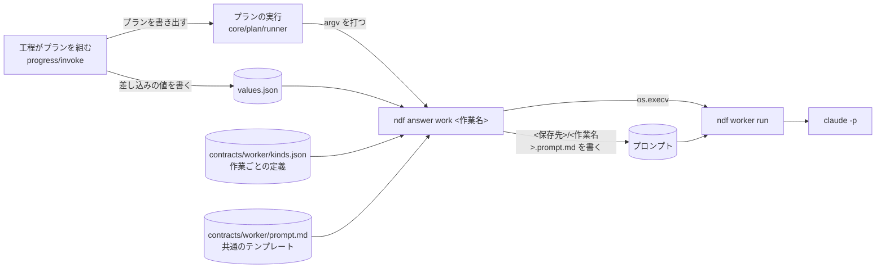
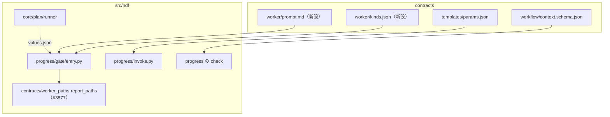
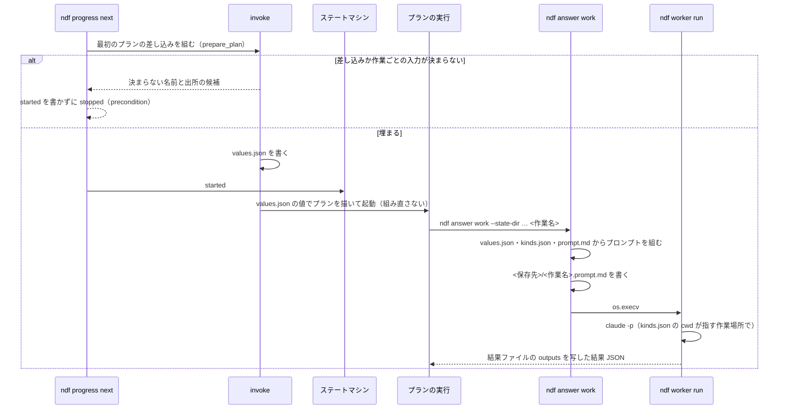

# 工程のプラン: 作業のプロンプトを仕組みが組み、工程が手を借りずに流れる（#3908）

工程のプランは、worker を起動する argv（差し込み `worker`）の既定を持たない。そのため `standard` の 18 工程のうち 17 工程が起動のたびに invalid で止まり、conductor と supervisor が作業を抱えてきた。欠けているのは作業のプロンプトを書く処理だけである。工程がプランを組むときに差し込みの値を保存先へ残し、`ndf answer work` がその値と作業ごとの定義からプロンプトを組んで `ndf worker run` を起動する形にする。決められない差し込みは起動の前に見つけて失敗の記録を残さず、手で閉じるときの出力の取り場所は文脈のスキーマが持つ。採らなかった案は「決定の記録」にある。

## 今の姿

何が起きたか・目的・受け入れ条件は要求仕様（[issue-3908-requirements.md](./issue-3908-requirements.md)、正は #3908 の本文）にある。この文書は「どう解くか」と「なぜその解き方か」だけを書く。



- `plugins/ndf/contracts/templates/params.json:16` の `worker` は「worker の起動の引数の並び」で、`default` を持たない。テンプレートはその後ろに作業の名前（`requirements` など）を 1 要素足して、プランのステップの `run`（argv）にする
- `plugins/ndf/src/ndf/progress/invoke.py:313-325` の `FILL_SOURCES` は `worker` の出所を `FROM_DEFAULT`（`params.json` の既定）だけにしている。既定が無いので、どの経路でも値が決まらない
- `worker` を使うテンプレートは 25 件中 23 件である（使わないのは `fix.json` と `merged.json`）。`standard` の 18 工程のうち 17 工程が当たり、当たらないのは `merged` を呼ぶクリーンアップだけである
- `plugins/ndf/src/ndf/progress/gate/entry.py:81-105` の `ndf answer work <作業名>` は、作業の名前を `ndf worker run --kind <名前> --prompt-file <保存先>/<名前>-prompt.md --result-file <保存先>/<名前>-result.json ...` へ合わせて `os.execv` で置き換える。**プロンプトのファイルを書く処理だけが無く**、同じファイルの `:76-78` のコメントがそう明記している。この設計の後は、ファイル名の区切りを `.` にそろえる（`<名前>.prompt.md`・`<名前>.result.json`。#3877 の決定 7）
- `worker` のほかに、工程「実装」は `title`・`body_file`・`issue`（課題が 2 件以上のとき）と `acceptance` が欠ける
- 工程「リファクタリング」は `refactor` が欠ける（`.ndf/project.json` に `workflow` のキーが無いため）
- 手で閉じるときの出力の値は、`plugins/ndf/contracts/workflow/context.schema.json` の `description` が「誰が書くか」を書くだけである。どこから取るかは `delivery` の 1 件しか書いていない

## 文脈と制約

- プランのステップは argv をそのまま子プロセスで打つ。`worker` は argv の先頭部分で、テンプレートが後ろに作業の名前を 1 要素足す。この形は 23 件のテンプレートが共有しているので変えない
- 差し込みの既定の中に、実行のときの差し込み（`{state_dir}` など）を書ける。`plugins/ndf/src/ndf/core/route/__init__.py:94` の `REVIEW_STATE = "{state_dir}/cross-review"` が同じ形を使っている
- `ndf answer work` が受け取れるのは `--state-dir`・`--cwd`・作業の名前の 3 つだけである（`entry.py:88-93`）。プロンプトの材料（課題の番号・作業場所・受け入れ条件）は、保存先から読めなければならない
- プランの状態の保存先には今、`prs.json`・`outputs.json`・`progress.jsonl` がある（`plugins/ndf/src/ndf/core/plan/records.py:17-22`）。差し込みの値は残っていない
- `ndf answer work` が受ける作業の名前は 7 件（`WORK_KINDS`）だが、`params.json` の説明が挙げる名前は 18 件である。唯一の基準を 1 つにする
- 報告の保存先のパスの決め方は #3877 の `report_paths`（`contracts/worker_paths.py`）が持つ。この設計はその関数を使い、別の決め方を作らない。プロンプトのファイル（`<名前>.prompt.md`）もこの関数が返す 4 つのパスの 1 つにする
- worker（`ndf worker run`）は `claude -p` を起動する。プロンプトの中身は `plugins/ndf/skills/development-workflow/references/agent-layers.md` の「supervisor → worker」が定める 7 項目と規則 7 個である

## 解き方の全体像



`worker` の既定を `["ndf", "answer", "work", "--state-dir", "{state_dir}"]` にする。worker が動く作業場所は作業ごとに違う（コードを編集する作業は作業場所 `worktree`、作業場所をこれから作る作業や要求の作業はリポジトリの根 `repo`）ので、既定の argv に `--cwd` を置かず、`kinds.json` の `cwd` が持つ。工程がプランを組む処理は、差し込みの値と工程の入力を 1 回だけ組んで保存先の `values.json` へ残し、プランを書き出すときはそれを使う。工程の最初のプランは `started` の前に組む。準備した値を使い回すのは同じ試行の中だけで、打ち直しでは設定と入力を取り直す。`ndf answer work <作業名>` は、その値と作業ごとの定義（`kinds.json`）と共通のテンプレート（`prompt.md`）からプロンプトを組み、作業場所を決める。worker が結果ファイルに書いた `outputs` は `ndf worker run` の結果を通ってプランの結果へ届く。書き出す先は `report_paths` が返すプロンプトのパス（`<保存先>/<作業名>.prompt.md`）で、書き終えたら `ndf worker run` へ置き換わる。差し込みを決められない工程は、起動する前に見つけて失敗の記録を残さずに返す。手で閉じるときの出力の取り場所は、文脈のスキーマの `x-source` が持ち、`ndf progress check` が欠けたキーの行に添える。

## 構成要素

| 要素 | 責務 |
| --- | --- |
| `contracts/templates/params.json` の `worker`（変更） | 既定 `["ndf", "answer", "work", "--state-dir", "{state_dir}"]` を持つ（作業場所は `kinds.json` の `cwd`） |
| `contracts/worker/kinds.json`（新設） | 作業の名前ごとに、作業種別・作業の 1 行・読む Skill・手順の抜粋のパス・読む値・作業場所・必須の出力を持つ。`WORK_KINDS` の唯一の基準になる |
| `contracts/worker/prompt.md`（新設） | 起動指示の 7 項目と規則 7 個の共通のテンプレート。差し込みは `string.Template` の `$名前`・`${名前}`（決定 6） |
| 工程がプランを組む処理（`progress/invoke`。変更） | プランを書き出すときに、組んだ差し込みの値を同じ保存先の `values.json` へ書く。`route.derived`・`route.launched` の補い（`acceptance`・`title`・`body_file` など）はこの層にしか無い |
| `ndf answer work`（`progress/gate/entry.py`。変更） | `values.json`・`kinds.json`・`prompt.md` からプロンプトを組んで `report_paths` が返すパスへ書き、`ndf worker run` へ置き換わる |
| `invoke.prepare_plan`（新設）と `progress/run` の `_start`（変更） | 試行（初回の開始と失敗の後の打ち直し）の始まりに前の試行の `values.json` を消し、その試行で次に流すプランの差し込みと作業ごとの入力を `started` の前に 1 回だけ組んで確かめ、`values.json` へ残す。決められなければ工程を `running` にせずに返す。止まりの分類は `_call_plan` と 1 か所で共有する |
| `ndf worker run`（`core/worker.py`。変更） | 結果ファイルの `outputs` を結果 JSON へ写し、必須の出力の欠けを返す |
| `route.refactor_launch`（新設） | `workflow.refactor` が無いリポジトリのリファクタリングの既定の起動を組む |
| `contracts/workflow/context.schema.json`（変更） | 文脈のキーごとに `x-source`（値の取り場所）を持つ |
| `ndf progress check`（変更） | 欠けた文脈のキーの行に `x-source` を添える |



## データ構造

`<保存先>/values.json`（工程がプランを組むときに書く）:

| キー | 型 | 中身 |
| --- | --- | --- |
| `plan` | string | プランの名前（テンプレートの `template`） |
| `values` | object | 差し込みの名前 → 値（文字列か文字列の配列）。`invoke.template_values` が組んだ値そのもの（`route.derived`・`route.launched` の補いを含む） |
| `inputs` | object | 工程の入力（`StageRun.inputs`）。テンプレートの `params` に無い入力（工程「要求と受け入れ条件」の `issues` など）は `values` から落ちるので、作業ごとの入力はこちらからも取る |
| `local_tests` | boolean | 描画の条件（手元のテストのステップを含めるか）。プランを描くときに設定を読み直さない |
| `at` | string | 書いた時刻（ISO 8601） |

`contracts/worker/kinds.json`:

| キー | 型 | 中身 |
| --- | --- | --- |
| `version` | integer | 形のバージョン |
| `kinds` | object | 作業の名前 → 下の定義 |

作業の定義:

| キー | 型 | 中身 |
| --- | --- | --- |
| `work` | string | 作業種別（`調査`・`修正`・`検証`・`集計`） |
| `summary` | string | 作業の 1 行（起動指示の「作業」の欄） |
| `skills` | array | 読む Skill の名前。工程ごとに読む規則の Skill（`document-style`・`logging-guidelines`）。無ければ空 |
| `excerpt` | string / null | 手順の抜粋のパス（`skills/<名前>/references/excerpt.md`）。無ければ null |
| `inputs` | array | この作業が読む値の名前（`issue`・`worktree`・`branch`・`acceptance`・`issues` など）。差し込みの値にあればそれを、無ければ工程の入力を使う |
| `cwd` | string | worker が動く場所を指す差し込みの名前（`"worktree"` か `"repo"`） |
| `outputs` | array | 作業の結果ファイルに必ず入れる `outputs` のキー（`worktree` の作業なら `worktree`・`branch`）。無ければ空 |

`context.schema.json` の各キーに足す `x-source`（文字列）: その値をどこから取るかを 1 行で書く。例は「`.ndf/project.json` の `branch_strategy.release.deliveries` の 1 行に `result` を足す」「ステートマシンの `release-mvv` のステップの outputs」。

## 入出力のコントラクト

```text
ndf answer work --state-dir <保存先> --cwd <作業場所> <作業名>
```

変えるのは中の振る舞いで、引数は変えない。作業の名前は `kinds.json` の `kinds` のキーのどれかで、ほかは `stopped`（`invalid`）で断る（今の `WORK_KINDS` の 7 件が 18 件へ広がる）。`values.json` が無い・読めないときは `stopped`（`precondition`）で、保存先のパスと理由を `summary` に書く。

```text
ndf progress next <ステートマシン>
```

差し込みを決められない工程に当たったとき、その行を `running` にせず、`stopped`（`precondition`）で返す。`summary` は「工程 \<名前\> のプラン \<テンプレート\> の差し込み \<名前\>… を決められない」とする。`items` には差し込みごとの名前と出所の候補（`FILL_SOURCES` の出所の人が読む文）を並べる。

```text
ndf progress check <ステートマシン> <工程> --output <出力>
```

欠けた文脈のキーを挙げるとき、キーごとに `x-source` を添える。

## 処理の流れ



## 決定の記録

### 決定 1: 作業のプロンプトを書く処理を `ndf answer work` に置く

- **質問**: 工程のプランが worker を起動できるようにするために、プロンプトを誰が書くか
- **選んだ案**: `ndf answer work` がプロンプトを組んで書き、そのまま `ndf worker run` へ置き換わる。`worker` の既定はこのコマンドの argv にする
- 採らなかった案:
  - テンプレートごとに `run` でプロンプトのファイルを渡す（23 件のテンプレートに同じ形を書き写すことになり、プロンプトの形を変えるたびに 23 か所を直す）
  - プランの実行がプロンプトを書く（プランの実行は工程と作業の規約を知らない層で、起動指示の 7 項目の規約が実行の層へ漏れる）
  - 決まらない工程をステートマシンの定義から外す（`standard` の 17 工程が工程表から消え、工程の進行が記録されなくなる）
- **代償**: `ndf answer work` が、プランの保存先の形（`values.json`）に依存する
- 作り方: 自前で作る（既存の `ndf answer work` に処理を足す）
- 比べた候補: 外部の調査の LIB の表（プロンプトのテンプレートを埋めるライブラリ）
- 根拠: Value 3「判断の要らない手順（待ち・集計・検査・記録・整形・起動の組み立て）は仕組みが進めるので、結果が実行ごとにばらつかない」（MVV バージョン 1）

### 決定 2: プロンプトの材料を保存先の `values.json` で渡す

- **質問**: `ndf answer work` は、課題の番号・作業場所・受け入れ条件をどこから読むか
- **選んだ案**: 工程がプランを組む処理（`progress/invoke`）が、プランを書き出すときに差し込みの値を保存先の `values.json` へ書き、`ndf answer work` がそれを読む。プランの実行の層（`core/plan/runner`）には `acceptance`・`title`・`body_file` の補いが渡らないため、組んだ層が書く
- 採らなかった案:
  - `ndf answer work` の引数を増やしてテンプレートから渡す（23 件のテンプレートを直し、差し込みを足すたびに全件を直す）
  - `ndf answer work` が自分でステートマシンとプランを読み直す（同じ値を 2 か所で組み立てることになり、プランが使った値と食い違いうる）
- **代償**: 保存先にファイルが 1 つ増える。工程がプランを組むときに 1 回書き込みを行う。工程を通さない単発のプラン（`ndf plan` を手で打つ経路）では `values.json` が無く、`ndf answer work` は `precondition` で止まる
- 根拠: Value 3「同じ手順は毎回同じ結果になる」（MVV バージョン 1）

### 決定 3: 作業ごとの定義を `kinds.json` の 1 か所に置く

- **質問**: 作業の名前・作業種別・読む Skill・手順の抜粋の対応を、どこが持つか
- **選んだ案**: `contracts/worker/kinds.json` が持ち、`params.json` の説明文・`WORK_KINDS` の定数・プロンプトの組み立てがすべてここを読む
- 採らなかった案:
  - 作業の名前ごとにプロンプトのテンプレートのファイルを置く（18 件の文書ができ、共通の 7 項目と規則 7 個が 18 か所に写る）
  - 今のままコードの定数（`WORK_KINDS`）と説明文に分けて持つ（7 件と 18 件で既に食い違っている）
- **代償**: 作業を足すときに `kinds.json` へ 1 行足す手順が増える
- 根拠: Value 3「手順は使うほど増えるのではなく、減っていく」・値を設定の 1 か所に統合する方針（MVV バージョン 1）

### 決定 4: 決められない差し込みは、工程を `running` にする前に見つける

- **質問**: 差し込みを決められない工程をどう扱うか
- **選んだ案**: テンプレートを埋められるかを `started` の記録の前に確かめ、埋められなければ行を `pending` のままにして `stopped`（`precondition`）で返す。決まらない差し込みの名前と出所の候補を `items` に並べる
- 採らなかった案:
  - 今のまま `started` → `failed` を書く（ステートマシンの履歴が失敗で埋まり、`retry` を打たないと次へ進めない）
  - 既定の値で埋めて起動する（誤った値で worker が動き、何が足りなかったか分からなくなる）
- **代償**: `ndf progress next` の終了コードが、今の「工程が失敗した」から「起動できない」に変わる。呼ぶ側（耐久ワークフロー）が `precondition` を読む
- 根拠: Value 3「版上げ・再起動・セッションの入れ替えをまたいでも、進行中の作業と人の回答は失われず、止まった所から続く」（MVV バージョン 1）

### 決定 5: 出力の値の取り場所を文脈のスキーマに置く

- **質問**: 手で閉じるときの出力の値の取り場所を、どこが持ち、どこが示すか
- **選んだ案**: `context.schema.json` のキーごとに `x-source` を足し、`ndf progress check` が欠けたキーの行に添える
- 採らなかった案:
  - 手順書に取り場所の表を書く（文書とスキーマの 2 か所に同じ事実が分かれ、片方だけが古くなる）
  - `description` に書き足す（説明文と機械が読む値が混ざり、どこまでが取り場所か決まらない）
- **代償**: JSON Schema に標準でないキー（`x-` の接頭辞）を 1 つ持つ
- 根拠: Value 1「AI が決められないことは、理由と根拠を添えて人へ戻ってくる」・Value 3（MVV バージョン 1）

### 決定 6: プロンプトのテンプレートの差し込みは `string.Template` の `$名前` にする

- **質問**: プロンプトのテンプレートの差し込みを何で埋めるか
- **選んだ案**: Python 標準ライブラリの `string.Template` を使い、差し込みは `$名前`・`${名前}` の形にする。共通のテンプレートの差し込みの欠けは `substitute()` が `KeyError` を上げる（LIB1・LIB1a）。作業ごとの入力は 1 つの `$inputs` に組んでから入れるので、その内訳の欠けは `KeyError` にならない。内訳は `kinds.json` の `inputs` の名前ごとに `started` の前に確かめる（決定 4）
- 採らなかった案:
  - Jinja2（条件と繰り返しが要らず、依存が 1 つ増える。既定の `Undefined` は欠けた値を空で描画し、止めるには明示が要る。LIB2・LIB2a）
  - `{{名前}}` の形を自前の置換で埋める（`string.Template` の `pattern` を上書きすれば合わせられるが、標準の形から外れる理由が無い）
- **代償**: プロンプトの本文に `$` を書くときは `$$` で逃がす
- 作り方: ライブラリを使う（Python 標準ライブラリ）
- 比べた候補: LIB1・LIB2・LIB3・LIB4
- 根拠: Value 3「同じ手順は毎回同じ結果になる」（MVV バージョン 1）

### 決定 7: 課題が 2 件以上の工程は代表の課題から値を組み、`refactor` は既定の起動を持つ

- **質問**: 受け入れ条件 2 の差し込み（`title`・`body_file`・`issue`・`acceptance`・`refactor`）を、課題が 2 件以上のスプリントと、`.ndf/project.json` に `workflow` のキーが無いリポジトリで、どこから決めるか
- **選んだ案**:
  - 課題が 2 件以上なら、`_issue_values`（`progress/invoke.py:387-412`）が番号の最も小さい課題を代表の課題にして `title`・`body_file`・`issue` を写す。代表の課題の選び方は、実装のフェーズの単位の決まり（`agent-layers.md` の「実装のフェーズの単位」の「代表の課題」）と同じである
  - `acceptance` は、`route.launched` の補いを課題ごとの `--issue` の並び（`--issue <番号1> --issue <番号2> ...`）にする。今の補い（`--issue <issue>` の 1 つ）では代表の課題の条件しか照らさない
  - `refactor` は、`review` が設定なしでも `review_launch` で組める（`route/__init__.py:461-466`）のと同じ形で、`route.refactor_launch` が `ndf refactor run --branch <branch> --base <起点> --required <必須のチェック>` を `bash -c` の包み（`REFACTOR_WITH_PR`。位置引数は `$0` がブランチ、`$1` が起点で、本文の先頭の `shift` の後の `"$@"` が実行の argv）で組み、`invoke._fill_refactor` が既定として差し込む。起点は、読み込み済みの設定から決めたマージ先を、工程の条件 `code_in_diff` と同じ規則（`command.base_ref`。手元に無ければブランチ戦略の設定のリモートの `<リモート>/<base>`）で参照にしたもので、`--base` と差分の列挙の両方に同じ値を渡す。`--required` は `.ndf/project.json` の `ci.required_checks` から、プランを組むときに取る。`--pr` はブランチの PR の番号、`--scope` は起点からの差分のファイル（`git diff -z` で取り、1 ファイル 1 引数で渡す）で、どちらも前の工程の後でないと決まらないので、包みが打つ時点に読んで足す（`REVIEW_WITH_PR` と同じ）。PR が無い・差分が空なら `ndf refactor run` を打たずに `stopped`（`precondition`）を返す（2026-11-23 に `ndf refactor run --help` で必須の引数がこの 5 つであることを確かめた）。設定（`workflow.refactor`）は既定を変えたいときだけ置く。値の出所の表は詳細設計の「リファクタリングの既定の起動」にある
- 採らなかった案:
  - 課題が 2 件以上のときは差し込みを決めずに止める（決定 4 の止まり方になるが、`standard` のスプリントは課題を束ねることが多く、ほとんどの実装の工程が止まる）
  - `.ndf/project.json` に `workflow.refactor` を足して、このリポジトリだけ埋める（ほかのリポジトリでは同じように止まる。リポジトリの設定が無ければ動かない形は、設定 1 つで同じ工程が使える決まりに反する）
- **代償**: PR の題と本文は代表の課題のものになる。ほかの課題は、PR の本文の `Closes` の行と実装の Pull Request の作り方（`pr` の工程）が拾う
- 根拠: Value 4「テストのコマンド・起点のブランチ・配布の手段・言語・ランタイム・課題の置き場が違っても、設定か引数を渡せば同じ工程が使える」（MVV バージョン 1）

## 影響と危険

- **働く範囲**: `plugins/ndf` のリリース対象。利用先のリポジトリでも、工程のプランを使うすべてのスプリントに当たる
- **プロジェクトごとに違うもの**: 作業場所・課題の番号・受け入れ条件は差し込みの値として渡る。読む Skill と手順の抜粋は `kinds.json` が持ち、リポジトリの設定では変えない
- **当たるモード**: すべてのモード（工程のプランはモードごとの工程の並びから呼ばれる）

### 代表のリポジトリでの振る舞い

| 代表のリポジトリ | 設定の要点 | 直した後に起きること | この種類で扱えなくなること |
| --- | --- | --- | --- |
| Web サービス | `test.suites`・`ci.required_checks` を持つ | 工程のプランが worker を起動して流れる。テストの差し込みは今までどおり設定から埋まる | 無し |
| モバイルアプリ | 同上 | 同上 | 無し |
| 業務文書だけ | テストの設定を持たない。`documentation` のモード | 素材の収集・執筆・体裁レビューの工程のプランが流れる。テストの差し込みを求めるステップは今までどおり通らない | 無し |

### ai-plugins だけの事情

| 値 | 置く所 | 持つ Issue |
| --- | --- | --- |
| `.ndf/project.json` に `workflow` のキーが無い | `.ndf/project.json` | 無し。`refactor` は既定の起動を持つので埋まる（決定 7）。`rebuild` の既定は工程「ドキュメント再構成」を流すときに同じ形で足す |
| `test.ci.only` が真で、手元のテストのステップを求めない | `.ndf/project.json` | 無し |

危険:

- `worker` の既定を入れると、今まで止まっていた 17 工程が一斉に走り出す。走り出した先の worker のプロンプトに作業の情報が足りないと、工程が意図しない作業をして進む。実装では、工程を 1 つずつ（まず要求と受け入れ条件）通して確かめる。リリースの後に工程が意図しない作業をしたときは、今と同じく conductor がその工程を `ndf progress` で止めて手で閉じる経路が残る。直しはその工程の `kinds.json` の行とテンプレートの文で行い、全体を戻すときは `params.json` の `worker` の既定を外す 1 行の revert で今の振る舞い（起動の前に止まる）へ戻る
- `invoke.py` と `core/plan/runner` は、並行するほかのスプリント（#3905・#4229）も触りうる

## 用語

| 用語 | 意味 | 用語集への反映 |
| --- | --- | --- |
| 作業の名前 | 工程のプランが worker へ渡す作業の識別子（`requirements`・`impl` など）。`contracts/worker/kinds.json` のキーが唯一の基準 | 追加 |
| 差し込みの値 | プランのテンプレートの `{{名前}}` に入る値。`invoke.template_values` が組む。プロンプトのテンプレートの差し込み（`$名前`）とは別の仕組みである | 追加 |

## テスト設計

| 受け入れ条件・不変条件 | どの振る舞いで縛るか | どう壊したら落ちるべきか |
| --- | --- | --- |
| 1（要求と受け入れ条件が起動する） | `standard` のステートマシンで工程「要求と受け入れ条件」を起動すると、`worker` の差し込みで止まらずにプランが起動する | `params.json` の `worker` の既定を消すと落ちる |
| 2（実装・リファクタリングの差し込み） | 課題が 1 件と 2 件以上の工程「実装」で `title`・`body_file`・`issue` が代表の課題から決まり、`acceptance` が課題ごとの `--issue` の並びになる。`.ndf/project.json` に `workflow` が無いリポジトリの工程「リファクタリング」で `refactor` が既定から決まる | 課題が 2 件以上のときに `acceptance` を代表の課題だけにすると落ちる。`refactor` の既定を消すと落ちる |
| 3（failed を書かない） | 差し込みを決められない工程を `ndf progress next` で起動すると、ステートマシンの記録に `started` も `failed` も増えず、決まらない差し込みの名前と出所の候補が返る | 決まらないときに `started` を書くと落ちる |
| 4（取り場所を示す） | `ndf progress check` が、欠けた `delivery`・`mvv_gate` の行に `x-source` の文を添える | `x-source` を読まずにキーの名前だけを出すと落ちる |
| 5（退行） | 工程「クリーンアップ」が、この変更の前と同じ引数でプランを起動する | `merged` のテンプレートに `worker` を足すと落ちる |
| 決定 1（プロンプトを書く） | `ndf answer work <作業名>` が `<保存先>/<作業名>.prompt.md` を書いてから `ndf worker run` の argv へ置き換わる。プロンプトに、起動指示の 7 項目と規則 7 個の見出しがそろう | プロンプトを書かずに置き換わると落ちる |
| 決定 2（材料の受け渡し） | `values.json` が無い保存先で `ndf answer work` を打つと `stopped`（`precondition`）で、保存先のパスを `summary` に出す | 無いときに空のプロンプトで起動すると落ちる |
| 決定 3（唯一の基準） | `kinds.json` に無い作業の名前は `stopped`（`invalid`）で断る。`kinds.json` のキーが、テンプレートが使う作業の名前をすべて含む | テンプレートが使う名前を `kinds.json` から 1 件落とすと落ちる |
| 決定 1（作業場所） | `values.json` の `repo` と `worktree` が違う値のとき、作業 `impl` の worker は `worktree` で、作業 `worktree`・`requirements` の worker は `repo` で起動する | 既定の argv に `--cwd {repo}` を戻すか、`kinds.json` の `cwd` を読まずに `repo` を使うと落ちる |
| 決定 2（作業ごとの入力） | 工程「要求と受け入れ条件」で、テンプレートの `params` に無い工程の入力 `issues`（2 件）が起動指示の入力の欄に両方載る。`issues` が無ければ `started` の前に名前と出所付きで止まる | `values.json` に工程の入力を残さないと落ちる |
| 決定 2（1 回だけ組む） | 工程を起動してプランを描くまでに、差し込みを組む処理（`template_values`）が 1 回だけ呼ばれる | `plan_path` が `values.json` を読まずに組み直すと落ちる |
| 決定 1（出力の受け渡し） | 工程「作業場所の用意」で、worker の結果ファイルの `outputs` の `worktree`・`branch` が工程の出力まで届く | `ndf worker run` が結果ファイルの `outputs` を写さないと落ちる |

詳細設計は [issue-3908-design-detail.md](./issue-3908-design-detail.md) にある（新設する関数が 2 つ以上のため別ファイル）。

## 設計の結果

| 課題 | 扱い | 統合先 | 触るファイル |
| --- | --- | --- | --- |
| #3908 | 実装する | — | `plugins/ndf/contracts/templates/params.json`、`plugins/ndf/contracts/worker/kinds.json`（新設）、`plugins/ndf/contracts/worker/prompt.md`（新設）、`plugins/ndf/contracts/workflow/context.schema.json`、`plugins/ndf/src/ndf/progress/invoke.py`、`plugins/ndf/src/ndf/progress/run.py`、`plugins/ndf/src/ndf/progress/command.py`、`plugins/ndf/src/ndf/progress/definition.py`、`plugins/ndf/src/ndf/progress/gate/entry.py`、`plugins/ndf/src/ndf/progress/worker_kinds.py`（新設）、`plugins/ndf/src/ndf/core/worker.py`、`plugins/ndf/src/ndf/core/route/__init__.py`、`plugins/ndf/docs/contracts/commands.md`、`plugins/ndf/tests/progress/test_invoke.py`、`plugins/ndf/tests/progress/test_invoke_refactor.py`、`plugins/ndf/tests/progress/test_run.py`、`plugins/ndf/tests/progress/gate/test_gate_work.py`、`plugins/ndf/tests/progress/test_sprint_templates.py`、`plugins/ndf/tests/core/test_worker_outcome.py`（新設） |

## 未確認のまま残ること

| 項目 | 内容 |
| --- | --- |
| プロンプトの中身が足りるか | 工程のプランが起動した worker が、組んだプロンプトだけで作業を終えられるかは、実際に流すまで分からない。実装では工程を 1 つずつ通し、足りなかった項目を `kinds.json` とテンプレートへ足す |
| `ndf answer work` の今の振る舞い | プロンプトのファイルが無い状態で打ったときの終了コードと結果 JSON の形は、実測していない（調査の残リスク 4） |
| `rebuild` の既定 | 工程「ドキュメント再構成」の `rebuild` は、`refactor` と同じく既定の起動を持たせる見込みだが、組み直しの起動の引数（`--out` を後ろに足す形）を実装で確かめてから決める |

## 外部の調査

| 種類 | 調べるか | 理由 |
| --- | --- | --- |
| 標準・仕様 | 調べない | プロンプトの中身の規約は NDF の手順書（`agent-layers.md` の「supervisor → worker」）が持ち、業界の標準が形を定めていない |
| 主要な製品 | 調べる | 工程ごとの作業のプロンプトを、テンプレートのファイルで持つかコードで組むかの分かれ目（決定 1・決定 3） |
| ライブラリとサービス | 調べる | 自前で組む決定（決定 1）があるため、プロンプトのテンプレートを差し込みで埋める既存のライブラリと、値が決まらないときの扱いを比べる |

### 主要な製品

| # | 製品 | どう解いているか | 設計への反映 | 出典 |
| --- | --- | --- | --- | --- |
| PRD1 | OpenAI Agents SDK（Python） | 指示は静的な文字列か、エージェントと文脈を受け取って本文を返す関数で渡す。プラットフォーム側のテンプレートを指すときは、差し込みを `variables` の辞書で渡す | 決定 1。テンプレートをファイルに置き、差し込みを辞書で渡す形は実績がある | https://openai.github.io/openai-agents-python/agents/ （2026-11-23） |
| PRD2 | CrewAI | 設定ファイル（`agents.jsonc`）に `{placeholder}` を含む本文を書き、`inputs` に既定を置く。足りない値は実行時に利用者へ聞く | 決定 3。作業ごとの定義を設定ファイルの 1 か所に置く形の実績。ただし「聞く」は人のいない実行で採れないため、決定 4 では「起動の前に止める」を選ぶ | https://docs.crewai.com/en/concepts/agents （2026-11-23） |
| PRD3 | GitHub Copilot のカスタムエージェント | frontmatter 付きの Markdown（本文は 30,000 文字まで）で定義する。差し込みの構文は見つからなかった | 決定 3。作業ごとに自由記述の文書を 18 件持つ案を採らない根拠（共通の項目が 18 か所に写る） | https://docs.github.com/en/copilot/reference/custom-agents-configuration （2026-11-23、検索結果を経由） |

### ライブラリとサービス

| # | 候補 | バージョン | ライセンス | 最後のリリースの日付 | 終了のアナウンス | 要件を満たすか | 出典 |
| --- | --- | --- | --- | --- | --- | --- | --- |
| LIB1 | `string.Template`（Python 標準ライブラリ） | Python 3 の標準ライブラリ | Python Software Foundation License | 標準ライブラリのため個別のリリース日なし | 無し | 満たす。`$名前` の差し込みで足り、欠けた値は `substitute()` が `KeyError` を上げる（決定 4 の「起動の前に止める」と合う）。依存を足さない | https://docs.python.org/3/library/string.html （2026-11-23） |
| LIB2 | Jinja2 | 3.1.6 | BSD | 2025-03-05 | 無し | 条件と繰り返しを使えるが、この用途では要らない。既定の `Undefined` は欠けた値を空で描画し、止めるには `StrictUndefined` を明示する必要がある。依存が 1 つ増える | https://pypi.org/pypi/jinja2/json （2026-11-23） |
| LIB3 | prompt-poet | 0.0.52 | MIT | 2026-02-12 | 無し（ただしバージョンが 0.0.x 系で、`Development Status` の記載が無い） | 満たさない。テンプレートの形が LLM の会話の列に寄っており、起動指示の 7 項目の文書を組む用途と合わない | https://pypi.org/pypi/prompt-poet/json （2026-11-23） |
| LIB4 | langchain-core（`PromptTemplate`） | 1.8.4 | MIT | 2026-11-19 | 無し | 満たさない。プロンプトのためだけに LangChain の依存を足すことになり、値が足りないときの振る舞いも確かめられていない | https://pypi.org/pypi/langchain-core/json （2026-11-23） |

### 差し込みの値が決まらないときの扱い（決定 4 の材料）

| # | 仕組み | 既定の扱い | 出典 |
| --- | --- | --- | --- |
| LIB1a | `string.Template.substitute()` | 欠けた差し込みで `KeyError` を送出する（止める） | https://docs.python.org/3/library/string.html （2026-11-23） |
| LIB1b | `string.Template.safe_substitute()` | 欠けた差し込みをそのまま文字列に残す | 同上 |
| LIB2a | Jinja2 の `Undefined`（既定） | 印字すると空文字になり、止まらない | https://jinja.palletsprojects.com/en/stable/api/ （2026-11-23） |
| LIB2b | Jinja2 の `StrictUndefined` | 描画の時点で例外を上げる（止める） | 同上 |
| PRD2a | CrewAI | 実行時に利用者へ聞く | https://docs.crewai.com/en/concepts/agents （2026-11-23） |

実在する扱いは「空にする」「止める」「そのまま残す」「聞く」の 4 通りで、人のいない実行では「聞く」を採れない。決定 4 は「起動の前に止めて、決まらない名前と出所の候補を返す」を選ぶ。

### 確かめられなかったこと

| 対象 | 試した手段 | 結果と理由 |
| --- | --- | --- |
| Cursor・Devin・LangGraph のプロンプトの組み立て | 試していない | 3 課題の調査を合わせた取得の試みの上限（30 回）に達したため着手していない。この課題に使ったのは 11 回 |
| LangChain `PromptTemplate` の、値が足りないときの振る舞いの原文 | PyPI の登録簿だけ取得 | バージョン・ライセンス・リリース日は確認したが、振る舞いの原文は未確認。理由: 上限 |
| GitHub Copilot のカスタムエージェントの原文の直接の取得 | https://docs.github.com/en/copilot/concepts/agents/custom-agents を取得（404）→ 検索 1 回 | 404 のため検索結果の要約を経由した。原文の逐語の引用ではない。理由: 上限 |

調べた量: 候補 7 件・取得の試み 11 回。
