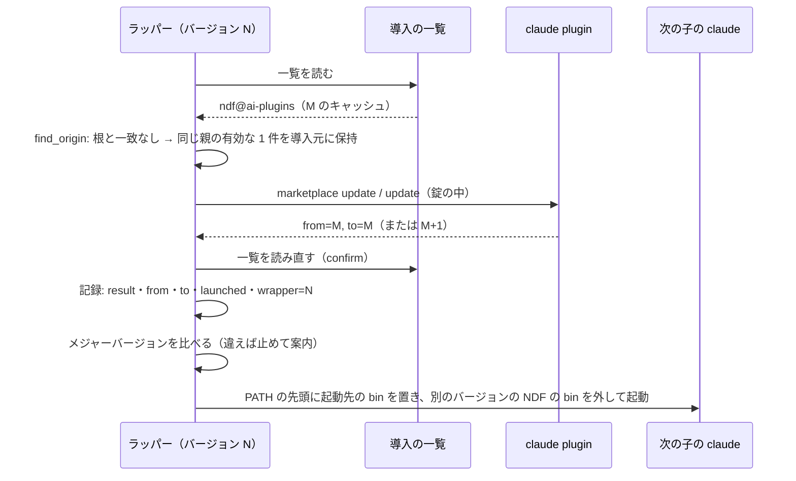

# 中継: ラッパーの外で NDF が上がっても、次のセグメントと `ndf` を今の導入のバージョンで動かす（#3909）

Claude Code の自動更新が NDF を先に上げると、後から起動したラッパーは自分のコードと同じバージョンの導入を見つけられず、更新を飛ばしたまま子の claude を起動し、子の `ndf` も古いバージョンに解決していた。ラッパーが更新の対象を「自分と同じ導入先」だけでなく「同じマーケットプレイスのキャッシュの有効な導入」から選び、子の `PATH` から別のバージョンの NDF の `bin` を外し、耐久ワークフローがその時点の有効な導入の `bin/ndf` でラッパーを起動するように直す。外で上がったことは記録の新しいキーで区別できるようにし、自動更新を止めて自分で上げる経路を確かめる手順を手順書に足す。採らなかった案は「決定の記録」に、Claude Code の自動更新の事実は「外部の調査」にある。

## 今の姿

何が起きたか・目的・受け入れ条件は要求仕様（[issue-3909-requirements.md](./issue-3909-requirements.md)、正は #3909 の本文）にある。この文書は「どう解くか」と「なぜその解き方か」だけを書く。

```mermaid
flowchart LR
  CC[Claude Code の自動更新] -- "導入を M へ入れ替え" --> INS[(installed_plugins.json<br/>ndf@ai-plugins = M)]
  LR["耐久ワークフロー<br/>（バージョン N のコード）"] -- "entry(): 自分のバージョン N の bin/ndf" --> HUB[relay spawn / ハブ]
  HUB -- "N の bin/ndf relay run" --> W["ラッパー（バージョン N）"]
  W -- "find_origin: installPath == N の根?" --> INS
  W -. "一致なし → skipped・launched null" .-> LOG[(log.jsonl)]
  W -- "PATH を加工せず起動" --> C["子の claude<br/>hook・Skill は M、ndf は N"]
```

**根本原因は 3 つの部品にあり、どれも「起動したプロセスのコードのバージョン = 導入のバージョン」を前提にしている。** 導入がラッパーの外で上がると前提が崩れる。

| 部品 | 今の振る舞い | 外で上がったときに起きること |
| --- | --- | --- |
| 更新の対象を決める（`plugin_update.find_origin`） | 有効な `ndf@` の行のうち、`installPath` がラッパー自身のコードの根と一致する 1 件だけを導入元にする | 一致が 0 件で `skipped`（`NO_MATCH`）。起動先の確認も呼ばれず `launched` が null になり、メジャーバージョンの判定も素通りする |
| 子の環境を作る（`session_env.child_env`） | `PATH` を加工しない（環境変数の表 `contracts/domains/env.json` に `PATH` の行が無い） | ラッパーの起動の経路で入ったバージョン N の NDF の仮想環境の `bin` とバージョン N のプラグインの `bin` が子の `PATH` の前に残り、子の claude が末尾に足すバージョン M の `bin` より先に `ndf` が見つかる |
| ラッパーを起動する（`progress/lane/launch.entry`） | 耐久ワークフロー自身のコードの根の `bin/ndf` を使い、その根が消えたときだけ別のバージョンへ替える | 旧バージョンの根は `.orphaned_at` が付いても 14 日残るので替わらない。ラッパーはバージョン N で起動し続ける |

**なぜ検査で拾えなかったか。** #3812 のテストは「導入先がラッパーのコードと同じバージョン」と「キャッシュの外（`tmp_path/"dev"`）」の 2 つの形だけを試し、「同じキャッシュの別のバージョン」の形を持たなかった。同じプロセスの中で一度導入元を保持した後の追跡（`test_i4_origin_is_kept_before_the_lock_wait_and_followed_after_another_wrapper_moved_it`）は通るので、長く動くラッパーでは起きず、起動し直したラッパーでだけ起きた。

**ラッパーの外で上げたのは Claude Code のマーケットプレイスの自動更新である（2026-11-20 に確かめた）。**

| 根拠 | 中身 |
| --- | --- |
| 旧バージョンに Claude Code のマーカー | 11.0.8 の `.orphaned_at` は `1795145702712`（12:35:02 JST）、11.0.9 の `.orphaned_at` は `1795168188506`（18:49:48.506 JST）。それぞれ `installed_plugins.json` の `lastUpdated`（12:35 JST・18:49:48.505 JST）と一致する。Claude Code は更新した旧バージョンに `.orphaned_at` を書く（外部の調査の PRD1） |
| マーケットプレイスの取り直し | `~/.claude/plugins/marketplaces/ai-plugins` の `git reflog` は `HEAD@{2026-11-20 09:49:48 +0000}: clone` の 1 行だけ |
| NDF は打っていない | 11.0.10 の更新は 5 本のラッパーが claude を起動した 18:49:31〜41 JST の 7 秒後で、ラッパーの記録はすべて `skipped`。NDF のコードで導入を更新するのはラッパーの `plugin_update.py` だけで、リリースの確かめ（`domains/release/verify.py`）は読むだけ |
| 設定 | `~/.claude/settings.json` の `extraKnownMarketplaces.ai-plugins` と `known_marketplaces.json` の `ai-plugins` の両方が `autoUpdate: true`。止める環境変数は無い |

**同じ形の箇所。** 自分のバージョンの根を前提にする箇所は、上の 3 つのほかに `launch.stop`・`wrappers`・`account_ok`・`sprint_wait`・`run.detach` の `entry()` がある。どれもラッパーを起動しない（止める・一覧を読む・耐久ワークフロー自身を起動する）ので、バージョンがずれても振る舞いは変わらない。直す対象に入れない。

## 文脈と制約

- ラッパー自身のコードは、動いている間は入れ替えない（#3812 の決定。確定仕様 [ndf-relay-plugin-update.md](../docs/specifications/ndf-relay-plugin-update.md)）。この設計も入れ替えない
- `--plugin-dir` や開発のチェックアウトから動くラッパーは更新しない（#3812 の受け入れ条件 6）。この境目を保つ
- 耐久ワークフローのプロセス自身の入れ替えと、それが組むレーンの最初の入力のバージョンは扱わない（#3918）
- 利用者の Claude Code の設定（自動更新の有無）を NDF のコードで書き換えない（要求の「境界」）
- Claude Code の自動更新は、利用者が有効にしたマーケットプレイスについて、どのセッションからでも裏で走る（外部の調査の PRD1）。ラッパーの子だけ止めても、ほかのセッションが上げる

## 解き方の全体像

```mermaid
flowchart LR
  CC[Claude Code の自動更新] -- "M へ入れ替え" --> INS[(導入の一覧<br/>ndf@ai-plugins = M)]
  LR["耐久ワークフロー（バージョン N）"] -- "installed_entry: 一覧の M の bin/ndf" --> HUB[relay spawn / ハブ]
  HUB -- "M の bin/ndf relay run" --> W["ラッパー（バージョン M）"]
  W -- "find_origin: 同じキャッシュの有効な 1 件" --> INS
  W -- "更新のコマンド → launched・wrapper を記録" --> LOG[(log.jsonl)]
  W -- "PATH の先頭に起動先の bin を置き、別のバージョンの NDF の bin を外して起動" --> C["子の claude<br/>hook・Skill・ndf がそろって M"]
```

- 耐久ワークフローが起動するラッパーは決定 4 で今の導入のバージョンになるので、決定 1 が効くのは、古いバージョンの `bin/ndf` から手で起動したラッパーと、決定 4 が自分のバージョンへ戻したときである。2 つは同じ規則を使う
- 同じキャッシュの導入を選ぶ規則は下の層（`adapters.claude`）に 1 つだけ置き、ラッパーと耐久ワークフローの両方が読む
- ラッパーは、自分の根と一致する導入が無ければ、自分の根が Claude Code のキャッシュのバージョンのディレクトリ（`<CLAUDE_CONFIG_DIR か ~/.claude>/plugins/cache/<マーケットプレイス>/ndf/<plugin.json の version>`）であるときだけ、同じ親の下を指す有効な `ndf@` の 1 件を導入元にし、今のとおり 2 つのコマンドを打つ。キャッシュの外から動くラッパーと、キャッシュの中でもバージョンの名前でないディレクトリ（`ai-plugins/ndf/dev` など）から動くラッパーは今のとおり `skipped`
- `plugin_update` の行にラッパー自身のバージョン（`wrapper`）が載り、`from` がそれと違えば外で上がっていた、`result` が `updated` なら自分で上げた、と読める
- ラッパーは起動先の導入の根を覚え、子の `PATH` から、その根と同じ親の下の別のバージョンの `bin` と NDF の仮想環境の `bin` を外し、起動先の `bin` を先頭に置く。子の `ndf` は、`PATH` の上の旧版へのシンボリックリンク（`~/.local/bin/ndf` など）が残っていても起動先の `bin` に解決する
- 耐久ワークフローはレーンのラッパーを起動するとき、導入の一覧の有効な導入（同じ規則で選ぶ）の `bin/ndf` で `relay spawn` を打つ。読めなければ今のとおり自分のバージョン（自分の根が消えていれば同じ親の最も新しいバージョン）で打ち、理由と選んだバージョンを 1 行出す
- relay.md に、自動更新の止め方・戻し方と、ラッパーが自分で上げる経路をリリース後に確かめる手順が載る

## 処理の流れ

カットポイントの切り替えで、外で M へ上がっていた場合（ラッパーはバージョン N で起動した直後、まだ導入元を保持していない）。



失敗の経路は今のまま変えない（一覧が読めない → `failed` で今の起動先、錠を取れない → `failed`、保持した導入が消えた → `skipped`）。新しく足すのは、同じ親の下に有効な導入が 2 件以上あるときの `skipped`（理由「同じマーケットプレイスのキャッシュを指す有効な NDF の導入が複数ある」）だけである。

## 決定の記録

### 決定 1: 外で上がった導入を更新の対象にするため、自分の根と同じ親の下の有効な導入を導入元にする

- **質問**: ラッパーのコードの根と一致する導入が無いとき、どの導入を更新の対象にするか
- **選んだ案**: 根と一致する 1 件があれば今のとおりそれを使う。無ければ、ラッパーの根が Claude Code のキャッシュのバージョンのディレクトリ（キャッシュの根 `<CLAUDE_CONFIG_DIR か ~/.claude>/plugins/cache` の下の `<マーケットプレイス>/ndf/<名前>` で、`<名前>` が根の `plugin.json` の `version` と等しい）であるときだけ、`installPath` が同じキャッシュの根の下の同じ親を指す有効な `ndf@` の行を集め、ちょうど 1 件ならそれを導入元にする。2 件以上なら `skipped`、0 件なら今のとおり `NO_MATCH`。条件の全体は詳細設計の「同じキャッシュの導入を選ぶ規則」にある
- 採らなかった案: 一致しなければ有効な `ndf@` の行のどれでも使う（キャッシュの外から動くラッパーまで更新し、#3812 の受け入れ条件 6 を破る）
- 採らなかった案: 親ディレクトリが一致すれば使う（実際のキャッシュの `ai-plugins/ndf/` 直下に置いた `dev` のチェックアウトを `--plugin-dir` で起動すると、同じ親の登録済みの導入を更新し、#3812 の受け入れ条件 6 を破る）
- 採らなかった案: ラッパーのバージョン（`plugin.json` の `version`）より新しいバージョンの行を選ぶ（バージョンの大小では別のマーケットプレイスや別のキャッシュの導入と区別できず、古いバージョンへ戻した利用者の導入を拾わない）
- 採らなかった案: 外で上がったと分かったらラッパー自身を新しいバージョンで起動し直す（#3812 が採らなかった再実行を戻すことになり、動いている会話の状態の受け渡しが要る）
- **代償**: キャッシュの保存先の形（`<キャッシュ>/<マーケットプレイス>/<プラグイン>/<バージョン>`）に依る。Claude Code が形を変えると `NO_MATCH` に戻る（壊れ方は今と同じで、悪くはならない）。キャッシュの中に、名前を自分の `plugin.json` の `version` とそろえて置いた開発のチェックアウトは導入と区別できない（Claude Code の保存先を手で作る形で、通常の配置ではない）
- 作り方: 自前で作る。比べた候補: PRD1（Claude Code のバージョンのディレクトリの形と `installPath`）。導入を選ぶ規則を持つライブラリは無い（外部の調査）
- 根拠: Value 7（不具合を根本原因の場所で直す）・Value 4（キャッシュの外から動く利用者の形を壊さない）（MVV バージョン 9）

### 決定 2: 外で上がったことを記録で区別するため、`plugin_update` の行にラッパーのバージョンと外で上がったかの値を足す

- **質問**: 「外で上がっていた」と「自分で上げた」をどう記録に残すか
- **選んだ案**: 行に `wrapper`（ラッパー自身のコードのバージョン）と `outside`（外で上がっていたか）を足す。ラッパーは前に知っていたバージョン（最初は `wrapper`、以後は前の `plugin_update` の行の `launched`）を覚え、(1) それとこの行で更新の前に有効だったバージョン（`from`。更新しない手では `launched`）を比べ、(2) 更新のコマンドが返した `to` と確認で読んだ `launched` を比べる（コマンドと確認の間に外で上がった場合）。どちらかが違えば真・どちらも比べられなければ null を書く。更新のコマンドが失敗した行で (2) を比べられず、`from` と `launched` が違うとき（その差を自分が入れたか外で入ったかを更新の結果から決められない）も null を書く。ほかで比べられた比べがすべて同じなら偽。`result` が `updated` なら自分で上げた。`result` の値の集合は変えない
- 採らなかった案: `result` に新しい値（例 `moved_outside`）を足す（外で上がった後にさらに自分で上げた場合を 1 つの値で表せず、`result` を読む既存の `jq` の例と確定仕様の表を書き換えることになる）
- 採らなかった案: `wrapper` だけを足し、`from` が `wrapper` と違えば外で上がったと読む（ラッパーが一度自分で N から N+1 へ上げると、次のカットポイントの行は `from`=N+1 になり、外で何も起きていないのに外で上がったと読める）
- 採らなかった案: コマンドの前に一覧で読んだバージョンを別のキーで持つ（`from` と同じ値を 2 か所に持つことになる）
- **代償**: ラッパーが前に知っていたバージョンを 1 つ覚える。`from` が分からない失敗の行と、失敗の行で `from` と `launched` が違う行では `outside` が null になり、外で上がったかは読めない（null は「外で上がっていない」と読まない。後者は覚えるバージョンを `launched` へ進めるので、次の行でも同じ差は拾わない）
- 根拠: Value 8（同じ事実を 2 か所に持たない）・Value 3（MVV バージョン 9）

### 決定 3: 子の `ndf` を起動先のバージョンに解決させるため、子の `PATH` から別のバージョンの NDF の `bin` を外し、起動先の `bin` を先頭に置く

- **質問**: 子の claude の Bash の `ndf` を、子の読む導入のバージョンにそろえるにはどうするか
- **選んだ案**: ラッパーが子を起動するとき、起動先の根が分かっていれば、`PATH` の要素のうち (a) `bin` の親（候補の導入の根）が起動先の根と同じ親の下の別のバージョンであるもの、(b) NDF の仮想環境の保存先（`${XDG_CACHE_HOME:-~/.cache}/ndf/venv/`）の下の `bin` を外し、起動先の `bin` を `PATH` の先頭に置く。起動先が分からなければ `PATH` を変えない
- 採らなかった案: 外すだけで、起動先の `bin` は子の claude が末尾に足すのに任せる（`bin/ndf` が支える `PATH` の上のシンボリックリンク、例 `~/.local/bin/ndf` → N の `bin/ndf` が残り、`command -v ndf` が旧版を返す）
- 採らなかった案: 旧版を指す `ndf` のシンボリックリンクがあるディレクトリも外す（同じディレクトリのほかのコマンド、例 `~/.local/bin/ndf-relay` まで子から使えなくなる）
- 採らなかった案: 環境変数の表（`env.json`）に `PATH` の `drop` を足す（`PATH` ごと外すと子が何も起動できない。表は変数の単位で、要素の単位を表せない）
- **代償**: 利用者が自分で `PATH` に置いた NDF の古いバージョンの `bin`（キャッシュの同じ親の下）も子では外れ、`PATH` の上の NDF のシンボリックリンクより起動先の `bin` が先に見つかる。起動先の `bin` にあるのは NDF 自身のコマンドだけなので、ほかのコマンドの解決は変わらない。起動先の `bin` は子の claude も末尾に足すので、`PATH` に同じ要素が 2 回現れる（害は無い）。仮想環境の `bin` を全バージョン分外しても、起動先の `bin/ndf` は自分のバージョンの仮想環境を `UV_PROJECT_ENVIRONMENT` で指定して `uv run` で動く（`plugins/ndf/bin/ndf` の 88 行）ので、`PATH` の仮想環境に依らない
- 作り方: 自前で作る。比べた候補: 既存の `session_env._without_ndf_src`（`PYTHONPATH` から NDF の `src` を外す同じ形の処理）に倣う
- 根拠: Value 3（同じ手順は毎回同じ結果）・Value 7（MVV バージョン 9）

### 決定 4: 耐久ワークフローが起動するラッパーをその時点の導入のバージョンで動かすため、`relay spawn` を一覧の導入の `bin/ndf` で打つ

- **質問**: 耐久ワークフロー（バージョン N のコード）がレーンのラッパーを起動するとき、どのバージョンの `bin/ndf` を使うか
- **選んだ案**: `relay spawn` を打つときだけ、レーンの作業ディレクトリで導入の一覧を読み、決定 1 と同じ規則（自分の根と同じ親の下の有効な 1 件）で選んだ導入の `bin/ndf` を使う。一覧が読めない・0 件・2 件以上・実行できないときは今の `entry()` と同じ選び方に戻し、断念の理由と実際に選んだバージョンを標準エラーへ 1 行にまとめて書く（`entry()` の切り替えの行と 2 行にしない）
- 採らなかった案: `entry()` そのものを一覧で選ぶ（止める・一覧を読む・耐久ワークフロー自身の起動まで一覧を読むことになり、起動のたびに `claude plugin list` が数回走る。バージョンがずれても振る舞いが変わらない呼び出しに費用を足す）
- 採らなかった案: 耐久ワークフロー自身を新しいバージョンで起動し直す（耐久実行のライブラリ DBOS が落ちた後に記録から続きを再開する仕組みに関わり、この設計で決められない。#3918）
- **代償**: レーンを起動するたびに `claude plugin list --json` を 1 回打つ（2026-11-20 の記録で 0.7 秒）。最初の入力は耐久ワークフローのバージョンのまま（#3918）
- 根拠: Value 5（直しが速く届く）・Value 2（費用を足すのは起動の 1 回だけ）（MVV バージョン 9）

### 決定 5: ラッパーが自分で上げる経路を確かめるため、自動更新を止める手順を手順書に置き、NDF のコードでは止めない

- **質問**: #3812 の受け入れ条件 1 を確かめる場面を作るために、Claude Code の自動更新をどう扱うか
- **選んだ案**: relay.md に、自動更新の既定・決まる順・止め方（`/plugin` の Marketplaces タブか、利用者の設定ファイルの `extraKnownMarketplaces.<名前>.autoUpdate: false`）・戻し方と、リリースの前に止めてリリース後のカットポイントで `updated` の行を確かめ、終わったら戻す手順を載せる。NDF のコードは自動更新の設定を読みも書きもしない
- 採らなかった案: ラッパーが子へ `DISABLE_AUTOUPDATER=1` を渡す（Claude Code 自身の更新も止まり、ほかのセッションの自動更新は止まらないので、外で上がる経路は残る）
- 採らなかった案: 子の起動だけ別のプラグインの保存先（`CLAUDE_CODE_PLUGIN_CACHE_DIR`）にする（マーケットプレイスの追加と導入をやり直すことになり、利用者の導入と別のバージョンが動く）
- 採らなかった案: ラッパーが利用者の設定ファイルの `autoUpdate` を書き換える（利用者の設定を NDF が変える。要求の「境界」の行わない）
- **代償**: 確かめる人が手で止めて戻す。戻し忘れると自動更新が止まったままになるので、止める前に 2 つの場所の値とキーの有無を控え、最後に控えのとおり戻す行（足したキーは消す）と、決まる順で実効値を求める確かめのコマンドを置く
- 根拠: Value 4（利用者の環境の選択を持ち込まない）・Value 1（MVV バージョン 9）

## 影響と危険

- **働く範囲**: 利用先のリポジトリでも働く（中継のラッパーと耐久ワークフローは NDF の利用者の手元で動く）
- **プロジェクトごとに違うもの**: 無し（導入の一覧とキャッシュの保存先は利用者の Claude Code の状態から読む。設定も引数も足さない）
- **当たるモード**: 中継の下で動くすべてのモード
- 壊れうる箇所:
  - `find_origin` の規則を広げると、同じキャッシュの親の下に user と project の 2 つのスコープの導入が別のバージョンで有効なときに `skipped` になる。今は自分と一致する方を選べていた形なので、一致が先に勝つ順を保つ（決定 1）
  - 子の `PATH` を変えるので、子の claude の Bash から NDF の仮想環境の `python` を直に使っていた手順があれば動かなくなる。リポジトリの手順は `uv run` か `ndf` を通すので当たらない見込み（実装のテストで確かめる）
  - 同じファイル（`wrapper.py`・`launch.py`）を触る開いた Pull Request があれば実装の前に読み直す

### 代表のリポジトリでの振る舞い

| 代表のリポジトリ | 設定の要点 | 直した後に起きること | この種類で扱えなくなること |
| --- | --- | --- | --- |
| Web サービス | 中継・並列の計画を使う。設定の差は無い | 設計の検査・cross-review・MVV 判定は今のまま。リリースの後に中継の下のレーンが新しいバージョンで続く | 無し |
| モバイルアプリ | 同上 | 同上 | 無し |
| 業務文書だけ | 同上（テストやビルドの設定に依らない） | 同上 | 無し |

### このリポジトリだけの事情

- 無し（`.ndf/` の設定の値を使わない。ai-plugins の開発者の手元で自動更新が有効なのは利用者の Claude Code の設定で、リポジトリの設定ではない）

## テスト設計

| 受け入れ条件・不変条件 | どの振る舞いで縛るか | どう壊したら落ちるべきか |
| --- | --- | --- |
| 1. 外で上がった後に起動したラッパーが更新する | 根がバージョン N のキャッシュで、一覧に同じ親のバージョン M の有効な行だけがあるとき、更新の手が 2 つのコマンドを M の ID とスコープで打ち、結果の起動先が M になる | `find_origin` が一致だけを見るように戻すと `skipped` で落ちる |
| 2. 記録で区別できる | `plugin_update` の行に `wrapper` と `outside` がある。外で上がった後の最初の行は `outside` が真、自分で上げた後の次の行は偽、`from` も `launched` も分からない行は null。更新のコマンドが `up_to_date`（`from`=`to`=N）を返した直後に M へ上がり確認が M を返す行は真 | 前に知っていたバージョンを更新しないと、自分で上げた後の行が真になって落ちる。`to` と `launched` を比べないと、コマンドと確認の間に上がった行が偽になって落ちる |
| 3. 子の `ndf` が起動先のバージョンに解決する | 起動先が M のとき、子へ渡す `PATH` の先頭が M の `bin` で、同じ親のバージョン N の `bin` と NDF の仮想環境の `bin` が無く、それ以外の要素は順を保って残る。`PATH` の上に N の `bin/ndf` を指すシンボリックリンクのディレクトリがあっても、その環境で打った `command -v ndf` が M の `bin/ndf` を返し、同じディレクトリのほかのコマンドも解決する。起動先が分からなければ `PATH` は変わらない | 外す処理を通さないと落ちる。起動先の `bin` まで外すと落ちる。先頭に置かないとシンボリックリンクの形で落ちる |
| 4. メジャーバージョンの違いで止まる | 根が 11.x、一覧の同じ親の行が 12.x のとき、次のセグメントを起動せず案内の 1 行を出す | `find_origin` の広げ方を外すと起動先が分からず素通りして落ちる |
| 5. 耐久ワークフローが一覧の導入でラッパーを起動する | 一覧に同じ親のバージョン M の有効な行があるとき、`spawn` の argv の先頭が M の `bin/ndf`。一覧が読めない・2 件以上・実行できないときは今の `entry()` と同じパスで、標準エラーに理由と選んだバージョンの 1 行（自分の根が消えて別のバージョンを選んだときも 1 行） | `spawn` が `entry()` のままだと落ちる |
| 6. 退行しない | キャッシュの外の根・実際のキャッシュの形（`CLAUDE_CONFIG_DIR` を `tmp_path` の下へ向ける）の `ai-plugins/ndf/dev` の根・別のマーケットプレイスの行・同じ導入先を 2 つのスコープが指す・同じ親に有効な行が 2 件で、コマンドを打たず `skipped`。根と一致する行があるときは今のテストがそのまま通る | 規則を「有効な `ndf@` ならどれでも」や「親が同じならどれでも」に広げると落ちる |
| 7・8. 手順書 | relay.md の手順のコマンドと `jq` の例を実物の記録に打って結果を確かめる（文言を照らすテストは書かない） | — |
| 9. リリース後に `updated` が残る | リリース後テストで受け入れ条件 8 の手順を打つ | — |

## 設計の結果

詳細設計は [issue-3909-design-detail.md](./issue-3909-design-detail.md) にある（新設する関数 4（うち内部の関数 1）・シグネチャを変える関数 1（`find_origin`））。

| 課題 | 扱い | 統合先 | 触るファイル |
| --- | --- | --- | --- |
| #3909 | 実装する | — | `plugins/ndf/src/ndf/adapters/claude.py`、`plugins/ndf/src/ndf/domains/relay/plugin_update.py`、`plugins/ndf/src/ndf/domains/relay/session_env.py`、`plugins/ndf/src/ndf/domains/relay/wrapper.py`、`plugins/ndf/src/ndf/progress/lane/launch.py`、`plugins/ndf/skills/development-workflow/references/relay.md`、`plugins/ndf/tests/domains/relay/test_relay_plugin_update.py`、`plugins/ndf/tests/domains/relay/test_relay_parts.py`、`plugins/ndf/tests/domains/relay/test_relay_wrapper.py`、`plugins/ndf/tests/progress/test_lane_launch.py` |

## 未確認のまま残ること

| 項目 | 内容 |
| --- | --- |
| 起動の約 7 秒後の自動更新の引き金 | 公式は「最初のメッセージの後、最大 10 分の乱数の待ち」と書く。11.0.10 の入れ替えが起動の 7 秒後に起きたのがこの経路か、定義された設定との差を埋める別の経路かは記録から決められなかった。直し方には関わらない（どちらの経路でも外で上がる） |
| 子の claude が足すプラグインの `bin` | 子の claude が起動先のプラグインの `bin` を Bash の `PATH` に足すことと、その位置（末尾）は、このセッションの `PATH` の観察 1 件から読んだ。決定 3 はラッパーが起動先の `bin` を先頭に置くので、足すかどうかに依らない |
| リリース後の実物の確かめ | 受け入れ条件 1・2・5・9 は次のリリースの後にしか動かない（要求の「リリース後の確認の計画」） |

## 外部の調査

| 種類 | 調べるか | 理由 |
| --- | --- | --- |
| 標準・仕様 | 調べない | 導入の選び方と記録の形は NDF と Claude Code の間の取り決めで、業界の標準が無い |
| 主要な製品 | 調べる | Claude Code のプラグインの自動更新・保存先・止め方が直し方を決める |
| ライブラリとサービス | 調べない | 使う外部は Claude Code の CLI だけで、導入を選ぶ・`PATH` を整えるライブラリを足す規模の処理ではない（既存の `_without_ndf_src` と同じ形） |

### 主要な製品

| # | 製品 | どう解いているか | 設計への反映 | 出典 |
| --- | --- | --- | --- | --- |
| PRD1 | Claude Code のプラグインの自動更新 | 自動更新の有無は設定ファイルの `extraKnownMarketplaces.<名前>.autoUpdate` → `known_marketplaces.json` の `autoUpdate` → 既定（公式のマーケットプレイスと claude.ai から足したものは有効、ほかは無効）の順で決まる。止めるのは `/plugin` の Marketplaces タブか設定ファイルの `autoUpdate: false`。`DISABLE_AUTOUPDATER=1` などは更新の全体を止める。対話のセッションで最初のメッセージの後、最大 10 分の乱数の待ちの後に、有効なマーケットプレイスを取り直してプラグインをディスク上で入れ替える。旧バージョンには `.orphaned_at` を書き、14 日後に消す。動いているセッションのフック・MCP は旧バージョンのパスを使い続け、次の起動で新しいバージョンを読む | 決定 1（バージョンのディレクトリが同じ親の下に並ぶ）・決定 3（旧バージョンの `bin` が 14 日残る）・決定 5（止め方と戻し方、`DISABLE_AUTOUPDATER` を採らない理由） | https://code.claude.com/docs/en/plugins/loading ・ https://code.claude.com/docs/en/plugins/install ・ https://code.claude.com/docs/en/plugins/org ・ https://code.claude.com/docs/en/env-vars （2026-11-20） |
| PRD2 | Claude Code 2.1.329 の CLI | `claude plugin` と `claude plugin marketplace` の配下に自動更新を切り替える引数は無い。`marketplace update` は `--json` だけを持つ | 決定 5（手順はコマンドではなく `/plugin` か設定ファイルで止める） | `claude plugin marketplace --help`・`claude plugin marketplace update --help`（2026-11-20） |

### 確かめられなかったこと

| 対象 | 試した手段 | 結果と理由 |
| --- | --- | --- |
| `--settings` で 1 回の起動だけ自動更新を止められるか | https://code.claude.com/docs/en/settings | 公式は `--settings` の値が決まる順の 1 番目（設定ファイル）に入るかを書いていない。実測していない。決定 5 は利用者の設定ファイルで止めるので、この事実に依らない |
| スキルの本文が更新の途中で新しいバージョンへ切り替わるか | https://code.claude.com/docs/en/plugins/loading | 公式が旧バージョンのパスを使い続けると書くのはフック・モニター・MCP・LSP だけ。この設計は次のセグメントを新しく起動するので関わらない |

調べた量: 候補 2 件・取得の試み 9 回。
