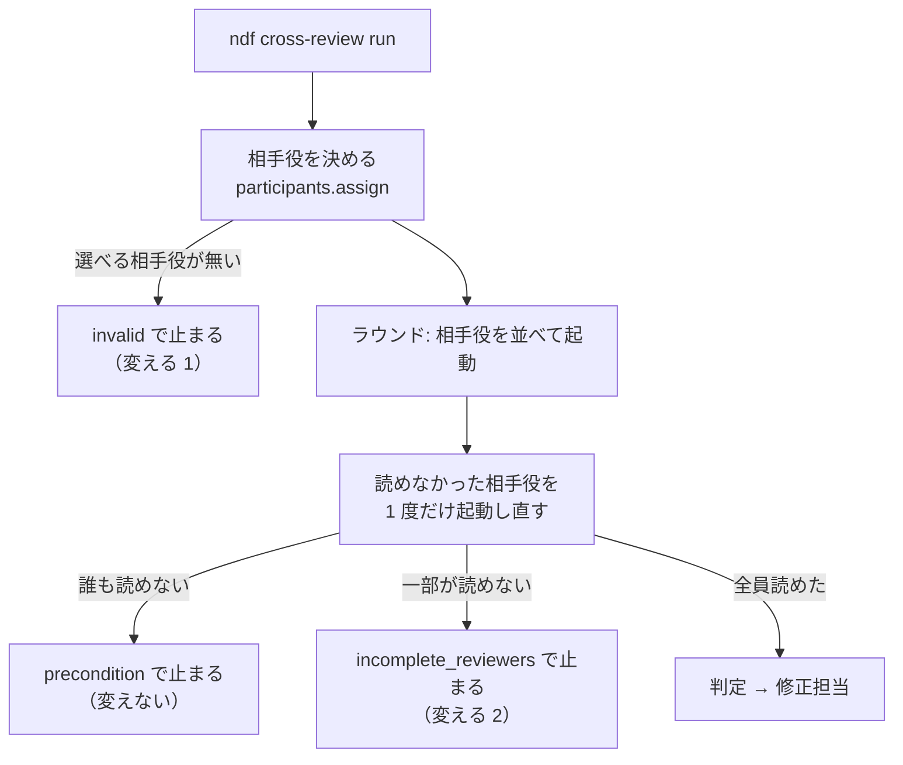
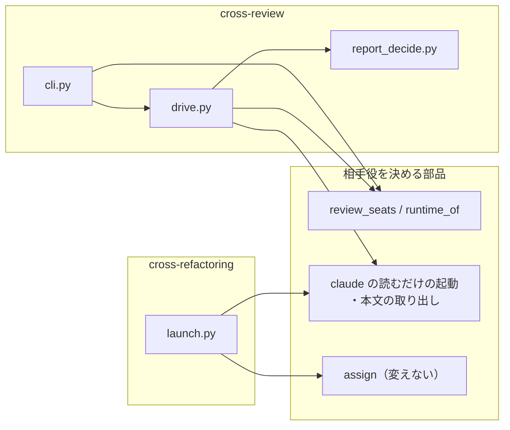
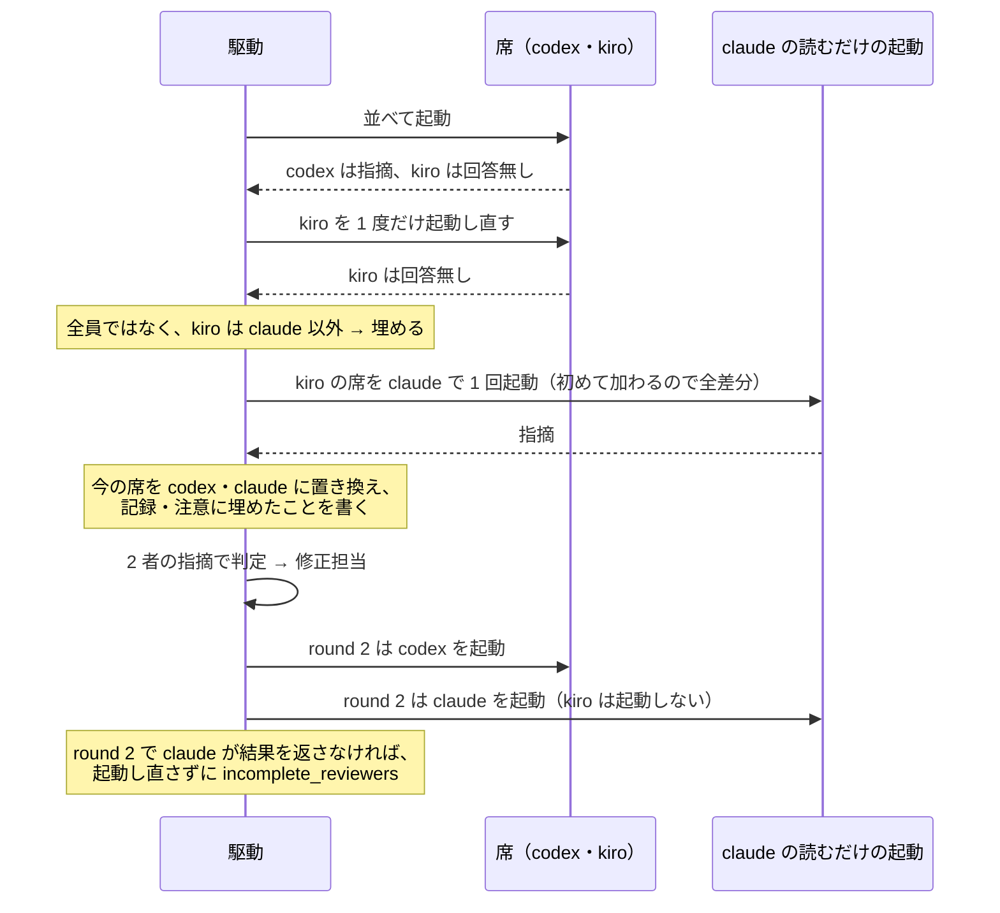

# cross-review: 相手役が欠けても、空いた席を claude の読むだけの起動で埋めて 2 者でレビューする（#3955）

相手役の kiro が未ログインで差分を読めないと、cross-review は止まるか、codex の 1 者だけのレビューになる。この設計では、起動し直しても読めない相手役の席と、使ってよいランタイムの設定（`.ndf/runtimes.json` の `allowed`）のために足りない席を、修正担当とは別のプロセスで動く claude の読むだけの起動で埋め、毎ラウンド 2 者のレビューを保つ。席を決める規則は相手役を決める部品（`ndf.core.converge.participants`）に cross-review 用として足し、cross-refactoring の選び方は変えない。採らなかった案は「決定の記録」に、外部の調査は末尾にある。

## 今の姿

何が起きたか・目的・受け入れ条件は要求仕様の [issue-3955-requirements.md](./issue-3955-requirements.md) にある。その正は [#3955](https://github.com/devbasex/ai-plugins/issues/3955) の本文である。この文書は「どう解くか」と「なぜその解き方か」だけを書く。

変える箇所は、相手役を決める所（起動の前）と、ラウンドの中の起動し直しの後の 2 か所である。



設計に要る今の構造は次のとおりである。

- **相手役を決める関数 `participants.assign` は、cross-review と cross-refactoring が共有している。** 場所は `plugins/ndf/src/ndf/core/converge/participants.py` の 52〜68 行である
  - 既定では、ランタイムの表（`contracts/domains/runtimes.json`）の既定の席から相手役を並べる。並べるのは、読むだけの起動の引数（`review_args`）を持つ行で、修正担当の claude は除く
  - claude の行は `review_args` を持たない
  - 選べる相手役が 0 になると `UnknownParticipant` を投げ、cross-review の CLI は `invalid` で止める
- **ラウンドの相手役は、起動の引数 `RunConfig.reviewers` のまま全ラウンドで変わらない。** この並びを読む箇所は次の 4 つである。場所は `plugins/ndf/src/ndf/domains/crossreview/drive.py` の `_review`・`_round`・`_prepare_round`・`drive` である
  - 起動
  - 状態ファイルのラウンドの記録（`rounds[].reviewers`）
  - 差分の起点を決める比較（`scope_decide.Basis`）
  - 始める前の確かめ（`participants.unready`）。学習の設定のバックアップを確かめ、起動を断られた担当（相手役か修正担当）が 1 つでもあれば、ラウンドを始める前に `precondition` で止める
- **相手役の 1 回の起動（`agents.Launch`）の `agent` は、ランタイムの名前として使われている。** この値で引くものは次の 2 つである
  - 無進捗の許容（`monitor.stall.<名前>`）。claude は 900 秒、表に無い名前は 180 秒である
  - claude の利用上限の検知（`agent == "claude"` の判定）
- **claude の読むだけの起動は、cross-refactoring にだけある。** 提案などの読むだけの工程で使う。場所は `plugins/ndf/src/ndf/domains/crossrefactor/launch.py` の `_read_only`・`_answer_text` である
  - `Read,Grep,Glob` だけを許した `claude -p` を起動する
  - 出力の外側の JSON の `result` から結果を読む
- **記録のコメントのラウンドの表は、相手役の列を持たない。** 誰が読んだかは指摘の表の「担当」の列からしか分からない（`report_decide._round_rows`）

## 文脈と制約

- 修正担当の claude の起動の形（`_fixer_launch`）は変えない（要求の「境界」）
- cross-refactoring の相手役の選び方は変えない（受け入れ条件 13）。`participants.assign` の入出力は今のまま残す
- 引数と結果 JSON のキーは足さない（要求の「影響」）。状態ファイルのラウンドの記録にはキーを 1 つ足す（移行は無い）
- 相手役の全員がレビュー結果を返さなかったときは、今と同じく `precondition` で止める（前提 1）。埋めた claude も結果を返さなければ、埋め直さずに `incomplete_reviewers` で止める（前提 2）
- 学習の設定による起動の制限（`participants.unready`）は保つ。断られた担当は起動しない
- 利用者が `--reviewer` で 1 者だけを名指したときは、起動の前にもラウンドの中でも席を埋めない（前提 4）
- 実行の担い手は `ndf cross-review run` の 1 プロセスで、相手役の起動は今のとおり並べて行う。埋める起動は起動し直しの後の 1 回だけ足す

## 解き方の全体像


- 相手役を決める部品に、cross-review 用の席の関数 `review_seats` を足す。`allowed` の中で相手役になれるランタイムが 2 つに満たなければ、足りない席を claude の読むだけの起動で埋める。席の名前は `claude`、2 つ目は `claude-2` である
- 始める前の確かめで学習の設定のために起動を断られた相手役の席も、ラウンドを始める前に同じく埋める。断られた相手役は起動しない
- ラウンドの中で、起動し直してもレビュー結果の無い claude 以外の席があれば、同じラウンドでその席を claude の読むだけの起動で 1 回埋める。判定は 2 者の指摘で行う
- 埋めた claude がそのラウンドで初めて加わる担当なら、ラウンドの範囲が前の head からの差分でも、PR の全差分を渡す
- 起動し直すのは claude 以外の席だけである。claude の席（起動の前に埋めた席・前のラウンドで埋めた席・そのラウンドで埋めた席）は起動し直さない
- 埋めた席は、その実行の以後のラウンドでもそのまま座る。欠けた相手役は起動しない
- 埋めたことは次の 3 か所に残る
  - 状態ファイルのラウンドの記録（`reviewers` と新しい `filled`）
  - 結果 JSON の注意（`warnings`）
  - 記録のコメントのラウンドの表の「相手役」の列
- claude の読むだけの起動は、cross-refactoring の今の形を相手役を決める部品へ移して、2 つの Skill で 1 つを使う

## ドメインモデル

### コンテキスト

| コンテキスト | 何の語が 1 つの意味に決まるか |
| --- | --- |
| ndf-cross-review | 席・相手役・修正担当・振り替え（空いた席を claude の読むだけの起動で埋めること） |

### 集約

| 集約 | オーナー（書き換えてよいもの） | 根 | エンティティ | 値オブジェクト |
| --- | --- | --- | --- | --- |
| 1 回の実行（状態ファイル） | `ndf cross-review run` の駆動（`drive.py`） | 状態ファイル | ラウンドの記録（`rounds[]`）・指摘（`findings[]`） | 席の名前・埋めた席（`filled[]` の 1 件） |

### 不変条件

| # | 集約 | 条件 | 破れたときの扱い |
| --- | --- | --- | --- |
| I1 | 1 回の実行 | `--reviewer` で 1 者だけを名指したときを除き、判定に使うラウンドは 2 つ以上の席の指摘を持つ | 席が 1 つしか読めなければ、そのラウンドを収束に数えず `incomplete_reviewers` で止める |
| I2 | 1 回の実行 | 埋めるのは claude 以外のランタイムの席だけで、1 つの席を埋めるのは 1 回だけである。claude の席は起動し直さない | 結果の無い席に claude の席が 1 つでもあれば、ほかに結果の無い claude 以外の席があっても、どの席も埋めずに `incomplete_reviewers` で止める（全員が結果を返さないときは I3 が先に効く） |
| I3 | 1 回の実行 | 全員がレビュー結果を返さなかったラウンドでは席を埋めない | `precondition` で止め、状態ファイルにそのラウンドを残さない |
| I4 | 1 回の実行 | 一度埋めた席は、同じ実行の以後のラウンドでも埋めた claude が座り、欠けた相手役を起動しない | — （駆動が今の席を持ち続けることで保つ） |
| I5 | 1 回の実行 | 席に座る claude は、修正担当と会話を共有せず、ファイルを書き換える Tool を持たない | — （起動の引数で保つ） |

### ドメインイベント

| # | イベント | 発生元 | 受け手 |
| --- | --- | --- | --- |
| E1 | 席を決めた | `review_seats` | 駆動（起動の前に埋めた席があれば注意に載せる） |
| E2 | 席を並べて起動した | 駆動の `_review` | — |
| E3 | 結果の無い claude 以外の席を起動し直した | 駆動の `_review` | — |
| E4 | 空いた席を claude の読むだけの起動で埋めた | 駆動の `_review` | 駆動（今の席を置き換える） |
| E5 | 埋めた席を記録した | 駆動の `_round` | 状態ファイル・注意・記録のコメント |
| E6 | ラウンドを判定した | 駆動の `_round` | 修正担当 |
| E7 | 次のラウンドを、埋めた席のまま始めた | 駆動の `_round` | — |

## 構成要素

| 要素 | 責務 |
| --- | --- |
| 相手役を決める部品（`participants.py`。変える） | cross-review の席を決める `review_seats` と、席の名前からランタイムを引く `runtime_of` と、学習の設定で断られたランタイムと理由の組を返す `refusals` を足す（`unready` は `refusals` を使う形にし、返り値は変えない）。claude の読むだけの起動の組み立てと、claude の出力から本文を取り出す処理を cross-refactoring から移して持つ。`assign` は変えない |
| cross-review の駆動（`drive.py`。変える） | 今の席を実行の間持ち、起動し直しの後に空いた席を埋める。ラウンドの記録に実際に座った席と埋めた席を書き、注意に埋めたことを載せる。起動・監視・認証の確かめにはランタイムの名前を、指摘の担当・出力の名前・記録には席の名前を使う |
| cross-review の CLI（`cli.py`。変える） | `--reviewer` の名指しと `allowed` から `review_seats` で席を決め、名指しが 1 者かを駆動の設定に渡す |
| 記録のコメント（`report_decide.py`。変える） | ラウンドの表に「相手役」の列を足し、埋めた席は欠けた相手役の名前を添えて示す |
| cross-refactoring の起動（`crossrefactor/launch.py`。変える） | claude の読むだけの起動と本文の取り出しを、相手役を決める部品の関数で行う（振る舞いは変えない） |



## データ構造

**状態ファイルのラウンドの記録（`rounds[]` の 1 件）に `filled` を足し、`reviewers` の意味を「そのラウンドに座った席」にそろえる。** 今の `reviewers` は起動の引数の並びをそのまま書くため、席を埋めると実際に読んだ担当と食い違う。

| キー | 型 | 今 | 変えた後 |
| --- | --- | --- | --- |
| `reviewers` | 文字列の配列 | 起動の引数の相手役 | そのラウンドに座った席の名前（埋めた後の並び）。例: `["codex", "claude"]` |
| `filled` | オブジェクトの配列（新設） | — | そのラウンドで claude が座っている、埋めた席。埋めた席が無いラウンドでは書かない |

`filled` の 1 件の形:

| キー | 型 | 意味 |
| --- | --- | --- |
| `seat` | 文字列 | 埋めた席の名前（`claude` / `claude-2`） |
| `for` | 文字列か null | 欠けた相手役の名前。`allowed` のために足りない席を起動の前に埋めたときは null |
| `reason` | 文字列 | 埋めた理由。形は下の表のとおり |

`reason` の形は、埋めた時点ごとに次のとおりである。テストはこの文字列を期待値にする。

| 埋めた時点 | `for` | `reason` の形 | 例 |
| --- | --- | --- | --- |
| ラウンドの中（起動し直しても結果が無い） | 欠けた相手役 | 結果が無かった理由（駆動が注意に載せる `<状態>: <詳細>` と同じ文字列） | `failed: 終了コード 1` |
| 始める前の確かめで断られた | 断られた相手役 | `unready: ` に続けて `participants.unready` の理由 | `unready: <participants.unready が返した理由をそのまま>` |
| `allowed` のために足りない（起動の前） | null | `allowed の相手役 <数>（<名前を ・ で並べる>）`。0 のときは括弧を付けない | `allowed の相手役 1（codex）`・`allowed の相手役 0` |

例（kiro が round 1 で読めず、round 2 も埋めた claude で続けたとき）:

```json
{"round": 2, "reviewers": ["codex", "claude"],
 "filled": [{"seat": "claude", "for": "kiro", "reason": "failed: 終了コード 1"}], "verdict": "converged"}
```

**`filled` は埋めた後のすべてのラウンドに書く。** 埋めたラウンドだけに書くと、2 ラウンド目以降の記録だけを読んだ人が、`claude` が修正担当でなく席に座ったことを読み取れないためである。

**2 ラウンド目以降に前の head からの差分だけを渡してよいかは、今回の席が全員、前のラウンドを読んでいるかで決まる。** その判定（`scope_decide.read_by_all_head`）は、全員が結果を返した直近のラウンドの記録を 1 件選び、次の 3 つを確かめる。

- そのラウンドの比較基点（`base`）が今回と同じ
- そのラウンドのレビューの重点（`focus`）が今回と同じ
- 今回の席が全員、そのラウンドの `reviewers` に含まれる（集合の包含で見る。並び順は問わない）

3 つが合えば、そのラウンドの head が差分の起点の候補になる。設計の PR で詳細にレビューしていない節が残るときは、候補があっても全差分を渡す（`review_scope`）。

`reviewers` を埋めた後の席で書くのは、この判定のためである。round 1 で kiro の席を claude で埋めたとき、記録が `["codex", "claude"]` なら、round 2 の席（codex・claude）は全員含まれ、前の head からの差分で続く。起動の引数（codex・kiro）を書くと、round 2 の claude が含まれず、毎ラウンド全差分を読み直す。逆に、claude が読んでいないラウンドを claude が読んだと記録すると、claude が前の変更を見ないまま収束する。

別の起動で打ち直すと、席は既定（codex・kiro）から決め直す。比較が合わないので、全差分を読み直す。前回の結果をそのまま返す判定（`_reusable`）も、同じ理由で前回の結果を返さない。kiro はもう一度起動する。

## 処理の流れ

### 始める前の確かめ

**学習の設定のために起動を断られた担当は、今と同じく起動しない。修正担当の claude を起動でき、相手役を 1 者だけ名指ししていなければ、起動を断られた相手役の席をすべて、ラウンドを始める前に claude で埋める。** 断られた相手役が 1 つでも、全員でも同じである。

**確かめる順は今のままにする。** 今の `drive` は、同じ head の収束の結果を返せるか（`_reusable`）を先に判定し、返せるときは学習の設定を確かめずに返す。この順を保つ。返せる結果を、学習の設定の確かめのために `precondition` へ変えないためである。`_reusable` が今回の席として使うのは、`review_seats` が起動の時点で決めた席である。この後の確かめで断られた席を claude で埋めても、その前に済んだ再利用の判定には影響しない。

**どの席を埋めるかを決めるため、確かめの結果はランタイムと理由の組で受け取る。** 今の `participants.unready` は断る理由の文字列の並び（`list[str]`）を返すので、どのランタイムが断られたかが分からない。そこで相手役を決める部品に `participants.refusals(runtimes)` を足し、断られたランタイムから理由への対応（`dict[str, str]`。断られなかったランタイムは含めない）を返す。

- 同じランタイムは 1 回だけ確かめる。渡す前に席の名前をランタイムの名前へ直し（`claude-2` は claude）、修正担当の claude と合わせて重なりを除く（今の `unready` の `dict.fromkeys` と同じ）。`claude`・`claude-2`・修正担当がそろっても、claude の確かめは 1 回である
- `unready` は `refusals` の理由を並べて返す薄い関数として残す。cross-refactoring の呼び出しと返り値は変えない
- 駆動は `refusals` の結果のランタイムを席の名前へ戻して、埋める席を決める

断られた担当ごとの扱いは次のとおりで、上から順に当てはめる。

| 順 | 断られた担当 | 扱い | 終わり方 |
| --- | --- | --- | --- |
| 1 | 修正担当（claude） | 埋めない。claude を断られると、修正もレビューの代わりもできない。起動の前に埋めた claude の席も同じランタイムなので、同時に断られる | `precondition`（今と同じ） |
| 2 | 名指しが 1 者で、その相手役 | 埋めない（決定 6） | `precondition`（今と同じ） |
| 3 | 上のどれでもない claude 以外の相手役（1 つでも全員でも） | 断られた席を、空いている席の名前の claude で埋め、`filled` に `for` と `reason`（`unready: …`）を書く。断られた相手役は起動しない | ラウンドへ進む |

3 行目で相手役が全員断られたときは、席が `claude`・`claude-2` になり、`allowed` が claude だけのときと同じ形で進む。全員が結果を返さないラウンドを止める I3 は、起動した結果の話なので、ここには当てはめない。断られるのは学習の設定の確かめが通らないときで、環境が壊れたことを示すものではないためである。

3 行目で埋めた claude の席は、起動の前に埋めた席として扱う。ラウンドの中で結果を返さなければ、起動し直さずに、次の節の分岐の表の 2 行目で止まる。

### 1 ラウンドの流れ



**この文書の「読めない」「結果が無い」は、席がレビュー結果を返さなかったことを指す。** 次のどちらかに当たる席である。

- 起動が失敗した（終了の状態が完了でない・サンドボックスを作れなかった）
- 終了した後に、出力から結果の JSON の `findings` 配列を取り出せない（`participants.findings_of` が None）

`findings: []` は指摘が無いというレビュー結果で、成功とする。差分のファイルを開けるかどうか（ファイルへのアクセス）とは別の話で、そちらは「未確認のまま残ること」で扱う。

**起動し直しの後は、次の表を上から順に当てはめ、最初に当たった行で扱いを決める。** 起動し直すのは claude 以外の席だけである。claude の席（起動の前に埋めた席・前のラウンドで埋めた席）は、結果が無くても起動し直さずにこの表へ進む。

| 順 | 起動し直した後の状態 | 扱い | 終わり方 |
| --- | --- | --- | --- |
| 0 | 全員が結果を返した（結果の無い席が 0） | 埋めない。その結果で判定する | 判定のとおり |
| 1 | 全員が結果を返さない（claude の席を含むかを問わない） | 埋めない | `precondition`（今と同じ。I3） |
| 2 | 結果の無い席に claude の席が 1 つでもある（claude 以外の席も結果が無い場合を含む） | どの席も埋めない | `incomplete_reviewers`（I2） |
| 3 | 結果の無い席が 1 つ以上あり、どれも claude 以外 | その席ごとに、空いている席の名前（`claude`、使われていれば `claude-2`）で claude の読むだけの起動を 1 回ずつ並べて起動する | 次の 2 行で決まる |
| 3a | 埋めた claude が全員結果を返した | 埋めた後の席の指摘で判定する | 判定のとおり |
| 3b | 埋めた claude の 1 つでも結果を返さない | 起動し直しも埋め直しもしない | `incomplete_reviewers`（前提 2） |

名指しが 1 者のときは席が 1 つなので、その 1 者に結果が無ければ 1 行目に当たる。`--reviewer` で 2 者を名指したときも、既定の席と同じにこの表を使う。今の相手役になれるランタイムは codex と kiro の 2 つで、席は 2 つまでなので、2 行目のうち claude の席と claude 以外の席が同時に結果を返さない場合は、実際には 1 行目に当たる。2 行目を「1 つでもある」と書くのは、相手役になれるランタイムが増えて席が 3 つ以上になっても、同じ規則で止めるためである。

**埋めた claude がそのラウンドで初めて加わる担当なら、PR の全差分を渡す。** 今の `_prepare_round` は、相手役を起動する前に差分の範囲を決める。前のラウンドで codex と kiro が全員結果を返していれば、範囲は前の head からの差分になる。この差分をそのまま埋めた claude に渡すと、claude は PR のそれより前の変更を一度も見ないまま、その席で収束する。そこで駆動は次のようにする。

- そのラウンドの範囲が前の head からの差分なら、`--base` からの全差分のファイルを別に作り、前の head の情報を含めない全差分の依頼文で埋めた claude を起動する
- そのラウンドの範囲がもともと全差分なら、同じ差分と依頼文を渡す
- 全差分は、埋めた claude の席への依頼にだけ使う。ラウンドの範囲（`prep.scope`）は書き換えない。ラウンドの記録の `scope` と、詳細にレビューした節の更新（`store.REVIEWED`。範囲が全差分のときだけ足す）は、元の `prep.scope` で決める。claude 向けに `prep.scope` を全差分へ差し替えると、前の head からの差分しか受け取っていない codex も全差分を読んだと記録されるためである
- ラウンドの記録の `reviewers` には、埋めた claude のレビューが結果を返した後に、実際に座った席を書く。次のラウンドの差分の起点の判定は、この記録で今回の席が全員読んだことを確かめる（データ構造の節）

## 決定の記録

### 決定 1: cross-refactoring の選び方を変えないため、席を埋める規則を cross-review 用の関数として足し、`assign` は変えない

- **質問**: 空いた席を claude で埋める規則を、相手役を決める部品のどこに置くか
- **選んだ案**: 相手役を決める部品に `review_seats(requested, allowed)` を足す。cross-refactoring は今のまま `assign` を呼ぶ
  - 名指しがあれば、`assign` と同じに確かめて名指しの並びを返す（1 者でも埋めない）
  - 名指しが無ければ既定の席を選び、2 つに満たない分を `claude`・`claude-2` で埋める。選べる相手役が 0 でも投げない
  - 修正担当が `allowed` の外なら、今と同じ `FixerNotAllowed` を投げる
- 採らなかった案: `assign` に「埋めるか」の引数を足す。既定値の選び方を誤ると cross-refactoring の振る舞いが変わる。受け入れ条件 13 を 1 つの引数の既定値に預けることになる
- 採らなかった案: ランタイムの表の claude の行に `review_args` を足す。理由は次の 2 つである
  - `assign` の母集合が変わる。cross-refactoring で claude を名指したときの `invalid` が、黙って外す振る舞いに変わる
  - claude の起動の引数は `ClaudeCall` から組み立てるもので、表の静的な引数では持てない
- **代償**: 相手役を決める関数が 2 つになり、選び方の共通の部分（母集合の求め方）を 2 つの関数で使う。共通の部分は内側の関数に切り出して重ねない
- 作り方: 自前で作る
- 比べた候補: PRD1
- 根拠: Value 9「責務の分かれた設計で作られる」 / Value 11「重複と冗長が無い」（MVV バージョン 11）。PRD1（担当が使えないとき、選べる者から数を満たす）

### 決定 2: 2 つの Skill で claude の読むだけの起動を 1 つにするため、cross-refactoring の起動の形を相手役を決める部品へ移す

- **質問**: 席に座る claude の起動の引数と、出力から指摘を読む処理をどこに書くか
- **選んだ案**: cross-refactoring の次の 2 つを、相手役を決める部品の関数へ移す。cross-review の駆動と cross-refactoring の起動が同じ関数を呼ぶ。system の文は呼び手が渡す
  - `_read_only` の claude の分岐。`Read,Grep,Glob` だけを許し、会話を残さない最小構成の `claude -p` である
  - `_answer_text`。外側の JSON の `result` を本文にする
- 採らなかった案: cross-review の駆動に別に書く（同じ役割の起動が 2 か所に分かれ、許す Tool の変更が片方にしか効かない）
- **代償**: cross-refactoring の起動のファイルも触る。振る舞いは変えないので、既存の cross-refactoring のテストが通ることで確かめる
- 根拠: Value 11「重複と冗長が無い」（MVV バージョン 11）

### 決定 3: 監視と記録を両方正しく引くため、席の名前とランタイムの名前を分ける

- **質問**: 2 つ目の claude の席（`claude-2`）を、起動と記録でどの名前で扱うか
- **選んだ案**: 2 つの名前を次のように使い分ける。席の名前からランタイムを引くのは `runtime_of` の 1 か所にする

  | 名前 | 値 | 使う所 |
  | --- | --- | --- |
  | 席の名前 | 相手役の名前（`codex`・`kiro`・`claude`）と `claude-2` | 指摘の担当（`by`）・出力のファイルの名前（`round<n>-<席>`）・ラウンドの記録・注意 |
  | ランタイムの名前 | `runtime_of` で席の名前から引く | 起動（`agents.Launch.agent`）・無進捗の許容・利用上限の検知・始める前の確かめ・読めなかったときの直し方 |

- 採らなかった案: 席の名前をランタイムの名前のままにする。claude の席が 2 つになると、出力のファイルと指摘の担当が重なる
- 採らなかった案: 起動にも席の名前を渡す。`monitor.stall.claude-2` が表に無く、claude の 900 秒ではなく既定の 180 秒で止まる。利用上限の検知も外れる
- **代償**: 駆動の中で 2 つの名前を取り違えない注意が要る。テストで `claude-2` の席の監視がランタイム claude で引かれることを縛る
- 根拠: Value 3「同じ手順は毎回同じ結果になる」（MVV バージョン 11）

### 決定 4: 一時的な失敗で claude の利用を増やさないため、席を埋めるのは起動し直しの後で、埋めた claude は起動し直さない

- **質問**: 読めなかった相手役の席をいつ埋めるか、埋めた claude が読めなければどうするか
- **選んだ案**: 埋める席は、今の起動し直し（同じラウンドで 1 度）の後もレビュー結果の無い claude 以外の席だけにする。その席を同じラウンドで claude の読むだけの起動で 1 回埋める
  - 起動し直すのは claude 以外の席だけにする。claude の席は、どの時点で座ったかによらず起動し直さない。対象は、そのラウンドで埋めた claude、前のラウンドで埋めて座り続けている claude、起動の前に埋めた claude（`allowed` が狭いとき・学習の設定で断られたとき）の 3 つである
  - claude の席が結果を返さなければ、起動し直しも埋め直しもせずに `incomplete_reviewers` で止める（全員が結果を返さなければ `precondition`）
  - 1 つの claude の席の起動は、1 ラウンドに 1 回である
- 採らなかった案: 起動し直しをやめて、最初に読めなかった時点で埋める。一時的な失敗でも claude の起動が増え、欠けた相手役の指摘が失われる
- 採らなかった案: 埋めた claude も 1 度起動し直す。1 ラウンドの待ちが最大で 3 回分の起動になる。claude が結果を返さない原因は、利用上限や認証のように起動し直しで直らないものが多い
- 採らなかった案: 起動の前に埋めた claude と前のラウンドで埋めた claude は、ほかの席と同じに 1 度起動し直す。同じ claude の失敗なのに、座った時点で起動し直しの有無が変わり、上と同じ理由で直らない起動を席ごとに 1 回増やす
- **代償**: 埋めた claude の一時的な失敗でも止まる。打ち直せば同じ状態ファイルから続く
- 根拠: Value 2「安く使える」 / Value 3「同じ手順は毎回同じ結果になる」（MVV バージョン 11）

### 決定 5: 同じ失敗を毎ラウンド待たないため、埋めた席を実行の間の今の席として持ち、ラウンドの記録に実際の席を書く

- **質問**: 埋めた席を以後のラウンドにどう引き継ぎ、記録に何を書くか
- **選んだ案**: 駆動の実行中の値（`_Run`）に今の席を持ち、埋めたら置き換える。起動・差分の起点の比較・ラウンドの記録の `reviewers` は今の席を読む。埋めた席は `filled` として埋めた後のすべてのラウンドに書く。起動の引数（`RunConfig`）は書き換えない
- 採らなかった案: 毎ラウンド欠けた相手役を先に起動する。同じ失敗を毎回待つ（前提 3）
- 採らなかった案: 起動の引数の相手役を書き換える。起動の引数は、前回の結果を返すかの判定にも使う。書き換えると、利用者が渡した値と実際の席の区別が無くなる
- **代償**: 別の起動で打ち直すと既定の席から決め直し、全差分を読み直す。欠けた相手役がログインし直していれば、その相手役が戻る
- 根拠: Value 2「安く使える」 / Value 8「正しいデータ構造で作られる」（MVV バージョン 11）

### 決定 6: 利用者の名指しを尊重するため、名指しが 1 者のときだけ埋めない

- **質問**: `--reviewer` の名指しがあるとき、どの場合に席を埋めるか
- **選んだ案**: 名指しが 1 者なら、起動の前にもラウンドの中でも埋めない。2 者以上なら、ラウンドの中で欠けた席を既定と同じに埋める。名指しが 1 者かは CLI が決め、駆動の設定に「埋めてよいか」として渡す
- 採らなかった案: 名指しがあれば常に埋めない。2 者を名指して 1 者が欠けたとき、既定より弱いレビューになる（前提 4）
- **代償**: 駆動の設定に値が 1 つ増える（利用者の引数は増えない）
- 根拠: Value 3「同じ手順は毎回同じ結果になる」（MVV バージョン 11）

### 決定 7: どのラウンドを誰が読んだかを PR で読めるよう、記録のコメントのラウンドの表に「相手役」の列を足す

- **質問**: 埋めたことを PR の記録のコメントのどこに示すか
- **選んだ案**: ラウンドの表に「相手役」の列を足し、席の名前を `・` で並べる。埋めた席は欠けた相手役を括弧で添える（例: `codex・claude（kiro の席）`）。注意の欄には、結果 JSON の注意と同じ文が今のとおり載る
- 採らなかった案: 注意の欄だけに書く。ラウンドごとの席が読めず、2 ラウンド目以降も埋めた席で読んだことが分からない
- **代償**: 記録のコメントの表が 1 列広がる。記録のコメントを読み戻す処理（`report_decide.open_items`）は、コメントの最後の行に埋めた未解決の指摘の JSON の一覧だけを読み、ラウンドの表は読まないので影響しない
- 根拠: Value 14「判断の理由が残り、語がそろっている」（MVV バージョン 11）

## 影響と危険

- **働く範囲**: 利用先のリポジトリでも働く（NDF の `ndf cross-review run` の振る舞い）。cross-refactoring の相手役の選び方は変わらない
- **プロジェクトごとに違うもの**: 使ってよいランタイムは今のとおり設定（`.ndf/runtimes.json` の `allowed`）で受ける。新しい設定と引数は足さない
- **当たるモード**: cross-review を通るすべてのモード。`standard` の設計 PR とスプリント PR、`light` などで cross-review を回すときである
- **壊れうる箇所**: 次の 3 つである
  - 席の名前とランタイムの名前の取り違え（決定 3）
  - 差分の起点の比較が今の席で行われること（データ構造の節）
  - 記録のコメントの表の列の追加。今の表を読み戻す処理が無いことは確かめた（`report_decide.open_items` は、コメントの最後の行に埋めた未解決の指摘の JSON の一覧だけを読む。決定 7 と同じ対象）
- **費用**: 相手役が欠けたとき・`allowed` が狭いときに claude の起動が増える（要求の「今の利用者への影響と互換」）
- **同じファイルを触る別の変更**: [#3953](https://github.com/devbasex/ai-plugins/issues/3953) （止まったときの結果 JSON の形の誤り）である。`finish_decide.py` と `cli.py` を触る見込みがある。この変更は `finish_decide.py` を触らない

### 代表のリポジトリでの振る舞い

| 代表のリポジトリ | 設定の要点 | 直した後に起きること | この種類で扱えなくなること |
| --- | --- | --- | --- |
| Web サービス | 相手役の既定（codex・kiro）、`allowed` は置かないことが多い | 設計 PR とスプリント PR の cross-review で、相手役が欠けても claude が席を埋めて 2 者で進む | 無し |
| モバイルアプリ | Web サービスと同じ | 同上 | 無し |
| 業務文書だけ | 文書の PR に cross-review を回す。`allowed` を claude だけにすることがある | `allowed` が claude だけでも、`claude` と `claude-2` の 2 者で cross-review が回る | 無し |

### このリポジトリだけの事情

- 無し（相手役の選び方はリポジトリの運用の値に依らず、`allowed` の値だけで決まるため）

## 用語

| 用語 | 意味 | 用語集への反映 |
| --- | --- | --- |
| 席 | cross-review の 1 ラウンドの 2 つのレビュー担当のスロット。席の名前は相手役の名前で、claude の読むだけの起動で埋めた 2 つ目の席は `claude-2` と呼ぶ | 新規（用語集に今は無い）。10 系も同じランタイムの 2 つ目の席を `claude-2` と呼んでいた（[#1598](https://github.com/devbasex/ai-plugins/issues/1598) の利用者の決定）。11 系への作り直しで外した席（[#3941](https://github.com/devbasex/ai-plugins/issues/3941) ）を、同じ名前で戻す |
| 読めない・結果が無い | 席がレビュー結果を返さなかったこと。起動が失敗したか、終了後に出力から結果の JSON の `findings` 配列を取り出せない場合を指す。`findings: []` は成功とする。差分のファイルを開けるかどうかとは別である | 用語集には載せない（この設計の中の定義） |

## テスト設計

相手役の起動は偽物にし、起動ごとに回答の有無を決めて駆動を通す。

| 受け入れ条件・不変条件 | どの振る舞いで縛るか | どう壊したら落ちるべきか |
| --- | --- | --- |
| 1・I2 | codex と kiro の既定で kiro だけが起動し直しても読めないと、同じラウンドで claude の席が 1 回起動され、ラウンドの判定が codex と claude の指摘で決まり、`incomplete_reviewers` にならない | 埋める処理を外す・起動し直しの前に埋める・claude の席を 2 回起動すると落ちる |
| 2 | 1 の実行で指摘が出なくなると結果が `ok` で、注意に欠けた相手役の名前・読めなかった理由・埋めた席が載る | 注意の文から理由か席の名前を落とすと落ちる |
| 3 | 1 の実行の状態ファイルのラウンドの記録の `reviewers` が `codex`・`claude` で、`filled` に `kiro` の席を `claude` で埋めたことが載り、記録のコメントのラウンドの表の「相手役」の列に `codex・claude（kiro の席）` が出る | `reviewers` に起動の引数を書く・`filled` を書かない・列を足さないと落ちる |
| 4・I4 | 1 の実行の 2 ラウンド目は kiro を起動せず、codex と claude を起動し、差分は前の head から渡る | 毎ラウンド起動の引数の相手役に戻す・比較を起動の引数で行うと落ちる |
| 5 | `allowed` が claude と codex のとき、`--reviewer` の無い起動の席が `codex`・`claude` になり、起動の前に埋めたことが注意に載り、`filled` の 1 件が `{"seat": "claude", "for": null, "reason": "allowed の相手役 1（codex）"}` になる | `review_seats` が埋めない・`assign` を呼ぶと落ちる |
| 6 | `allowed` が claude だけのとき、`invalid` で止まらずに席が `claude`・`claude-2` になり、codex と kiro を起動しない | 選べる相手役が 0 で投げる・2 つ目の席の名前が重なると落ちる |
| 決定 3 | `claude-2` の席の起動の `agent` がランタイム claude で、無進捗の許容が claude の値で引かれ、出力のファイルの名前は `round<n>-claude-2` になる | 起動に席の名前を渡すと落ちる |
| 7・8・I5 | 席の claude の起動の引数が会話を残さない最小構成で、許す Tool が `Read,Grep,Glob` だけであり、修正担当の会話の ID を持たない | 修正担当の起動の形（`FIXER_TOOLS`・会話の指定）を使うと落ちる |
| 9 | codex と kiro が両方読めると、claude を相手役として起動せず、ラウンドの記録に `filled` が無い | 読めたときにも埋めると落ちる |
| 10・I3 | codex と kiro が両方起動し直しても読めないと `precondition` で止まり、claude を相手役として起動しない | 全員が読めないときに埋めると落ちる |
| 11 | 埋めた claude も読めないと、そのラウンドを収束に数えず `incomplete_reviewers` で止まり、claude を 2 回起動しない | 埋めた席を起動し直す・埋め直すと落ちる |
| 分岐の順（I2・I3） | `allowed` が codex と claude で席が `codex`・`claude` のとき、(a) 両方が結果を返さないと `precondition` で止まり `claude-2` を起動しない、(b) claude の席だけが結果を返さないと、claude を起動し直さず、どの席も埋めずに `incomplete_reviewers` で止まる、(c) codex だけが起動し直しても結果を返さないと、codex の席を `claude-2` で埋めて判定へ進む。`--reviewer codex,kiro` の 2 者の名指しで kiro が結果を返さないときも、既定と同じに `claude` で埋める | 分岐の表の 1 行目と 2 行目の順を入れ替える・claude の席に結果が無いのに claude 以外の席を埋める・2 者の名指しで埋めないと落ちる |
| 結果の有無の定義 | 相手役が終了コード 0 で終わっても出力に `findings` 配列が無いと、その席を結果が無いとして扱い（起動し直し・埋める）、`{"findings": []}` を返した席は成功として埋めない | 起動の失敗だけを結果が無いとして扱う・空の指摘を失敗と数えると落ちる |
| 埋めた claude の差分（4 の続き） | round 1 で codex と kiro が両方結果を返し、round 2 で初めて kiro が起動し直しても結果を返さないと、round 2 の codex には前の head からの差分が、埋めた claude には `--base` からの全差分が渡る。round 2 の記録の `reviewers` が `codex`・`claude` で、round 3 は両者に round 2 の head からの差分が渡る | 埋めた claude にそのラウンドの差分をそのまま渡す・埋める前の席を記録すると落ちる |
| 起動し直しの回数（決定 4） | (a) `allowed` が claude だけで `claude-2` が結果を返さないと、`claude-2` を起動し直さずに `incomplete_reviewers` で止まり、claude の起動はラウンドで席ごとに 1 回である。(b) round 1 で kiro の席を埋め、round 2 で座り続けた claude が結果を返さないと、起動し直さずに `incomplete_reviewers` で止まる | claude の席にも起動し直しを当てると落ちる |
| 始める前の確かめ | 偽の `participants.unready` で、(a) kiro だけを断ると、kiro を起動せずに席が `codex`・`claude` になり、`filled` の `reason` が `unready: ` で始まる、(b) codex と kiro を両方断ると、席が `claude`・`claude-2` になる、(c) 修正担当の claude を断ると、どの担当も起動せずに `precondition` で止まる、(d) `--reviewer kiro` で kiro を断ると、埋めずに `precondition` で止まる、(e) `allowed` が claude だけで席が `claude`・`claude-2` のとき、学習の設定の確かめは claude について 1 回だけ呼ばれる、(f) 最後のラウンドが同じ head で収束しているとき、kiro を断る設定でも学習の設定を確かめずに前回の結果（`converged`）を返す | 断られた相手役を起動する・断られた席を埋めずに止める・修正担当を断られても進む・同じランタイムを 2 回確かめる・再利用の判定より先に確かめると落ちる |
| `refusals` | 断られたランタイムだけが理由と組で返り、`unready` は同じ入力で今と同じ理由の並びを返す | 返り値に断られなかったランタイムを含める・`unready` の返り値を変えると落ちる |
| 埋めた claude の差分と記録の範囲 | 「埋めた claude の差分」の実行で、round 2 の記録の `scope` が前の head からの差分のままで、詳細にレビューした節（`store.REVIEWED`）が round 2 で増えない | 埋めた claude のためにラウンドの範囲を全差分へ差し替えると落ちる |
| 分岐の順の 0 行目 | codex と kiro が両方結果を返すと、埋める処理を呼ばず、claude を相手役として起動しない（9 と同じ実行で縛る） | 結果の無い席が 0 のときに 3 行目へ進むと落ちる |
| 12 | `--reviewer codex` で codex が読めないと、claude を起動せずに `precondition` で止まり、codex が読めれば 1 者で判定する | 名指し 1 者でも埋めると落ちる |
| 13 | cross-refactoring の相手役の選び方（`assign` の既定・名指し・`allowed`）と、読むだけの claude の起動の引数と本文の取り出しが今と同じ | `assign` の振る舞いを変える・移した関数の引数を変えると既存の cross-refactoring のテストが落ちる |
| 14 | 手順書の相手役の説明と終わり方の表を、1〜12 の振る舞いに合わせて書き直す（`.md` の文言を照合するテストは書かない。cross-review の設計 PR のレビューと、実装の PR のレビューで確かめる） | — |
| I1 | 1〜12 のどの経路でも、名指し 1 者を除いて、判定に使ったラウンドの記録の `reviewers` が 2 つ以上ある | 1 つの席で判定へ進むと 1・5・11 のどれかが落ちる |

## 設計の結果

| 課題 | 扱い | 統合先 | 触るファイル |
| --- | --- | --- | --- |
| #3955 | 実装する | — | `plugins/ndf/src/ndf/core/converge/participants.py`、`plugins/ndf/src/ndf/domains/crossreview/drive.py`、`plugins/ndf/src/ndf/domains/crossreview/cli.py`、`plugins/ndf/src/ndf/domains/crossreview/report_decide.py`、`plugins/ndf/src/ndf/domains/crossrefactor/launch.py`、`plugins/ndf/skills/cross-review/SKILL.md`、`plugins/ndf/skills/cross-review/docs/01-state-and-review.md`、`docs/specifications/cross-review-participants-and-seats.md`、`plugins/ndf/tests/core/converge/test_converge.py`、`plugins/ndf/tests/domains/crossreview/test_crossreview_run.py`、`plugins/ndf/tests/domains/crossreview/test_crossreview_report.py`、`plugins/ndf/tests/domains/crossrefactor/test_launch_and_phase.py` |

## 未確認のまま残ること

| 項目 | 内容 |
| --- | --- |
| 席の claude が保存先の差分のファイルを開けるか | 相手役へ渡す差分のファイルは worktree の外の保存先（`--state-dir`）にある。`Read,Grep,Glob` だけを許した最小構成の `claude -p` が worktree の外のファイルにアクセスできるかは、実機で起動して確かめていない。実装の TDD の中で実際の claude を 1 回起動して確かめ、開けなければ起動の引数に保存先をアクセスできる場所として足す（`--add-dir`）。リリース後テストでも、kiro が未ログインの環境で claude の席が指摘を返すことを見る |
| 席の claude の 1 回の時間 | 席の claude は出力を完了まで出さない形（`--output-format json`）で起動するため、無進捗の許容は claude の 900 秒で見る。設計 PR の全差分を読む 1 回がこの中に収まるかは、リリース後テストで実際の設計 PR に回して分かる |

## 外部の調査

| 種類 | 調べるか | 理由 |
| --- | --- | --- |
| 標準・仕様 | 調べない | 複数の AI にレビューさせるときの席の埋め方に、業界の標準や公開の仕様は無いと見た（検索はしていない）。席の数と埋め方はプロジェクトの中の取り決め（10 系の [#1598](https://github.com/devbasex/ai-plugins/issues/1598) の利用者の決定）で決まる |
| 主要な製品 | 調べる | レビュー担当を自動で割り当てる主要な製品が、担当が使えないときに数をどう満たすかを比べる |
| ライブラリとサービス | 調べない | 席を決める処理は既定の席の並びと `allowed` の数だけで決まる数行の処理で、使えるライブラリを探す対象にならない。claude の起動は既存のアダプター（`ndf.adapters.claude`）を使う |

### 主要な製品

| # | 製品 | どう解いているか | 設計への反映 | 出典 |
| --- | --- | --- | --- | --- |
| PRD1 | GitHub のチームのレビューの自動割り当て | チームへのレビュー依頼を、指定した人数のメンバーへ割り当てる。状態を Busy にしたメンバーは選ばず、全員が Busy ならチームに依頼が残る | 使えない担当を外し、選べる者から数を満たす点を採る（決定 1）。全員が使えないときに割り当てずに残す点は、全員が読めないときに埋めずに止める扱い（I3）と同じ向きである | https://docs.github.com/en/organizations/organizing-members-into-teams/managing-code-review-settings-for-your-team （2026-11-24） |

調べた量: 候補 1 件・取得の試み 1 回。
