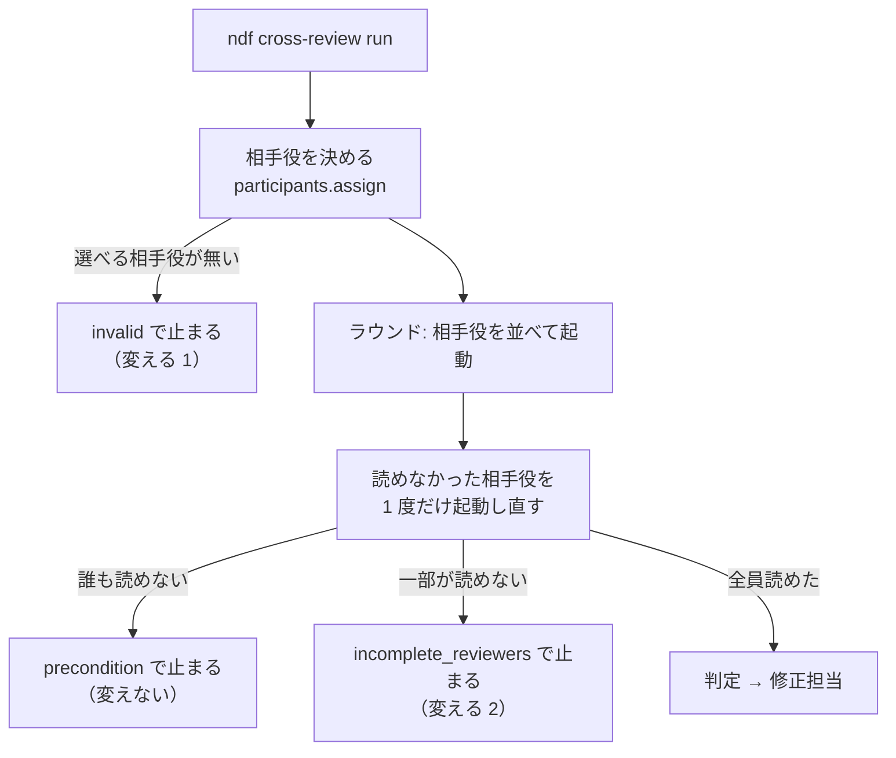
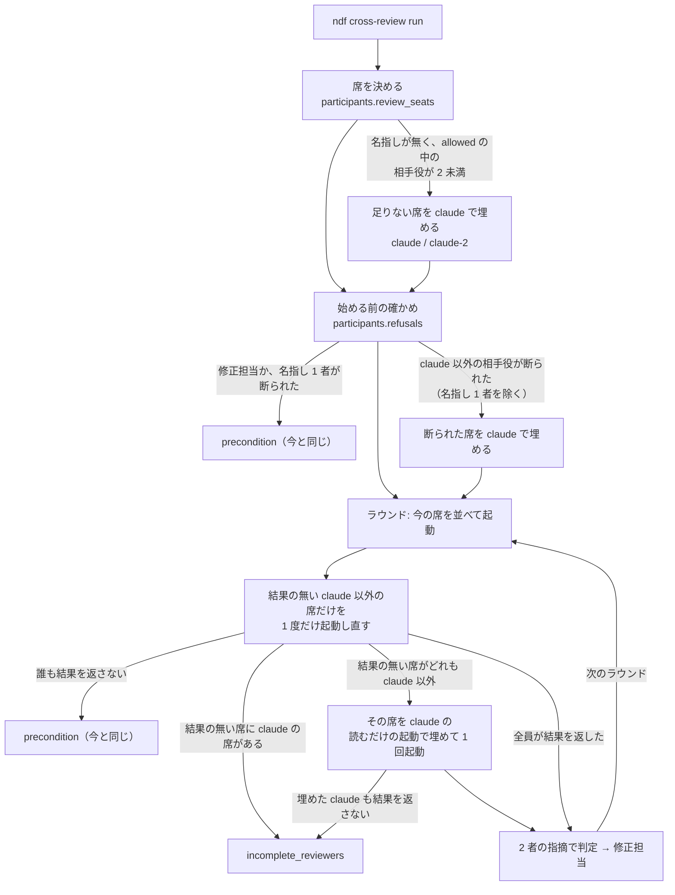
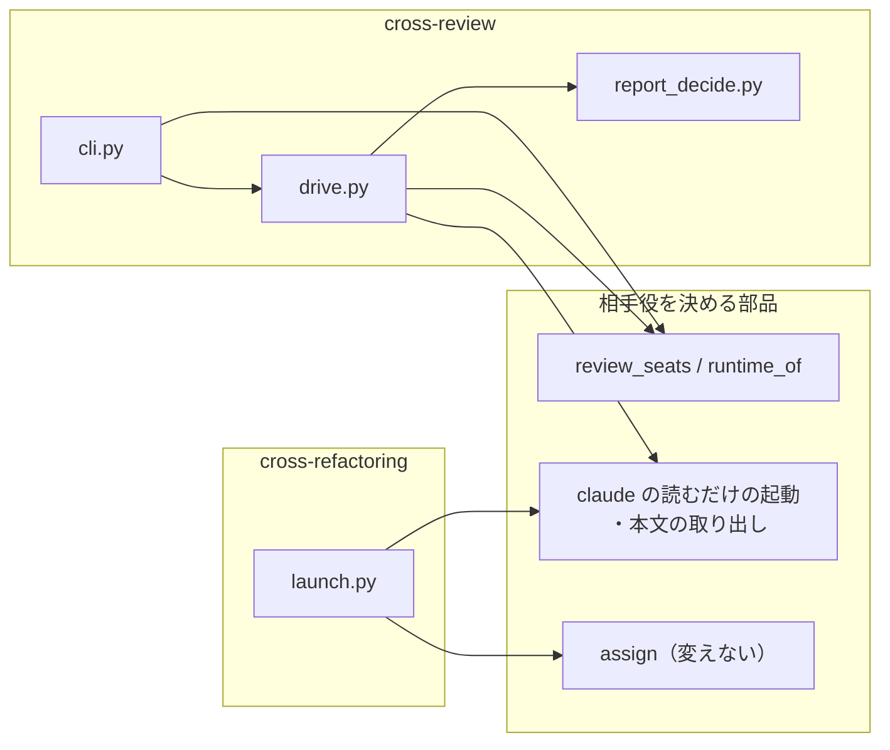
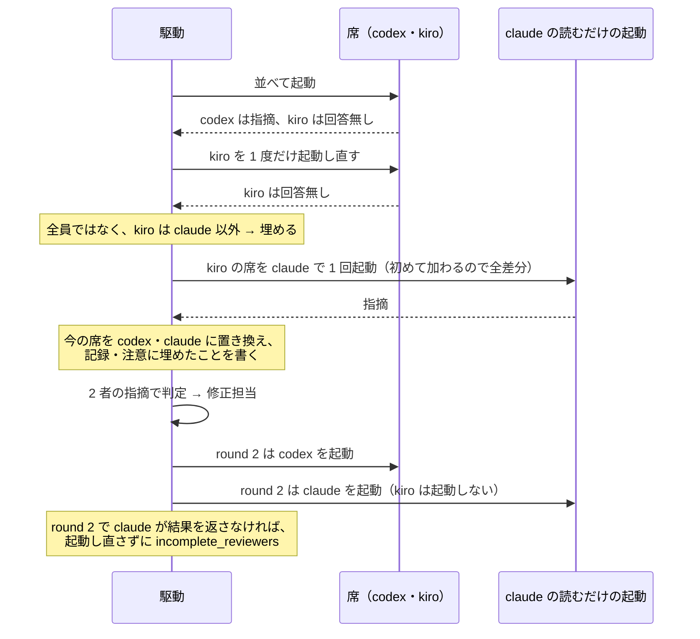

# cross-review: 相手役が欠けても、空いた席を claude の読むだけの起動で埋めて 2 者でレビューする（#3955）

相手役の kiro が未ログインで差分を読めないと、cross-review は止まるか、codex の 1 者だけのレビューになる。この設計では、起動し直しても読めない相手役の席と、使ってよいランタイムの設定（`.ndf/runtimes.json` の `allowed`）のために足りない席を、修正担当とは別のプロセスで動く claude の読むだけの起動で埋め、毎ラウンド 2 者のレビューを保つ。席を決める規則は相手役を決める部品（`ndf.core.converge.participants`）に cross-review 用として足し、cross-refactoring の選び方は変えない。採らなかった案は「決定の記録」に、外部の調査は末尾にある。

## 今の姿

何が起きたか・目的・受け入れ条件は要求仕様の [issue-3955-requirements.md](./issue-3955-requirements.md) にある。要求の正本は [#3955](https://github.com/devbasex/ai-plugins/issues/3955) の本文である。この文書は「どう解くか」と「なぜその解き方か」だけを書く。

変える箇所は、相手役を決める所（起動の前）と、ラウンドの中の起動し直しの後の 2 か所である。



設計に要る今の構造は次のとおりである。

- **相手役を決める関数 `participants.assign` は、cross-review と cross-refactoring が共有している。** 場所は `plugins/ndf/src/ndf/core/converge/participants.py` の 52〜68 行である
  - 既定では、ランタイムの表（`contracts/domains/runtimes.json`）の既定の席から相手役を並べる。並べるのは、読むだけの起動の引数（`review_args`）を持つ行で、修正担当の claude は除く
  - claude の行は `review_args` を持たない
  - 選べる相手役が 0 になると `UnknownParticipant` を投げ、cross-review の CLI は `invalid` で止める
- **ラウンドの相手役は、起動の引数 `RunConfig.reviewers` のまま全ラウンドで変わらない。** この並びを読む箇所は次の 4 つである。場所は `plugins/ndf/src/ndf/domains/crossreview/drive.py` の `_review`・`_round`・`_prepare_round`・`drive` である
  - 起動
  - 状態ファイルのラウンドの記録（`rounds[].reviewers`）
  - 差分の起点を決める比較（`scope_decide.Basis`）
  - 始める前の確かめ（`participants.unready`）。学習の設定のバックアップを確かめ、起動を断られた担当（相手役か修正担当）が 1 つでもあれば、ラウンドを始める前に `precondition` で止める
- **相手役の 1 回の起動（`agents.Launch`）の `agent` は、ランタイムの名前として使われている。** この値で引くものは次の 2 つである
  - 無進捗の許容（`monitor.stall.<名前>`）。claude は 900 秒、表に無い名前は 180 秒である
  - claude の利用上限の検知（`agent == "claude"` の判定）
- **claude の読むだけの起動は、cross-refactoring にだけある。** 提案などの読むだけの工程で使う。場所は `plugins/ndf/src/ndf/domains/crossrefactor/launch.py` の `_read_only`・`_answer_text` である
  - `Read,Grep,Glob` だけを許した `claude -p` を起動する
  - 出力の外側の JSON の `result` から結果を読む
- **記録のコメントのラウンドの表は、相手役の列を持たない。** 誰が読んだかは指摘の表の「担当」の列からしか分からない（`report_decide._round_rows`）

## 文脈と制約

- 修正担当の claude の起動の形（`_fixer_launch`）は変えない（要求の「境界」）
- cross-refactoring の相手役の選び方は変えない（受け入れ条件 13）。`participants.assign` の入出力は今のまま残す
- 引数と結果 JSON のキーは足さない（要求の「影響」）。状態ファイルのラウンドの記録にはキーを 1 つ足す（移行は無い）
- 相手役の全員がレビュー結果を返さなかったときは、今と同じく `precondition` で止める（前提 1）。埋めた claude も結果を返さなければ、埋め直さずに `incomplete_reviewers` で止める（前提 2）
- 学習の設定による起動の制限は保つ。断られた担当は起動しない。cross-review の駆動は、今の `participants.unready` に代えて `participants.refusals` で確かめる。`refusals` は断られたランタイムと理由の組を返す（処理の流れの「始める前の確かめ」）
- 利用者が `--reviewer` で 1 者だけを名指したときは、起動の前にもラウンドの中でも席を埋めない（前提 4）
- 実行するのは `ndf cross-review run` の 1 プロセスで、相手役の起動は今のとおり並べて行う。ラウンドの中で足す起動は、起動し直しの後に、結果の無い席ごとに 1 回である。起動の前に埋めた席は、ほかの席と同じに毎ラウンド起動する

## 解き方の全体像



- 相手役を決める部品に、cross-review 用の席の関数 `review_seats` を足す。`--reviewer` の名指しが無く、`allowed` の中で相手役になれるランタイムが 2 つに満たなければ、足りない席を claude の読むだけの起動で埋める。名指しがあれば、起動の前には埋めない。席の名前は `claude`、2 つ目は `claude-2` である
- 始める前の確かめで学習の設定のために起動を断られた相手役の席も、ラウンドを始める前に同じく埋める。断られた相手役は起動しない
- ラウンドの中で、起動し直してもレビュー結果の無い claude 以外の席があれば、同じラウンドでその席を claude の読むだけの起動で 1 回埋める。判定は 2 者の指摘で行う
- 埋めた claude がそのラウンドで初めて加わる担当なら、ラウンドの範囲が前の head からの差分でも、PR の全差分を渡す
- 起動し直すのは claude 以外の席だけである。claude の席（起動の前に埋めた席・前のラウンドで埋めた席・そのラウンドで埋めた席）は起動し直さない
- 埋めた席は、その実行の以後のラウンドでもそのまま座る。欠けた相手役は起動しない
- 埋めたことは次の 3 か所に残る
  - 状態ファイルのラウンドの記録（`reviewers` と新しい `filled`）
  - 結果 JSON の注意（`warnings`）
  - 記録のコメントのラウンドの表の「相手役」の列
- claude の読むだけの起動は、cross-refactoring の今の形を相手役を決める部品へ移して、2 つの Skill で 1 つを使う

## ドメインモデル

### コンテキスト

| コンテキスト | 何の語が 1 つの意味に決まるか |
| --- | --- |
| ndf-cross-review | 席・相手役・修正担当・振り替え（空いた席を claude の読むだけの起動で埋めること） |

### 集約

| 集約 | オーナー（書き換えてよいもの） | 根 | エンティティ | 値オブジェクト |
| --- | --- | --- | --- | --- |
| 1 回の実行（状態ファイル） | `ndf cross-review run` の駆動（`drive.py`） | 状態ファイル | ラウンドの記録（`rounds[]`）・指摘（`findings[]`） | 席の名前・埋めた席（`filled[]` の 1 件） |

### 不変条件

| # | 集約 | 条件 | 破れたときの扱い |
| --- | --- | --- | --- |
| I1 | 1 回の実行 | `--reviewer` で 1 者だけを名指したときを除き、判定に使うラウンドは 2 つ以上の席の指摘を持つ | 席が 1 つしか読めなければ、そのラウンドを収束に数えず `incomplete_reviewers` で止める |
| I2 | 1 回の実行 | 埋めるのは claude 以外のランタイムの席だけで、1 つの席を埋めるのは 1 回だけである。claude の席は起動し直さない | 結果の無い席に claude の席が 1 つでもあれば、ほかに結果の無い claude 以外の席があっても、どの席も埋めずに `incomplete_reviewers` で止める（全員が結果を返さないときは I3 が先に効く） |
| I3 | 1 回の実行 | 全員がレビュー結果を返さなかったラウンドでは席を埋めない | `precondition` で止め、状態ファイルにそのラウンドを残さない |
| I4 | 1 回の実行 | 一度埋めた席は、同じ実行の以後のラウンドでも埋めた claude が座り、欠けた相手役を起動しない | — （駆動が今の席を持ち続けることで保つ） |
| I5 | 1 回の実行 | 席に座る claude は、修正担当と会話を共有せず、ファイルを書き換える Tool を持たない。読めるのはレビューする worktree と、レビューの資料のディレクトリ（決定 2）だけである | — （起動の引数で保つ） |

### ドメインイベント

| # | イベント | 発生元 | 受け手 |
| --- | --- | --- | --- |
| E1 | 席を決めた | `review_seats` | 駆動（起動の前に埋めた席があれば注意に載せる） |
| E2 | 席を並べて起動した | 駆動の `_review` | — |
| E3 | 結果の無い claude 以外の席を起動し直した | 駆動の `_review` | — |
| E4 | 空いた席を claude の読むだけの起動で埋めた | 駆動の `_review` | 駆動（今の席を置き換える） |
| E5 | 埋めた席を記録した | 駆動の `_round` | 状態ファイル・注意・記録のコメント |
| E6 | ラウンドを判定した | 駆動の `_round` | 修正担当 |
| E7 | 次のラウンドを、埋めた席のまま始めた | 駆動の `_round` | — |

## 構成要素

| 要素 | 責務 |
| --- | --- |
| 相手役を決める部品（`participants.py`。変える） | cross-review の席を決める `review_seats` と、席の名前からランタイムを引く `runtime_of` と、学習の設定で断られたランタイムと理由の組を返す `refusals` を足す（`unready` は `refusals` を使う形にし、返り値は変えない）。claude の読むだけの起動の組み立てと、claude の出力から本文を取り出す処理を cross-refactoring から移して持つ。`assign` は変えない |
| cross-review の駆動（`drive.py`。変える） | 今の席を実行の間持ち、起動し直しの後に空いた席を埋める。ラウンドの記録に実際に座った席と埋めた席を書き、注意に埋めたことを載せる。起動・監視・認証の確かめにはランタイムの名前を、指摘の担当・出力の名前・記録には席の名前を使う。相手役へ渡す資料を、実行ごとに保存先の下に新しく作る `review-input-<ランダムな接尾辞>/` に書き、実行の終わりに消す（決定 2）。同じ head の打ち直しで前回の結果を返すときは、前回埋めた席を数えて判定し、注意を作り直す（データ構造の節） |
| cross-review の CLI（`cli.py`。変える） | `--reviewer` の名指しと `allowed` から `review_seats` で席を決め、名指しが 1 者かを駆動の設定に渡す。詳しくは下の「CLI の 2 つのコマンド」 |
| ラウンドの範囲の判断（`scope_decide.py`。変える） | ラウンドの記録のキーに `filled` を足し、埋めた席 1 件の型と、前回の席ごとに割り当ててよい名前の候補を読む関数を持つ。同じ head の打ち直しの再利用の判定（`read_by_all_head`）で、埋めた席を実際の席名か欠けた相手役のどちらか一方として数える |
| 記録のコメント（`report_decide.py`。変える） | ラウンドの表に「相手役」の列を足し、埋めた席は欠けた相手役の名前を添えて示す |
| claude の起動の部品（`adapters/claude.py`。変える） | 起動の設定（`ClaudeCall`）に読める場所の一覧を足す。空でないときだけ、`permission_args` で `--restricted`・`--add-dir`・`dontAsk` を組み立てる（決定 2）。空なら今と同じ引数を返す |
| 外部 CLI の下限の検査（`adapters/cli_floor.py`・`adapters/agents.py`。変える） | 下限の表の行の `flag_floors` を読み、起動の引数に含まれる引数の下限と比べる。含まれなければ今のとおり `min_version` と比べる。相手役の起動は起動の引数をすべて検査に渡す（決定 2） |
| cross-refactoring の起動（`crossrefactor/launch.py`。変える） | claude の読むだけの起動と本文の取り出しを、相手役を決める部品の関数で行う（振る舞いは変えない） |

ファイルと関数の粒度は、詳細設計の [issue-3955-design-detail.md](./issue-3955-design-detail.md) にある。新設する関数が 2 つ以上あり、既存の関数のシグネチャも変えるため、別ファイルにした。



### CLI の 2 つのコマンド

**`run` と `review-scope` は、同じ席の関数で席を決める。** 今の 2 つのコマンドは、名指しと `allowed` から相手役を決める処理（`cli._resolve` の中の `_reviewers`）を共有する。そして同じ相手役でレビューの範囲を計算している。この共有の処理を `assign` から `review_seats` に替える。`run` の設定を作る所だけを替えると、claude だけを許したリポジトリで食い違いが起きる。レビューは始まるのに、利用者が事前に範囲を確かめる `review-scope` は `invalid` で止まる。

- `review-scope` が示す範囲は、起動の前に分かる席（名指しと `allowed` から決まる席）に基づく。始める前の確かめで断られて埋める席と、ラウンドの中で埋める席は、起動しないと分からないので含めない。このことを `review-scope` の説明（CLI の help と手順書）に書く
- 「名指しが 1 者」は、`--reviewer` を数えた回数ではなく、重なりを除いた後の席の数で決める。今の CLI は `--reviewer` を複数回渡す形で、`assign` は同じ名前の重なりと修正担当を除く。`--reviewer codex --reviewer codex` は codex だけを名指したことになり、席を埋めない

## データ構造

**状態ファイルのラウンドの記録（`rounds[]` の 1 件）に `filled` を足し、`reviewers` の意味を「そのラウンドに座った席」にそろえる。** 今の `reviewers` は起動の引数の並びをそのまま書くため、席を埋めると実際に読んだ担当と食い違う。

| キー | 型 | 今 | 変えた後 |
| --- | --- | --- | --- |
| `reviewers` | 文字列の配列 | 起動の引数の相手役 | そのラウンドに座った席の名前（埋めた後の並び）。例: `["codex", "claude"]` |
| `filled` | オブジェクトの配列（新設） | — | そのラウンドで claude が座っている、埋めた席。埋めた席が無いラウンドでは書かない |

`filled` の 1 件の形:

| キー | 型 | 意味 |
| --- | --- | --- |
| `seat` | 文字列 | 埋めた席の名前（`claude` / `claude-2`） |
| `for` | 文字列か null | 欠けた相手役の名前。`allowed` のために足りない席を起動の前に埋めたときは null |
| `reason` | 文字列 | 埋めた理由。形は下の表のとおり |

`reason` の形は、埋めた時点ごとに次のとおりである。テストはこの文字列を期待値にする。

| 埋めた時点 | `for` | `reason` の形 | 例 |
| --- | --- | --- | --- |
| ラウンドの中（起動し直しても結果が無い） | 欠けた相手役 | 起動し直した 2 回目の起動について、駆動（`_launch_reviewers`）が注意に載せる理由と同じ文字列。サンドボックスの失敗ならその文、それ以外は `<状態>: <詳細>`（`AgentStatus` の `state` と `detail`。終了は成功したが指摘を取り出せないときも同じ形） | `failed: 終了コード 1` |
| 始める前の確かめで断られた | 断られた相手役 | `unready: ` に続けて、`participants.refusals` がそのランタイムについて返した理由 | `unready: <participants.refusals が返した理由をそのまま>` |
| `allowed` のために足りない（起動の前） | null | `allowed の相手役 <数>（<名前を ・ で並べる>）`。0 のときは括弧を付けない | `allowed の相手役 1（codex）`・`allowed の相手役 0` |

例（kiro が round 1 で読めず、round 2 も埋めた claude で続けたとき）:

```json
{"round": 2, "reviewers": ["codex", "claude"],
 "filled": [{"seat": "claude", "for": "kiro", "reason": "failed: 終了コード 1"}], "verdict": "converged"}
```

**`filled` は埋めた後のすべてのラウンドに書く。** 埋めたラウンドだけに書くと、2 ラウンド目以降の記録だけを読んだ人が、`claude` が修正担当でなく席に座ったことを読み取れないためである。

**2 ラウンド目以降に前の head からの差分だけを渡してよいかは、今回の席が全員、前のラウンドを読んでいるかで決まる。** その判定（`scope_decide.read_by_all_head`）は、ラウンドの記録を 1 件選ぶ。選ぶのは、記録の `reviewers`（埋めた後の席）の全員が結果を返した直近のラウンドである。その記録で次の 3 つを確かめる。

- そのラウンドの比較基点（`base`）が今回と同じ
- そのラウンドのレビューの重点（`focus`）が今回と同じ
- 今回の席が全員、そのラウンドの `reviewers` に含まれる（集合の包含で見る。並び順は問わない）

3 つが合えば、そのラウンドの head が差分の起点の候補になる。設計の PR で詳細にレビューしていない節が残るときは、候補があっても全差分を渡す（`review_scope`）。

`reviewers` を埋めた後の席で書くのは、この判定のためである。例として、round 1 で kiro の席を claude で埋めたとする。記録が `["codex", "claude"]` なら、round 2 の席（codex・claude）は全員含まれ、前の head からの差分で続く。起動の引数（codex・kiro）を書くと、round 2 の claude が含まれず、毎ラウンド全差分を読み直す。逆に、claude が読んでいないラウンドを claude が読んだと記録すると、claude が前の変更を見ないまま収束する。

別の起動で打ち直すと、席は既定（codex・kiro）から決め直す。head が変わっていれば比較が合わないので、kiro をもう一度起動し、全差分を読み直す。欠けた相手役がログインし直していれば、その相手役が戻る。

**同じ head で打ち直したときは、前回の結果をそのまま返せるか（`_reusable`）を、前回埋めた席を欠けた相手役の代わりとして数えて判定する。** 埋めた席を数えないと、kiro が引き続き使えない環境で、同じ head を打ち直すたびに次の起動が起きるためである。1 度も起動せずに前回の収束の結果を返せるのに、codex を 1 回・kiro を 2 回（起動し直しを含む）・claude を 1 回起動し、全差分を読み直すことになる。

- 比べるのは、最後のラウンド（収束したラウンド）の記録である
- 今回の席を、前回の別々の席に 1 つずつ割り当てられるかで判定する。前回の 1 つの席で今回の 2 つの席を満たさない
- 前回の `reviewers` の席ごとに、割り当ててよい今回の席の名前（候補）を決める
  - `filled` に載り、`for` が相手役の名前の席は、実際の席名と、代わった相手役の名前の 2 つを候補にする。割り当てるのはどちらか一方だけである
  - `filled` に載らない席と、`for` が null の席（`allowed` のために起動の前に埋めた席）は、その席自身だけを候補にする
- 今回の席の全員を、候補に含む前回の席へ、重ならずに割り当てられれば、前回のラウンドを全員が読んだとみなす。割り当ては 2 部グラフの最大マッチングで求める。席は 2 つほどなので、計算の量は問題にならない
- 例 1: 前回が `codex` と `{"seat": "claude", "for": "kiro"}` の claude で、今回の席が codex・kiro とする。codex を前回の codex に、kiro を前回の claude に割り当てられるので、前回の結果を返す
- 例 2: 例 1 と同じ前回で、同じ head のまま `allowed` を claude と codex に絞って打ち直すと、今回の席は codex・claude になる。codex を前回の codex に、claude を前回の claude（実際の席名）に割り当てられる。両者とも前回の差分を読んでいるので、前回の結果を返す
- 例 3: 前回が `kiro` と `{"seat": "claude", "for": "codex"}` の claude だったとする。同じ head のまま `allowed` を claude と codex に変えて打ち直すと、今回の席は codex・claude になる。今回の codex と claude を割り当てられるのは、どちらも前回の claude の席だけで、前回の kiro の席の候補は kiro だけである。前回の claude の席を 2 度数えないので、前回の結果を返さずにレビューを回す
- 相手役の代わりとして数えるのは、今回の実行が席を埋めてよいとき（名指しが 1 者でないとき。決定 6）だけである。名指しが 1 者なら、前回の席をその席自身として、今と同じに比べる
- 代わりに読んだ席は claude で、修正担当と同じランタイムである。修正担当が `allowed` の外なら席を決める時点で止まるので、代わりに読んだ席が `allowed` の外になることは無い
- 比較基点（`base`）と重点（`focus`）は今と同じに確かめる

この数え方は再利用の判定だけに使う。head が変わって新しいラウンドを回すときは、今回の席（kiro を含む）をそのまま起動する。

**前回の結果を返すときは、最後のラウンドの `filled` から、席を埋めた注意を作り直して結果 JSON の `warnings` に載せる。** 今の `run.warnings` は起動ごとに空から始まる。新しいラウンドの中でだけ注意を作ると、再利用した結果 JSON から、誰がどの理由で席を埋めたかが消えるためである。注意の文は、ラウンドの中で埋めたときと同じ形（欠けた相手役・理由・埋めた席）にし、前回のラウンドの番号を添える。`allowed` が初めから claude と codex に絞られているときなど、置き換えなしで再利用できる場合も同じである。

## 処理の流れ

### 始める前の確かめ

**学習の設定のために起動を断られた担当は、今と同じく起動しない。修正担当の claude を起動でき、相手役を 1 者だけ名指ししていなければ、起動を断られた相手役の席をすべて、ラウンドを始める前に claude で埋める。** 断られた相手役が 1 つでも、全員でも同じである。

**確かめる順は今のままにする。** 今の `drive` は、同じ head の収束の結果を返せるか（`_reusable`）を先に判定し、返せるときは学習の設定を確かめずに返す。この順を保つ。返せる結果を、学習の設定の確かめのために `precondition` へ変えないためである。`_reusable` が今回の席として使うのは、`review_seats` が起動の時点で決めた席である（前回埋めた席の数え方はデータ構造の節）。この後の確かめで断られた席を claude で埋めても、その前に済んだ再利用の判定には影響しない。

**どの席を埋めるかを決めるため、確かめの結果はランタイムと理由の組で受け取る。** 今の `participants.unready` は断る理由の文字列の並び（`list[str]`）を返すので、どのランタイムが断られたかが分からない。そこで相手役を決める部品に `participants.refusals(runtimes)` を足す。返すのは、断られたランタイムから理由への対応（`dict[str, str]`）で、断られなかったランタイムは含めない。

- 同じランタイムは 1 回だけ確かめる。渡す前に席の名前をランタイムの名前へ直す（`claude-2` は claude）。そして修正担当の claude と合わせて重なりを除く（今の `unready` の `dict.fromkeys` と同じ）。`claude`・`claude-2`・修正担当がそろっても、claude の確かめは 1 回である
- `unready` は `refusals` の理由を並べて返す薄い関数として残す。cross-refactoring の呼び出しと返り値は変えない
- 駆動は `refusals` の結果のランタイムを席の名前へ戻して、埋める席を決める

断られた担当ごとの扱いは次のとおりで、上から順に当てはめる。

| 順 | 断られた担当 | 扱い | 終わり方 |
| --- | --- | --- | --- |
| 1 | 修正担当（claude） | 埋めない。claude を断られると、修正もレビューの代わりもできない。起動の前に埋めた claude の席も同じランタイムなので、同時に断られる | `precondition`（今と同じ） |
| 2 | 名指しが 1 者で、その相手役 | 埋めない（決定 6） | `precondition`（今と同じ） |
| 3 | 上のどれでもない claude 以外の相手役（1 つでも全員でも） | 断られた席を、空いている席の名前の claude で埋め、`filled` に `for` と `reason`（`unready: …`）を書く。断られた相手役は起動しない | ラウンドへ進む |

3 行目で相手役が全員断られたときは、席が `claude`・`claude-2` になり、`allowed` が claude だけのときと同じ形で進む。全員が結果を返さないラウンドを止める I3 は、起動した結果の話なので、始める前の確かめには当てはめない（埋めた後のラウンドには当てはめる。次の段落）。断られるのは学習の設定の確かめが通らないときで、環境が壊れたことを示すものではないためである。

3 行目で埋めた claude の席は、起動の前に埋めた席として扱い、ラウンドの中で結果を返さなくても起動し直さない。その後は次の節の分岐の表を上から当てはめる。全員が結果を返さなければ 1 行目（`precondition`）、ほかの席が結果を返していれば 2 行目（`incomplete_reviewers`）である。たとえば codex と kiro を両方断られて `claude`・`claude-2` で始め、その両方が結果を返さなければ、`precondition` で止まる。

### 1 ラウンドの流れ



**この文書の「読めない」「結果が無い」は、席がレビュー結果を返さなかったことを指す。** 次のどちらかに当たる席である。

- 起動が失敗した（終了の状態が完了でない・サンドボックスを作れなかった）
- 終了した後に、出力から結果の JSON の `findings` 配列を取り出せない（`participants.findings_of` が None）

`findings: []` は指摘が無いというレビュー結果で、成功とする。差分のファイルを開けるかどうか（ファイルへのアクセス）とは別の話で、そちらは「未確認のまま残ること」で扱う。

**起動し直しの後は、次の表を上から順に当てはめ、最初に当たった行で扱いを決める。** 起動し直すのは claude 以外の席だけである。claude の席（起動の前に埋めた席・前のラウンドで埋めた席）は、結果が無くても起動し直さずにこの表へ進む。

| 順 | 起動し直した後の状態 | 扱い | 終わり方 |
| --- | --- | --- | --- |
| 0 | 全員が結果を返した（結果の無い席が 0） | 埋めない。その結果で判定する | 判定のとおり |
| 1 | 全員が結果を返さない（claude の席を含むかを問わない） | 埋めない | `precondition`（今と同じ。I3） |
| 2 | 結果の無い席に claude の席が 1 つでもある（claude 以外の席も結果が無い場合を含む） | どの席も埋めない | `incomplete_reviewers`（I2） |
| 3 | 結果の無い席が 1 つ以上あり、どれも claude 以外 | その席ごとに、空いている席の名前（`claude`、使われていれば `claude-2`）で claude の読むだけの起動を 1 回ずつ並べて起動する | 次の 2 行で決まる |
| 3a | 埋めた claude が全員結果を返した | 埋めた後の席の指摘で判定する | 判定のとおり |
| 3b | 埋めた claude の 1 つでも結果を返さない | 起動し直しも埋め直しもしない | `incomplete_reviewers`（前提 2） |

名指しが 1 者のときは席が 1 つなので、その 1 者に結果が無ければ 1 行目に当たる。`--reviewer` で 2 者を名指したときも、既定の席と同じにこの表を使う。今の相手役になれるランタイムは codex と kiro の 2 つで、席は 2 つまでである。そのため、2 行目のうち claude の席と claude 以外の席が同時に結果を返さない場合は、実際には 1 行目に当たる。2 行目を「1 つでもある」と書くのは、相手役になれるランタイムが増えて席が 3 つ以上になっても、同じ規則で止めるためである。

**埋めた claude がそのラウンドで初めて加わる担当なら、PR の全差分を渡す。** 今の `_prepare_round` は、相手役を起動する前に差分の範囲を決める。前のラウンドで codex と kiro が全員結果を返していれば、範囲は前の head からの差分になる。この差分をそのまま埋めた claude に渡すと、claude は PR のそれより前の変更を一度も見ないまま、その席で収束する。そこで駆動は次のようにする。

- 埋めた claude への依頼文は、ラウンドの範囲にかかわらず、前回の情報を渡さずに組み立て直す（`_review_prompt` の `prep.previous` を None にする）。今の `_review_prompt` は、範囲が全差分のラウンドでも、前の head があれば文書の指摘の基準 6 を前回以降に変わった文などに限る。ほかの席と同じ依頼文を渡すと、初めて読む claude にもこの制限がかかり、変わっていない文への指摘が軽く扱われるためである
- そのラウンドの範囲が前の head からの差分なら、`--base` からの全差分のファイルを別に作り、上の依頼文と一緒に埋めた claude へ渡す
- そのラウンドの範囲がもともと全差分なら、差分のファイルはほかの席と同じものを渡し、依頼文だけを上のとおり組み立て直す
- 全差分は、埋めた claude の席への依頼にだけ使う。ラウンドの範囲（`prep.scope`）は書き換えない。ラウンドの記録の `scope` と、詳細にレビューした節の更新（`store.REVIEWED`。範囲が全差分のときだけ足す）は、元の `prep.scope` で決める。claude 向けに `prep.scope` を全差分へ差し替えると、前の head からの差分しか受け取っていない codex も全差分を読んだと記録されるためである
- ラウンドの記録の `reviewers` には、埋めた claude のレビューが結果を返した後に、実際に座った席を書く。次のラウンドの差分の起点の判定は、この記録で今回の席が全員読んだことを確かめる（データ構造の節）

## 決定の記録

### 決定 1: cross-refactoring の選び方を変えないため、席を埋める規則を cross-review 用の関数として足し、`assign` は変えない

- **質問**: 空いた席を claude で埋める規則を、相手役を決める部品のどこに置くか
- **選んだ案**: 相手役を決める部品に `review_seats(requested, allowed)` を足す。cross-refactoring は今のまま `assign` を呼ぶ
  - 名指しがあれば、`assign` と同じに確かめて、重なりを除いた名指しの並びを返す（1 者でも埋めない）。名指しが 1 者かは、この重なりを除いた後の数で決める
  - 名指しが無ければ既定の席を選び、2 つに満たない分を `claude`・`claude-2` で埋める。選べる相手役が 0 でも投げない
  - 修正担当が `allowed` の外なら、今と同じ `FixerNotAllowed` を投げる
- 採らなかった案: `assign` に「埋めるか」の引数を足す。既定値の選び方を誤ると cross-refactoring の振る舞いが変わる。受け入れ条件 13 を 1 つの引数の既定値に預けることになる
- 採らなかった案: ランタイムの表の claude の行に `review_args` を足す。理由は次の 2 つである
  - `assign` の母集合が変わる。cross-refactoring で claude を名指したときの `invalid` が、黙って外す振る舞いに変わる
  - claude の起動の引数は `ClaudeCall` から組み立てるもので、表の静的な引数では持てない
- **代償**: 相手役を決める関数が 2 つになり、選び方の共通の部分（母集合の求め方）を 2 つの関数で使う。共通の部分は内側の関数に切り出して重ねない
- 作り方: 自前で作る
- 比べた候補: PRD1
- 根拠: Value 9「責務の分かれた設計で作られる」 / Value 11「重複と冗長が無い」（MVV バージョン 11）。PRD1（担当が使えないとき、選べる者から数を満たす）

### 決定 2: 2 つの Skill で claude の読むだけの起動を 1 つにするため、cross-refactoring の起動の形を相手役を決める部品へ移す

- **質問**: 席に座る claude の起動の引数と、出力から指摘を読む処理をどこに書くか
- **選んだ案**: cross-refactoring の次の 2 つを、相手役を決める部品の関数へ移す。cross-review の駆動と cross-refactoring の起動が同じ関数を呼ぶ。system の文は呼び手が渡す
  - `_read_only` の claude の分岐。`Read,Grep,Glob` だけを許し、会話を残さない最小構成の `claude -p` である
  - `_answer_text`。外側の JSON の `result` を本文にする
- **席の claude が読める場所は、レビューする worktree と、レビューの資料のディレクトリだけに限る。** 席の claude の指摘は PR のコメントとして GitHub に載る。差分や PR の本文には、claude への指示が仕込まれうる。それに従って claude が worktree の外のファイル（`~/.ssh`・認証情報など）を読み、指摘の本文に書き写すと、その中身が公開されるためである。codex と kiro はサンドボックスの中で動くが、claude の読むだけの起動には今その境界が無い
  - レビューの資料のディレクトリは、`ndf cross-review run` の実行ごとに、状態の保存先（`--state-dir`）の下に新しく作る。名前は `review-input-<ランダムな接尾辞>/` で、以下では `review-input/` と略す。駆動は、相手役へ渡す差分のファイル・前の head からの差分のファイル・既存のコメントのファイル・埋めた claude 用の全差分のファイルを、このディレクトリに書く。依頼文はこのディレクトリの中のファイルだけを指す
  - 実行ごとに新しく作るのは、前の実行の資料を読ませないためである。同じ `--state-dir` を別の PR で使い回すと、決まった名前のディレクトリには前の PR の差分が残る。席の claude がそれを読み、今回の PR のコメントに書き写すと、前の PR の中身を今回の PR の閲覧者に開示してしまう
  - 作り方は次の 3 つを守る
    - `tempfile.mkdtemp(prefix="review-input-", dir=<保存先>)` で作る。この関数は、同じ名前のディレクトリやシンボリックリンクが既にあれば別の名前で作り直し、既存のものを使わない。作ったディレクトリは空で、作った利用者だけが読める
    - 作ったディレクトリのパスを実行の間持ち、資料の書き込みと `--add-dir` にはそのパスだけを使う。既存のディレクトリを探して再利用しない
    - 実行が終わるとき（止まったときを含む）に、そのディレクトリを消す。消せなくても実行の結果は変えない。消し残しは次の実行の `--add-dir` に渡らない
  - 修正担当の結果・実行のログ・要約・状態ファイルは、今のとおり保存先の直下に置き、`review-input/` には置かない。保存先の全体を読めるようにすると、修正担当の結果や実行のログまで席の claude が読めるようになるためである
  - 範囲の外の読み取りは、許可の規則（`--allowed-tools`）ではなく、claude の起動の形で断る。許可の規則は、当たる操作を確かめずに通すためのもので、当たらない操作を断るものではないためである。起動の引数は次の 3 つを今の `Permission.TOOLS` の引数に足し、または置き換える（claude 2.1.331 の `claude --help` で確かめた）
    - `--restricted` を足す。ファイルの Tool を作業ディレクトリ（`--add-dir` で足した場所を含む）に閉じ込め、利用者とプロジェクトの設定ファイルも読まない
    - `--add-dir` に、この実行で作った `review-input/` だけを渡す。作業ディレクトリ（起動する場所）は今のとおり worktree である
    - 許可のモードを `acceptEdits` から `dontAsk`（事前に許していない操作を尋ねずに断る）に替える。席の claude は書き換えないので、編集を受けるモードは要らない
  - `--tools` と `--allowed-tools` には、今のとおり同じ Tool の名前（`Read,Grep,Glob`）だけを渡し、場所を限った規則は使わない。`Permission.TOOLS` を 2 つの値に分ける作業は要らない。理由は次のとおりである。今の `Permission.TOOLS` は、同じ文字列を `--tools`（使える Tool）と `--allowed-tools`（許可の規則）の両方に渡す。場所を限った規則（`Read(//<パス>/**)` など）を同じ文字列に入れると、`--tools` に Tool の名前でない値が渡る。読める場所は、claude の起動の部品（`adapters/claude.py` の `ClaudeCall`）に足す一覧で受ける。空でないときだけ上の 3 つの引数を組み立てる。権限の引数は今のとおり `permission_args` の 1 か所で組み立てる
  - 共有する関数は、読める場所を引数で受ける。cross-refactoring は場所を渡さず、今と同じ引数になる（受け入れ条件 13）
  - 範囲の外を本当に断るかは、実装の PR で実際の claude を起動して手で確かめる（「未確認のまま残ること」の「読み取りの境界の実機確認」）。範囲の外のファイルの内容か名前を Claude が取れた場合は、実装の PR のマージを止めて設計に戻す
- **`--restricted` を付けた claude の起動にだけ、下限 2.1.316 を当てる。claude の共通の下限（2.1.268）は変えない。** `--restricted` の読み取りの境界は、2.1.316 より前のバージョンでは保てないためである
  - 2.1.315 以前には、`--restricted` のセッションでも、作業ディレクトリの外のファイルをアップロードしてしまう不具合があった。当たるのは、読み取りの許可の規則がそのファイルに当たるときで、2.1.316 で直った
  - 変更履歴の文は「`--restricted` sessions uploading files from outside the working directories when a Read allow rule covered them」である。送り先は書いていない。出典は [Claude Code の変更履歴の 2.1.316](https://github.com/anthropics/claude-code/blob/main/CHANGELOG.md#21316) である
  - この設計の起動も `--allowed-tools` に `Read`（場所を限らない読み取りの許可の規則）を渡すので、この不具合に当たる
  - その前にも、作業ディレクトリの境界に関わる不具合が 2 つ直っている。2.1.290 では、読んでいる途中で差し替えたリンクから作業ディレクトリの外を読めた不具合が直った。2.1.295 では、起動の後に登録される Tool に `--tools` と `--restricted` が効かない不具合が直った
  - 共通の下限を上げないのは、席を埋めない実行を止めないためである。共通の下限を上げると、修正担当の claude も 2.1.268〜2.1.315 で起動を断られる。codex と kiro が両方レビューできて席を埋めない実行でも、修正担当を起動できず、今は完走する cross-review が途中で止まる
  - 引数ごとの下限は、外部 CLI の下限の表（`plugins/ndf/contracts/domains/cli-floors.json`）の `claude` の行に、列 `flag_floors`（引数の名前から下限への対応）として足す。値は `{"--restricted": "2.1.316"}` である。引数ごとの下限は、その行の `min_version` 以上の値にする
  - 起動の前の検査は、今の `cli_floor.require` に起動の引数を渡す形に広げる。起動の引数に `flag_floors` の引数が含まれれば、その下限と比べる。含まれなければ、今のとおり `min_version` と比べる。相手役の起動（`agents.run_agent`）は、起動の直前に起動の引数をすべて渡して確かめる。修正担当の起動など `--restricted` を付けない起動は、今と同じ下限で確かめる
  - 席の claude が 2.1.316 より古いと、席の claude の起動だけが断られた（`refused`）状態を返す。その席は結果が無いとして分岐の表に進む。読める場所を渡さない cross-refactoring の claude の起動は `--restricted` を付けないので、今の下限のままである
  - 表の `columns` に `flag_floors` の説明を足す。説明には「その引数で NDF が頼る振る舞いの不具合が直った最初のバージョン」と、足した理由（`--restricted` の読み取りの境界、#3955）を書く
- 採らなかった案: cross-review の駆動に別に書く（同じ役割の起動が 2 か所に分かれ、許す Tool の変更が片方にしか効かない）
- 採らなかった案: 保存先（`--state-dir`）の全体を `--add-dir` に足す。上のとおり、レビューに要らない修正担当の結果や実行のログまで読めるようになる
- 採らなかった案: `--allowed-tools` に場所を限った読み取りの規則だけを書いて範囲を限る。許可の規則は当たらない読み取りを断らないので、範囲の外の読み取りが通りうる
- 採らなかった案: 拒否の規則（`--disallowed-tools`）で `~/.ssh` などの危ない場所を並べて断る。並べ漏れた場所は読める。拒否の規則は許可より優先されるので、「全体を断り、worktree だけ許す」形も書けない
- **代償**: cross-refactoring の起動のファイルも触る。振る舞いは変えないので、既存の cross-refactoring のテストが通ることで確かめる。相手役へ渡す資料のディレクトリが、保存先の直下から実行ごとの `review-input/` に変わる（codex と kiro にも同じパスを渡す）。実行の終わりに消すので、止まった後に資料のファイルを保存先から見返すことはできなくなる
- 根拠: Value 11「重複と冗長が無い」（MVV バージョン 11）

### 決定 3: 監視と記録を両方正しく引くため、席の名前とランタイムの名前を分ける

- **質問**: 2 つ目の claude の席（`claude-2`）を、起動と記録でどの名前で扱うか
- **選んだ案**: 2 つの名前を次のように使い分ける。席の名前からランタイムを引くのは `runtime_of` の 1 か所にする

  | 名前 | 値 | 使う所 |
  | --- | --- | --- |
  | 席の名前 | 相手役の名前（`codex`・`kiro`・`claude`）と `claude-2` | 指摘の担当（`by`）・出力のファイルの名前（`round<n>-<席>`）・ラウンドの記録・注意 |
  | ランタイムの名前 | `runtime_of` で席の名前から引く | 起動（`agents.Launch.agent`）・無進捗の許容・利用上限の検知・始める前の確かめ・読めなかったときの直し方 |

- 採らなかった案: 席の名前をランタイムの名前のままにする。claude の席が 2 つになると、出力のファイルと指摘の担当が重なる
- 採らなかった案: 起動にも席の名前を渡す。`monitor.stall.claude-2` が表に無く、claude の 900 秒ではなく既定の 180 秒で止まる。利用上限の検知も外れる
- **代償**: 駆動の中で 2 つの名前を取り違えない注意が要る。テストで `claude-2` の席の監視がランタイム claude で引かれることを縛る
- 根拠: Value 3「同じ手順は毎回同じ結果になる」（MVV バージョン 11）

### 決定 4: 一時的な失敗で claude の利用を増やさないため、席を埋めるのは起動し直しの後で、埋めた claude は起動し直さない

- **質問**: 読めなかった相手役の席をいつ埋めるか、埋めた claude が読めなければどうするか
- **選んだ案**: 埋める席は、今の起動し直し（同じラウンドで 1 度）の後もレビュー結果の無い claude 以外の席だけにする。その席を同じラウンドで claude の読むだけの起動で 1 回埋める
  - 起動し直すのは claude 以外の席だけにする。claude の席は、どの時点で座ったかによらず起動し直さない。対象は、そのラウンドで埋めた claude、前のラウンドで埋めて座り続けている claude、起動の前に埋めた claude の 3 つである。起動の前に埋めるのは、`allowed` が狭いときと学習の設定で断られたときである
  - claude の席が結果を返さなければ、起動し直しも埋め直しもせずに `incomplete_reviewers` で止める。全員が結果を返さなければ `precondition` で止める
  - 1 つの claude の席の起動は、1 ラウンドに 1 回である
- 採らなかった案: 起動し直しをやめて、最初に読めなかった時点で埋める。一時的な失敗でも claude の起動が増え、欠けた相手役の指摘が失われる
- 採らなかった案: 埋めた claude も 1 度起動し直す。1 ラウンドの待ちが最大で 3 回分の起動になる。claude が結果を返さない原因は、利用上限や認証のように起動し直しで直らないものが多い
- 採らなかった案: 起動の前に埋めた claude と前のラウンドで埋めた claude は、ほかの席と同じに 1 度起動し直す。同じ claude の失敗なのに、座った時点で起動し直しの有無が変わり、上と同じ理由で直らない起動を席ごとに 1 回増やす
- **代償**: 埋めた claude の一時的な失敗でも止まる。打ち直せば同じ状態ファイルから続く
- 根拠: Value 2「安く使える」 / Value 3「同じ手順は毎回同じ結果になる」（MVV バージョン 11）

### 決定 5: 同じ失敗を毎ラウンド待たないため、埋めた席を実行の間の今の席として持ち、ラウンドの記録に実際の席を書く

- **質問**: 埋めた席を以後のラウンドにどう引き継ぎ、記録に何を書くか
- **選んだ案**: 駆動の実行中の値（`_Run`）に今の席を持ち、埋めたら置き換える。起動・差分の起点の比較・ラウンドの記録の `reviewers` は今の席を読む。埋めた席は `filled` として埋めた後のすべてのラウンドに書く。起動の引数（`RunConfig`）は書き換えない
- 採らなかった案: 毎ラウンド欠けた相手役を先に起動する。同じ失敗を毎回待つ（前提 3）
- 採らなかった案: 起動の引数の相手役を書き換える。起動の引数は、前回の結果を返すかの判定にも使う。書き換えると、利用者が渡した値と実際の席の区別が無くなる
- **代償**: 別の起動で head が変わった後に打ち直すと既定の席から決め直し、全差分を読み直す。欠けた相手役がログインし直していれば、その相手役が戻る。同じ head の打ち直しは、前回埋めた席を数えて前回の結果を返す（データ構造の節）
- 根拠: Value 2「安く使える」 / Value 8「正しいデータ構造で作られる」（MVV バージョン 11）

### 決定 6: 利用者の名指しを尊重するため、名指しが 1 者のときだけ埋めない

- **質問**: `--reviewer` の名指しがあるとき、どの場合に席を埋めるか
- **選んだ案**: 名指しが 1 者なら、どの時点でも埋めない。2 者以上なら、名指しをそのまま席にする。起動の前には、`allowed` で足りない分を埋めない。始める前の確かめで断られた席と、ラウンドの中で欠けた席は、既定と同じに埋める。名指しが 1 者かは CLI が決め、駆動の設定に「埋めてよいか」として渡す
- 採らなかった案: 名指しがあれば常に埋めない。2 者を名指して 1 者が欠けたとき、既定より弱いレビューになる（前提 4）
- **代償**: 駆動の設定に値が 1 つ増える（利用者の引数は増えない）
- 根拠: Value 3「同じ手順は毎回同じ結果になる」（MVV バージョン 11）

### 決定 7: どのラウンドを誰が読んだかを PR で読めるよう、記録のコメントのラウンドの表に「相手役」の列を足す

- **質問**: 埋めたことを PR の記録のコメントのどこに示すか
- **選んだ案**: ラウンドの表に「相手役」の列を足し、席の名前を `・` で並べる。埋めた席は欠けた相手役を括弧で添える（例: `codex・claude（kiro の席）`）。注意の欄には、結果 JSON の注意と同じ文が今のとおり載る
- 採らなかった案: 注意の欄だけに書く。ラウンドごとの席が読めず、2 ラウンド目以降も埋めた席で読んだことが分からない
- **代償**: 記録のコメントの表が 1 列広がる。記録のコメントを読み戻す処理（`report_decide.open_items`）には影響しない。この処理は、コメントの最後の行に書き込んだ未解決の指摘の JSON の一覧だけを読み、ラウンドの表は読まないためである
- 根拠: Value 14「判断の理由が残り、語がそろっている」（MVV バージョン 11）

## 影響と危険

- **働く範囲**: 利用先のリポジトリでも働く（NDF の `ndf cross-review run` の振る舞い）。cross-refactoring の相手役の選び方は変わらない
- **プロジェクトごとに違うもの**: 使ってよいランタイムは今のとおり設定（`.ndf/runtimes.json` の `allowed`）で受ける。新しい設定と引数は足さない
- **当たるモード**: cross-review を通るすべてのモード。`standard` の設計 PR とスプリント PR、`light` などで cross-review を回すときである
- **壊れうる箇所**: 次の 4 つである
  - 席の名前とランタイムの名前の取り違え（決定 3）
  - 差分の起点の比較が今の席で行われること（データ構造の節）
  - 相手役へ渡す資料のディレクトリの移動（決定 2）。資料のパスを保存先の直下で組み立てている箇所が残ると、相手役が差分を開けない
  - 記録のコメントの表の列の追加。今の表を読み戻す処理が無いことは確かめた。`report_decide.open_items` は、コメントの最後の行に書き込んだ未解決の指摘の JSON の一覧だけを読む（決定 7 と同じ対象）
- **費用**: 相手役が欠けたとき・`allowed` が狭いときに claude の起動が増える（要求の「今の利用者への影響と互換」）
- **claude の下限のバージョン**: 共通の下限は 2.1.268 のまま変えない。`--restricted` を付けて起動する席の claude にだけ、下限 2.1.316 を当てる（決定 2）。2.1.268〜2.1.315 の claude を使う環境でも、席を埋めない cross-review と修正担当、ほかの claude の起動は今と同じに動く。席を埋める場面でだけ、席の claude が断られ、結果の無い席として分岐の表のとおり止まる（`incomplete_reviewers` か `precondition`）。claude を更新すれば直る
- **同じファイルを触る別の変更**: [#3953](https://github.com/devbasex/ai-plugins/issues/3953) である。止まったときの結果 JSON の形の誤りを扱い、`finish_decide.py` と `cli.py` を触る見込みがある。この変更は `finish_decide.py` を触らない

### 代表のリポジトリでの振る舞い

| 代表のリポジトリ | 設定の要点 | 直した後に起きること | この種類で扱えなくなること |
| --- | --- | --- | --- |
| Web サービス | 相手役の既定（codex・kiro）、`allowed` は置かないことが多い | 設計 PR とスプリント PR の cross-review で、相手役が欠けても claude が席を埋めて 2 者で進む | 無し |
| モバイルアプリ | Web サービスと同じ | 同上 | 無し |
| 業務文書だけ | 文書の PR に cross-review を回す。`allowed` を claude だけにすることがある | `allowed` が claude だけでも、`claude` と `claude-2` の 2 者で cross-review が回る | 無し |

### このリポジトリだけの事情

- 無し（相手役の選び方はリポジトリの運用の値に依らず、`allowed` の値だけで決まるため）

## 用語

| 用語 | 意味 | 用語集への反映 |
| --- | --- | --- |
| 席 | cross-review の 1 ラウンドの 2 つのレビュー担当のスロット。席の名前は相手役の名前で、claude の読むだけの起動で埋めた 2 つ目の席は `claude-2` と呼ぶ | 新規（用語集に今は無い）。10 系も同じランタイムの 2 つ目の席を `claude-2` と呼んでいた（[#1598](https://github.com/devbasex/ai-plugins/issues/1598) の利用者の決定）。11 系への作り直しで外した席（[#3941](https://github.com/devbasex/ai-plugins/issues/3941) ）を、同じ名前で戻す |
| 読めない・結果が無い | 席がレビュー結果を返さなかったこと。起動が失敗したか、終了後に出力から結果の JSON の `findings` 配列を取り出せない場合を指す。`findings: []` は成功とする。差分のファイルを開けるかどうかとは別である | 用語集には載せない（この設計の中の定義） |

## テスト設計

相手役の起動は偽物にし、起動ごとに回答の有無を決めて駆動を通す。

| 受け入れ条件・不変条件 | どの振る舞いで縛るか | どう壊したら落ちるべきか |
| --- | --- | --- |
| 1・I2 | codex と kiro の既定で kiro だけが起動し直しても読めないと、同じラウンドで claude の席が 1 回起動され、ラウンドの判定が codex と claude の指摘で決まり、`incomplete_reviewers` にならない | 埋める処理を外す・起動し直しの前に埋める・claude の席を 2 回起動すると落ちる |
| 2 | 1 の実行で指摘が出なくなると結果が `ok` で、注意に欠けた相手役の名前・読めなかった理由・埋めた席が載る | 注意の文から理由か席の名前を落とすと落ちる |
| 3 | 1 の実行の状態ファイルのラウンドの記録の `reviewers` が `codex`・`claude` で、`filled` に `kiro` の席を `claude` で埋めたことが載り、記録のコメントのラウンドの表の「相手役」の列に `codex・claude（kiro の席）` が出る | `reviewers` に起動の引数を書く・`filled` を書かない・列を足さないと落ちる |
| 4・I4 | 1 の実行の 2 ラウンド目は kiro を起動せず、codex と claude を起動し、差分は前の head から渡る | 毎ラウンド起動の引数の相手役に戻す・比較を起動の引数で行うと落ちる |
| 5 | `allowed` が claude と codex のとき、`--reviewer` の無い起動の席が `codex`・`claude` になり、起動の前に埋めたことが注意に載り、`filled` の 1 件が `{"seat": "claude", "for": null, "reason": "allowed の相手役 1（codex）"}` になる | `review_seats` が埋めない・`assign` を呼ぶと落ちる |
| 6 | `allowed` が claude だけのとき、`invalid` で止まらずに席が `claude`・`claude-2` になり、codex と kiro を起動しない | 選べる相手役が 0 で投げる・2 つ目の席の名前が重なると落ちる |
| 決定 3 | `claude-2` の席の起動の `agent` がランタイム claude で、無進捗の許容が claude の値で引かれ、出力のファイルの名前は `round<n>-claude-2` になる | 起動に席の名前を渡すと落ちる |
| 7・8・I5 | 席の claude の起動の引数が会話を残さない最小構成で、許す Tool が `Read,Grep,Glob` だけであり、修正担当の会話の ID を持たない。起動の引数に `--restricted` と `--permission-mode dontAsk` があり、`acceptEdits` が無く、`--add-dir` が `review-input/` だけを指し、`--tools` と `--allowed-tools` が Tool の名前だけである。依頼文が指すファイルがすべて `review-input/` の下にあり、修正担当の結果・実行のログ・状態ファイルが `review-input/` に無い。保存先に前の実行の `review-input-*` のディレクトリ（別の PR の差分入り）と `review-input-` で始まるシンボリックリンクを置いてから実行しても、`--add-dir` はそのどちらとも違う新しいディレクトリを指し、そこに前の実行のファイルが無い。実行が終わると（止まったときも）そのディレクトリが消えている。読める場所を渡さない cross-refactoring の起動の引数は今と同じである | 修正担当の起動の形（`FIXER_TOOLS`・会話の指定）を使う・`--restricted` か `dontAsk` を落とす・保存先の全体を `--add-dir` に渡す・資料を保存先の直下に書く・場所の規則を `--tools` に混ぜる・資料のディレクトリを決まった名前で使い回すと落ちる |
| claude の下限（決定 2） | バージョンの検査を差し替えて claude を 2.1.315 と答えさせる。(a) 席の claude の起動（`--restricted` 付き）は子のプロセスを起動せずに断られた状態を返し、その席は結果が無いとして分岐の表に進む。2.1.316 なら起動する。(b) codex と kiro が両方結果を返す実行では、2.1.315 でも修正担当の claude が起動され、レビューと修正のラウンドが今と同じに進む。(c) 読める場所を渡さない cross-refactoring の claude の起動は、2.1.315 でも断られない。(d) 2.1.267 なら、`--restricted` の有無によらず今のとおり断られる | `--restricted` の下限を付けない・共通の下限を上げる・席の claude の起動で起動の引数を検査に渡さないと落ちる |
| 9 | codex と kiro が両方読めると、claude を相手役として起動せず、ラウンドの記録に `filled` が無い | 読めたときにも埋めると落ちる |
| 10・I3 | codex と kiro が両方起動し直しても読めないと `precondition` で止まり、claude を相手役として起動しない | 全員が読めないときに埋めると落ちる |
| 11 | 埋めた claude も読めないと、そのラウンドを収束に数えず `incomplete_reviewers` で止まり、claude を 2 回起動しない | 埋めた席を起動し直す・埋め直すと落ちる |
| 分岐の順（I2・I3） | `allowed` が codex と claude で席が `codex`・`claude` のとき、(a) 両方が結果を返さないと `precondition` で止まり `claude-2` を起動しない、(b) claude の席だけが結果を返さないと、claude を起動し直さず、どの席も埋めずに `incomplete_reviewers` で止まる、(c) codex だけが起動し直しても結果を返さないと、codex の席を `claude-2` で埋めて判定へ進む。`--reviewer codex --reviewer kiro` の 2 者の名指しで kiro が結果を返さないときも、既定と同じに `claude` で埋める | 分岐の表の 1 行目と 2 行目の順を入れ替える・claude の席に結果が無いのに claude 以外の席を埋める・2 者の名指しで埋めないと落ちる |
| 名指しの数え方 | `--reviewer codex --reviewer codex` で codex が起動し直しても結果を返さないと、席を埋めずに `precondition` で止まり、claude を相手役として起動しない。始める前の確かめで codex を断られたときも、埋めずに `precondition` で止まる | `--reviewer` の出現回数で 1 者かを決めると落ちる |
| `review-scope`（5・6） | `allowed` が claude だけのとき、`run` と `review-scope` がどちらも `invalid` で止まらず、同じ席（`claude`・`claude-2`）で範囲を決める | `run` の設定を作る所だけを `review_seats` に替えると落ちる |
| 同じ head の打ち直し | (a) round 1 で kiro の席を claude で埋めて収束した状態ファイルで、同じ head のまま打ち直すと、どの担当も起動せずに前回の結果（`converged`）を返し、結果 JSON の `warnings` に kiro の席を claude で埋めたことと理由が載る。(b) `allowed` が claude と codex で収束した後に同じ head で打ち直すと、前回の結果を返し、`warnings` に起動の前に埋めたことが載る。(c) (a) の状態ファイルで `--reviewer kiro` の 1 者を名指して打ち直すと、前回の結果を返さない。(d) round 1 で kiro と、codex の席を埋めた claude が収束した状態ファイルで、同じ head のまま `allowed` を claude と codex に変えて打ち直すと、前回の結果を返さずにレビューを回す（前回の claude の席を codex と claude の両方に数えない）。(e) (a) の状態ファイル（codex と、kiro の席を埋めた claude）で、同じ head のまま `allowed` を claude と codex に絞って打ち直すと、どの担当も起動せずに前回の結果を返す | 埋めた席を欠けた相手役の代わりに数えない・再利用のときに注意を作らない・名指し 1 者でも代わりに数える・前回の 1 つの席で今回の 2 つの席を満たす・埋めた席を代わった相手役としてしか数えない（実際の席名で数えない）と落ちる |
| 埋めた claude の依頼文 | 設計の PR で詳細にレビューしていない節が残り、round 2 の範囲が全差分で前の head があるとき、codex の依頼文は文書の基準 6 を前回以降に変わった文などに限り、round 2 で初めて加わった claude の依頼文はその制限を含まない | 埋めた claude にほかの席と同じ依頼文を渡すと落ちる |
| 結果の有無の定義 | 相手役が終了コード 0 で終わっても出力に `findings` 配列が無いと、その席を結果が無いとして扱い（起動し直し・埋める）、`{"findings": []}` を返した席は成功として埋めない | 起動の失敗だけを結果が無いとして扱う・空の指摘を失敗と数えると落ちる |
| 埋めた claude の差分（4 の続き） | round 1 で codex と kiro が両方結果を返し、round 2 で初めて kiro が起動し直しても結果を返さないと、round 2 の codex には前の head からの差分が、埋めた claude には `--base` からの全差分が渡る。round 2 の記録の `reviewers` が `codex`・`claude` で、round 3 は両者に round 2 の head からの差分が渡る | 埋めた claude にそのラウンドの差分をそのまま渡す・埋める前の席を記録すると落ちる |
| 起動し直しの回数（決定 4） | (a) `allowed` が claude だけで `claude-2` が結果を返さないと、`claude-2` を起動し直さずに `incomplete_reviewers` で止まり、claude の起動はラウンドで席ごとに 1 回である。(b) round 1 で kiro の席を埋め、round 2 で座り続けた claude が結果を返さないと、起動し直さずに `incomplete_reviewers` で止まる | claude の席にも起動し直しを当てると落ちる |
| 始める前の確かめ（受け入れ条件 15） | (a)〜(d) と (f) は、駆動から呼ぶ `participants.refusals` を差し替え、断るランタイムをキー、理由を値とする対応を返させる。(e) は、ランタイムごとに確かめた回数を数えるため、`refusals` の中で呼ぶ `training.ensure` を差し替える。(a) kiro だけを断ると、kiro を起動せずに席が `codex`・`claude` になり、`filled` の `reason` が `unready: ` で始まる、(b) codex と kiro を両方断ると、席が `claude`・`claude-2` になる、(c) 修正担当の claude を断ると、どの担当も起動せずに `precondition` で止まる、(d) `--reviewer kiro` で kiro を断ると、埋めずに `precondition` で止まる、(e) `allowed` が claude だけで席が `claude`・`claude-2` のとき、学習の設定の確かめは claude について 1 回だけ呼ばれる、(f) 最後のラウンドが同じ head で収束しているとき、kiro を断る設定でも学習の設定を確かめずに前回の結果（`converged`）を返す | 断られた相手役を起動する・断られた席を埋めずに止める・修正担当を断られても進む・同じランタイムを 2 回確かめる・再利用の判定より先に確かめると落ちる |
| `refusals` | 断られたランタイムだけが理由と組で返り、`unready` は同じ入力で今と同じ理由の並びを返す | 返り値に断られなかったランタイムを含める・`unready` の返り値を変えると落ちる |
| 埋めた claude の差分と記録の範囲 | 「埋めた claude の差分」の実行で、round 2 の記録の `scope` が前の head からの差分のままで、詳細にレビューした節（`store.REVIEWED`）が round 2 で増えない | 埋めた claude のためにラウンドの範囲を全差分へ差し替えると落ちる |
| 分岐の順の 0 行目 | codex と kiro が両方結果を返すと、埋める処理を呼ばず、claude を相手役として起動しない（9 と同じ実行で縛る） | 結果の無い席が 0 のときに 3 行目へ進むと落ちる |
| 12 | `--reviewer codex` で codex が読めないと、claude を起動せずに `precondition` で止まり、codex が読めれば 1 者で判定する | 名指し 1 者でも埋めると落ちる |
| 13 | cross-refactoring の相手役の選び方（`assign` の既定・名指し・`allowed`）と、読むだけの claude の起動の引数と本文の取り出しが今と同じ | `assign` の振る舞いを変える・移した関数の引数を変えると既存の cross-refactoring のテストが落ちる |
| 14 | 手順書の相手役の説明と終わり方の表を、1〜12 と 15 の振る舞いに合わせて書き直す（`.md` の文言を照合するテストは書かない。cross-review の設計 PR のレビューと、実装の PR のレビューで確かめる） | — |
| I1 | 1〜12 と 15 のどの経路でも、名指し 1 者を除いて、判定に使ったラウンドの記録の `reviewers` が 2 つ以上ある | 1 つの席で判定へ進むと 1・5・11 のどれかが落ちる |

## 設計の結果

| 課題 | 扱い | 統合先 | 触るファイル |
| --- | --- | --- | --- |
| #3955 | 実装する | — | `plugins/ndf/src/ndf/core/converge/participants.py`、`plugins/ndf/src/ndf/domains/crossreview/drive.py`、`plugins/ndf/src/ndf/domains/crossreview/cli.py`、`plugins/ndf/src/ndf/domains/crossreview/report_decide.py`、`plugins/ndf/src/ndf/domains/crossreview/scope_decide.py`、`plugins/ndf/src/ndf/domains/crossrefactor/launch.py`、`plugins/ndf/src/ndf/adapters/claude.py`、`plugins/ndf/src/ndf/adapters/cli_floor.py`、`plugins/ndf/src/ndf/adapters/agents.py`、`plugins/ndf/contracts/domains/cli-floors.json`、`plugins/ndf/skills/cross-review/SKILL.md`、`plugins/ndf/skills/cross-review/docs/01-state-and-review.md`、`docs/specifications/cross-review-participants-and-seats.md`、`plugins/ndf/tests/core/converge/test_converge.py`、`plugins/ndf/tests/domains/crossreview/test_crossreview_run.py`、`plugins/ndf/tests/domains/crossreview/test_crossreview_report.py`、`plugins/ndf/tests/domains/crossreview/test_crossreview_scope.py`、`plugins/ndf/tests/domains/crossrefactor/test_launch_and_phase.py`、`plugins/ndf/tests/adapters/test_claude_args.py`、`plugins/ndf/tests/adapters/test_cli_floor.py` |

## 未確認のまま残ること

| 項目 | 内容 |
| --- | --- |
| 席の claude が資料のディレクトリを開け、それ以外を開けないか | 相手役へ渡す差分のファイルは worktree の外の `review-input/` にある（決定 2）。`--restricted`・`--add-dir`・`dontAsk` で起動した最小構成の `claude -p` が、`review-input/` と worktree のファイルを開け、それ以外を断るかは、実機で起動して確かめていない（引数の意味は `claude --help` の説明だけで確かめた）。テストでは起動を偽物にして、起動の引数と依頼文が指す場所だけを確かめる（テスト設計の「7・8・I5」）。実際の CLI では、実装の PR で手で起動し、表の下の「読み取りの境界の実機確認」の手順で確かめる。リリース後テストでも、kiro が未ログインの環境で claude の席が指摘を返すことを見る |
| 席の claude の 1 回の時間 | 席の claude は出力を完了まで出さない形（`--output-format json`）で起動するため、無進捗の許容は claude の 900 秒で見る。設計 PR の全差分を読む 1 回がこの中に収まるかは、リリース後テストで実際の設計 PR に回して分かる |

### 読み取りの境界の実機確認

**許した 3 つの Tool（`Read`・`Grep`・`Glob`）のそれぞれについて、範囲の外のファイルの内容も名前も取れないことを確かめる。** `Read` だけを確かめると、`Grep` が範囲の外のファイルの中身を検索結果として返す実装や、`Glob` が範囲の外のファイル名を列挙する実装でも合格に見えるためである。範囲の外を指すシンボリックリンクを範囲の中に置く場合も確かめる。

準備は次の 4 つである。確認は確認用の worktree で行い、終わったら置いたファイルとリンクを消す。

- 範囲の外の一時ディレクトリ（以下 `<外>`）に、無害なファイル `probe.txt` を作る。中身は秘密を含まない決まった文字列（例: `NDF-BOUNDARY-PROBE-3955`）にする
- 状態の保存先の直下に、修正担当の結果に見立てたファイルを置く。中身は同じ決まった文字列にする
- worktree と `review-input/` のそれぞれに、`<外>/probe.txt` を指すファイルのリンク（名前は `link-to-probe`）と、`<外>` を指すディレクトリのリンク（名前は `link-to-outside`）を置く
- `review-input/` の差分のファイルと worktree のファイルに、範囲の中で見つかるべき別の決まった文字列を入れておく

起動は、席の claude と同じ引数（`read_only_launch` に `review-input/` を読める場所として渡して組み立てた引数）で行う。下の表の 1 マスごとに `claude -p` を 1 回起動し、依頼文で使う Tool と対象を 1 つに指定する。

| Tool | 範囲の中（読めるべき） | 範囲の外を直接指す（断るべき） | 範囲の中のリンクを通す（断るべき） |
| --- | --- | --- | --- |
| `Read` | `review-input/` の差分のファイルと worktree のファイルの内容が出る | `<外>/probe.txt` と、保存先の直下の修正担当の結果に見立てたファイルの内容が出ない | `link-to-probe` の内容が出ない |
| `Grep` | `review-input/` と worktree で、範囲の中の決まった文字列が見つかる | `<外>` と保存先の直下を対象に、範囲の外の決まった文字列を探しても、内容もファイル名も出ない | `link-to-outside` の下と `link-to-probe` を対象に探しても、内容もファイル名も出ない |
| `Glob` | `review-input/` の下の差分のファイルの名前が列挙される | `<外>/*` と保存先の直下の `*` で、`probe.txt` と修正担当の結果に見立てたファイルの名前が出ない | `link-to-outside/*` で `probe.txt` の名前が出ない |

断ったかどうかは、`claude -p` の出力の全体（`result` だけでなく、`--output-format json` の出力のすべて）で判定する。範囲の外の決まった文字列も、`probe.txt` と修正担当の結果に見立てたファイルの名前も出ていなければ、断ったとみなす。結果は、Tool ごと・対象ごとの表と、確かめた claude のバージョンを、実装の PR の本文に書く。

「断るべき」の列のどれか 1 つでも、Claude が範囲の外のファイルの内容か名前を取れた場合は、実装の PR のマージを止めて設計に戻す。「読めるべき」の列のどれかが読めなかった場合も、席の claude が差分を開けないので、マージを止めて設計に戻す。

## 外部の調査

| 種類 | 調べるか | 理由 |
| --- | --- | --- |
| 標準・仕様 | 調べない | 複数の AI にレビューさせるときの席の埋め方に、業界の標準や公開の仕様は無いと見た（検索はしていない）。席の数と埋め方はプロジェクトの中の取り決め（10 系の [#1598](https://github.com/devbasex/ai-plugins/issues/1598) の利用者の決定）で決まる |
| 主要な製品 | 調べる | レビュー担当を自動で割り当てる主要な製品が、担当が使えないときに数をどう満たすかを比べる |
| ライブラリとサービス | 調べない | 席を決める処理は既定の席の並びと `allowed` の数だけで決まる数行の処理で、使えるライブラリを探す対象にならない。claude の起動は既存のアダプター（`ndf.adapters.claude`）を使う |

### 主要な製品

| # | 製品 | どう解いているか | 設計への反映 | 出典 |
| --- | --- | --- | --- | --- |
| PRD1 | GitHub のチームのレビューの自動割り当て | チームへのレビュー依頼を、指定した人数のメンバーへ割り当てる。状態を Busy にしたメンバーは選ばず、全員が Busy ならチームに依頼が残る | 使えない担当を外し、選べる者から数を満たす点を採る（決定 1）。全員が使えないときに割り当てずに残す点は、全員が読めないときに埋めずに止める扱い（I3）と同じ向きである | https://docs.github.com/en/organizations/organizing-members-into-teams/managing-code-review-settings-for-your-team （2026-11-24） |

調べた量: 候補 1 件・取得の試み 1 回。
