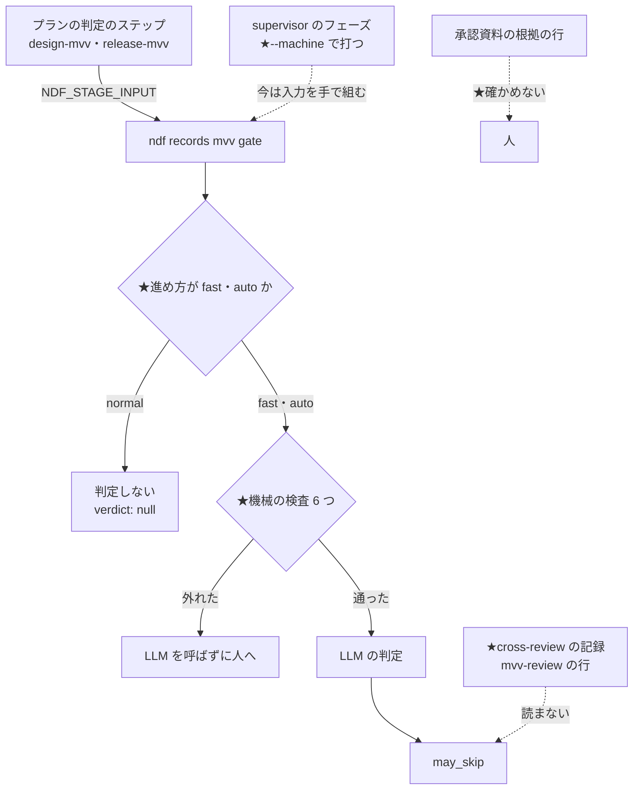
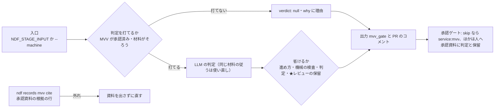
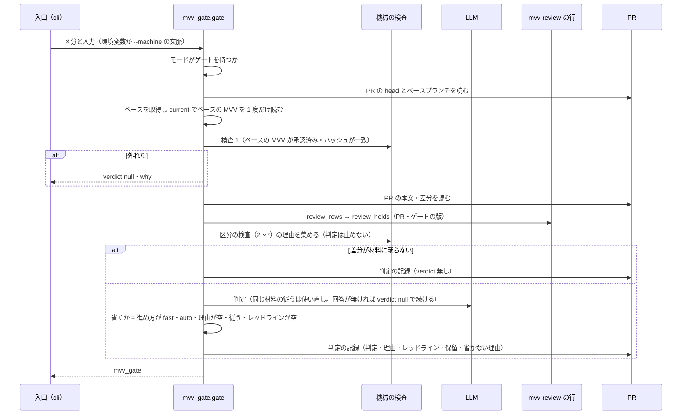
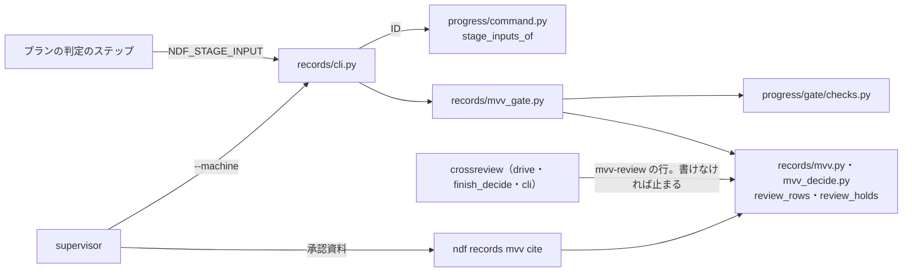

# MVV 判定: 承認ゲートの手前で進め方によらず判定し、人が判定とレビューの保留と確かめた根拠を読める（#3959 #4055）

進め方 `normal` では承認ゲートの手前で MVV 判定を打たず、承認資料の根拠の行は自己申告のままで、`fast`・`auto` ではレッドラインの指摘が残った PR も省かれうる。判定を打つ条件（MVV が承認済みで材料がそろう）と承認ゲートを省く条件（機械の検査・判定・レビューの記録）を分けて、どの進め方でも判定を打ち、承認資料の根拠の行は #4076 が作る確かめの関数で止める。プランの外でもステートマシンの ID で同じ判定を打てるようにし（#4055）、即時修正の判定（#4104）とリリースの保留の範囲（#4105）は別の Issue へ分けた。採らなかった案は「決定の記録」にある。

## 今の姿

何が起きたか・目的・受け入れ条件は要求仕様（[issue-3959-requirements.md](./issue-3959-requirements.md)、正は #3959 の本文）にある。この文書は「どう解くか」と「なぜその解き方か」だけを書く。#4055 の要求は #3959 の受け入れ条件 8 にまとめ、#4055 の要求仕様のコピーは作らない。まとめた理由は決定 6 にある（共通の原因: どちらも `ndf records mvv gate` の入口と判定を打つ条件の 1 か所が、プランの `fast`・`auto` の承認ゲートだけを前提にしている）。

★ が変わる位置である。設計に要る今の構造:

| 部品 | 今の振る舞い | 場所 |
| --- | --- | --- |
| 判定の入口 | `--gate design|release` だけを受け、工程の入力は `NDF_STAGE_INPUT` からだけ読む。無ければ `invalid` | `plugins/ndf/src/ndf/domains/records/cli.py` の `_mvv_gate` |
| 判定を打つ条件 | モードがその承認ゲートを持ち、進め方が `MVV_PACES`（`fast`・`auto`）で、機械の検査 6 つ（`refusals`）を通り、PR の差分の全体が材料に載るときだけ LLM を呼ぶ | `records/mvv_gate.py` の `gate`・`_judged` |
| 省く判定 | 機械の検査・判定の形・「従う」・レッドラインが空 | `progress/gate/checks.py` の `may_skip` |
| 判定の記録 | PR を読めた後は、省くときも省かないときも PR のコメントへ書く（`checks.note`） | `mvv_gate._recorded` |
| 出力 | `mvv_gate`: `gate`（`design`・`release`）・`skip`・`verdict`・`why`・`head` | `contracts/workflow/context.schema.json` の `$defs.mvv_gate` |
| 承認資料の「MVV 判定」の欄 | 設計 PR の判定のコメントかリリースの承認資料の末尾から写す。根拠の行（「目指す姿の根拠」）は設計文書からそのまま写す | `skills/development-workflow/references/approval-request.md` |

#4076 の実装（前提 1）の後に次の部品がある。この設計はその形を前提に書く。

| #4076 が作る部品 | 振る舞い | 場所 |
| --- | --- | --- |
| MVV の写し | `current(root, ref) -> Snapshot`。ベースブランチの承認済みの MVV の版・sha256・写しのパス・項目の一覧（`items`）を返す。CLI は `ndf records mvv current --base` | `records/mvv.py` |
| 根拠の行の確かめ | `citation_errors(added, catalog)`・`fenced_lines(text)`。純粋な関数 | `records/mvv_decide.py` |
| cross-review の MVV の記録 | `record_review` が `mvv-validation.jsonl` に種類 `mvv-review` の行（`repo`・`pr`・`head`・`key`・`id`・`item`・`outcome`・`version`・`sha256`・`at`、`deferred` は `reason`、`redline` は `text`）を書く。書けなければ注意に留める | `records/mvv.py`、`crossreview/drive.py` の `_summary` |
| 共通原則の本文 | `principles()` を `mvv_gate.py` から `mvv.py` へ移す | `records/mvv.py` |

## 文脈と制約

- **#4076 の実装が先に main へ入る。** 写し・根拠の行の確かめ・`mvv-review` の行はどれも #4076 が作る。同じ確かめを 2 か所に作らない（#4076 の設計の「#3959」の項）
- **#4076 の設計は、`fast`・`auto` でレッドラインの指摘が残っても省かれうる危険を、この Issue が直すまで残した**（#4076 の決定 5 の代償。#4077 の cross-review の指摘 r9-1 は「#3959 と同時に有効化するか」を問い直す材料として返された）
- **承認ゲートを省いてよいのは今どおり `fast`・`auto` だけである**（利用者の方針、2026-11-21）。この Issue は省く範囲を広げない
- **このリポジトリはテストを CI に寄せる**（`.ndf/project.json` の `test.ci.only` が真）。LLM の判定の中身に依る受け入れ条件は CI で確かめない
- **supervisor が手で回すフェーズ**（プランのテンプレートが無いとき。#3908）でも、設計の工程の出力は `mvv_gate` を持つ（`ndf progress show` の `outputs`）

## 解き方の全体像

- `ndf records mvv gate` は、承認済みの MVV があり PR の材料がそろえば、進め方と機械の検査によらず LLM の判定を打つ。進め方・機械の検査・判定・レビューの保留は「省くか」だけを決め、`normal` は常に省かない。リリース承認ゲートは #4105 まで省かない
- 判定の記録（判定・理由・レッドライン・レビューの保留・省かない理由）は PR のコメントに載る。承認資料の「MVV 判定」の欄は、PR のコメントでなく今回の判定の出力（`outputs.mvv_gate`）を写す（今回のコメントが無い終わり方でも、前回の判定を人へ渡さない）
- `service:mvv` の承認は、回答を読む時点で判定した PR・宛先・head と今の PR を、判定が規則を読んだベースのコミットと今の宛先の先端を照合し、どれかが違う・読めなければ人の承認待ちへ戻す。読むのは入口で照合した回答（事象番号が一致するもの）だけにする。リリース承認ゲートは、旧版の判定や旧版が書いた回答から再開しても、ゲートの側で #4105 まで省かない
- 設計承認ゲートは、設計 PR の cross-review の記録にレッドラインの指摘か今の版の未解消の見送りがあれば省かない。cross-review はその記録を書けなければ収束にせず止まる
- 承認資料を出す担当は、出す前に `ndf records mvv cite --base <ブランチ> <資料>` を打ち、版と番号の誤りがあれば直す。supervisor が回すフェーズは `--machine <ステートマシンの ID>` で判定を打ち、設計承認ゲートは出力をそのまま設計の工程の出力と承認資料へ、手動のリリース承認ゲートは承認資料へ写す

## 構成要素

| 要素 | 責務 |
| --- | --- |
| 判定の入口（`records/cli.py`） | 工程の入力を `NDF_STAGE_INPUT` か `--machine` のどちらか 1 つから得る。`cite` のサブコマンドを足す |
| 判定の本体（`records/mvv_gate.py`） | 判定を打つ条件と省く条件を分ける。MVV とレッドラインのパスを PR のベースから読む。設計 PR のレビューの記録を読んで保留を事実に入れる |
| 機械の検査（`progress/gate/checks.py`） | 省かない理由の検査に `check_review_holds` を足す。判定の記録（`note`）に保留を載せる |
| レビューの記録の読み手（`records/mvv.py`・`mvv_decide.py`） | `mvv-review` の行を読み（`review_rows`）、PR ごとの保留を決める（`review_holds`）。#4076 から移した規則 |
| cross-review の終わり方（`crossreview/drive.py`・`finish_decide.py`・`cli.py`） | 承認ゲートの判定に要る記録を書けなければ `mvv_record_failed` で止まる。#4076 から移した規則 |
| ステートマシンの文脈の読み手（`progress/command.py`） | ID から、判定のステップを持つ工程の入力をプランと同じ規則で組む |
| 省いた回答の照合（`progress/model.py`・`progress/gate/asking.py`・`answering.py`・`entry.py`・`run.py`） | `service:mvv` の承認に判定した PR・宛先・ベースのコミット・head を持たせ、回答を読む前の検証（`recheck`）で今の PR と宛先の先端に照合し、照合した回答だけを読む。リリース承認ゲートの省略を #4105 まで止める |
| 手順書（`pace.md`・`approval-request.md`・`agent-layers.md`・`project-mvv.md`） | 進め方によらず判定すること、承認資料が今回の判定の出力から保留と判定を写すこと、根拠の行の確かめ、supervisor が設計承認ゲートと手動のリリース承認ゲートの前に `--machine` で打つ手順 |

## 入出力のコントラクト

### `ndf records mvv gate`

| 引数 | 内容 |
| --- | --- |
| `--gate design|release` | 承認ゲートの区分（今のまま。即時修正の区分は #4104） |
| `--machine <ID>`（新設） | ステートマシンの ID。`design`・`release` で、`NDF_STAGE_INPUT` が無いときに使う。両方あれば `invalid`（どちらの入力か決めない） |

| 区分 | 判定する PR | 当てる機械の検査（省かない・進めない理由） | 結果 |
| --- | --- | --- | --- |
| `design` | 文脈の `worktree`（無ければ作業場所）のブランチの開いた PR（`NDF_STAGE_INPUT` と `--machine` のどちらでも同じ） | 1〜6 と 7（レビューの保留） | `ok`・`outputs.mvv_gate`（今の形。`skip` は進め方が `fast`・`auto` で理由が空のときだけ真） |
| `release` | 文脈の `pr`（今のまま） | 1〜6（保留は #4105 まで読まない） | `ok`・`outputs.mvv_gate`。#4105 まで `skip` は常に偽（決定 3） |

MVV の事実（検査 1・判定の材料・保留の版）は、判定する PR のベースブランチを取得して `current` で 1 度だけ読んだ MVV から作る（要求仕様の前提 3）。レッドラインのパス（`.ndf/pace.json` の `boundary_paths`）も同じベースのコミットから読む。作業ツリーの `.ndf/mvv.json`・`.ndf/pace.json` は読まない（PR が規則を緩めても、今回の変更には元の規則が効く）。PR が MVV の設定を消しても変えても、ベースが承認済みなら判定を打ち、検査 5 が外れる。

機械の検査は今の `pace.md` の 1〜6 に 7 を足したものである。

| 番号 | 検査 | 外れたとき |
| --- | --- | --- |
| 1 | PR のベースのプロジェクト MVV が承認済みで、本文の sha256 が承認の記録と一致する | 判定を打たない（判定の前提） |
| 2 | スプリントの文脈の `mvv_ref` が承認の記録と一致する | 判定は打ち、省かない |
| 3 | モードが `operation` でも `documentation` でもない | 同上 |
| 4 | PR の変えたファイルが `.ndf/pace.json` の `boundary_paths` に当たらない | 同上 |
| 5 | PR が `.ndf/mvv.md`・`.ndf/mvv.json` を変えない（共通原則の C7） | 同上 |
| 6 | 出し直しの指摘への対応表が「記載した」と書く PR 本文のセクションに中身がある | 同上 |
| 7（新設） | 対象の PR の `mvv-review` の行に、レッドラインの指摘か今の版の未解消の見送りが無く、記録を読める | 同上 |

`mvv_gate` の形は今の（`gate`・`skip`・`verdict`・`why`・`head`）に、任意のキー `holds`（保留）・`noted`（判定の記録を PR に書けなかった印）・`pr`（判定した PR の番号）・`base`（判定した時点の PR の宛先）を足したものである。`service:mvv` の承認は `pr`・`base`・`head` を見た対象として持ち、回答を読む前の検証で今の PR と照合する。`verdict` が null になるのは、MVV が承認済みでない・今の本文のハッシュが承認の記録と合わない（検査 1）・PR を読めない・差分の全体が材料に載らない・LLM が回答しない、のどれかだけになる。`normal` では `why` に「進め方 normal は承認ゲートを MVV 判定で省かない」が必ず入る。`verdict` が null のときも、判定しなかった理由が `why` と PR のコメント（PR を読めた後）に載り、承認資料の「MVV 判定」の欄は今回の出力から「判定できない: <理由>」と保留を写す。

### `ndf records mvv cite --base <ブランチ> <ファイル>...`（新設）

| 項目 | 内容 |
| --- | --- |
| 入力 | `--base`（必須）。`current` と同じくベースブランチを取得して承認済みの MVV の写しを得る。ファイルは 1 つ以上（承認資料など） |
| 確かめ | ファイルの全体の行からフェンスの内側を除き（`fenced_lines`）、`citation_errors` に `{承認済みの版: 項目の一覧}` を渡す。全体を読むのは、承認資料がゲートごとに新しく書かれる文書だからである |
| 出力（誤り無し） | `ok`、`items` は空、`summary` は「根拠の行の確かめ: 誤り無し（MVV バージョン <版>）」。承認資料の「MVV 判定」の欄にこの 1 行を写す |
| 出力（誤りあり） | `stopped`・`cause.kind: refused`（終了コード 1）、`items` に誤り（`path`・`line`・`cited`・`version`・`unknown`）、`summary` に件数と最初の誤り |
| 承認済みの MVV が無い（`absent`・`unapproved`） | `ok`、`summary` に「MVV が承認されていないので確かめない」。根拠の行を書かない形（`decisions.md` の「MVV なし」）が正しいため |
| 失敗 | ファイルを読めない・`current` の `MvvError`（参照を解決できない・設定が壊れている）・ベースの本文が承認の記録と合わない（`mismatch`）は `stopped`・`precondition`。`mismatch` は確かめる版を決められないので、確かめずに `ok` にしない |

### cross-review の結果（#4076 から移した変更）

`ndf cross-review run` は、`record_review` が `redline`・`deferred` の行を書けなかったら、終わり方を `STOPPED`・`cause.kind: mvv_record_failed` にする。`fixed`・`unresolved` の行だけが書けなかったときは今どおり注意に留める。

## 処理の流れ

入口と、判定の外の構成要素の流れ:

## 決定の記録

### 決定 1: どの進め方でも人へ判定を渡すため、判定を打つ条件と承認ゲートを省く条件を分ける

- **質問**: `normal` でも判定を打つとき、今の順（進め方 → 機械の検査 → 判定）のどこを変えるか
- **選んだ案**: 判定を打つ前提を「MVV が承認済みで今の本文のハッシュが承認の記録と一致する（検査 1）・PR を読める・差分の全体が材料に載る」の 3 つだけにする。進め方と検査 2〜7 は判定の後に「省くか」だけを決め、外れた理由は `why` と PR のコメントに載る。`skip` が真になるのは、進め方が `fast`・`auto` で、検査 2〜7 の理由が無く、判定が「従う」でレッドラインが空のときだけである（今の `may_skip` と同じ条件に検査 7 を足したもの）
- 採らなかった案: 進め方の条件（`pace.md` の順 2）だけを外し、機械の検査が外れたら今どおり判定しない（`fast`・`auto` でも、レッドラインのパスに当たる PR・MVV の設定を変える PR のように人が最も確かめたい PR で判定が抜ける。利用者の「MVV 判定は常に実施」に合わない）
- 採らなかった案: `normal` 用に助言だけの別のコマンドを足す（判定の材料・記録・PR のコメントの書き方が 2 つになり、同じ材料の判定を使い直す記録も分かれる）
- **代償**: `fast`・`auto` で機械の検査が外れた PR にも LLM の 1 回の費用がかかる。同じ材料の「従う」の使い直しは今のまま効くが、「従わない」「判定できない」は打ち直しのたびに呼ぶ
- 根拠: Value 1 / Value 13 / Value 14（MVV バージョン 11）

### 決定 2: レッドラインの指摘が残る PR を人が見るため、承認ゲートの省略の条件に cross-review の記録を足す

- **質問**: #4076 から移した「レビューの記録を読んで省かない」仕組みを、どの形で承認ゲートと承認資料に入れるか
- **選んだ案**: #4076 の詳細設計で決まった規則（#3959 の本文の「#4076 の設計から移した仕組み」）をそのまま採る。`review_rows` が `mvv-validation.jsonl` の `mvv-review` の行と読めなかった行の数を返す。`review_holds` は対象の PR ごとに、`redline` の行が 1 行でもあるキーと、今の版の `deferred` の後に同じキー・同じ版の `fixed` が無いキーを保留として返す。head で行を選ばない。保留は検査 7 として `refusals` に入り、承認資料の「MVV 判定」の欄と PR のコメントにも同じ結果が載る。記録を読めないときと読めない行があるときも保留にする。cross-review は `redline`・`deferred` の行を書けなければ `mvv_record_failed` で止まる
- 採らなかった案: 承認資料に載せるだけで、`fast`・`auto` の省略の条件には足さない（人が資料を読まない `service:mvv` の承認で、レッドラインの指摘が残る PR が通る。#4076 の cross-review の指摘 r1-5 が critical とした危険が残る）
- 採らなかった案: 判定の LLM の材料に cross-review の記録を足し、LLM に省くかを決めさせる（同じ記録でも判定が揺れ、記録を読めないときに省かない側へ倒す決まりを LLM に任せることになる）
- 採らなかった案: 人がゲートで承認したら記録の保留を外す行を書く（承認を表す行の形・書き手・読み手が要り、#4076 の cross-review の指摘 r8-3・r8-8 が規則の穴を挙げた。余分な人の承認は許す側を選ぶ）
- **代償**: レッドラインの指摘を一度受けたキーは、同じ PR を対象にするゲートで毎回人へ問う（リリース承認ゲートは #4105 まで保留を読まないが、省かないので人が答える）。記録が壊れると、直すまで `fast`・`auto` でも人へ問う
- 根拠: Value 1 / Value 13（MVV バージョン 11）

### 決定 3: レッドラインが残る変更を自動で通さないため、リリース承認ゲートは保留を読む範囲が決まるまで `fast`・`auto` でも省かない

- **質問**: リリース承認ゲートで保留を読む PR の範囲（リリースに含まれる単位の PR）を #4105 へ分けた間、リリース承認ゲートの省略をどう扱うか
- **選んだ案**: #4105 が実装されるまで、リリース承認ゲートは進め方によらず MVV 判定で省かない。判定は打ち、判定の記録は PR のコメントと承認資料に載る。`why` に「リリース承認ゲートは、保留を読む PR の範囲が決まるまで（#4105）MVV 判定で省かない」を入れ、保留は読まない（`review_prs` は空）。判定の出力の `skip: false` だけでは、旧版で `release-mvv` を済ませてから更新した実行中のステートマシン（済んだ `skip: true` を `model.mvv_skip` が読む）と、旧版が書いた未消費の `service:mvv` の回答に効かないので、ゲートの側にも置く: 省いてよい区分の表 `MVV_SKIP_GATES` を `design` だけにし、`mvv_skip` はほかの区分を省かず、回答を読む前の検証（`recheck`）は区分が表に無い `service:mvv` の回答を人の承認待ちへ戻す。#4105 は表に `release` を足す設計承認ゲートの保留は対象が設計 PR の 1 件で決まるので、この Issue で読む
- 採らなかった案: 判定の出力だけで止め、ゲートの側は変えない（旧版の済んだ判定と未消費の回答から再開すると、`service:mvv` の承認でリリース承認ゲートを通る。#4093 の指摘 r4-3）
- 採らなかった案: リリースの PR 自体（文脈の `pr`）の保留だけを読み、省く条件に使う（`trunk` の `release_pr` のように単位の PR が版上げの PR の差分に現れない戦略で、単位の PR に残るレッドラインを読まずに省く。#4076 の cross-review の指摘 r9-1 と #4093 の指摘 r1-3 の危険を開ける）
- 採らなかった案: 範囲の決め方を #3959 に残したまま収束させる（#4093 の cross-review の 3 ラウンドで、範囲の決め方への指摘が毎ラウンド続き、CHANGELOG の集め方や組み立てのコミットの記録へ広がった。conductor が 2026-11-22 に範囲を分けると決めた）
- **代償**: `fast`・`auto` でもリリース承認ゲートは毎回人が答える。リリースの自動化は #4105 まで止まる。r9-1 の危険（レッドラインの指摘が残る変更が自動で省かれる）は開かない
- 根拠: Value 1 / Value 7（MVV バージョン 11）
### 決定 4: 承認資料の根拠の行を出す前に止めるため、#4076 の確かめの関数をファイルに当てるコマンド `ndf records mvv cite` を足す

- **質問**: PR の外にある承認資料の根拠の行の版と番号を、どこで確かめて止めるか
- **選んだ案**: `ndf records mvv cite --base <ブランチ> <ファイル>...` を足し、#4076 の `current`（写しと項目の一覧）と `citation_errors`・`fenced_lines` をそのまま使う。承認資料は毎回新しく書く文書なので、差分でなくファイルの全体を確かめる。`approval-request.md` に「承認資料を渡す前にこのコマンドを打ち、誤りがあれば直してから渡す」を置き、`agent-layers.md` の supervisor の規則（承認ゲートを返す前）にも置く。PR の差分の根拠の行（設計文書）は #4076 の cross-review が確かめるので、ここでは重ねない
- 採らなかった案: `ndf records mvv gate` が PR の差分の根拠の行も確かめる（#4076 の cross-review と同じ確かめが 2 か所になる。ゲートは差分の全体を API の patch で読むので、フェンスの内外を決める本文も別に要る）
- 採らなかった案: hook で承認資料の書き込みを見張る（承認資料の置き場は呼び手が決め、プランの資料は NDF が書く。書き込みのパスで資料を見分けられない）
- 採らなかった案: 承認資料は設計文書から写すだけなので確かめない（写す元の設計文書が #4076 の後に正しくても、手で組む資料には版を書き換えた行が入りうる。ls3-spec の資料の誤りは資料の側にあった）
- **代償**: 承認資料を出す担当が打つことに頼る。打たずに出した資料は止まらないが、確かめた結果の 1 行が欄に無いので、承認する人は確かめていない資料だと分かる（プランが書く資料は根拠の行を持たないので当たらない）
- 根拠: Value 11 / Value 13 / Value 3（MVV バージョン 11）

### 決定 5: プランの外でも同じ入力で判定するため、`ndf records mvv gate` にステートマシンの ID の入口を足す

- **質問**: プランの外（supervisor が回すフェーズ）で、判定の入力をどう渡すか（#4055）
- **選んだ案**: `--machine <ID>` を足す。ステートマシンの文脈（`machine_context`。作成の時点の値に記録された出力を重ねたもの）から、判定のステップ（`design-mvv`・`release-mvv`）を持つ工程の入力を、プランと同じ `resolve_inputs` で組み、文脈のほかのキー（`design_pr` など）は足さない。設計承認ゲートが判定する PR は、どちらの入口でも入力の `worktree` のブランチの開いた PR である（プランの経路の入力に `design_pr` は無いので、片方だけが読むと同じ文脈で別の PR を判定しうる）。`NDF_STAGE_INPUT` と `--machine` が両方あれば `invalid` で止める。`agent-layers.md` の supervisor の規則に「設計承認ゲートを返す前に `--machine` で打ち、出力の `mvv_gate` を設計の工程の出力と承認資料へ写す」と「手動の経路でリリース承認ゲートを返す前に `--gate release --machine` で打ち、出力を承認資料へ写す（打てなければ判定できない理由を写して人へ問う）」を足す
- 採らなかった案: `--pace`・`--mode`・`--pr` などの引数で入力を渡す（文脈の値と引数の値の 2 つの出所ができ、手で打つ値がスプリントの値と食い違っても止まらない。進め方を手で `fast` と書けば省く判定まで出る）
- 採らなかった案: 今どおり `NDF_STAGE_INPUT` を手で組む手順を書く（#3995 で組んだ JSON は `mvv_ref` を欠き、検査 2 が常に外れる。組み方を人と AI が覚える入口が増える）
- **代償**: ステートマシンを作っていないフェーズでは打てない（そのときは判定の入力が無いのと同じで、今どおり `invalid`）
- 根拠: Value 15 / Value 3（MVV バージョン 11）

### 決定 6: 同じ入口を 1 回で直すため、#4055 を #3959 にまとめる

- **質問**: #4055（プランの外で判定を打てない）を別の設計・実装にするか、#3959 にまとめるか
- **選んだ案**: まとめる。#3959 は `normal` でも判定を打つので、supervisor が回すフェーズ（プランのテンプレートが無い工程。進め方を問わない）で判定を打つ場面が今より増える。#4055 の入口が無いと、#3959 の受け入れ条件 1・3 を supervisor のフェーズで満たせない。どちらも `records/cli.py` の `_mvv_gate` と `mvv_gate.gate` の入力の扱いを変える。#4055 は実装の PR で #3959 と一緒に閉じる
- 採らなかった案: #4055 を別の設計にする（同じ 2 つの関数を 2 つの PR で順に変え、片方の PR の間は `normal` の判定を supervisor のフェーズで打てない）
- **代償**: #3959 の実装の PR が大きくなる（入口の変更は `cli.py` と `command.py` の数十行）
- 根拠: Value 11 / Value 5（MVV バージョン 11）

### 決定 7: `fast`・`auto` でレッドラインが残る PR が省かれる期間を作らないため、#4076 の実装と同じ版で出す

- **質問**: #4076 の実装（レッドラインの指摘を修正担当へ渡さず記録に残す）と、この Issue の実装（承認ゲートがその記録を読む）を、どの順で利用者へ届けるか
- **選んだ案**: 同じ版で出す。#4076 の実装の PR の後にこの Issue の実装の PR を同じスプリントで main へ入れ、版を上げるのは両方が入った後にする。#4076 の実装だけを出すと、cross-review はレッドラインの指摘を修正担当へ渡さずに収束し、`fast`・`auto` の承認ゲートはその記録を読まずに省きうる（#4077 の cross-review の指摘 r9-1）
- 採らなかった案: #4076 の実装に暫定の経路（レッドラインが残れば `incomplete` にする）を足す（#4076 の範囲を変え、この Issue で消す経路を一度作る）
- 採らなかった案: 順に別の版で出す（その間の版で r9-1 の危険が利用者へ届く）
- **代償**: #4076 の実装が先に終わっても、この Issue の実装が入るまで版を上げない。止める機械の検査は置かず、リリース承認ゲートで人が見る（承認資料の「作るもの」に両方の PR が載る）
- 根拠: Value 1 / Value 7（MVV バージョン 11）

### 決定 8: 収束しない仕組みを別の設計で詰めるため、即時修正の判定とリリースの保留の範囲を #4104・#4105 へ分ける

- **質問**: #4093 の cross-review の 3 ラウンドで指摘が続いた 2 つの仕組みを、この Issue に残すか分けるか
- **選んだ案**: 分ける。即時修正のマージの前の判定（判定した PR・宛先・head を CI からマージまで束ねる。指摘 r1-2・r2-3・r2-8・r3-2・r3-3・r3-4・r3-7）を #4104 へ、リリース承認ゲートで保留を読む PR の範囲（指摘 r1-3・r2-5・r2-6・r2-7・r3-1・r3-5）を #4105 へ移し、指摘と設計の内容を本文へ写した。この Issue に残すのは、判定を打つ条件と省く条件の分離・設計承認ゲートの保留・承認資料の保留・`cite`・`--machine`（#4055）・`mvv_record_failed` である。リリースの間の扱いは決定 3
- 採らなかった案: この Issue に残してラウンドを足す（直すたびに `ndf ci watch`・`ndf ci merge`・GitHub の adapter・リリースの組み立ての記録へ変更が広がり、残す範囲の承認まで遅れる）
- **代償**: 即時修正は #4104 まで MVV 判定を通らずにマージされる（利用者の「即時修正でも必要」は #4104 で満たす）。設計と実装が 3 本に分かれる
- 根拠: Value 5 / Value 9（MVV バージョン 11）

## 影響と危険

- **働く範囲**: 利用先のリポジトリでも働く。判定・保留・根拠の行の確かめが現れるのは承認済みの MVV（状態 `approved`）を持つリポジトリだけで、持たないリポジトリでは承認ゲートの出力の形が今と変わらない
- **プロジェクトごとに違うもの**: MVV の本文とレッドラインのパス（`.ndf/pace.json` の `boundary_paths`）は今どおり設定から読む。新しい設定のキーは足さない
- **当たるモード**: 設計承認ゲート・リリース承認ゲートを持つモード（判定はモードの定義がゲートを持つときだけ）。進め方はすべて
- **同じファイルを触る別の変更**: #4076 の実装が `records/mvv.py`・`mvv_decide.py`・`mvv_gate.py`・`crossreview/drive.py`・`finish_decide.py`・`agent-layers.md`・`project-mvv.md` を変える。この Issue の実装は #4076 の実装が main へ入った後の main から切る（決定 7）
- **壊れうる箇所**: 判定が LLM の回答を待つので、`normal` のゲートでも LLM が回答しないと `verdict: null` になる。その場合も省かない側（人へ問う）なので、承認ゲートは止まらない
- **費用**: 承認ゲート 1 回につき LLM の判定 1 回（同じ材料の「従う」は使い直す）。MVV をベースから読むため、判定ごとに PR の読み取り（承認済みの MVV が無いリポジトリでも）とベースの `git fetch` が 1 回ずつ増える（参照の解決は `current` の入口の 1 回だけで、`git rev-parse` は増やさない）。記録 `mvv-validation.jsonl` は保留と判定の再利用で共有し、判定 1 回につき 1 回だけ読む。省いた回答の照合は、今の検証が読む PR の 1 回の結果から宛先も読むので、API の呼び出しは増えない。さらに差分を読み終えた後に PR を 1 回読み直す（REST 1 回。差分が判定した head に属することを確かめる）。リリース承認ゲートは #4105 まで保留を読まないので、保留の読み取りの費用は設計承認ゲートだけにかかる（記録のファイルを 1 回読む）

### 代表のリポジトリでの振る舞い

| 代表のリポジトリ | 設定の要点 | 直した後に起きること | この種類で扱えなくなること |
| --- | --- | --- | --- |
| Web サービス | 承認済みの MVV があり、設計 PR とリリースの PR が承認ゲートを通る | `normal` でも承認ゲートの手前で判定が PR のコメントと承認資料に載る。`fast`・`auto` でもリリース承認ゲートは #4105 まで人が答える | 無し |
| モバイルアプリ | 同上。配布の手段が違うだけ | 同上 | 無し |
| 業務文書だけ | 文書の PR。MVV が無いことが多い | MVV が無ければ今と同じ。あれば文書の PR にも判定が載る（`documentation` は今どおり省かない） | 無し |

### このリポジトリだけの事情

- 無し（新しい値を足さない。ai-plugins の MVV の版 11 は例として使うだけで、仕組みはどのプロジェクトの MVV も読む）

## 用語

設計文書の本文で使う新しい語を、実装の PR で用語集へ足す（この設計 PR は `issues/issue-3959-*` だけを触る）。

| 語 | 意味 | 反映 |
| --- | --- | --- |
| レビューの保留 | 対象の PR の cross-review の記録に残る、レッドラインの指摘と今の版の未解消の見送り。あれば承認ゲートを省かない | 追加 |
| MVV 判定 | 承認ゲートの手前で、LLM が PR を共通原則とプロジェクト MVV に照らす判定。どの進め方でも打ち、`fast`・`auto` の承認ゲートを省くかの材料にもなる | 意味の変更（今は `fast`・`auto` の承認ゲートを省く材料だけ） |

## テスト設計

| 受け入れ条件・不変条件 | どの振る舞いで縛るか | どう壊したら落ちるべきか |
| --- | --- | --- |
| 1 | `pace: normal` の入力で `gate` が LLM のスタブを 1 回呼び、`verdict` を持ち `skip` は偽で、`why` に normal の理由、PR のコメントの関数が 1 回呼ばれる | `normal` で判定しない・`skip` が真になる・コメントを書かない |
| 2 | `fast` でレッドラインのパスに当たる・MVV の設定を変える・モードが `documentation` の PR で、判定が打たれ `skip` は偽、理由が `why` に入る | 検査が外れて判定しない・判定が「従う」で省く |
| 2 | 検査 1 が外れる（承認されていない・ハッシュが違う）と LLM を呼ばない | 承認されていない MVV で判定する |
| 3 | `note` が保留と判定を載せる（`normal` でも） | `normal` で欄が空になる |
| 4 | #4076 から移したテスト（`review_holds` の正常・境界値・異常。#3959 の本文の「テストで落とす壊し方」）と、保留があると `fast` でも `skip` が偽。不正なバイトを含む記録で読めない理由の保留。リリース承認ゲートは保留を読まず、`fast`・`auto` でも `skip` が偽 | 保留を読まない・head で行を選ぶ・読めない記録を該当なしにする・符号の誤りでゲートが落ちる・リリース承認ゲートを `fast`・`auto` で省く |
| 5 | `record_review` が `redline` を書けないと `cmd_run` の結果が `STOPPED`・`mvv_record_failed`。通常の行の失敗では必須の行が欠けない（必須の行を先に書く）。打ち直しで欠けた行だけを書く | 注意だけで収束する・CLI の `finish` の打ち直しで成功に戻る・通常の行の失敗の後の必須の行を落とす |
| 7 | `cite` が版の違う根拠の行・版に無い番号で `refused`、フェンスの中と文中の引用は拾わない、MVV が無ければ `ok`、ベースが `mismatch` なら `precondition` | 誤りを通す・説明の文で止まる・確かめを失ったまま `ok` |
| 1・2（省いた回答） | 設計承認ゲートの `service:mvv` の承認を書いた後、同じ head のまま宛先を変えると、回答を読む前の検証が人の承認待ちへ戻す。質問の PR が判定した PR と違っても戻す | 同じ head なら宛先の変更を見ずに省いた回答を読む |
| 決定 3（再開） | 旧版で済ませた `release-mvv` の `skip: true` と、旧版が書いた未消費の `service:mvv` の回答のどちらから再開しても、リリース承認ゲートが人の承認待ちになる | 判定の出力だけで止め、旧版の判定か回答で省く |
| 4（記録を読めない） | 不正なバイトを含む実際の `mvv-validation.jsonl` で、実物の `mvv_validate_sprint` を通しても判定が打たれ（再利用を省く）、`holds` に読めない理由が載り `skip` は偽。追記も失敗すると判定・保留・記録に書けない理由がそろう | 判定の再利用の読み直しで例外が出て止まる・読めない記録で再利用する |
| 承認資料 | 手順書が `outputs.mvv_gate` を出所にし、`verdict: null`・`noted: false` でも今回の理由と保留を写す | PR のコメントの前回の判定を写す |
| 8 | `--machine` で文脈から組んだ入力が、同じ文脈でプランが組む入力（`resolve_inputs`）と同じで、両入口が同じ PR と判定結果を選ぶ。環境変数と両方 → `invalid`。無い ID → `refused` | 文脈の `mvv_ref` を落とす・両方あるときに片方を選ぶ・`design_pr` で別の PR を判定する |
| 前提 2 | 承認済みの MVV が無いリポジトリで `design`・`release` の出力が今の形（`verdict: null`） | 形が変わる |

## どこを変えるか

詳細設計は別ファイル [issue-3959-4055-design-detail.md](./issue-3959-4055-design-detail.md) にした。新設する関数が 2 つ以上あり、既存の関数のシグネチャを変えるためである。

## 設計の結果

| 課題 | 扱い | 統合先 | 触るファイル |
| --- | --- | --- | --- |
| #3959 | 実装する | — | `plugins/ndf/src/ndf/domains/records/mvv_gate.py`、`plugins/ndf/src/ndf/domains/records/mvv.py`、`plugins/ndf/src/ndf/domains/records/mvv_decide.py`、`plugins/ndf/src/ndf/domains/records/mvv_material_decide.py`、`plugins/ndf/src/ndf/domains/records/cli.py`、`plugins/ndf/src/ndf/progress/gate/checks.py`、`plugins/ndf/src/ndf/progress/command.py`、`plugins/ndf/src/ndf/progress/model.py`、`plugins/ndf/src/ndf/progress/gate/asking.py`、`plugins/ndf/src/ndf/progress/gate/answering.py`、`plugins/ndf/src/ndf/domains/crossreview/drive.py`、`plugins/ndf/src/ndf/domains/crossreview/finish_decide.py`、`plugins/ndf/src/ndf/domains/crossreview/cli.py`、`plugins/ndf/contracts/workflow/context.schema.json`、`plugins/ndf/docs/contracts/commands.md`、`plugins/ndf/skills/development-workflow/references/pace.md`、`plugins/ndf/skills/development-workflow/references/approval-request.md`、`plugins/ndf/skills/development-workflow/references/agent-layers.md`、`plugins/ndf/skills/development-workflow/references/project-mvv.md`、`docs/glossary/glossary.json`、`docs/glossary.md`、`plugins/ndf/tests/domains/records/test_mvv_gate.py`、`plugins/ndf/tests/domains/records/test_mvv_review_holds.py`、`plugins/ndf/tests/domains/records/test_mvv_cite.py`、`plugins/ndf/tests/domains/records/test_mvv_record_review.py`、`plugins/ndf/tests/progress/gate/test_gate_checks.py`、`plugins/ndf/tests/domains/crossreview/test_crossreview_finish.py`、`plugins/ndf/tests/progress/test_command_mvv_inputs.py`、`plugins/ndf/tests/progress/gate/test_gate_mvv_answer.py`、`plugins/ndf/tests/domains/records/test_mvv.py` |
| #4055 | 統合する | #3959 | 上と同じ（`records/cli.py`・`progress/command.py`） |

## 未確認のまま残ること

| 項目 | 内容 |
| --- | --- |
| `normal` で増える費用 | 承認ゲートごとの判定の LLM の費用を測っていない。判定の記録（`mvv-validation.jsonl` の `usd`）で、使い始めてから分かる |
| 保留で人へ問う回数 | レッドラインの指摘を受けたキーを持つ PR が、`fast`・`auto` のゲートで人へ問う回数は分からない。`mvv-review` の `redline` の行の数で、使い始めてから分かる |
| 受け入れ条件 1・3 の中身 | 判定の中身は LLM の出力に依る。リリースの後の最初の `normal` のスプリントの設計承認ゲートで分かる |

## 外部の調査

省く: 既存の判定・機械の検査・プランの部品の延長と、#4076 が決めた規則の移設だけで、外部の判断が要る形が無い
