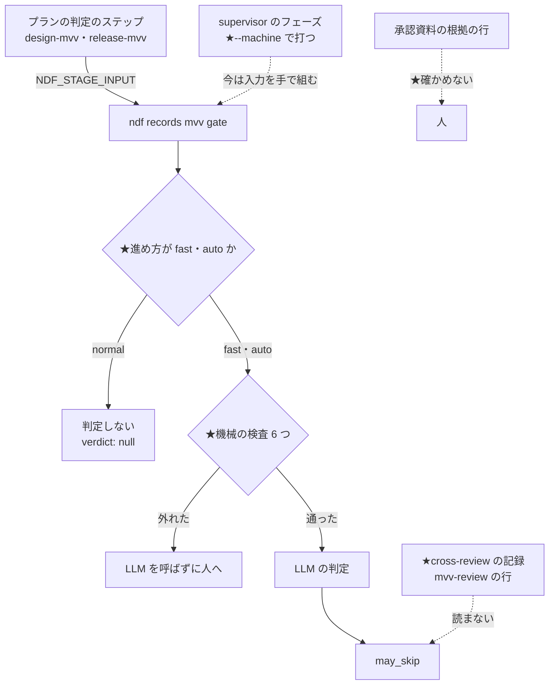
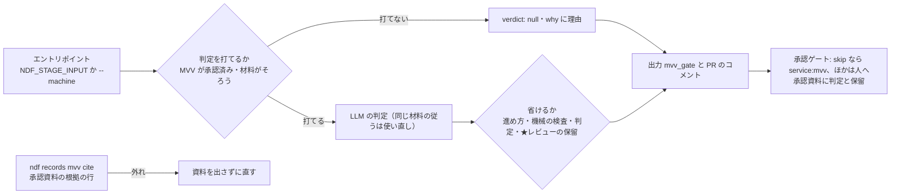
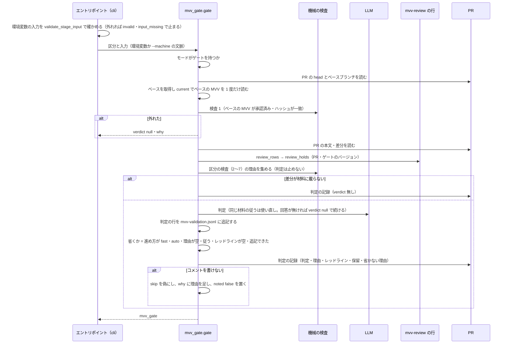
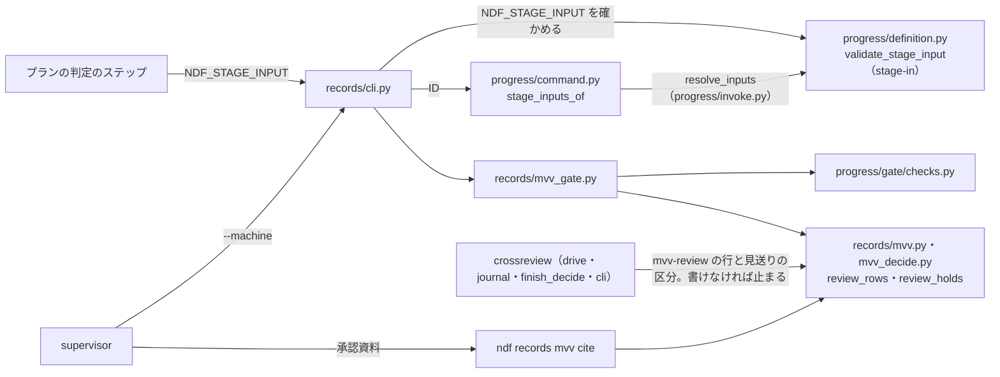

# MVV 判定: 承認ゲートの手前で進め方によらず判定し、人が判定とレビューの保留と確かめた根拠を読める（#3959 #4055）

進め方 `normal` では承認ゲートの手前で MVV 判定を打たず、承認資料の根拠の行は自己申告のままで、`fast`・`auto` ではレッドラインの指摘が残った PR も省かれうる。判定を打つ条件（MVV が承認済みで材料がそろう）と承認ゲートを省く条件（機械の検査・判定・レビューの記録）を分け、どの進め方でも判定を打つ。承認資料の根拠の行の誤りは、#4076 が作った確かめの関数（ndf 11.0.31 から main にある）で、資料を出す前に止める。プランの外でもステートマシンの ID で同じ判定を打てるようにする（#4055）。工程の入力のコントラクト（`stage-in`）はプランが渡す形に直し、形の違う入力では判定を打たずに止める。即時修正の判定（#4104）とリリースの保留の範囲（#4105）は別の Issue へ分けた。採らなかった案は「決定の記録」にある。

## 今の姿

何が起きたか・目的・受け入れ条件は要求仕様（[issue-3959-requirements.md](./issue-3959-requirements.md)、正は #3959 の本文）にある。この文書は「どう解くか」と「なぜその解き方か」だけを書く。#4055 の要求は #3959 の受け入れ条件 8 にまとめ、#4055 の要求仕様のコピーは作らない。まとめた理由は決定 6 にある。2 つの共通の原因は 1 か所にある。`ndf records mvv gate` のエントリポイントと判定を打つ条件が、どちらもプランの `fast`・`auto` の承認ゲートだけを前提にしている。



★ が変わる位置である。設計に要る今の構造:

| 部品 | 今の振る舞い | 場所 |
| --- | --- | --- |
| 判定のエントリポイント | `--gate design\|release` だけを受け、工程の入力は `NDF_STAGE_INPUT` からだけ読む。無ければ `invalid` | `plugins/ndf/src/ndf/domains/records/cli.py` の `_mvv_gate` |
| 判定を打つ条件 | モードがその承認ゲートを持ち、進め方が `MVV_PACES`（`fast`・`auto`）で、機械の検査 6 つ（`refusals`）を通り、PR の差分の全体が材料に載るときだけ LLM を呼ぶ | `records/mvv_gate.py` の `gate`・`_judged` |
| 省く判定 | 機械の検査・判定の形・「従う」・レッドラインが空 | `progress/gate/checks.py` の `may_skip` |
| 判定の記録 | PR を読めた後は、省くときも省かないときも PR のコメントへ書く（`checks.note`） | `mvv_gate._recorded` |
| 出力 | `mvv_gate`: `gate`（`design`・`release`）・`skip`・`verdict`・`why`・`head` | `contracts/workflow/context.schema.json` の `$defs.mvv_gate` |
| 承認資料の「MVV 判定」の欄 | 設計 PR の判定のコメントかリリースの承認資料の末尾から載せる。根拠の行（「目指す姿の根拠」）は設計文書からそのままコピーする | `skills/development-workflow/references/approval-request.md` |
| 工程の入力の形 | コントラクトの `stage-in` と `definition.validate_stage_input` は `{"context": {...}}` を求めるが、本番のコードから呼ばれない。プランが `NDF_STAGE_INPUT` に入れるのは `invoke.resolve_inputs` の平らな object。`ndf records mvv gate` は入力の形を確かめず、`{"context": {...}}` を渡すと `ok` のまま「モード None は承認ゲート design を持たない」を返す（要求仕様の「何が起きたか」） | `contracts/workflow/stage-io.schema.json`・`progress/definition.py`・`progress/invoke.py` |

#4076 の実装（前提 1）は PR #4419 で main に入り、ndf 11.0.31 で出た。この設計が使う部品は次のとおりで、どれも今の main にある。形は #4090・#4099 の設計（PR #4121）が直した後のものである。

```bash
# 2026-11-24 に確かめた。6 件
git grep -n -E 'def (current|of_base|fenced_lines|decision_lines|record_review|citation_errors)\b' origin/main -- plugins/ndf/src/ndf/domains/records
```

| #4076 が作った部品 | 今の振る舞い | 場所 |
| --- | --- | --- |
| MVV のコピー | `current(root, ref, allow_mismatch=False, outside=None) -> Snapshot`。参照の承認済みの MVV のバージョン・sha256・コピーのパス・項目の一覧（`items`）・解決したコミット（`commit`）・共通原則の sha256 を返す。本文が承認の記録と合わなければ `MvvError`。取得済みのベースブランチから読む `of_base` もある。CLI は `ndf records mvv current --base` | `records/mvv.py` |
| 根拠の行の確かめ | `citation_errors`（パス・行の番号・本文・決定の根拠の行か、の 4 要素を受ける）・`fenced_lines`・`decision_lines`（`### 決定 <数>` の見出しの下の行の番号）。純粋な関数。誤りは `kind`（`format` を含む）を持つ | `records/mvv_decide.py`（`citation_errors`）、`records/mvv.py`（`fenced_lines`・`decision_lines`） |
| cross-review の MVV の記録 | `record_review` が `mvv-validation.jsonl` に種類 `mvv-review` の行（`repo`・`pr`・`head`・`key`・`id`・`item`・`outcome`・`mvv_version`・`sha256`・`at`、`deferred` は `reason`、`redline` は `text`）を書き、書いた件数を返す。見送りの理由やレッドラインの指摘本文（自由記述）に含まれる秘密の値や非公開の情報が、記録や承認資料から漏れないようにするため、引数 `clean` は自由記述から伏せるべき値を除く。除く範囲を決めるため、`clean` は記録先のリポジトリと本文が参照するリポジトリの公開範囲を GitHub に照会する。照会に失敗して `clean` が None のときは、自由記述を保存せず、`withheld: true` の行（伏せた行）を書く。承認資料には、本文の代わりに記録の本文を確かめられない旨の文（`WITHHELD`）を載せる。伏せた行は保留を外す材料にならず、決定 11 の規則で保留になる。書けなければ例外を投げ、呼び出し元の `crossreview/drive.py` の `_record_mvv` が注意（`RECORDS_UNWRITTEN`）に留めて収束を続ける。この Issue は決定 2 で、必須の行を書けなければ止める形に変える | `records/mvv.py`、`crossreview/drive.py` の `_mvv_results`・`_record_mvv` |
| 共通原則の本文 | `principles()` は `records/mvv.py` にある | `records/mvv.py` |

## 文脈と制約

- **#4076 の実装は main にある。** MVV のコピー・根拠の行の確かめ・`mvv-review` の行はどれも #4076 が作った。同じ確かめを 2 か所に作らない（#4076 の設計の「#3959」の項）
- **`fast`・`auto` でレッドラインの指摘が残っても設計承認ゲートが省かれうる危険は、ndf 11.0.31 から利用者の手元にある。**
  - #4076 の設計は、この危険をこの Issue が直すまで残した（#4076 の決定 5 の代償。#4077 の cross-review の指摘 r9-1）。#4076 の実装は、この Issue の実装より先に 11.0.31 で出た
  - 11.0.31 の cross-review は、レッドラインの指摘を修正担当へ渡さずに記録へ残す。承認ゲートの判定（`mvv_gate.py`・`progress/gate/checks.py`）は、その記録を読まない
  - 根拠: 次の検索は、判定の指示文の 1 行だけを返す（2026-11-24 に確かめた）

    ```bash
    grep -n -i -E 'review|redline' plugins/ndf/src/ndf/domains/records/mvv_gate.py plugins/ndf/src/ndf/progress/gate/checks.py
    ```
- **承認ゲートを省いてよいのは今どおり `fast`・`auto` だけである**（利用者の方針、2026-11-21）。この Issue は省く範囲を広げない
- **このリポジトリはテストを CI に寄せる**（`.ndf/project.json` の `test.ci.only` が真）。LLM の判定の中身に依る受け入れ条件は CI で確かめない
- **supervisor が手で回すフェーズ**（プランのテンプレートが無いとき。#3908）でも、設計の工程の出力は `mvv_gate` を持つ（`ndf progress show` の `outputs`）
- **#4090・#4099 の設計の決定 16 が、#3959 と重なる 5 点の形を決めた。** #3959 の文書はその表の「#3959 の実装がすること」に合わせる（決定 11）
- **後の設計（#4104・#4105・#4106）は、この Issue の実装が main へ入った後に実装する。** #4105 は `MVV_SKIP_GATES` に `release` を足し、`--machine` の入力にリリースの入力（`lane.release_inputs`）を足す。この Issue はその余地を残すだけで、先に作らない

## 解き方の全体像



- `ndf records mvv gate` は、承認済みの MVV があり PR の材料がそろえば、進め方と機械の検査によらず LLM の判定を打つ。進め方・機械の検査・判定・レビューの保留は「省くか」だけを決め、`normal` は常に省かない。リリース承認ゲートは #4105 まで省かない
- 判定の記録（判定・理由・レッドライン・レビューの保留・省かない理由）は PR のコメントに載る。承認資料の「MVV 判定」の欄は、PR のコメントでなく今回の判定の出力（`outputs.mvv_gate`）を載せる（今回のコメントが無い終わり方でも、前回の判定を人へ渡さない）
- `service:mvv` の承認（省いた回答）の照合は今のまま head だけである。判定した PR・宛先・宛先の先端と消費の時点で照合する仕組みは #4106 が持つ（決定 9）。リリース承認ゲートは #4105 まで、ゲートの側でも省かない（決定 3）
- 設計承認ゲートは、設計 PR の cross-review の記録に次のどちらかがあれば省かない
  - 直っていないレッドラインの指摘
  - 利用者の判断が要る今のバージョンの未解消の見送り（見送りの区分が `needs_user`）
- 範囲外を起票した見送り（`filed`）と、基準に当たらない・意図どおりの見送り（`not_applicable`）は保留にしない。cross-review はその記録を書けなければ収束にせず止まる
- 工程の入力の規則は、コントラクトの `stage-in` と `definition.validate_stage_input` の 1 つになる。プランが組む入力と、`ndf records mvv gate` が `NDF_STAGE_INPUT` から読む入力の両方を、それで確かめる。形が違えば判定を打たずに `invalid`・`input_missing` で止まる
- 承認資料を出す担当は、出す前に `ndf records mvv cite --base <ブランチ> <資料>` を打ち、バージョンと番号の誤りがあれば直す
- 判定の入力の出所は、工程の進め方で決まる。プランの判定のステップ（`design-mvv`・`release-mvv`）は今どおり `NDF_STAGE_INPUT` を渡し、`--machine` は打たない。プランを使わずに工程を進める担当（supervisor）は、進行中の工程と文脈を記録したステートマシンの ID を `--machine` に渡す。設計承認ゲートは出力をそのまま設計の工程の出力と承認資料へ載せ、手動のリリース承認ゲートは承認資料へ載せる

## 構成要素

| 要素 | 責務 |
| --- | --- |
| 判定のエントリポイント（`records/cli.py`） | 工程の入力を `NDF_STAGE_INPUT` か `--machine` のどちらか 1 つから得る。`NDF_STAGE_INPUT` は `validate_stage_input` で確かめる。`cite` のサブコマンドを足す |
| 判定の本体（`records/mvv_gate.py`） | 判定を打つ条件と省く条件を分ける。MVV とレッドラインのパスを PR のベースから読む。設計 PR のレビューの記録を読んで保留を事実に入れる |
| 機械の検査（`progress/gate/checks.py`） | 省かない理由の検査に `check_review_holds` を足す。判定の記録（`note`）に保留を載せる |
| レビューの記録の読み手（`records/mvv.py`・`mvv_decide.py`） | `mvv-review` の行を読み（`review_rows`）、PR ごとの保留を決める（`review_holds`）。#4076 から移した規則を、直っていないレッドラインと利用者の判断が要る見送りに絞った形 |
| 見送りの区分（`crossreview/drive.py`・`journal.py`・`contracts/data/review-criteria.json`・`records/mvv.py`） | 修正担当が見送るときに区分 `defer`（`needs_user`・`filed`・`not_applicable`）を書き、ジャーナルが理由とともに持ち、`record_review` が `mvv-review` の `deferred` の行に書く |
| cross-review の終わり方（`crossreview/drive.py`・`finish_decide.py`・`cli.py`） | 承認ゲートの判定に要る記録を書けなければ `mvv_record_failed` で止まる。#4076 から移した規則 |
| 工程の入力のコントラクト（`stage-io.schema.json`・`progress/definition.py`・`progress/invoke.py`） | `stage-in` をプランが渡す平らな形にし、`validate_stage_input` をその形で確かめる。`resolve_inputs` と判定のエントリポイントが同じ関数で確かめる |
| ステートマシンの文脈の読み手（`progress/command.py`） | ID から、判定のステップを持つ工程の入力をプランと同じ規則で組む |
| リリース承認ゲートの省略の止め（`progress/model.py`） | 省いてよい承認ゲートの区分（`MVV_SKIP_GATES`）を設計承認ゲートだけにし、判定の出力によらずリリース承認ゲートを省かない（#4105 まで） |
| 手順書（`pace.md`・`approval-request.md`・`agent-layers.md`・`project-mvv.md`） | 進め方によらず判定すること、承認資料が今回の判定の出力から保留と判定を載せること、根拠の行の確かめ、supervisor が設計承認ゲートと手動のリリース承認ゲートの前に `--machine` で打つ手順 |

## 入出力のコントラクト

### `ndf records mvv gate`

| 引数 | 内容 |
| --- | --- |
| `--gate design\|release` | 承認ゲートの区分（今のまま。即時修正の区分は #4104） |
| `--machine <ID>`（新設） | ステートマシンの ID。`design`・`release` で、`NDF_STAGE_INPUT` が無いときに使う。両方あれば `invalid`（どちらの入力か決めない）。ID のステートマシンが無いか、このリポジトリのものでないか、モードが判定のステップを持たないときは、判定を打たず PR へも書かずに `stopped`・`cause.kind: refused` を返す（呼び手はステートマシンを作るか ID を直す） |
| 環境変数 `NDF_STAGE_INPUT` | 今のまま受ける。判定の前に、判定のステップを持つ工程の定義で `validate_stage_input` を当てる。スキーマに合わなければ `stopped`・`invalid`、工程の入力のキーが足りなければ `stopped`・`input_missing` で、判定を打たない（受け入れ条件 9） |

| 区分 | 判定する PR | 当てる機械の検査（省かない・進めない理由） | 結果 |
| --- | --- | --- | --- |
| `design` | 文脈の `worktree`（無ければ作業場所）のブランチの開いた PR（`NDF_STAGE_INPUT` と `--machine` のどちらでも同じ） | 1〜6 と 7（レビューの保留） | `ok`・`outputs.mvv_gate`（今の形。`skip` は進め方が `fast`・`auto` で理由が空のときだけ真） |
| `release` | 文脈の `pr`（今のまま） | 1〜6（保留は #4105 まで読まない） | `ok`・`outputs.mvv_gate`。#4105 まで `skip` は常に偽（決定 3） |

MVV の事実（検査 1・判定の材料・保留のバージョン）は、判定する PR のベースブランチを取得して `current` で 1 度だけ読んだ MVV から作る（要求仕様の前提 3）。レッドラインのパス（`.ndf/pace.json` の `boundary_paths`）も同じベースのコミットから読む。作業ツリーの `.ndf/mvv.json`・`.ndf/pace.json` は読まない（PR が規則を緩めても、今回の変更には元の規則が効く）。PR が MVV の設定を消しても変えても、ベースが承認済みなら判定を打ち、検査 5 が外れる。

機械の検査は今の `pace.md` の 1〜6 に 7 を足したものである。

| 番号 | 検査 | 外れたとき |
| --- | --- | --- |
| 1 | PR のベースのプロジェクト MVV が承認済みで、本文の sha256 が承認の記録と一致する | 判定を打たない（判定の前提） |
| 2 | スプリントの文脈の `mvv_ref` が承認の記録と一致する | 判定は打ち、省かない |
| 3 | モードが `operation` でも `documentation` でもない | 同上 |
| 4 | PR の変えたファイルが `.ndf/pace.json` の `boundary_paths` に当たらない | 同上 |
| 5 | PR が `.ndf/mvv.md`・`.ndf/mvv.json` を変えない（共通原則の C7） | 同上 |
| 6 | 出し直しの指摘への対応表が「記載した」と書く PR 本文のセクションに中身がある | 同上 |
| 7（新設） | 対象の PR について `review_holds` が保留を 1 件も返さず、記録 `mvv-validation.jsonl` を読める。保留の規則の正本は `review_holds`（決定 2・決定 11、詳細設計の `review_holds` の行）で、直っていないレッドライン、利用者の判断が要る今のバージョンの未解消の見送り（区分が `needs_user`・区分が無い・知らない値）、今のバージョンの伏せた行（`withheld: true`）で終わるキー、読めない行を含む | 同上 |

`mvv_gate` の形は、今のキー（`gate`・`skip`・`verdict`・`why`・`head`）に次の 2 つを足したものである。

| 足すキー | 内容 |
| --- | --- |
| `holds` | 保留。常にキーを置く。記録を読んで保留が無ければ空の配列 `[]`、保留があれば保留の配列、記録を読む段階で失敗したら読めない理由を含む配列になる。保留を読む前に終わったときとリリース承認ゲートでは `null` になる（下の表）。承認資料は `[]` を「無し」、`null` を「未確認」と分けて載せる |
| `noted`（任意） | 今回の判定を PR のコメントに書かなかった・書けなかったことを示す。値は `false` だけを使う。検査 1 が外れてコメントを書かない分岐と、コメントの投稿に失敗した分岐で `noted: false` を置き、コメントを書けたときはキーを省く。差分を読む間に PR が動いた分岐などもコメントを書かないがキーを置かないので、キーが無いことだけでは記録の成否を決めない（コメントの有無は下の表）。承認資料は `noted: false` のとき「今回は PR に判定のコメントを載せていない。PR に既存の判定のコメントがあっても、今回の結果はここで確かめる」を添える。前回の判定が PR にあるとは書かない（承認済みの MVV が無いリポジトリでは、初回から一度もコメントを書かない）。書かなかった理由（検査 1 が外れた・投稿に失敗した）は `why` で伝える |

判定した PR の番号・宛先を出力に足し、`service:mvv` の承認を消費の時点で今の PR と照合する仕組みは #4106 が足す（決定 9）。

`verdict` が null になる終わり方と、そのときの `holds` と PR のコメントは次の表のとおりで、これ以外では `verdict` を持つ。表は詳細設計（[issue-3959-4055-design-detail.md](./issue-3959-4055-design-detail.md)）の「異常系の処理」の分岐表を要約したもので、食い違えば詳細設計に従う。

| 終わり方 | `verdict` | `holds` | PR のコメント |
| --- | --- | --- | --- |
| モードがその承認ゲートを持たない | null | `null` | 書かない |
| 開いた PR が無い・PR を読めない | null | `null` | 書かない（`head` も無い） |
| ベースの MVV やレッドラインの設定を読めない | null | `null` | 書く |
| 検査 1 が外れる（MVV が承認済みでない・本文のハッシュが承認の記録と合わない） | null | `null` | 書かない（`noted: false`。承認済みの MVV が無いリポジトリで今と同じにする） |
| 差分を読めない | null | `null` | 書く |
| 差分を読む間に head か宛先が動いた・差分の後に PR を読み直せない | null | `null` | 書かない（材料が今の PR に属さないので、古い head の判定を投稿しない） |
| 差分の全体が材料に載らない | null | 読んだ結果 | 書く |
| LLM が回答しない | null | 読んだ結果 | 書く |
| 記録 `mvv-validation.jsonl` を読めない | 判定のまま | 読めない理由を含む配列 | 書く |
| リリース承認ゲート（#4105 まで） | 判定のまま | `null` | 書く |

`normal` で LLM の判定まで済んだとき（`verdict` を持つとき）は、`why` の先頭に「進め方 normal は承認ゲートを MVV 判定で省かない」が入る。この理由は、省くかを決める段階（詳細設計の `_judged` の手順 (8)）で足すので、上の表で `verdict` が null の終わり方には入らない。その終わり方でも、判定しなかった理由は `why` に必ず載り、`skip` は進め方によらず偽になる。PR のコメントに載るのは、上の表で「書く」の終わり方だけである。承認資料の「MVV 判定」の欄は、今回の出力から「判定できない: <理由>」と保留を載せる。

### `ndf records mvv cite --base <ブランチ> <ファイル>...`（新設）

| 項目 | 内容 |
| --- | --- |
| 入力 | `--base`（必須）。`current` と同じくベースブランチを取得して承認済みの MVV のコピーを得る。ファイルは 1 つ以上（承認資料など） |
| 確かめ | ファイルの全体の行からフェンスの内側を除き（`fenced_lines`）、行ごとに決定の根拠の行か（`decision_lines`）を添えて、`citation_errors` に `{承認済みのバージョン: 項目の一覧}` を渡す（cross-review の `_citations` と同じ関数・同じ規則）。全体を読むのは、承認資料がゲートごとに新しく書かれる文書だからである |
| 出力（誤り無し） | `ok`、`items` は空、`summary` は「根拠の行の確かめ: 誤り無し（MVV バージョン <バージョン>）」。承認資料の「MVV 判定」の欄にこの 1 行を載せる |
| 出力（誤りあり） | `stopped`・`cause.kind: refused`（終了コード 1）、`items` に誤り（`path`・`line`・`cited`・`version`・`unknown`）、`summary` に件数と最初の誤り。`path`・`cited`・`unknown` は承認資料から取った自由記述なので、秘密の値や非公開のリポジトリ名を含みうる。この 3 つの欄は、cross-review と同じ伏せる処理（公開範囲の照会と秘密の除去）に通した後の値だけを `items`・`summary` に載せ、未処理の値は出力・要約・警告のどこにも載せない。`path`・`cited` は文字列、`unknown` は文字列の配列（`citation_errors` の型）である。伏せる処理には `unknown` の要素を 1 つずつ文字列として渡し、伏せた後の値を元の順の配列に戻す。照会に失敗したら `path`・`cited` を `WITHHELD` の文にし、`unknown` は要素ごとに `WITHHELD` の文にした同じ長さの配列にする（型を変えない）。終わり方は `refused` のまま注意を足す。処理の詳細は詳細設計の `_mvv_cite` の「伏せ方」にある |
| 承認済みの MVV が無い（`absent`・`unapproved`） | `ok`、`summary` に「MVV が承認されていないので確かめない」。根拠の行を書かない形（`decisions.md` の「MVV なし」）が正しいため |
| 失敗 | ファイルを読めない・`current` の `MvvError`（参照を解決できない・設定が壊れている・ベースの本文が承認の記録と合わない `mismatch`）は `stopped`・`precondition`。`mismatch` は `current` が先に投げるので、`cite` は分岐を持たない。確かめるバージョンを決められないまま `ok` にしない |

### cross-review の結果（#4076 から移した変更）

`ndf cross-review run` は、`record_review` が `redline`・`deferred` の行を書けなかったら、終わり方を `STOPPED`・`cause.kind: mvv_record_failed` にする。書けなかった場合には、追記の失敗だけでなく、ロックの取得と既存の行の読み取りの失敗を含む。`fixed`・`unresolved` の行だけが書けなかったときは今どおり注意に留める。

## 処理の流れ



エントリポイントと、判定の外の構成要素の流れ:



## 決定の記録

### 決定 1: どの進め方でも人へ判定を渡すため、判定を打つ条件と承認ゲートを省く条件を分ける

- **質問**: `normal` でも判定を打つとき、今の順（進め方 → 機械の検査 → 判定）のどこを変えるか
- **選んだ案**: 判定を打つ前提を「MVV が承認済みで今の本文のハッシュが承認の記録と一致する（検査 1）・PR を読める・差分の全体が材料に載る」の 3 つだけにする。進め方と検査 2〜7 は判定の後に「省くか」だけを決め、外れた理由は `why` と PR のコメントに載る。`skip` が真になるのは、進め方が `fast`・`auto` で、検査 2〜7 の理由が無く、判定が「従う」でレッドラインが空のときだけである（今の `may_skip` と同じ条件に検査 7 を足したもの）。この条件は、結果を返す時点で判定の記録が 2 つとも残っていることも求める。判定の行を手元の記録 `mvv-validation.jsonl` に追記できなかったときと、PR のコメントを書けなかったときは、判定を出力に残したまま `skip` を偽にし、書けなかった理由を `why` に足す（判定の根拠を後から確かめられない承認ゲートを自動で通さないため）
- 採らなかった案: 進め方の条件（`pace.md` の順 2）だけを外し、機械の検査が外れたら今どおり判定しない（`fast`・`auto` でも、人が最も確かめたい PR で判定が抜ける。レッドラインのパスに当たる PR・MVV の設定を変える PR がそれに当たる。利用者の「MVV 判定は常に実施」に合わない）
- 採らなかった案: `normal` 用に助言だけの別のコマンドを足す（判定の材料・記録・PR のコメントの書き方が 2 つになり、同じ材料の判定を使い直す記録も分かれる）
- **代償**: `fast`・`auto` で機械の検査が外れた PR にも LLM の 1 回の費用がかかる。同じ材料の「従う」の使い直しは今のまま効くが、「従わない」「判定できない」は打ち直しのたびに呼ぶ
- 根拠: Value 1 / Value 13 / Value 14（MVV バージョン 11）

### 決定 2: レッドラインの指摘が残る PR を人が見るため、承認ゲートの省略の条件に cross-review の記録を足す

- **質問**: #4076 から移した「レビューの記録を読んで省かない」仕組みを、どの形で承認ゲートと承認資料に入れるか
- **選んだ案**: #4076 の詳細設計で決まった規則（#3959 の本文の「#4076 の設計から移した仕組み」）を、2026-11-23 の設計承認ゲートで利用者が絞った形で採る。伏せた行を保留にする 3 つ目の規則は、後の #4090・#4099 の設計が足したもので、決定 11 で入れる
  - `review_rows` が、`mvv-validation.jsonl` の `mvv-review` の行と、読めなかった行の数を返す
  - `review_holds` は対象の PR ごとに、次のキーを保留として返す
    - 直っていないレッドライン: 最後の `redline` の行より後に、同じキーの `fixed` が無いキー
    - 利用者の判断が要る見送り: 今のバージョンの `deferred` のうち、見送りの区分 `defer` が `needs_user` か区分が無く、後に同じキーで同じ組の `fixed` が無いキー。今のバージョンとは、（`mvv_version`, `sha256`）の組がゲートの使う MVV と一致することである
  - 番号が同じでも `sha256` が違う行は、今のバージョンの行として数えず、`deferred` の保留の解除にも使わない。組の一致を求めるのは `deferred` の保留と伏せた行の保留だけである。レッドラインの保留は、MVV のバージョンや `sha256` を問わず、後の同じキーの `fixed` で外す
  - 区分が `filed`・`not_applicable` の見送りは保留にしない。区分は修正担当が見送るときに書き、cross-review のジャーナルが理由とともに持ち、`record_review` が行に書く
  - head で行を選ばない
  - 保留は検査 7 として `refusals` に入る。承認資料の「MVV 判定」の欄と PR のコメントにも同じ結果が載る
  - 記録を読めないときと、読めない行があるときも保留にする
  - cross-review は `redline`・`deferred` の行を書けなければ `mvv_record_failed` で止まる
- 採らなかった案: 承認資料に載せるだけで、`fast`・`auto` の省略の条件には足さない（人が資料を読まない `service:mvv` の承認で、レッドラインの指摘が残る PR が通る。#4076 の cross-review の指摘 r1-5 が critical とした危険が残る）
- 採らなかった案: 判定の LLM の材料に cross-review の記録を足し、LLM に省くかを決めさせる（同じ記録でも判定が揺れる。記録を読めないときに省かない側へ倒す決まりも、LLM に任せることになる）
- 採らなかった案: #4076 から移したままの規則にする。`redline` の行が 1 行でもあるキーを外さず、今のバージョンの `deferred` をすべて保留にする規則である（直した後もレッドラインがずっと保留になる。cross-review はほとんどの PR で何かを見送るので、事実上どの PR も承認ゲートを省けない。2026-11-23 の設計承認ゲートで利用者が差し戻し、保留を絞ると決めた）
- 採らなかった案: 見送りの理由の自由記述を読んで、利用者の判断が要るかを決める（同じ理由でも書き方で判定が揺れる。区分を修正担当が見送るときに 1 つ選ぶ形なら、機械で数えられる）
- 採らなかった案: 人がゲートで承認したら記録の保留を外す行を書く。#4076 の設計 PR の cross-review（ https://github.com/devbasex/ai-plugins/pull/4077#issuecomment-7075168516 の r8-3・r8-8）が、この規則の穴を 2 つ挙げた。1 つは、`review_holds` の入力（記録の行・対象の PR・MVV の識別子）では、どの指摘が人に承認されたかを見分けられないこと。もう 1 つは、承認を表す行の形、それを書く処理、読む処理がどれも無く、どのゲートの承認をどの PR・head・指摘に当てるかも決まっていないことである。これらを足すと記録の形と書き手が増えるので、余分な人の承認を許す側を選ぶ
- **代償**: 修正担当が区分を誤ると（利用者の判断が要る見送りを `filed`・`not_applicable` にすると）、その見送りは保留にならずにゲートを省けてしまう。区分の誤りは、承認資料と PR のコメントに載る見送りの区分と理由で後から分かる。ただし省いた後では止められない。直っていないレッドラインは、同じ PR を対象にするゲートで毎回人へ問う（リリース承認ゲートは #4105 まで保留を読まないが、省かないので人が答える）。区分の無い見送りと、壊れた記録は、直すまで `fast`・`auto` でも人へ問う
- 根拠: Value 1 / Value 13（MVV バージョン 11）

### 決定 3: レッドラインが残る変更を自動で通さないため、リリース承認ゲートは保留を読む範囲が決まるまで `fast`・`auto` でも省かない

- **質問**: リリース承認ゲートで保留を読む PR の範囲（リリースに含まれる単位の PR）を #4105 へ分けた間、リリース承認ゲートの省略をどう扱うか
- **選んだ案**: #4105 が実装されるまで、リリース承認ゲートは進め方によらず MVV 判定で省かない
  - 判定は打ち、判定の記録は PR のコメントと承認資料に載る
  - `why` に「リリース承認ゲートは、保留を読む PR の範囲が決まるまで（#4105）MVV 判定で省かない」を入れ、保留は読まない（`review_prs` は空）
  - 判定の出力だけに頼らず、ゲートの側にも置く。省いてよい区分の表 `MVV_SKIP_GATES` を `design` だけにし、`mvv_skip` はほかの区分を省かない。#4105 は表に `release` を足す
  - 古いバージョンの NDF が書いた状態から、実行中のスプリントを再開する場合は扱わない。その状態とは、更新の前に済ませた判定の `skip: true` と、まだ読まれていない `service:mvv` の回答である。実装の PR の `## 移行の手順` に「更新の前にリリース承認ゲートまで進んでいたスプリントは `ndf progress cancel` してから作り直す」を書く
  - 回答を判定の対象と消費の時点で照合する仕組みは #4106 が持つ
  - 設計承認ゲートの保留は、対象が設計 PR の 1 件で決まるので、この Issue で読む
- 採らなかった案: 判定の出力だけで止め、ゲートの側は変えない（新しいバージョンの判定でも、出力を読む側が区分を見ないと、判定の手違い 1 つでリリース承認ゲートが省かれる。#4093 の指摘 r4-3）
- 採らなかった案: 古いバージョンの状態から再開する実行も扱う。`progress` の回答の読み口へ、次の変更が広がる（#4093 の cross-review の 7・8 ラウンドで指摘が続いた。r7-1・r7-3 → r8-1〜r8-4。利用者の方針「普及フェーズに入るまで後方互換は不要」（2026-11-16）と突き合わせ、2026-11-22 に conductor が扱わないと決めた）
  - 古いバージョンの未消費の回答を、消費の経路と承認済みの head の読み口の両方で採らない
  - 消費済みの回答を有効とみなす
  - accepted ファイルを回答に結び付ける
- 採らなかった案: リリースの PR 自体（文脈の `pr`）の保留だけを読み、省く条件に使う（単位の PR が、バージョンを上げる PR の差分に現れない戦略がある。`trunk` の `release_pr` がそれに当たり、単位の PR に残るレッドラインを読まずに省く。#4076 の cross-review の指摘 r9-1 と #4093 の指摘 r1-3 の危険を開ける）
- 採らなかった案: 範囲の決め方を #3959 に残したまま収束させる（#4093 の cross-review の 3 ラウンドで、範囲の決め方への指摘が毎ラウンド続いた。指摘は CHANGELOG の集め方や組み立てのコミットの記録へ広がった。conductor が 2026-11-22 に範囲を分けると決めた）
- **代償**: `fast`・`auto` でもリリース承認ゲートは毎回人が答える。リリースの自動化は #4105 まで止まる。更新の時点でリリース承認ゲートまで進んでいた実行中のスプリントは、利用者が作り直す。作り直さずに再開すると、古いバージョンが書いた `service:mvv` の回答でリリース承認ゲートを通りうる。r9-1 の危険（レッドラインの指摘が残る変更が自動で省かれる）は、作り直したスプリントでは開かない
- 根拠: Value 1 / Value 7 / Value 6（MVV バージョン 11）

### 決定 4: 承認資料の根拠の行を出す前に止めるため、#4076 の確かめの関数をファイルに当てるコマンド `ndf records mvv cite` を足す

- **質問**: PR の外にある承認資料の根拠の行のバージョンと番号を、どこで確かめて止めるか
- **選んだ案**: `ndf records mvv cite --base <ブランチ> <ファイル>...` を足す。#4076 の `current`（コピーと項目の一覧）と `citation_errors`・`fenced_lines` をそのまま使う。承認資料は毎回新しく書く文書なので、差分でなくファイルの全体を確かめる。`approval-request.md` に「承認資料を渡す前にこのコマンドを打ち、誤りがあれば直してから渡す」を置く。同じ規則を `agent-layers.md` の supervisor の規則（承認ゲートを返す前）にも置く。PR の差分の根拠の行（設計文書）は #4076 の cross-review が確かめるので、ここでは重ねない
- 採らなかった案: `ndf records mvv gate` が PR の差分の根拠の行も確かめる（#4076 の cross-review と同じ確かめが 2 か所になる。ゲートは差分の全体を API の patch で読むので、フェンスの内外を決める本文も別に要る）
- 採らなかった案: hook で承認資料の書き込みを監視する（承認資料の保存先は呼び手が決め、プランの資料は NDF が書く。書き込みのパスで資料を見分けられない）
- 採らなかった案: 承認資料は設計文書からコピーするだけなので確かめない（コピー元の設計文書が #4076 の後に正しくても、手で組む資料には、バージョンを書き換えた行が入りうる。確定仕様化と測り直しの #3412 の承認資料の誤りは、資料の側にあった）
- **代償**: 承認資料を出す担当が打つことに頼る。打たずに出した資料は止まらないが、確かめた結果の 1 行が欄に無いので、承認する人は確かめていない資料だと分かる（プランが書く資料は根拠の行を持たないので当たらない）
- 根拠: Value 11 / Value 13 / Value 3（MVV バージョン 11）

### 決定 5: プランの外でも同じ入力で判定するため、`ndf records mvv gate` にステートマシンの ID のエントリポイントを足す

- **質問**: プランの外（supervisor が回すフェーズ）で、判定の入力をどう渡すか（#4055）
- **選んだ案**: `--machine <ID>` を足す
  - ステートマシンの文脈（`machine_context`。作成の時点の値に、記録された出力を重ねたもの）から、判定のステップ（`design-mvv`・`release-mvv`）を持つ工程の入力を組む。組み方はプランと同じ `resolve_inputs` で、文脈のほかのキー（`design_pr` など）は足さない
  - 設計承認ゲートが判定する PR は、どちらのエントリポイントでも、入力の `worktree` のブランチの開いた PR である。プランの経路の入力に `design_pr` は無いので、片方だけが読むと、同じ文脈で別の PR を判定しうる
  - `NDF_STAGE_INPUT` と `--machine` が両方あれば `invalid` で止める
  - `agent-layers.md` の supervisor の規則に、次の 2 つを足す
    - 「設計承認ゲートを返す前に `--machine` で打ち、出力の `mvv_gate` を設計の工程の出力と承認資料へ載せる」
    - 「手動の経路でリリース承認ゲートを返す前に `--gate release --machine` で打ち、出力を承認資料へ載せる（打てなければ判定できない理由を載せて人へ問う）」
- 採らなかった案: `--pace`・`--mode`・`--pr` などの引数で入力を渡す（文脈の値と引数の値の 2 つの出所ができ、手で打つ値がスプリントの値と食い違っても止まらない。進め方を手で `fast` と書けば省く判定まで出る）
- 採らなかった案: 今どおり `NDF_STAGE_INPUT` を手で組む手順を書く（#3995 で組んだ JSON は `mvv_ref` を欠き、検査 2 が常に外れる。組み方を人と AI が覚えるエントリポイントが増える）
- **代償**: ステートマシンを作っていないフェーズでは打てない（そのときは判定の入力が無いのと同じで、今どおり `invalid`）
- 根拠: Value 15 / Value 3（MVV バージョン 11）

### 決定 6: 同じエントリポイントを 1 回で直すため、#4055 を #3959 にまとめる

- **質問**: #4055（プランの外で判定を打てない）を別の設計・実装にするか、#3959 にまとめるか
- **選んだ案**: まとめる。#3959 は `normal` でも判定を打つので、supervisor が回すフェーズ（プランのテンプレートが無い工程。進め方を問わない）で判定を打つ場面が今より増える。#4055 のエントリポイントが無いと、#3959 の受け入れ条件 1・3 を supervisor のフェーズで満たせない。どちらも `records/cli.py` の `_mvv_gate` と `mvv_gate.gate` の入力の扱いを変える。#4055 は実装の PR で #3959 と一緒にクローズする
- 採らなかった案: #4055 を別の設計にする（同じ 2 つの関数を 2 つの PR で順に変え、片方の PR の間は `normal` の判定を supervisor のフェーズで打てない）
- **代償**: #3959 の実装の PR が大きくなる（エントリポイントの変更は `cli.py` と `command.py` の数十行）
- 根拠: Value 11 / Value 5（MVV バージョン 11）

### 決定 7: `fast`・`auto` でレッドラインが残る PR が省かれる期間を短くするため、この Issue の実装をほかの課題を待たずに正式版の PATCH で出す

- **質問**: この Issue の実装をどの時点で出すか。#4076 の実装（レッドラインの指摘を修正担当へ渡さず記録に残す）は、この Issue の実装（承認ゲートがその記録を読む）より先に ndf 11.0.31 で出た。11.0.31 からは、cross-review がレッドラインの指摘を修正担当へ渡さずに収束する。`fast`・`auto` の設計承認ゲートは、その記録を読まずに省きうる（#4077 の cross-review の指摘 r9-1）
- **選んだ案**: この Issue の実装の PR が main へ入ったら、ほかの課題のマージを待たずに、安定版の直しとして正式版の PATCH を出す。根拠は AGENTS.md の「版とリリースの方針」の「安定版の直しは正式版の PATCH として早く出してよい」である。実装の PR は今の main（11.0.31 の後）から切る
- 採らなかった案: この Issue の実装の前に、暫定の直しを別の PATCH で出す。`fast`・`auto` の設計承認ゲートを MVV 判定で省かない直しである（`progress/model.py` の `mvv_skip` がどの区分も省かない、数行の直しで済む。しかしこの Issue の実装が同じ関数を、省いてよい区分の表 `MVV_SKIP_GATES` で設計承認ゲートだけを省く形へ書き直す。一度作って消す変更になり、同じスプリントでリリースの手順を 2 回通すことになる）
- 採らなかった案: スプリントのほかの課題とまとめて次のバージョンで出す（ほかの課題が終わるまで r9-1 の危険が利用者の手元に残る）
- **代償**: この Issue の実装が main へ入るまで、11.0.31 を使う `fast`・`auto` のプロジェクトでは、レッドラインの指摘が残る設計 PR も設計承認ゲートが省かれうる。その間も、cross-review の PR のコメントと結果の JSON に「人の承認を待つ」が残る。PR のコメントを読めば分かる（11.0.31 の CHANGELOG の「承認の資料へはまだ自動で載らないので、Pull Request のコメントで確かめる」）
- 根拠: Value 1 / Value 7（MVV バージョン 11）

### 決定 8: 収束しない仕組みを別の設計で詰めるため、即時修正の判定とリリースの保留の範囲を #4104・#4105 へ分ける

- **質問**: #4093 の cross-review の 3 ラウンドで指摘が続いた 2 つの仕組みを、この Issue に残すか分けるか
- **選んだ案**: 分ける。2 つを次の Issue へ移し、指摘と設計の内容をそれぞれの本文へコピーした。リリースの間の扱いは決定 3
  - #4104: 即時修正のマージの前の判定（判定した PR・宛先・head を CI からマージまで紐付ける。指摘 r1-2・r2-3・r2-8・r3-2・r3-3・r3-4・r3-7）
  - #4105: リリース承認ゲートで保留を読む PR の範囲（指摘 r1-3・r2-5・r2-6・r2-7・r3-1・r3-5）
  - この Issue に残すのは、判定を打つ条件と省く条件の分離・設計承認ゲートの保留・承認資料の保留・`cite`・`--machine`（#4055）・`mvv_record_failed` である
- 採らなかった案: この Issue に残してラウンドを足す（直すたびに、`ndf ci watch`・`ndf ci merge`・GitHub の adapter・リリースの組み立ての記録へ変更が広がる。残す範囲の承認まで遅れる）
- **代償**: 即時修正は #4104 まで MVV 判定を通らずにマージされる（利用者の「即時修正でも必要」は #4104 で満たす）。設計と実装が 3 本に分かれる
- 根拠: Value 5 / Value 9（MVV バージョン 11）

### 決定 9: #3959 の目的と別の既存の隙を別の設計で詰めるため、省いた回答の照合を #4106 へ分け、#3959 の照合は head だけに保つ

- **質問**: 省いた回答（`service:mvv`）を、消費の時点で判定した PR・宛先・宛先の先端・head と照合する仕組みを、この Issue に残すか分けるか
- **選んだ案**: 分ける
  - #4093 の cross-review の 4〜6 ラウンドで、この仕組みへの指摘が毎ラウンド続いた（r4-2 → r5-2・r5-3 → r6-1〜r6-6）
  - 宛先の変更や、判定の後のベースの変化を見落とす隙は、今の `fast`・`auto` にもともとある。#3959 の変更が生んだものでなく、#3959 の目的（`normal` でも判定する・保留・`cite`・`--machine`）と別の仕組みである
  - 指摘と設計の内容を #4106 の本文へコピーし、この Issue の照合は今のまま head だけにする
  - リリース承認ゲートを省かない止め（決定 3）は、区分の条件（`MVV_SKIP_GATES`）で `mvv_skip` が新たに省くかを決めるところだけを、この Issue に残す
  - 回答の読み口（`_running_move` の消費と承認済みの head の取得）は変えない。古いバージョンが書いた未消費の `service:mvv` の回答は、区分の条件で拒まない（古いバージョンの状態から再開する実行は扱わず、移行の手順で作り直す。決定 3）
- 採らなかった案: この Issue に残してラウンドを足す（直すたびに、`ndf progress` のエントリポイントの照合・消費の排他・`ndf answer head`・表示と待機の取得経路へ変更が広がる。残す範囲の承認まで遅れる）
- **代償**: 設計承認ゲートを `fast`・`auto` で省くとき、判定の後に宛先を変える・ベースが進む隙は、#4106 まで今と同じ形で残る。リリース承認ゲートは決定 3 で省かないので当たらない。ただし更新の前に古いバージョンが書いた未消費の回答は拒まないので、決定 3 の代償のとおり、実行中のスプリントは作り直す
- 根拠: Value 5 / Value 9（MVV バージョン 11）

### 決定 10: 形の違う入力で判定が黙って抜けないため、工程の入力の規則をコントラクトの `stage-in` 1 つにし、判定のエントリポイントもそれで確かめる

- **質問**: コントラクトの `stage-in`（`{"context": {...}}`）とプランが渡す平らな object の食い違い（#3687 の設計で見つけた）を、どこで直すか
- **選んだ案**: コントラクトをプランの渡す形に合わせる
  - `stage-in` を文脈のスキーマへの参照（平らな object）にする
  - `definition.validate_stage_input` を、入力の object そのものを確かめる形にする
  - `invoke.resolve_inputs` は、取り出した入力をこの関数で確かめる
  - `ndf records mvv gate` は、`NDF_STAGE_INPUT` を、判定のステップを持つ工程の定義でこの関数に当てる。外れれば判定を打たずに `invalid`・`input_missing` で止まる
  - `--machine` は `resolve_inputs` を通るので同じ規則になる
- 採らなかった案: プランの側を `stage-in` の形（`{"context": {...}}`）に変える（script と Skill のすべての作業の読み方が変わる。`stage-in` の形を読むコードは本番に無く、今動いている形を捨てることになる）
- 採らなかった案: `ndf records mvv gate` が両方の形を受け、`context` があれば中を読む（入力の形が 2 つになり、コントラクトは食い違ったまま残る。ほかの作業は平らな形しか読まない）
- 採らなかった案: `ndf records mvv gate` だけが平らな形を確かめ、コントラクトは別の Issue で直す（同じ規則が `validate_stage_input` と判定のエントリポイントの 2 か所に分かれる。コントラクトは本番で使われないまま残る）
- **代償**: `stage-in` の `base`・`head`（入力の範囲の起点と終点）の説明が消える。どの書き込み元も作らず、本番のどの読み手も読まないので、振る舞いは変わらない。範囲は今どおりステップの `range` が持つ
  - 根拠: Value 13（MVV バージョン 11）。本番のどの読み手も読まないことは、次の検索で確かめた（2026-11-23）。`grep -rn -E 'stage-in|validate_stage_input' plugins/ndf/src` は、工程の定義の参照と関数の定義だけを返し、呼び出しは `tests/progress/test_definition.py` だけである
- 根拠: Value 7 / Value 11 / Value 15（MVV バージョン 11）

### 決定 11: #4076 の直しと食い違わない部品を作るため、#4090・#4099 の決定 16 の 5 点をこの設計に入れる

- **質問**: #4090・#4099 の設計（PR #4121）が決めた、#3959 と重なる 5 点を、いつ #3959 の文書に入れるか。5 点は `Snapshot.commit`・`cite` の `mismatch`・`cite` が使う確かめの関数・`record_review` の契約・`review_holds` の規則である
- **選んだ案**: この設計で入れる
  - `Snapshot.commit` は #4076 の実装が足したので、使うだけにする
  - `cite` は `mismatch` の分岐を持たず、`decision_lines` で 4 要素を作って `citation_errors` を呼ぶ
  - `record_review` は今の引数（`repo`・`pr`・`head`・`snapshot`・`rows`・`clean`）のまま、返り値を `ReviewWrite` に変える。伏せた行の追記の失敗も、その行が必須の行（`redline`・`deferred`）なら `missing` に載せる。必須かは `withheld` によらず `outcome` で決まる。伏せた `fixed`・`unresolved` の追記の失敗は `missing` に載せず、`cause` を返して注意に留める
  - `review_holds` は、`withheld: true` の行で終わるキーも保留する。対象は（`mvv_version`, `sha256`）の組がゲートの使う MVV と一致する行である。承認資料には、伏せた理由の代わりに `WITHHELD` の文を載せる
- 採らなかった案: 決定 16 のとおり実装の PR で読み替える（実装する人が 2 つの設計を突き合わせて読み替えることになり、設計承認ゲートで見ていない形が実装に入る。実装計画のレビューの単位も、読み替えた後の関数で数えられない）
- **代償**: この設計が #4090・#4099 の設計を前提にする。main に入った #4076 の実装（11.0.31）では、`Snapshot.commit`・`decision_lines`・`record_review` の引数が決定 16 の形と一致する（2026-11-24 に `records/mvv.py` で確かめた）。`record_review` の返り値は今は書いた件数で、`ReviewWrite` への変更はこの Issue の実装が行う
- 根拠: Value 11 / Value 14（MVV バージョン 11）

## 影響と危険

- **働く範囲**: 利用先のリポジトリでも働く。判定・保留・根拠の行の確かめが現れるのは承認済みの MVV（状態 `approved`）を持つリポジトリだけで、持たないリポジトリでは承認ゲートの出力の形が今と変わらない
- **プロジェクトごとに違うもの**: MVV の本文とレッドラインのパス（`.ndf/pace.json` の `boundary_paths`）は今どおり設定から読む。新しい設定のキーは足さない
- **当たるモード**: 設計承認ゲート・リリース承認ゲートを持つモード（判定はモードの定義がゲートを持つときだけ）。進め方はすべて
- **今の危険**: `fast`・`auto` でレッドラインの指摘が残る設計 PR が省かれうる危険は、ndf 11.0.31 から開いている（「文脈と制約」）。この Issue の実装の PATCH で閉じる（決定 7）
- **同じファイルを触る別の変更**: #4076 の実装は main に入っており、この Issue の実装は今の main から切る。#3684（ https://github.com/devbasex/ai-plugins/issues/3684 、開いている）が `plugins/ndf/contracts/` と `plugins/ndf/src/` を触る。#3684 は、契約の表を整理して説明を契約から生成する。`stage-io.schema.json`・`progress/definition.py`・`progress/invoke.py` の変更は、実装の時点で #3684 の変更と突き合わせる
- **壊れうる箇所**: 判定が LLM の回答を待つので、`normal` のゲートでも LLM が回答しないと `verdict: null` になる。その場合も省かない側（人へ問う）なので、承認ゲートは止まらない
- **費用**: 承認ゲート 1 回につき、判定の処理（`llm.ask`）を 1 回呼ぶ。同じ材料の「従う」が記録にあれば使い直し、LLM を起動しない。使い直せないときの LLM のプロセス（`claude -p`）の起動は、ふつう 1 回で、回答が決めた形に合わなければ `llm.ask` が 1 回だけ打ち直すので最大 2 回になる。ほかに次の読み取りが増える
  - MVV をベースから読むため、判定ごとに PR の読み取り（承認済みの MVV が無いリポジトリでも）とベースの `git fetch` が 1 回ずつ増える。参照の解決は `current` のエントリポイントの 1 回だけで、`git rev-parse` は増やさない
  - 記録 `mvv-validation.jsonl` は保留と判定の再利用で共有し、判定 1 回につき 1 回だけ読む
  - 差分を読み終えた後に PR を 1 回読み直す（REST 1 回。差分が判定した head に属することを確かめる）
  - 変えたファイルが 300 件に届く PR だけ、比較の API の代わりに手元の Git で差分を読み直すので、head の `git fetch`・`git merge-base`・`git diff` の起動が 1 回ずつ（Git の起動が 3 回）増える
  - リリース承認ゲートは #4105 まで保留を読まないので、保留の読み取りの費用は設計承認ゲートだけにかかる（記録のファイルを 1 回読む）
  - コメントの投稿と照会が増えるのは、今はコメントを書かずに終わる判定のうち、詳細設計の分岐表（「処理の手順」と「異常系の処理」）でコメントを「書く」とした終わり方だけである。承認済みの MVV が無いリポジトリ（検査 1 が外れる）と、差分を読む間に PR が動いた・差分の後に PR を読み直せなかった終わり方では、どの進め方でもコメントを書かないので増えない。増える終わり方は、今の振る舞いで分けると次の 3 つである
    - `normal` の判定のうち、分岐表でコメントを「書く」とした終わり方（今は進め方を見て判定せずに返す）
    - `fast`・`auto` で、PR を読む前に検査 1 のほかの検査に外れた判定（今は検査の段階で返す）
    - PR を読んだ後の失敗（ベースの取得・差分の読み取り・LLM の失敗）で終わる判定（今は例外を `gate` が受けて返す）
  - 上の終わり方の判定 1 回につき、次の呼び出しが増える
    - 投稿の REST（`POST /repos/<repo>/issues/<番号>/comments`）が最大 1 回。`_recorded` は打ち直さない
    - `Publisher` の書き先の公開範囲の照会（GitHub の GraphQL）が 1 回
    - 書き先が公開か公開範囲を読めず、本文に他のリポジトリへの参照があるときだけ、その参照の公開範囲の照会（GraphQL）が参照 100 件ごとに 1 回
  - 結果に入れる原因の文を伏せる処理（詳細設計の `public_cause`）は手元の処理だけで、GitHub の呼び出しを増やさない
  - 既存の案と比べると、今の `fast`・`auto` でコメントを書く判定は、今も `post_note`（`Publisher.comment`）を通るので回数は変わらない。増えるのは上の 3 つの対象だけである。`normal` ではコメントを書かず承認資料にだけ載せる案なら、この増分は無い。ただし判定の記録の置き場が進め方で 2 つに分かれる（決定 1 で採らなかった、`normal` 用に別の書き方を持つ案と同じ問題）ので採らない
- **承認資料の確かめ（`ndf records mvv cite`）の費用**: 承認資料を渡す前の確かめ 1 回と、誤りを直した後の確かめ直し 1 回ごとに、次が増える。LLM は呼ばない
  - `ndf` の起動 1 回と、ベースブランチの `git fetch` 1 回
  - 誤りが 1 件以上あるときだけ、伏せる処理の公開範囲の照会（GitHub の GraphQL）が、対象のリポジトリについて 1 回増える。対象が公開（か公開範囲を読めない）で、誤りの欄に他のリポジトリへの参照があれば、さらに参照 100 件ごとに 1 回増える。誤りが 0 件なら照会しない

### 代表のリポジトリでの振る舞い

| 代表のリポジトリ | 設定の要点 | 直した後に起きること | この種類で扱えなくなること |
| --- | --- | --- | --- |
| Web サービス | 承認済みの MVV があり、設計 PR とリリースの PR が承認ゲートを通る | `normal` でも承認ゲートの手前で判定が PR のコメントと承認資料に載る。`fast`・`auto` でもリリース承認ゲートは #4105 まで人が答える | 無し |
| モバイルアプリ | 同上。配布の手段が違うだけ | 同上 | 無し |
| 業務文書だけ | 文書の PR。MVV が無いことが多い | MVV が無ければ今と同じ。あれば文書の PR にも判定が載る（`documentation` は今どおり省かない） | 無し |

### このリポジトリだけの事情

- 無し（新しい値を足さない。ai-plugins の MVV のバージョン 11 は例として使うだけで、仕組みはどのプロジェクトの MVV も読む）

## 用語

設計文書の本文で使う新しい語を、実装の PR で用語集へ足す（この設計 PR は `issues/issue-3959-*` だけを触る）。

| 語 | 意味 | 反映 |
| --- | --- | --- |
| レビューの保留 | 対象の PR の cross-review の記録に残る、直っていないレッドラインの指摘と、利用者の判断が要る今のバージョンの未解消の見送り。あれば承認ゲートを省かない | 追加 |
| 見送りの区分 | cross-review の修正担当が指摘を見送るときに選ぶ 3 つの値（`needs_user`: 利用者の判断が要る・`filed`: 範囲外を起票した・`not_applicable`: 基準に当たらない・意図どおり）。レビューの保留になるのは `needs_user` と区分の無いものだけ | 追加 |
| MVV 判定 | 承認ゲートの手前で、LLM が PR を共通原則とプロジェクト MVV と突き合わせる判定。どの進め方でも打ち、`fast`・`auto` の承認ゲートを省くかの材料にもなる | 意味の変更（今は `fast`・`auto` の承認ゲートを省く材料だけ） |
| 伏せた行 | `mvv-review` の行のうち、自由記述（見送りの理由・レッドラインの指摘本文）を保存しなかった行（`withheld: true`）。自由記述から秘密や非公開の情報を除くための公開範囲の照会に失敗したときに書く。今のバージョンの伏せた行で終わるキーは保留になる | 追加 |

次の語は用語集にある既存の語である（用語集は変えない）。判定の入力の出所（`NDF_STAGE_INPUT` か `--machine` か）を決めるのに要るので、この設計での使い方を添える。

| 語 | 意味（用語集） | この設計での使い方 |
| --- | --- | --- |
| 工程 | 工程表（モードごとに起動する Skill の表）の 1 行。設計・実装・リリースなど | 判定のステップを持つのは設計の工程とリリースの工程 |
| フェーズ | 1 つの supervisor（または 1 本のプラン）が通す、連続する工程のグループ。設計・実装・検査・マージ・仕上げ・リリースの 6 つ | — |
| プラン | フェーズの手順をステップの列として持つ JSON。`supervise.py` が流す | 判定のステップ（`design-mvv`・`release-mvv`）を持つプランでは、そのステップが `NDF_STAGE_INPUT` を渡して判定を打つ。`--machine` は打たない |
| supervisor | 1 つのフェーズを通す役割。主に `supervise.py` が担い、プランのテンプレートが無いときなどはサブエージェント（`ndf:supervisor`）が代わりに工程を進める | プランを使わずに工程を進めるとき、承認ゲートを返す前に `--machine` で判定を打つ |
| ステートマシン | 工程の並びと、それぞれの状態を持つ表。ID（`machine_id`）で指す | 作成の時点の文脈（モード・進め方・作業場所・`mvv_ref` など）と記録された出力を持つ。`--machine` はこの ID から判定の入力を組む |

## テスト設計

| 受け入れ条件・不変条件 | どの振る舞いで縛るか | どう壊したら落ちるべきか |
| --- | --- | --- |
| 1 | `pace: normal` の入力で `gate` が LLM のスタブを 1 回呼び、`verdict` を持ち `skip` は偽で、`why` に normal の理由、PR のコメントの関数が 1 回呼ばれる | `normal` で判定しない・`skip` が真になる・コメントを書かない |
| 2 | `fast` でレッドラインのパスに当たる・MVV の設定を変える・モードが `documentation` の PR で、判定が打たれ `skip` は偽、理由が `why` に入る | 検査が外れて判定しない・判定が「従う」で省く |
| 2 | 検査 1 が外れる（承認されていない・ハッシュが違う）と LLM を呼ばない | 承認されていない MVV で判定する |
| 3 | `note` が保留と判定を載せる（`normal` でも） | `normal` で欄が空になる |
| 4 | #4076 から移したテスト（`review_holds` の正常・境界値・異常。#3959 の本文の「テストで落とす壊し方」。保留を絞った後の形）と、保留があると `fast` でも `skip` が偽。直った `redline`（後に同じキーの `fixed`）と区分が `filed`・`not_applicable` の見送りだけの PR は、`fast` で「従う」なら `skip` が真。区分の無い見送りは保留。修正担当の結果の区分がジャーナルを通って `mvv-review` の行に書かれる。不正なバイトを含む記録で読めない理由の保留。リリース承認ゲートは保留を読まず、`fast`・`auto` でも `skip` が偽 | 保留を読まない・直った `redline` や `filed`・`not_applicable` の見送りで省かない・区分の無い見送りで省く・head で行を選ぶ・読めない記録を該当なしにする・符号の誤りでゲートが落ちる・リリース承認ゲートを `fast`・`auto` で省く |
| 5 | `record_review` が `redline` を書けないと `cmd_run` の結果が `STOPPED`・`mvv_record_failed`。通常の行の失敗では必須の行が欠けない（必須の行を先に書く）。打ち直しで欠けた行だけを書く | 注意だけで収束する・CLI の `finish` の打ち直しで成功に戻る・通常の行の失敗の後の必須の行を落とす |
| 7 | `cite` がバージョンの違う根拠の行・バージョンに無い番号で `refused`、フェンスの中と文中の引用は拾わない、MVV が無ければ `ok`、ベースが `mismatch` なら `precondition` | 誤りを通す・説明の文で止まる・確かめを失ったまま `ok` |
| 4（記録を読めない） | 不正なバイトを含む実際の `mvv-validation.jsonl` で、実物の `mvv_validate_sprint` を通しても判定が打たれ（再利用を省く）、`holds` に読めない理由が載り `skip` は偽。追記も失敗すると判定・保留・記録に書けない理由がそろう | 判定の再利用の読み直しで例外が出て止まる・読めない記録で再利用する |
| 承認資料 | 手順書が `outputs.mvv_gate` を出所にし、`verdict: null`・`noted: false` でも今回の理由と保留を載せる | PR のコメントの前回の判定を載せる |
| 決定 3 | リリース承認ゲートでは判定の出力が `skip: true` でも `mvv_skip` が None で、`service:mvv` の回答を書かずに人を待つ | 判定の出力だけで止め、区分を見ない |
| 8 | `--machine` で文脈から組んだ入力が、同じ文脈でプランが組む入力（`resolve_inputs`）と同じで、両方のエントリポイントが同じ PR と判定結果を選ぶ。環境変数と両方 → `invalid`。無い ID → `refused` | 文脈の `mvv_ref` を落とす・両方あるときに片方を選ぶ・`design_pr` で別の PR を判定する |
| 9 | `{"context": {...}}` の `NDF_STAGE_INPUT` で `stopped`・`invalid`、`mode` の無い入力で `input_missing`、どちらも LLM のスタブと `gate` を呼ばない。プランが組む入力（`resolve_inputs` の結果）は今どおり通る。`validate_stage_input` が平らな形を確かめる | 形の違う入力で `ok` のまま判定を打たない・プランの入力が落ちる・`resolve_inputs` と判定のエントリポイントが別の規則で確かめる |
| 4（伏せた行） | キーの最後の行が今のバージョンの `withheld: true` の行なら、`fast` でも保留になり `skip` は偽。承認資料に `WITHHELD` の文が載る | 伏せた行を保留にせず省く |
| 4（ハッシュだけが違う行） | `mvv_version` が同じで `sha256` の違う `fixed` は、今の `needs_user` の保留を外さない | バージョンの番号だけで比べ、別の本文の `fixed` で省く |
| 5（追記の前の失敗） | 既存の `mvv-validation.jsonl` が不正な UTF-8 のとき、書けていない `redline` が `missing` に入り、`cmd_run` の結果が `STOPPED`・`mvv_record_failed` | 追記の失敗だけを捕まえ、警告だけで収束する |
| 前提 2 | 承認済みの MVV が無いリポジトリで `design`・`release` の出力が今の形（`verdict: null`） | 形が変わる |

## どこを変えるか

詳細設計は別ファイル [issue-3959-4055-design-detail.md](./issue-3959-4055-design-detail.md) にした。新設する関数が 2 つ以上あり、既存の関数のシグネチャを変えるためである。タスクの順とレビューの単位は実装計画 [issue-3959-plan.md](./issue-3959-plan.md) にある。

## 設計の結果

| 課題 | 扱い | 統合先 | 触るファイル |
| --- | --- | --- | --- |
| #3959 | 実装する | — | `plugins/ndf/src/ndf/domains/records/mvv_gate.py`、`plugins/ndf/src/ndf/domains/records/mvv.py`、`plugins/ndf/src/ndf/domains/records/mvv_decide.py`、`plugins/ndf/src/ndf/domains/records/mvv_material_decide.py`、`plugins/ndf/src/ndf/domains/records/cli.py`、`plugins/ndf/src/ndf/progress/gate/checks.py`、`plugins/ndf/src/ndf/progress/command.py`、`plugins/ndf/src/ndf/progress/model.py`、`plugins/ndf/src/ndf/progress/definition.py`、`plugins/ndf/src/ndf/progress/gate/asking.py`、`plugins/ndf/src/ndf/adapters/publish.py`、`plugins/ndf/src/ndf/adapters/run_log.py`、`plugins/ndf/src/ndf/progress/invoke.py`、`plugins/ndf/contracts/workflow/stage-io.schema.json`、`plugins/ndf/src/ndf/domains/crossreview/drive.py`、`plugins/ndf/src/ndf/domains/crossreview/finish_decide.py`、`plugins/ndf/src/ndf/domains/crossreview/journal.py`、`plugins/ndf/contracts/data/review-criteria.json`、`plugins/ndf/src/ndf/domains/crossreview/cli.py`、`plugins/ndf/contracts/workflow/context.schema.json`、`plugins/ndf/docs/contracts/commands.md`、`plugins/ndf/skills/development-workflow/references/pace.md`、`plugins/ndf/skills/development-workflow/references/approval-request.md`、`plugins/ndf/skills/development-workflow/references/agent-layers.md`、`plugins/ndf/skills/development-workflow/references/project-mvv.md`、`docs/glossary/glossary.json`、`docs/glossary.md`、`plugins/ndf/tests/domains/records/test_mvv_gate.py`、`plugins/ndf/tests/domains/records/test_mvv_review_holds.py`、`plugins/ndf/tests/domains/records/test_mvv_cite.py`、`plugins/ndf/tests/domains/records/test_mvv_record_review.py`、`plugins/ndf/tests/progress/gate/test_gate_checks.py`、`plugins/ndf/tests/domains/crossreview/test_crossreview_finish.py`、`plugins/ndf/tests/domains/crossreview/test_crossreview_journal.py`、`plugins/ndf/tests/progress/test_command_mvv_inputs.py`、`plugins/ndf/tests/domains/records/test_mvv.py`、`plugins/ndf/tests/progress/test_definition.py`、`plugins/ndf/tests/progress/test_invoke.py`、`plugins/ndf/tests/progress/gate/test_gate_present.py`、`plugins/ndf/tests/adapters/test_publish.py` |
| #4055 | 統合する | #3959 | 上と同じ（`records/cli.py`・`progress/command.py`） |

## 未確認のまま残ること

| 項目 | 内容 |
| --- | --- |
| `normal` で増える費用 | 承認ゲートごとの判定の LLM の費用を測っていない。判定の記録（`mvv-validation.jsonl` の `usd`）で、使い始めてから分かる |
| 見送りの区分の正しさ | 修正担当が見送りの区分を正しく選ぶかは、LLM の出力に依るので CI では確かめない。承認資料と PR のコメントに載る区分と理由で、使い始めてから分かる |
| レッドラインが直ったと記録される経路 | #4076 の cross-review（11.0.31）は、レッドラインの指摘を修正担当へ渡さない。そのため同じキーの `fixed` は、人が直した後の起動か、別の起動が同じキーを直したときに書かれる。11.0.31 で実際にどの場面で書かれるかは、まだ実測していない。書かれなければ、そのレッドラインは保留に残る（省かない側） |
| 保留で人へ問う回数 | 直っていないレッドラインの指摘を持つ PR が、`fast`・`auto` のゲートで人へ問う回数は分からない。`mvv-review` の `redline` の行の数で、使い始めてから分かる |
| 受け入れ条件 1・3 の中身 | 判定の中身は LLM の出力に依る。リリースの後の最初の `normal` のスプリントの設計承認ゲートで分かる |

## 外部の調査

省く: 既存の判定・機械の検査・プランの部品の延長と、#4076 が決めた規則の移設だけで、外部の判断が要る形が無い
