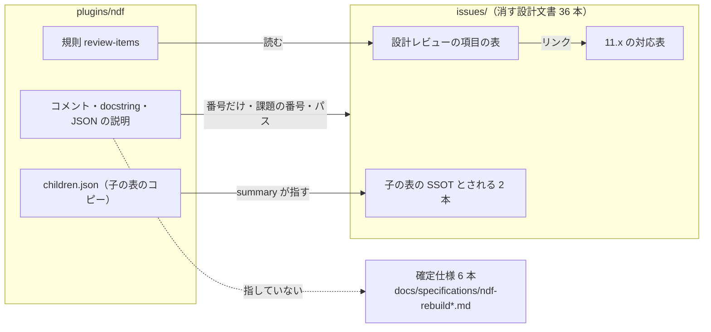
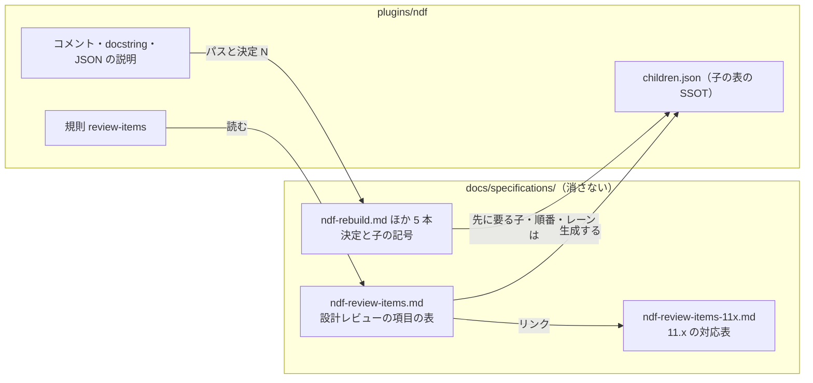
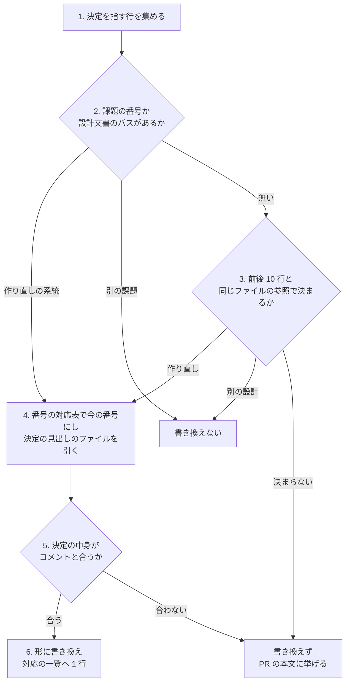

# plugins/ndf のコメント: 作り直しの決定の根拠へ 1 回の検索で行き着ける（#3960）

`plugins/ndf` のコメントは、作り直し（#1142）の決定を番号だけ・課題の番号・もうすぐ消す設計文書のパスで指していて、直す人が根拠に行き着けず、設計文書 36 本を消す作業も止まっている（要求仕様の「何が起きたか」）。コメントの参照を確定仕様のファイルと決定番号の形に書き換え、子の表の SSOT は検査が読む `children.json` の 1 か所に決め、規則 `review-items` が読む 2 つの表は確定仕様へ移す。採らなかった案は決定ごとに書き、外部の調査は省いた理由を末尾に書く。

## 今の姿

何が起きたか・目的・受け入れ条件は要求仕様（[issue-3960-requirements.md](./issue-3960-requirements.md)、正は #3960 の本文）にある。この文書は「どう解くか」と「なぜその解き方か」だけを書く。



設計に要る今の構造は次のとおりである（数は 2026-11-24 の `main` 167ea3bbc で数えた）。

| 対象 | 今の構造 |
| --- | --- |
| 決定を指す行 | `git grep -E '決定 [0-9]+' -- plugins/ndf` は 586 行・260 ファイル。このうち、作り直しの決定を指すと下調べで見えたのは 74 ファイルに収まる（下の「設計の結果」） |
| 番号だけの行 | Skill の本文とテストの見本を除くと、番号が 36〜130 の行は、`answering.py` と `test_gate_answer.py` の「決定 99」（別の設計の決定）のほかは作り直しの決定に見える。35 以下の行は、中継・gate・レーンなど別の設計の決定に見える |
| 36 本を消すと落ちるもの | 使い捨ての worktree で消して打った結果は、規則 `review-items` の入力が読めない `config_broken` 1 件と、リンク切れ 4 件（`checks/README.md` の 2 件・`ndf-contract-fact-checks.md` の 2 件）だけである。`ndf check` はこの 1 件で止まるので、残りの規則が 36 本に依らないことは、入力を移した上で全体を打って確かめた（決定 2 の根拠） |
| `children.json` | 子 54 件と、共有の表 2 つ（`contracts/causes/`・`contracts/limits/`）の書き込み元を持つ。確定仕様「子の記号」の表は 54 行あり、R0・R1 の 2 行は `children.json` に無く、M3b+・X9 の 2 行は確定仕様に無い。ほかの 52 件は先に要る子・順番・レーン・Issue がすべて一致する |
| 規則 `review-items` | `rules.json` の `spec.review_items_source` の 1 本を読み、11.x の行のリンク先を同じディレクトリから読む。`children.json` の `review_items` 182 件のうち 57 件の `routed_to` が、リンク先の文書の名前を持つ |

## 文脈と制約

- 36 本を消すのは #3990 で、この変更のマージを待つ。この変更は 36 本を消さない
- コードの振る舞いは変えない。`.py` は、コメントと docstring を除いた構文木が前後で一致する
- 1 ファイル 1,000 行・1 関数 60 行・1 行 140 桁（全角は 2 桁）の上限がある。`github.py` は 1,000 行、`account_dir.py` は 999 行、`test_invoke.py` は 998 行で、行を増やせない。パスは長いので、今の行に収まらなければ説明の文を言い換えて収める
- 耐久ワークフローの関数の中に「決定 N」のコメントは無い（構文木で確かめた）。形の番号の hash のテストは変わらない
- 同じ計画の他のレーンも `plugins/ndf` のファイルに触る。コメントの行だけを変え、衝突は取り込みで解く。増えた行は、マージの直前に下の「確かめのコマンド」を打ち直して拾う
- `plugins/ndf` は利用者へ配るが、`docs/specifications/` は配らない。コメントのパスは NDF のリポジトリの中のパスで、Skill の本文が NDF のリポジトリの確定仕様を指すのと同じ扱いである

## 解き方の全体像



- 作り直しの決定を指す行は、`docs/specifications/ndf-rebuild-<主題>.md の決定 N` の形で、実在する同じ中身の決定を指す。別の設計の決定を指す行と、決められない行は変わらない
- 子の表の SSOT は `children.json` の 1 か所で、確定仕様「子の記号」は記号・Issue・中身だけを持ち、先に要る子・順番・レーン・サブパッケージ・書き込み元を写さない
- 設計レビューの項目の表と 11.x の対応表は、確定仕様の 2 本にある。規則は入力のパスだけが替わり、同じ 182 件を同じ条件で確かめる
- `issues/` の設計文書 36 本は、`plugins/ndf` とこの変更が触る確定仕様から参照されない。#3990 が消しても検査は落ちない

## 構成要素

| 要素 | 責務 |
| --- | --- |
| `docs/specifications/ndf-review-items.md`（新設） | 設計レビューの項目 182 件の表。規則 `review-items` の入力 |
| `docs/specifications/ndf-review-items-11x.md`（新設） | 11.x へ回した項目と要求の行 72 行の、11.x でのルートの表 |
| `checks/rules.json` の `spec.review_items_source` | 入力の保存先を新しい文書へ向ける |
| `children.json` | 子の表の SSOT。`summary` に、自分が SSOT であることと変え方を書く。`review_items` は生成し直す |
| `docs/specifications/ndf-rebuild.md` の「子の記号」 | 記号・Issue・中身の 3 列と M3b+・X9 の行を持ち、値の SSOT として `children.json` を指す |
| `plugins/ndf` のコメント・docstring・README・JSON の説明 | 作り直しの決定を確定仕様の形で指す |

## 書き換えの手順



系統の見分け方と、書き換えの先は次の表で決める。番号だけが同じ行を別の決定と取り違えないよう、手順 5 で決定の本文とコメントの文を 1 行ずつ突き合わせる。

| 行の書き方 | 読み方 |
| --- | --- |
| `#1142`・`#3347`・`#3388`・`#3395` の決定、または 36 本のパスを添えた行 | 作り直しの決定。#3388 の決定 1〜10 は確定仕様に無いので書き換えない |
| `#3344` の決定 81〜86、`#3345` の決定 88〜96 | `ndf-rebuild.md` の同じ番号の決定 |
| `#3394` の決定 60 など、ほかの課題の番号 | 見出しの番号と中身の両方が確定仕様の決定と合うときだけ書き換える（例: `llm.py` の回数 2 の打ち直しは `ndf-rebuild-scripted-flow.md` の決定 60） |
| 番号だけの行 | 前後 10 行のコメントと、同じファイルのほかの参照の系統で決める |
| 置き換わった番号（例: 決定 20 → 89） | [ndf-rebuild.md の「番号の対応表」](../docs/specifications/ndf-rebuild.md#番号の対応表) の替わった先を指す。確定仕様に移していない決定（64・69〜72・121）に当たれば書き換えずに PR に挙げる |
| 不変条件だけの参照（例: `invariants.py` の 1 行目） | `docs/specifications/ndf-rebuild.md の「常に成り立つ条件」` のようにセクションの名前で指す |

書き換えた後の形は次のとおりである。

- 1 行に複数の番号があるときは、ファイルごとに 1 回のパスの後ろに並べる（例: `docs/specifications/ndf-rebuild.md の決定 75・79`）。範囲（`81〜86`）は使わず、番号を並べる
- パスと番号は 1 行に置き、改行で分けない。下の「確かめのコマンド」が 1 行ずつ読むためである
- 不変条件の番号（`IH2` など）は、決定の番号の後ろに並べて残す
- `# noqa` の理由の中の決定は、抑制コメントの形を保ったまま置き換える
- `contracts/` の JSON の説明を変えたときは、`ndf check --write-spec` で生成物を作り直し、変わった分を同じ PR に含める（今の `docs/contracts/` に「決定 N」の行は無い）

設計文書のパスを書く 7 ファイルの書き換え先は次のとおりである。

| ファイル | 書き換え先 |
| --- | --- |
| `pyproject.toml` の 2 行目と 29 行目 | 決定 77 は `ndf-rebuild.md`、決定 36 は `ndf-rebuild-data-and-smells.md` |
| `checks/invariants.py` の 1 行目 | `ndf-rebuild.md` の「常に成り立つ条件」の I1・I3 |
| `core/durable.py` の 9 行目 | `ndf-rebuild.md` の決定 81・82・83・84・85・86 |
| `core/plan/transition_decide.py` の 31 行目 | 選択の記録の規則の番号の表がある `ndf-rebuild-scripted-flow.md` |
| `checks/README.md` の「子の表の規則」 | SSOT を `children.json` とし、変え方の約束を書く（決定 1） |
| `checks/children.json` の `summary` | 同じ。`review_items` の `routed_to` は生成し直しで替わる |
| `checks/rules.json` の `spec.review_items_source` | `docs/specifications/ndf-review-items.md` |

あわせて直す参照: `child_deps.py` の docstring の「入れ替え（S2）がこのモジュールと `children.json` を消す」を消し、規則が残っていることを書く。`.github/workflows/script-structure.yml` の `REVIEW_ITEMS_PATHS` と、`ndf-contract-fact-checks.md` の 2 つのリンクを、新しい 2 本に向ける。確定仕様の「子の表のコピー」「振り分け表は確定仕様へ移さない」の記述（`ndf-rebuild.md`・`ndf-rebuild-review-scope.md`）は、今の姿に合わせて直す。

## 決定の記録

### 決定 1: 子の表の値を 1 か所にするため、`children.json` を SSOT にし、確定仕様には記号・Issue・中身だけを残す

- **質問**: 子の表（子ごとのサブパッケージ・先に要る子・順番・レーンと、共有の表の書き込み元）の SSOT をどこに置くか
- **選んだ案**: 検査が読む `children.json` を SSOT にする。`ndf-rebuild.md` の「子の記号」は、先に要るもの・順番・レーンの 3 列を消し、`children.json` を指す。R0・R1 の 2 行は `children.json` に無いので表から外し、直前の段落の文にする。M3b+ と X9 の 2 行を足す。行数は 500 行のまま変わらない。表を変えるときは、変える行を書いた設計 PR を先に通し、その後に `children.json` を直す（今の約束の強さを保つ）
- 採らなかった案: `packages` と `tables` の表を新しい確定仕様（`ndf-rebuild-children.md`）に置く（同じ値を文書と JSON の 2 か所に持ち、値を変える PR が 2 か所を直す。M3b+ と X9 は今も JSON にだけある）
- 採らなかった案: 新しい確定仕様を置き、JSON との一致を検査で縛る（一致を保つ検査が要る形は、値を 2 か所に持つことの後始末で、検査の追加は振る舞いの変更に当たる）
- **代償**: 表を読むには確定仕様から JSON へ進む。記号と Issue の番号は読み手のために確定仕様にも残り、記号を足すときは 2 か所に 1 行ずつ足す
- 根拠: Value 8・Value 11（MVV バージョン 11）

### 決定 2: 36 本を消しても検査が入力を読めるよう、規則 `review-items` が読む 2 つの表を確定仕様の 2 本に移す

- **質問**: 規則 `review-items` の入力（設計レビューの項目の表と 11.x の対応表）の、消さない保存先をどこにするか
- **選んだ案**: `docs/specifications/ndf-review-items.md` と `ndf-review-items-11x.md` に置く。名前は規則の名前に合わせ、`ndf-rebuild` で始めない（決定の番号を持つ 6 本の数え方を変えないため）。表の値は要旨のセルを 1 文字も変えず、11.x の行のリンク先の文書の名前だけを替える。文書の頭には、読み方と出所を書き、件数の集計・抜き出しのコマンド・要求の行のオーナーの表など、規則が読まないセクションは移さない。要求の行番号が指す文書（コミット 4e1f1f1ca の時点）は、そのコミットの `issues/` のディレクトリへの固定リンクで示す
- 採らなかった案: `children.json` の `review_items` を SSOT にし、生成を止める（生成し直した中身との違いを違反にする今の検査が成り立たず、振る舞いが変わる）
- 採らなかった案: `plugins/ndf/src/ndf/checks/` に置く（利用者へ配る量が増え、プラグインを使うプロジェクトに関係の無い 182 件を届ける）
- 採らなかった案: 1 本の文書に 2 つの表を置く（11.x の行のリンクが同じ文書の頭を指し、読み手が表に行き着けない）
- **代償**: 作り直しの作業の記録が、確定仕様に残る。#3412 の設計は 2 本を「移さない」としていたので、確定仕様の側の記述を直す
- 根拠: Value 3・Value 13（MVV バージョン 11）。2026-11-24 に使い捨ての worktree で 36 本を消し、表を移し、`rules.json` の 1 行を替えて `ndf check --write-spec` を打つと `1572 ファイルに違反なし`、`review_items` は 182 件で、リンク先の名前を除いて前と一致し、ルートを 1 つ空にすると違反 2 件になった

### 決定 3: 似た番号の取り違えを防ぐため、行を番号ではなく中身で見分け、決められない行は残す

- **質問**: 586 行のうち、どの行を作り直しの決定とみなし、どう書き換えるか
- **選んだ案**: 「書き換えの手順」のとおり、課題の番号・前後 10 行・同じファイルの参照の順で系統を見分け、決定の本文とコメントの文を突き合わせてから 1 行ずつ書き換える。決められない行は書き換えず、PR の本文に挙げる。書き換えた行ごとに、前後のファイルと番号と根拠を並べた対応の一覧を PR に載せる
- 採らなかった案: 番号の範囲と対応表でまとめて置き換える（番号が同じ別の決定がある。例: 「決定 99」は `ndf-rebuild.md` の決定 99 ではない）
- 採らなかった案: 番号だけの行をすべて書き換える（中継などの別の設計の決定まで、作り直しの決定に見えるようになる）
- **代償**: 読む行が多く、目視の手間が掛かる。対応の一覧をレビューで読む
- 根拠: Value 13・Value 14（MVV バージョン 11）

### 決定 4: 一度きりの確かめを検査に足さないため、参照の実在と表の一致はコマンドで数える

- **質問**: 「決定 N」の実在・子の表の一致・構文木の一致を、CI の検査に足すか
- **選んだ案**: 足さない。「確かめのコマンド」の 3 つを打ち、出力を PR に載せる。3 つは、存在しない番号・範囲・形の違う行を混ぜると違反を返すことを確かめた
- 採らなかった案: `ndf check` に、参照の実在を見る規則を足す（検査の追加は振る舞いの変更で、この Issue の範囲の外である）
- **代償**: 後から書き足された参照が壊れても機械は知らせない。参照の形の書き方はレビューが見る
- 根拠: Value 11（MVV バージョン 11）

## 影響と危険

- **働く範囲**: このリポジトリの検査と文書。利用先のリポジトリへは、配るコードのコメントと JSON の説明の文だけが届き、振る舞いは変わらない
- **プロジェクトごとに違うもの**: 無い。設定と引数を足さない
- **当たるモード**: どのモードの工程も変わらない
- **壊れうる箇所**: 取り違えた参照（別の設計の決定を書き換える）は、対応の一覧と決定の本文の突き合わせで拾う。行の上限に近いファイル（`github.py`・`account_dir.py`・`test_invoke.py`）は、行を増やさずに書き換える
- **並行する変更**: `plugins/ndf` の多くのファイルに触る。コメントの行だけを変えるので、衝突は取り込みのときに両方の行を残して解く。マージの直前に「決定 N」の行を数え直す
- **#3990 との関係**: 36 本の削除は、この変更のマージの後に行う。着手の条件（`checks/README.md` の書き換え）は満たされる

### 代表のリポジトリでの振る舞い

| 代表のリポジトリ | 設定の要点 | 直した後に起きること | この種類で扱えなくなること |
| --- | --- | --- | --- |
| Web サービス | 変わらない | 何も変わらない。`ndf check` は NDF のリポジトリだけの検査で、利用先では打たない | 無し |
| モバイルアプリ | 変わらない | 同上 | 無し |
| 業務文書だけ | 変わらない | 同上 | 無し |

### このリポジトリだけの事情

| 値 | 置く所 | 持つ Issue |
| --- | --- | --- |
| 設計レビューの項目の表の保存先 | `plugins/ndf/src/ndf/checks/rules.json` の `spec.review_items_source` | #3960 |

## 用語

| 用語 | 意味 | 用語集への反映 |
| --- | --- | --- |
| 子の表 | #1142 の作り直しの子の Issue を、記号ごとに番号・サブパッケージ・先に要る子・順番・レーン・閉じたかで持ち、共有の表の書き込み元も持つ表（`plugins/ndf/src/ndf/checks/children.json`）。この表が SSOT である | 意味の変更 |

## テスト設計

| 受け入れ条件 | どの振る舞いで縛るか | どう壊したら落ちるべきか |
| --- | --- | --- |
| 1 参照の 0 件 | `git grep` の結果が 0 件 | 7 ファイルの 1 つでも設計文書のパスを残すと当たる |
| 2・3 確定仕様の形と実在 | 「確かめのコマンド」の参照の確かめが違反 0 件 | 無い番号・範囲・形の違う行を混ぜると違反を返す |
| 4・5 対応の一覧と残した行 | PR の本文に一覧があり、書き換えた行の数と合う | 一覧に無い書き換えがあれば、差分と数が合わない |
| 6 別の設計の行 | `git diff` に、別の設計の決定を指す行が無い | 「決定 99」や中継の「決定 13」の行が変われば差分に出る |
| 7 子の表の SSOT | 「確かめのコマンド」の子の表の確かめで、記号と Issue が一致し、C4 と `contracts/limits/` の書き込み元が `children.json` にある | 記号を 1 つ削ると違いが出る |
| 8 README と summary | 指す先が `children.json` で、「S2 が消す」の記述が 0 件 | 旧い記述を戻すと検索に当たる |
| 9 36 本を消した状態 | 使い捨ての worktree で 36 本を消し、`ndf check` とリンクの検査が通る | 参照を 1 つ残すと落ちる |
| 10 振る舞いの不変 | 「確かめのコマンド」の構文木の確かめが違い 0 件 | コードの定数を 1 つ変えると挙がる |
| 11 review-items | 182 件のまま `ok`。既存の `test_review_items.py` が通る | ルートを空にする・対応表の行を消すと違反になる |
| 12 生成物 | `ndf check --write-spec` の後に差分が無く、`ndf records glossary render --check` が `ok` | JSON の説明だけを変えて生成し直さないと落ちる |
| 13 退行しない | CI の必須のジョブが通り、足した 2 本が 500 行以下 | 行数の検査が超えた文書を挙げる |

### 確かめのコマンド

どれもリポジトリの根で打つ。参照の確かめ（条件 3）:

```bash
python3 - <<'PY'
import re, subprocess, sys
PATH = r"docs/specifications/(ndf-rebuild(?:-[a-z]+)*)\.md"
REF = re.compile(PATH + r" の(決定 \d+(?:[・〜]\d+)*)")
held = {}
def decisions(name):
    if name not in held:
        try:
            text = open(f"docs/specifications/{name}.md", encoding="utf-8").read()
        except OSError:
            text = ""
        held[name] = set(re.findall(r"^#{2,4} 決定 (\d+)", text, re.M))
    return held[name]
shown = subprocess.run(["git", "grep", "-n", "ndf-rebuild", "--", "plugins/ndf"], capture_output=True, text=True).stdout
refs = bad = 0
def ng(why, line):
    global bad
    bad += 1
    print(why, line[:200])
for line in shown.splitlines():
    rest = REF.sub("", line)
    if re.search(r"ndf-rebuild[a-z-]*\.md", rest) and re.search(r"決定 ?\d", rest):
        ng("形が違う:", line)
    for m in REF.finditer(line):
        if "〜" in m[2]:
            ng("番号を範囲で書いている:", line)
        for n in re.findall(r"\d+", m[2]):
            refs += 1
            if n not in decisions(m[1]):
                ng(f"決定が無い（{m[1]} の {n}）:", line)
print("参照", refs, "件・違反", bad, "件")
sys.exit(bool(bad))
PY
```

変更の前の `main` では `参照 0 件・違反 0 件`。確かめのため、実在する 2 行・無い番号・無い文書・範囲・形の違う行・決定を書かない行を混ぜると、`参照 7 件・違反 4 件` になった。

子の表の確かめ（条件 7）と、構文木の確かめ（条件 10。`<base>` は変更の前のコミット）:

```bash
python3 - <<'PY'
import json, re
held = json.load(open("plugins/ndf/src/ndf/checks/children.json", encoding="utf-8"))
text = open("docs/specifications/ndf-rebuild.md", encoding="utf-8").read()
sec = text[text.index("## 子の記号"):text.index("## 決定と理由")]
rows = {}
for line in sec.splitlines():
    cells = [c.strip() for c in line.strip("|").split("|")]
    if re.fullmatch(r"[A-Z]+[0-9]+[a-z]?\+?", cells[0]):
        rows[cells[0]] = cells[1]
kids = held["children"]
print("確定仕様だけ", sorted(set(rows) - set(kids)), "JSON だけ", sorted(set(kids) - set(rows)))
print("Issue の違い", [k for k in rows if k in kids and rows[k] != f"#{kids[k]['issue']}"])
print("ndf.core.refs のオーナー", [k for k, v in kids.items() if "ndf.core.refs" in v["packages"]])
print("contracts/limits/ の書き込み元", held["tables"]["contracts/limits/"])
PY
python3 - <base> <<'PY'
import ast, subprocess, sys
base = sys.argv[1]
def tree(text):
    t = ast.parse(text)
    for n in ast.walk(t):
        if isinstance(n, (ast.Module, ast.ClassDef, ast.FunctionDef, ast.AsyncFunctionDef)) and ast.get_docstring(n, clean=False) is not None:
            n.body[0].value.value = ""
    return ast.dump(t)
run = lambda *a: subprocess.run(["git", *a], capture_output=True, text=True, check=True).stdout
names = run("ls-files", "--", "plugins/ndf/*.py").split()
old = {n for n in run("ls-tree", "-r", "--name-only", base, "plugins/ndf").split("\n") if n.endswith(".py")}
bad = sorted(set(names) ^ old)
for n in sorted(set(names) & old):
    before, after = run("show", f"{base}:{n}"), open(n, encoding="utf-8").read()
    if before != after and tree(before) != tree(after):
        bad.append(n)
print("\n".join(bad))
print("違い", len(bad), "件")
sys.exit(bool(bad))
PY
```

変更の前の確定仕様で打つと、子の表の確かめは `確定仕様だけ ['R0', 'R1'] JSON だけ ['M3b+', 'X9']`、構文木の確かめは `違い 0 件`（docstring を 1 行替えても 0 件、`llm.py` の定数を 1 つ替えると 1 件）である。変更の後は、子の表の確かめの 2 つの並びと Issue の違いがすべて空になる。

## 設計の結果

| 課題 | 扱い | 統合先 | 触るファイル |
| --- | --- | --- | --- |
| #3960 | 実装する | — | `plugins/ndf/bin/ndf-claude`、`plugins/ndf/contracts/hooks/guards.json`、`plugins/ndf/contracts/hooks/imports.json`、`plugins/ndf/contracts/hooks/runtimes.json`、`plugins/ndf/contracts/limits/durable.keep.json`、`plugins/ndf/contracts/limits/durable.prepare.json`、`plugins/ndf/contracts/limits/hook.ask-forward.json`、`plugins/ndf/contracts/limits/hook.budget.pre-tool-use.json`、`plugins/ndf/contracts/limits/hook.counter-lock.json`、`plugins/ndf/contracts/limits/hook.deny-repeat.json`、`plugins/ndf/contracts/limits/hook.metrics-keep.json`、`plugins/ndf/contracts/limits/hook.pushback.json`、`plugins/ndf/contracts/limits/hook.venv-keep.json`、`plugins/ndf/hooks/boot.py`、`plugins/ndf/hooks/entry.py`、`plugins/ndf/pyproject.toml`、`plugins/ndf/src/ndf/adapters/github.py`、`plugins/ndf/src/ndf/adapters/llm.py`、`plugins/ndf/src/ndf/checks/README.md`、`plugins/ndf/src/ndf/checks/child_deps.py`、`plugins/ndf/src/ndf/checks/children.json`、`plugins/ndf/src/ndf/checks/facts.py`、`plugins/ndf/src/ndf/checks/invariants.py`、`plugins/ndf/src/ndf/checks/lint.py`、`plugins/ndf/src/ndf/checks/rules.json`、`plugins/ndf/src/ndf/checks/smells.py`、`plugins/ndf/src/ndf/core/durable.py`、`plugins/ndf/src/ndf/core/durable_runs.py`、`plugins/ndf/src/ndf/core/durable_sweep.py`、`plugins/ndf/src/ndf/core/plan/transition_decide.py`、`plugins/ndf/src/ndf/domains/hooks/__init__.py`、`plugins/ndf/src/ndf/domains/hooks/boot.py`、`plugins/ndf/src/ndf/domains/hooks/budget.py`、`plugins/ndf/src/ndf/domains/hooks/cli.py`、`plugins/ndf/src/ndf/domains/hooks/context.py`、`plugins/ndf/src/ndf/domains/hooks/counter.py`、`plugins/ndf/src/ndf/domains/hooks/dispatch.py`、`plugins/ndf/src/ndf/domains/hooks/env.py`、`plugins/ndf/src/ndf/domains/hooks/guards/ask.py`、`plugins/ndf/src/ndf/domains/hooks/guards/read_repeat.py`、`plugins/ndf/src/ndf/domains/hooks/guards/session.py`、`plugins/ndf/src/ndf/domains/hooks/guards/stop_wait.py`、`plugins/ndf/src/ndf/domains/hooks/guards/turn.py`、`plugins/ndf/src/ndf/domains/hooks/guards/unattended.py`、`plugins/ndf/src/ndf/domains/hooks/main.py`、`plugins/ndf/src/ndf/domains/hooks/metrics.py`、`plugins/ndf/src/ndf/domains/hooks/outbox.py`、`plugins/ndf/src/ndf/domains/hooks/registration.py`、`plugins/ndf/src/ndf/domains/hooks/sender.py`、`plugins/ndf/src/ndf/domains/hooks/strict.py`、`plugins/ndf/src/ndf/domains/relay/__init__.py`、`plugins/ndf/src/ndf/domains/relay/account_registry.py`、`plugins/ndf/src/ndf/domains/relay/cli.py`、`plugins/ndf/src/ndf/domains/relay/hub.py`、`plugins/ndf/src/ndf/domains/relay/markers.py`、`plugins/ndf/src/ndf/domains/relay/pending.py`、`plugins/ndf/src/ndf/domains/relay/signals.py`、`plugins/ndf/src/ndf/domains/release/__init__.py`、`plugins/ndf/src/ndf/domains/worktree/write_target.py`、`plugins/ndf/src/ndf/identity.py`、`plugins/ndf/src/ndf/progress/backup.py`、`plugins/ndf/src/ndf/progress/lane/__init__.py`、`plugins/ndf/src/ndf/progress/store.py`、`plugins/ndf/tests/checks/conftest.py`、`plugins/ndf/tests/conftest.py`、`plugins/ndf/tests/core/test_durable.py`、`plugins/ndf/tests/core/test_durable_format.py`、`plugins/ndf/tests/core/test_durable_store.py`、`plugins/ndf/tests/core/test_durable_sweep.py`、`plugins/ndf/tests/core/test_durable_url.py`、`plugins/ndf/tests/domains/relay/test_relay_parts.py`、`plugins/ndf/tests/progress/load_measure.py`、`plugins/ndf/tests/progress/test_store_pg.py`、`plugins/ndf/tests/progress/test_store_sqlite.py`、`docs/specifications/ndf-review-items.md`、`docs/specifications/ndf-review-items-11x.md`、`docs/specifications/README.md`、`docs/specifications/ndf-rebuild.md`、`docs/specifications/ndf-rebuild-review-scope.md`、`docs/specifications/ndf-contract-fact-checks.md`、`.github/workflows/script-structure.yml`、`docs/glossary/glossary.json`、`docs/glossary/ndf-rebuild.md` |

「決定 N」を指す行の見分けは実装で決めるため、この一覧は下調べで作り直しの決定に見えたファイルである。実装で別のファイルの行も作り直しの決定と決まれば、同じ PR で書き換え、PR の本文に挙げる。

## 外部の調査

省く: 参照の書き方と保存先は、このリポジトリの確定仕様（#3412 の設計で調べた番号の慣行を含む）と検査の入力だけで決まり、外部の標準・製品・ライブラリで得る機能が無い
