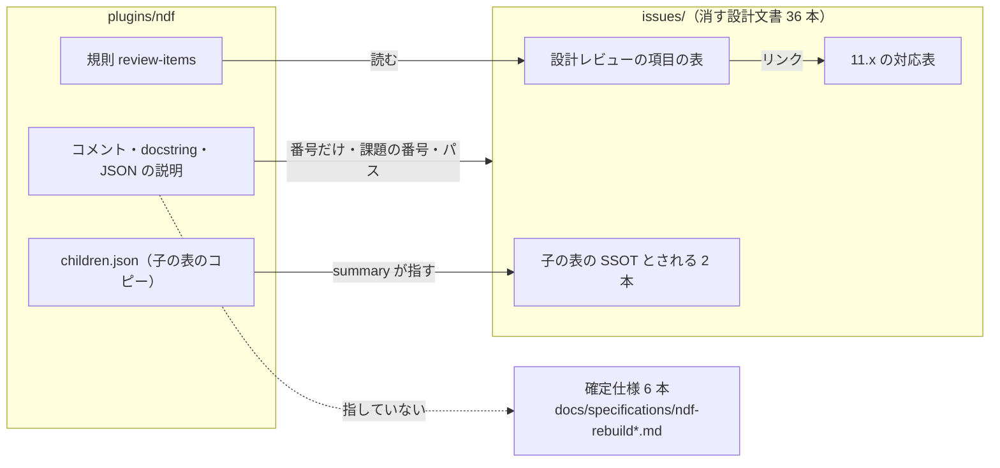
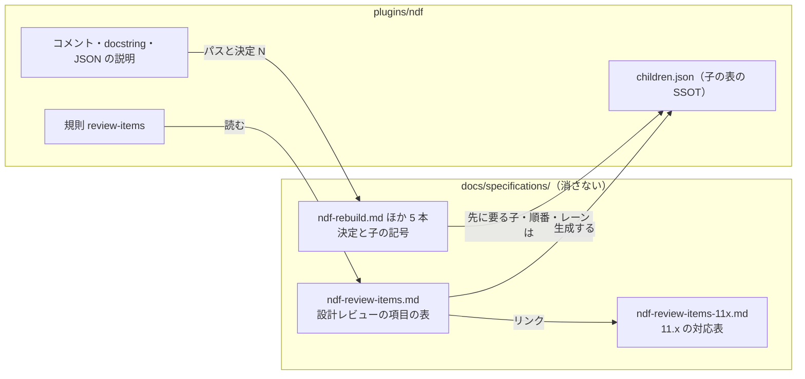
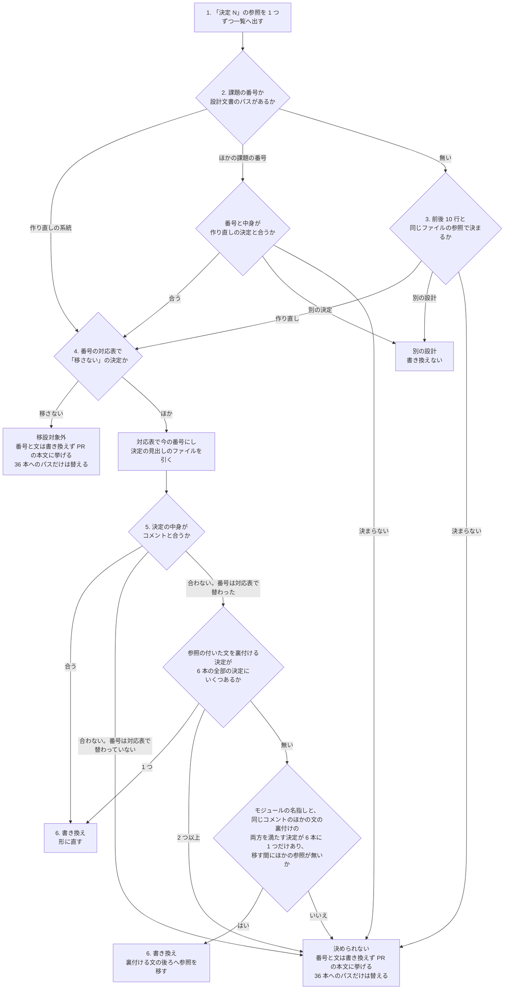

# plugins/ndf のコメント: 作り直しの決定の根拠へ 1 回の検索で行き着ける（#3960）

`plugins/ndf` のコメントから作り直し（#1142）の決定の根拠に行き着けず、設計文書 36 本を消す作業も止まっている（要求仕様の「何が起きたか」）。コメントの参照を、確定仕様のファイルと決定番号の形に書き換える。子の表の SSOT は検査が読む `children.json` の 1 か所に決め、規則 `review-items` が読む 2 つの表は確定仕様へ移す。採らなかった案は決定ごとに書き、外部の調査は省いた理由を末尾に書く。

## 今の姿

何が起きたか・目的・受け入れ条件は要求仕様（[issue-3960-requirements.md](./issue-3960-requirements.md)、正は #3960 の本文）にある。この文書は「どう解くか」と「なぜその解き方か」だけを書く。

設計に要る今の構造は次のとおりである（数は 2026-11-24 の `main` 167ea3bbc で数えた）。

| 対象 | 今の構造 |
| --- | --- |
| 決定を指す行 | `git grep -E '決定 [0-9]+' -- plugins/ndf` は 586 行・260 ファイル。このうち、作り直しの決定を指すと下調べで見えたのは 74 ファイルに収まる（下の「設計の結果」） |
| 番号だけの行 | Skill の本文とテストの見本（どちらも書き方の例で、書き換えない）を除くと、番号が 36〜130 の行は、`answering.py` と `test_gate_answer.py` の「決定 99」（別の設計の決定）のほかは作り直しの決定に見える。35 以下の行は、中継・gate・レーンなど別の設計の決定に見える |
| 36 本を消すと落ちるもの | 使い捨ての worktree で消して `ndf check` とリンクの検査を打った。落ちたのは、規則 `review-items` の入力が読めない `config_broken` 1 件と、リンク切れ 4 件（`checks/README.md` の 2 件・`ndf-contract-fact-checks.md` の 2 件）だけである。`ndf check` はこの 1 件で止まる。そこで 2 つの表を先に移してから 36 本を消して全部の規則を打ち、ほかに違反が無いことを確かめた（決定 2 の根拠） |
| `children.json` | 子 54 件と、共有の表 2 つ（`contracts/causes/`・`contracts/limits/`）の書き込み元を持つ。確定仕様「子の記号」の表は 54 行あり、R0・R1 の 2 行は `children.json` に無く、M3b+・X9 の 2 行は確定仕様に無い。ほかの 52 件は先に要る子・順番・レーン・Issue がすべて一致する |
| 規則 `review-items` | `rules.json` の `spec.review_items_source` の 1 本を読み、11.x の行のリンク先を同じディレクトリから読む。`children.json` の `review_items` 182 件のうち 57 件の `routed_to` が、リンク先の文書の名前を持つ |

## 文脈と制約

- 36 本を消すのは #3990 で、この変更のマージを待つ。この変更は 36 本を消さない
- コードの振る舞いは変えない。`.py` は、コメントと docstring を除いた構文木が前後で一致する
- 1 ファイル 1,000 行・1 関数 60 行・1 行 140 桁（全角は 2 桁）の上限がある。触るファイルのうち行を増やせないのは `github.py`（1,000 行）である。パスは長いので、今の行に収まらなければ説明の文を言い換えて収める
- 耐久ワークフローの関数のソースの hash を記録と比べるテスト（`tests/core/test_durable_format.py`）がある。対象の関数の中に「決定 N」のコメントは無い（構文木で確かめた）ので、hash は変わらない
- 同じ計画の他のレーンも `plugins/ndf` のファイルに触る。コメントの行だけを変え、衝突は取り込みで解く。増えた行は、マージの直前に「確かめのコマンド」を打ち直して拾う
- `plugins/ndf` は利用者へ配るが、`docs/specifications/` は配らない。コメントのパスは NDF のリポジトリの中のパスである。Skill の本文が NDF のリポジトリの確定仕様を指すのと同じ扱いである

## 解き方の全体像

- 作り直しの決定を指す行は、実在する同じ中身の決定を指す。形は `docs/specifications/ndf-rebuild-<主題>.md の決定 N` である。別の設計の決定を指す参照は変わらない。決められない参照は番号と文が変わらず、設計文書 36 本へのパスだけを替える
- 子の表の SSOT は `children.json` の 1 か所である。確定仕様「子の記号」は記号・Issue・中身だけを持つ。先に要る子・順番・レーン・サブパッケージ・書き込み元はコピーしない
- 設計レビューの項目の表と 11.x の対応表は、確定仕様の 2 本にある。規則は入力のパスだけが替わり、同じ 182 件を同じ条件で確かめる
- `issues/` の設計文書 36 本は、`plugins/ndf` とこの変更が触る確定仕様から参照されない。#3990 が消しても検査は落ちない

## 要求の読み方

要求仕様は課題の本文のコピーなので、この PR では手で直さない。実装と合否の判定は次の読み方に従う。設計承認ゲートでは、要求の未決 2 件（決定 1・2）とあわせてこの読み方を確かめる。

| 要求 | 読み方 |
| --- | --- |
| 受け入れ条件 2（すべて新しい形） | 対象は、作り直しの決定を指すすべての参照のうち、条件が挙げるコメント・docstring・README・JSON の説明の中のものである。コードの値の文字列の中の参照は、書き換えると条件 10 の構文木が変わるため対象にしない。当たるのは `identity.py` の `OldPlace` の `reason` にある「決定 85」の 1 件で、一覧の分類は `コードの値` とする。Skill とエージェントの本文やテストの見本にある「決定 N」（書き方の例・別の設計の決定）は、一覧に出し `別の設計` とする。旧い番号に見出しが無くても、「番号の対応表」で畳んだ・振り直した・移したとある決定（例: 102 → 番号の対応表の節）は替わった先へ書き換える。替わった先の中身がコメントと合わない参照（例: `write_target.py` の決定 20）の扱いは受け入れ条件 4 の読み方に従う。除くのは、対応表が「移さない」と明示した決定（`移設対象外`）と、文脈を突き合わせても決められない参照（`決められない`）と、上の `コードの値` の 3 つだけで、一覧に理由を書く。ほかの参照を旧い形で 1 つでも残せば不合格とする |
| 受け入れ条件 4（番号が替わった決定は替わった先を指す）と、「何が起きたか」の `write_target.py` の例 | 指すのは、替わった先の本文が、参照の付いた文を裏付けるときだけである。裏付けないときは「替わった先が合わないときの探し方」（書き換えの手順）に従い、参照の付いた文、同じコメントのほかの文の順に探す。どちらでも 1 つに決まらなければ `決められない` とする。決定 89 は hook の起動と依存の環境の決定で、書き込み先の推定を書かない |
| 受け入れ条件 5（決められない行） | `移設対象外`・`決められない`・`コードの値` を、行と理由を添えて PR の本文に挙げる |
| 受け入れ条件 7（SSOT に載り、値が一致する） | SSOT が `children.json` 自身なので、比べる相手は変更の前の `children.json` と、変更の前の「子の記号」の表である。`children` と `tables` の値が変更の前と 1 つでも違えば不合格とする。変更の前の「子の記号」は、R0・R1 を除く 52 行の値が `children.json` と、記号・Issue・中身が変更の後の表と合い、R0・R1 の Issue と中身が段落に残れば合格とする。`summary` と `review_items` の `routed_to` は比べない |
| 「含まない」の「確定仕様の決定の中身の変更」 | 決定の見出し・選んだ内容・採らなかった案は変えない。変えるのは、表の保存先を書いた文だけである（決定 2 の表） |
| 「規則 `review-items` の入力（振り分け表と 11.x の対応表）」 | 用語集の「振り分け表」は要求のオーナーの表も含む。移すのは規則が読む 182 項目の表と 11.x の対応表だけである（決定 2 の表） |

## 構成要素

| 要素 | 責務 |
| --- | --- |
| `docs/specifications/ndf-review-items.md`（新設） | 設計レビューの項目 182 件の表。規則 `review-items` の入力 |
| `docs/specifications/ndf-review-items-11x.md`（新設） | 11.x へ回した項目と要求の行 72 行の、11.x での行き先の表 |
| `checks/rules.json` の `spec.review_items_source` | 入力の保存先を新しい文書へ向ける |
| `children.json` | 子の表の SSOT。`summary` に、自分が SSOT であることと変え方を書く。`review_items` は生成し直す |
| `docs/specifications/ndf-rebuild.md` の「子の記号」 | 記号・Issue・中身の 3 列と M3b+・X9 の行を持ち、値の SSOT として `children.json` を指す |
| `plugins/ndf` のコメント・docstring・README・JSON の説明 | 作り直しの決定を確定仕様の形で指す |

## 書き換えの手順

**手順 1 の一覧。** 「参照の確かめ」の `list` が、変更の前の参照を番号ごと・設計文書のパスごとに 1 行（ファイル・行の文・番号かパス・分類・新しい参照・根拠）の TSV へ出す。分類は図の `書き換え`・`別の設計`・`移設対象外`・`決められない` と、図に無い `コードの値`（要求の読み方の受け入れ条件 2）のどれか 1 つで、根拠は全行に書く。番号の新しい参照は、`書き換え` の行だけが `ndf-rebuild.md#75` か `ndf-rebuild.md「番号の対応表」`（替わった先がセクションのとき）の形で持つ。パスの書き方は [issue-3960-design-checks.md](./issue-3960-design-checks.md) にある。TSV はコミットしない。PR の本文には `別の設計` 以外の行と、分類ごとの件数を載せる（条件 4・5）。

系統の見分け方と、書き換えの先は次の表で決める。番号だけが同じ行を別の決定と取り違えないよう、手順 5 で決定の本文とコメントの文を 1 行ずつ突き合わせる。

| 行の書き方 | 読み方 |
| --- | --- |
| `#1142`・`#3347`・`#3388`・`#3395` の決定、または 36 本のパスを添えた行 | 作り直しの決定。対応表の「移さない」に当たるかを先に見る |
| `#3344` の決定 81〜86、`#3345` の決定 88〜96 | `ndf-rebuild.md` の同じ番号の決定 |
| `#3394` の決定 60 など、ほかの課題の番号 | 番号と中身の両方が作り直しの決定と合うときだけ、作り直しの系統として手順 4 へ進む（例: `llm.py` の回数 2 の打ち直しは `ndf-rebuild-scripted-flow.md` の決定 60） |
| 番号だけの行 | 前後 10 行のコメントと、同じファイルのほかの参照の系統で決める |
| 置き換わった番号（例: 決定 102・IG6 → 番号の対応表の節） | [ndf-rebuild.md の「番号の対応表」](../docs/specifications/ndf-rebuild.md#番号の対応表) の替わった先を指す。見出しがあるかは、対応表を当てた後の番号で見る。替わった先がセクションのとき（例と同じ）は、セクションの名前で指す。替わった先の本文がコメントの文を裏付けないときは指さず、下の「替わった先が合わないときの探し方」に進む |
| 替わった先が合わない `domains/worktree/write_target.py` の「#1142 の決定 20」 | 対応表の決定 89（hook の起動と依存の環境）は指さない。シェルの構文を `write_target` が tree-sitter-bash で読むと書く `docs/specifications/ndf-rebuild-libraries.md の決定 14` を指す。参照は 1 行目から外し、docstring の「構文木は tree-sitter-bash で作る」の文の後ろに置く。1 行目の文（書き込み先の推定）を裏付ける決定は 6 本に無く、`write_target` を名指しする決定は決定 14 だけなので、探し方の 2 に当たる。書き込み先の 4 つの形と `cd` の扱いには、裏付ける決定が無いので参照を添えない。一覧の新しい参照は `ndf-rebuild-libraries.md#14` である |
| 移設対象外の決定（`fixes` の決定 69〜75・`#3388` の決定 1〜10・`scripted-flow` の決定 64・`#3395` の決定 121。`fixes` などは「番号の対応表」が使う、旧い設計文書の系統の名前） | 分類は `移設対象外`。パスの無い行は変えない。36 本へのパスを伴う行は、パスだけを `docs/specifications/ndf-rebuild.md の「番号の対応表」` に替え、元の系統の名前と番号は残す（条件 1 のため）。例: `fixes の決定 70（docs/specifications/ndf-rebuild.md の「番号の対応表」）` |
| 番号が同じ別の系統の行（例: `fixes` の決定 75 と `next` の決定 75、#3097 の決定 99） | 番号だけで除外しない。コメントの文を両方の決定の本文と突き合わせて系統を決め、どちらとも決まらなければ `決められない` とする |
| `決められない` に分けた、36 本へのパスを伴う行 | パスだけを同じ形で「番号の対応表」に替え、番号と文は残す |
| 設計文書のパスを伴う、不変条件だけの参照（`invariants.py` の 1 行目だけ） | `docs/specifications/ndf-rebuild.md の「常に成り立つ条件」` のようにセクションの名前で指し、`I1・I3` の番号は残す |
| 「決定 N」もパスも無い、不変条件の番号だけの参照 | 対象ではない。一覧に出さず、書き換えない |

**替わった先が合わないときの探し方。** 対応表で番号が替わった参照だけに当て、番号を問わず 6 本の全部の決定から次の順に探す。

1. **参照の付いた文**（句点までの 1 文。括弧の中の参照は、その括弧を含む文）を裏付ける決定を数える。1 つならその場で替え、2 つ以上なら `決められない`。無ければ 2 へ進む
2. **同じコメントのほかの文**へ移せるかを見る。同じコメントとは、参照を含む 1 つの docstring、連続する `#` の行、JSON の 1 つの説明文のどれか 1 つである。次の (ア) と (イ) の両方を満たす決定がちょうど 1 つあり、元の位置と移す先の間にほかの決定の参照が無い（参照の並びを変えないため）ときだけ、参照を元の文から外し、裏付ける文（2 文以上なら最初の文）の後ろへ移す。ほかのときは `決められない` とし、参照を動かさない
   - (ア) そのコメントのあるモジュールを、決定の本文が名指しする（`ndf.domains.worktree.write_target` の形か、ファイルのパス）
   - (イ) 参照の付いた文のほかに、同じコメントの少なくとも 1 文を、決定の本文が裏付ける。(ア) を満たさない決定は、文を裏付けても数えない

移したときは、一覧の根拠に、移す前の文・移した後の文・決定の本文の該当する文を書く。

書き換えた後の形は次のとおりである。

- 1 行に複数の番号があるときは、ファイルごとに 1 回のパスの後ろに並べる。例: `docs/specifications/ndf-rebuild.md の決定 75・79`。範囲（`81〜86`）は使わず、番号を並べる
- パスと番号は 1 行に置き、改行で分けない。番号の並びの直後に `、` などを挟んで別の数を続けない（例: `決定 83、14 日`）。どちらも「参照の確かめ」が形の違いとして挙げる
- 不変条件の番号（`IH2` など）は、決定の番号の後ろに並べて残す
- `# noqa` の理由の中の決定は、抑制コメントの形を保ったまま置き換える
- `contracts/` の JSON の説明を変えたときは、`ndf check --write-spec` で生成物を作り直す。今の生成物（`plugins/ndf/docs/contracts/` と `contracts/schemas/io/`）は「決定 N」を 1 つも持たず、書き換える `summary` の文も載らないので、差分は出ない見込みである。出れば同じ PR に含める

設計文書のパスを書く 7 ファイルの書き換え先は次のとおりである。

| ファイル | 書き換え先 |
| --- | --- |
| `pyproject.toml` の 2 行目と 29 行目 | 決定 77 は `ndf-rebuild.md`、決定 36 は `ndf-rebuild-data-and-smells.md` |
| `checks/invariants.py` の 1 行目 | `ndf-rebuild.md` の「常に成り立つ条件」の I1・I3 |
| `core/durable.py` の 9 行目 | `ndf-rebuild.md` の決定 81・82・83・84・85・86 |
| `core/plan/transition_decide.py` の 31 行目 | 選択の記録について、規則の番号を並べた表がある `docs/specifications/ndf-rebuild-scripted-flow.md の「洗い出しの一覧」` |
| `checks/README.md` の「子の表の規則」 | SSOT を `children.json` とし、変え方の約束を書く（決定 1） |
| `checks/children.json` の `summary` | 同じ。`review_items` の `routed_to` は生成し直しで替わる |
| `checks/rules.json` の `spec.review_items_source` | `docs/specifications/ndf-review-items.md` |

あわせて直す参照は次のとおりである。

| 直す所 | 直した後 |
| --- | --- |
| `child_deps.py` の docstring の「入れ替え（S2）がこのモジュールと `children.json` を消す」 | 消して、規則が残っていることを書く |
| `plugins/ndf` の「子の表のコピー」（`child_deps.py` の 1 行目と 30 行目、`checks/README.md`、`children.json` の `summary`） | 「子の表」に替える |
| `.github/workflows/script-structure.yml` の `REVIEW_ITEMS_PATHS` と、`ndf-contract-fact-checks.md` の 2 つのリンク | 新しい 2 本に向ける |
| 確定仕様の「子の表のコピー」「振り分け表は確定仕様へ移さない」の記述（`ndf-rebuild.md`・`ndf-rebuild-review-scope.md`） | 決定 2 の表のとおりに直す |

## 決定の記録

### 決定 1: 子の表の値を 1 か所にするため、`children.json` を SSOT にし、確定仕様には記号・Issue・中身だけを残す

- **質問**: 子の表（子ごとのサブパッケージ・先に要る子・順番・レーンと、共有の表の書き込み元）の SSOT をどこに置くか
- **選んだ案**: 検査が読む `children.json` を SSOT にする。`ndf-rebuild.md` の「子の記号」は、先に要るもの・順番・レーンの 3 列を消し、`children.json` を指す。R0・R1 の 2 行は `children.json` に無いので表から外し、直前の段落の文にする。M3b+ と X9 の 2 行を足す。行数の増減と、表の変え方は下に書く
- **`ndf-rebuild.md` の行数**: 500 行のままである（下の変更を手元で当てて数えた）

| 変更 | 増減 |
| --- | ---: |
| 表から R0・R1 の 2 行を外す | −2 |
| 表に M3b+・X9 の 2 行を足す（行の文は下） | +2 |
| R0・R1 の Issue と中身を、表の直前の段落（1 行）の「末尾の R0・R1 は…」の文と替える。形は `R0 #3757「<今の中身>」`・`R1 #3758「<今の中身>」` で、中身は変えない | 0 |
| 3 列を消す・SSOT の説明（表の直前の段落、「構造」と「入れ替えの結果」の「子の表のコピー」）を行の中で替える | 0 |

- **足す 2 行**（中身は、消す設計文書 `issues/issue-3395-design.md` の「構成要素」の行を短くした）
  - `| M3b+ | #3604 | M3b の追補（中継のアカウントの切り替えで、M3b のモジュールが S1e の account_registry を読む） |`
  - `| X9 | #3604 | 起動時に claude の層へ中継の確かめを差し込むエントリポイント（ndf.__main__） |`
- **表の変え方**: 次の順に進め、`checks/README.md` の「子の表の規則」にも同じ順を書く
  1. 設計 PR が、その変更の設計書 `issues/issue-<番号>-design.md` の「子の表の変更」のセクションに、変える行を書く。列は「記号か表・項目・変更の前・変更の後」で、足す子と消す子は全項目を書く。`children.json` はまだ変えない
  2. 設計の承認の後、実装の PR が `children.json` をその行のとおりに直し、PR の本文からそのセクションへリンクする。記号・Issue・中身が変わるときだけ「子の記号」の表も同じ PR で直す
  3. レビューが、`children.json` の差分とセクションの行を 1 行ずつ突き合わせる。行に無い差分があれば差し戻す
- 採らなかった案: `packages` と `tables` の表を新しい確定仕様（`ndf-rebuild-children.md`）に置く（同じ値を文書と JSON の 2 か所に持つ。値を変える PR が 2 か所を直す。M3b+ と X9 は今も JSON にだけある）
- 採らなかった案: 新しい確定仕様を置き、JSON との一致を検査で縛る（一致を保つ検査が要る形は、値を 2 か所に持つことの後始末である。検査の追加は振る舞いの変更に当たる）
- **代償**: 表を読むには確定仕様から JSON へ進む。記号と Issue の番号は読み手のために確定仕様にも残り、記号を足すときは 2 か所に 1 行ずつ足す
- 根拠: Value 8「正しいデータ構造で作られる」・Value 11「重複と冗長が無い」（MVV バージョン 11）

### 決定 2: 36 本を消しても検査が入力を読めるよう、規則 `review-items` が読む 2 つの表を確定仕様の 2 本に移す

- **質問**: 規則 `review-items` の入力（設計レビューの項目の表と 11.x の対応表）の、消さない保存先をどこにするか
- **選んだ案**: `docs/specifications/ndf-review-items.md` と `ndf-review-items-11x.md` に置く。名前は規則の名前に合わせ、`ndf-rebuild` で始めない（決定の番号を持つ 6 本の数え方を変えないため）。表の値は要旨のセルを 1 文字も変えず、11.x の行のリンク先の文書の名前だけを替える。文書の頭には、読み方と出所を書く。移す範囲は下の表で決める。要求の行番号が指す文書は、コミット 4e1f1f1ca の `issue-1142-requirements.md` への固定リンクで示す（下の「リンクの替え先」）

| 今の場所 | 扱い |
| --- | --- |
| `issue-1142-design-review-routing.md` の「行き先の表」（182 項目）と「列の読み方」 | `ndf-review-items.md` へ移す。「列の読み方」の相対リンクは、下の「リンクの替え先」の表で替える |
| 同じ文書のほかのセクション（抜き出しのコマンド・件数・決定 127 で戻した行・要求の受け入れ条件の持ち主・作らない要求の行） | 移さない。要求のオーナーの表も規則の入力ではない |
| `issue-3388-design-routing.md` の「対応表」（72 行）と「列の読み方」 | `ndf-review-items-11x.md` へ移す |
| 同じ文書のほかのセクション（件数・分類ごとの行き先・合わせて扱う Issue・突き合わせ） | 移さない |
| `ndf-rebuild-review-scope.md` の決定 109 | 変えるのは「11.0.0 の後に足した検査」の項目だけで、「振り分け表の項目」を「`ndf-review-items.md` の 182 項目の表」に、「子の表のコピー `children.json`」を「`children.json`」に替える。見出し・選んだ内容・採らなかった案は変えない |
| 同じ文書の構成要素の表「振り分け表」の「確定仕様へ移さない」と、対象範囲の「含まない」の「182 項目ごとの割り当ての結果」 | 182 項目の表と 11.x の対応表は `ndf-review-items.md`・`ndf-review-items-11x.md` にあり、要求のオーナーの表は移していない、と替える |
| 同じ文書の「版の基準」と「子の分け方」、`ndf-rebuild.md` の「構造」「入れ替えの結果」「子の記号」 | 表の名前と「子の表のコピー」の語を、移した後の保存先にそろえる |
| `ndf-rebuild.md` の「番号の対応表」（「移さない」の行） | 変えない。どれも決定の番号の扱いで、2 つの表の保存先ではない |

「リンクの替え先」は次のとおりである。`issue-3388-design-children.md` は 784110e5 から変わっておらず、Z1〜Z13 の順番・先に要るもの・題を持つ。

| 「列の読み方」のリンク | 替え先 |
| --- | --- |
| `issue-3388-design-routing.md`（11.x の対応表。2 か所） | `ndf-review-items-11x.md` |
| `issue-3388-design-children.md`（「順番」の行の 11.x の子の表） | [コミット 784110e5 の固定リンク](https://github.com/devbasex/ai-plugins/blob/784110e5461b3f856ba18f3c8ea7e995a06c8b0d/issues/issue-3388-design-children.md) |
| `issue-1142-requirements.md`（「要求の行」） | [コミット 4e1f1f1ca の固定リンク](https://github.com/devbasex/ai-plugins/blob/4e1f1f1caa7c022cd4807d56df2706e095776adb/issues/issue-1142-requirements.md) |

- 採らなかった案: `children.json` の `review_items` を SSOT にし、生成を止める（生成し直した中身との違いを違反にする今の検査が成り立たない。振る舞いが変わる）
- 採らなかった案: `plugins/ndf/src/ndf/checks/` に置く（利用者へ配る量が増える。プラグインを使うプロジェクトに関係の無い 182 件を届ける）
- 採らなかった案: 1 本の文書に 2 つの表を置く（11.x の行のリンクが同じ文書の頭を指し、読み手が表に行き着けない）
- **代償**: 作り直しの作業の記録が、確定仕様に残る。#3412 の設計は 2 本を「移さない」としていたので、確定仕様の側の記述を直す
- 根拠: Value 3「同じ手順は毎回同じ結果になる」・Value 13「確かめたことだけが済んだとされる」（MVV バージョン 11）。2026-11-24 に使い捨ての worktree で 36 本を消し、表を移し、`rules.json` の 1 行を替えて確かめた。`ndf check --write-spec` は `1572 ファイルに違反なし` を返した。`review_items` は 182 件で、リンク先の名前を除いて前と一致した。行き先を 1 つ空にすると違反 2 件になった

### 決定 3: 似た番号の取り違えを防ぐため、行を番号ではなく中身で見分け、決められない行は残す

- **質問**: 586 行のうち、どの行を作り直しの決定とみなし、どう書き換えるか
- **選んだ案**: 「書き換えの手順」のとおり、課題の番号・前後 10 行・同じファイルの参照の順で系統を見分ける。決定の本文とコメントの文を突き合わせてから 1 行ずつ書き換える。決められない参照は番号と文を書き換えず、PR の本文に挙げる（設計文書 36 本へのパスだけは替える）。書き換えた参照ごとに、書き換える前と後の参照先（ファイルと番号）と根拠を並べた対応の一覧を PR に載せる
- 採らなかった案: 番号の範囲と対応表でまとめて置き換える（番号が同じ別の決定がある。例: 「決定 99」は `ndf-rebuild.md` の決定 99 ではない）
- 採らなかった案: 番号だけの行をすべて書き換える（中継などの別の設計の決定まで、作り直しの決定に見えるようになる）
- **代償**: 読む行が多く、目視の手間が掛かる。対応の一覧をレビューで読む
- 根拠: Value 13「確かめたことだけが済んだとされる」・Value 14「判断の理由が残り、語がそろっている」（MVV バージョン 11）

### 決定 4: 一度きりの確かめを検査に足さないため、参照の実在と表の一致はコマンドで数える

- **質問**: 「決定 N」の実在・子の表の一致・移した表の一致・構文木の一致を、CI の検査に足すか
- **選んだ案**: 足さない。「確かめのコマンド」の 5 つを打ち、出力を PR に載せる。5 つとも、違反が 1 件でもあれば終了コード 1、無ければ 0 を返す。使い捨ての clone で、変更を当てた形が 0 を、壊した形が 1 を返すことを確かめた（結果は [issue-3960-design-checks.md](./issue-3960-design-checks.md) の各コマンドの下にある）
- 採らなかった案: `ndf check` に、参照の実在を見る規則を足す（検査の追加は振る舞いの変更で、この Issue の範囲の外である）
- **代償**: 後から書き足された参照が壊れても機械は知らせない。参照の形の書き方はレビューが見る
- 根拠: Value 11「重複と冗長が無い」（MVV バージョン 11）

## 影響と危険

- **働く範囲**: このリポジトリの検査と文書。利用先のリポジトリへは、配るコードのコメントと JSON の説明の文だけが届き、振る舞いは変わらない
- **プロジェクトごとに違うもの**: 無い。設定と引数を足さない
- **当たるモード**: どのモードの工程も変わらない
- **壊れうる箇所**: 取り違えた参照（別の設計の決定を書き換える）は、対応の一覧と決定の本文の突き合わせで拾う。行の上限にあるファイル（`github.py`）は、行を増やさずに書き換える
- **並行する変更**: `plugins/ndf` の多くのファイルに触る。コメントの行だけを変えるので、衝突したら相手の変更を採り、その行の参照だけを書き換え直す。マージの直前に「決定 N」の行を数え直す
- **#3990 との関係**: 36 本の削除は、この変更のマージの後に行う。着手の条件（`checks/README.md` の書き換え）は満たされる

### 代表のリポジトリでの振る舞い

| 代表のリポジトリ | 設定の要点 | 直した後に起きること | この種類で扱えなくなること |
| --- | --- | --- | --- |
| Web サービス | 変わらない | 何も変わらない。`ndf check` は NDF のリポジトリだけの検査で、利用先では打たない | 無し |
| モバイルアプリ | 変わらない | 同上 | 無し |
| 業務文書だけ | 変わらない | 同上 | 無し |

### このリポジトリだけの事情

| 値 | 置く所 | 持つ Issue |
| --- | --- | --- |
| 設計レビューの項目の表の保存先 | `plugins/ndf/src/ndf/checks/rules.json` の `spec.review_items_source` | #3960 |

## 用語

| 用語 | 意味 | 用語集への反映 |
| --- | --- | --- |
| 子の表 | #1142 の作り直しの子の Issue を、記号ごとに番号・サブパッケージ・先に要る子・順番・レーン・閉じたかで持ち、共有の表の書き込み元も持つ表（`plugins/ndf/src/ndf/checks/children.json`）。この表が SSOT である | 意味の変更 |

## テスト設計

| 受け入れ条件 | どの振る舞いで縛るか | どう壊したら落ちるべきか |
| --- | --- | --- |
| 1 参照の 0 件 | `git grep` の結果が 0 件 | 7 ファイルの 1 つでも設計文書のパスを残すと当たる |
| 2・3 確定仕様の形と実在 | 「参照の確かめ」が終了コード 0。候補の全件が一覧で分類され、書き換えた参照と残した参照がファイルの中の並びで 1 件ずつ一覧と合う。指す決定とセクションの見出しがある | 旧い形の残り・無い番号・範囲・読点の並び・改行・一覧の漏れ・同じ番号の取り違え・無い見出しを混ぜると 1 を返す |
| 4・5 対応の一覧と残した行 | PR の本文に `別の設計` 以外の行と分類ごとの件数があり、参照の確かめに使った TSV と合う | 一覧に無い書き換えがあれば、参照の確かめが 1 を返す |
| 6 別の設計の行 | `git diff` に、別の設計の決定を指す行が無い | 「決定 99」や中継の「決定 13」の行が変われば差分に出る |
| 7 子の表の SSOT | 「子の表の確かめ」が終了コード 0。変更の前の `children.json` の全部の子と表、変更の前の「子の記号」の値と中身が一致し、R0・R1 が段落に移り、C4 と `contracts/limits/` の書き込み元が引ける | `needs`・`packages`・表の書き込み元・子・行の中身・R0 と R1 の文を 1 つ削ると 1 を返す |
| 8 README と summary | 指す先が `children.json` で、「S2 が消す」の記述と、`git grep -n '子の表のコピー' -- plugins/ndf` がどちらも 0 件 | 旧い記述を戻すと検索に当たる |
| 9 36 本を消した状態 | 使い捨ての worktree で 36 本を消し、`ndf check` とリンクの検査が通る | 参照を 1 つ残すと落ちる |
| 10 振る舞いの不変 | 「構文木の確かめ」と「`.py` 以外のファイルの値の確かめ」がどちらも終了コード 0 | コードの定数・limits の数値・依存・起動の行・検査の規則の値を 1 つ変えると 1 を返す |
| 11 review-items | 182 件のまま `ok`。既存の `test_review_items.py` が通る。「移した表の確かめ」が終了コード 0（182 行と 72 行の全部のセルが、行の ID ごとに変更の前と一致する。許す差はリンク先の文書の名前だけ） | 行き先を空にする・11.x の対応表の行を消すと違反になる。`Z10` を別の有効な記号に変える・行を落とす・重ねると「移した表の確かめ」が 1 を返す |
| 12 生成物 | `ndf check --write-spec` の後に差分が無く、`ndf records glossary render --check` が `ok` | `spec.review_items_source` を替えて `children.json` の `review_items` を生成し直さないと、`ndf check` が落ちる。用語集の JSON だけを変えると `--check` が落ちる |
| 13 退行しない | CI の必須のジョブが通り、足した 2 本が 500 行以下 | 行数の検査が超えた文書を挙げる |

### 確かめのコマンド

5 つのコマンドの全文と、合否を確かめた結果は [issue-3960-design-checks.md](./issue-3960-design-checks.md) にある。

## どこを変えるか

詳細設計はこのセクションに畳む。新設する関数 0・シグネチャを変える関数 0 のため。責務や失敗時の扱いが変わる関数も無い。変えるファイルは「設計の結果」の 86 本で、種類ごとに次のとおり変える。参照をどの決定へ向けるかは、「書き換えの手順」の表で決める。

| ファイル（本数） | 変える場所 | 変える前 → 変えた後 | 変わらないことの確かめ | 決定 |
| --- | --- | --- | --- | --- |
| `plugins/ndf` の `.py`（60）・`bin/ndf-claude`（1）・`pyproject.toml`（1） | コメントと docstring | 番号・課題の番号・設計文書のパスで決定を指す → 確定仕様のパスと番号で指す。`child_deps.py` は、入れ替えで消すという説明と「コピー」の語も外す。コードの値の文字列（`identity.py` の 1 件）は変えない | `.py` は構文木の確かめ。ほかの 2 本は値の確かめ | 3 |
| `contracts/hooks/`（3）・`contracts/limits/`（9）の JSON | `summary` の文 | 同上。ほかの値は変えない | 値の確かめ。`ndf check --write-spec` の後に差分が無い | 3 |
| `checks/README.md`（1） | 「子の表の規則」と、決定を指す文 | SSOT は設計文書 2 本 → SSOT は `children.json`。表の変え方の順を足す | 条件 8 の検索 | 1・3 |
| `checks/children.json`（1） | `summary` と、生成する `review_items` の `routed_to` | 設計文書のコピーと名乗る → 自分が SSOT だと書く。`children` と `tables` の値は変えない | 子の表の確かめ・値の確かめ | 1・2 |
| `checks/rules.json`（1） | `spec.review_items_source` と、`ndf.adapters.llm.ATTEMPTS` の `reason` の文 | 入力は `issues/` の表 → 入力は `docs/specifications/` の表。`reason` は決定の指し方だけが替わる | 値の確かめ | 2・3 |
| `ndf-review-items.md`（新設）・`ndf-review-items-11x.md`（新設） | 全文 | `issues/` の 2 つの表 → 確定仕様の 2 つの表 | 移した表の確かめ | 2 |
| `ndf-rebuild.md`・`ndf-rebuild-review-scope.md`・`ndf-contract-fact-checks.md`・`docs/specifications/README.md`（4） | 表の保存先を書く文・「子の記号」の表・リンク・文書の一覧 | 旧い保存先を書く → 新しい保存先を書く。一覧には新設の 2 本の行を足す | 子の表の確かめ・リンクの検査 | 1・2 |
| `.github/workflows/script-structure.yml`（1） | `REVIEW_ITEMS_PATHS` の 1 行 | 旧い 2 つのパス → 新しい 2 つのパス | 値の確かめ | 2 |
| `docs/glossary/` の 2 本 | 「子の表」の意味 | 設計の Pull Request で変えてあり、実装では変えない | `ndf records glossary render --check` | 1 |

`main` に 11.0.29 を取り込んだ後（2fd9227a4）、「決定 N」の行は 602 行・267 ファイルに増えた。増えた行は #4126・#4049 と中継の設計の決定を指す。作り直しの決定を指す行は増えておらず、触るファイルの一覧は変わらない。

## 設計の結果

| 課題 | 扱い | 統合先 | 触るファイル |
| --- | --- | --- | --- |
| #3960 | 実装する | — | `plugins/ndf/bin/ndf-claude`、`plugins/ndf/contracts/hooks/guards.json`、`plugins/ndf/contracts/hooks/imports.json`、`plugins/ndf/contracts/hooks/runtimes.json`、`plugins/ndf/contracts/limits/durable.keep.json`、`plugins/ndf/contracts/limits/durable.prepare.json`、`plugins/ndf/contracts/limits/hook.ask-forward.json`、`plugins/ndf/contracts/limits/hook.budget.pre-tool-use.json`、`plugins/ndf/contracts/limits/hook.counter-lock.json`、`plugins/ndf/contracts/limits/hook.deny-repeat.json`、`plugins/ndf/contracts/limits/hook.metrics-keep.json`、`plugins/ndf/contracts/limits/hook.pushback.json`、`plugins/ndf/contracts/limits/hook.venv-keep.json`、`plugins/ndf/hooks/boot.py`、`plugins/ndf/hooks/entry.py`、`plugins/ndf/pyproject.toml`、`plugins/ndf/src/ndf/adapters/github.py`、`plugins/ndf/src/ndf/adapters/llm.py`、`plugins/ndf/src/ndf/checks/README.md`、`plugins/ndf/src/ndf/checks/child_deps.py`、`plugins/ndf/src/ndf/checks/children.json`、`plugins/ndf/src/ndf/checks/facts.py`、`plugins/ndf/src/ndf/checks/invariants.py`、`plugins/ndf/src/ndf/checks/lint.py`、`plugins/ndf/src/ndf/checks/rules.json`、`plugins/ndf/src/ndf/checks/smells.py`、`plugins/ndf/src/ndf/core/durable.py`、`plugins/ndf/src/ndf/core/durable_runs.py`、`plugins/ndf/src/ndf/core/durable_sweep.py`、`plugins/ndf/src/ndf/core/plan/transition_decide.py`、`plugins/ndf/src/ndf/domains/hooks/__init__.py`、`plugins/ndf/src/ndf/domains/hooks/boot.py`、`plugins/ndf/src/ndf/domains/hooks/budget.py`、`plugins/ndf/src/ndf/domains/hooks/cli.py`、`plugins/ndf/src/ndf/domains/hooks/context.py`、`plugins/ndf/src/ndf/domains/hooks/counter.py`、`plugins/ndf/src/ndf/domains/hooks/dispatch.py`、`plugins/ndf/src/ndf/domains/hooks/env.py`、`plugins/ndf/src/ndf/domains/hooks/guards/ask.py`、`plugins/ndf/src/ndf/domains/hooks/guards/read_repeat.py`、`plugins/ndf/src/ndf/domains/hooks/guards/session.py`、`plugins/ndf/src/ndf/domains/hooks/guards/stop_wait.py`、`plugins/ndf/src/ndf/domains/hooks/guards/turn.py`、`plugins/ndf/src/ndf/domains/hooks/guards/unattended.py`、`plugins/ndf/src/ndf/domains/hooks/main.py`、`plugins/ndf/src/ndf/domains/hooks/metrics.py`、`plugins/ndf/src/ndf/domains/hooks/outbox.py`、`plugins/ndf/src/ndf/domains/hooks/registration.py`、`plugins/ndf/src/ndf/domains/hooks/sender.py`、`plugins/ndf/src/ndf/domains/hooks/strict.py`、`plugins/ndf/src/ndf/domains/relay/__init__.py`、`plugins/ndf/src/ndf/domains/relay/account_registry.py`、`plugins/ndf/src/ndf/domains/relay/cli.py`、`plugins/ndf/src/ndf/domains/relay/hub.py`、`plugins/ndf/src/ndf/domains/relay/markers.py`、`plugins/ndf/src/ndf/domains/relay/pending.py`、`plugins/ndf/src/ndf/domains/relay/signals.py`、`plugins/ndf/src/ndf/domains/release/__init__.py`、`plugins/ndf/src/ndf/domains/worktree/write_target.py`、`plugins/ndf/src/ndf/identity.py`、`plugins/ndf/src/ndf/progress/backup.py`、`plugins/ndf/src/ndf/progress/lane/__init__.py`、`plugins/ndf/src/ndf/progress/store.py`、`plugins/ndf/tests/bin/test_ndf_claude.py`、`plugins/ndf/tests/checks/conftest.py`、`plugins/ndf/tests/conftest.py`、`plugins/ndf/tests/core/test_durable.py`、`plugins/ndf/tests/core/test_durable_format.py`、`plugins/ndf/tests/core/test_durable_store.py`、`plugins/ndf/tests/core/test_durable_sweep.py`、`plugins/ndf/tests/core/test_durable_url.py`、`plugins/ndf/tests/domains/relay/test_relay_cli.py`、`plugins/ndf/tests/domains/relay/test_relay_hub.py`、`plugins/ndf/tests/domains/relay/test_relay_parts.py`、`plugins/ndf/tests/progress/load_measure.py`、`plugins/ndf/tests/progress/test_store_pg.py`、`plugins/ndf/tests/progress/test_store_sqlite.py`、`docs/specifications/ndf-review-items.md`、`docs/specifications/ndf-review-items-11x.md`、`docs/specifications/README.md`、`docs/specifications/ndf-rebuild.md`、`docs/specifications/ndf-rebuild-review-scope.md`、`docs/specifications/ndf-contract-fact-checks.md`、`.github/workflows/script-structure.yml`、`docs/glossary/glossary.json`、`docs/glossary/ndf-rebuild.md` |

「決定 N」を指す行の見分けは実装で決めるため、この一覧は下調べで作り直しの決定に見えたファイルである。実装で別のファイルの行も作り直しの決定と決まれば、同じ PR で書き換え、PR の本文に挙げる。

## 外部の調査

省く: 参照の書き方と保存先は、このリポジトリの確定仕様（#3412 の設計で調べた番号の慣行を含む）と検査の入力だけで決まり、外部の標準・製品・ライブラリで得る機能が無い
