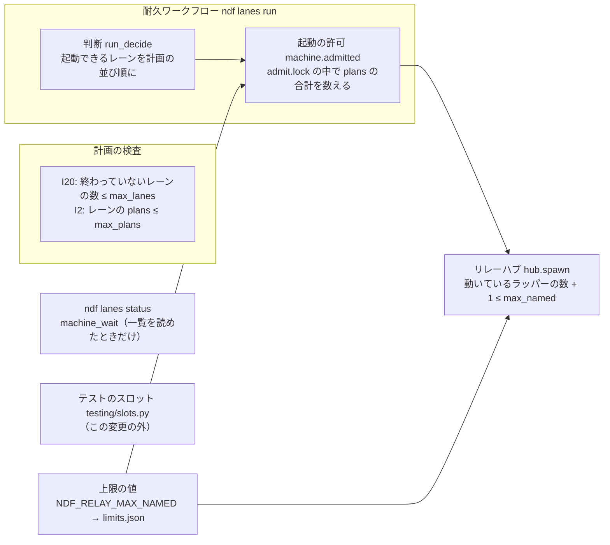
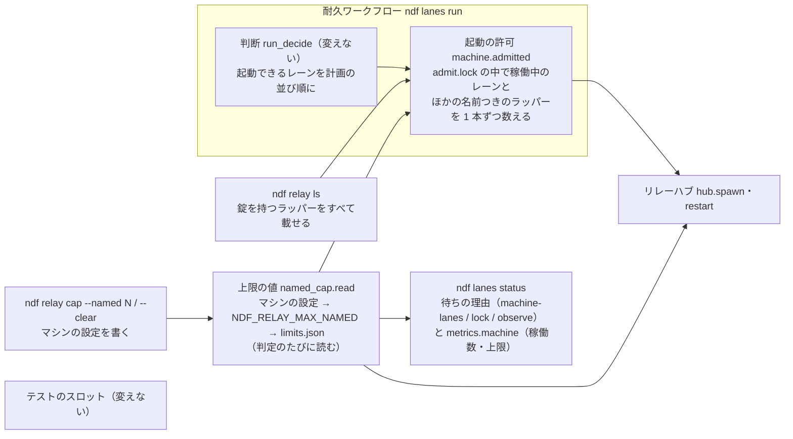
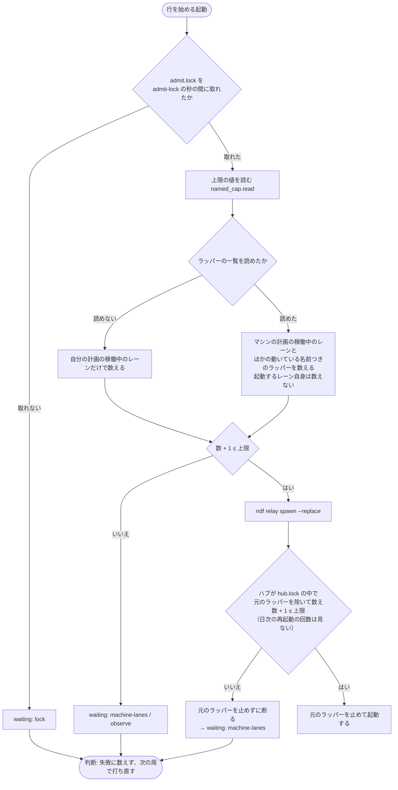

# 並列の計画: 同時実行の制御を稼働中のレーンの数とテストのスロットの 2 層にする（#3989）

並列の計画の同時実行に関わる値が 4 つ（計画の `max_lanes`・`max_plans`、レーンの `plans`、マシンの `relay.max-named`）あり、`after` 待ちの未着手のレーンが上限の数を占め、マシンの数えは申告の重みでメモリの使い方を表していなかった。3 つの値と検査 I20・I2 を消し、耐久ワークフローがマシン全体の稼働中のレーンの数を、リレーハブと同じラッパーを含めて 1 本ずつ数えて `relay.max-named` で絞る。上限の値は判定のたびに読むマシンの設定で次の周から変えられ、待ちとその理由は `ndf lanes status` に出る。採らなかった案は「決定の記録」に、調べた製品とライブラリは付録の「外部の調査」にある。

## 今の姿

何が起きたか・目的・受け入れ条件は要求仕様（[issue-3989-requirements.md](./issue-3989-requirements.md)、正は #3989 の本文）にある。この文書は「どう解くか」と「なぜその解き方か」だけを書く。

設計に要る今の構造:

| 部品 | 今の振る舞い | 場所 |
| --- | --- | --- |
| 計画とレーンの上限の値 | 計画の設定の `max_lanes`・`max_plans`（既定は `relay.max-named`）と、レーンの設定の `plans` を計画の状態（`PlanView`・`LaneSpec`）が持つ。I20 が終わっていないレーンの数を、I2 が各レーンの `plans` を比べる。`ndf lanes limits` が上限を、`ndf lanes set --plans` がレーンの `plans` を変える | `progress/lane/rules.py` の `_limit_errors`・`progress/lane/types.py`・`progress/lane/fold.py`・`progress/plan/__init__.py`・`progress/plan/cli.py` |
| 起動の許可 | 行を始める起動だけを、マシンの起動の排他の中で数えてから打つ。動いているレーン（実行中の行を持つかラッパーが動いている）の設定の `plans` を足し、計画の設定に無い conductor の役のラッパーを 1 本と数える。合計 + このレーンの `plans` が上限を超えれば `waiting` を返す。判断は `waiting` を失敗に数えず、その周は打ち直さない | `progress/lane/machine.py` の `count`・`admit`・`admitted`、`progress/plan/run.py` の `launch_lane`、`progress/plan/run_decide.py` の `_after_launch` |
| リレーハブ | 新しく起動する前に、この NDF の動いているラッパーを役に依らず数え（状態の保存先のラッパーのディレクトリの錠と、状態のファイルのバージョン。`_own_count`）、1 本足して `max_named` を超えれば断る。一覧（`ndf relay ls`）は登録簿の行に「動いているか」を足したもの | `domains/relay/hub.py` の `spawn`・`restart`・`listing`、`domains/relay/hub_decide.py`、`domains/relay/registry.py` の `running` |
| 上限の値 | `NDF_RELAY_MAX_NAMED` → `contracts/limits.json` の `relay.max-named`（既定 6）。`limits.json` は 1 プロセスに 1 回だけ読み、環境変数は起動した環境から引き継ぐ。値を書くサブコマンドは無い | `contracts/limits.py` の `from_env`、`progress/lane/machine.py` の `cap`、`domains/relay/cli.py` の `hub_context` |
| 待ちの表示 | 起動できるレーンのうち、マシンの上限に当たるものに `machine_wait` を載せる。ラッパーの一覧を読めなければ何も載せず、排他の待ちは出さない | `progress/plan/__init__.py` の `machine_waits`・`status` |
| テストのスロット | テスト・LLM の CLI の重みを数え、メモリが下限を割れば待たせるか止める | `testing/slots.py`（変えない） |

数え方の食い違いが 3 つある（要求仕様が挙げた 2 つに、数える単位の違いを足した）。

- **数える単位が違う。** ハブはラッパー（claude のセッション）を 1 本ずつ数え、起動の許可はレーンの申告の `plans` の合計を数える。`plans` はレーンの conductor へ渡らず、実際に動くプロセスとつながらない
- **数える範囲が違う。** 起動の許可は計画のレーンと conductor の役のラッパーだけを数える。オーガナイザーのセッションのように、計画に無く conductor でもない名前つきのラッパーがある。それが動いていると、起動の許可を通った起動をハブが断る。断られた起動は失敗に数えられ、回数が尽きると `launch_failed` の知らせになる。登録簿に無いのに錠を持つラッパーがあれば、ハブは数え、一覧には載らない
- **上限の値を読む時点がプロセスごとに違う。** ハブの判定は要求を処理したプロセスの環境と `limits.json` の値で決まり、耐久ワークフローは `ndf lanes start` を打った環境の値を使い続ける。動いている耐久ワークフローの上限を変える手段は無く、`ndf lanes limits --max-lanes` がその代わりだった

## 文脈と制約

- 計画とレーンの状態はステートマシンの事象（追記だけ）が持つ。書かれた事象は書き換えない。古い計画の作成の事象・レーンの追加の事象・レーンの変更の事象・上限の変更の事象には `max_lanes`・`max_plans`・`plans` が残る
- 計画の設定（`plan.json`）は手元のファイルで、リポジトリに入らない（`.ndf/.gitignore` の `parallel/`）。`ndf lanes init`・`start` と `ndf lanes lane add` は形（`parallel-plan.schema.json`、`additionalProperties: false`）で確かめる
- 同じ計画の `ndf lanes run` は 1 本に限られる（実行のキーのロック）。計画をまたぐ起動の数えはマシンの起動の排他（`<状態の保存先>/parallel/admit.lock`）だけが直列にする
- `progress` は `domains` に依存しない。耐久ワークフローはラッパーの一覧をサブコマンド `ndf relay ls` の結果で読む
- テストのスロットは変えない（要求の受け入れ条件 11）。確定仕様 `docs/specifications/ndf-parallel-machine-plan-limit.md` は計画 p9 のレーン ls3-spec と触る場所が重なるので、この設計と実装の Pull Request では触らず、確定仕様化の工程で `main` を取り込んでから直す
- NDF は普及のフェーズの前で、互換の経路を持たない（MVV Value 4）。決定の根拠に引く MVV の項目は `.ndf/mvv.md`（MVV バージョン 1）にある
- この文書の「行」はレーンの順番表の 1 行（スプリント 1 つか開発ループ 1 つ）を指し、「周」は耐久ワークフローが計画とレーンのステートマシンを読み直す 1 回（上限の設定 `parallel-run.poll` の秒ごと）を指す。「admit-lock の秒」は上限の設定 `parallel-machine.admit-lock` の秒である

## 解き方の全体像

- 計画とレーンには同時実行の値が無くなる。`max_lanes`・`max_plans`・`plans`・I20・I2・`ndf lanes limits`・`ndf lanes set --plans` は無く、`after` 待ちのレーンを何本書いても計画の作成とレーンの追加は数で断られない
- 同時実行の制御は 2 つの層になる。セッションの数の層では、耐久ワークフローの起動の許可が 2 つを 1 本ずつ数える。マシン全体の稼働中のレーン（実行中の行を持つかラッパーが動いている）と、計画のレーンでない動いている名前つきのラッパーである。1 本足して上限を超えるなら待たせる。重い処理の層はテストのスロットのまま
- 起動の許可が数える集まりはハブが数えるラッパーを含むので、許可を通った起動をハブが上限で断らない。許可の後に排他の隙間で空きが埋まっても、ハブは元のラッパーを止める前に断り、起動の手はそれを待ちに戻す（決定 7）
- 上限の値はマシンの設定の 1 つの値で、起動の許可・ハブ・`ndf lanes status` が判定のたびに同じ順で読む。`ndf relay cap --named <数>` で書けば、動いている耐久ワークフローも次の周から新しい値で決める
- `ndf lanes status` は、起動できるのに待つレーンごとに理由と数を、計画の集計にマシンの稼働中の数と上限を出す

## 処理の流れ

行を始める起動 1 回の判定（`launch_lane` → `admitted`）。中止・回答の後の next・`/goal` の入れ直し・止める手は今のまま判定を通らず、上限で待たない（要求の「含まない」）。

続きの起動（中止・回答の後の next・`/goal` の入れ直し）は起動の許可を通らず、`ndf relay spawn --replace --seat <席> --seated` を打つ。ハブは登録簿の同じ名前の行に、行を始める起動が書いた同じ席があることだけを確かめ、本数の上限を判定せず（上限を読まない。バージョンの混在の判定は対象を除いて行う）、元のラッパーが動いていれば止めてから起動する。続きの起動は待ちにならない（決定 7）。

## 決定の記録

### 決定 1: 計画とレーンに同時実行の値を残さないため、`max_lanes`・`max_plans`・`plans` と I20・I2・`ndf lanes limits`・`ndf lanes set --plans` を消す

- **質問**: 3 つの値を数え方を変えて残すか、消すか
- **選んだ案**: 消す。計画の設定の形・計画の状態（`PlanView` の `max_lanes`・`max_plans`、`LaneSpec` の `plans`）・検査（`_limit_errors` の I20 と I2）・`ndf lanes limits` のサブコマンド・`ndf lanes set` の `--plans`・`ndf lanes status` の該当の項目・コントラクト（`lanes.args.schema.json`・`lanes.result.schema.json`・`commands.md`）から外す。I20・I2 の番号は欠番にし、別の規則に使い回さない
- 採らなかった案: `max_lanes` を稼働中のレーンの数で数え直して計画ごとに残す（上限が 2 つ残り、どちらで待ったかを見分ける手間が残る。利用者が廃止を決めた）
- 採らなかった案: `plans` をマシンの数えの重みとして残す（申告で、レーンの conductor へ渡らず、実際に動くプロセスとつながらない。重い処理はテストのスロットが絞る）
- 採らなかった案: I20・I2 の番号を別の検査に付け直す（番号で過去の記録と文書を引くと、別の規則を指す）
- **代償**: 1 つの計画だけを少なく流したい（マシンには空きがあるのにこの計画は 2 本まで）という使い方は、`after` で並びを書くほかに手段が無くなる。この使い方は利用者の決定（計画とレーンの上限の値の廃止）が手放したもので、同時に動く数を抑える目的はマシン全体の上限が持つ
- 根拠: Value 3「手順は使うほど増えるのではなく、減っていく」・Value 4（MVV バージョン 1）

### 決定 2: 再開できなくならないよう、記録の 3 つの値は読むときに捨て、計画の設定のファイルは形で断ってファイルから消す

- **質問**: 既にある計画の設定（`plan.json`）とステートマシンの記録に残る 3 つの値を、ファイルから消すか、読むときに捨てるか
- **選んだ案**: 2 つを分ける。ステートマシンの記録は書き換えられないので、畳み込み（`fold.py`）が計画の作成・レーンの追加・レーンの変更・上限の変更の事象の 3 つの値を読まない（3 つの値だけを変えた事象は、何も変えない事象になる）。計画の設定のファイルは、形から 3 つの値を消して `ndf lanes init`・`start`・`lane add` がその名前を名指す誤りで断る。手元の `.ndf/parallel/p9/plan.json`・`p12/plan.json` は、実装の Pull Request の移行の手順で消す（`jq 'del(.max_lanes, .max_plans) | .lanes |= map(del(.plans))'` で書き直す。2026-11-21 に p9 の `plan.json` の写しへ打ち、終了コード 0 で計画の項目が `lanes`・`name`・`rules`・`version`、レーンの項目が `after`・`input`・`name`・`rows`・`touches` だけになることを確かめた）
- 採らなかった案: 計画の設定でも読むときに捨てる（形に「読まないキー」を残すことになり、新しい計画にも書けてしまう。書いても効かない設定が残る）
- 採らなかった案: 移行のサブコマンドを足す（消すのは手元の 2 ファイルのキーで、誤りが名指すので手で直せる。普及の前の利用者は計画を作り直してよい。Value 4 の「移行のコマンド」は、移行の手順に書く上の 1 行の `jq` が受け持つ）
- **代償**: 移行の手順を打つ前に `ndf lanes start` を打つと断られる。断りの文にキーの名前が出るので、消して打ち直す
- 根拠: Value 3「バージョンを上げても再起動しても、進行中の作業と人の回答は失われず、止まった所から続く」・Value 4「旧い設定の形を残す互換の仕組みを持たず、移行のコマンドできれいな最終形へ移す」（MVV バージョン 1）

### 決定 3: 許可を通った起動をハブが断らないよう、起動の許可は稼働中のレーンとほかの名前つきのラッパーを 1 本ずつ数え、一覧はハブが数えるラッパーをすべて載せる

- **質問**: 耐久ワークフローが待たせる数を、ハブが断る数とどう一致させるか
- **選んだ案**: 起動の許可が数える集まりを、ラッパーの名前の和集合にする。1 つ目はマシンの計画の稼働中のレーン（実行中の行を持つレーン）のラッパーの名前である。マシンの計画は、自分の計画・一覧の conductor の役の行から読む計画・マシンの計画の索引（`<状態の保存先>/parallel/plans/`）に載る計画の和である。索引は起動の許可が通ったときに排他の中で計画の所在（作業ディレクトリと計画の名前）を書き、耐久ワークフローが終わるときに消す。ラッパーがすべて止まって登録簿から消えた計画も、実行中の行を持つ間は索引から見つかる。2 つ目は一覧で動いているラッパーの名前（役に依らない）である。起動しようとしているレーン自身のラッパーは除く。数 + 1 が上限を超えれば待たせる。あわせて `ndf relay ls` が、登録簿に無いのに錠を持つ動いているラッパーも行（`registered: false`）として載せる。これで (2) はハブが数えるラッパー（`registry.running` の錠）を含む
- 採らなかった案: 実行中の行を持つレーンだけを数える（ハブはオーガナイザーのセッションも数えるので、許可を通った起動をハブが断る）
- 採らなかった案: ハブが数えるラッパーだけを数える（実行中の行を持つのにラッパーが止まったレーンの席を残さず、そのレーンの `/goal` の入れ直しや回答の後の再起動をハブが断る）
- 採らなかった案: ハブに断られた起動を待ちとして読む（断られるまでレーンの前のラッパーを止めてしまう。数えてから起動する今の形を崩す）
- **代償**: ラッパーが止まったまま実行中の行を持つレーンが 1 本あるごとに、耐久ワークフローはハブより 1 本分早く待つ（等しいのは、そのレーンが無いとき）。席を残すのは、そのレーンの続き（`/goal` の入れ直し・回答の後の再起動）が上限で待たずに打たれ、ハブに断られないためである。上限をその場で下げたとき・席を許可を通らない起動が使ったときも、続きの起動はハブが本数で断らない（決定 7）ので、動くラッパーの数が一時的に上限を超え得る。索引のファイルが耐久ワークフローの異常終了で残ると、その計画のステートマシンを周ごとに読む（実行中の行が無ければ 0 本と数えるので、数は狂わない）。オーガナイザーや手で起動したラッパーが動いているマシンでは、今より早く起動の待ちになる
- 根拠: Value 3「同じ手順は毎回同じ結果になる」・Value 1「ワークフロー上の課題で、利用者に操作を求めない」（MVV バージョン 1）

### 決定 4: 動いている耐久ワークフローの上限を次の周から変えられるよう、判定のたびに読むマシンの設定と `ndf relay cap` を足す

- **質問**: 計画の上限を消すと、動いている耐久ワークフローの同時実行の上限を変える手段が無くなる。上限の値をどこに置き、だれがいつ読むか
- **選んだ案**: マシンの設定（`<状態の保存先>/relay/hub/cap.json`、`{"version": 1, "max_named": <数>}`）を足し、`ndf relay cap --named <数>` が書き、`--clear` が消し、引数なしで今の値と出所を出す。上限の値を読む関数を 1 つ（`ndf.contracts.named_cap.read`）にし、起動の許可（`machine.cap`）とリレーハブの判定（`spawn`・`restart`）と `ndf lanes status` が、判定のたびにマシンの設定 → `NDF_RELAY_MAX_NAMED` → `limits.json` の `relay.max-named` の順で読む。3 つの出所のどれも 1 以上の整数だけを受け、ほかの値（`0.5`・`inf`・`1.5`・数でない）は `NamedCapError` で断る（切り捨てない）。マシンの設定が無いとき（未作成・`--clear` の後）のフォールバックの値は、要求を出した側の環境で決める。ハブへの要求（`spawn`・`restart`）は、頼む側がマシンの設定を読まずに環境変数 → `limits.json` で解いた値と出所（`named_cap.fallback`）を `cap` として載せる。マシンの設定の値は要求に載せない。ハブはマシンの設定を読み直し、あればその値、無ければ要求の `cap` の値で判定する。これで、要求を書いた後・ハブの判定の前に `ndf relay cap --clear` が済めば、ハブは消した値でなく頼む側の環境の値で判定する。耐久ワークフローの `ndf relay spawn` は耐久ワークフローの環境を引き継ぐので、起動の許可とハブの判定は同じ値になる。要求を処理したプロセス（`drain` を打った側）の環境と `limits.json` は判定に使わない
- 採らなかった案: 環境変数だけにし、変えるときは `ndf lanes stop`・`start` で耐久ワークフローを打ち直す（ハブは要求を処理したプロセスの環境で決めるので、打ち直しても耐久ワークフローとハブの値が食い違い得る。止めた周の間は新しい起動が止まる）
- 採らなかった案: 計画ごとに上限を持つ（マシン全体の値を計画が持つと、計画ごとに違う値になり、1 つの上限にならない）
- 採らなかった案: 環境変数をマシンの設定より先に読む（動いているプロセスが引き継いだ古い値が、後から書いた値に勝つ）
- 採らなかった案: 頼む側が `named_cap.read`（マシンの設定を含む）で解いた値を要求に載せる（要求を書いた後に `--clear` すると、ハブはマシンの設定が無いので要求の値を使い、消した値で判定する。マシンの設定が 6・頼む側の環境が 2 なら、3 本が動く間の起動がクリアの後も 6 で通る）
- 採らなかった案: ハブが自分の環境でフォールバックを読む（耐久ワークフローが環境変数で 8、ハブを兼ねたプロセスが既定の 6 なら、6 本が動く間に許可を通った起動をハブが断る）
- 採らなかった案: 環境変数を今の `limits.from_env` と同じく正の浮動小数点数で受けて `int()` で切り捨てる（`0.5` が 0 になって空のマシンでも起動できず、`inf` は変換で例外になる）
- **代償**: 11 系の「値を書き込むサブコマンドは持たない」（`docs/specifications/ndf-next-closed-children-subcommands.md` の `from-issue:3569-relay-cap`）を覆す。元の決定は値の持ち主を環境変数と上限の宣言に決めただけで、書くサブコマンドを持たない理由は同じ表に書かれていない。当時は `ndf lanes limits` が計画ごとに上限を変えられた。読む値の出所が 1 つ増える
- 作り方: 自前で作る（状態の保存先の JSON 1 つと、既存の `limits.from_env` の前に 1 つ出所を足す読み手）
- 比べた候補: LIB1 / PRD1
- 根拠: Value 1「ワークフロー上の課題で、利用者に操作を求めない」・Value 3「同じ手順は毎回同じ結果になる」（MVV バージョン 1）

### 決定 5: 待ちの理由をオーガナイザーが読めるよう、`ndf lanes status` が判定をその場で数え直し、排他は取らずに確かめる

- **質問**: 待ちの理由（マシンの上限・排他・ラッパーの一覧を読めない）と稼働中の数を、どこから出すか
- **選んだ案**: `ndf lanes status` がその場で数え直す。起動できる行を持つレーンごとに、起動の許可と同じ数え方で判定し、収まらなければ `machine_wait`（`reason` が `machine-lanes`）を載せる。ラッパーの一覧を読めなければ自分の計画の稼働中のレーンだけで数え、収まらなければ `reason` を `observe` にする。マシンの起動の排他は待たずに 1 回だけ取ってすぐ放し、取れなければ起動できるレーンのすべてに `reason` が `lock` の待ちを載せる。計画の集計（`metrics`）に `machine`（`lanes` 稼働中の数・`cap` 上限・`unreadable` 読めない計画・`others` ほかの計画のステートマシンを読んだか・`error` 上限を読めないときの文）を足す。`machine_wait` の項目は `reason`・`machine_lanes`・`cap`・`unreadable` にし、規則の名前を `machine-plans` から `machine-lanes` へ改める。排他の待ち（`lock`）は数えていないので、`machine_lanes` と `cap` を null にする（耐久ワークフローの `waiting` も同じ）。打つ回数を今より増やさないため、ほかの計画のステートマシンは起動できる行を持つレーンがあるときだけ、1 回の `status` で 1 計画 1 回読み、集計とレーンごとの判定が同じ読み取りを使う。起動できるレーンが無ければほかの計画を読まず、集計は自分の計画と一覧の動いているラッパーで数えて `others` を偽にする。マシンの設定が壊れていれば `status` は止めずに、`metrics.machine` の `cap` を null・`error` に文を載せ、待ちは載せない（終了コードは今のまま。耐久ワークフローの起動は `launch_failed` の知らせになるので、オーガナイザーはそちらでも気づく）
- 採らなかった案: 耐久ワークフローが最後の待ちの結果をステートマシンへ書き、`status` はそれを読む（周ごとに事象が増え、待ちが解けたときの消し方が要る）
- 採らなかった案: `status` が排他を取ったまま数える（ほかの計画の DB を読む間、起動の排他を握り、耐久ワークフローの起動を遅らせる）
- 採らなかった案: 集計のために毎回ほかの計画を読む（稼働中の行を眺めるだけの `status` でも、計画ごとにステートマシンを開き、所在の確かめで Git を打つ）
- 採らなかった案: マシンの設定が壊れていれば `status` を `invalid` で止める（計画の行とレーンの生死まで読めなくなり、直すための材料が出ない）
- **代償**: `status` の待ちは打った時点の数え直しで、耐久ワークフローが同じ周に見た値と一致するとは限らない。排他の待ちはその瞬間だけの値で、`lock` が出たらオーガナイザーは `status` を打ち直して読む（手順書の `parallel-checks.md` に書く）。起動できるレーンが無いときの集計（`others` が偽）は、ほかの計画のうちラッパーが止まったまま実行中の行を持つレーンを数えないので、起動の許可の数より少なく出得る
- 根拠: Value 1「読み切れる量の材料から、詳しく知りたい所の中身へすぐにたどれる」（MVV バージョン 1）

### 決定 6: 起動の順を変えずに済ませるため、待ちのレーンは今の判断のまま計画のレーンの並び順に打ち直す

- **質問**: 待ちのレーンを起動する順と数を、判断（`run_decide`）で変えるか
- **選んだ案**: 変えない。毎周、起動できるレーンを計画のレーンの並び順に試し、起動の許可が通るものから起動する。待ちになった起動はその周は打ち直さない。重みが無くなったので、空きが 1 つできれば並びの先のレーンが 1 本起動し、続くレーンはその起動を数えて待つ（同じ周の中でも排他の中で数え直すため）
- 採らなかった案: 判断に空きの数を渡し、空きの数だけ起動の手を作る（起動の許可が排他の中で数え直すので同じ結果になり、写しと判断の形が増える）
- **代償**: 並びの先のレーンの起動が起動の許可の後で失敗すると（spawn の失敗）、その周は後ろのレーンが空きを使う。並びの先のレーンは次の周に打ち直す。要求の受け入れ条件 6 の「並び順」は試す順で、起動に失敗したレーンが空きを待ち続けることまでは求めない
- 根拠: Value 3「判断の要らない手順は仕組みが進める」・Value 5（MVV バージョン 1）

### 決定 7: 許可の後に空きが埋まっても元のレーンを失わないよう、置き換えの起動はハブが元のラッパーを止める前に上限を判定し、上限の断りを待ちに戻す

- **質問**: 起動の許可（`admit.lock`）とハブの判定（`hub.lock`）は別の排他で、間に隙間がある。通常の `ndf relay spawn`（オーガナイザーや手の起動）は `admit.lock` を取らないので、残り 1 枠に先に入り得る。同じ隙間で `ndf relay cap --named` が上限を下げ得る。さらに今の `launch_lane` は元のラッパーを止めてから `spawn` するので、3 本が動く間に上限を 2 へ下げて 1 本の `/goal` を入れ直すと、止めた後も 2 本が動くので `spawn` を断られ、元のレーンが止まったまま残る。続きの起動（中止・回答の後の next・`/goal` の入れ直し）は、要求が上限で待たせないと定めている（要求の「含まない」）。この 3 つをどう満たすか
- **選んだ案**: 止めることと起動することを、ハブの 1 つの要求（`ndf relay spawn --replace`）にまとめ、行を始める起動と続きの起動で本数の判定を分ける
  - 行を始める起動（`--replace`。要求の種別は旧版のハブが通常の起動として処理できない `replace` にし、旧版に断られたら頼む側が新しい要求 ID で書き直す）: ハブは `hub.lock` の中で、置き換える対象（同じ名前の動いているラッパー）を除き、起動の許可が数えたラッパーの止まった稼働中のレーン（要求の `held`）を足して数え、数 + 1 が上限を超えれば対象を止めずに断る。通れば対象を止め、止まったのを確かめてから起動する。上限による断りは、結果の `items` に `{"refusal": "max-named", "running": <数>, "cap": <上限>}` を載せ、`launch.spawn` がそれを読んで待ちの結果（`waiting`、理由 `machine-lanes`、ハブの数と上限）に変える。耐久ワークフローの判断はそれを失敗に数えず、次の周で打ち直す。ハブの要求は `hub.lock` が 1 本ずつ処理するので、ほかのラッパーの起動と上限の書き換えはハブの判定の前か後のどちらかに入り、許可を通った起動が断られても元のラッパーは動いたまま残る
  - 続きの起動（`--replace --seated`）: 実行中の行を持つレーンは、起動の許可がすでに 1 本と数えて席を残している（決定 3）。続きの起動はその席を使うだけで稼働中のレーンの数を増やさないので、ハブは本数の上限を判定しない（上限の値も読まない）。代わりに、名前を明示させ、登録簿のその名前の行の席（行を始める起動が書いた `<レーンのステートマシンの ID>:<行のキー>`）が同じかを確かめ、席の無い新規起動は断る。バージョンの混在は、置き換えのどちらの起動でも対象を除いて判定する。導入の入口と作業ディレクトリは対象を止める前に確かめる。元のラッパーが動いていれば止めてから起動する。上限を稼働中の数より下へ下げても、中止・回答の後の next・`/goal` の入れ直しは待たずに通り、計画の中止の処理が終わる
  - どちらも日次の再起動の回数（`starts`・`max_starts`）は判定に使わず、増やさない。登録簿の行の `starts` は今の `stop` → `spawn` と同じく、その日の 0 回で書き直す。回数の上限は `ndf relay restart`（利用者や切り替えの手が打つ再起動）だけのものとして残す
- 採らなかった案: ハブの判定も `admit.lock` を取る（耐久ワークフローは `admit.lock` を持ったまま `ndf relay spawn` の子のプロセスを待つので、子のハブが同じ排他を待って詰まる。排他を渡す仕組みが要る）
- 採らなかった案: 起動の手が止める前に自分で数え直す（数え直しとハブの判定の間に同じ隙間が残る）
- 採らなかった案: 置き換えも `hub_decide.restart` で判定する（日次の再起動の回数も見るので、回数を使い切ったレーンは空きがあっても次の行へ進めない。今の `stop` → `spawn` はこの回数を使わない）
- 採らなかった案: 続きの起動も本数で判定し、断られたら待ちにする（上限を下げると中止の起動まで待ち続け、計画の中止が終わらない。要求が待たせないと定めている）
- **代償**: `ndf relay spawn` に引数が 2 つ増える。続きの起動は本数で断られないので、上限を下げた直後や、許可を通らない起動（オーガナイザーや手の `ndf relay spawn`）が席を使った後は、動くラッパーの数が上限を超え得る（下げた上限は次の行を始める起動から効く）。ハブに断られた行を始める起動は待ちとして読むので、上限で断られ続けるレーンは `launch_failed` にならず待ち続ける。そのレーンは実行中の行を持たず未着手の行を持つままなので、`ndf lanes status` が起動できるレーンとして数え直し、待ちに出す（決定 5）
- 根拠: Value 3「バージョンを上げても再起動しても、進行中の作業と人の回答は失われず、止まった所から続く」・Value 3「同じ手順は毎回同じ結果になる」（MVV バージョン 1）

## 影響と危険

- **働く範囲**: 並列の計画を使う利用先のリポジトリのすべてで働く（`plugins/ndf` の `progress`・`domains/relay`・コントラクト・手順書）。上限の値はマシンごとで、リポジトリに依らない
- **プロジェクトごとに違うもの**: 無い。上限の値はマシンの設定（`ndf relay cap`）と環境変数で受け、計画の設定には置かない
- **当たるモード**: 並列の計画を使う進め方（`issue-plan-strategy` の並列の計画・`development-workflow` の並行開発）だけ。単発のスプリントには当たらない
- **壊れうる箇所**:
  - 動いている計画 p9・p12 の `plan.json` に 3 つの値がある。実装のバージョンを入れた後、移行の手順の前に `ndf lanes start` を打つと断られる（決定 2）。実装の Pull Request の本文の移行の手順に書く
  - `plans` を 2 以上にしていたマシンでは、今より多くのレーンが同時に動く。メモリの実測（要求の「今の姿」。セッション 8 本で 2.4 GB）とテストのスロットが重い処理を絞ることから、上限 6 のままで足りる
  - 同じファイルを触る別の変更: `progress/lane/machine.py`・`progress/plan/__init__.py`・`domains/relay/hub.py`・`progress/lane/rules.py` を触る開いた Pull Request は無い（2026-11-21 に `gh pr list` の触るファイルで確かめた）。実装の前に打ち直す
  - 計画 p9 のレーン ls3-spec が `docs/specifications/` を触る。この設計は `docs/specifications/` を触らない（確定仕様化の工程で直す）
  - `parallel-cross-repo.md` は I20 を「クローンでない場所を指した」の断りとしても引くが、11 系にその検査は無い。この設計は I20 を消すので、その行と「上限を超える」の行と例の `plans` を直す。検査が無いことは #3992 として起票した

### 代表のリポジトリでの振る舞い

| 代表のリポジトリ | 設定の要点 | 直した後に起きること | この種類で扱えなくなること |
| --- | --- | --- | --- |
| Web サービス（nd-factory） | 並列の計画を使えば、レーンのリポジトリと課題の重なりで計画を組む。上限はマシンの設定 | 計画の作成とレーンの追加が数で断られない。同時に動くレーンはマシン全体の 1 つの上限で絞られ、待ちが `ndf lanes status` に出る | 無し |
| モバイルアプリ | 同上 | 同上 | 無し |
| 業務文書だけ | 並列の計画をほとんど使わない | 使わなければ何も変わらない | 無し |

### ai-plugins だけの事情

| 値 | 置く所 | 持つ Issue |
| --- | --- | --- |
| 手元の計画 p9・p12 の `plan.json` の 3 つの値 | 利用者の手元の `.ndf/parallel/<計画>/plan.json`（リポジトリに入らない）。実装の Pull Request の移行の手順で消す | #3989 |

## 用語

| 用語 | 意味 | 用語集への反映 |
| --- | --- | --- |
| マシンの設定 | 同時に動かすレーンとラッパーの数の上限を、マシンごとに状態の保存先へ置く値。リレーハブと耐久ワークフローが判定のたびに環境変数と上限の設定より先に読む | 追加 |
| 稼働中のレーン | 実行中の行を持つか、ラッパーが動いているレーン。承認ゲート・質問の回答を待つ行を持つレーンを含む。マシン全体の同時実行の上限はこの数とほかの名前つきのラッパーを 1 本ずつ数える | 追加 |
| 起動の許可 | 耐久ワークフローが行を始める起動の前に、マシンの起動の排他の中で稼働中の数を数え、上限に収まるときだけ起動させる判定。収まらなければ起動の待ちに置く | 追加 |

## テスト設計

| 受け入れ条件 | どの振る舞いで縛るか | どう壊したら落ちるべきか |
| --- | --- | --- |
| 1 | 計画の状態と `ndf lanes status` に 3 つの値が無く、`ndf lanes limits` と `ndf lanes set --plans` は引数の誤りで断る。検査の誤りに I20・I2 が出ない | 計画の状態に値を戻す・引数を残すと落ちる |
| 2 | 3 つの値のどれかを書いた計画の設定・レーンの設定を `ndf lanes init`・`lane add` へ渡すと、誤りの文にその名前が出て断る。消した設定は通る | 形に値を残すと落ちる |
| 3 | 計画の作成・レーンの追加・レーンの変更・上限の変更の事象に 3 つの値を持つ記録を畳み込むと、計画の状態を読める。値だけの事象は計画の状態を変えない | 畳み込みが値を読みに行く（`KeyError`・型の誤り）と落ちる |
| 4 | `after` で直列にした未着手のレーン 3 本の計画が、上限 1 のマシンの設定でも `ndf lanes init` を通る | 計画の検査が終わっていないレーンを数えると落ちる |
| 5 | 稼働中のレーンとほかの動いているラッパーの数 + 1 が上限を超えると `admitted` が `waiting`（`machine-lanes`）を返し、判断はその起動を失敗にも `launch_failed` にもしない | 待ちを失敗に数える・リクエストを書くと落ちる |
| 6 | 待ちのレーンが 2 本あり、稼働中のレーンが終わって 1 本分の空きができた周で、計画の並び順の先のレーンだけを起動する | 並びを逆にする・空きより多く起動すると落ちる |
| 7 | 計画に無く conductor でもない役の動いているラッパーと、登録簿に無く錠を持つラッパーを、起動の許可が 1 本ずつ数える。許可した起動の後のラッパーの数がハブの判定（`hub_decide.spawn`）を通る。マシンの設定が無く、耐久ワークフローの環境が `NDF_RELAY_MAX_NAMED=8`・ハブを兼ねるプロセスの環境に変数が無い（既定 6）とき、6 本が動く間に許可した起動をハブが通す | 役で絞る今の条件に戻す・一覧が錠だけのラッパーを載せない・ハブが `drain` を打った側の環境で上限を読むと落ちる |
| 7 | 起動の許可を通った後、ハブの判定の前に別の `ndf relay spawn` が残り 1 枠を使う（または `ndf relay cap --named` が上限を下げる）と、`spawn --replace` は元のラッパーを止めずに断り、起動の手は `waiting`（`machine-lanes`）を返し、判断は失敗にも `launch_failed` にもしない | 止めてから判定する・ハブの上限の断りを失敗に数えると落ちる |
| 7 | 3 本が動く間に上限を 2 へ下げると、そのうち 1 本の中止・回答の後の next・`/goal` の入れ直しのそれぞれが待たずに通り（`spawn --replace --seated`）、元のラッパーを止めてから起動して、動く本数は 3 のまま。中止した計画は中止の処理を終える。同じ状態で別のレーンの行を始める起動は、起動の許可で待つ | 続きの起動を本数で判定する・待ちに戻す・元のラッパーを止めずに 2 本目を起動すると落ちる |
| 7 | 日次の再起動の回数を使い切ったレーンが、空きのある状態で次の行を始める起動（`spawn --replace`）を打つと通り、登録簿の `starts` はその日の 0 回で書き直される | 置き換えを `hub_decide.restart` で判定する・`starts` を増やすと落ちる |
| 8 | 別の 2 つの計画（ステートマシンの ID が違う）の起動の許可を同時に走らせても、起動した後の稼働中の数が上限を超えない。上限 1 で計画 A が回答待ちの行を持ち、A のラッパーがすべて止まって登録簿から消えても、計画 B の起動は待つ（A は索引から見つかる） | 排他の外で数える・登録簿の conductor の行だけから計画を見つけると落ちる |
| 9 | 起動できるレーンに、上限で待つときは `machine-lanes`、一覧を読めないときは `observe`、排他が取られているときは `lock`（`machine_lanes`・`cap` が null）の `machine_wait` が載り、`metrics.machine` に稼働中の数と上限が載る。起動できるレーンが無い `status` はほかの計画のステートマシンを 1 回も開かず、ある `status` はレーンの数に依らず 1 計画 1 回だけ開く。マシンの設定が壊れていても `status` は計画とレーンを出し、`metrics.machine.error` に文が載る | 一覧を読めないときに待ちを載せない・排他を握ったまま数える（排他を持つ別の処理が `status` を待つ）・集計と待ちで別々に読む・壊れた設定で止まると落ちる |
| 10 | `ndf relay cap --named` で書いた値を、同じプロセスの次の判定（起動の許可・ハブ・`status`）が使う。環境変数より先に読む。`--clear` の後は環境変数 → `limits.json` に戻る。上限を下げても実行中の行を中止させる手を出さない。3 つの出所のどれでも `1` は通り、`0`・`0.5`・`1.5`・`inf`・`nan`・`-1`・数でない値は `NamedCapError` で断る | 値を 1 回だけ読んで持ち続ける・環境変数を先に読む・小数を切り捨てると落ちる |
| 10 | マシンの設定が 6・頼む側の環境が `NDF_RELAY_MAX_NAMED=2` で、3 本が動く間に `spawn` の要求を書き、ハブの `drain` の前に `ndf relay cap --clear` を済ませると、ハブは 2 で判定して断る。要求の `cap` は `source` が `env` で値が 2（マシンの設定の 6 を載せない） | 要求にマシンの設定の値を載せる（クリアの後も 6 で通る）と落ちる |
| 10 | 壊れた `cap.json` で、ハブの `spawn` の要求は `invalid` の結果になり、同じ `drain` の後ろの `stop` の要求も処理される。引数なしの `ndf relay cap` は `invalid`（終了コード 2）の結果 JSON を出す。耐久ワークフローの起動の手は `final` の失敗を返す | 例外が `drain` や CLI の外へ抜けると落ちる |
| 11 | テストのスロットのテスト（`plugins/ndf/tests/testing/`）が変わらずに通る | — |
| 13 | 上の行のテストは事象の数・回数・状態で判定し、時間で区切らない | — |

受け入れ条件 12（手順書）は文言を突き合わせるテストを書かず、ドキュメントレビューで見る。確定仕様の分は確定仕様化の工程で見る。

## どこを変えるか

詳細設計は [issue-3989-design-detail.md](./issue-3989-design-detail.md) にある（新設する関数 12・シグネチャを変える関数 8 のため。新設は `named_cap.path`・`read`・`fallback`・`write`・`parse`・`machine.lock_free`・`index_plan`・`unindex_plan`・`indexed`・`hub._max_named`・`hub_decide.replace`・`relay.cli._cap`、シグネチャを変えるのは `machine.cap`・`admit`・`admitted`・`waiting`・`machine_plans`・`plan.machine_waits`・`launch.spawn`・`hub.requester`）。

## 設計の結果

| 課題 | 扱い | 統合先 | 触るファイル |
| --- | --- | --- | --- |
| #3989 | 実装する | — | `plugins/ndf/src/ndf/contracts/named_cap.py`（新設）、`plugins/ndf/src/ndf/progress/lane/rules.py`、`plugins/ndf/src/ndf/progress/lane/types.py`、`plugins/ndf/src/ndf/progress/lane/fold.py`、`plugins/ndf/src/ndf/progress/lane/machine.py`、`plugins/ndf/src/ndf/progress/lane/__init__.py`、`plugins/ndf/src/ndf/progress/plan/__init__.py`、`plugins/ndf/src/ndf/progress/plan/cli.py`、`plugins/ndf/src/ndf/progress/plan/run.py`、`plugins/ndf/src/ndf/progress/lane/launch.py`、`plugins/ndf/src/ndf/domains/relay/cli.py`、`plugins/ndf/src/ndf/domains/relay/hub.py`、`plugins/ndf/src/ndf/domains/relay/hub_decide.py`、`plugins/ndf/contracts/workflow/parallel-plan.schema.json`、`plugins/ndf/contracts/schemas/io/lanes.args.schema.json`、`plugins/ndf/contracts/schemas/io/lanes.result.schema.json`、`plugins/ndf/contracts/schemas/io/relay.args.schema.json`、`plugins/ndf/contracts/schemas/io/relay.result.schema.json`、`plugins/ndf/contracts/domains/env.json`、`plugins/ndf/contracts/limits.json`、`plugins/ndf/docs/contracts/commands.md`、`plugins/ndf/docs/contracts/env.md`（`env.json` から再生成）、`plugins/ndf/skills/issue-plan-strategy/references/parallel-plan.md`、`plugins/ndf/skills/development-workflow/references/parallel.md`、`plugins/ndf/skills/development-workflow/references/parallel-checks.md`、`plugins/ndf/skills/development-workflow/references/parallel-cross-repo.md`、`plugins/ndf/skills/development-workflow/references/parallel-work.md`、`docs/ndf-parallel-model.md`、`plugins/ndf/tests/progress/test_lane.py`、`plugins/ndf/tests/progress/test_plan.py`、`plugins/ndf/tests/progress/test_lane_machine.py`、`plugins/ndf/tests/progress/test_run_lanes.py`、`plugins/ndf/tests/progress/test_lane_launch.py`、`plugins/ndf/tests/support/plan_decls.py`、`plugins/ndf/tests/contracts/test_named_cap.py`（新設）、`plugins/ndf/tests/domains/relay/test_relay_cli.py`、`plugins/ndf/tests/domains/relay/test_relay_hub.py` |

## 未確認のまま残ること

| 項目 | 内容 |
| --- | --- |
| リレーハブが長く動くプロセスで要求を処理するか | 要求は処理したプロセスの文脈（`hub_context`）で判定される（`hub.submit` の `drain`）。文脈は CLI の呼び出しごとに作るが、長く動く処理が同じ文脈で `drain` するかを読み切っていない。決定 4 は判定のたびにマシンの設定を読み直し、無ければ要求に載った頼む側の値を使うので、どちらでも同じ値になる。実装の `tdd-cycle` で確かめる |
| ハブが数えないのに一覧で動いているラッパー | ハブは状態のファイルにバージョンを持つラッパーだけを数え、一覧は錠を持つものを載せる。状態のファイルが無い起動の途中のラッパーは、起動の許可だけが数える（多い側に倒れる）。そのような時間の長さは実装で確かめる |

## 外部の調査

| 種類 | 調べるか | 理由 |
| --- | --- | --- |
| 標準・仕様 | 調べない | 同時実行の上限の数え方と待たせ方は、プロジェクトの中の取り決め（ラッパー・計画・レーン）だけで形が決まり、従う公開の仕様が無い |
| 主要な製品 | 調べる | 同時に動く数の上限を超えた分を待たせる形を、広く使われる製品で確かめる |
| ライブラリとサービス | 調べる | プロジェクトが依存している DBOS のキューの同時実行の上限で、起動の待ちを置き換えられるかを確かめる |

### 主要な製品

| # | 製品 | どう解いているか | 設計への反映 | 出典 |
| --- | --- | --- | --- | --- |
| PRD1 | GitHub Actions の `strategy.max-parallel` | ワークフローの中の行列のジョブを同時に動かす数の上限で、ランナーに空きがあっても上限までしか同時に動かさず、残りは空いたら動く | 上限は「同時に動く数」を 1 本ずつ数え、まだ始まっていないものは数えない（決定 1・3）。上限の値はワークフローの定義が持ち、動いている実行の途中では変えない点は採らない（決定 4） | https://docs.github.com/en/actions/writing-workflows/choosing-what-your-workflow-does/running-variations-of-jobs-in-a-workflow（2026-11-21） |

### ライブラリとサービス

| # | 候補 | バージョン | ライセンス | 最後のリリースの日付 | 終了のアナウンス | 要件を満たすか | 出典 |
| --- | --- | --- | --- | --- | --- | --- | --- |
| LIB1 | DBOS のキュー（`Queue` の `global_concurrency`・`worker_concurrency`） | 3.1.0（`uv.lock`） | 確かめていない | 確かめていない | 無し | 満たさない。キューの上限はキューに入れた関数が動いている間を数える。レーンはラッパーの claude が数時間から数日動き続け、耐久ワークフローの起動の手（`launch_lane`）は spawn した直後に終わるので、関数の実行の間ではレーンの稼働を数えられない。数える相手（ラッパー）がプロセスの外にあり、ハブの数え方とも合わせられない | https://docs.dbos.dev/python/reference/queues（2026-11-21）・`uv.lock` |

### 確かめられなかったこと

| 対象 | 試した手段 | 結果と理由 |
| --- | --- | --- |
| DBOS の最後のリリースの日付とライセンス | 試していない | 要件を満たさないと分かった候補なので、取得の試みを使わなかった |

調べた量: 候補 2 件・取得の試み 2 回。
