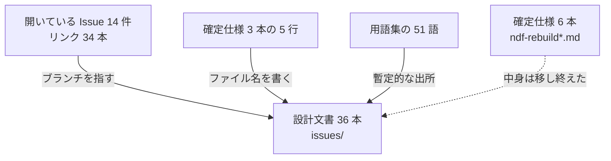
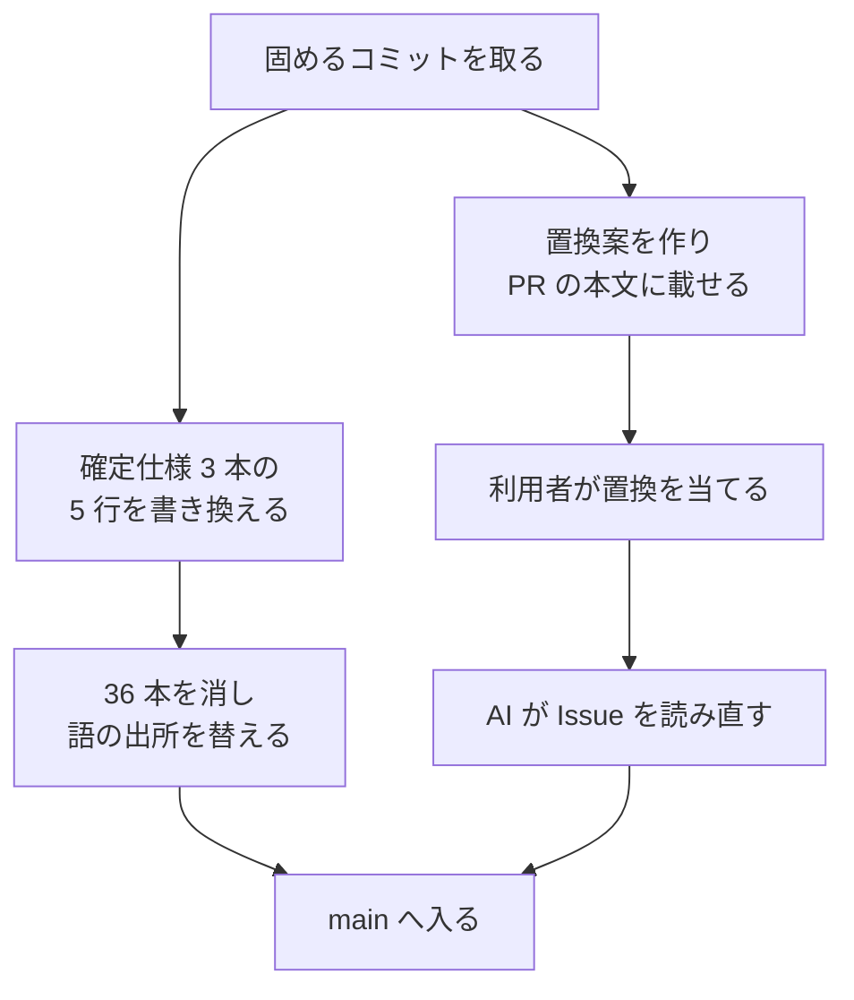

# 作り直しの設計文書 36 本: 確定仕様だけを正の記録にし、消した後も開いている Issue から元の文書を読めるようにする（#3990）

NDF のスクリプトの作り直し（#1142 と、その続きの #3347・#3388・#3395）の設計文書 36 本が `issues/` に残り、確定仕様と食い違う古い決定が正しいものとして読まれる。この設計では、開いている Issue の 36 本へのリンクを消す前の `main` のコミットへ固め、確定仕様 3 本の 5 行から 36 本のファイル名を無くす。続けて `ndf records spec finalize` で 36 本を消し、用語集の語の出所を確定仕様へ替える（51 語のうち 35 語は、出現の回数の規則で決めて指定する）。その規則は「決定の記録」の決定 2、語ごとの結果は「用語集の語の出所」の表、採らなかった案は「決定の記録」、GitHub の固定リンクと Issue の更新の調査は末尾の「外部の調査」にある。

## 今の姿

何が起きたか・目的・受け入れ条件は、要求仕様にある（[issue-3990-requirements.md](./issue-3990-requirements.md) 。正は #3990 の本文）。この文書は「どう解くか」と「なぜその解き方か」だけを書く。

2026-11-24 に `main`（`85dc47f7af1401852642d88d7b2064b02e2869fd`。この作業のブランチの起点と同じ）で確かめた、設計に要る今の構造は次のとおりである。

| 確かめたこと | 結果 | 確かめ方 |
| --- | --- | --- |
| 36 本を消すと壊れる、リポジトリの文書のリンク | 0 本 | `scripts/check-markdown-links.py` に 36 本を `--removing` で渡し、`No links to the removed files` と終了コード 0 |
| 36 本のファイル名を含む行（受け入れ条件 2 の範囲） | 56 行。用語集の正本（`docs/glossary/glossary.json`）の確定する前の出所（`pending_source`）が 51 行、確定仕様 3 本が 5 行 | 要求仕様の「エンジニア向けの補足」の `git grep` |
| 開いている Issue の 36 本へのリンク | 428 件のうち 14 件に 34 本。`develop` を指すものが 33 本、`main` が 1 本。40 桁の SHA で固めたものは 0 本。要求仕様の 426 件とは数えた時刻が違う（開いている Issue の数は、起票と終了で増減する）。リンクのある 14 件・34 本はどちらでも同じ | `gh api --paginate 'repos/devbasex/ai-plugins/issues?state=open&per_page=100'` から Pull Request を除き（`select(.pull_request \| not)`）、本文から抜いた |
| リンクが指すファイルとフラグメント | 7 ファイル。フラグメントは `issue-3347-design-detail.md` の `#ほかの子へ足す条件` と `#実装計画` の 2 つで、どちらも `main` のバージョンに同じ名前の見出しがある | `grep -n '^#'` |
| `develop` の状態 | 残っている（`f37ea4c2`）。`main` の祖先で、リンクが指す 7 ファイルのうち 4 ファイルは `main` のほうが新しい | `git ls-remote`・`git merge-base --is-ancestor`・`git diff --stat` |
| 用語集の 51 語の出所を、削除のコマンドが決められるか | 手順 4 で `--spec` に渡す 8 本（確定仕様 6 本と、決定 2 で足す 2 本）では、18 語は決まる。23 語は 8 本の 2 本以上に現れ、10 語はどの 1 本にも現れないため、`--source-of` が要る。6 本だけで判定した場合（17 語が決まる）との差は 3 語で、`抑制コメント` が足す `ndf-next-terms-and-settings-renames.md` にも現れて決まらなくなり、`共有の一覧`・`チェックアウトの保存先` が足す 2 本のそれぞれだけに現れて決まる | 判定の関数（`plugins/ndf/src/ndf/domains/records/spec_decide.py` の `plan_glossary` が呼ぶ `_assign`）に、8 本と 6 本の本文と、36 本を `pending_source` に持つ 51 語を渡して確かめた |
| 確定仕様の番号の対応表（`docs/specifications/ndf-rebuild.md` の「番号の対応表」） | 30 行のすべてに扱い（移した・畳んだ・振り直した・落とした・移さないなど）がある | 表の「扱い」の列を数えた |

## 文脈と制約

- 確定仕様 6 本の本文は変えない。中身の移し替えは #3412 で終わっている（要求仕様の「含まない」）
- リンクを固めるコミット（以下「固めるコミット」）は、作業の中で 1 回だけ取り、後から取り直さない。要求仕様の前提 1 は「36 本を消すコミットの親にあたる `origin/main` のコミット」とする。このブランチでは設計のコミットが削除のコミットより先に載るので、削除のコミットの直接の親は `main` のコミットにならない。そこで前提 1 を「このブランチが載っている `main` のコミット（`git merge-base HEAD origin/main`）」と読む。選び方と、`main` が進んだときの扱いは次の「固めるコミットの選び方」にある
- 開いている Issue の本文は、利用者（Issue の編集者）が置換のコマンドで書き換える。置換の間は、`devbasex/ai-plugins` の Issue の本文を書き換えるおそれのある、ほかの NDF の作業を止めておく（要求仕様の前提 2）。止まっていることは、`ndf plan pending` とレーンの一覧に、この作業のほかに `devbasex/ai-plugins` を対象にした実行が無いことで確かめる（#3412 の詳細設計書の「本文の書き戻しと同時の編集」と同じ）。GitHub の Issue の更新は、バージョンの一致を条件にした書き込みができない（外部の調査の STD2）
- 置換を当てて確かめ終えるのは、この作業の Pull Request が `main` へ入る前である（受け入れ条件 6）。`main` へ入った時点で、`main` を指すリンクが開けなくなる
- `ndf records spec finalize` は 36 本を作業ツリーから直接消す。未コミットの編集も一緒に消えるので、打つ直前に 36 本に未コミットの変更が無いことを確かめる
- `--source-of <語>=<ファイル>` で指すファイルは、同じ呼び出しの `--spec` に渡したもののどれかでなければならない。判定は `plugins/ndf/src/ndf/domains/records/spec_decide.py` の `plan_glossary` にある
- このリポジトリの設計の設定（`.ndf/design.json`）が挙げるパス（`plugins/ndf/**`・`plugins/ndf-next/**`・`.claude-plugin/marketplace.json`）のファイルは触らない。これらは利用先のリポジトリへ届くコードと配布の設定で、変えると、代表的なリポジトリの種類（Web サービス・モバイルアプリ・業務文書だけ）でそのまま使えるかの確認が要る。この作業は文書を消してリンクを直すだけで、これらを変える理由が無い

### 固めるコミットの選び方

1. 手順 1 で `git fetch origin main` の後に、`git merge-base HEAD origin/main` と `git rev-parse origin/main` を打つ。2026-11-24 は、どちらも `85dc47f7af1401852642d88d7b2064b02e2869fd` である
2. 2 つが同じなら、それを固めるコミットにする
3. 違う（ブランチの起点より `main` が進んでいる）なら、ブランチを `origin/main` へリベースしてから 1 に戻る
4. 手順 1 の後は、次の 2 つの時点で `git fetch origin main` を打ち、固めるコミットから最新の `main` までに 36 本を変えたコミットを `git log --format=%H <固めるコミット>..origin/main -- <36 本>` で一覧にする
   - 利用者に手順 5 を頼む直前
   - 手順 7（リリース承認を求める直前の再確認）
5. 一覧が空なら、固めるコミットをそのまま使う。リンクが見せる 36 本の中身は、最新の `main` と同じだからである
6. 一覧が空でなく、利用者に手順 5 を頼む前なら、ブランチをリベースし、手順 1 から取り直す。PR の本文の置換のコマンドも、手順 2 で作り直す
7. 一覧が空でなく、利用者が手順 5 を打った後なら、固めるコミットは取り直さない。置換のコマンドは 40 桁の SHA のリンクを替えないので、取り直した SHA へは当て直せないからである。消す 36 本への変更なので、そのままマージすると変更の中身は確定仕様に移らずに `main` から消える。そこで、一覧のコミットのうち、まだ扱いの決まっていないものを、変えたファイルと一緒に PR の本文に挙げ、利用者に扱いを決めてもらう。扱いは次の 2 つのどちらかである
   - 確定仕様へ移す: AI が変更の中身を確定仕様へ書き足してコミットする
   - 移さない: Issue のリンクは固めるコミットの版を指したままで、変更後の版はそのコミットから読める
8. 扱いが決まったら、PR の本文の「36 本の変更の扱い」の表に、コミットごとに 1 行を足す。1 行は、`main` のコミットの 40 桁の SHA・変えたファイル・扱い（移した・移さない）・移したときは確定仕様へ書き足したコミットの SHA、移さないときは利用者の判断の理由、を持つ
9. 再確認では、4 の一覧からこの表にある SHA を除いた残りを「扱いの決まっていない変更」とする。固めるコミットは取り直さないので、`main` との差そのものは残る。差ではなくコミットで照らすことで、扱いの決まった変更を利用者へ返し直さない。残りが 1 件でもあれば、マージへ進まず 7 に戻る

## 解き方の全体像

- 36 本は `issues/` から無くなり、作り直しの決定の正の記録は確定仕様 6 本だけになる
- 開いている Issue の 36 本へのリンクは、すべて消す前の `main` のコミット（40 桁の SHA）を指す。消した後も、そのリンクから消す前の 36 本を読める
- 確定仕様 3 本は、ファイル名を書かずに「どの課題の何の表か」を文で書き、消す前のコミットの `issues/` の一覧へリンクする
- 用語集の 51 語は、確定仕様のどれかを出所に持つ。用語集の文書は正本から作り直してある

## 処理の流れ

手順の番号の後ろの `E<数>` は、要求仕様のドメインイベントの番号である。「参照の検査の 1・2」は、[#3412 の詳細設計書の「参照の検査」](./issue-3412-design-detail.md#参照の検査) の 2 つのコマンドである。

| 手順 | 何をするか | 終わりの条件 |
| --- | --- | --- |
| 1（E1） | 固めるコミットを取る（文脈と制約の「固めるコミットの選び方」） | SHA が 40 桁で、その木に 36 本がある |
| 2（E2） | 置換のコマンド（決定 4）を書き込まない動作で打つ。出力の対象（Issue の番号と、替える前と後のリンクの組）を、替えた後のリンクの検証（決定 4 の「替えた後のリンクの検証」）を通してから「確認済みの対象」としてコマンドに埋め込む。PR の本文に、Issue の番号と替えるリンクの数の表と、コマンドを載せる。置換案はファイルに保存しない | 列挙で得た Issue の件数とリンクの数が、PR の本文の表と一致する。確認済みの対象の替えた後のリンクが、すべて検証を通る。14 件・34 本は 2026-11-24 の観測値で、合格の条件ではない |
| 3（E3） | 確定仕様 3 本の 5 行から 36 本のファイル名を無くし（決定 3 の対応表）、3 本をコミットする | 参照の検査の 1 が、用語集の正本の `pending_source` の 51 行だけを返す |
| 4（E6・E7） | 36 本に未コミットの変更が無いことを確かめてから、`ndf records spec finalize` を `-m <コミットの件名>` 付きで打つ。`--spec` には決定 2 で決めた一式、`--remove` には 36 本、`--source-of` には決定 2 で決めた語を渡す（2026-11-24 の実測では 8 本と 35 語。本文が変わって規則で作り直したら、作り直した結果を渡す）。コマンドは 36 本を消し、用語集の正本と文書を作り直し、返すパス（渡した確定仕様・用語集・消した 36 本）を `git add -A` してコミットする。`-m` を省くとパスを返すだけでステージもしないので、省いたときは返したパスを `git add -A -- <パス>` でステージしてコミットする | コミットの後に、参照の検査の 1 と 2 が 0 行。`git ls-files` で 36 本が 0 件。`ndf records glossary render --check` が `ok` |
| 5（E4） | 利用者が、PR の本文の置換のコマンドを書き込む動作で打ち、試行の記録のファイル（決定 4 の「試行の記録」）を PR の本文へ貼るか AI へ渡す | 記録に、書き込みを試みた Issue ごとの結果と時刻がある。確認済みの対象を超える差、または検証を通らないリンクで止まったときは、手順 2 からやり直す |
| 6（E5） | AI が開いている Issue を全件読み直し、受け入れ条件 3〜5 を確かめて PR の本文に結果を書く（下の「手順 6 の確かめ方」） | 受け入れ条件 3・4 が通る。書き込みが本文に入ったかもしれない試行（決定 4 の「試行の記録」の読み方）のすべてが、編集の履歴の照合で「他者の編集なし」になるか、「未確認」から利用者の答えで合格か照合の対象外になる。それ以外は Issue の番号を挙げて利用者へ返し、手順 6 を終えない |
| 7（E8） | リリース承認を求める直前に、手順 2 の列挙（書き込まない動作）と、参照の検査の 1・2 と、36 本と最新の `main` の比較（文脈と制約の「固めるコミットの選び方」の 4）を打ち直す | 列挙で、40 桁の SHA でない 36 本へのリンクが 0 本。参照の検査の 1・2 が 0 行。固めるコミットから最新の `main` までに 36 本を変えたコミットが、すべて PR の本文の「36 本の変更の扱い」の表にある（扱いの決まっていない変更が 0 件）。手順 4 と 6 が終わっている |

手順 2 と、手順 3・4 の組は順を入れ替えてよい。手順 4 は手順 3 の後に行う。手順 5 は手順 2 の PR の本文が要るので、手順 2 の後に行う。

手順 7 の打ち直しは、手順 6 の後に、ほかの変更が 36 本へのリンクを新しく足していないかを見るためである。期待する結果に届かなければ、マージへ進まずに次のとおり戻る。

| 見つかった所 | すること |
| --- | --- |
| 開いている Issue の本文に、40 桁の SHA でない 36 本へのリンクがある | 手順 2 に戻って確認済みの対象と PR の本文を作り直す。利用者が手順 5 を打ち、AI が手順 6 をやり直してから、手順 7 を打ち直す |
| リポジトリの文書に、参照の検査の 1・2 が拾う行がある | 手順 3 と同じ書き換えをその行に当て、参照の検査の 1・2 が 0 行になってから、手順 7 を打ち直す |
| 36 本を変えたコミットのうち、「36 本の変更の扱い」の表に無いもの（扱いの決まっていない変更）がある | 文脈と制約の「固めるコミットの選び方」の 7・8 のとおり、そのコミットだけを利用者へ返して扱いを決めてもらい、表に足してから手順 7 を打ち直す。表にあるコミットは返し直さない |

承認を求めた後に PR へコミットを足したときも、手順 7 を打ち直す。

### 手順 6 の確かめ方

- 受け入れ条件 3: 決定 4 と同じ列挙で全件を読み直し、40 桁の SHA でない 36 本へのリンクを数えて 0 本
- 受け入れ条件 4（開いている Issue 全体）: 固めるコミットの SHA を指す 36 本へのリンクのすべてが、決定 4 の「替えた後のリンクの検証」を通る。今回替えたリンクはすべてこの SHA を指すので、手順 2 の後に足されて置換されたリンクも漏れない
- 受け入れ条件 4（書いた Issue ごと）: 決定 4 の「リンクの照合」を行う。照らすのは、試行の記録で書き込みが本文に入ったかもしれない試行（終わりの行の無い試行を含む）のある Issue である。Issue を番号で取り直し、同じ番号の本文と、全試行の組を順に当てた最終のリンクを照らす。URL を Issue をまたいだ集合で照らさない。書いた後に閉じて開いている Issue の一覧から外れた Issue も、番号で取り直して確かめる
- 受け入れ条件 5: 書き込みが本文に入ったかもしれない試行のすべてで、編集の履歴を照合する（決定 4 の「編集の履歴の照合」）。打ち直しの記録で、前の試行の記録を置き換えない。記録が PR に渡されていなければ、照合する Issue も時刻も分からないので、手順 6 を終えずに利用者へ記録を求める
- 書いた後のリンクに不備が見つかったとき: AI は Issue を書かない。Issue の番号・今のリンク・訂正したリンクを PR の本文に挙げ、手順 2 で確認済みの対象に訂正の組として足す（決定 4 の「訂正」）。利用者が手順 5 を打ち直し、AI が手順 6 をやり直す

### 用語集の語の出所

決定 2 の規則で決めた、`--source-of` で渡す語の出所である（2026-11-24 の実測で、一式 8 本・35 語）。ファイルはすべて `docs/specifications/` の下にある。残りの 16 語は、8 本のうち 1 本だけに現れるので、コマンドが決める。規則の欄の値は次の意味である。

| 規則の値 | 意味 |
| --- | --- |
| 複数 | 8 本の 2 本以上に語が現れ、最も多く現れる 1 本にした（2 段目の (c)） |
| 複数（同数） | 8 本の 2 本以上に語が現れ、最も多い回数の本が 2 本以上あったので、2 段目の (c) の並びで先の 1 本にした |
| 語幹 | 8 本のどれにも現れず、括弧の補足を除いた語で数えて決めた（2 段目の (d)） |
| 他の確定仕様 | 確定仕様 6 本のどれにも現れず、6 本以外の確定仕様で最も多く現れる 1 本にし、その 1 本を `--spec` に足した（1 段目）。2 段目の (a) でほかの規則より優先するので、`--source-of` でも渡す |
| 索引 | どこにも現れないため `ndf-rebuild.md` にした（2 段目の (e)） |

| 語 | コンテキスト | 規則 | 出所 |
| --- | --- | --- | --- |
| 系統（決定番号の） | ndf-design | 語幹 | `ndf-rebuild.md` |
| 安定版（依存の） | ndf-code-structure | 語幹 | `ndf-rebuild.md` |
| 一時コピーの検査 | ndf-rebuild | 索引 | `ndf-rebuild.md` |
| ライブラリ | ndf-code-structure | 複数 | `ndf-rebuild-libraries.md` |
| エントリポイント | ndf-code-structure | 複数 | `ndf-rebuild.md` |
| drive の状態 | ndf-cross-review | 索引 | `ndf-rebuild.md` |
| 耐久ワークフロー | ndf-durable | 複数 | `ndf-rebuild-libraries.md` |
| 耐久ステップ | ndf-durable | 複数 | `ndf-rebuild-libraries.md` |
| 耐久の記録 | ndf-durable | 複数（同数） | `ndf-rebuild.md` |
| 実行の回 | ndf-durable | 複数（同数） | `ndf-rebuild-libraries.md` |
| 資源のクォータ | ndf-supervise | 索引 | `ndf-rebuild.md` |
| 共有の一覧 | ndf-supervise | 他の確定仕様 | `ndf-supervise-queue-overlap-by-file.md` |
| ステートマシンの DB | ndf-durable | 索引 | `ndf-rebuild.md` |
| 兆候 | ndf-code-structure | 複数 | `ndf-rebuild-data-and-smells.md` |
| 判定データ | ndf-code-structure | 複数（同数） | `ndf-rebuild-data-and-smells.md` |
| 抑制コメント | ndf-code-structure | 複数 | `ndf-rebuild-data-and-smells.md` |
| アダプター | ndf-code-structure | 複数 | `ndf-rebuild-libraries.md` |
| 事実の表 | ndf-code-structure | 複数 | `ndf-rebuild-data-and-smells.md` |
| オーナーのモジュール | ndf-code-structure | 索引 | `ndf-rebuild.md` |
| 停止理由の表 | ndf-durable | 複数 | `ndf-rebuild-scripted-flow.md` |
| 判断の呼び出し | ndf-durable | 複数 | `ndf-rebuild-scripted-flow.md` |
| プラグインの入れ替え | ndf-rebuild | 複数 | `ndf-rebuild-libraries.md` |
| チェックアウトの保存先 | ndf-code-structure | 他の確定仕様 | `ndf-next-terms-and-settings-renames.md` |
| 形の番号 | ndf-code-structure | 複数 | `ndf-rebuild.md` |
| レビューの項目 | ndf-rebuild | 複数 | `ndf-rebuild.md` |
| ルートの表 | ndf-rebuild | 索引 | `ndf-rebuild.md` |
| 追補の単位 | ndf-rebuild | 複数 | `ndf-rebuild-review-scope.md` |
| 目的の物差し | ndf-rebuild | 複数 | `ndf-rebuild-review-scope.md` |
| 選択の記録 | ndf-rebuild | 複数 | `ndf-rebuild-measure.md` |
| 閉じる証拠 | ndf-rebuild | 複数 | `ndf-rebuild-review-scope.md` |
| 11.x の行 | ndf-rebuild | 複数 | `ndf-rebuild-review-scope.md` |
| 閉じた子 | ndf-rebuild | 複数 | `ndf-rebuild-review-scope.md` |
| 多観点レビュー | ndf-rebuild | 索引 | `ndf-rebuild.md` |
| 起票の前に人へ見せる場 | ndf-rebuild | 索引 | `ndf-rebuild.md` |
| 11.x の子 | ndf-rebuild | 複数 | `ndf-rebuild-review-scope.md` |

数は 35 語で、規則ごとに複数 23 語（うち同数 3 語）・語幹 2 語・他の確定仕様 2 語・索引 8 語である。`抑制コメント` は、`ndf-rebuild-data-and-smells.md` に 36 回、`--spec` に足す `ndf-next-terms-and-settings-renames.md` に 2 回現れる。6 本だけならコマンドが決める語だが、8 本を渡すと決まらなくなるので、2 段目の (c) で `ndf-rebuild-data-and-smells.md` にした。手順 4 を打つ時点で確定仕様の本文が変わっていれば、表を規則で作り直してから打つ。

## 決定の記録

### 決定 1: 開いている Issue のリンクが消す前の正のバージョンを指すよう、`develop` を指す 33 本も `main` のコミットへ固める

- **質問**: 33 本は廃止した開発版のブランチ `develop` を指している。`develop` はまだ残っており、36 本を消しても開けなくはならない。この 33 本をどのコミットへ固めるか、または固めずに残すか
- **選んだ案**: `main` を指す 1 本と同じく、手順 1 で取った `main` のコミットへ固める。リンクの種類（`blob` など）、ファイル、フラグメントは変えない
- 採らなかった案: `develop` の先端のコミット（`f37ea4c2`）へ固める。`develop` は `main` の祖先で、7 ファイルのうち 4 ファイルは `main` のほうが新しい。リンクから読ませたいのは消す前の正のバージョンである
- 採らなかった案: `develop` を指すリンクは替えない（受け入れ条件 3 はブランチを指すリンクを 0 本にすることを求める。廃止したブランチが消えた時点で 33 本が開けなくなる）
- **代償**: 4 ファイルは、リンクを書いた人が見た `develop` のバージョンと行が違うバージョンを見せる。フラグメントの 2 つを持つ `issue-3347-design-detail.md` は `develop` と `main` で同じなので、見出しへの飛び先は変わらない
- 根拠: Value 6「使うほど散らからない」（MVV バージョン 11）。STD1

### 決定 2: 用語集の語の出所が誰が打っても同じになるよう、35 語の出所を出現の回数の規則で決めて `--source-of` で渡す

- **質問**: `ndf records spec finalize` は、`--spec` に渡した確定仕様のうち 1 本だけに現れる語しか出所を決めない。2 本以上に現れる語と、どれにも現れない語の出所をどう決めるか。`--spec` に足すファイルで、判定の結果が変わることもどう扱うか
- **選んだ案**: 2 段で決める。1 段目で `--spec` に渡す一式を確定し、2 段目でその一式から語ごとの出所を選ぶ。結果は「用語集の語の出所」の表にある

語の数え方は、コマンドの判定と同じく本文の文字の並びで数える。ほかの語の一部として現れたもの（「兆候の基準ファイル」の中の「兆候」）も数える。回数は、重ならない出現の数（Python の `str.count`）とする。「括弧を除いた語」は、括弧の補足（例: 「（決定番号の）」）を除いた語である。

**1 段目（`--spec` の一式を確定する）**: 確定仕様 6 本だけで判定する。

- 語も括弧を除いた語も 6 本のどれにも現れない語ごとに、6 本以外の確定仕様（`docs/specifications/` の `README.md` を除く `.md`）で語が最も多く現れる 1 本を選ぶ。語が無ければ括弧を除いた語で数える。最も多い回数の本が 2 本以上あれば、ファイル名の昇順で先の 1 本にする
- 6 本に、1 段目で選んだファイルを足したものを一式とする。2026-11-24 の実測では足すファイルが 2 本で、計 8 本になる。以下の「一式」は、この確定した一式を指す

**2 段目（語ごとの出所を選ぶ）**: 一式の中で、(a) から順に当て、当たった所で決める。

- (a) 1 段目でファイルを選んだ語は、その結果を出所にする。2 段目のほかの規則より優先する。ほかの語のために足したファイルにもこの語が現れて、一式の中で 2 本以上に現れても、1 段目の結果を使う
- (b) 一式のうち 1 本だけに語が現れれば、コマンドが決めるのに任せる（2026-11-24 の実測で 16 語）
- (c) 一式の 2 本以上に現れれば、語が最も多く現れる 1 本にする。最も多い回数の本が 2 本以上あれば、次の並びで先の 1 本にする。6 本は `ndf-rebuild.md` の索引の並び（`ndf-rebuild.md`・`-libraries`・`-data-and-smells`・`-scripted-flow`・`-measure`・`-review-scope`）で、その後に 1 段目で足したファイルをファイル名の昇順で並べる
- (d) 一式のどれにも現れなければ、括弧を除いた語で数える。1 本だけに現れればその 1 本にし、2 本以上に現れれば (c) と同じ決め方をする
- (e) どこにも現れなければ `ndf-rebuild.md` にする

(b) で決まる語のほかは、すべて `--source-of` で渡す。2026-11-24 の実測では 35 語である。確定仕様の本文が変わって作り直したときは、作り直した一式と語を手順 4 に渡す。
- 採らなかった案: 語ごとに意味を読んで出所を選ぶ（選ぶ人ごとに結果が変わり、レビューで同じ検討を繰り返す）
- 採らなかった案: 確定仕様の本文に語を書き足し、コマンドが自動で決められるようにする（確定仕様 6 本の本文は範囲の外で、#3412 で終わっている）
- 採らなかった案: 使われなくなった語（「drive の状態」など）を用語集から廃止する（語の意味と存否を変える判断で、この Issue の範囲の外である。受け入れ条件 7 は、語が確定仕様を出所に持つことを求める）
- **代償**: 2 段目の (e) で `ndf-rebuild.md` にした 8 語は、出所の本文にその語が無い。読み手は出所を開いても語を見つけられない。`ndf-rebuild.md` は作り直しの索引で、「番号の対応表」の頭から消す前のコミットの `issues/` へたどれる
- 根拠: Value 3「同じ手順は毎回同じ結果になる」（MVV バージョン 11）

### 決定 3: 確定仕様 3 本から元の文書へたどれるよう、5 行はファイル名の代わりに課題の番号と表の名前を文で書き、消す前のコミットの `issues/` の一覧へリンクする

- **質問**: 受け入れ条件 2 の検査は、固めたリンクの中のファイル名も数える。確定仕様 3 本の 5 行には、固めたリンクが 3 本、コードの書式で書いたファイル名が 2 つ、ファイル名の型（`issues/issue-1142-*` など）が 2 つある。元の文書へたどれる手段を残したまま、これらからファイル名を無くすにはどう書くか
- **選んだ案**: ファイル名を書いていた所に、「#3388 の設計の対応表」「#3388 の 11.x の子の表」「#1142 の要求仕様のコピー」のように課題の番号と表の名前を文で書く。リンクは、コミットの `issues/` の一覧（`https://github.com/devbasex/ai-plugins/tree/<SHA>/issues` ）へ替える。`ndf-rebuild.md` の「番号の対応表」の頭のリンクと同じ形である。今リンクがある所は今のリンクと同じ SHA を使い、行番号や中身の時点を変えない。今リンクが無くファイル名だけを書いた所には、手順 1 の固めるコミットの SHA でリンクを付ける。行ごとの書き換えは下の表のとおりである

| 行 | 今ある参照 | 書き換えた後 | リンク先の SHA |
| --- | --- | --- | --- |
| `docs/specifications/ndf-review-items.md` の 6 行 | コードの書式のファイル名 `issues/issue-1142-design-review-routing.md`（リンク無し）。同じ行の `ndf-rebuild-review-scope.md` へのリンクは残す | 「#3395 の設計の振り分け表（[消す前のコミットの `issues/` の一覧](https://github.com/devbasex/ai-plugins/tree/<固めるコミット>/issues) にある #1142 の設計文書の 1 つ）」 | 固めるコミット |
| `docs/specifications/ndf-review-items.md` の 16 行 | リンク `[11.x の子の表](…/blob/784110e5…/issues/issue-3388-design-children.md)` | 「[#3388 の設計の 11.x の子の表](https://github.com/devbasex/ai-plugins/tree/784110e5461b3f856ba18f3c8ea7e995a06c8b0d/issues) （コミット `784110e5` の `issues/` の一覧にある）」 | `784110e5461b3f856ba18f3c8ea7e995a06c8b0d`（今と同じ） |
| `docs/specifications/ndf-review-items.md` の 18 行 | リンク `[issue-1142-requirements.md](…/blob/4e1f1f1c…/issues/issue-1142-requirements.md)` | 「#1142 の要求仕様のコピー（[コミット `4e1f1f1ca` の `issues/` の一覧](https://github.com/devbasex/ai-plugins/tree/4e1f1f1caa7c022cd4807d56df2706e095776adb/issues) にある）の行番号（コミット `4e1f1f1ca` の時点）」 | `4e1f1f1caa7c022cd4807d56df2706e095776adb`（今と同じ） |
| `docs/specifications/ndf-review-items-11x.md` の 5 行 | コードの書式のファイル名 `issues/issue-3388-design-routing.md`（リンク無し）と、リンク `[コミット 784110e5 の issue-3388-design-children.md](…/blob/784110e5…/issues/issue-3388-design-children.md)` の 2 つ | 前者は「#3388 の設計の対応表（[消す前のコミットの `issues/` の一覧](https://github.com/devbasex/ai-plugins/tree/<固めるコミット>/issues) にある）」。後者は「[コミット 784110e5 の #3388 の設計の 11.x の子の表](https://github.com/devbasex/ai-plugins/tree/784110e5461b3f856ba18f3c8ea7e995a06c8b0d/issues) （`issues/` の一覧にある）」 | 前者は固めるコミット。後者は `784110e5461b3f856ba18f3c8ea7e995a06c8b0d`（今と同じ） |
| `docs/specifications/ndf-code-decision-references.md` の 74 行 | コードの書式のファイル名の型 `issues/issue-1142-*`・`issues/issue-3388-*` の 2 つ（リンク無し） | 「作り直しの設計文書（#1142・#3347・#3388・#3395 の設計文書）へのパス」。検査の説明なのでリンクは付けない | — |

- **確かめ方**: 書き換えた後、参照の検査の 1 がこの 5 行を返さない。`scripts/check-markdown-links.py` が通る
- 採らなかった案: 受け入れ条件 2 の検査の除外に 3 本を足す（除外を広げると #3412 の受け入れ条件 5 の範囲が変わる。要求仕様の起票者の推定 S3 が書き換える側を選んでいる）
- 採らなかった案: リンクを消して文だけにする（読み手が元の表を開けなくなる）
- **代償**: 読み手は `issues/` の一覧から目当てのファイルを選ぶ手間が 1 つ増える。`#1142 の要求仕様のコピー` の「要求の行」の行番号は、そのコピーを開いて数える
- 根拠: Value 14「判断の理由が残り、語がそろっている」（MVV バージョン 11）。STD1

### 決定 4: 利用者が手元で置換を当てられるよう、置換のコマンドは保存した置換案を読まず、取り直した本文から同じ規則で作り直し、PR の本文に載せる

- **質問**: #3412 の詳細設計書は、AI が作業ファイルに置換案を書き、置換のコマンドがそれを読む形にしている（[issue-3412-design-detail.md の「本文の書き戻しと同時の編集」](./issue-3412-design-detail.md#本文の書き戻しと同時の編集) ）。作業ファイルは AI の作業場所にあり、コミットしない。利用者が打つコマンドは何を入力にするか、どこに置くか
- **選んだ案**: コマンドは、開いている Issue を全件取り直し、本文の 36 本へのリンクのうち参照が 40 桁の SHA でないものを、固めるコミットの SHA に替える。置換は取り直した本文に当たるので、取り直すまでにほかの人が加えた編集を消さずに書く。保存した置換案（本文やその sha256）は読まない。代わりに、利用者が PR の本文で確かめた範囲を超えて書かないよう、「確認済みの対象」をコマンドに埋め込む。コマンドはリポジトリに置かず、PR の本文に載せる。詳しい振る舞いは下の各項目にある

**対象のリポジトリ**: すべての `gh` の呼び出しで `devbasex/ai-plugins` を明示し、作業ディレクトリのリポジトリに頼らない。読み取りは `gh api repos/devbasex/ai-plugins/...`、書き込みは `gh issue edit <番号> --repo devbasex/ai-plugins --body-file <B1>`、書いた後の取り直しは `gh api repos/devbasex/ai-plugins/issues/<番号>`、編集の履歴は GraphQL の `repository(owner: "devbasex", name: "ai-plugins")` である。#3412 の詳細設計書の `gh issue edit <番号> --body-file <B1>` には `--repo` を足す

**列挙**: `gh api --paginate 'repos/devbasex/ai-plugins/issues?state=open&per_page=100' --jq '.[] | select(.pull_request | not) | …'` で、Pull Request を除いた開いている Issue だけを読む（REST の Issue の一覧は Pull Request も返す）。手順 2 の事前確認、手順 5 の書き込み、手順 6 の読み直し、手順 7 の再確認のすべてで、この同じ式を使う

**確認済みの対象**: 手順 2 で AI が書き込まない動作を打ち、出力の（Issue の番号・替える前のリンク・替えた後のリンク）の組をすべて、コマンドの中に一覧として埋め込む。埋め込む前に、替えた後のリンクのすべてが下の「替えた後のリンクの検証」を通ることを確かめる。通らない組は埋め込まず、PR の本文に挙げて、訂正したリンクを決めてから埋め込む。PR の本文の表は、この一覧から作る

**替えた後のリンクの検証**: リンクのファイルが、リンクの SHA のコミットにあることを確かめる。リンクに `#` の後ろのフラグメントがあれば、その版のファイルの見出しから作ったアンカーと一致することも確かめる（見出しの扱いは `scripts/check-markdown-links.py` と同じ）。フラグメントの無いリンクは、ファイルがあれば合格である。手順 2・手順 5 の書き込みの前・手順 6 のすべてで、この同じ条件を使う

ファイルの中身は、SHA とファイルのパスの組ごとに 1 回だけ取り、同じファイルを指すリンクのアンカーの照合には、取った中身を使い回す。AI は手元で `git cat-file -e <SHA>:issues/<ファイル>` と `git show <SHA>:issues/<ファイル>` で取る。置換のコマンドは利用者の手元にリポジトリが無くても動くよう、`gh api 'repos/devbasex/ai-plugins/contents/issues/<ファイル>?ref=<SHA>'` で取る。2026-11-24 の観測値では、34 本のリンクが指すファイルは 7 つなので、書き込む動作 1 回で増える呼び出しは 7 回である

**訂正**: 確認済みの対象には、40 桁の SHA を指すリンクを直す「訂正の組」（Issue の番号・今のリンク・訂正したリンク）も入れられる。手順 6 で書いた後のリンクに不備が見つかったときは、AI が訂正の組を足し、利用者が書き込む動作を打ち直して直す。訂正したリンクも、替えた後のリンクの検証を通してから埋め込む。通常の置き換えは 40 桁の SHA のリンクを替えないので、訂正の組は次のとおり別の経路で対象に入れる

- 対象を集めるとき（書き込まない動作・書き込む動作の 1）と、Issue ごとの a の取り直しの後の両方で、訂正の組の Issue の番号の本文に、組の「今のリンク」と同じ URL があれば、それを対象に加える。置き換え後のリンクは、組に埋め込んだ「訂正したリンク」である
- 訂正の組の Issue は、開いている Issue の列挙に加えて、`gh api repos/devbasex/ai-plugins/issues/<番号>` で番号から取る。書いた後に閉じて列挙から外れた Issue も、これで訂正できる
- 「今のリンク」が本文に無い組は書かず、差として出す

**動作**: 既定は書き込まない動作で、取り直した対象を Issue ごとに（番号・替える前のリンク・替えた後のリンク）で出し、確認済みの対象との差と、検証の結果も出す。書き込む動作は明示の引数で選び、次の順に進む

1. 全件を取り直し（訂正の組の Issue は番号でも取る）、書き込む前に対象を画面に出す
2. 対象に、確認済みの対象に無い Issue かリンクが 1 つでもあれば、1 件も書かずに止め、差を出す。利用者は AI へ返し、AI は手順 2 からやり直して確認済みの対象と PR の本文を作り直す
3. 対象の替えた後のリンクを、替えた後のリンクの検証にかける。1 つでも通らなければ、1 件も書かずに止める。利用者は AI へ返す
4. 確認済みの対象にあって、取り直した本文には無くなったリンク（ほかの人が先に直したなど）は書かず、差として出す
5. Issue ごとに、#3412 の詳細設計書の「本文の書き戻しと同時の編集」の手順 2 の a〜d（取り直し・置換・書き込み・書いた後の取り直しと照合）を行う。b の置換は、通常の置き換えと訂正の組の両方を当てる。a の取り直しで、その Issue の対象が確認済みの対象を超えたら、その Issue を書かずに全体を止める

**試行の記録**: 書き込む動作は、1 回打つごとに試行の番号を振り、Issue ごとの記録を、作業ディレクトリの `issue-3990-apply.jsonl` へ 1 行ずつ追記する。ファイルは追記だけで、前の試行の行を消したり書き換えたりしない。途中で止まっても、それまでの行は残る。1 行が持つ値は、試行の番号・Issue の番号・結果・替えたリンクの組（替える前と後）・書いた利用者の GitHub のログイン名・a の取り直しの時刻・c の書き込みの時刻・d の取り直しの時刻である。記録は次の順に書く

1. c の書き込みの直前に、結果を「書き込みを試みる」とした行を書く
2. d の取り直しの後に、結果を「書いた」か「書いた後に変わった」とした行を書く
3. c が失敗の応答を返したら「書けなかった」とした行を書く。c が応答を返さなかった、または d の取り直しに失敗したなど、書き込みの成否が分からなければ「成否不明」とした行を書く
4. 書かなかった Issue は「替えるリンクが無い」か「止めた」とした行を書く

利用者は、全試行の行を含むこのファイルを PR の本文へ貼るか AI へ渡す。手順 6 は、記録を次のとおり読む

- 同じ試行・同じ Issue で「書き込みを試みる」の行の後に終わりの行（「書いた」「書いた後に変わった」「書けなかった」「成否不明」）が無ければ、途中で切れたものとして「成否不明」とみなす
- 「書いた」「書いた後に変わった」「成否不明」の試行を、書き込みが本文に入ったかもしれない試行とする。リンクの照合と履歴の照合の対象である
- 「書けなかった」の試行は、本文を変えていないので、どちらの照合の対象にもしない。替えるはずだったリンクが残っていれば、受け入れ条件 3 の列挙で拾う
- 同じ Issue の後の試行の行が、前の試行の照合を省く理由にはならない

**リンクの照合**（手順 6）: 書き込みが本文に入ったかもしれない試行のある Issue ごとに、`gh api repos/devbasex/ai-plugins/issues/<番号>` で番号から今の本文を取る（閉じていても取る）。照らすのは、その Issue の全試行の替えたリンクの組を、試行の番号の順に当てた後の最終のリンクである。後の試行の訂正で替わった前のリンクは、本文に無くてよい。最終のリンクがすべて今の本文にあり、それぞれが替えた後のリンクの検証を通れば合格である

**編集の履歴の照合**（手順 6）: 書き込みが本文に入ったかもしれない試行のすべてで、試行ごとに照合する。訂正で後から打ち直した Issue も、前の試行の照合を残す。照らす期間は、その試行の a の取り直しの時刻から d の取り直しの時刻までである。d の時刻が無い試行は、照らせる終わりが無いので「未確認」にする

履歴は GraphQL の `repository(owner: "devbasex", name: "ai-plugins") { issue(number: <番号>) { userContentEdits(last: 20, before: <カーソル>) { nodes { editedAt editor { login } } pageInfo { hasPreviousPage startCursor } } } }` で、新しい側から読む。期間を覆えたと言えるのは、次のどちらかになったときである。どちらにもならない間だけ、`startCursor` を `before` に渡して前のページを足して読む

- 取れた最も古い編集の `editedAt` が、期間の始まりより前である
- `hasPreviousPage` が偽で、履歴を最後まで読んだ

期間の中の編集から、置換の書き込みを特定する。書き込みは、期間の中にある、書いた利用者のログイン名の編集である。それがちょうど 1 件なら特定できたとする。判定は次の表のとおりである

| 判定 | 条件 | AI がすること |
| --- | --- | --- |
| 他者の編集なし | 期間を覆えた。書き込みを特定でき、それより前に、ほかの人の編集が無い | 合格として PR の本文に書く。書き込みの後にほかの人の編集があれば、本文は上書きしていないので復旧は頼まない。その Issue を、リンクの照合を今の本文でやり直す対象にする |
| 上書きの疑い | 書き込みを特定でき、それより前（期間の始まりから書き込みまで）に、ほかの人の編集がある | 書き直さず、番号・編集者・時刻を PR の本文に挙げ、#3412 の詳細設計書の同じ節の手順 4 の復旧を利用者に頼む。復旧と打ち直しの後に照合し直す |
| 未確認 | 履歴を取れない。期間を覆えない。書き込みを特定できない（書いた利用者の編集が期間の中に 0 件か 2 件以上ある、または同じ時刻の編集があって前後を決められない）。記録に時刻が無い。記録の結果が「成否不明」 | 番号と理由を PR の本文に挙げ、利用者に GitHub の画面の編集の履歴を確かめてもらう。利用者の答えで次の表のとおりに扱う |

「未確認」の Issue は、利用者の答えで次のとおりに扱う。復旧は、置換の書き込みと失われた編集の両方を特定できたときだけに限る。どちらかを特定できないまま復旧すると、書き込みが入っていない、または上書きしていない本文を戻し、正しい本文を壊すおそれがあるからである

| 利用者の答え | 扱い |
| --- | --- |
| 期間の中に、利用者の書き込みが無い | 書き込みは入っていない。「書けなかった」と同じく照合の対象から外し、答えを PR の本文に書く |
| 利用者の書き込みを特定でき、それより前にほかの人の編集が無い | 合格にし、答えを PR の本文に書く |
| 利用者の書き込みと、それより前のほかの人の編集を特定でき、その編集の中身が今の本文から失われている | 「上書きの疑い」と同じく復旧を頼む |
| 上のどれとも決められない | 「未確認」のままにし、手順 6 を終えない。決められる材料（履歴の各版の本文など）がそろってから答え直してもらう |

この判定は、受け入れ条件 5 の「当てる直前の取り直しから書き込みまで」に合わせ、書き込みより前の編集だけを上書きの疑いにする。書き込みより後の編集は上書きされていないので、復旧を頼まず、リンクを確かめ直すだけにする。復旧を頼むと、失われていない本文を利用者が戻し、正常な後の編集を消すおそれがあるからである

- 採らなかった案: 作業ファイルの置換案を読む（利用者の手元に作業ファイルが無い。置換案の本文を PR の本文に載せると、載せた時点と打つ時点の本文の差を別に扱う手順が要る。確認済みの対象は本文を持たず、対象の範囲だけを縛る）
- 採らなかった案: `scripts/` にスクリプトとして置く（1 回だけの操作で、マージした後に使い道が無い。使わないコードとテストがリポジトリに残る）
- **代償**: PR の本文のコマンドは CI を通らない。書き込む動作は、利用者が打つまで一度も走らない
- 根拠: Value 6「使うほど散らからない」・Value 11「重複と冗長が無い」（MVV バージョン 11）。STD2

## 影響と危険

- **働く範囲**: このリポジトリだけである。`issues/`・`docs/specifications/` の 3 本・`docs/glossary/` と、このリポジトリの開いている Issue の本文が変わる。`plugins/` を変えないので、利用先のリポジトリに届くものは無い
- **プロジェクトごとに違うもの**: 無し（設定も引数も足さない）
- **当たるモード**: `standard` のこの 1 回の作業だけである。NDF の工程の振る舞いは変わらない
- **同じファイルを触る別の変更**: 用語集の正本と文書を触る別の Pull Request と、同時にはマージできない。先に入った側に合わせて手順 4 を打ち直す（`ndf records glossary render --check` が食い違いを返す）
- **36 本へのリンクを新しく足す別の変更**: リポジトリの文書のリンクは、手順 7 の参照の検査の 1・2 が拾う。Issue の本文に新しく足したリンクは、手順 7 の列挙で拾う。どちらも見つかればマージへ進まず、処理の流れの戻り先の表のとおりにやり直す
- **確認の後に増えた対象**: 利用者が PR の本文で確かめた後に増えた Issue やリンクは、書き込む動作が確認済みの対象との差で止まるので、確かめていない Issue の本文は書かない
- **固めた後に 36 本を変える別の変更**: 利用者に手順 5 を頼む直前と手順 7 で、36 本を最新の `main` と比べて拾う。置換の後に見つかった変更は、利用者が扱いを決めて PR の本文の表に載るまでマージへ進まない（文脈と制約の「固めるコミットの選び方」の 7〜9）
- **書いた後に見つかったリンクの不備**: 書く前に替えた後のリンクを検証するので、通常は起きない。起きたときは、AI が訂正の組を確認済みの対象に足し、利用者が打ち直して直す（決定 4 の「訂正」）
- **置換を当てる間のほかの書き込み**: ほかの NDF の作業が Issue の本文を書くと、上書きの疑いになる。要求仕様の前提 2 のとおり、利用者がその作業を止めてから打つ。上書きの疑いと、確かめられなかった Issue は、手順 6 の編集の履歴の照合が拾う。AI は書き直さずに番号・編集者・時刻を PR の本文に挙げ、利用者の確認が済むまで手順 6 を終えない
- **振り分け表の検査**: `ndf-review-items.md` で書き換えるのは「列の読み方」の表と前書きの行だけである。規則 `review-items` が読む「行き先の表」は変えない。`ndf check` が通ることで確かめる

## テスト設計

コードを変えないので、単体テストは足さない。受け入れ条件ごとに、打つ検査と落ちるべき壊し方を決める。

| 受け入れ条件・不変条件 | どの振る舞いで縛るか | どう壊したら落ちるべきか |
| --- | --- | --- |
| 1. 36 本が無く、対応表のすべての行が処理済み | 手順 4 のコミット（削除をステージしてコミットした後）に、`git ls-files` で 36 本のパターンが 0 件。「番号の対応表」の 30 行のすべてに扱いがある | 36 本のどれか 1 本を消し忘れると 1 件になる |
| 2. 36 本のファイル名を含む行が 0 行 | 要求仕様の「エンジニア向けの補足」の `git grep` が 0 行 | 確定仕様 3 本の 5 行のどれかを残す、または語を 1 つ `pending_source` のまま残すと 1 行以上になる |
| 3. ブランチなどを指すリンクが 0 本 | 開いている Issue を全件読み直し、36 本へのリンクのうち参照が 40 桁の 16 進でないものを数えて 0 本 | 置換を 1 件の Issue に当て忘れると 1 本以上になる |
| 4. 替えたリンクの先にファイルと見出しがある | 固めるコミットの SHA を指す 36 本へのリンクのすべてが、決定 4 の「替えた後のリンクの検証」を通る。書き込みが本文に入ったかもしれない試行（終わりの行の無い試行を含む）のある Issue ごとに、番号で取り直した本文に、全試行の組を順に当てた最終のリンクがすべてある | SHA を 36 本を消した後のコミットにすると `cat-file` が落ちる。フラグメントを変えると見出しに当たらない |
| 5. 当てる間のほかの人の編集が 0 件 | 書き込みが本文に入ったかもしれない試行のすべてが、決定 4 の「編集の履歴の照合」で「他者の編集なし」になるか、「未確認」から利用者の答えで合格か照合の対象外になる | 書き込みより前に別の編集が入ると、番号・編集者・時刻が PR の本文に挙がる。履歴を取れない・記録が途中で切れると「未確認」になり、利用者が確かめるまで手順 6 が終わらない |
| 6. 3・4 はマージの前に満たす | 手順 6 の結果（受け入れ条件 3・4 の数）が PR の本文にあることを、リリース承認を求める前に確かめる | 手順 5・6 を飛ばすと PR の本文に結果が無く、承認を求める前の確かめで止まる |
| 7. 語が確定仕様を出所に持つ | 削除する 36 本のどれかを暫定的な出所（`pending_source`）として登録していた 51 語のすべてが、`source` に `docs/specifications/` のファイルを持ち、`pending_source` を持たない | `--source-of` を 1 語でも渡し忘れると、コマンドが消さずに止まる |
| 8. 退行しない | `ndf records glossary render --check` が `ok`。`scripts/check-markdown-links.py`（36 本を `--removing` で渡す形も含む）・`scripts/check-doc-staleness.py`・`ndf check`・CI の必須のジョブが通る | 用語集の文書を作り直さないと `--check` が食い違いを返す。確定仕様のリンクを壊すと検査が落ちる |

## 設計の結果

| 課題 | 扱い | 統合先 | 触るファイル |
| --- | --- | --- | --- |
| #3990 | 実装する | — | `docs/specifications/ndf-review-items.md`、`docs/specifications/ndf-review-items-11x.md`、`docs/specifications/ndf-code-decision-references.md`、`docs/glossary/glossary.json`、`docs/glossary/ndf-rebuild.md`、`docs/glossary/ndf-code-structure.md`、`docs/glossary/ndf-durable.md`、`docs/glossary/ndf-supervise.md`、`docs/glossary/ndf-design.md`、`docs/glossary/ndf-cross-review.md`、`issues/issue-1142-design-base-design-detail.md`、`issues/issue-1142-design-data-design-detail.md`、`issues/issue-1142-design-data.md`、`issues/issue-1142-design-dbos.md`、`issues/issue-1142-design-decisions.md`、`issues/issue-1142-design-detail.md`、`issues/issue-1142-design-fixes-design-detail.md`、`issues/issue-1142-design-fixes.md`、`issues/issue-1142-design-labels.md`、`issues/issue-1142-design-libraries.md`、`issues/issue-1142-design-migration.md`、`issues/issue-1142-design-modules.md`、`issues/issue-1142-design-next-design-detail.md`、`issues/issue-1142-design-next.md`、`issues/issue-1142-design-review-routing.md`、`issues/issue-1142-design-scripted-flow-design-detail.md`、`issues/issue-1142-design-scripted-flow.md`、`issues/issue-1142-design-smells-design-detail.md`、`issues/issue-1142-design-smells.md`、`issues/issue-1142-design.md`、`issues/issue-1142-requirements.md`、`issues/issue-3347-design-detail.md`、`issues/issue-3347-design.md`、`issues/issue-3347-requirements.md`、`issues/issue-3347-source-note.md`、`issues/issue-3388-design-children.md`、`issues/issue-3388-design-detail.md`、`issues/issue-3388-design-routing.md`、`issues/issue-3388-design.md`、`issues/issue-3388-requirements.md`、`issues/issue-3395-design-bugs.md`、`issues/issue-3395-design-decisions.md`、`issues/issue-3395-design-detail.md`、`issues/issue-3395-design-scope.md`、`issues/issue-3395-design.md`、`issues/issue-3395-requirements.md` |

`issues/` の 36 本は消すファイルである。用語集の文書（`docs/glossary/` の `.md`）は、手で直さずに `ndf records spec finalize` が作り直す。

## 未確認のまま残ること

| 項目 | 内容 |
| --- | --- |
| 置換を当てる時点の Issue とリンクの数 | 14 件・34 本は 2026-11-24 の数である。新しい Issue が 36 本を指せば数が変わる。手順 7 の列挙と、利用者が打つ書き込まない動作の出力で分かる |
| 編集の履歴が置換の書き込みをどう記録するか | `userContentEdits` が `gh issue edit` の書き込みを 1 件の編集として記録し、`editedAt` が書き込みの時刻と照らせる粒度かは、書き込むまで確かめられない。手順 6 で分かる。照らせなければ、その Issue は決定 4 の「未確認」になり、利用者の確認が済むまで手順 6 を終えない |

## 外部の調査

| 種類 | 調べるか | 理由 |
| --- | --- | --- |
| 標準・仕様 | 調べる | 消した後も読めることは、GitHub のコミットを指すリンクの振る舞いに依る。同時の編集の扱いは、Issue の更新の API の仕様に依る |
| 主要な製品 | 調べない | 消すファイルとリンクの扱いは、このリポジトリの取り決め（`issues/README.md`・#3412 の詳細設計書）だけで決まる。比べる製品の解き方が無い |
| ライブラリとサービス | 調べない | 使う道具は既にある `ndf records spec finalize`・`scripts/check-markdown-links.py`・`gh` だけで、足す依存が無い |

### 標準・仕様

| # | 標準・仕様 | 何を定めているか | 設計への反映 | 出典 |
| --- | --- | --- | --- | --- |
| STD1 | GitHub Docs「Getting permanent links to files」 | ブランチ名の URL は先端のバージョンを指し、内容が変わる。コミット ID を置いた URL は、そのバージョンの内容が変わらない | 決定 1・決定 3 で、リンクを 40 桁の SHA に固める。ブランチを指すリンクは残さない | https://docs.github.com/en/repositories/working-with-files/using-files/getting-permanent-links-to-files （2026-11-24） |
| STD2 | GitHub REST API「Update an issue」 | Issue の本文を更新する。ページに条件付きの更新（`If-Match`・`ETag`・412）の記述は無い | 文脈と制約の 3 つ目と決定 4。書き込みの前後の取り直しと編集の履歴で上書きを見つける | https://docs.github.com/en/rest/issues/issues#update-an-issue （2026-11-24。本文を取得し `if-match`・`etag`・`412` で検索して 0 件） |

調べた量: 候補 2 件・取得の試み 4 回。
