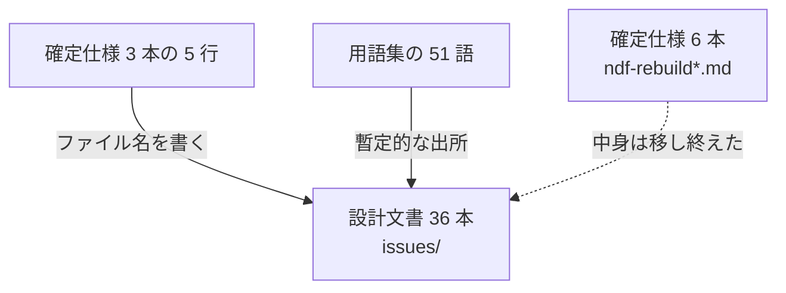
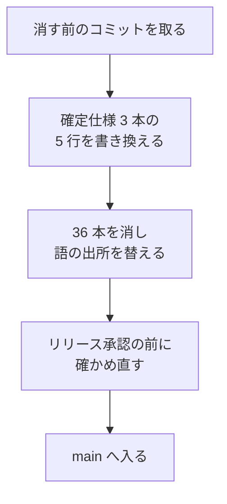

# 作り直しの設計文書 36 本: 消して、確定仕様だけを正本にする（#3990）

NDF のスクリプトの作り直し（#1142 と、その続きの #3347・#3388・#3395）の設計文書 36 本が `issues/` に残り、確定仕様と食い違う古い決定が正しいものとして読まれる。この設計では、確定仕様 3 本の 5 行から 36 本のファイル名を無くし、`ndf records spec finalize` で 36 本を消して、用語集の語の出所を確定仕様へ替える（51 語のうち 35 語は、出現の回数の規則で決めて指定する）。開いている Issue の本文にある 36 本へのリンクは書き換えない（決定 1）。用語集の語の出所を選ぶ規則は「決定の記録」の決定 2、語ごとの結果は「用語集の語の出所」の表、GitHub のコミットを指すリンクの調査は「外部の調査」にある。

## 今の姿

何が起きたか・目的・受け入れ条件は、要求仕様にある（[issue-3990-requirements.md](./issue-3990-requirements.md) 。正本（信頼する唯一の記録）は #3990 の本文）。この文書は「どう解くか」と「なぜその解き方か」だけを書く。この文書の「利用者」は、このリポジトリの持ち主で、設計とリリースを承認する人を指す。

「受け入れ条件 N」と「E<数>」（ドメインイベント）は要求仕様の番号、「手順 N」は「処理の流れ」の表の番号、「決定 N」はこの文書の「決定の記録」の番号、「STD<数>」は「外部の調査」の番号である。「2 段目の (a)〜(e)」は決定 2 の、語の出所を選ぶ規則を指す。



2026-11-24 に `main`（`85dc47f7af1401852642d88d7b2064b02e2869fd`。この作業のブランチの起点と同じ）で確かめた、設計に要る今の構造は次のとおりである。

| 確かめたこと | 結果 | 確かめ方 |
| --- | --- | --- |
| 36 本を消すと壊れる、リポジトリの文書のリンク | 0 本 | `scripts/check-markdown-links.py` に 36 本を `--removing` で渡し、`No links to the removed files` と終了コード 0 |
| 36 本のファイル名を含む行（受け入れ条件 2 の範囲） | 56 行。用語集の正本（`docs/glossary/glossary.json`）の確定する前の出所（`pending_source`）が 51 行、確定仕様 3 本が 5 行 | 要求仕様の「エンジニア向けの補足」の `git grep` |
| 用語集の 51 語の出所を、削除のコマンドが決められるか | 手順 3 で `--spec` に渡す 8 本（確定仕様 6 本と、決定 2 で足す 2 本）では、1 本だけに現れてコマンドが決められる語が 18 語ある。残りの 33 語には `--source-of` が要る。6 本だけで判定したときとの比較は、この表の下にある | 判定の関数（`plugins/ndf/src/ndf/domains/records/spec_decide.py` の `plan_glossary` が呼ぶ `_assign`）に、8 本と 6 本の本文と、36 本を `pending_source` に持つ 51 語を渡して確かめた |
| 確定仕様の番号の対応表（`docs/specifications/ndf-rebuild.md` の「番号の対応表」） | 30 行のすべてに扱い（移した・畳んだ・振り直した・落とした・移さないなど）がある | 表の「扱い」の列を数えた |
| 確定仕様の対応表にある、消す前の 36 本へのリンク | 既にある。`docs/specifications/ndf-rebuild.md` の 449 行（「番号の対応表」の節の、表の前の段落）に「設計の材料（2026-11-21 に消す前のコミット）」として、コミット `784110e5461b3f856ba18f3c8ea7e995a06c8b0d` の `issues/` の一覧へのリンクがある。そのコミットに 36 本はすべてある。その後 2026-11-22〜24 に、2 本（`issue-1142-design-review-routing.md` に 2 コミット・`issue-3395-design.md` に 7 コミット）が `main` で書き換わった。分岐点（`85dc47f7`）とこの日の `main`（`aae9cbee`）の間では、36 本に差が無い | `git cat-file -e 784110e5:<36 本のそれぞれ>` が 36 本とも通る。`git log 784110e5..origin/main -- <36 本>` で、書き換えたコミットを数えた。`git diff --quiet 85dc47f7 origin/main -- <36 本>` が終了コード 0 |
| 開いている Issue の 36 本へのリンク | 428 件のうち 14 件に 34 本。`develop` を指すものが 33 本、`main` が 1 本。40 桁の SHA で固めたものは 0 本。要求仕様の 426 件とは数えた時刻が違う（開いている Issue の数は、起票と終了で増減する）。リンクのある 14 件・34 本はどちらでも同じ | `gh api --paginate 'repos/devbasex/ai-plugins/issues?state=open&per_page=100'` から Pull Request を除き（`select(.pull_request \| not)`）、本文から抜いた |
| `develop` の状態 | 残っている（`f37ea4c2`）。`main` の祖先である | `git ls-remote`・`git merge-base --is-ancestor` |

用語集の 51 語を、`--spec` に渡す本数ごとに分けると次のとおりである。6 本の列の 2 本以上とどれにも現れないの数は、8 本の数と、下の 3 語の移り方から求めた。

| `--spec` に渡すもの | 1 本だけに現れる（コマンドが決める） | 2 本以上に現れる | どれにも現れない |
| --- | --- | --- | --- |
| 8 本 | 18 語 | 23 語 | 10 語 |
| 確定仕様 6 本だけ | 17 語 | 22 語 | 12 語 |

- 8 本と 6 本の差は 3 語である。`抑制コメント` は、足す 1 本の `ndf-next-terms-and-settings-renames.md` にも現れるので、8 本では 2 本以上に移る。`共有の一覧` と `チェックアウトの保存先` は、足す 2 本のそれぞれ 1 本だけに現れるので、8 本では 1 本だけに移る
- 8 本で 1 本だけに現れる 18 語のうち 2 語は、決定 2 の 2 段目の (a) で `--source-of` にも渡す。そのため、コマンドに任せるのは 16 語、`--source-of` で渡すのは 35 語である（「用語集の語の出所」の表）

## 文脈と制約

- 確定仕様 6 本の本文は変えない。中身の移し替えは #3412 で終わっている（要求仕様の「含まない」）
- Issue と Pull Request の本文に既にある、削除対象の設計文書へのリンクは書き換えない（決定 1）。この作業の PR の本文に検査の結果や変更の扱いを書くことは、これに当たらない
- `ndf records spec finalize` は 36 本を作業ツリーから直接消す。未コミットの編集も一緒に消えるので、打つ直前に 36 本に未コミットの変更が無いことを確かめる
- `--source-of <語>=<ファイル>` で指すファイルは、同じ呼び出しの `--spec` に渡したもののどれかでなければならない。判定は `plugins/ndf/src/ndf/domains/records/spec_decide.py` の `plan_glossary` にある
- このリポジトリの設計の設定（`.ndf/design.json`）が挙げるパスのファイルは触らない。パスは `plugins/ndf/**`・`plugins/ndf-next/**`・`.claude-plugin/marketplace.json` である。これらは利用先のリポジトリへ届くコードと配布の設定で、変えると、代表的なリポジトリの種類（Web サービス・モバイルアプリ・業務文書だけ）でそのまま使えるかの確認が要る。この作業は文書を消してリンクを直すだけで、これらを変える理由が無い

### 消す前のコミットの決め方

決定 3 で確定仕様 2 か所に新しく付けるリンクは、「消す前のコミット」の `issues/` の一覧を指す。消す前のコミットは、このブランチが載っている `main` のコミット（分岐点）とする。削除のコミットの直接の親にはしない。このブランチでは設計のコミットが削除のコミットより先に載るので、直接の親はブランチの上のコミットになり、マージの形によっては `main` の履歴に残らないからである。

1. 手順 1 で `git fetch origin main` の後に、`git merge-base HEAD origin/main` と `git rev-parse origin/main` を打つ。2026-11-24 は、どちらも `85dc47f7af1401852642d88d7b2064b02e2869fd` である。違えば、ブランチを `origin/main` へリベースしてから打ち直す
2. 手順 4（リリース承認を求める直前）とマージキューへ入れる直前に、`git fetch origin main` の後で、消す前のコミットから最新の `main` までに 36 本を変えたコミットを一覧にする。一覧は `git log --full-history --format=%H <消す前のコミット>..origin/main -- <36 本>` で取る
3. 一覧が空なら、消す前のコミットをそのまま使う。リンクが見せる 36 本の中身は、最新の `main` と同じだからである
4. 一覧が空でなければ、ブランチをリベースして手順 1 から取り直し、決定 3 の 2 か所のリンクを書き直す。リンクが消す直前の版を見せるようにするためである。あわせて、一覧のコミットごとに、変えたファイル・変更の中身の要約・確定仕様へ移すかどうかの推奨を PR の本文に挙げ、利用者に扱いを決めてもらう（要求仕様の「利用者がすること」の 1）。推奨は、確定仕様にまだ無い決定や仕様の変更なら「移す」、書式の直しや既に確定仕様にある内容なら「移さない」とする。移すと決まったら、AI が変更の中身を確定仕様へ書き足してコミットする

1 と 4 のリベースは、PR #4470 のブランチが公開済みなので、push に強制 push が要る。AI は強制 push を打つ前に人へ戻し、承認を得てから打つ（MVV の共通原則 C4。履歴を書き換える操作は実行前に人の承認を取る）。

マージキューに入っている間に、36 本を変える別の変更が先に `main` へ入ると、この PR の削除とぶつかってマージキューがこの PR を外す。そのときは上の 2 から打ち直す。

## 解き方の全体像



- 36 本は `issues/` から無くなり、作り直しの決定の正本は確定仕様 6 本だけになる
- 確定仕様 3 本は、ファイル名を書かずに「どの課題の何の表か」を文で書き、コミットの `issues/` の一覧へリンクする（決定 3）。今あるリンクは、今と同じコミットの一覧を指す。ファイル名だけだった所は、消す前のコミットの一覧を指す
- 用語集の 51 語は、確定仕様のどれかを出所に持つ。用語集の文書は正本から作り直してある
- 開いている Issue の本文の 36 本へのリンクは変えない。開けなくなる時期は「影響と危険」にある

## 処理の流れ

手順の番号の後ろの `E<数>` は、要求仕様のドメインイベントの番号である。

「参照の検査の 1・2」は、[#3412 の詳細設計書の「参照の検査」](./issue-3412-design-detail.md#参照の検査) にある次の 2 つのコマンドで、どちらも 0 行（2 は当たり 0 件と終了コード 0）を合格とする。

```bash
# 1. 36 本のファイル名を含む行（受け入れ条件 2 の範囲）。要求仕様の「エンジニア向けの補足」と同じ式
git grep -n -e issue-1142- -e issue-3347- -e issue-3395- -e issue-3388- -- \
  plugins scripts docs .github AGENTS.md CLAUDE.md \
  ':!docs/archive' ':!docs/ndf-12-survey' ':!scripts/ndf-next-parity' ':!**/CHANGELOG.md'
# 2. 残る文書のリンクのうち、36 本を消すと壊れるもの・指す先が変わるもの
env -u UV_PROJECT_ENVIRONMENT -u VIRTUAL_ENV uv run --frozen --project . --all-extras \
  python scripts/check-markdown-links.py \
  $(git ls-tree -r --name-only <消す前のコミット> -- issues/ | grep -E '^issues/issue-(1142|3347|3395|3388)-' | sed 's/^/--removing /')
```

1 は 36 本のファイル名を文字の並びで数える。2 はリンクを解決して数える。2 が読むのは、`git ls-files '*.md'` の全件から `--removing` の 36 本を除いた文書（`issues/` を含む）のリンクである。数えるのは次の 2 種類である。

- 出力の `(a)`: 相対リンクの宛先が 36 本のどれかになるもの
- 出力の `(b)`: `https://github.com/devbasex/ai-plugins/(blob|tree|raw)/<参照>/<パス>` の `<パス>` が 36 本のどれかで、`<参照>` が 40 桁の SHA でないもの

当たりごとに `文書:行: (a|b) 宛先` を出し、1 つでもあれば終了コード 1 を返す。消すパスの一覧は消す前のコミットの木から取る。作業ツリーの `git ls-files` で取ると、手順 3 で消した後に一覧が空になり、2 が何も検査しなくなるからである。打つ前に一覧が 36 行であることを確かめる。

| 手順 | 何をするか | 終わりの条件 |
| --- | --- | --- |
| 1（E1） | 消す前のコミットを取る（文脈と制約の「消す前のコミットの決め方」の 1） | SHA が 40 桁で、その木に 36 本がある |
| 2（E2） | 確定仕様 3 本の 5 行から 36 本のファイル名を無くし（決定 3 の対応表）、3 本をコミットする | 参照の検査の 1 が、用語集の正本の `pending_source` の 51 行だけを返す |
| 3（E3・E4） | 36 本に未コミットの変更が無いことを確かめてから、`ndf records spec finalize` を `-m <コミットの件名>` 付きで打つ。`--spec` には決定 2 で決めた一式、`--remove` には 36 本、`--source-of` には決定 2 で決めた語を渡す（2026-11-24 の実測では 8 本と 35 語。本文が変わって規則で作り直したら、作り直した結果を渡す）。コマンドは 36 本を消し、用語集の正本と文書を作り直し、返すパス（渡した確定仕様・用語集・消した 36 本）だけをステージしてコミットする（`git add -A -- <パス…>` と `git commit -m <件名> -- <パス…>`）。`-m` を省くとパスを返すだけでステージもしない。省いたときは、ステージもコミットも返したパスに限り、`git add -A -- <パス…>` の後に `git commit -m <件名> -- <パス…>` を打つ。パスを付けずに `git commit` を打つと、ほかの作業のために既にステージしてあった変更まで削除のコミットに入るからである | コミットの後に、参照の検査の 1 と 2 が 0 行。`git ls-files` で 36 本が 0 件。`ndf records glossary render --check` が `ok` |
| 4 | リリース承認を求める直前に、参照の検査の 1・2 と、36 本と最新の `main` の比較（消す前のコミットの決め方の 2）を打ち直し、受け入れ条件 1〜4 の結果を PR の本文に書く | 参照の検査の 1・2 が 0 行。消す前のコミットから最新の `main` までに 36 本を変えたコミットが無い。あれば、消す前のコミットの決め方の 4 のとおり手順 1 から取り直す |

手順 2 は手順 1 の SHA を使い、手順 3 は手順 2 の後に行う。承認を求めた後に PR へコミットを足したときも、手順 4 を打ち直す。

手順 4 は承認を求める前の検査で、終えても PR はまだ `main` へ入っていない。要求仕様の E5（Pull Request が `main` へ入った）が成り立つのは、リリース承認の後に PR が `main` へマージされた時点である。

## 決定の記録

各決定の「根拠」の「Value <番号>」は、このプロジェクトの MVV（使命・目指す姿・価値基準をまとめた、判断の基準。バージョン 11）の価値基準（Value）の番号と名前である。

### 決定 1: 開いている Issue の本文にある 36 本へのリンクは書き換えない

- **質問**: 開いている Issue 14 件の本文に、36 本へのリンクが 34 本ある（`main` を指す 1 本、`develop` を指す 33 本）。36 本を消した後も開けるよう、消す前のコミットの 40 桁の SHA を指す形に書き換えるか
- **選んだ案**: 書き換えない（利用者の判断、2026-11-24）。34 本は開けなくなることを受け入れる。`main` を指す 1 本はこの作業が `main` へ入った時点で、`develop` を指す 33 本は `develop` を消した時点で開けなくなる。消した文書は、git の履歴と、確定仕様の対応表（`ndf-rebuild.md` の「設計の材料」）と決定 3 で付けるリンクから読める
- **理由**: 書き換えを安全に行う手順（書き込む間に入ったほかの編集を上書きしない・書き換える組を人が許したかを確かめる）を設計に詰めると、AI のレビューが 3 回とも、まれな場合分けを求めて収束しなかった。GitHub の Issue の更新には条件付きの書き込みが無く（[GitHub REST API の「Update an issue」](https://docs.github.com/en/rest/issues/issues#update-an-issue) ）、このリポジトリの Issue を編集できるアカウントは 1 つなので、人の編集と AI の書き込みを履歴で見分ける手順が場合分けを増やした
- 採らなかった案: AI が、開いている Issue の本文のリンクを消す前のコミットの SHA へ書き換える（上の理由で、安全な手順を設計で閉じられなかった）
- **代償**: 開いている Issue 14 件の読み手は、リンクが開けなくなった後、確定仕様の対応表か git の履歴から元の文書を探す。#3412 の受け入れ条件 6（開いている Issue のリンクを固める）は満たさない
- 根拠: Value 1「人の判断を、読み切れる量の大事な所だけにする」（MVV バージョン 11）

### 決定 2: 用語集の語の出所が誰が打っても同じになるよう、35 語の出所を出現の回数の規則で決めて `--source-of` で渡す

- **質問**: `ndf records spec finalize` は、`--spec` に渡した確定仕様のうち 1 本だけに現れる語しか出所を決めない。2 本以上に現れる語と、どれにも現れない語の出所をどう決めるか。`--spec` に足すファイルで、判定の結果が変わることもどう扱うか
- **選んだ案**: 2 段で決める。1 段目で `--spec` に渡す一式を確定し、2 段目でその一式から語ごとの出所を選ぶ。結果は「用語集の語の出所」の表にある

語の数え方は、コマンドの判定と同じく本文の文字の並びで数える。ほかの語の一部として現れたもの（「兆候の基準ファイル」の中の「兆候」）も数える。回数は、重ならない出現の数（Python の `str.count`）とする。「括弧を除いた語」は、括弧の補足（例: 「（決定番号の）」）を除いた語である。

**1 段目（`--spec` の一式を確定する）**: 確定仕様 6 本だけで判定する。

- 1 段目では、6 本に現れない語ごとに、6 本以外の確定仕様から語が最も多く現れる 1 本を選ぶ。ただし、語も括弧を除いた語も 6 本以外のどの確定仕様にも 1 回も現れなければ、ファイルを選ばない。その語は 2 段目の (e) で `ndf-rebuild.md` に決まる
  - 対象は、語も括弧を除いた語も 6 本のどれにも現れない語である
  - 6 本以外の確定仕様は、`docs/specifications/` の `README.md` を除く `.md` である
  - 語が 1 回以上現れる確定仕様があれば、語の回数で比べる。無ければ、括弧を除いた語の回数で比べる。どちらも 0 回なら、上のとおりファイルを選ばない
  - 最も多い回数の本が 2 本以上あれば、ファイル名の昇順で先の 1 本にする
- 6 本に、1 段目で選んだファイルを足したものを一式とする。2026-11-24 の実測では足すファイルが 2 本で、計 8 本になる。以下の「一式」は、この確定した一式を指す

**2 段目（語ごとの出所を選ぶ）**: 一式の中で、(a) から順に当て、当たった所で決める。

- (a) 1 段目でファイルを選んだ語は、その結果を出所にする。2 段目のほかの規則より優先する。ほかの語のために足したファイルにもこの語が現れて、一式の中で 2 本以上に現れても、1 段目の結果を使う
- (b) 一式のうち 1 本だけに語が現れれば、コマンドが決めるのに任せる（2026-11-24 の実測で 16 語）
- (c) 一式の 2 本以上に現れれば、語が最も多く現れる 1 本にする。最も多い回数の本が 2 本以上あれば、次の並びで先の 1 本にする。6 本は `ndf-rebuild.md` の索引の並びとする（`ndf-rebuild.md`・`-libraries`・`-data-and-smells`・`-scripted-flow`・`-measure`・`-review-scope`）。その後に、1 段目で足したファイルをファイル名の昇順で並べる
- (d) 一式のどれにも現れなければ、括弧を除いた語で数える。1 本だけに現れればその 1 本にし、2 本以上に現れれば (c) と同じ決め方をする
- (e) どこにも現れなければ `ndf-rebuild.md` にする

(b) で決まる語のほかは、すべて `--source-of` で渡す。2026-11-24 の実測では 35 語である。確定仕様の本文が変わって作り直したときは、作り直した一式と語を手順 3 に渡す。
- 採らなかった案: 語ごとに意味を読んで出所を選ぶ（選ぶ人ごとに結果が変わり、レビューで同じ検討を繰り返す）
- 採らなかった案: 確定仕様の本文に語を書き足し、コマンドが自動で決められるようにする（確定仕様 6 本の本文は範囲の外で、#3412 で終わっている）
- 採らなかった案: 使われなくなった語（「drive の状態」など）を用語集から廃止する（語の意味と存否を変える判断で、この Issue の範囲の外である。受け入れ条件 3 は、語が確定仕様を出所に持つことを求める）
- **代償**: 2 段目の (e) で `ndf-rebuild.md` にした 8 語は、出所の本文にその語が無い。読み手は出所を開いても語を見つけられない。`ndf-rebuild.md` は作り直しの索引で、「番号の対応表」の節に既にある「設計の材料」のリンクから、2026-11-21 のコミットの `issues/` の一覧へたどれる
- 根拠: Value 3「同じ手順は毎回同じ結果になる」（MVV バージョン 11）

### 決定 3: 確定仕様 3 本から元の文書へたどれるよう、5 行はファイル名の代わりに課題の番号と表の名前を文で書き、消す前のコミットの `issues/` の一覧へリンクする

- **質問**: 受け入れ条件 2 の検査は、固めたリンクの中のファイル名も数える。確定仕様 3 本の 5 行には、コミットに固めたリンクが 3 本、コードの書式で書いたファイル名が 2 つ、ファイル名の型（`issues/issue-1142-*` など）が 2 つある。元の文書へたどれる手段を残したまま、これらからファイル名を無くすにはどう書くか
- **選んだ案**: ファイル名を書いていた所に、「#3388 の設計の対応表」「#3388 の 11.x の子の表」「#1142 の要求仕様のコピー」のように課題の番号と表の名前を文で書く。リンクは、コミットの `issues/` の一覧（`https://github.com/devbasex/ai-plugins/tree/<SHA>/issues` ）へ替える。`ndf-rebuild.md` の「番号の対応表」の節に既にある「設計の材料」のリンク（コミット `784110e5` の `issues/` の一覧）と同じ形である。今リンクがある所は今のリンクと同じ SHA を使い、行番号や中身の時点を変えない。今リンクが無くファイル名だけを書いた所には、手順 1 の消す前のコミットの SHA でリンクを付ける。行ごとの書き換えは下の表のとおりである

| 行 | 今ある参照 | 書き換えた後 | リンク先の SHA |
| --- | --- | --- | --- |
| `docs/specifications/ndf-review-items.md` の 6 行 | コードの書式のファイル名 `issues/issue-1142-design-review-routing.md`（リンク無し）。同じ行の `ndf-rebuild-review-scope.md` へのリンクは残す | 「#3395 の設計で作った振り分け表（ファイル名は #1142 の設計文書の名前で始まる。[消す前のコミットの `issues/` の一覧](https://github.com/devbasex/ai-plugins/tree/<消す前のコミット>/issues) にある）」 | 消す前のコミット |
| `docs/specifications/ndf-review-items.md` の 16 行 | リンク `[11.x の子の表](…/blob/784110e5…/issues/issue-3388-design-children.md)` | 「[#3388 の設計の 11.x の子の表](https://github.com/devbasex/ai-plugins/tree/784110e5461b3f856ba18f3c8ea7e995a06c8b0d/issues) （コミット `784110e5` の `issues/` の一覧にある）」 | `784110e5461b3f856ba18f3c8ea7e995a06c8b0d`（今と同じ） |
| `docs/specifications/ndf-review-items.md` の 18 行 | リンク `[issue-1142-requirements.md](…/blob/4e1f1f1c…/issues/issue-1142-requirements.md)` | 「#1142 の要求仕様のコピー（[コミット `4e1f1f1ca` の `issues/` の一覧](https://github.com/devbasex/ai-plugins/tree/4e1f1f1caa7c022cd4807d56df2706e095776adb/issues) にある）の行番号（コミット `4e1f1f1ca` の時点）」 | `4e1f1f1caa7c022cd4807d56df2706e095776adb`（今と同じ） |
| `docs/specifications/ndf-review-items-11x.md` の 5 行 | コードの書式のファイル名 `issues/issue-3388-design-routing.md`（リンク無し）と、リンク `[コミット 784110e5 の issue-3388-design-children.md](…/blob/784110e5…/issues/issue-3388-design-children.md)` の 2 つ | 前者は「#3388 の設計の対応表（[消す前のコミットの `issues/` の一覧](https://github.com/devbasex/ai-plugins/tree/<消す前のコミット>/issues) にある）」。後者は「[コミット 784110e5 の #3388 の設計の 11.x の子の表](https://github.com/devbasex/ai-plugins/tree/784110e5461b3f856ba18f3c8ea7e995a06c8b0d/issues) （`issues/` の一覧にある）」 | 前者は消す前のコミット。後者は `784110e5461b3f856ba18f3c8ea7e995a06c8b0d`（今と同じ） |
| `docs/specifications/ndf-code-decision-references.md` の 74 行 | コードの書式のファイル名の型 `issues/issue-1142-*`・`issues/issue-3388-*` の 2 つ（リンク無し） | 「作り直しの設計文書（#1142・#3347・#3388・#3395 の設計文書）へのパス」。検査の説明なのでリンクは付けない | — |

`ndf-rebuild.md` の「設計の材料」のリンクとの関係は次のとおりである。どちらも、消した後に 36 本を読むための `issues/` の一覧へのリンクで、違うのは指すコミットだけである。

| リンク | 指すコミット | 見える版 | この作業ですること |
| --- | --- | --- | --- |
| `ndf-rebuild.md` の「設計の材料」 | `784110e5`（2026-11-21） | 36 本のすべてがある。2 本（`issue-1142-design-review-routing.md`・`issue-3395-design.md`）は、その後に `main` で書き換わる前の版 | 何もしない（確定仕様 6 本の本文は変えない） |
| 上の表の「消す前のコミット」の 2 か所 | 消す前のコミット | 消す直前の版 | ファイル名だけを書いていた所に新しく付ける |
| 上の表の「今と同じ」の 3 か所 | `784110e5`・`4e1f1f1ca`（今のリンクと同じ） | 今のリンクが見せている版 | ファイルへのリンクを、同じコミットの `issues/` の一覧へのリンクに替える |

- **確かめ方**: 書き換えた後、参照の検査の 1 がこの 5 行を返さない。`scripts/check-markdown-links.py` が通る
- 採らなかった案: 受け入れ条件 2 の検査の除外に 3 本を足す（除外を広げると #3412 の受け入れ条件 5 の範囲が変わる。要求仕様の起票者の推定 S3 が書き換える側を選んでいる）
- 採らなかった案: リンクを消して文だけにする（読み手が元の表を開けなくなる）
- **代償**: 読み手は `issues/` の一覧から目当てのファイルを選ぶ手間が 1 つ増える。`#1142 の要求仕様のコピー` の「要求の行」の行番号は、そのコピーを開いて数える
- 根拠: Value 14「判断の理由が残り、語がそろっている」（MVV バージョン 11）。STD1

## 影響と危険

- **働く範囲**: このリポジトリだけである。`issues/`・`docs/specifications/` の 3 本・`docs/glossary/` が変わる。`plugins/` を変えないので、利用先のリポジトリに届くものは無い
- **開けなくなる Issue のリンク**: 開いている Issue 14 件の本文にある、36 本へのブランチを指すリンク 34 本は、書き換えないので開けなくなる（決定 1）。`main` を指す 1 本はこの作業の Pull Request（#4470）が `main` へ入った時点で、`develop` を指す 33 本は `develop` を消した時点で開けなくなる。閉じた Issue と Pull Request の本文のリンクの数と時期は、要求仕様の「影響」にある
- **プロジェクトごとに違うもの**: 無し（設定も引数も足さない）
- **当たるモード**: `standard` のこの 1 回の作業だけである。NDF の工程の振る舞いは変わらない
- **同じファイルを触る別の変更**: 用語集の正本と文書を触る別の Pull Request と、同時にはマージできない。そちらが先に `main` へ入ったら、手順 3 をやり直す（`ndf records glossary render --check` が食い違いを返す）。手順 3 を終えたブランチには 36 本がもう無いので、そのまま打ち直してはいけない。`ndf records spec finalize` は、`--remove` に渡したファイルが 1 本でも無いと、用語集を処理する前に止まるからである。手順 3 のコミットを外して 36 本が残る状態へ戻し、先に `main` へ入った用語集の変更を取り込んでから、手順 3 を打ち直す
- **36 本へのリンクを新しく足す別の変更**: リポジトリの文書のリンクは、手順 4 の参照の検査の 1・2 が拾う。見つかればマージへ進まず、手順 2 と同じ書き換えをその行に当て、手順 4 を打ち直す
- **分岐点の後に 36 本を変える別の変更**: 手順 4 とマージキューへ入れる直前に、36 本を最新の `main` と比べて拾い、消す前のコミットの決め方の 4 のとおり取り直す
- **振り分け表の検査**: `ndf-review-items.md` で書き換えるのは「列の読み方」の表と前書きの行だけである。`ndf check` の規則 `review-items`（設計レビューの項目の表と 11.x の対応表の、列と行き先の形を検査する）が読む「行き先の表」は変えない。`ndf check` が通ることで確かめる

## テスト設計

コードを変えないので、単体テストは足さない。受け入れ条件ごとに、打つ検査と落ちるべき壊し方を決める。

| 受け入れ条件 | どの振る舞いで縛るか | どう壊したら落ちるべきか |
| --- | --- | --- |
| 1. 36 本が無く、対応表のすべての行が処理済み | 手順 3 のコミットの後に、`git ls-files` で 36 本のパターンが 0 件。「番号の対応表」の 30 行のすべてに扱いがある | 36 本のどれか 1 本を消し忘れると 1 件になる |
| 2. 36 本のファイル名を含む行が 0 行 | 要求仕様の「エンジニア向けの補足」の `git grep` が 0 行 | 確定仕様 3 本の 5 行のどれかを残す、または語を 1 つ `pending_source` のまま残すと 1 行以上になる |
| 3. 語が確定仕様を出所に持つ | 削除する 36 本のどれかを暫定的な出所（`pending_source`）として登録していた 51 語のすべてが、`source` に `docs/specifications/` のファイルを持ち、`pending_source` を持たない | `--source-of` を 1 語でも渡し忘れると、コマンドが消さずに止まる |
| 4. 退行しない | `ndf records glossary render --check` が `ok`。`scripts/check-markdown-links.py`（36 本を `--removing` で渡す形も含む）・`scripts/check-doc-staleness.py`・`ndf check`・CI の必須のジョブが通る | 用語集の文書を作り直さないと `--check` が食い違いを返す。確定仕様のリンクを壊すと検査が落ちる |

## どこを変えるか

コードを変えない（新しく作る関数も、引数を変える関数も無い）ので、詳細設計書は別に作らず、このセクションに書く。

| ファイル | 変える中身 | 決定 |
| --- | --- | --- |
| `docs/specifications/ndf-review-items.md` | 6 行・16 行・18 行の 3 か所で、ファイル名とファイルへのリンクを、課題の番号と表の名前の文と、コミットの `issues/` の一覧へのリンクに替える（決定 3 の対応表の 1〜3 行目）。「列の読み方」の表と前書きの行だけを書き換え、`ndf check` の規則 `review-items` が読む「行き先の表」は変えない。手順 2 でコミットする | 決定 3 |
| `docs/specifications/ndf-review-items-11x.md` | 5 行の 2 か所（ファイル名とファイルへのリンク）を、決定 3 の対応表の 4 行目のとおり替える。手順 2 でコミットする | 決定 3 |
| `docs/specifications/ndf-code-decision-references.md` | 74 行のファイル名の型 2 つを、「作り直しの設計文書（#1142・#3347・#3388・#3395 の設計文書）へのパス」という文に替える。リンクは付けない。手順 2 でコミットする | 決定 3 |
| `docs/glossary/glossary.json` | 36 本を暫定的な出所（`pending_source`）に持つ 51 語の出所を、確定仕様へ替える。手で直さず、手順 3 の `ndf records spec finalize` が書く。`--spec` には決定 2 の一式（2026-11-24 の実測で 8 本）、`--source-of` には「用語集の語の出所」の 35 語を渡す | 決定 2 |
| `docs/glossary/ndf-rebuild.md`、`docs/glossary/ndf-code-structure.md`、`docs/glossary/ndf-durable.md`、`docs/glossary/ndf-supervise.md`、`docs/glossary/ndf-design.md`、`docs/glossary/ndf-cross-review.md` | 用語集の正本から作り直した文書。手で直さず、手順 3 の `ndf records spec finalize` が作り直す。`ndf records glossary render --check` が `ok` になることで確かめる | 決定 2 |
| `issues/issue-1142-design-base-design-detail.md`、`issues/issue-1142-design-data-design-detail.md`、`issues/issue-1142-design-data.md`、`issues/issue-1142-design-dbos.md`、`issues/issue-1142-design-decisions.md`、`issues/issue-1142-design-detail.md`、`issues/issue-1142-design-fixes-design-detail.md`、`issues/issue-1142-design-fixes.md`、`issues/issue-1142-design-labels.md`、`issues/issue-1142-design-libraries.md`、`issues/issue-1142-design-migration.md`、`issues/issue-1142-design-modules.md`、`issues/issue-1142-design-next-design-detail.md`、`issues/issue-1142-design-next.md`、`issues/issue-1142-design-review-routing.md`、`issues/issue-1142-design-scripted-flow-design-detail.md`、`issues/issue-1142-design-scripted-flow.md`、`issues/issue-1142-design-smells-design-detail.md`、`issues/issue-1142-design-smells.md`、`issues/issue-1142-design.md`、`issues/issue-1142-requirements.md`、`issues/issue-3347-design-detail.md`、`issues/issue-3347-design.md`、`issues/issue-3347-requirements.md`、`issues/issue-3347-source-note.md`、`issues/issue-3388-design-children.md`、`issues/issue-3388-design-detail.md`、`issues/issue-3388-design-routing.md`、`issues/issue-3388-design.md`、`issues/issue-3388-requirements.md`、`issues/issue-3395-design-bugs.md`、`issues/issue-3395-design-decisions.md`、`issues/issue-3395-design-detail.md`、`issues/issue-3395-design-scope.md`、`issues/issue-3395-design.md`、`issues/issue-3395-requirements.md` | 消す 36 本。手順 3 で、`ndf records spec finalize` が `--remove` で作業ブランチから消してコミットする。開いている Issue の本文のリンクは書き換えない | 決定 1 |

## 設計の結果

| 課題 | 扱い | 統合先 | 触るファイル |
| --- | --- | --- | --- |
| #3990 | 実装する | — | `docs/specifications/ndf-review-items.md`、`docs/specifications/ndf-review-items-11x.md`、`docs/specifications/ndf-code-decision-references.md`、`docs/glossary/glossary.json`、`docs/glossary/ndf-rebuild.md`、`docs/glossary/ndf-code-structure.md`、`docs/glossary/ndf-durable.md`、`docs/glossary/ndf-supervise.md`、`docs/glossary/ndf-design.md`、`docs/glossary/ndf-cross-review.md`、`issues/issue-1142-design-base-design-detail.md`、`issues/issue-1142-design-data-design-detail.md`、`issues/issue-1142-design-data.md`、`issues/issue-1142-design-dbos.md`、`issues/issue-1142-design-decisions.md`、`issues/issue-1142-design-detail.md`、`issues/issue-1142-design-fixes-design-detail.md`、`issues/issue-1142-design-fixes.md`、`issues/issue-1142-design-labels.md`、`issues/issue-1142-design-libraries.md`、`issues/issue-1142-design-migration.md`、`issues/issue-1142-design-modules.md`、`issues/issue-1142-design-next-design-detail.md`、`issues/issue-1142-design-next.md`、`issues/issue-1142-design-review-routing.md`、`issues/issue-1142-design-scripted-flow-design-detail.md`、`issues/issue-1142-design-scripted-flow.md`、`issues/issue-1142-design-smells-design-detail.md`、`issues/issue-1142-design-smells.md`、`issues/issue-1142-design.md`、`issues/issue-1142-requirements.md`、`issues/issue-3347-design-detail.md`、`issues/issue-3347-design.md`、`issues/issue-3347-requirements.md`、`issues/issue-3347-source-note.md`、`issues/issue-3388-design-children.md`、`issues/issue-3388-design-detail.md`、`issues/issue-3388-design-routing.md`、`issues/issue-3388-design.md`、`issues/issue-3388-requirements.md`、`issues/issue-3395-design-bugs.md`、`issues/issue-3395-design-decisions.md`、`issues/issue-3395-design-detail.md`、`issues/issue-3395-design-scope.md`、`issues/issue-3395-design.md`、`issues/issue-3395-requirements.md` |

`issues/` の 36 本は消すファイルである。用語集の文書（`docs/glossary/` の `.md`）は、手で直さずに `ndf records spec finalize` が作り直す。

## 未確認のまま残ること

| 項目 | 内容 |
| --- | --- |
| `develop` を消す時期 | 決まっていない。消した時点で、開いている Issue の `develop` を指す 33 本と、閉じた Issue の 618 本が開けなくなる |
| 手順 3 を打つ時点の語の出所 | 「用語集の語の出所」の表は 2026-11-24 の確定仕様の本文から作った。打つまでに確定仕様の本文が変われば、決定 2 の規則で作り直す |

## 外部の調査

| 種類 | 調べるか | 理由 |
| --- | --- | --- |
| 標準・仕様 | 調べる | 消した後も確定仕様のリンクから読めることは、GitHub のコミットを指すリンクの振る舞いに依る |
| 主要な製品 | 調べない | 消すファイルとリンクの扱いは、このリポジトリの取り決め（`issues/README.md`・#3412 の詳細設計書）だけで決まる。比べる製品の解き方が無い |
| ライブラリとサービス | 調べない | 使う Tool は既にある `ndf records spec finalize`・`scripts/check-markdown-links.py` だけで、足す依存が無い |

### 標準・仕様

| # | 標準・仕様 | 何を定めているか | 設計への反映 | 出典 |
| --- | --- | --- | --- | --- |
| STD1 | GitHub Docs「Getting permanent links to files」 | ブランチ名の URL は先端のバージョンを指し、内容が変わる。コミット ID を置いた URL は、そのバージョンの内容が変わらない | 決定 3 で、確定仕様のリンクを 40 桁の SHA のコミットの `issues/` の一覧へ向ける | https://docs.github.com/en/repositories/working-with-files/using-files/getting-permanent-links-to-files （2026-11-24） |

## 用語集の語の出所

決定 2 の規則で決めた、`--source-of` で渡す語の出所である（2026-11-24 の実測で、一式 8 本・35 語）。ファイルはすべて `docs/specifications/` の下にある。残りの 16 語は、8 本のうち 1 本だけに現れるので、コマンドが決める。規則の欄の値は次の意味である。

| 規則の値 | 意味 |
| --- | --- |
| 複数 | 8 本の 2 本以上に語が現れ、最も多く現れる 1 本にした（2 段目の (c)） |
| 複数（同数） | 8 本の 2 本以上に語が現れ、最も多い回数の本が 2 本以上あったので、2 段目の (c) の並びで先の 1 本にした |
| 語幹 | 8 本のどれにも現れず、括弧の補足を除いた語で数えて決めた（2 段目の (d)） |
| 他の確定仕様 | 確定仕様 6 本のどれにも現れず、6 本以外の確定仕様で最も多く現れる 1 本にし、その 1 本を `--spec` に足した（1 段目）。2 段目の (a) でほかの規則より優先するので、`--source-of` でも渡す |
| 索引 | どこにも現れないため `ndf-rebuild.md` にした（2 段目の (e)）。6 本以外の確定仕様にも、語と括弧を除いた語のどちらも 1 回も現れないので、1 段目ではファイルを選んでいない（2026-11-24 に `docs/specifications/` の `README.md` を除く `.md` で数えて確かめた） |

| 語 | コンテキスト | 規則 | 出所 |
| --- | --- | --- | --- |
| 系統（決定番号の） | ndf-design | 語幹 | `ndf-rebuild.md` |
| 安定版（依存の） | ndf-code-structure | 語幹 | `ndf-rebuild.md` |
| 一時コピーの検査 | ndf-rebuild | 索引 | `ndf-rebuild.md` |
| ライブラリ | ndf-code-structure | 複数 | `ndf-rebuild-libraries.md` |
| エントリポイント | ndf-code-structure | 複数 | `ndf-rebuild.md` |
| drive の状態 | ndf-cross-review | 索引 | `ndf-rebuild.md` |
| 耐久ワークフロー | ndf-durable | 複数 | `ndf-rebuild-libraries.md` |
| 耐久ステップ | ndf-durable | 複数 | `ndf-rebuild-libraries.md` |
| 耐久の記録 | ndf-durable | 複数（同数） | `ndf-rebuild.md` |
| 実行の回 | ndf-durable | 複数（同数） | `ndf-rebuild-libraries.md` |
| 資源のクォータ | ndf-supervise | 索引 | `ndf-rebuild.md` |
| 共有の一覧 | ndf-supervise | 他の確定仕様 | `ndf-supervise-queue-overlap-by-file.md` |
| ステートマシンの DB | ndf-durable | 索引 | `ndf-rebuild.md` |
| 兆候 | ndf-code-structure | 複数 | `ndf-rebuild-data-and-smells.md` |
| 判定データ | ndf-code-structure | 複数（同数） | `ndf-rebuild-data-and-smells.md` |
| 抑制コメント | ndf-code-structure | 複数 | `ndf-rebuild-data-and-smells.md` |
| アダプター | ndf-code-structure | 複数 | `ndf-rebuild-libraries.md` |
| 事実の表 | ndf-code-structure | 複数 | `ndf-rebuild-data-and-smells.md` |
| オーナーのモジュール | ndf-code-structure | 索引 | `ndf-rebuild.md` |
| 停止理由の表 | ndf-durable | 複数 | `ndf-rebuild-scripted-flow.md` |
| 判断の呼び出し | ndf-durable | 複数 | `ndf-rebuild-scripted-flow.md` |
| プラグインの入れ替え | ndf-rebuild | 複数 | `ndf-rebuild-libraries.md` |
| チェックアウトの保存先 | ndf-code-structure | 他の確定仕様 | `ndf-next-terms-and-settings-renames.md` |
| 形の番号 | ndf-code-structure | 複数 | `ndf-rebuild.md` |
| レビューの項目 | ndf-rebuild | 複数 | `ndf-rebuild.md` |
| ルートの表 | ndf-rebuild | 索引 | `ndf-rebuild.md` |
| 追補の単位 | ndf-rebuild | 複数 | `ndf-rebuild-review-scope.md` |
| 目的の物差し | ndf-rebuild | 複数 | `ndf-rebuild-review-scope.md` |
| 選択の記録 | ndf-rebuild | 複数 | `ndf-rebuild-measure.md` |
| 閉じる証拠 | ndf-rebuild | 複数 | `ndf-rebuild-review-scope.md` |
| 11.x の行 | ndf-rebuild | 複数 | `ndf-rebuild-review-scope.md` |
| 閉じた子 | ndf-rebuild | 複数 | `ndf-rebuild-review-scope.md` |
| 多観点レビュー | ndf-rebuild | 索引 | `ndf-rebuild.md` |
| 起票の前に人へ見せる場 | ndf-rebuild | 索引 | `ndf-rebuild.md` |
| 11.x の子 | ndf-rebuild | 複数 | `ndf-rebuild-review-scope.md` |

数は 35 語で、規則ごとに複数 23 語（うち同数 3 語）・語幹 2 語・他の確定仕様 2 語・索引 8 語である。`抑制コメント` は、`ndf-rebuild-data-and-smells.md` に 36 回現れる。`--spec` に足す `ndf-next-terms-and-settings-renames.md` にも 2 回現れる。6 本だけならコマンドが決める語だが、8 本を渡すと決まらなくなるので、2 段目の (c) で `ndf-rebuild-data-and-smells.md` にした。手順 3 を打つ時点で確定仕様の本文が変わっていれば、表を規則で作り直してから打つ。
