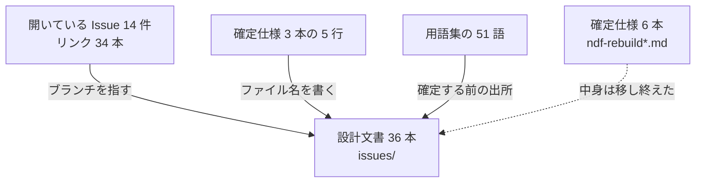
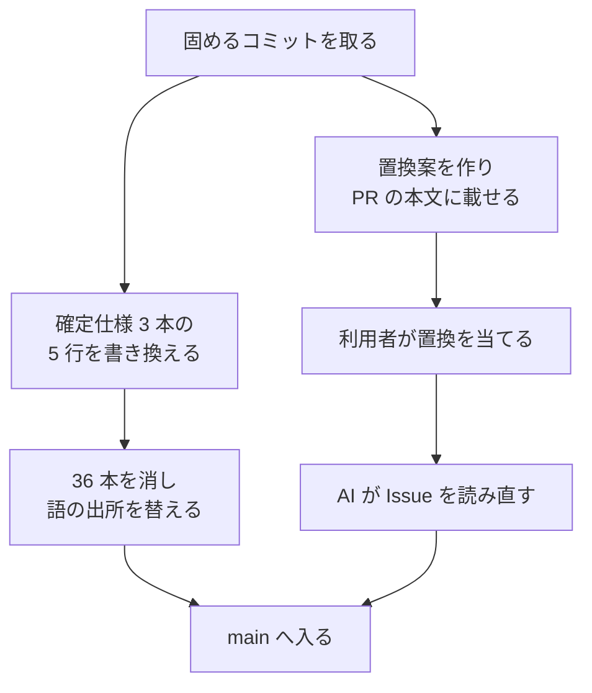

# 作り直しの設計文書 36 本: 確定仕様だけを正の記録にし、消した後も開いている Issue から元の文書を読めるようにする（#3990）

NDF のスクリプトの作り直し（#1142 の系統）の設計文書 36 本が `issues/` に残り、確定仕様と食い違う古い決定が正しいものとして読まれる。この設計では、開いている Issue の 36 本へのリンクを消す前の `main` のコミットへ固め、確定仕様 3 本の 5 行から 36 本のファイル名を無くす。続けて `ndf records spec finalize` で 36 本を消し、用語集の語の出所を確定仕様へ替える（削除のコマンドが出所を自動で決められない 34 語は、出現の回数で決める）。その規則は「決定の記録」の決定 2、語ごとの結果は「用語集の語の出所」の表、採らなかった案は「決定の記録」、GitHub の固定リンクと Issue の更新の調査は末尾の「外部の調査」にある。

## 今の姿

何が起きたか・目的・受け入れ条件は、要求仕様にある（[issue-3990-requirements.md](./issue-3990-requirements.md) 。正は #3990 の本文）。この文書は「どう解くか」と「なぜその解き方か」だけを書く。

2026-11-24 に `main`（`85dc47f7af1401852642d88d7b2064b02e2869fd`。この作業のブランチの起点と同じ）で確かめた、設計に要る今の構造は次のとおりである。

| 確かめたこと | 結果 | 確かめ方 |
| --- | --- | --- |
| 36 本を消すと壊れる、リポジトリの文書のリンク | 0 本 | `scripts/check-markdown-links.py` に 36 本を `--removing` で渡し、`No links to the removed files` と終了コード 0 |
| 36 本のファイル名を含む行（受け入れ条件 2 の範囲） | 56 行。用語集の正本（`docs/glossary/glossary.json`）の確定する前の出所（`pending_source`）が 51 行、確定仕様 3 本が 5 行 | 要求仕様の「エンジニア向けの補足」の `git grep` |
| 開いている Issue の 36 本へのリンク | 428 件のうち 14 件に 34 本。`develop` を指すものが 33 本、`main` が 1 本。40 桁の SHA で固めたものは 0 本 | `gh api --paginate 'repos/devbasex/ai-plugins/issues?state=open&per_page=100'` の本文から抜いた |
| リンクが指すファイルとフラグメント | 7 ファイル。フラグメントは `issue-3347-design-detail.md` の `#ほかの子へ足す条件` と `#実装計画` の 2 つで、どちらも `main` のバージョンに同じ名前の見出しがある | `grep -n '^#'` |
| `develop` の状態 | 残っている（`f37ea4c2`）。`main` の祖先で、リンクが指す 7 ファイルのうち 4 ファイルは `main` のほうが新しい | `git ls-remote`・`git merge-base --is-ancestor`・`git diff --stat` |
| 用語集の 51 語の出所を、削除のコマンドが決められるか | 17 語は決まる。22 語は確定仕様 6 本の 2 本以上に現れ、12 語はどの 1 本にも現れないため、`--source-of` が要る | `ndf records spec finalize` が使う判定の関数（`plan_glossary`）に、今の 6 本と 36 本を渡して確かめた |
| 確定仕様の番号の対応表（`docs/specifications/ndf-rebuild.md` の「番号の対応表」） | 30 行のすべてに扱い（移した・畳んだ・振り直した・落とした・移さないなど）がある | 表の「扱い」の列を数えた |

## 文脈と制約

- 確定仕様 6 本の本文は変えない。中身の移し替えは #3412 で終わっている（要求仕様の「含まない」）
- リンクを固めるコミットは、作業の中で 1 回だけ取る。36 本を消すコミットの親の `origin/main` を使う（前提 1）。今は `85dc47f7af1401852642d88d7b2064b02e2869fd` である。実装を始める時点で `git rev-parse origin/main` を打ち、このブランチの起点と同じであることを確かめて取る
- 開いている Issue の本文は、利用者（Issue の編集者）が置換のコマンドで書き換える。その間、このリポジトリで NDF のほかの実行を止めておく（前提 2）。GitHub の Issue の更新は、バージョンの一致を条件にした書き込みができない（外部の調査の STD2）
- 置換を当てて確かめ終えるのは、この作業の Pull Request が `main` へ入る前である（受け入れ条件 6）。`main` へ入った時点で、`main` を指すリンクが開けなくなる
- `ndf records spec finalize` は 36 本を作業ツリーから直接消す。未コミットの編集も一緒に消えるので、打つ直前に 36 本に未コミットの変更が無いことを確かめる
- `--source-of <語>=<ファイル>` で指すファイルは、同じ呼び出しの `--spec` に渡したもののどれかでなければならない。判定は `plugins/ndf/src/ndf/domains/records/spec_decide.py` の `plan_glossary` にある
- このリポジトリの設計の設定（`.ndf/design.json`）が対象に挙げるパス（`plugins/ndf/**` など）のファイルは触らない

## 解き方の全体像

- 36 本は `issues/` から無くなり、作り直しの決定の正の記録は確定仕様 6 本だけになる
- 開いている Issue の 36 本へのリンクは、すべて消す前の `main` のコミット（40 桁の SHA）を指す。消した後も、そのリンクから消す前の 36 本を読める
- 確定仕様 3 本は、ファイル名を書かずに「どの課題の何の表か」を文で書き、消す前のコミットの `issues/` の一覧へリンクする
- 用語集の 51 語は、確定仕様のどれかを出所に持つ。用語集の文書は正本から作り直してある

## 処理の流れ

手順の番号の後ろの `E<数>` は、要求仕様のドメインイベントの番号である。「参照の検査の 1・2」は、[#3412 の詳細設計書の「参照の検査」](./issue-3412-design-detail.md#参照の検査) の 2 つのコマンドである。

| 手順 | 何をするか | 終わりの条件 |
| --- | --- | --- |
| 1（E1） | 固めるコミットを取る（文脈と制約の 2 つ目） | SHA が 40 桁で、その木に 36 本がある |
| 2（E2） | 開いている Issue を全件読み、36 本へのリンクのうち 40 桁の SHA でないものを、手順 1 の SHA に替える置換案を作る。PR の本文の下書きに、Issue の番号と替えるリンクの数の表と、置換のコマンドを載せる | 置換のコマンドを書き込まない動作で打ち、14 件・34 本（打つ時点の数）を返す |
| 3（E3） | 確定仕様 3 本の 5 行から 36 本のファイル名を無くす（決定 3） | 参照の検査の 1 が、用語集の正本の `pending_source` の 51 行だけを返す |
| 4（E6・E7） | 36 本に未コミットの変更が無いことを確かめてから、`ndf records spec finalize` に 6 本と決定 2 で加える 2 本を `--spec` で、36 本を `--remove` で、34 語を `--source-of` で渡して消す。用語集の文書は同じコマンドが作り直す | 参照の検査の 1 と 2 が 0 行。`ndf records glossary render --check` が `ok` |
| 5（E4） | 利用者が、PR の本文の置換のコマンドを書き込む動作で打つ | コマンドが Issue ごとの結果（書いた・替えるリンクが無い・書いた後に変わった）を出す |
| 6（E5） | AI が開いている Issue を全件読み直し、受け入れ条件 3〜5 を確かめて PR の本文に結果を書く | 3〜5 が通る。通らなければ Issue の番号を挙げて利用者へ返す |
| 7（E8） | リリース承認で `main` へ入る | 手順 4 と 6 が終わっている |

手順 2 と、手順 3・4 の組は順を入れ替えてよい。手順 4 は手順 3 の後に行う。手順 5 は手順 2 の PR の本文が要るので、手順 2 の後に行う。マージの直前に、手順 2 の列挙と参照の検査の 1・2 をもう一度打つ。ほかの変更が 36 本へのリンクを新しく足していないかを見るためである。

### 用語集の語の出所

決定 2 の規則で決めた、`--source-of` で渡す 34 語の出所である。ファイルはすべて `docs/specifications/` の下にある。規則の欄の値は次の意味である。

| 規則の値 | 意味 |
| --- | --- |
| 複数 | 確定仕様 6 本の 2 本以上に語が現れる |
| 語幹 | 括弧の補足を除いた語で数えた |
| 他の確定仕様 | 6 本以外の確定仕様で数えた |
| 索引 | どこにも現れないため `ndf-rebuild.md` にした |

| 語 | コンテキスト | 規則 | 出所 |
| --- | --- | --- | --- |
| 系統（決定番号の） | ndf-design | 語幹 | `ndf-rebuild.md` |
| 安定版（依存の） | ndf-code-structure | 語幹 | `ndf-rebuild.md` |
| 一時コピーの検査 | ndf-rebuild | 索引 | `ndf-rebuild.md` |
| ライブラリ | ndf-code-structure | 複数 | `ndf-rebuild-libraries.md` |
| エントリポイント | ndf-code-structure | 複数 | `ndf-rebuild.md` |
| drive の状態 | ndf-cross-review | 索引 | `ndf-rebuild.md` |
| 耐久ワークフロー | ndf-durable | 複数 | `ndf-rebuild-libraries.md` |
| 耐久ステップ | ndf-durable | 複数 | `ndf-rebuild-libraries.md` |
| 耐久の記録 | ndf-durable | 複数（同数） | `ndf-rebuild.md` |
| 実行の回 | ndf-durable | 複数（同数） | `ndf-rebuild-libraries.md` |
| 資源のクォータ | ndf-supervise | 索引 | `ndf-rebuild.md` |
| 共有の一覧 | ndf-supervise | 他の確定仕様 | `ndf-supervise-queue-overlap-by-file.md` |
| ステートマシンの DB | ndf-durable | 索引 | `ndf-rebuild.md` |
| 兆候 | ndf-code-structure | 複数 | `ndf-rebuild-data-and-smells.md` |
| 判定データ | ndf-code-structure | 複数（同数） | `ndf-rebuild-data-and-smells.md` |
| アダプター | ndf-code-structure | 複数 | `ndf-rebuild-libraries.md` |
| 事実の表 | ndf-code-structure | 複数 | `ndf-rebuild-data-and-smells.md` |
| オーナーのモジュール | ndf-code-structure | 索引 | `ndf-rebuild.md` |
| 停止理由の表 | ndf-durable | 複数 | `ndf-rebuild-scripted-flow.md` |
| 判断の呼び出し | ndf-durable | 複数 | `ndf-rebuild-scripted-flow.md` |
| プラグインの入れ替え | ndf-rebuild | 複数 | `ndf-rebuild-libraries.md` |
| チェックアウトの保存先 | ndf-code-structure | 他の確定仕様 | `ndf-next-terms-and-settings-renames.md` |
| 形の番号 | ndf-code-structure | 複数 | `ndf-rebuild.md` |
| レビューの項目 | ndf-rebuild | 複数 | `ndf-rebuild.md` |
| ルートの表 | ndf-rebuild | 索引 | `ndf-rebuild.md` |
| 追補の単位 | ndf-rebuild | 複数 | `ndf-rebuild-review-scope.md` |
| 目的の物差し | ndf-rebuild | 複数 | `ndf-rebuild-review-scope.md` |
| 選択の記録 | ndf-rebuild | 複数 | `ndf-rebuild-measure.md` |
| 閉じる証拠 | ndf-rebuild | 複数 | `ndf-rebuild-review-scope.md` |
| 11.x の行 | ndf-rebuild | 複数 | `ndf-rebuild-review-scope.md` |
| 閉じた子 | ndf-rebuild | 複数 | `ndf-rebuild-review-scope.md` |
| 多観点レビュー | ndf-rebuild | 索引 | `ndf-rebuild.md` |
| 起票の前に人へ見せる場 | ndf-rebuild | 索引 | `ndf-rebuild.md` |
| 11.x の子 | ndf-rebuild | 複数 | `ndf-rebuild-review-scope.md` |

数は 34 語で、規則ごとに複数 22 語・語幹 2 語・他の確定仕様 2 語・索引 8 語である。手順 4 を打つ時点で確定仕様の本文が変わっていれば、表を規則で作り直してから打つ。

## 決定の記録

### 決定 1: 開いている Issue のリンクが消す前の正のバージョンを指すよう、`develop` を指す 33 本も `main` のコミットへ固める

- **質問**: 33 本は廃止した開発版のブランチ `develop` を指している。`develop` はまだ残っており、36 本を消しても開けなくはならない。この 33 本をどのコミットへ固めるか、または固めずに残すか
- **選んだ案**: `main` を指す 1 本と同じく、手順 1 で取った `main` のコミットへ固める。リンクの種類（`blob` など）、ファイル、フラグメントは変えない
- 採らなかった案: `develop` の先端のコミット（`f37ea4c2`）へ固める。`develop` は `main` の祖先で、7 ファイルのうち 4 ファイルは `main` のほうが新しい。リンクから読ませたいのは消す前の正のバージョンである
- 採らなかった案: `develop` を指すリンクは替えない（受け入れ条件 3 はブランチを指すリンクを 0 本にすることを求める。廃止したブランチが消えた時点で 33 本が開けなくなる）
- **代償**: 4 ファイルは、リンクを書いた人が見た `develop` のバージョンと行が違うバージョンを見せる。フラグメントの 2 つを持つ `issue-3347-design-detail.md` は `develop` と `main` で同じなので、見出しへの飛び先は変わらない
- 根拠: Value 6（MVV バージョン 11）。STD1

### 決定 2: 用語集の語の出所が誰が打っても同じになるよう、34 語の出所を出現の回数の規則で決めて `--source-of` で渡す

- **質問**: `ndf records spec finalize` は、確定仕様のうち 1 本だけに現れる語しか出所を決めない。2 本以上に現れる 22 語と、どれにも現れない 12 語の出所をどう決めるか
- **選んだ案**: 次の規則を上から当てる。結果は「用語集の語の出所」の表にある
  1. 確定仕様 6 本のうち 1 本だけに語が現れれば、コマンドが決めるのに任せる（17 語）
  2. 2 本以上に現れれば、語が最も多く現れる 1 本にする。同数なら、`ndf-rebuild.md` の索引の並びで先の 1 本にする。並びは `ndf-rebuild.md`・`-libraries`・`-data-and-smells`・`-scripted-flow`・`-measure`・`-review-scope` である
  3. どれにも現れなければ、括弧の補足（例: 「（決定番号の）」）を除いた語で 2 を当てる。それでも無ければ、6 本以外の確定仕様で語が最も多く現れる 1 本にし、その 1 本を `--spec` にも足す。6 本以外の確定仕様は、`docs/specifications/` の `README.md` を除く `.md` である。どこにも無ければ `ndf-rebuild.md` にする
- 採らなかった案: 語ごとに意味を読んで出所を選ぶ（選ぶ人ごとに結果が変わり、レビューで同じ検討を繰り返す）
- 採らなかった案: 確定仕様の本文に語を書き足し、コマンドが自動で決められるようにする（確定仕様 6 本の本文は範囲の外で、#3412 で終わっている）
- 採らなかった案: 使われなくなった語（「drive の状態」など）を用語集から廃止する（語の意味と存否を変える判断で、この Issue の範囲の外である。受け入れ条件 7 は、語が確定仕様を出所に持つことを求める）
- **代償**: 規則 3 で `ndf-rebuild.md` にした 8 語は、出所の本文にその語が無い。読み手は出所を開いても語を見つけられない。`ndf-rebuild.md` は作り直しの索引で、「番号の対応表」の頭から消す前のコミットの `issues/` へたどれる
- 根拠: Value 3（MVV バージョン 11）

### 決定 3: 確定仕様 3 本から元の文書へたどれるよう、5 行はファイル名の代わりに課題の番号と表の名前を文で書き、消す前のコミットの `issues/` の一覧へリンクする

- **質問**: 受け入れ条件 2 の検査は、固めたリンクの中のファイル名も数える。確定仕様 3 本の 5 行（固めたリンク 3 本と、コードの書式で書いたファイル名 3 つ）から、元の文書へたどれる手段を残したままファイル名を無くすにはどう書くか
- **選んだ案**: ファイル名を書いていた所に、「#3388 の設計の対応表」「#3388 の 11.x の子の表」「#1142 の要求仕様のコピー」のように課題の番号と表の名前を文で書く。リンクは、今のリンクと同じコミットの `issues/` の一覧へ替える（`https://github.com/devbasex/ai-plugins/tree/<同じ SHA>/issues` ）。`ndf-rebuild.md` の「番号の対応表」の頭のリンクと同じ形である。`ndf-code-decision-references.md` の検査の説明は、ファイル名の型を「作り直しの設計文書（#1142・#3347・#3388・#3395 の設計文書）」と書く
- 採らなかった案: 受け入れ条件 2 の検査の除外に 3 本を足す（除外を広げると #3412 の受け入れ条件 5 の範囲が変わる。要求仕様の起票者の推定 S3 が書き換える側を選んでいる）
- 採らなかった案: リンクを消して文だけにする（読み手が元の表を開けなくなる）
- **代償**: 読み手は `issues/` の一覧から目当てのファイルを選ぶ手間が 1 つ増える。`#1142 の要求仕様のコピー` の「要求の行」の行番号は、そのコピーを開いて数える
- 根拠: Value 14（MVV バージョン 11）。STD1

### 決定 4: 利用者が手元で置換を当てられるよう、置換のコマンドは保存した置換案を読まず、取り直した本文から同じ規則で作り直し、PR の本文に載せる

- **質問**: #3412 の詳細設計書は、AI が作業ファイルに置換案を書き、置換のコマンドがそれを読む形にしている（[issue-3412-design-detail.md の「本文の書き戻しと同時の編集」](./issue-3412-design-detail.md#本文の書き戻しと同時の編集) ）。作業ファイルは AI の作業場所にあり、コミットしない。利用者が打つコマンドは何を入力にするか、どこに置くか
- **選んだ案**: コマンドは、開いている Issue を全件取り直し、本文の 36 本へのリンクのうち参照が 40 桁の SHA でないものを、手順 1 の SHA に替える。保存した置換案を読まない。置換は取り直した本文に当たるので、取り直すまでにほかの人が加えた編集を消さずに書く。既定は書き込まない動作で、Issue の番号と替えるリンクの数だけを出す。書き込む動作は明示の引数で選ぶ。Issue ごとの手順（取り直し・書き込み・書いた後の取り直しと照合）と、書いた時刻の出力は、#3412 の詳細設計書の「本文の書き戻しと同時の編集」の手順 2 のとおりにする。コマンドはリポジトリに置かず、PR の本文に載せる。AI が手順 2 で書き込まない動作を打ち、出力を PR の本文の表と照らしてから載せる
- 採らなかった案: 作業ファイルの置換案を読む（利用者の手元に作業ファイルが無い。置換案を PR の本文に載せると、載せた時点と打つ時点の本文の差を別に扱う手順が要る）
- 採らなかった案: `scripts/` にスクリプトとして置く（1 回だけの操作で、マージした後に使い道が無い。使わないコードとテストがリポジトリに残る）
- **代償**: PR の本文のコマンドは CI を通らない。書き込む動作は、利用者が打つまで一度も走らない
- 根拠: Value 6・Value 11（MVV バージョン 11）。STD2

## 影響と危険

- **働く範囲**: このリポジトリだけである。`issues/`・`docs/specifications/` の 3 本・`docs/glossary/` と、このリポジトリの開いている Issue の本文が変わる。`plugins/` を変えないので、利用先のリポジトリに届くものは無い
- **プロジェクトごとに違うもの**: 無し（設定も引数も足さない）
- **当たるモード**: `standard` のこの 1 回の作業だけである。NDF の工程の振る舞いは変わらない
- **同じファイルを触る別の変更**: 用語集の正本と文書を触る別の Pull Request と、同時にはマージできない。先に入った側に合わせて手順 4 を打ち直す（`ndf records glossary render --check` が食い違いを返す）
- **36 本へのリンクを新しく足す別の変更**: リポジトリの文書のリンクは、マージの直前の参照の検査の 2 が拾う。Issue の本文に新しく足したリンクは、マージの直前の列挙で拾い、置換のコマンドをもう一度打ってもらう
- **置換を当てる間のほかの書き込み**: NDF のほかの実行が Issue の本文を書くと、上書きの疑いになる。前提 2 のとおり利用者が実行を止めてから打つ。上書きの疑いは手順 6 の編集の履歴の照合が拾い、AI は書き直さずに番号・編集者・時刻を PR の本文に挙げる
- **振り分け表の検査**: `ndf-review-items.md` で書き換えるのは「列の読み方」の表と前書きの行だけである。規則 `review-items` が読む「行き先の表」は変えない。`ndf check` が通ることで確かめる

## テスト設計

コードを変えないので、単体テストは足さない。受け入れ条件ごとに、打つ検査と落ちるべき壊し方を決める。

| 受け入れ条件・不変条件 | どの振る舞いで縛るか | どう壊したら落ちるべきか |
| --- | --- | --- |
| 1. 36 本が無く、対応表のすべての行が処理済み | `git ls-files` で 36 本のパターンが 0 件。「番号の対応表」の 30 行のすべてに扱いがある | 36 本のどれか 1 本を消し忘れると 1 件になる |
| 2. 36 本のファイル名を含む行が 0 行 | 要求仕様の「エンジニア向けの補足」の `git grep` が 0 行 | 確定仕様 3 本の 5 行のどれかを残す、または語を 1 つ `pending_source` のまま残すと 1 行以上になる |
| 3. ブランチなどを指すリンクが 0 本 | 開いている Issue を全件読み直し、36 本へのリンクのうち参照が 40 桁の 16 進でないものを数えて 0 本 | 置換を 1 件の Issue に当て忘れると 1 本以上になる |
| 4. 替えたリンクの先にファイルと見出しがある | 替えたリンクごとに `git cat-file -e <SHA>:issues/<ファイル>` が通り、フラグメントがそのバージョンの見出しから作ったアンカーに当たる（見出しの扱いは `scripts/check-markdown-links.py` と同じ） | SHA を 36 本を消した後のコミットにすると `cat-file` が落ちる。フラグメントを変えると見出しに当たらない |
| 5. 当てる間のほかの人の編集が 0 件 | 置換のコマンドが出した取り直しと書き込みの時刻の間に、`userContentEdits` の `editedAt` を持つ、利用者の書き込み以外の編集が無い | 間に別の編集が入ると、番号・編集者・時刻が PR の本文に挙がる |
| 6. 3・4 はマージの前に満たす | 手順 6 の結果（受け入れ条件 3・4 の数）が PR の本文にあることを、リリース承認を求める前に確かめる | 手順 5・6 を飛ばすと PR の本文に結果が無く、承認を求める前の確かめで止まる |
| 7. 語が確定仕様を出所に持つ | 36 本を確定する前の出所に持っていた 51 語のすべてが、`source` に `docs/specifications/` のファイルを持ち、`pending_source` を持たない | `--source-of` を 1 語でも渡し忘れると、コマンドが消さずに止まる |
| 8. 退行しない | `ndf records glossary render --check` が `ok`。`scripts/check-markdown-links.py`（36 本を `--removing` で渡す形も含む）・`scripts/check-doc-staleness.py`・`ndf check`・CI の必須のジョブが通る | 用語集の文書を作り直さないと `--check` が食い違いを返す。確定仕様のリンクを壊すと検査が落ちる |

## 設計の結果

| 課題 | 扱い | 統合先 | 触るファイル |
| --- | --- | --- | --- |
| #3990 | 実装する | — | `docs/specifications/ndf-review-items.md`、`docs/specifications/ndf-review-items-11x.md`、`docs/specifications/ndf-code-decision-references.md`、`docs/glossary/glossary.json`、`docs/glossary/ndf-rebuild.md`、`docs/glossary/ndf-code-structure.md`、`docs/glossary/ndf-durable.md`、`docs/glossary/ndf-supervise.md`、`docs/glossary/ndf-design.md`、`docs/glossary/ndf-cross-review.md`、`issues/issue-1142-design-base-design-detail.md`、`issues/issue-1142-design-data-design-detail.md`、`issues/issue-1142-design-data.md`、`issues/issue-1142-design-dbos.md`、`issues/issue-1142-design-decisions.md`、`issues/issue-1142-design-detail.md`、`issues/issue-1142-design-fixes-design-detail.md`、`issues/issue-1142-design-fixes.md`、`issues/issue-1142-design-labels.md`、`issues/issue-1142-design-libraries.md`、`issues/issue-1142-design-migration.md`、`issues/issue-1142-design-modules.md`、`issues/issue-1142-design-next-design-detail.md`、`issues/issue-1142-design-next.md`、`issues/issue-1142-design-review-routing.md`、`issues/issue-1142-design-scripted-flow-design-detail.md`、`issues/issue-1142-design-scripted-flow.md`、`issues/issue-1142-design-smells-design-detail.md`、`issues/issue-1142-design-smells.md`、`issues/issue-1142-design.md`、`issues/issue-1142-requirements.md`、`issues/issue-3347-design-detail.md`、`issues/issue-3347-design.md`、`issues/issue-3347-requirements.md`、`issues/issue-3347-source-note.md`、`issues/issue-3388-design-children.md`、`issues/issue-3388-design-detail.md`、`issues/issue-3388-design-routing.md`、`issues/issue-3388-design.md`、`issues/issue-3388-requirements.md`、`issues/issue-3395-design-bugs.md`、`issues/issue-3395-design-decisions.md`、`issues/issue-3395-design-detail.md`、`issues/issue-3395-design-scope.md`、`issues/issue-3395-design.md`、`issues/issue-3395-requirements.md` |

`issues/` の 36 本は消すファイルである。用語集の文書（`docs/glossary/` の `.md`）は、手で直さずに `ndf records spec finalize` が作り直す。

## 未確認のまま残ること

| 項目 | 内容 |
| --- | --- |
| 置換を当てる時点の Issue とリンクの数 | 14 件・34 本は 2026-11-24 の数である。新しい Issue が 36 本を指せば数が変わる。マージの直前の列挙と、利用者が打つ書き込まない動作の出力で分かる |
| 編集の履歴が置換の書き込みをどう記録するか | `userContentEdits` が `gh issue edit` の書き込みを 1 件の編集として記録し、`editedAt` が書き込みの時刻と照らせる粒度かは、書き込むまで確かめられない。手順 6 で分かる。照らせなければ、手順 6 で PR の本文にその Issue を挙げる |

## 外部の調査

| 種類 | 調べるか | 理由 |
| --- | --- | --- |
| 標準・仕様 | 調べる | 消した後も読めることは、GitHub のコミットを指すリンクの振る舞いに依る。同時の編集の扱いは、Issue の更新の API の仕様に依る |
| 主要な製品 | 調べない | 消すファイルとリンクの扱いは、このリポジトリの取り決め（`issues/README.md`・#3412 の詳細設計書）だけで決まる。比べる製品の解き方が無い |
| ライブラリとサービス | 調べない | 使う道具は既にある `ndf records spec finalize`・`scripts/check-markdown-links.py`・`gh` だけで、足す依存が無い |

### 標準・仕様

| # | 標準・仕様 | 何を定めているか | 設計への反映 | 出典 |
| --- | --- | --- | --- | --- |
| STD1 | GitHub Docs「Getting permanent links to files」 | ブランチ名の URL は先端のバージョンを指し、内容が変わる。コミット ID を置いた URL は、そのバージョンの内容が変わらない | 決定 1・決定 3 で、リンクを 40 桁の SHA に固める。ブランチを指すリンクは残さない | https://docs.github.com/en/repositories/working-with-files/using-files/getting-permanent-links-to-files （2026-11-24） |
| STD2 | GitHub REST API「Update an issue」 | Issue の本文を更新する。ページに条件付きの更新（`If-Match`・`ETag`・412）の記述は無い | 文脈と制約の 3 つ目と決定 4。書き込みの前後の取り直しと編集の履歴で上書きを見つける | https://docs.github.com/en/rest/issues/issues#update-an-issue （2026-11-24。本文を取得し `if-match`・`etag`・`412` で検索して 0 件） |

調べた量: 候補 2 件・取得の試み 4 回。
