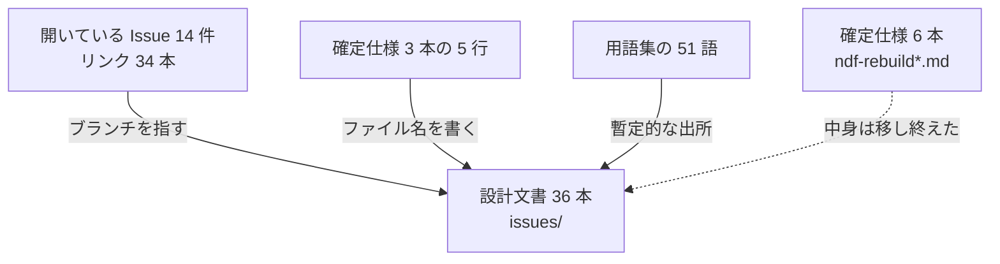
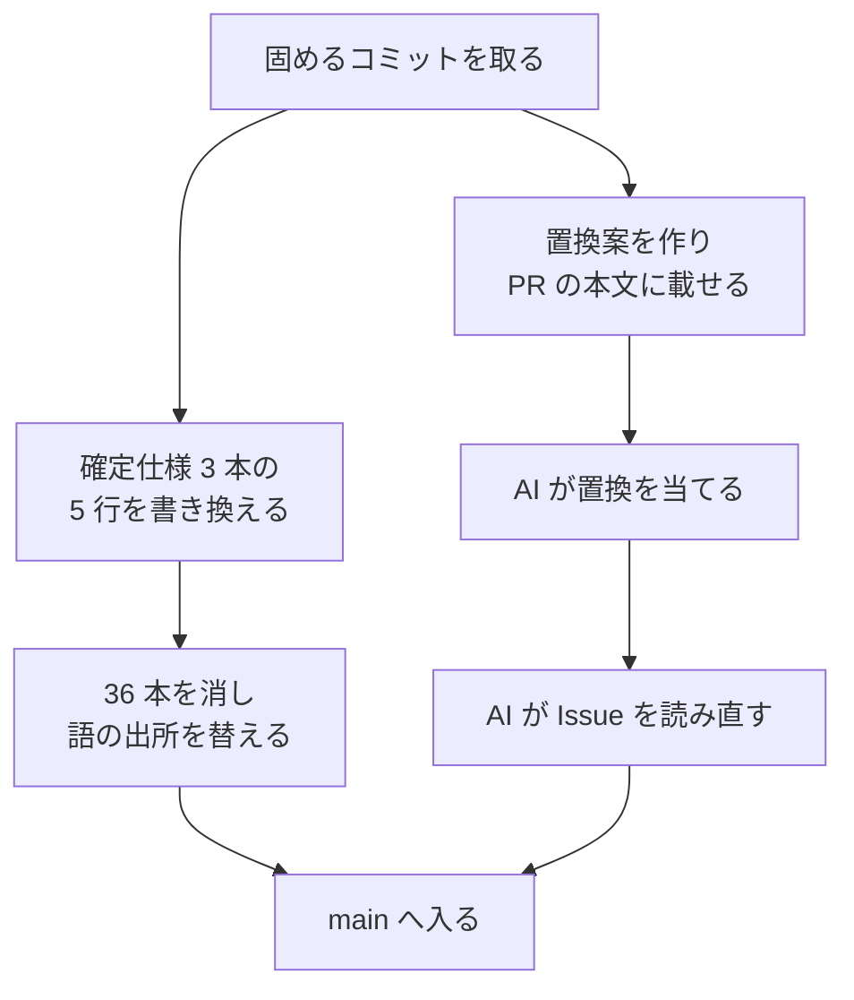

# 作り直しの設計文書 36 本: 確定仕様だけを正本にし、消した後も開いている Issue から元の文書を読めるようにする（#3990）

NDF のスクリプトの作り直し（#1142 と、その続きの #3347・#3388・#3395）の設計文書 36 本が `issues/` に残り、確定仕様と食い違う古い決定が正しいものとして読まれる。この設計では、開いている Issue にある 36 本へのリンクを、36 本を消す前の `main` のコミットの 40 桁の SHA を指す形（固定リンク）に書き換える。書き換えのコマンドは AI が打つ（決定 5）。あわせて、確定仕様 3 本の 5 行から 36 本のファイル名を無くす。続けて `ndf records spec finalize` で 36 本を消し、用語集の語の出所を確定仕様へ替える（51 語のうち 35 語は、出現の回数の規則で決めて指定する）。その規則は「決定の記録」の決定 2、語ごとの結果は「用語集の語の出所」の表、採らなかった案は「決定の記録」、GitHub の固定リンクと Issue の更新の調査は末尾の「外部の調査」にある。

## 今の姿

何が起きたか・目的・受け入れ条件は、要求仕様にある（[issue-3990-requirements.md](./issue-3990-requirements.md) 。正本（信頼する唯一の記録）は #3990 の本文）。この文書は「どう解くか」と「なぜその解き方か」だけを書く。この文書の「利用者」は、このリポジトリの持ち主で、設計とリリースを承認する人を指す。

この文書には番号の付いた並びがいくつもある。ほかの所から指すときは、番号だけで書かず、次の呼び方で並びの名前を付ける。

| 呼び方 | 何の並びか | ある所 |
| --- | --- | --- |
| 手順 1〜7 | 作業全体の手順 | 「処理の流れ」の表 |
| 選び方の 1〜10 | 固めるコミットの選び方 | 「文脈と制約」の「固めるコミットの選び方」 |
| 選び方の 10 の小手順 1〜6 | 置換のコマンドが書く前に `main` を調べる順 | 選び方の 10 の中 |
| マージの後の置換の 1〜5 | マージの後に見つかったリンクを固める順 | 「承認からマージまで」 |
| 減った箇所の確かめの 1〜4 | リンクの数が減った箇所を履歴で探す順 | 「手順 6 の確かめ方」 |
| 書き戻しの 1〜4 | 消えたリンクを利用者が書き戻す順 | 「手順 6 の確かめ方」の「消えたリンクを戻す」 |
| 2 段目の (a)〜(e) | 語の出所を選ぶ規則 | 決定 2 |
| a〜d | Issue ごとの取り直し・置換・書き込み・書いた後の取り直し | 決定 4 の冒頭の表 |
| 動作の 1〜5 | 書き込む動作の順 | 決定 4 の「動作」 |
| 記録の書き方の 1〜4 | 試行の記録に結果を書く順 | 決定 4 の「試行の記録」 |
| リンクの照合の 1〜4 | 書いた Issue ごとにリンクの数を照らす順 | 決定 4 の「リンクの照合」 |

「受け入れ条件 N」と「E<数>」（ドメインイベント）は要求仕様の番号、「決定 N」はこの文書の「決定の記録」の番号、「STD<数>」は末尾の「外部の調査」の番号である。



2026-11-24 に `main`（`85dc47f7af1401852642d88d7b2064b02e2869fd`。この作業のブランチの起点と同じ）で確かめた、設計に要る今の構造は次のとおりである。

| 確かめたこと | 結果 | 確かめ方 |
| --- | --- | --- |
| 36 本を消すと壊れる、リポジトリの文書のリンク | 0 本 | `scripts/check-markdown-links.py` に 36 本を `--removing` で渡し、`No links to the removed files` と終了コード 0 |
| 36 本のファイル名を含む行（受け入れ条件 2 の範囲） | 56 行。用語集の正本（`docs/glossary/glossary.json`）の確定する前の出所（`pending_source`）が 51 行、確定仕様 3 本が 5 行 | 要求仕様の「エンジニア向けの補足」の `git grep` |
| 開いている Issue の 36 本へのリンク | 428 件のうち 14 件に 34 本。`develop` を指すものが 33 本、`main` が 1 本。40 桁の SHA で固めたものは 0 本。要求仕様の 426 件とは数えた時刻が違う（開いている Issue の数は、起票と終了で増減する）。リンクのある 14 件・34 本はどちらでも同じ | `gh api --paginate 'repos/devbasex/ai-plugins/issues?state=open&per_page=100'` から Pull Request を除き（`select(.pull_request \| not)`）、本文から抜いた |
| リンクが指すファイルとフラグメント | 7 ファイル。フラグメントは `issue-3347-design-detail.md` の `#ほかの子へ足す条件` と `#実装計画` の 2 つで、どちらも `main` のバージョンに同じ名前の見出しがある | `grep -n '^#'` |
| `develop` の状態 | 残っている（`f37ea4c2`）。`main` の祖先で、リンクが指す 7 ファイルのうち 4 ファイルは `main` のほうが新しい | `git ls-remote`・`git merge-base --is-ancestor`・`git diff --stat` |
| 用語集の 51 語の出所を、削除のコマンドが決められるか | 手順 4 で `--spec` に渡す 8 本（確定仕様 6 本と、決定 2 で足す 2 本）では、1 本だけに現れてコマンドが決められる語が 18 語ある。残りの 33 語には `--source-of` が要る。6 本だけで判定したときとの比較は、この表の下にある | 判定の関数（`plugins/ndf/src/ndf/domains/records/spec_decide.py` の `plan_glossary` が呼ぶ `_assign`）に、8 本と 6 本の本文と、36 本を `pending_source` に持つ 51 語を渡して確かめた |
| Issue の編集の履歴（GraphQL の `userContentEdits`）の並びと `diff` の中身 | 新しい編集から順に並ぶ。`last: 3` で取ると古い側の 3 件が返った。最も新しい要素の `diff` は今の本文と一致した（9170 文字）。最も古い要素の `diff` は起票したときの本文だった | #3990 の履歴（5 件）を `first: 5` と `last: 3` で取り、各要素の `diff` を今の本文と比べた |
| 確定仕様の番号の対応表（`docs/specifications/ndf-rebuild.md` の「番号の対応表」） | 30 行のすべてに扱い（移した・畳んだ・振り直した・落とした・移さないなど）がある | 表の「扱い」の列を数えた |
| 確定仕様の対応表にある、消す前の 36 本へのリンク | 既にある。`docs/specifications/ndf-rebuild.md` の 449 行（「番号の対応表」の節の、表の前の段落）に「設計の材料（2026-11-21 に消す前のコミット）」として、コミット `784110e5461b3f856ba18f3c8ea7e995a06c8b0d` の `issues/` の一覧へのリンクがある。そのコミットに 36 本はすべてある。その後 2026-11-22〜24 に、2 本（`issue-1142-design-review-routing.md` に 2 コミット・`issue-3395-design.md` に 7 コミット）が `main` で書き換わった。固めるコミット（`85dc47f7`）とこの日の `main`（`aae9cbee`）の間では、36 本に差が無い | `git cat-file -e 784110e5:<36 本のそれぞれ>` が 36 本とも通る。`git log 784110e5..origin/main -- <36 本>` で、書き換えたコミットを数えた。`git diff --quiet 85dc47f7 origin/main -- <36 本>` が終了コード 0 |
| このリポジトリの Issue を編集できるアカウント | 1 つ（利用者のアカウント）。利用者の手の編集も、NDF の作業が `gh` で書く編集も、AI が置換のコマンドで書く編集も、同じログイン名で編集の履歴に残る | `gh api --paginate 'repos/devbasex/ai-plugins/collaborators?per_page=100'` で、`push` か `triage` の権限を持つ協力者を数えた。`gh api user` のログイン名も同じ |
| 動いている NDF の計画をすべて挙げる手段 | 無い。`ndf plan pending` は待ちを抱えた実行の識別子・状態・更新の時刻を返すが、計画の名前と対象のリポジトリを返さない（この日は 3 件）。`ndf lanes status <計画>` は名前を知っている計画 1 つの状態を返す。計画の一覧を返すサブコマンドは `ndf plan --help`・`ndf lanes --help` に無い | 3 つのコマンドを打って出力と使い方を読んだ |
| 閉じた Issue と Pull Request の本文にある、36 本へのリンク | 閉じた Issue は 120 件に 638 本。`main` を指すものが 7 件（#1142・#3341・#3370・#3412・#3687・#3691・#3907）に 20 本、`develop` を指すものが 618 本。40 桁の SHA で固めたものは 0 本。Pull Request の本文は 4 件に 13 本で、どれも消したブランチ（`design/issue-3347`・`design/issue-3345`・`design/issue-3344`・`design/issue-1142-next`）を指し、今も開けない。ほかに、Pull Request の本文に相対リンクが 6 件に 17 本、閉じた Issue に 1 件に 2 本ある（Issue や Pull Request の画面からは、もともと開けない）。開いている Issue は同じ数え方で 14 件・34 本で、今の姿の 3 行目と同じ | 2026-11-24 20:50〜20:52（JST）に、`gh api --paginate 'repos/devbasex/ai-plugins/issues?state=closed&per_page=100'`（`select(.pull_request \| not)` で Pull Request を除く）と `gh api --paginate 'repos/devbasex/ai-plugins/pulls?state=all&per_page=100'` で本文を取り（どちらも終了コード 0）、`https://github.com/devbasex/ai-plugins/(blob\|tree\|raw)/<参照>/issues/<ファイル>` のうち、ファイルがこの日の `main`（`aae9cbee`）の 36 本のどれかのものを数えた。参照には `/` を含むブランチ名も含めた。ブランチが残っているかは `git ls-remote --heads` で見た |

用語集の 51 語を、`--spec` に渡す本数ごとに分けると次のとおりである。6 本の列の 2 本以上とどれにも現れないの数は、8 本の数と、下の 3 語の移り方から求めた。

| `--spec` に渡すもの | 1 本だけに現れる（コマンドが決める） | 2 本以上に現れる | どれにも現れない |
| --- | --- | --- | --- |
| 8 本 | 18 語 | 23 語 | 10 語 |
| 確定仕様 6 本だけ | 17 語 | 22 語 | 12 語 |

- 8 本と 6 本の差は 3 語である。`抑制コメント` は、足す 1 本の `ndf-next-terms-and-settings-renames.md` にも現れるので、8 本では 2 本以上に移る。`共有の一覧` と `チェックアウトの保存先` は、足す 2 本のそれぞれ 1 本だけに現れるので、8 本では 1 本だけに移る
- 8 本で 1 本だけに現れる 18 語のうち 2 語は、決定 2 の 2 段目の (a) で `--source-of` にも渡す。そのため、コマンドに任せるのは 16 語、`--source-of` で渡すのは 35 語である（「用語集の語の出所」の表）

## 文脈と制約

- 確定仕様 6 本の本文は変えない。中身の移し替えは #3412 で終わっている（要求仕様の「含まない」）
- リンクを固めるコミット（以下「固めるコミット」）は、このブランチが載っている `main` のコミットとする（`git merge-base HEAD origin/main`。要求仕様の前提 1）。削除のコミットの直接の親にはしない。このブランチでは設計のコミットが削除のコミットより先に載るので、直接の親はブランチの上のコミットになり、マージの形によっては `main` の履歴に残らないからである。手順 5 で最初に書き込むまでは取り直すことがあり、その後は取り直さない。選び方と、`main` が進んだときの扱いは次の「固めるコミットの選び方」にある
- 開いている Issue の本文は、設計の承認の後に AI が置換のコマンドで書き換える。ほかの NDF の作業は止めない（要求仕様の前提 2、決定 5）。GitHub の Issue の更新は、「読んだ後に誰も編集していなければ書く」という条件付きの書き込みができない（外部の調査の STD2）。そこでコマンドは、Issue ごとに書く直前に本文を取り直してその本文に置換を当てる。取り直してから書き込むまでの短い間に入った、置換の書き込み以外の編集（人の手の編集や、並行して動くほかの NDF の作業の編集。以下「ほかの編集」）は、書いた後に編集の履歴で見つける（決定 4 の「動作」と「編集の履歴の照合」）
- このリポジトリの Issue を編集できるアカウントは 1 つで、利用者の手の編集・ほかの NDF の作業の編集・置換の書き込みは、同じログイン名で履歴に残る（今の姿の表）。そのため、置換の書き込みとほかの編集をログイン名では分けられない。置換の書き込みは送った本文のハッシュで特定し、それ以外の編集は編集者を問わず「ほかの編集」として扱う
- 置換を当てて確かめ終えるのは、この作業の Pull Request が `main` へ入る前である（受け入れ条件 6）。`main` へ入った時点で、`main` を指すリンクが開けなくなる
- `ndf records spec finalize` は 36 本を作業ツリーから直接消す。未コミットの編集も一緒に消えるので、打つ直前に 36 本に未コミットの変更が無いことを確かめる
- `--source-of <語>=<ファイル>` で指すファイルは、同じ呼び出しの `--spec` に渡したもののどれかでなければならない。判定は `plugins/ndf/src/ndf/domains/records/spec_decide.py` の `plan_glossary` にある
- このリポジトリの設計の設定（`.ndf/design.json`）が挙げるパスのファイルは触らない。パスは `plugins/ndf/**`・`plugins/ndf-next/**`・`.claude-plugin/marketplace.json` である。これらは利用先のリポジトリへ届くコードと配布の設定で、変えると、代表的なリポジトリの種類（Web サービス・モバイルアプリ・業務文書だけ）でそのまま使えるかの確認が要る。この作業は文書を消してリンクを直すだけで、これらを変える理由が無い

### 固めるコミットの選び方

固めるコミットは手順 1 で取り、手順 5 で最初に書き込むまでは取り直すことがある。次の 1〜10 を「選び方の 1」などと呼ぶ。

1. 手順 1 で `git fetch origin main` の後に、`git merge-base HEAD origin/main` と `git rev-parse origin/main` を打つ。2026-11-24 は、どちらも `85dc47f7af1401852642d88d7b2064b02e2869fd` である
2. 2 つが同じなら、それを固めるコミットにする
3. 違う（ブランチの起点より `main` が進んでいる）なら、ブランチを `origin/main` へリベースしてから選び方の 1 に戻る
4. 手順 1 の後は、次の 3 つの時点で `git fetch origin main` を打つ。続けて、固めるコミットから最新の `main` までに 36 本を変えたコミットを一覧にする。一覧は `git log --full-history --format=%H <固めるコミット>..origin/main -- <36 本>` で取る
   - 手順 5 のコマンドを打つ直前
   - 手順 7（リリース承認を求める直前の再確認）。リリース承認は、この PR を `main` へ入れてよいと利用者が承認することである
   - マージキューへ入れる直前（処理の流れの「承認からマージまで」）
5. 選び方の 4 の一覧が空なら、固めるコミットをそのまま使う。リンクが見せる 36 本の中身は、最新の `main` と同じだからである
6. 一覧が空でなく、手順 5 でまだ 1 件も書いていないなら、ブランチをリベースし、手順 1 から取り直す。PR の本文の置換のコマンドも、手順 2 で作り直す
7. 一覧が空でなく、手順 5 で 1 件でも書いた（書いたかもしれない）後なら、固めるコミットは取り直さない。置換のコマンドは 40 桁の SHA のリンクを替えないので、取り直した SHA へは当て直せないからである。消す 36 本への変更なので、そのままマージすると変更の中身は確定仕様に移らずに `main` から消える。そこで、一覧のコミットのうち、まだ扱いの決まっていないものを PR の本文に挙げ、利用者に扱いを決めてもらう
   - AI が挙げる材料は、コミットの 40 桁の SHA・変えたファイル・変更の中身の要約・移すかどうかの推奨である。推奨は、確定仕様にまだ無い決定や仕様の変更なら「移す」、書式の直しや既に確定仕様にある内容なら「移さない」とする（要求仕様の「利用者がすること」の 2）
   - 確定仕様へ移す: AI が変更の中身を確定仕様へ書き足してコミットする
   - 移さない: Issue のリンクは、固めるコミットの版（変更が入る前の版）を指したままになる。変更後の版は、表に挙げた `main` のコミットを開かないと読めない。マージした後の `main` には 36 本が無いので、リンクからも確定仕様からも変更後の版へはたどれない。利用者はこの点を承知したうえで選び、移さない理由を #4470 へのコメントで答える。AI がその理由を表に書く
8. 扱いが決まったら、PR の本文の「36 本の変更の扱い」の表に、コミットごとに 1 行を足す。1 行は、`main` のコミットの 40 桁の SHA・変えたファイル・扱い（移した・移さない。マージの後は、この PR の削除のコミットに「この PR の削除」も使う）・移したときは確定仕様へ書き足したコミットの SHA、移さないときは利用者の判断の理由、扱いを答えたコメントの URL（この PR の削除の行は除く）を持つ
9. 再確認では、選び方の 4 の一覧から、選び方の 8 の表にある SHA を除いた残りを「扱いの決まっていない変更」とする。固めるコミットは取り直さないので、`main` との差そのものは残る。差ではなくコミットで照らすことで、扱いの決まった変更を利用者へ返し直さない。残りが 1 件でもあれば、マージへ進まず選び方の 7 に戻る
10. 選び方の 4 で比べてからコマンドが書き始めるまでの間にも `main` は進む。そこで置換のコマンドは、書き込む動作で 1 件も書く前に、AI が選び方の 4 で比べた後に `main` へ入ったコミットを、コミットごとに調べる。比較の範囲の両端の差（`compare` の応答の `files`）だけでは調べない。差だけでは、36 本を変えてから元に戻したコミットを拾えない。そのうえ、`files` は 300 件、`commits` はページを指定しないと 250 件で打ち切られる（[GitHub REST API の「Compare two commits」](https://docs.github.com/en/rest/commits/commits#compare-two-commits) ）

    コマンドには、固めるコミットの SHA、AI が選び方の 4 で比べたときの `main` の SHA（以下「確かめた `main`」）、選び方の 8 の表にある SHA の一覧を埋め込む。手順 5 を打つ直前の選び方の 4 の比較の後に、AI はこの値でコマンドを作り直してから打つ。コマンドは次の小手順 1〜6 の順に調べる（「選び方の 10 の小手順 1」などと呼ぶ）

    1. `gh api -H 'Accept: application/vnd.github.sha' repos/devbasex/ai-plugins/commits/main` で今の `main` の SHA を 1 回だけ取る。以下はすべてこの SHA までを調べ、途中で `main` が進んでも範囲を変えない
    2. 今の `main` が確かめた `main` と同じなら、調べ終える
    3. 違えば、`gh api --paginate 'repos/devbasex/ai-plugins/compare/<確かめた main>...<今の main>?per_page=100'` で、間のコミットを全ページ読む。応答の `status` が `ahead` で、読めたコミットの数が `total_commits` と同じことを確かめる
    4. 読めたコミットごとに、`gh api --paginate 'repos/devbasex/ai-plugins/commits/<SHA>?per_page=100'` で変えたファイルを全ページ読み、36 本のどれかを変えたコミットを拾う
    5. 拾ったコミットのうち、選び方の 8 の表に無いものが 1 件でもあれば、1 件も書かずに止め、そのコミットを出す
    6. どれかの取得が失敗したとき（終了コードが 0 でない、`status` が `ahead` でない、コミットの数が合わない）も、1 件も書かずに止める。AI が打ち直す

    選び方の 10 の小手順 5 で止まったら、AI は、選び方の 4 の比較を今の `main` で打ち直してから、次のとおり戻る
    - 置換の書き込みがまだどの Issue の本文にも入っていないなら、選び方の 6 のとおりリベースして手順 1 から取り直し、手順 2 でコマンドを作り直す。入っていないと言えるのは、試行の記録（置換のコマンドが Issue ごとに書き込みの結果と時刻を残す記録。決定 4 の「試行の記録」）に、本文に入った試行も「成否不明」の試行も無いときである。古いコマンドは古い固めるコミットを埋め込んでいるので、打ち直しても同じ所で止まり、書き込まない
    - 書き込みが 1 件でも入っている、または入ったかもしれないなら、固めるコミットは取り直さず、選び方の 7・8 のとおり利用者に扱いを決めてもらう。AI は選び方の 8 の表に足した SHA と、新しい確かめた `main` を埋め込んでコマンドを作り直して打つ

    増える API の呼び出しは、`main` が進んでいなければ書き込む動作 1 回につき 1 回である。進んでいれば、`compare` のページ数と、間のコミットの数（ファイルが 100 件を超えるコミットはそのページ数）が足される。AI が打つ直前に確かめているので、間のコミットは確かめてから打つまでに入った分だけである

## 解き方の全体像



- 36 本は `issues/` から無くなり、作り直しの決定の正本は確定仕様 6 本だけになる
- 開いている Issue の 36 本へのリンクは、すべて、36 本を消す前の `main` のコミット（40 桁の SHA）を指す。消した後も、そのリンクから消す前の 36 本を読める
- 確定仕様 3 本は、ファイル名を書かずに「どの課題の何の表か」を文で書き、コミットの `issues/` の一覧へリンクする（決定 3）。今あるリンクは、今と同じコミットの一覧を指す。ファイル名だけだった所は、固めるコミットの一覧を指す
- 用語集の 51 語は、確定仕様のどれかを出所に持つ。用語集の文書は正本から作り直してある

## 処理の流れ

手順の番号の後ろの `E<数>` は、要求仕様のドメインイベントの番号である。

「参照の検査の 1・2」は、[#3412 の詳細設計書の「参照の検査」](./issue-3412-design-detail.md#参照の検査) にある次の 2 つのコマンドで、どちらも 0 行（2 は当たり 0 件と終了コード 0）を合格とする。

```bash
# 1. 36 本のファイル名を含む行（受け入れ条件 2 の範囲）。要求仕様の「エンジニア向けの補足」と同じ式
git grep -n -e issue-1142- -e issue-3347- -e issue-3395- -e issue-3388- -- \
  plugins scripts docs .github AGENTS.md CLAUDE.md \
  ':!docs/archive' ':!docs/ndf-12-survey' ':!scripts/ndf-next-parity' ':!**/CHANGELOG.md'
# 2. 残る文書のリンクのうち、36 本を消すと壊れるもの・指す先が変わるもの
env -u UV_PROJECT_ENVIRONMENT -u VIRTUAL_ENV uv run --frozen --project . --all-extras \
  python scripts/check-markdown-links.py \
  $(git ls-tree -r --name-only <固めるコミット> -- issues/ | grep -E '^issues/issue-(1142|3347|3395|3388)-' | sed 's/^/--removing /')
```

1 は 36 本のファイル名を文字の並びで数える。2 はリンクを解決して数える。2 が読むのは、`git ls-files '*.md'` の全件から `--removing` の 36 本を除いた文書（`issues/` を含む）のリンクである。数えるのは次の 2 種類である。

- 出力の `(a)`: 相対リンクの宛先が 36 本のどれかになるもの
- 出力の `(b)`: `https://github.com/devbasex/ai-plugins/(blob|tree|raw)/<参照>/<パス>` の `<パス>` が 36 本のどれかで、`<参照>` が 40 桁の SHA でないもの

当たりごとに `文書:行: (a|b) 宛先` を出し、1 つでもあれば終了コード 1 を返す。消すパスの一覧は固めるコミットの木から取る。作業ツリーの `git ls-files` で取ると、手順 4 で消した後に一覧が空になり、2 が何も検査しなくなるからである。打つ前に一覧が 36 行であることを確かめる。

| 手順 | 何をするか | 終わりの条件 |
| --- | --- | --- |
| 1（E1） | 固めるコミットを取る（文脈と制約の「固めるコミットの選び方」） | SHA が 40 桁で、その木に 36 本がある |
| 2（E2） | 置換のコマンド（決定 4）を書き込まない動作で打つ。出力の対象（Issue の番号と、替える前と後のリンクの組）を、替えた後のリンクの検証（決定 4 の「替えた後のリンクの検証」）を通してから「確認済みの対象」としてコマンドに埋め込む。作る・作り直すたびに、埋め込む前に決定 4 の「書いてよい組との照合」を通す。そのために、確認済みの対象の組のうち「書いてよい組」の表に無いものを、利用者がそのまま #4470 へのコメントに貼れる形で、PR の本文の「答えを求める組」に挙げる（最初に作るときはすべての組）。PR の本文に、Issue の番号と替えるリンクの数の表と、コマンドを載せる。置換案はファイルに保存しない。編集の履歴の形も確かめる（決定 4 の「履歴の形の確かめ」） | 列挙で得た Issue の件数とリンクの数が、PR の本文の表と一致する。確認済みの対象の替えた後のリンクが、すべて検証を通る。履歴の形の確かめの結果が PR の本文にある。14 件・34 本は 2026-11-24 の観測値で、合格の条件ではない |
| 3（E3） | 確定仕様 3 本の 5 行から 36 本のファイル名を無くし（決定 3 の対応表）、3 本をコミットする | 参照の検査の 1 が、用語集の正本の `pending_source` の 51 行だけを返す |
| 4（E6・E7） | 36 本に未コミットの変更が無いことを確かめてから、`ndf records spec finalize` を `-m <コミットの件名>` 付きで打つ。`--spec` には決定 2 で決めた一式、`--remove` には 36 本、`--source-of` には決定 2 で決めた語を渡す（2026-11-24 の実測では 8 本と 35 語。本文が変わって規則で作り直したら、作り直した結果を渡す）。コマンドは 36 本を消し、用語集の正本と文書を作り直し、返すパス（渡した確定仕様・用語集・消した 36 本）を `git add -A` してコミットする。`-m` を省くとパスを返すだけでステージもしないので、省いたときは返したパスを `git add -A -- <パス>` でステージしてコミットする | コミットの後に、参照の検査の 1 と 2 が 0 行。`git ls-files` で 36 本が 0 件。`ndf records glossary render --check` が `ok` |
| 5（E4） | 設計の承認の後に、AI が、PR の本文の置換のコマンドを書き込む動作で打ち、試行の記録のファイル（決定 4 の「試行の記録」）を PR の本文へ貼る。打つ直前に、確認済みの対象のすべての組が「書いてよい組」の表にあり、答えの照合を通ることを確かめる（決定 4 の「書いてよい組との照合」）。最初の書き込みでも、手順 2 で作った一覧のすべての組に、利用者の #4470 へのコメントでの答えが要る。ほかの NDF の作業は止めない（決定 5） | 記録に、書き込みを試みた Issue ごとの結果と時刻がある。確認済みの対象を超える差、または検証を通らないリンクで止まったときは、手順 2 からやり直す。「書いてよい組」の表に無い組で止まったときは、利用者がコメントで答え、その組が表に書かれるまで打たない |
| 6（E5） | AI が開いている Issue を全件読み直し、受け入れ条件 3〜5 を確かめて PR の本文に結果を書く（下の「手順 6 の確かめ方」） | 受け入れ条件 3・4 が通る。書き込みが本文に入ったかもしれない試行（決定 4 の「試行の記録」の読み方）のすべてが、編集の履歴の照合で「他者の編集なし」か「復旧済み」になるか、「未確認」から利用者の答えで合格か照合の対象外になる。それ以外は Issue の番号を挙げて利用者へ返し、手順 6 を終えない。PR の本文に「手順 6 のリンクの数」がある |
| 7（E8） | リリース承認を求める直前に、手順 2 の列挙（書き込まない動作）と、参照の検査の 1・2 と、36 本と最新の `main` の比較（選び方の 4）を打ち直す。列挙で得た本文と、「手順 6 のリンクの数」にあって列挙に無い Issue を番号で取り直した本文を、Issue の番号で重複を除いて 1 組にする。その本文から、40 桁の SHA を指す 36 本へのリンクを Issue の番号と URL の組ごとに数え、「手順 6 のリンクの数」と比べる | 列挙で、40 桁の SHA でない 36 本へのリンクが 0 本。40 桁の SHA を指す 36 本へのリンクの、Issue の番号と URL の組ごとの数が、「手順 6 のリンクの数」と一致する。「手順 6 のリンクの数」の表に無い組は、期待する数を 0 本として比べる。表にあって本文に無い組は、今の数を 0 本として比べる。参照の検査の 1・2 が 0 行。固めるコミットから最新の `main` までに 36 本を変えたコミットが、すべて PR の本文の「36 本の変更の扱い」の表にある（扱いの決まっていない変更が 0 件）。手順 4 と 6 が終わっている |

手順 2 と、手順 3・4 の組は順を入れ替えてよい。手順 4 は手順 3 の後に行う。手順 5 は手順 2 の PR の本文が要るので、手順 2 の後に行う。

手順 7 の打ち直しは、手順 6 の後に、ほかの変更が 36 本へのリンクを新しく足したり、手順 6 で確かめたリンクを変えたりしていないかを見るためである。40 桁の SHA でないリンクの数だけでは、替えた後のリンクのフラグメントだけが書き換えられたときや、リンクが 1 つ消されたときを見落とす。期待する結果に届かなければ、マージへ進まずに次のとおり戻る。

| 見つかった所 | すること |
| --- | --- |
| 開いている Issue の本文に、40 桁の SHA でない 36 本へのリンクがある | 手順 2 に戻って確認済みの対象と PR の本文を作り直す。AI が手順 5 を打ち、手順 6 をやり直してから、手順 7 を打ち直す |
| 40 桁の SHA を指す 36 本へのリンクの、Issue の番号と URL の組ごとの数が、「手順 6 のリンクの数」と違う | 差のある Issue ごとに、差のある URL を受け入れ条件 4 の検証（決定 4 の「替えた後のリンクの検証」）にかけ、決定 4 の「リンクの照合」の 4 と同じく、差を生んだ編集を履歴で探して利用者に意図した編集かを確かめてもらう。検証を通らないか、意図しない編集なら、手順 6 の確かめ方の「書いた後のリンクに不備が見つかったとき」で直す。リンクが消えて数が減ったときは、そこにある「消えたリンクを戻す」で利用者が手で戻す。済んだら「手順 6 のリンクの数」を書き直し、手順 7 を打ち直す |
| リポジトリの文書に、参照の検査の 1・2 が拾う行がある | 手順 3 と同じ書き換えをその行に当て、参照の検査の 1・2 が 0 行になってから、手順 7 を打ち直す |
| 36 本を変えたコミットのうち、「36 本の変更の扱い」の表に無いもの（扱いの決まっていない変更）がある | 選び方の 7・8 のとおり、そのコミットだけを利用者へ返して扱いを決めてもらい、表に足してから手順 7 を打ち直す。表にあるコミットは返し直さない |

承認を求めた後に PR へコミットを足したときも、手順 7 を打ち直す。

### 承認からマージまで

承認からマージまでの間にも、Issue の本文と `main` は変わる。そこで、マージキューへ入れる直前とマージの後に、1 回ずつ確かめ直す。受け入れ条件 6 は、マージの前にリンクが固まっていることを求めるからである。開いている Issue の一覧の全ページの取得は、手順 7 で取る分に加えて、この 2 回の確かめで 1 回ずつ、計 2 回増える。キューから外れて入れ直したときは、入れ直すたびに 1 回増える。

| いつ | 確かめること | 見つかったときにすること |
| --- | --- | --- |
| マージキューへ入れる直前（`ndf ci merge` を打つ直前） | 手順 7 のうち次の 3 つ。40 桁の SHA でない 36 本へのリンクが 0 本か。Issue の番号と URL の組ごとの数が「手順 6 のリンクの数」と一致するか。選び方の 4 の比較で、扱いの決まっていない変更が 0 件か | キューへ入れず、上の戻り先の表のとおり戻る。PR にコミットを足さずに直せたら、この 3 つを打ち直してからキューへ入れる。コミットを足したら、手順 7 から打ち直す |
| マージの後 | 一覧と、「手順 6 のリンクの数」にあって一覧に無い Issue の番号での取得で、上の最初の 2 つと、40 桁の SHA を指す 36 本へのリンクのすべてが決定 4 の「替えた後のリンクの検証」を通るか。キューへ入れてからマージされるまでの間の変化は、マージの前には見つけられないからである。検証は、マージを待つ間に足された固めたリンク（参照先の無い SHA やフラグメントを含む）も拾うために、ここで行う。追加の書き込みを見送って「マージの後の置換」の 4 を行わないときも、この 3 つの結果が「置換しなかったリンクの表」の元になる | 40 桁の SHA でないリンクがあれば、下の「マージの後の置換」を行う。数が違うときは、下の「マージの後に数が違うとき」のとおり、減った箇所と増えた箇所を分けて扱う。検証を通らないリンクがあるときは、上の戻り先の表の 2 行目と同じく、手順 6 の確かめ方の「書いた後のリンクに不備が見つかったとき」で直す |

**マージの後に数が違うとき**: 出現数の差だけでは、どの箇所で何が起きたかは分からない。同じ URL のリンクが 1 か所で消え、別の箇所に 2 本足されると、数は増えたように見えるが、消えた箇所の復旧が要る。そこで、数の増減ではなく、箇所ごとに扱いを決める。

1. AI は、差のある Issue と URL の組ごとに、「手順 6 のリンクの数」を書いた後の編集を、編集の履歴で新しい側から比べる。その URL のリンクが減った箇所と増えた箇所を、手順 6 の確かめ方の「減った箇所の確かめ」の 1〜4 と同じやり方で、それぞれ特定する。増えた箇所は、足す前の版に無く、足した後の版にあるリンクの前後の文で見分ける
2. 減った箇所は、今の数が期待値より多くても、1 か所ずつ「書いた後のリンクに不備が見つかったとき」で扱う。別の URL に変わった箇所は訂正の組で直し、リンクごと消えた箇所は「消えたリンクを戻す」で利用者に戻してもらう。意図して消したと利用者が答えた箇所は、決定 4 の「確かめた編集」の表に書く
3. 増えた箇所は、足した箇所の前後の文と、足した編集の時刻を PR の本文に挙げ、追加が意図したものかを利用者に確かめる。意図したと答えた箇所は「確かめた編集」の表に書く。意図しないと答えた箇所は、利用者に追加した箇所を直してもらう
4. 箇所を特定できなかった分は、減った・増えたの向きと件数を PR の本文に挙げ、利用者に GitHub の画面の編集の履歴で探してもらう。答えで 2 か 3 に振り分ける
5. 減った箇所と増えた箇所のすべてで答えがそろい、直すと決めた箇所を直し終えたら、AI は Issue を番号で取り直す。「手順 6 のリンクの数」を取り直した本文の数に書き直し、マージの後の確かめを打ち直す。答えのそろわない箇所が残ったまま追加の書き込みを見送るときは、その箇所を「置換しなかったリンクの表」に載せる

キューに入っている間に、36 本を変える別の変更が先に `main` へ入ると、この PR の削除とぶつかってマージキューがこの PR を外す。そのときは手順 7 から打ち直す。

**マージの後の置換**: マージの前と同じく、試行の記録・編集の履歴の照合・替えた後のリンクの検証を通す。マージの後の書き込みでも、ほかの編集を上書きするおそれは同じだからである。固めるコミットは `main` の履歴に残っているので、36 本を消した後でも、そのコミットへ固めればリンクから元の文書を読めるようになる。

1. AI は、36 本を消した `main` のコミットの SHA を、「36 本の変更の扱い」の表に扱い「この PR の削除」として足す。足さないと、選び方の 4 と選び方の 10 の比較が削除そのものを拾い、書く前に止まるからである
2. AI は手順 2 のとおり、書き込まない動作で確認済みの対象を作り直し、PR の本文に載せる。マージの前と同じく決定 4 の「書いてよい組との照合」を通し、「書いてよい組」の表に無い組があれば、1 件も書かずに「答えを求める組」に挙げて利用者へ返す。利用者が書かないと答えたときの扱いは、決定 4 の「書いてよい組との照合」の表のうち、マージの後に選べる行に従う
3. AI は手順 5 のとおり書き込む動作を打ち、試行の記録を PR の本文へ貼る。打つのは、確認済みの対象のすべての組が「書いてよい組」の表にそろい、答えの照合を通った後である
4. AI は、新しい試行について手順 6 を行う。編集の履歴の照合・リンクの照合・替えた後のリンクの検証である。上書きの疑いと未確認は、マージの前と同じく利用者へ返し、済むまでこの作業を終えない
5. 最後に「手順 6 のリンクの数」を書き直し、マージの後の確かめを打ち直す

### 手順 6 の確かめ方

- 受け入れ条件 3: 決定 4 と同じ列挙で全件を読み直し、40 桁の SHA でない 36 本へのリンクを数えて 0 本
- 受け入れ条件 4（開いている Issue 全体）: 固めるコミットの SHA を指す 36 本へのリンクのすべてが、決定 4 の「替えた後のリンクの検証」を通る。今回替えたリンクはすべてこの SHA を指すので、手順 2 の後に足されて置換されたリンクも漏れない
- 受け入れ条件 5: 書き込みが本文に入ったかもしれない試行（終わりの行の無い試行を含む）のすべてで、編集の履歴を照合する（決定 4 の「編集の履歴の照合」）。打ち直しの記録で、前の試行の記録を置き換えない。記録が PR の本文に無ければ、照合する Issue も時刻も分からないので、手順 6 を終えずに利用者へ記録を求める。この照合で、試行ごとに本文に入ったかどうかを確定する
- 受け入れ条件 4（書いた Issue ごと）: 受け入れ条件 5 の照合の後に、決定 4 の「リンクの照合」を行う。照らすのは、本文に入った試行のある Issue である。Issue を番号で取り直し、同じ番号の本文で、本文に入った試行の記録から作った URL ごとの出現数を照らす。URL を Issue をまたいだ集合で照らさない。書いた後に閉じて開いている Issue の一覧から外れた Issue も、番号で取り直して確かめる
- 書いた後のリンクに不備が見つかったとき: AI は Issue を書かない。直し方は、不備の箇所に今どんなリンクがあるかで分ける。訂正の組は、組の「今のリンク」と同じ URL が本文にあるときしか書き換えないので、リンクごと消えた箇所は訂正の組では戻せないからである。逆に、別の URL に変わった箇所を手で書き戻すと、誤った URL が残ったまま同じ箇所にリンクが 2 つ並ぶ

出現数が期待値より少ないときは、まず減った箇所を履歴で確かめる。次の 1〜4 を「減った箇所の確かめの 1」などと呼ぶ。

1. AI は、編集の履歴の各版の本文（`diff`）を新しい側から比べ、そのリンクの出現数が減った編集を特定する
2. 減る前の版でリンクがあった箇所の前後の文を取り、減った後の版の同じ箇所を見る
3. 同じ箇所に別の URL のリンクがあれば「URL が変わった」、リンクが無ければ「リンクが消えた」とする
4. 減った編集か箇所を特定できなければ、特定できないことを PR の本文に書き、利用者に GitHub の画面の編集の履歴で確かめてもらって、答えでどちらかに決める。手順 2 の「履歴の形の確かめ」で `diff` が版の本文と比べられないと分かっているときは、減った箇所の確かめの 1 から利用者に確かめてもらう

| 不備 | 直し方 |
| --- | --- |
| リンクはあるが、検証を通らない（フラグメントの書き換えなど） | Issue の番号・今のリンク・訂正したリンクを PR の本文に挙げ、手順 2 で確認済みの対象に訂正の組として足す（決定 4 の「訂正」）。足した組は「書いてよい組」の表に無いので、「答えを求める組」に挙げ、利用者がコメントで答えて表に書かれてから（決定 4 の「書いてよい組との照合」）、AI が手順 5 を打ち直し、手順 6 をやり直す |
| URL が変わった | 上と同じく訂正の組で直す。組の「今のリンク」は変わった後の URL、「訂正したリンク」は元の URL である |
| リンクが消えた | 下の「消えたリンクを戻す」のとおり、利用者が手で戻す |

**消えたリンクを戻す**: 消えたリンクだけを、最新の本文へ利用者が戻す。消えた後の本文にも、ほかの正しい編集が入っているかもしれないので、本文全体を前の版へ戻さない。次の 1〜4 を「書き戻しの 1」などと呼ぶ。

1. AI は、減った箇所の確かめで特定したことを、Issue の番号・URL と一緒に PR の本文の「消えたリンク」の表に挙げる。挙げるのは、リンクを消した編集の時刻と、消える前の版でリンクがあった箇所の前後の文である。箇所を利用者が画面で探したときは、その答えを書く
2. 利用者は、意図して消したのでなければ、GitHub の画面で最新の本文を開き、挙げた箇所にリンクだけを書き戻す。ほかの文は変えない。意図して消したのなら、#4470 へのコメントでそう答える
3. 利用者は、リンクを書き戻した場合は、その時刻を #4470 へのコメントで答える。意図して消した場合は、書き戻しの 2 のコメントで答えは終わっており、書き戻しの時刻は要らない。AI は、どちらの場合も、受けた答えとコメントの URL を表に書く。ログイン名は置換の書き込みと同じなので書かない
4. AI は Issue を番号で取り直し、そのリンクの出現数と、替えた後のリンクの検証をやり直す。期待値は、表の答えに合わせる（書き戻したなら元の数、意図して消したなら減った後の数）。一致して検証を通れば、答えを決定 4 の「確かめた編集」の表に書き、「手順 6 のリンクの数」を書き直す。書き戻しは置換のコマンドを通さないので、試行の記録には加えない

## 決定の記録

各決定の「根拠」の「Value <番号>」は、このプロジェクトの MVV（使命・目指す姿・価値基準をまとめた、判断の基準。バージョン 11）の価値基準（Value）の番号と名前である。

### 決定 1: 開いている Issue のリンクが消す前の最新のバージョンを指すよう、`develop` を指す 33 本も `main` のコミットへ固める

- **質問**: 33 本は廃止した開発版のブランチ `develop` を指している。`develop` はまだ残っており、36 本を消しても開けなくはならない。この 33 本をどのコミットへ固めるか、または固めずに残すか
- **選んだ案**: `main` を指す 1 本と同じく、手順 1 で取った `main` のコミットへ固める。リンクの種類（`blob` など）、ファイル、フラグメントは変えない
- 採らなかった案: `develop` の先端のコミット（`f37ea4c2`）へ固める。`develop` は `main` の祖先で、7 ファイルのうち 4 ファイルは `main` のほうが新しい。リンクから読ませたいのは消す前の最新のバージョンである
- 採らなかった案: `develop` を指すリンクは替えない（受け入れ条件 3 はブランチを指すリンクを 0 本にすることを求める。廃止したブランチが消えた時点で 33 本が開けなくなる）
- **代償**: 4 ファイルは、リンクを書いた人が見た `develop` のバージョンと行が違うバージョンを見せる。フラグメントの 2 つを持つ `issue-3347-design-detail.md` は `develop` と `main` で同じなので、見出しへの飛び先は変わらない
- 根拠: Value 6「使うほど散らからない」（MVV バージョン 11）。STD1

### 決定 2: 用語集の語の出所が誰が打っても同じになるよう、35 語の出所を出現の回数の規則で決めて `--source-of` で渡す

- **質問**: `ndf records spec finalize` は、`--spec` に渡した確定仕様のうち 1 本だけに現れる語しか出所を決めない。2 本以上に現れる語と、どれにも現れない語の出所をどう決めるか。`--spec` に足すファイルで、判定の結果が変わることもどう扱うか
- **選んだ案**: 2 段で決める。1 段目で `--spec` に渡す一式を確定し、2 段目でその一式から語ごとの出所を選ぶ。結果は「用語集の語の出所」の表にある

語の数え方は、コマンドの判定と同じく本文の文字の並びで数える。ほかの語の一部として現れたもの（「兆候の基準ファイル」の中の「兆候」）も数える。回数は、重ならない出現の数（Python の `str.count`）とする。「括弧を除いた語」は、括弧の補足（例: 「（決定番号の）」）を除いた語である。

**1 段目（`--spec` の一式を確定する）**: 確定仕様 6 本だけで判定する。

- 1 段目では、6 本に現れない語ごとに、6 本以外の確定仕様から語が最も多く現れる 1 本を選ぶ。ただし、語も括弧を除いた語も 6 本以外のどの確定仕様にも 1 回も現れなければ、ファイルを選ばない。その語は 2 段目の (e) で `ndf-rebuild.md` に決まる
  - 対象は、語も括弧を除いた語も 6 本のどれにも現れない語である
  - 6 本以外の確定仕様は、`docs/specifications/` の `README.md` を除く `.md` である
  - 語が 1 回以上現れる確定仕様があれば、語の回数で比べる。無ければ、括弧を除いた語の回数で比べる。どちらも 0 回なら、上のとおりファイルを選ばない
  - 最も多い回数の本が 2 本以上あれば、ファイル名の昇順で先の 1 本にする
- 6 本に、1 段目で選んだファイルを足したものを一式とする。2026-11-24 の実測では足すファイルが 2 本で、計 8 本になる。以下の「一式」は、この確定した一式を指す

**2 段目（語ごとの出所を選ぶ）**: 一式の中で、(a) から順に当て、当たった所で決める。

- (a) 1 段目でファイルを選んだ語は、その結果を出所にする。2 段目のほかの規則より優先する。ほかの語のために足したファイルにもこの語が現れて、一式の中で 2 本以上に現れても、1 段目の結果を使う
- (b) 一式のうち 1 本だけに語が現れれば、コマンドが決めるのに任せる（2026-11-24 の実測で 16 語）
- (c) 一式の 2 本以上に現れれば、語が最も多く現れる 1 本にする。最も多い回数の本が 2 本以上あれば、次の並びで先の 1 本にする。6 本は `ndf-rebuild.md` の索引の並びとする（`ndf-rebuild.md`・`-libraries`・`-data-and-smells`・`-scripted-flow`・`-measure`・`-review-scope`）。その後に、1 段目で足したファイルをファイル名の昇順で並べる
- (d) 一式のどれにも現れなければ、括弧を除いた語で数える。1 本だけに現れればその 1 本にし、2 本以上に現れれば (c) と同じ決め方をする
- (e) どこにも現れなければ `ndf-rebuild.md` にする

(b) で決まる語のほかは、すべて `--source-of` で渡す。2026-11-24 の実測では 35 語である。確定仕様の本文が変わって作り直したときは、作り直した一式と語を手順 4 に渡す。
- 採らなかった案: 語ごとに意味を読んで出所を選ぶ（選ぶ人ごとに結果が変わり、レビューで同じ検討を繰り返す）
- 採らなかった案: 確定仕様の本文に語を書き足し、コマンドが自動で決められるようにする（確定仕様 6 本の本文は範囲の外で、#3412 で終わっている）
- 採らなかった案: 使われなくなった語（「drive の状態」など）を用語集から廃止する（語の意味と存否を変える判断で、この Issue の範囲の外である。受け入れ条件 7 は、語が確定仕様を出所に持つことを求める）
- **代償**: 2 段目の (e) で `ndf-rebuild.md` にした 8 語は、出所の本文にその語が無い。読み手は出所を開いても語を見つけられない。`ndf-rebuild.md` は作り直しの索引で、「番号の対応表」の節に既にある「設計の材料」のリンクから、2026-11-21 のコミットの `issues/` の一覧へたどれる
- 根拠: Value 3「同じ手順は毎回同じ結果になる」（MVV バージョン 11）

### 決定 3: 確定仕様 3 本から元の文書へたどれるよう、5 行はファイル名の代わりに課題の番号と表の名前を文で書き、消す前のコミットの `issues/` の一覧へリンクする

- **質問**: 受け入れ条件 2 の検査は、固めたリンクの中のファイル名も数える。確定仕様 3 本の 5 行には、固めたリンクが 3 本、コードの書式で書いたファイル名が 2 つ、ファイル名の型（`issues/issue-1142-*` など）が 2 つある。元の文書へたどれる手段を残したまま、これらからファイル名を無くすにはどう書くか
- **選んだ案**: ファイル名を書いていた所に、「#3388 の設計の対応表」「#3388 の 11.x の子の表」「#1142 の要求仕様のコピー」のように課題の番号と表の名前を文で書く。リンクは、コミットの `issues/` の一覧（`https://github.com/devbasex/ai-plugins/tree/<SHA>/issues` ）へ替える。`ndf-rebuild.md` の「番号の対応表」の節に既にある「設計の材料」のリンク（コミット `784110e5` の `issues/` の一覧）と同じ形である。今リンクがある所は今のリンクと同じ SHA を使い、行番号や中身の時点を変えない。今リンクが無くファイル名だけを書いた所には、手順 1 の固めるコミットの SHA でリンクを付ける。行ごとの書き換えは下の表のとおりである

| 行 | 今ある参照 | 書き換えた後 | リンク先の SHA |
| --- | --- | --- | --- |
| `docs/specifications/ndf-review-items.md` の 6 行 | コードの書式のファイル名 `issues/issue-1142-design-review-routing.md`（リンク無し）。同じ行の `ndf-rebuild-review-scope.md` へのリンクは残す | 「#3395 の設計で作った振り分け表（ファイル名は #1142 の設計文書の名前で始まる。[消す前のコミットの `issues/` の一覧](https://github.com/devbasex/ai-plugins/tree/<固めるコミット>/issues) にある）」 | 固めるコミット |
| `docs/specifications/ndf-review-items.md` の 16 行 | リンク `[11.x の子の表](…/blob/784110e5…/issues/issue-3388-design-children.md)` | 「[#3388 の設計の 11.x の子の表](https://github.com/devbasex/ai-plugins/tree/784110e5461b3f856ba18f3c8ea7e995a06c8b0d/issues) （コミット `784110e5` の `issues/` の一覧にある）」 | `784110e5461b3f856ba18f3c8ea7e995a06c8b0d`（今と同じ） |
| `docs/specifications/ndf-review-items.md` の 18 行 | リンク `[issue-1142-requirements.md](…/blob/4e1f1f1c…/issues/issue-1142-requirements.md)` | 「#1142 の要求仕様のコピー（[コミット `4e1f1f1ca` の `issues/` の一覧](https://github.com/devbasex/ai-plugins/tree/4e1f1f1caa7c022cd4807d56df2706e095776adb/issues) にある）の行番号（コミット `4e1f1f1ca` の時点）」 | `4e1f1f1caa7c022cd4807d56df2706e095776adb`（今と同じ） |
| `docs/specifications/ndf-review-items-11x.md` の 5 行 | コードの書式のファイル名 `issues/issue-3388-design-routing.md`（リンク無し）と、リンク `[コミット 784110e5 の issue-3388-design-children.md](…/blob/784110e5…/issues/issue-3388-design-children.md)` の 2 つ | 前者は「#3388 の設計の対応表（[消す前のコミットの `issues/` の一覧](https://github.com/devbasex/ai-plugins/tree/<固めるコミット>/issues) にある）」。後者は「[コミット 784110e5 の #3388 の設計の 11.x の子の表](https://github.com/devbasex/ai-plugins/tree/784110e5461b3f856ba18f3c8ea7e995a06c8b0d/issues) （`issues/` の一覧にある）」 | 前者は固めるコミット。後者は `784110e5461b3f856ba18f3c8ea7e995a06c8b0d`（今と同じ） |
| `docs/specifications/ndf-code-decision-references.md` の 74 行 | コードの書式のファイル名の型 `issues/issue-1142-*`・`issues/issue-3388-*` の 2 つ（リンク無し） | 「作り直しの設計文書（#1142・#3347・#3388・#3395 の設計文書）へのパス」。検査の説明なのでリンクは付けない | — |

`ndf-rebuild.md` の「設計の材料」のリンクとの関係は次のとおりである。どちらも、消した後に 36 本を読むための `issues/` の一覧へのリンクで、違うのは指すコミットだけである。

| リンク | 指すコミット | 見える版 | この作業ですること |
| --- | --- | --- | --- |
| `ndf-rebuild.md` の「設計の材料」 | `784110e5`（2026-11-21） | 36 本のすべてがある。2 本（`issue-1142-design-review-routing.md`・`issue-3395-design.md`）は、その後に `main` で書き換わる前の版 | 何もしない（確定仕様 6 本の本文は変えない） |
| 上の表の「固めるコミット」の 2 か所 | 固めるコミット | 消す直前の版。開いている Issue の固めたリンクと同じ | ファイル名だけを書いていた所に新しく付ける |
| 上の表の「今と同じ」の 3 か所 | `784110e5`・`4e1f1f1ca`（今のリンクと同じ） | 今のリンクが見せている版 | ファイルへのリンクを、同じコミットの `issues/` の一覧へのリンクに替える |

- **確かめ方**: 書き換えた後、参照の検査の 1 がこの 5 行を返さない。`scripts/check-markdown-links.py` が通る
- 採らなかった案: 受け入れ条件 2 の検査の除外に 3 本を足す（除外を広げると #3412 の受け入れ条件 5 の範囲が変わる。要求仕様の起票者の推定 S3 が書き換える側を選んでいる）
- 採らなかった案: リンクを消して文だけにする（読み手が元の表を開けなくなる）
- **代償**: 読み手は `issues/` の一覧から目当てのファイルを選ぶ手間が 1 つ増える。`#1142 の要求仕様のコピー` の「要求の行」の行番号は、そのコピーを開いて数える
- 根拠: Value 14「判断の理由が残り、語がそろっている」（MVV バージョン 11）。STD1

### 決定 4: 打つ時点の本文に入ったほかの編集を消さないよう、置換のコマンドは保存した置換案を読まず、取り直した本文から同じ規則で作り直し、PR の本文に載せる

- **質問**: #3412 の詳細設計書では、AI が作業ファイルに置換案を書き、置換のコマンドがそれを読む（[issue-3412-design-detail.md の「本文の書き戻しと同時の編集」](./issue-3412-design-detail.md#本文の書き戻しと同時の編集) ）。作業ファイルは AI の作業場所にあり、コミットしない。置換案は作った時点の本文から作られ、打つ時点までに本文が変わることがある。置換のコマンドは何を入力にするか、どこに置くか
- **選んだ案**: コマンドは、開いている Issue を全件取り直し、本文の 36 本へのリンクのうち参照が 40 桁の SHA でないものを、固めるコミットの SHA に替える。置換は取り直した本文に当たるので、取り直すまでにほかの編集が加わっていても、それを消さずに書く。保存した置換案（本文やその sha256）は読まない。代わりに、PR の本文で見せた範囲を超えて書かないよう、「確認済みの対象」をコマンドに埋め込む。コマンドはリポジトリに置かず、PR の本文に載せ、設計の承認の後に AI がその文のまま打つ（打つのが AI である理由は決定 5）。詳しい振る舞いは下の各項目にある

コマンドは、Issue ごとに次の a〜d を行う。#3412 の詳細設計書の「本文の書き戻しと同時の編集」で、適用のコマンドの項目に付いた a〜d と同じ記号である。この文書ではどこでもこの記号で指す。

| 記号 | すること |
| --- | --- |
| a | 取り直し: `gh api repos/devbasex/ai-plugins/issues/<番号>` で、書き込む直前の本文と状態（応答の `state`）を取り直す |
| b | 置換: a の本文に置き換えを当て、書き込む本文を作る。手元で置き換えるだけで、API は呼ばない |
| c | 書き込み: `gh issue edit <番号> --repo devbasex/ai-plugins --body-file <b の本文>` で書く |
| d | 書いた後の取り直し: もう一度本文を取り、c で送った本文と照らす |

**対象のリポジトリ**: すべての `gh` の呼び出しで `devbasex/ai-plugins` を明示し、作業ディレクトリのリポジトリに頼らない。#3412 の詳細設計書の `gh issue edit <番号> --body-file <B1>` には `--repo` を足す。呼び出しごとの形は次のとおりである

| 呼び出し | 形 |
| --- | --- |
| 読み取り | `gh api repos/devbasex/ai-plugins/...` |
| 書き込み | `gh issue edit <番号> --repo devbasex/ai-plugins --body-file <B1>` |
| 書いた後の取り直し | `gh api repos/devbasex/ai-plugins/issues/<番号>` |
| 編集の履歴 | GraphQL の `repository(owner: "devbasex", name: "ai-plugins")` |

**列挙**: Pull Request を除いた開いている Issue だけを読む（REST の Issue の一覧は Pull Request も返す）。式は `gh api --paginate 'repos/devbasex/ai-plugins/issues?state=open&per_page=100' --jq '.[] | select(.pull_request | not) | …'` である。手順 2 の事前確認、手順 5 の書き込み、手順 6 の読み直し、手順 7 の再確認のすべてで、この同じ式を使う

列挙は、全ページを読み終えたと確かめてから使う。途中のページで取得が失敗すると、それまでのページの Issue だけが出力に残る。そのまま使うと、残りのページの Issue を確かめないまま先へ進んでしまう（要求仕様の E2 の「一覧の取得が途中で切れたら止めて読み直す」）。

- `gh api` の出力は、まず一時ファイルに受けて、終了コードを確かめる。終了コードが 0 でなければ、出力を 1 件も使わずに止め、列挙を打ち直す
- 途中まで得た出力から、置換の対象を作らない。書き込む動作は 1 件も書かずに止める。手順 6・7 は合格にせず、打ち直す
- 番号で取る Issue（訂正の組の Issue、書いた後に閉じた Issue）の取得も同じで、失敗した Issue があれば、その Issue を含む判定をしない

**確認済みの対象**: 手順 2 で AI が書き込まない動作を打つ。出力の（Issue の番号・替える前のリンク・替えた後のリンク）の組をすべて、コマンドの中に一覧として埋め込む。埋め込む前に、替えた後のリンクのすべてが下の「替えた後のリンクの検証」を通ることを確かめる。通らない組は埋め込まず、PR の本文に挙げて、訂正したリンクを決めてから埋め込む。PR の本文の表は、この一覧から作る

**書いてよい組との照合**: 確認済みの対象は AI が作り直せる。そこで、確認済みの対象のすべての組を利用者が書いてよいと答えたことを、書き込む前に確かめる。

- 組は、通常の置き換えなら Issue の番号と替える前と後のリンク、訂正の組なら Issue の番号・今のリンク・訂正したリンクである。「書いてよい組」は、利用者がこの作業の PR（#4470）へのコメントで書いてよいと答え、PR の本文の「書いてよい組」の表に書いた組である。組を書いてよい組にする経路はこのコメントの答えだけで、設計の承認は組を書いてよい組にしない
- 照合は、確認済みの対象を作る・作り直してコマンドへ埋め込むたびに、埋め込む前に行う。当たる時点は、手順 2 で作るときと作り直すとき（選び方の 6 で固めるコミットを取り直したとき、手順 7 の戻り先から戻ったとき、手順 6 の不備で訂正の組を足すときを含む）・手順 5 を打つ直前・マージの後の置換の 2 と 3 である
- 確認済みの対象に、「書いてよい組」の表に無い組が 1 つでもあれば、1 件も書かずに止める。手順 2 で最初に作ったときは、すべての組が当たる。その後に増えた組と、同じ Issue と替える前のリンク（訂正なら今のリンク）で替えた後のリンクが変わった組も当たる。固めるコミットを取り直すと、すべての組が変わるので当たる。AI は当たった組を、利用者がそのまま #4470 へのコメントに貼れる形で、PR の本文の「答えを求める組」に挙げ、利用者に書いてよいかを確かめてもらう。利用者は、挙げた一覧を貼って「書いてよい」と書いたコメントを 1 つ書けば、一覧のすべての組に答えられる。「書いてよい組」の表にあって確認済みの対象に無い組（減った組）は、書く範囲が狭まるだけなので止めない
- 利用者が書いてよいと答えた組は、PR の本文の「書いてよい組」の表に書く。1 行は、組の種類（通常の置き換え・訂正）・Issue の番号・替える前のリンク（訂正なら今のリンク）・替えた後のリンク（訂正なら訂正したリンク）・答え・答えた時刻・答えのコメントの URL を持つ。形は「確かめた編集」の表に合わせる。確認済みの対象のすべての組が表にそろい、下の「答えの照合」を通った後に、AI は書き込む動作を打ってよい
- 書いてよいと答えなかった組は、答えがまだ無い組と、書かないと答えた（拒否した）組で扱いを分ける。どちらも、AI はコマンドを作り直さず、書き込む動作を打たない。拒否した組を確認済みの対象から除いても、元のリンクは Issue の本文に残る。そのため、書き込む動作の 2 が確認済みの対象に無いリンクとして止まり、受け入れ条件 3（40 桁の SHA でないリンクが 0 本）も満たせないからである

| 組の状態と利用者の選択 | AI がすること | 先へ進める条件 |
| --- | --- | --- |
| 答えがまだ無い | 「答えを求める組」に挙げたまま待つ | 利用者が答える。書いてよいと答えれば「書いてよい組」の表に書く。書かないと答えれば次の行へ |
| 書かないと答えた | 「答えを求める組」の組に「拒否」と答えを書き、書き込む動作を打たずに止める。利用者へ、下の 4 行から、組の種類（通常の置き換えか訂正か）と今の時点（マージの前か後か）に合う 2 つを示し、どちらにするかを問う | 利用者が選ぶ |
| 利用者がそのリンクを処理する（マージの前と後のどちらでも選べる。拒否した組が通常の置き換えのとき） | 利用者が Issue の本文のリンクを自分で直す・消すか、Issue を閉じるのを待つ。通常の置き換えは開いている Issue だけに当てるので、閉じれば対象から外れる。済んだと答えがあれば、手順 2 から確認済みの対象を作り直す（マージの後なら「マージの後の置換」の 2 から） | 作り直した確認済みの対象に、その組が無い |
| 利用者がそのリンクを処理する（マージの前と後のどちらでも選べる。拒否した組が訂正の組のとき） | 利用者が Issue の本文から組の「今のリンク」を自分で直す・消すのを待つ。Issue を閉じても対象から外れない。訂正の組の Issue は閉じていても番号で取り直し、本文に「今のリンク」があれば対象に加えるからである（下の「訂正」）。済んだと答えがあれば、手順 2 から確認済みの対象を作り直す（マージの後なら「マージの後の置換」の 2 から）。利用者が直したリンクは、手順 6 で替えた後のリンクの検証にかける | Issue の本文に組の「今のリンク」が無く、作り直した確認済みの対象にその組が無い |
| マージを見送る（マージの前だけ選べる） | この PR をマージしない。36 本は消えない。利用者の答えを PR の本文に書いて、この作業を止める | — |
| 追加の書き込みを見送る（マージの後だけ選べる） | 36 本は既に `main` から消えているので、マージは取り消さない。その回の書き込む動作は打たず、「マージの後の置換」の 3〜5 を行わずに作業を終える。終える前に、マージの後の再確認で残った差を、すべて PR の本文の「置換しなかったリンク」の表へ書く。表の書き方は下の「置換しなかったリンクの表」にある | — |

- コマンドには、「書いてよい組」の表の組も埋め込む。書き込む動作の 1 で、確認済みの対象に、埋め込んだ書いてよい組に無い組があれば、コマンドも 1 件も書かずに止める
- この確かめは、上書きの疑いや未確認と同じく PR の本文で答えを求めるもので、承認ゲートは増やさない。答えの無い組が残っていないことは、リリース承認を求める前とマージキューへ入れる直前の確かめ（受け入れ条件 6）でも見る

**答えの経路と記録**: どの組の書き込みを誰がどの経路で認めたかを後から確かめられるよう（Value 15「だれが・どの経路で承認し、何を行ったかが記録に残る」）、利用者の答えは、この作業の Pull Request（#4470。36 本を消し、この設計書を載せている PR）へのコメントで受け、そのコメントの URL を表に書く。この作業で利用者に求める答えは、すべてこの経路で受ける。対象は、書いてよい組・復旧の確認・「未確認」の試行への答え・書いた後の編集が意図したものかの答え・消えたリンクの書き戻し・36 本の変更の扱い（選び方の 7）である。利用者はコメントを書くだけで、PR の本文の表は AI が書く。照合（下の「答えの照合」）で書き込みを止めるのは、書いてよい組だけである。コメントには、GitHub が書いた人と時刻を残す。表を読む人は URL を開けば、誰がこの PR のコメントという経路で答えたかを確かめられる。表にはログイン名を書かない。このリポジトリは公開されていて、実在のアカウントの名前を AI が PR の本文へ書き写さないためである（Value 17「公開を前提に、値を置かない」）。AI が会話で受けた答えや、PR の本文を AI が書き換えただけのものは、答えとして扱わない。

**答えの照合**: AI は、書き込む動作を打つ直前（手順 5 とマージの後の置換の 3 の直前）に、今回書く組の答えのコメントだけを取り直して照らす。今回書く組は、確認済みの対象のすべての組である。照らすのは、「書いてよい組」の表のうちその組の行に書いた答えのコメントである。1 つでも合わなければ、1 件も書かずに止め、合わない行を PR の本文に挙げる。

- 表にあって確認済みの対象に無い行（今回の対象から減った組）は照らさない。その行は過去の答えの記録として表に残し、消さない
- そのため、減った組の答えのコメントが後から消されても、今回書く組の照合は止まらない。今回書く組の答えのコメントが消されていれば止まる

| 照らすこと | 取り方 |
| --- | --- |
| コメントがこの PR のもので、消されていない | `gh api repos/devbasex/ai-plugins/issues/comments/<ID>` の `issue_url` がこの作業の PR（#4470）を指す |
| 書いた人がこのリポジトリへの書き込みの権限を持つ | 応答の `user.login` を `gh api repos/devbasex/ai-plugins/collaborators/<ログイン名>/permission` に渡し、`permission` が `write` か `admin` である。ログイン名はこの照合の中だけで使い、PR の本文や記録へ書かない |
| 答えが「答えを求める組」に挙げた後に書かれた | コメントの `created_at` が、その組を「答えを求める組」に挙げた時刻より後である |
| 答えが表の行と同じ組を指す | コメントの本文に、その行の Issue の番号と、替える前と替えた後のリンク（訂正なら今のリンクと訂正したリンク）がそのまま含まれる |

この照合が防ぐのは、次の 2 つである。AI が利用者のアカウントでコメントを投稿する場合は防げない。

- うっかり: 答えの無い組、答えの後に変わった組、AI が PR の本文の表だけを書き換えた組を書くこと
- 書き込みの権限の無い人のコメントを、答えとして使うこと

AI のコメントを除けないのは、書き手のアカウントで AI と利用者を分けられないからである。このリポジトリの Issue と PR を書けるアカウントは 1 つで、AI も利用者の `gh` の資格で動く（今の姿の表）。このプロジェクトの脅威の範囲は、うっかりの利用者と権限の無い人だけである。承認の権限を持つアカウントを AI が使った偽装は、防ぐ対象にしないと利用者が決めている（リリース承認をマージの前に取る仕組みを設計したときの考察への答え。 https://github.com/devbasex/ai-plugins/issues/2773 。確定仕様の [ndf-relay-account-switching.md の「セキュリティ」](../docs/specifications/ndf-relay-account-switching.md#セキュリティ) にも同じ線がある）。そのため、AI のアカウントと別であることの照合や、書き込む動作の前に利用者がその場で確かめる手順は足さない。

呼び出しは、今回書く組の答えのコメント 1 つにつき 2 回増える。1 つのコメントで複数の組に答えたときは、コメントごとに 1 回だけ取り、同じ結果で照らす。

**置換しなかったリンクの表**: マージの後に追加の書き込みを見送ったときは、マージの後の再確認で残った差を、対応の種類を問わずすべてこの表に載せる。Issue に残った不備を後から特定できるようにするためである。表は、置換や訂正の組からではなく、再確認の結果から作る。組から作ると、利用者が手で書き戻すはずだった消えたリンク（手順 6 の「消えたリンクを戻す」）が、組に無いので漏れるからである。

表の 1 行は、Issue の中の 1 つの箇所を表す。読んだ人が、どの箇所にどのリンクを戻すか・直すかを行ごとに判断できるようにするためである。そこで表は 2 段で作る。1 段目で Issue の番号と URL の組ごとに出現数を集計し、2 段目でその集計を箇所ごとの行に分けたりまとめたりする。

- 分ける: 同じ URL が 1 つの Issue の 2 か所以上で減ったか増えたときは、集計の 1 組を、特定できた箇所ごとの行に分ける
- まとめる: 固めたリンクがブランチを指す URL に変えられた箇所では、元の URL の出現数が減り、変えた後の URL が 40 桁の SHA でないリンクとして増える。URL ごとに 1 行にすると、1 か所の不備が 2 行に分かれ、1 回直せば両方が消えると読み取れない。そこで、この 2 組は 1 行にまとめる

1 段目の集計では、マージの後の確かめの 3 つ（「承認からマージまで」の表の「マージの後」の行）の結果を、Issue の番号と URL の組ごとに並べる。

- 40 桁の SHA でない 36 本へのリンクの URL と、その出現数（受け入れ条件 3 に反する）
- 固めたリンクの URL と、その出現数が「手順 6 のリンクの数」と違う組。期待した出現数と今の出現数を添える（受け入れ条件 4 に反する）
- 替えた後のリンクの検証を通らない、40 桁の SHA を指すリンクの URL（受け入れ条件 4 に反する）

2 段目では、集計の組を Issue の中の箇所ごとの行にする。

- 固めたリンクの出現数が減った組は、手順 6 の確かめ方の「減った箇所の確かめ」の 1〜4 で、編集の履歴から減った箇所を 1 つずつ特定する。減った数が 2 以上なら、減った数だけ箇所を探す
- 特定できた箇所ごとに 1 行を作り、「箇所」の列に、消える前の版でリンクの前後にあった文と、リンクを消すか変えた編集の `editedAt` を書く
- 特定できた箇所に別の URL のリンクがあれば、その URL の集計の組と同じ箇所とみなし、同じ行にまとめる。その行には、両方の組が反する受け入れ条件をすべて書く
- 固めたリンクの出現数が増えた組は、「承認からマージまで」の「マージの後に数が違うとき」の 1 で特定した、増えた箇所ごとに 1 行を作る。同じ組に減った箇所もあれば、減った箇所は上の 2 つの規則で別の行にする。行にするのは、追加が意図したものかの答えがまだ無い箇所と、意図しないと答えたが直し終えていない箇所である。意図したと答えた箇所は「確かめた編集」の表にあるので、この表には載せない
- 増えた箇所の行では、「箇所」の列に、足した後の版でリンクの前後にある文と、足した編集の `editedAt` を書く。「元の URL」と「今のリンク」には、どちらもその URL を書く。「終わっていない対応」には、答えが無ければ「追加の確認」、意図しないと答えていれば「利用者による追加した箇所の修正」と書く。「満たしていない受け入れ条件」には 4 を書く
- 減った数と増えた数のうち箇所を特定できなかった分は、URL と向き（減った・増えた）ごとに 1 行にまとめる。「箇所」の列に「未特定」と、特定できなかった件数を書き、「理由」の列に、箇所を特定できなかったことを書く
- ほかの組と同じ箇所だと確かめられなかった、40 桁の SHA でないリンクや検証を通らないリンクは、そのリンクだけで 1 行にする。「箇所」の列には、今の本文でそのリンクの前後にある文を書く。同じ URL が 2 か所以上にあれば、箇所ごとに行を分ける

| 列 | 中身 |
| --- | --- |
| Issue | Issue の番号とリンク |
| 箇所 | その行の箇所を見分けるための、リンクの前後の文と、リンクを消す・変える・足した編集の `editedAt`。箇所を特定できなかった分は「未特定」と、向き（減った・増えた）と件数 |
| 元の URL | 「手順 6 のリンクの数」にある、固めたリンクの URL。表に無い箇所（マージの後に足されたリンクなど）は「無し」とする |
| 期待した出現数 | 元の URL の「手順 6 のリンクの数」の数。元の URL が「無し」なら、今のリンクの URL について 0 とする |
| 今の出現数 | 再確認で数えた出現数。元の URL があればその URL の数、「無し」なら今のリンクの URL の数を書く。期待した出現数と今の出現数は Issue と URL の組の集計の値なので、同じ URL を箇所ごとに分けた行には同じ値を書く |
| 今のリンク | 同じ箇所に今あるリンク。リンクごと消えた箇所は「無し」とする |
| 終わっていない対応 | 通常の置き換え・訂正・利用者の手での書き戻し・追加の確認・利用者による追加した箇所の修正のうち、終わっていないもの。1 つの箇所に 2 つ以上あれば、すべて書く |
| 満たしていない受け入れ条件 | その行にまとめた組が反する受け入れ条件のすべて。対応の種類からは決めない。たとえば、マージを待つ間に固めたリンクがブランチを指す URL に変えられた箇所は、3 と 4 の両方を書く |
| 理由 | 対応を見送った理由（利用者が書かないと答えた、書き戻していない、追加の答えが無い、箇所を特定できなかった、など）と、見送ると決めた時刻 |

表の前には、マージの後に満たせなくなった受け入れ条件を、表の「満たしていない受け入れ条件」の列に現れる番号をすべて挙げて書く。

**替えた後のリンクの検証**: リンクのファイルが、リンクの SHA のコミットにあることを確かめる。リンクに `#` の後ろのフラグメントがあれば、アンカーとの一致も確かめる。アンカーは、その版のファイルの見出しから作る（見出しの扱いは `scripts/check-markdown-links.py` と同じ）。フラグメントの無いリンクは、ファイルがあれば合格である。手順 2・手順 5 の書き込みの前・手順 6 のすべてで、この同じ条件を使う

ファイルの中身は、SHA とファイルのパスの組ごとに 1 回だけ取り、同じファイルを指すリンクのアンカーの照合には、取った中身を使い回す。AI は手元で `git cat-file -e <SHA>:issues/<ファイル>` と `git show <SHA>:issues/<ファイル>` で取る。置換のコマンドは `gh api 'repos/devbasex/ai-plugins/contents/issues/<ファイル>?ref=<SHA>'` で取る。PR の本文の文のまま、どの作業ディレクトリから打っても同じに動くようにするためである。2026-11-24 の観測値では、34 本のリンクが指すファイルは 7 つなので、書き込む動作 1 回で増える呼び出しは 7 回である

**訂正**: 確認済みの対象には、40 桁の SHA を指すリンクを直す「訂正の組」（Issue の番号・今のリンク・訂正したリンク）も入れられる。手順 6 で書いた後のリンクに不備が見つかったときは、AI が訂正の組を足し、書き込む動作を打ち直して直す。訂正したリンクも、替えた後のリンクの検証を通してから埋め込む。通常の置き換えは 40 桁の SHA のリンクを替えないので、訂正の組は次のとおり別の経路で対象に入れる

- 訂正の組を対象に加えるかは、対象を集めるとき（書き込まない動作・書き込む動作の 1）と、Issue ごとの a の取り直しの後の両方で見る。訂正の組の Issue の番号の本文に、組の「今のリンク」と同じ URL があれば、それを対象に加える。置き換え後のリンクは、組に埋め込んだ「訂正したリンク」である
- 訂正の組の Issue は、開いている Issue の列挙に加えて、`gh api repos/devbasex/ai-plugins/issues/<番号>` で番号から取る。書いた後に閉じて列挙から外れた Issue も、これで訂正できる。閉じた Issue を書き換えるのは、書いてよい組（上の「書いてよい組との照合」）にある訂正の組に限る。通常の置き換えは開いている Issue だけに当てる（動作の 5）
- 「今のリンク」が本文に無い組は書かず、差として出す

**動作**: 既定は書き込まない動作で、取り直した対象を Issue ごとに（番号・替える前のリンク・替えた後のリンク）で出し、確認済みの対象との差と、検証の結果も出す。書き込む動作は明示の引数で選び、次の順に進む

1. AI が選び方の 4 で比べた後（確かめた `main` の後）に `main` へ入ったコミットを、コミットごとに調べる（選び方の 10）。固めるコミットから確かめた `main` までは、AI が打つ直前に選び方の 4 で比べ終えている。調べたコミットに扱いの決まっていない変更があれば、1 件も書かずに止める。確認済みの対象に、埋め込んだ書いてよい組に無い組があるときも、1 件も書かずに止める（上の「書いてよい組との照合」）。どちらも無ければ、全件を取り直し（訂正の組の Issue は番号でも取る）、書き込む前に対象を画面に出す
2. 対象に、確認済みの対象に無い Issue かリンクが 1 つでもあれば、1 件も書かずに止め、差を出す。AI は手順 2 からやり直して確認済みの対象と PR の本文を作り直す
3. 対象の替えた後のリンクを、替えた後のリンクの検証にかける。1 つでも通らなければ、1 件も書かずに止める。AI は手順 2 からやり直して訂正したリンクを決める
4. 確認済みの対象にあって、取り直した本文には無くなったリンク（ほかの編集が先に直したなど）は書かず、差として出す
5. Issue ごとに、上の表の a〜d（取り直し・置換・書き込み・書いた後の取り直しと照合）を行う。b の置換は、Issue が開いていれば、通常の置き換えと訂正の組の両方を当てる。a の応答の `state` が `open` でなければ（一覧を取った後に閉じられたなど）、通常の置き換えは当てず、その Issue の通常の置き換えの対象は書かずに差として出す。閉じた Issue に当てるのは、確認済みの対象に埋め込んだ訂正の組のうち、書いてよい組にあるものだけである。当てる訂正の組が無ければ、その Issue は書かず、記録の結果を「替えるリンクが無い」とする。a の取り直しで、その Issue の対象が確認済みの対象を超えたら、その Issue を書かずに全体を止める。d の照合は次のとおりに行う
   - d では、取り直した本文を正規化した sha256 を、記録の「送った本文のハッシュ」と比べる。一致すれば「書いた」、違えば「書いた後に変わった」とする。違うのは、c の書き込みから d の取り直しまでの間に、ほかの編集が本文を書いたときである（GitHub が保存のときに本文を変えたときも違う。「未確認のまま残ること」）。そのときも置換の書き込みは本文に入っており、上書きしていないので書き直さない

**本文の正規化**: 本文のハッシュを比べるときは、どこでも、改行を LF にそろえ、本文の末尾の空白と改行を除いてから sha256 を取る。比べるのは、c で送った本文・d で取った本文・編集の履歴の各版の本文（`diff`）である。末尾を除くのは、GitHub が保存のときに末尾の改行を変えても、同じ本文として比べるためである（「未確認のまま残ること」）

**試行の記録**: 書き込む動作は、1 回打つごとに、その実行だけの識別子（UUID）を作る。Issue ごとの記録は、作業ディレクトリの `issue-3990-apply.jsonl`（コミットしない）へ 1 行ずつ追記する。以下の「試行」は、1 回の実行の中の 1 件の Issue への書き込みを指し、実行の識別子と Issue の番号の組で区別する。連番にしないのは、別の作業ディレクトリから打ち直すことがあるからである（中継の再開など。中継の再開は、AI のセッションが区切りで終わり、新しいセッションが作業を引き継ぐこと）。連番だと、同じ番号の試行が別々のファイルにでき、手順 6 が古い試行の開始の行と新しい試行の終わりの行を結び付けてしまう。ファイルは追記だけで、前の試行の行を消したり書き換えたりしない。途中で止まっても、それまでの行は残る。コマンドは、実行の識別子と記録のファイルのパスを、始めと終わりに画面に出す。1 行が持つ値は次のとおりである

| 値 | 中身 |
| --- | --- |
| 実行の識別子・Issue の番号・結果 | 結果は、下の記録の書き方の 1〜4 で書く値のどれか |
| 替えたリンクの組 | 替える前と後の URL |
| 置換後の出現数 | b の置換を当てた本文（書き込む本文）に、替える前の URL と替えた後の URL のそれぞれが何回現れるか。置換前から本文にあった同じ URL も数える |
| 送った本文のハッシュ | c で送る本文を正規化した sha256（上の「本文の正規化」）。d の照合と、編集の履歴の中から置換の書き込みを特定するのに使う |
| a の時刻 | a の取り直しのリクエストを送った時刻（開始）と、応答を受け取った時刻（受信）の 2 つ。GitHub は、この間のどこかで本文を読み出している |
| a の応答の `Date` | a の応答の `Date` ヘッダ（GitHub の時計の時刻、秒の粒度）。a の取り直しを `gh api --include` で打って得る。手元の時計と GitHub の時計の差を見積もるのに使う |
| c の時刻・d の時刻 | c の書き込みと d の取り直しの、それぞれの開始と受信の時刻 |
| c の失敗の中身 | c が失敗したときの、終了コードと、GitHub の応答の状態とエラーの文 |

記録は次の順に書く。次の 1〜4 を「記録の書き方の 1」などと呼ぶ

1. c の書き込みの直前に、結果を「書き込みを試みる」とした行を書く
2. d の取り直しの後に、結果を「書いた」か「書いた後に変わった」とした行を書く。分け方は、d で取った本文と「送った本文のハッシュ」の照合（動作の 5）である
3. c が失敗したときは、更新が適用されていないと分かる失敗だけを「書けなかった」とする。当たるのは、要求を送る前の失敗（引数の誤り・認証が無いなど）と、GitHub が要求を受け付けなかったと応答した失敗（認証・権限・Issue が無い・入力の誤りを示す 4xx）である。サーバーエラー（5xx）・タイムアウト・接続の切断など、GitHub が更新を適用したかどうか分からない失敗は「成否不明」とする。c が成功しても d の取り直しに失敗したときも「成否不明」とする
4. 書かなかった Issue は「替えるリンクが無い」か「止めた」とした行を書く

AI は、全試行の行を含むこのファイルを PR の本文へ貼る。別の作業ディレクトリで打ち直したときは、それぞれのファイルをすべて貼る。作業ディレクトリが消えても、PR の本文の写しから読める。手順 6 は、貼ったファイルの行を 1 つにまとめ、記録を次のとおり読む

- 開始の行と終わりの行は、実行の識別子と Issue の番号の組が同じものどうしだけを結び付ける。ファイルや行の並びでは結び付けない
- 同じ実行・同じ Issue で「書き込みを試みる」の行の後に終わりの行が無ければ、途中で切れたものとして「成否不明」とみなす。終わりの行は「書いた」「書いた後に変わった」「書けなかった」「成否不明」である
- 「書いた」「書いた後に変わった」「成否不明」の試行を、書き込みが本文に入ったかもしれない試行とする。編集の履歴の照合の対象である
- 「書けなかった」の試行は、本文を変えていないので、どちらの照合の対象にもしない。替えるはずだったリンクが残っていれば、受け入れ条件 3 の列挙で拾う
- 同じ Issue の後の試行の行が、前の試行の照合を省く理由にはならない

手順 6 は、先に編集の履歴の照合で、試行ごとに本文に入ったかどうかを確定する。その後で、本文に入った試行だけからリンクの照合の期待値を作る。入らなかった試行の訂正を期待値に含めると、本文にある正しいリンクを不合格にしてしまうからである。

| 試行の扱い | 当たる試行 |
| --- | --- |
| 本文に入った | 記録の結果が「書いた」か「書いた後に変わった」の試行。「成否不明」のうち、履歴の照合か利用者の答えで、置換の書き込みを特定できた試行 |
| 本文に入らなかった | 記録の結果が「書けなかった」の試行。「未確認」から、利用者が「期間の中に置換の書き込みが無い」と答えた試行 |
| 決まっていない | 上のどちらでもない試行。その Issue のリンクの照合をせず、手順 6 を終えない |

**編集の履歴の照合**（手順 6）: 書き込みが本文に入ったかもしれない試行のすべてで、試行ごとに照合する。訂正で後から打ち直した Issue も、前の試行の照合を残す。照らす期間は、その試行の a の取り直しの開始時刻から、d の取り直しの受信時刻までである。始まりを a の受信時刻にしないのは、GitHub が本文を読み出してから応答が届くまでに入った編集を、期間から落とさないためである。d の受信時刻が無い試行は、照らせる終わりが無いので「未確認」にする

手元の時計と GitHub の時計は合っておらず、履歴の `editedAt` は秒の粒度である。そこで、記録の時刻と `editedAt` を比べるときは、次の誤差幅を見込む。

- 誤差幅は、a の応答の `Date` と a の受信時刻の差の絶対値に、粒度の 1 秒を足した値とする
- a の開始時刻から誤差幅を引いた時刻から、a の受信時刻に誤差幅を足した時刻までの編集は、a の読み取りに含まれたかどうかを決められない。ほかの編集がこの中に 1 件でもあれば「未確認」にする
- 期間を覆えたかどうかは、期間の始まりから誤差幅を引いた時刻で判断する

履歴は次の GraphQL で読む。

```graphql
repository(owner: "devbasex", name: "ai-plugins") { issue(number: <番号>) { userContentEdits(first: 20, after: <カーソル>) { nodes { editedAt editor { login } diff } pageInfo { hasNextPage endCursor } } } }
```

`userContentEdits` は新しい編集から順に並ぶので、`first` と `after` で新しい側から読む（`last` で取ると古い側が返る）。各要素の `diff` は、その編集をした後の本文全体である。最も古い要素は起票したときの本文で、その `editedAt` は起票の時刻である。この並びと `diff` の中身は、公式の説明からは決まらない（[UserContentEdit](https://docs.github.com/en/graphql/reference/users#usercontentedit) の「A summary of the changes for this edit」）。そこで 2026-11-24 に確かめた（今の姿の表）。手順 2 でも確かめ直す（下の「履歴の形の確かめ」）

期間を覆えたと言えるのは、次のどちらかになったときである。どちらにもならない間だけ、`endCursor` を `after` に渡して次のページを足して読む

- 取れた最も古い編集の `editedAt` が、期間の始まりから誤差幅を引いた時刻より前である
- `hasNextPage` が偽で、履歴を最後まで読んだ

**履歴の形の確かめ**: 手順 2 で AI は、編集の履歴が 2 件以上ある開いている Issue を 1 件選ぶ。その `userContentEdits(first: 1)` の要素の `diff` と今の本文を、正規化して比べる。一致すれば、`diff` で置換の書き込みを特定し、数が減ったリンクの箇所を探す。一致しなければ、GitHub が形を変えたとみなし、`diff` では比べない。そのときは、手順 5 を頼む前に PR の本文にそう書く。手順 6 では、すべての試行を「未確認」として利用者に画面の編集の履歴で確かめてもらい、数が減ったリンクの箇所も利用者に探してもらう。書き込みを誤って合格にはしないが、利用者の手間が増える

置換の書き込みは、送った本文のハッシュで特定する。このリポジトリの Issue を編集できるアカウントは 1 つなので（今の姿の表）、利用者の手の編集もほかの NDF の作業の編集も、置換の書き込みと同じログイン名で記録される。ログイン名で選ぶと、書き込みが入らなかった「成否不明」の試行でも、同じ時間のほかの編集を置換の書き込みと取り違える。以下の「ほかの編集」は、特定した置換の書き込みのほかのすべての編集を指し、編集者のログイン名を問わない。

- 候補を探す範囲は、a の開始時刻から誤差幅を引いた時刻から、d の受信時刻に誤差幅を足した時刻までとする。手元の時計で測った期間を、GitHub の時計で付いた `editedAt` と比べるので、両端に誤差幅を足す
- 範囲の中の編集のうち、その版の本文（`diff`）を正規化した sha256 が、記録の「送った本文のハッシュ」と一致するものを数える。編集者のログイン名では絞らない
- ちょうど 1 件なら、それを置換の書き込みとして特定できたとする。0 件か 2 件以上なら特定できない。範囲の外でハッシュが一致する編集は使わない

判定は次の表のとおりである

| 判定 | 条件 | AI がすること |
| --- | --- | --- |
| 他者の編集なし | 期間を覆えた。書き込みを特定でき、期間の始まりから書き込みまでに、ほかの編集が無い | 合格として PR の本文に書く。書き込みの後にほかの編集があれば、本文は上書きしていないので復旧は頼まない。その編集はリンクの照合で差として扱う |
| 上書きの疑い | 書き込みを特定でき、a の受信時刻に誤差幅を足した時刻から書き込みまでに、ほかの編集がある | 書き直さず、番号・時刻を PR の本文に挙げ、#3412 の詳細設計書の「本文の書き戻しと同時の編集」の「上書きの疑いからの復旧」の手順で復旧を頼む。その手順のうち、編集の履歴から上書きされた版の本文を開き、失われた編集を最新の本文へ戻すまでを利用者が行う。手順の最後の、その Issue だけへの置換の打ち直しは AI が行う |
| 未確認 | 履歴を取れない。期間を覆えない。書き込みを特定できない（ハッシュの一致する編集が、候補を探す範囲の中に 0 件か 2 件以上ある。または同じ時刻の編集があって前後を決められない）。上の誤差幅の中に、ほかの編集がある。記録に時刻が無い。記録の結果が「成否不明」で、履歴でも書き込みを特定できない | 番号と理由を PR の本文に挙げ、利用者に GitHub の画面の編集の履歴を確かめてもらう。利用者の答えで次の表のとおりに扱う |

「未確認」の Issue は、利用者の答えで次のとおりに扱う。復旧は、置換の書き込みと失われた編集の両方を特定できたときだけに限る。どちらかを特定できないまま復旧すると、書き込みが入っていない、または上書きしていない本文を戻し、正しい本文を壊すおそれがあるからである

| 利用者の答え | 扱い |
| --- | --- |
| 期間の中に、置換の書き込みが無い | 書き込みは入っていない。「書けなかった」と同じく照合の対象から外し、リンクの照合の期待値にも含めない。答えを PR の本文に書く |
| 置換の書き込みを特定でき、それより前にほかの編集が無い | 合格にし、答えを PR の本文に書く |
| 置換の書き込みと、それより前のほかの編集を特定でき、その編集の中身が今の本文から失われている | 「上書きの疑い」と同じく復旧を頼む |
| 上のどれとも決められない | 「未確認」のままにし、手順 6 を終えない。決められる材料（履歴の各版の本文など）がそろってから答え直してもらう |

この判定は、受け入れ条件 5 の見る時間（「コマンドがその Issue の本文を読み直してから書き込むまで」）に合わせ、書き込みより前の編集だけを上書きの疑いにする。書き込みより後の編集は上書きされていないので、復旧を頼まず、リンクを確かめ直すだけにする。復旧を頼むと、失われていない本文を利用者が戻し、正常な後の編集を消すおそれがあるからである

**復旧済み**: 復旧を頼んだ試行は、利用者が復旧を確かめた記録をその試行にひも付けて「復旧済み」にする。復旧した後も履歴そのものは変わらないので、元の試行を照合し直すと、毎回「上書きの疑い」に戻ってしまうからである。

- 利用者は、失われた編集ごとに、その中身が今の本文に戻っていることを確かめ、#4470 へのコメントで答える。AI はその答えを PR の本文の「復旧の確認」の表に書く。1 行は、元の試行の実行の識別子・Issue の番号・失われた編集の時刻・確かめた時刻・答えのコメントの URL を持つ。ログイン名は書かない（決定 4 の「答えの経路と記録」）
- AI は、元の試行の上書きの疑いに挙げた編集が、すべてこの表にあることを確かめる。そろえば元の試行を「復旧済み」とし、照合し直さない。1 件でも欠ければ、元の試行は「上書きの疑い」のままにする
- 復旧の後に打ち直した書き込みは、新しい実行の識別子で記録され、ほかの試行と同じく照合する
- 「復旧済み」の試行は本文に入った試行として扱う。リンクの照合の期待値は、打ち直しの試行を含めて作る

**リンクの照合**（手順 6）: 本文に入った試行のある Issue ごとに、番号から今の本文を取る（閉じていても取る）。取るのは `gh api repos/devbasex/ai-plugins/issues/<番号>` である。URL を Issue をまたいだ集合で照らさず、Issue ごとに出現数で照らす。同じ URL が本文の複数の箇所にあるときや、置換の前から替えた後の URL が本文にあったときも、置換した箇所が 1 つ欠ければ見つけられるようにするためである。

1. 期待値を作る。その Issue の本文に入った試行の組に出てくる URL（替える前と替えた後）ごとに、その URL を組に持つ最後の試行の「置換後の出現数」を期待値にする。後の試行は前の試行の書き込みを取り直した本文から数えているので、後の試行の数が今の状態を表す。試行の前後は、履歴で特定した置換の書き込みの `editedAt`（GitHub の時計）で決める。実行の識別子には順序が無く、手元の時刻は端末ごとに時計が違うからである。本文に入らなかった試行と、決まっていない試行は使わない。
   その Issue と URL の組が下の「確かめた編集」の表にあり、表の編集の `editedAt` が、期待値に使った試行の書き込みより後なら、表の出現数を期待値にする。利用者がすでに意図したと答えた変化を、手順 6 をやり直すたびに差として返さないためである
2. 今の本文で、同じ URL の出現数を数える
3. すべての URL で数が期待値と一致し、替えた後の URL のそれぞれが替えた後のリンクの検証を通れば合格である
4. 数が違えば、書き込みの後の編集を履歴で探す。差が書き込みの後のほかの編集で生じたなら、Issue の番号・URL・期待値と今の数・その編集の時刻を PR の本文に挙げ、意図した編集かを利用者に確かめてもらう。意図した編集だと答えれば、その答えを「確かめた編集」の表に書いて合格にする。意図しない編集か、書き込みの後に編集が無いのに数が違えば不合格にし、手順 6 の確かめ方の「書いた後のリンクに不備が見つかったとき」へ進む。数が期待値より少なければ、そこにある「消えたリンクを戻す」で直す

**確かめた編集**: 書き込みの後の編集で出現数が変わり、利用者が意図した編集だと答えたもの（「消えたリンクを戻す」の答えを含む）は、PR の本文の「確かめた編集」の表に書く。1 行は、Issue の番号・URL・その編集の `editedAt`・答えた後の出現数・答え・答えた時刻・答えのコメントの URL である。ログイン名は書かない（決定 4 の「答えの経路と記録」）。期待値はこの表から引き継ぐ。表の編集より後にさらに数が変わったときは、新しい差としてリンクの照合の 4 で確かめ直す。

手順 6 の最後に、36 本を指し参照が 40 桁の SHA のリンクの出現数を、PR の本文の「手順 6 のリンクの数」に書く。読み直したすべての Issue（開いている Issue と、番号で取り直した Issue）が対象である。表の 1 行は Issue の番号・URL・出現数で、Issue の番号と URL の組ごとに 1 行にする。URL だけで全 Issue を合算すると、同じ URL が一方の Issue から消えて別の Issue に足されたときに、数が変わらず差を見落とすからである。手順 7 はこの表と比べる

- 採らなかった案: 作業ファイルの置換案を読む（置換案は作った時点の本文を持つので、作った時点と打つ時点の本文の差を別に扱う手順が要る。確認済みの対象は本文を持たず、対象の範囲だけを縛る）
- 採らなかった案: `scripts/` にスクリプトとして置く（1 回だけの操作で、マージした後に使い道が無い。使わないコードとテストがリポジトリに残る）
- 採らなかった案: 設計の承認のときに PR の本文に載っていた確認済みの対象の一覧を、承認の後に AI が PR の本文の表へ写し、書いてよい組に含める（設計の承認の記録と写した一覧を結び付ける記録が無い。#4470 へのコメントの答えなら、GitHub が書いた人と時刻を残し、コメントの本文に組がそのまま書かれる）
- **代償**: PR の本文のコマンドは CI を通らない。書き込む動作は、手順 5 で打つまで一度も走らない
- 根拠: Value 6「使うほど散らからない」・Value 11「重複と冗長が無い」（MVV バージョン 11）。STD2

### 決定 5: 利用者の手を止めずに済むよう、置換のコマンドは AI が打ち、ほかの NDF の作業は止めない

- **質問**: #3412 の詳細設計書は、Issue の編集者（利用者）が置換のコマンドを打つ形にしていた。その間、ほかの NDF の作業は止める（[issue-3412-design-detail.md の「本文の書き戻しと同時の編集」](./issue-3412-design-detail.md#本文の書き戻しと同時の編集) ）。この形を続けるか、AI が打つ形にするか
- **選んだ案**: 設計の承認の後に、AI が手順 5 でコマンドを打つ。ほかの NDF の作業は止めない。コマンドの振る舞いは打つ人で変わらない（決定 4）。Issue ごとに、書く直前に本文を取り直し（a）、その本文に置換を当てて（b）書き（c）、取り直して照合する（d）。利用者に残るのは、AI が PR の本文で答えを求めたときの確かめと復旧だけである（要求仕様の「利用者がすること」）。Issue の本文を変えることは、この設計の承認で承認を受ける。書き換える Issue とリンクの数は、手順 2 で PR の本文に載せる。書き換える組は、利用者が #4470 へのコメントで書いてよいと答えた組だけである（決定 4 の「書いてよい組との照合」）
- **#3412 の詳細設計書が利用者に打たせた理由と、今それが成り立つか**: 理由は次のとおりだった。人の編集は AI から止められないので、AI が書くと排他にならない。排他になるのは、編集者が自分で打ち、その間 NDF の作業が止まっているときだけである。次の 3 点で、この理由は成り立たない
  - 利用者が打っても排他にならない。利用者は、コマンドを打っている間に別の画面で Issue を編集できる。止めるのは利用者の注意で、仕組みではない
  - ほかの NDF の作業が止まっていることを確かめられない。動いている計画をすべて挙げるコマンドが無い（今の姿の表）。`ndf plan pending` の出力は計画の名前も対象のリポジトリも持たず、`ndf lanes status <計画>` は名前を知っている計画しか読めない
  - GitHub に条件付きの書き込みが無い（STD2）ので、確かめてから書くまでの間の編集は、誰が打っても残る。その間は、打つ人ではなく、書く直前に取り直すこと（a）で短くなる

両案を同じ物差しで比べると次のとおりである。

| 物差し | 利用者が打ち、ほかの NDF の作業を止める（#3412 の形） | AI が打ち、止めない（選んだ案） |
| --- | --- | --- |
| 読んでから書くまでの、ほかの編集を消しうる間 | a の取り直しから c の書き込みまで。b は手元で本文を置き換えるだけなので、API の 1 往復ほどである | 同じ。コマンドが同じなので、間の長さも同じである |
| その間より前に入った編集 | a で取り直した本文に置換を当てるので、消さない | 同じ |
| ほかの NDF の作業を止める必要 | 要る。止めるのは利用者で、すべて止めたかを確かめる手段が無い | 要らない。止めていても、利用者の手の編集で同じ間は残る。その間の編集は書いた後に履歴で見つける |
| 利用者の負担 | 作業を止める・コマンドを打つ・試行の記録を貼る・止まったら AI に返して打ち直してもらう・答える | 答えを求められたときに確かめて答える・復旧する。何も起きなければ無い |
| 書いた後の編集の履歴の照合（決定 4）での検知と復旧 | 置換の書き込みは送った本文のハッシュで特定し、ほかの編集はログイン名を問わず数える | 同じ |
| 権限 | 利用者の `gh` の資格で書く | AI も利用者の `gh` の資格で書く。Issue を編集できるアカウントは 1 つで、どちらも同じログイン名で履歴に残る（今の姿の表） |

- 採らなかった案: 利用者が打ち、その間ほかの NDF の作業を止める（#3412 の形。上の表のとおり、消しうる間も検知と復旧も同じで、止まっていることを確かめられず、利用者の負担だけが大きい）
- 採らなかった案: AI が打ち、ほかの NDF の作業も AI が止める（すべての計画を挙げる手段が無く、止めても利用者の手の編集は残る。止めた計画を再開する手間と、止めている間の待ちが生まれる）
- 採らなかった案: 書き込みの直前に本文（か `updated_at`）を読み直し、a で取った本文から変わっていれば書かずに止める。a と c の間は b の手元の置換だけなので、読み直しても消しうる間はほとんど縮まず、API の呼び出しが Issue ごとに 1 回増える。`updated_at` はコメントやラベルの変更でも進むので、本文が同じでも止まる。a より前の編集は、止めずに取り直した本文へ当てれば消さずに済む
- 採らなかった案: 手順 2 で読んだ時点から本文が変わっていれば止める（Issue の本文は手順 2 から手順 5 までの間に、リンクと関わりのない編集でもよく変わる。止めずに取り直した本文へ当て、対象が確認済みの対象を超えたときだけ止める。決定 4 の動作の 2）
- **代償**: a の取り直しから c の書き込みまでの短い間に入った編集は、上書きしうる。そのときは手順 6 の照合が「上書きの疑い」として拾い、利用者に復旧を頼む。利用者が打つ形でも同じ間が残る
- 根拠: Value 1「人の判断を、読み切れる量の大事な所だけにする」（ワークフロー上の課題で利用者に操作を求めない）・Value 13「確かめたことだけが済んだとされる」（MVV バージョン 11）。STD2

## 影響と危険

- **働く範囲**: このリポジトリだけである。`issues/`・`docs/specifications/` の 3 本・`docs/glossary/` と、このリポジトリの開いている Issue の本文が変わる。`plugins/` を変えないので、利用先のリポジトリに届くものは無い
- **プロジェクトごとに違うもの**: 無し（設定も引数も足さない）
- **当たるモード**: `standard` のこの 1 回の作業だけである。NDF の工程の振る舞いは変わらない
- **同じファイルを触る別の変更**: 用語集の正本と文書を触る別の Pull Request と、同時にはマージできない。先に入った側に合わせて手順 4 を打ち直す（`ndf records glossary render --check` が食い違いを返す）
- **36 本へのリンクを新しく足す別の変更**: リポジトリの文書のリンクは、手順 7 の参照の検査の 1・2 が拾う。Issue の本文に新しく足したリンクは、手順 7 の列挙で拾う。どちらも見つかればマージへ進まず、処理の流れの戻り先の表のとおりにやり直す
- **確認の後に増えた対象**: 手順 2 で確認済みの対象を作った後に、Issue やリンクが増えることがある。そのときは書き込む動作が確認済みの対象との差で止まるので、確かめていない Issue の本文は書かない。作り直した確認済みの対象も、書いてよい組との照合（決定 4）で、増えた・変わった組に利用者が #4470 へのコメントで書いてよいと答えるまで書かない。マージの後の置換も同じである
- **固めた後に 36 本を変える別の変更**: 手順 5 を打つ直前と手順 7 で、36 本を最新の `main` と比べて拾う。置換の後に見つかった変更は、利用者が扱いを決めて PR の本文の表に載るまでマージへ進まない（選び方の 7〜9）
- **書いた後に見つかったリンクの不備**: 書く前に替えた後のリンクを検証するので、通常は起きない。起きたときは、AI が訂正の組を確認済みの対象に足し、打ち直して直す（決定 4 の「訂正」）
- **置換を当てる間のほかの書き込み**: 利用者の手の編集やほかの NDF の作業の編集が、a の取り直しより前に入れば、置換はその編集を含む本文に当たるので消さない。a の取り直しから c の書き込みまでの、API の 1 往復ほどの間に入れば、上書きの疑いになる。ほかの NDF の作業は止めない（決定 5）。上書きの疑いと、確かめられなかった Issue は、手順 6 の編集の履歴の照合が拾う。AI は書き直さずに番号・時刻を PR の本文に挙げ、利用者の確認が済むまで手順 6 を終えない
- **振り分け表の検査**: `ndf-review-items.md` で書き換えるのは「列の読み方」の表と前書きの行だけである。`ndf check` の規則 `review-items`（設計レビューの項目の表と 11.x の対応表の、列と行き先の形を検査する）が読む「行き先の表」は変えない。`ndf check` が通ることで確かめる

## テスト設計

コードを変えないので、単体テストは足さない。受け入れ条件ごとに、打つ検査と落ちるべき壊し方を決める。

| 受け入れ条件・不変条件 | どの振る舞いで縛るか | どう壊したら落ちるべきか |
| --- | --- | --- |
| 1. 36 本が無く、対応表のすべての行が処理済み | 手順 4 のコミット（削除をステージしてコミットした後）に、`git ls-files` で 36 本のパターンが 0 件。「番号の対応表」の 30 行のすべてに扱いがある | 36 本のどれか 1 本を消し忘れると 1 件になる |
| 2. 36 本のファイル名を含む行が 0 行 | 要求仕様の「エンジニア向けの補足」の `git grep` が 0 行 | 確定仕様 3 本の 5 行のどれかを残す、または語を 1 つ `pending_source` のまま残すと 1 行以上になる |
| 3. ブランチなどを指すリンクが 0 本 | 開いている Issue を全件読み直し、36 本へのリンクのうち参照が 40 桁の 16 進でないものを数えて 0 本 | 置換を 1 件の Issue に当て忘れると 1 本以上になる |
| 4. 替えたリンクの先にファイルと見出しがある | 固めるコミットの SHA を指す 36 本へのリンクのすべてが、決定 4 の「替えた後のリンクの検証」を通る。本文に入った試行のある Issue ごとに、番号で取り直した本文での URL ごとの出現数が、本文に入った試行の記録から作った期待値と一致する。手順 7 で、40 桁の SHA を指すリンクの URL ごとの数が「手順 6 のリンクの数」と一致する | SHA を 36 本を消した後のコミットにすると `cat-file` が落ちる。フラグメントを変えると見出しに当たらない。同じ URL が 2 か所にある本文で 1 か所を消すと、出現数が合わない。手順 6 の後にフラグメントだけを書き換えると、手順 7 で数が合わない。「書き込みが無い」と確かめた試行の訂正を期待値に含めると、本文にある正しいリンクで不合格になる |
| 5. 読み直してから書き込むまでのほかの編集が無いか、復旧済みか、利用者の答えで決まった | 書き込みが本文に入ったかもしれない試行のすべてが、決定 4 の「編集の履歴の照合」で「他者の編集なし」か「復旧済み」になるか、「未確認」から利用者の答えで合格か照合の対象外になる | a の取り直しの開始から書き込みまでに別の編集が入ると、番号・時刻が PR の本文に挙がるか、a の読み取りとの前後を決められなければ「未確認」になる。GitHub がサーバーエラーを返した試行は「成否不明」として照合に残る。履歴を取れない・記録が途中で切れると「未確認」になり、利用者が確かめるまで手順 6 が終わらない。復旧を確かめた記録が無い限り、元の試行は「上書きの疑い」のまま残る |
| 6. 3・4 と利用者の答えは、マージの前にそろう | 手順 6 の結果（受け入れ条件 3・4 の数）が PR の本文にあることと、AI が答えを求めたすべて（上書きの疑い・未確認・書いた後のリンクの変化・消えたリンク・選び方の 7 の扱い・答えを求める組）に利用者の答えが PR の本文にあることを、リリース承認を求める前とマージキューへ入れる直前に確かめる | 手順 5・6 を飛ばすと PR の本文に結果が無く、承認を求める前の確かめで止まる。答えの無い問いが 1 つでも残ると、手順 6 が終わらず、選び方の 9 の残りも 0 件にならないので、マージへ進まない |
| 7. 語が確定仕様を出所に持つ | 削除する 36 本のどれかを暫定的な出所（`pending_source`）として登録していた 51 語のすべてが、`source` に `docs/specifications/` のファイルを持ち、`pending_source` を持たない | `--source-of` を 1 語でも渡し忘れると、コマンドが消さずに止まる |
| 8. 退行しない | `ndf records glossary render --check` が `ok`。`scripts/check-markdown-links.py`（36 本を `--removing` で渡す形も含む）・`scripts/check-doc-staleness.py`・`ndf check`・CI の必須のジョブが通る | 用語集の文書を作り直さないと `--check` が食い違いを返す。確定仕様のリンクを壊すと検査が落ちる |

## どこを変えるか

コードを変えない（新しく作る関数も、引数を変える関数も無い）ので、詳細設計書は別に作らず、このセクションに書く。置換のコマンドはリポジトリに置かずに PR の本文に載せる（決定 4）。

| ファイル | 変える中身 | 決定 |
| --- | --- | --- |
| `docs/specifications/ndf-review-items.md` | 6 行・16 行・18 行の 3 か所で、ファイル名とファイルへのリンクを、課題の番号と表の名前の文と、コミットの `issues/` の一覧へのリンクに替える（決定 3 の対応表の 1〜3 行目）。「列の読み方」の表と前書きの行だけを書き換え、`ndf check` の規則 `review-items` が読む「行き先の表」は変えない。手順 3 でコミットする | 決定 3 |
| `docs/specifications/ndf-review-items-11x.md` | 5 行の 2 か所（ファイル名とファイルへのリンク）を、決定 3 の対応表の 4 行目のとおり替える。手順 3 でコミットする | 決定 3 |
| `docs/specifications/ndf-code-decision-references.md` | 74 行のファイル名の型 2 つを、「作り直しの設計文書（#1142・#3347・#3388・#3395 の設計文書）へのパス」という文に替える。リンクは付けない。手順 3 でコミットする | 決定 3 |
| `docs/glossary/glossary.json` | 36 本を暫定的な出所（`pending_source`）に持つ 51 語の出所を、確定仕様へ替える。手で直さず、手順 4 の `ndf records spec finalize` が書く。`--spec` には決定 2 の一式（2026-11-24 の実測で 8 本）、`--source-of` には「用語集の語の出所」の 35 語を渡す | 決定 2 |
| `docs/glossary/ndf-rebuild.md`、`docs/glossary/ndf-code-structure.md`、`docs/glossary/ndf-durable.md`、`docs/glossary/ndf-supervise.md`、`docs/glossary/ndf-design.md`、`docs/glossary/ndf-cross-review.md` | 用語集の正本から作り直した文書。手で直さず、手順 4 の `ndf records spec finalize` が作り直す。`ndf records glossary render --check` が `ok` になることで確かめる | 決定 2 |
| `issues/issue-1142-design-base-design-detail.md`、`issues/issue-1142-design-data-design-detail.md`、`issues/issue-1142-design-data.md`、`issues/issue-1142-design-dbos.md`、`issues/issue-1142-design-decisions.md`、`issues/issue-1142-design-detail.md`、`issues/issue-1142-design-fixes-design-detail.md`、`issues/issue-1142-design-fixes.md`、`issues/issue-1142-design-labels.md`、`issues/issue-1142-design-libraries.md`、`issues/issue-1142-design-migration.md`、`issues/issue-1142-design-modules.md`、`issues/issue-1142-design-next-design-detail.md`、`issues/issue-1142-design-next.md`、`issues/issue-1142-design-review-routing.md`、`issues/issue-1142-design-scripted-flow-design-detail.md`、`issues/issue-1142-design-scripted-flow.md`、`issues/issue-1142-design-smells-design-detail.md`、`issues/issue-1142-design-smells.md`、`issues/issue-1142-design.md`、`issues/issue-1142-requirements.md`、`issues/issue-3347-design-detail.md`、`issues/issue-3347-design.md`、`issues/issue-3347-requirements.md`、`issues/issue-3347-source-note.md`、`issues/issue-3388-design-children.md`、`issues/issue-3388-design-detail.md`、`issues/issue-3388-design-routing.md`、`issues/issue-3388-design.md`、`issues/issue-3388-requirements.md`、`issues/issue-3395-design-bugs.md`、`issues/issue-3395-design-decisions.md`、`issues/issue-3395-design-detail.md`、`issues/issue-3395-design-scope.md`、`issues/issue-3395-design.md`、`issues/issue-3395-requirements.md` | 消す 36 本。手順 4 で、`ndf records spec finalize` が `--remove` で作業ブランチから消してコミットする。開いている Issue のリンクを手順 1 の固めるコミットへ替える作業（手順 2・5）は、手順 4 の前でも後でもよい。この PR を `main` へマージする前に、置換と検証（手順 5〜7）を終える | 決定 1・決定 4・決定 5 |

## 設計の結果

| 課題 | 扱い | 統合先 | 触るファイル |
| --- | --- | --- | --- |
| #3990 | 実装する | — | `docs/specifications/ndf-review-items.md`、`docs/specifications/ndf-review-items-11x.md`、`docs/specifications/ndf-code-decision-references.md`、`docs/glossary/glossary.json`、`docs/glossary/ndf-rebuild.md`、`docs/glossary/ndf-code-structure.md`、`docs/glossary/ndf-durable.md`、`docs/glossary/ndf-supervise.md`、`docs/glossary/ndf-design.md`、`docs/glossary/ndf-cross-review.md`、`issues/issue-1142-design-base-design-detail.md`、`issues/issue-1142-design-data-design-detail.md`、`issues/issue-1142-design-data.md`、`issues/issue-1142-design-dbos.md`、`issues/issue-1142-design-decisions.md`、`issues/issue-1142-design-detail.md`、`issues/issue-1142-design-fixes-design-detail.md`、`issues/issue-1142-design-fixes.md`、`issues/issue-1142-design-labels.md`、`issues/issue-1142-design-libraries.md`、`issues/issue-1142-design-migration.md`、`issues/issue-1142-design-modules.md`、`issues/issue-1142-design-next-design-detail.md`、`issues/issue-1142-design-next.md`、`issues/issue-1142-design-review-routing.md`、`issues/issue-1142-design-scripted-flow-design-detail.md`、`issues/issue-1142-design-scripted-flow.md`、`issues/issue-1142-design-smells-design-detail.md`、`issues/issue-1142-design-smells.md`、`issues/issue-1142-design.md`、`issues/issue-1142-requirements.md`、`issues/issue-3347-design-detail.md`、`issues/issue-3347-design.md`、`issues/issue-3347-requirements.md`、`issues/issue-3347-source-note.md`、`issues/issue-3388-design-children.md`、`issues/issue-3388-design-detail.md`、`issues/issue-3388-design-routing.md`、`issues/issue-3388-design.md`、`issues/issue-3388-requirements.md`、`issues/issue-3395-design-bugs.md`、`issues/issue-3395-design-decisions.md`、`issues/issue-3395-design-detail.md`、`issues/issue-3395-design-scope.md`、`issues/issue-3395-design.md`、`issues/issue-3395-requirements.md` |

`issues/` の 36 本は消すファイルである。用語集の文書（`docs/glossary/` の `.md`）は、手で直さずに `ndf records spec finalize` が作り直す。

## 未確認のまま残ること

| 項目 | 内容 |
| --- | --- |
| 置換を当てる時点の Issue とリンクの数 | 14 件・34 本は 2026-11-24 の数である。新しい Issue が 36 本を指せば数が変わる。手順 7 の列挙と、手順 5 の前に打つ書き込まない動作の出力で分かる |
| 編集の履歴が置換の書き込みをどう記録するか | `userContentEdits` が `gh issue edit` の書き込みを 1 件の編集として記録し、`editedAt` が書き込みの時刻と照らせる粒度かは、書き込むまで確かめられない。手順 6 で分かる。照らせなければ、その Issue は決定 4 の「未確認」になり、利用者の確認が済むまで手順 6 を終えない |
| GitHub が保存のときに本文を変えるか | 送った本文と、d で取り直した本文・履歴の `diff` が、正規化（決定 4 の「本文の正規化」）の後に一致するかは、書き込むまで確かめられない。正規化は改行の種類と末尾の空白だけをそろえる。GitHub がそれ以外を変えれば、すべての試行が「書いた後に変わった」になり、履歴でも書き込みを特定できずに「未確認」になる。誤って合格にはならず、利用者が画面で確かめる手間が増える。手順 6 の照合で分かる |
| 履歴の `diff` の形が変わらないか | 2026-11-24 に #3990 で、`diff` が編集の後の本文全体であることを確かめた。公式の説明では決まっていないので、GitHub が形を変えることはありうる。手順 2 の「履歴の形の確かめ」で分かる。変わっていれば、すべての試行を利用者が画面で確かめる |

## 外部の調査

| 種類 | 調べるか | 理由 |
| --- | --- | --- |
| 標準・仕様 | 調べる | 消した後も読めることは、GitHub のコミットを指すリンクの振る舞いに依る。同時の編集の扱いは、Issue の更新の API の仕様に依る |
| 主要な製品 | 調べない | 消すファイルとリンクの扱いは、このリポジトリの取り決め（`issues/README.md`・#3412 の詳細設計書）だけで決まる。比べる製品の解き方が無い |
| ライブラリとサービス | 調べない | 使う道具は既にある `ndf records spec finalize`・`scripts/check-markdown-links.py`・`gh` だけで、足す依存が無い |

### 標準・仕様

| # | 標準・仕様 | 何を定めているか | 設計への反映 | 出典 |
| --- | --- | --- | --- | --- |
| STD1 | GitHub Docs「Getting permanent links to files」 | ブランチ名の URL は先端のバージョンを指し、内容が変わる。コミット ID を置いた URL は、そのバージョンの内容が変わらない | 決定 1・決定 3 で、リンクを 40 桁の SHA に固める。ブランチを指すリンクは残さない | https://docs.github.com/en/repositories/working-with-files/using-files/getting-permanent-links-to-files （2026-11-24） |
| STD2 | GitHub REST API「Update an issue」 | Issue の本文を更新する。ページに条件付きの更新（`If-Match`・`ETag`・412）の記述は無い | 文脈と制約の 3 つ目・決定 4・決定 5。書く直前の取り直しに置換を当てて消しうる間を短くし、書いた後の取り直しと編集の履歴で上書きを見つける。条件付きの書き込みが無いので、誰が打っても間は残る | https://docs.github.com/en/rest/issues/issues#update-an-issue （2026-11-24。本文を取得し `if-match`・`etag`・`412` で検索して 0 件） |

調べた量: 候補 2 件・取得の試み 4 回。

## 用語集の語の出所

決定 2 の規則で決めた、`--source-of` で渡す語の出所である（2026-11-24 の実測で、一式 8 本・35 語）。ファイルはすべて `docs/specifications/` の下にある。残りの 16 語は、8 本のうち 1 本だけに現れるので、コマンドが決める。規則の欄の値は次の意味である。

| 規則の値 | 意味 |
| --- | --- |
| 複数 | 8 本の 2 本以上に語が現れ、最も多く現れる 1 本にした（2 段目の (c)） |
| 複数（同数） | 8 本の 2 本以上に語が現れ、最も多い回数の本が 2 本以上あったので、2 段目の (c) の並びで先の 1 本にした |
| 語幹 | 8 本のどれにも現れず、括弧の補足を除いた語で数えて決めた（2 段目の (d)） |
| 他の確定仕様 | 確定仕様 6 本のどれにも現れず、6 本以外の確定仕様で最も多く現れる 1 本にし、その 1 本を `--spec` に足した（1 段目）。2 段目の (a) でほかの規則より優先するので、`--source-of` でも渡す |
| 索引 | どこにも現れないため `ndf-rebuild.md` にした（2 段目の (e)）。6 本以外の確定仕様にも、語と括弧を除いた語のどちらも 1 回も現れないので、1 段目ではファイルを選んでいない（2026-11-24 に `docs/specifications/` の `README.md` を除く `.md` で数えて確かめた） |

| 語 | コンテキスト | 規則 | 出所 |
| --- | --- | --- | --- |
| 系統（決定番号の） | ndf-design | 語幹 | `ndf-rebuild.md` |
| 安定版（依存の） | ndf-code-structure | 語幹 | `ndf-rebuild.md` |
| 一時コピーの検査 | ndf-rebuild | 索引 | `ndf-rebuild.md` |
| ライブラリ | ndf-code-structure | 複数 | `ndf-rebuild-libraries.md` |
| エントリポイント | ndf-code-structure | 複数 | `ndf-rebuild.md` |
| drive の状態 | ndf-cross-review | 索引 | `ndf-rebuild.md` |
| 耐久ワークフロー | ndf-durable | 複数 | `ndf-rebuild-libraries.md` |
| 耐久ステップ | ndf-durable | 複数 | `ndf-rebuild-libraries.md` |
| 耐久の記録 | ndf-durable | 複数（同数） | `ndf-rebuild.md` |
| 実行の回 | ndf-durable | 複数（同数） | `ndf-rebuild-libraries.md` |
| 資源のクォータ | ndf-supervise | 索引 | `ndf-rebuild.md` |
| 共有の一覧 | ndf-supervise | 他の確定仕様 | `ndf-supervise-queue-overlap-by-file.md` |
| ステートマシンの DB | ndf-durable | 索引 | `ndf-rebuild.md` |
| 兆候 | ndf-code-structure | 複数 | `ndf-rebuild-data-and-smells.md` |
| 判定データ | ndf-code-structure | 複数（同数） | `ndf-rebuild-data-and-smells.md` |
| 抑制コメント | ndf-code-structure | 複数 | `ndf-rebuild-data-and-smells.md` |
| アダプター | ndf-code-structure | 複数 | `ndf-rebuild-libraries.md` |
| 事実の表 | ndf-code-structure | 複数 | `ndf-rebuild-data-and-smells.md` |
| オーナーのモジュール | ndf-code-structure | 索引 | `ndf-rebuild.md` |
| 停止理由の表 | ndf-durable | 複数 | `ndf-rebuild-scripted-flow.md` |
| 判断の呼び出し | ndf-durable | 複数 | `ndf-rebuild-scripted-flow.md` |
| プラグインの入れ替え | ndf-rebuild | 複数 | `ndf-rebuild-libraries.md` |
| チェックアウトの保存先 | ndf-code-structure | 他の確定仕様 | `ndf-next-terms-and-settings-renames.md` |
| 形の番号 | ndf-code-structure | 複数 | `ndf-rebuild.md` |
| レビューの項目 | ndf-rebuild | 複数 | `ndf-rebuild.md` |
| ルートの表 | ndf-rebuild | 索引 | `ndf-rebuild.md` |
| 追補の単位 | ndf-rebuild | 複数 | `ndf-rebuild-review-scope.md` |
| 目的の物差し | ndf-rebuild | 複数 | `ndf-rebuild-review-scope.md` |
| 選択の記録 | ndf-rebuild | 複数 | `ndf-rebuild-measure.md` |
| 閉じる証拠 | ndf-rebuild | 複数 | `ndf-rebuild-review-scope.md` |
| 11.x の行 | ndf-rebuild | 複数 | `ndf-rebuild-review-scope.md` |
| 閉じた子 | ndf-rebuild | 複数 | `ndf-rebuild-review-scope.md` |
| 多観点レビュー | ndf-rebuild | 索引 | `ndf-rebuild.md` |
| 起票の前に人へ見せる場 | ndf-rebuild | 索引 | `ndf-rebuild.md` |
| 11.x の子 | ndf-rebuild | 複数 | `ndf-rebuild-review-scope.md` |

数は 35 語で、規則ごとに複数 23 語（うち同数 3 語）・語幹 2 語・他の確定仕様 2 語・索引 8 語である。`抑制コメント` は、`ndf-rebuild-data-and-smells.md` に 36 回現れる。`--spec` に足す `ndf-next-terms-and-settings-renames.md` にも 2 回現れる。6 本だけならコマンドが決める語だが、8 本を渡すと決まらなくなるので、2 段目の (c) で `ndf-rebuild-data-and-smells.md` にした。手順 4 を打つ時点で確定仕様の本文が変わっていれば、表を規則で作り直してから打つ。
