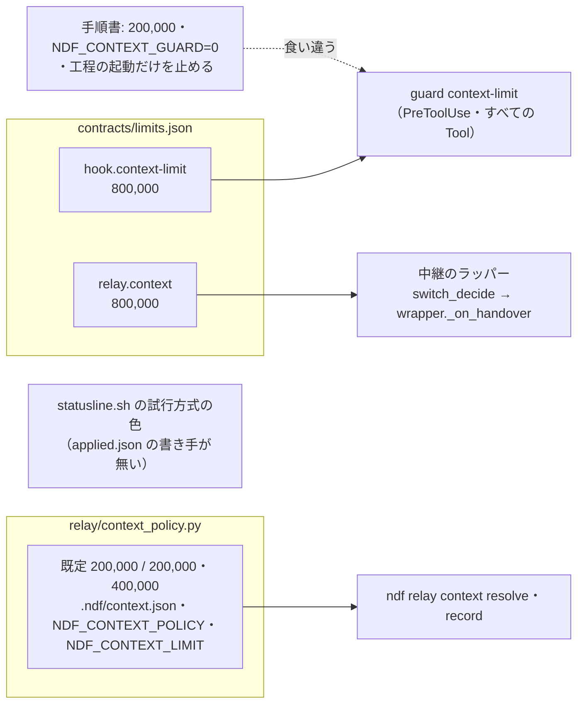
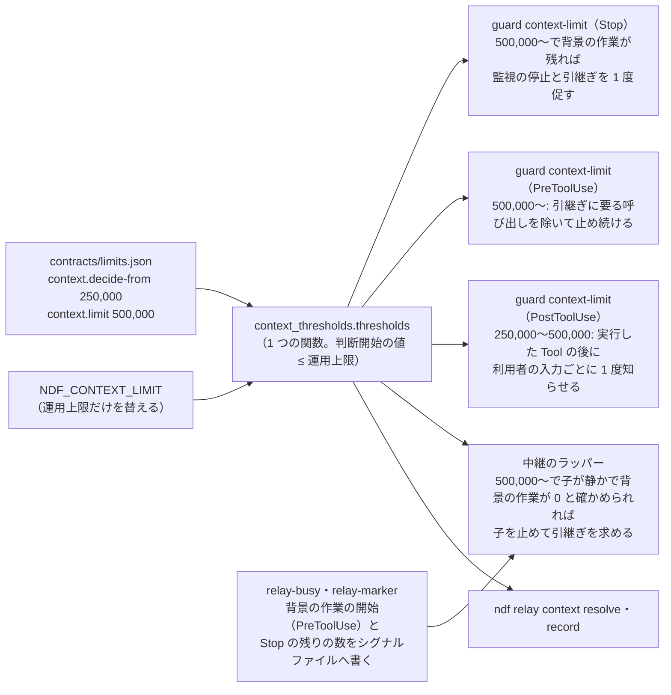
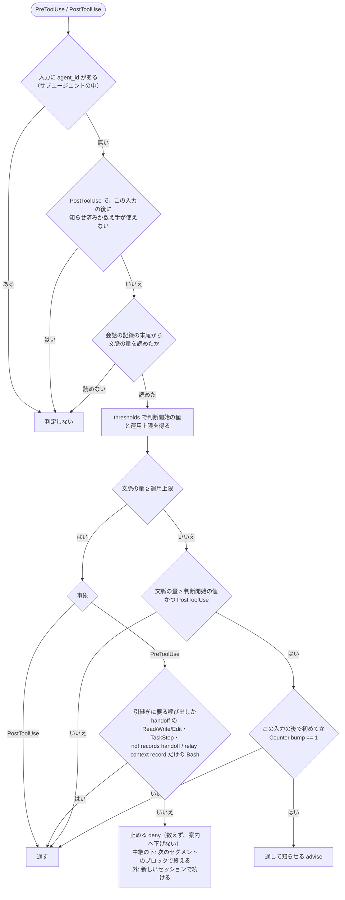
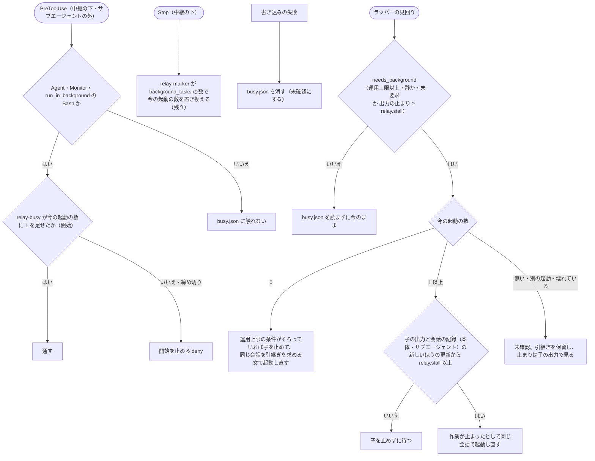

# 文脈の切り替え: 250,000 で知らせて次のカットポイントで切り、500,000 で止める 2 つの値を 1 か所に置く（#3995）

文脈の量で会話を切り替える閾値が 3 か所（800,000 の guard とラッパー、200,000 / 400,000 の再起動の方針）にあり、手順書の値と口がコードと食い違っていた。上限の設定（`limits.json`）に 2 つの値だけを置く。判断開始の値 250,000（タイミングを見て再起動）と運用上限 500,000（速やかに再起動）で、hook の判定の部品（guard）・中継のラッパー・`ndf relay context resolve` が 1 つの関数で読む。250,000 を超えると guard が Tool の実行の後に 1 度だけ知らせ、500,000 を超えると引継ぎに要る呼び出しを除いて止め続ける。中継のラッパーは、子の背景の作業（supervisor・`ndf plan queue`・監視）が残る間と、残りの有無を確かめられない間は子を止めずに待ち、背景の作業が残る Stop では guard が同じ会話に監視の停止と引継ぎを促す。2 つの方針と `.ndf/context.json`・`NDF_CONTEXT_POLICY` は消し、採らなかった案は「決定の記録」に、調べた製品は付録の「外部の調査」にある。

## 今の姿

何が起きたか・目的・受け入れ条件は要求仕様（[issue-3995-requirements.md](./issue-3995-requirements.md)、正は #3995 の本文）にある。この文書は「どう解くか」と「なぜその解き方か」だけを書く。

設計に要る今の構造:

| 部品 | 今の振る舞い | 場所 |
| --- | --- | --- |
| 文脈の量の guard | PreToolUse で会話の記録の末尾の最後の応答の `usage` を読み、`hook.context-limit`（800,000）以上なら、パスに `.ndf/handoff/` を含む Write/Edit を除くすべての Tool（Read・TaskStop を含む）を止める。手前の値は持たない | `domains/hooks/guards/context_limit.py`・`contracts/hooks/guards.json` の `context-limit`（`tools` は空・`deny_key` は `reason`） |
| 同じ拒否の数え手 | セッションごとの数え手（`Counter`）が、同じ guard・理由・対象の拒否を利用者の入力ごとに数える。`hook.deny-repeat`（2 回）を超えると、止めずに文だけを足す案内（`advise`）へ下げる。数え手を開けなければ初めから下げる。`guards.json` の `summary` は「`deny_key` が `none` なら数えない」と書くが、`dispatch.deny_key` は `none` を区別せずに数える | `domains/hooks/dispatch.py` の `run`・`deny_key`、`domains/hooks/counter.py` の `allow_deny`、`guards.json` の `summary` |
| 案内の出力 | `advise` は Claude Code の PreToolUse（Tool の実行の前）と PostToolUse（実行の後）で `additionalContext` として会話へ入る。同じ PreToolUse でほかの guard が止めると、まとめた判定は `deny` になり、案内の文は捨てられる | `contracts/hooks/runtimes.json` の `claude`・`dispatch.combine` |
| 中継のラッパー | 子の文脈の量が `relay.context`（800,000）以上で子が静かになったら、1 セグメントに 1 度、子を強制終了し、同じ会話を引継ぎを求める文（`HANDOVER_PROMPT`）で起動し直す。値はラッパーを起動した時に 1 度読む | `domains/relay/cli.py` の `wrapper_settings`・`switch_decide.py` の `_alive`・`wrapper.py` の `_on_handover` |
| 再起動の方針 | 現行方式（既定 200,000）と試行方式（判断開始の値 200,000・運用上限 400,000・容量の余白 50,000）を、既定 < `.ndf/context.json` < `NDF_CONTEXT_POLICY`・`NDF_CONTEXT_LIMIT` < `--policy` で重ねる。読み手は `ndf relay context resolve` と判定の記録の行（`record`）だけである | `domains/relay/context_policy.py`・`cli_context.py`・`context_records.py` |
| statusline | 試行方式のセッションだけ、`sessions/<セッション>.applied.json` の値で、判断開始の値を超えたら黄、運用上限か 窓 − 容量の余白 の小さいほうを超えたら赤にする。そのファイルの書き手は無い | `domains/statusline/statusline.sh` |
| 止める口 | guard を止める口は `NDF_HOOK_OFF`（`context-limit` か `all`）として既にある。手順書の `NDF_CONTEXT_GUARD` には読み手が無い | `domains/hooks/tables.py` の `is_off`・`contracts/domains/env.json` |

ほかに、要求仕様に無い食い違いが 3 つある。

- **運用上限を超えた会話は、手順書の引継ぎを終えられない。** 引継ぎ文書の更新は Read の後の Edit/Write と `ndf records handoff check`（Bash）を要する（`handoff.md` の「作る・更新する」）が、guard は Read と Bash を止める。オーガナイザーは背景の `ndf lanes wait` を TaskStop で止められず、中継の外では切り替えられない（`parallel.md` の「2 を飛ばすと切り替わらない」）
- **止め続けるはずの拒否が 3 回目から通る。** `deny_key` が `reason` で、理由の文は Tool に依らず同じなので、どの Tool でも 2 回止めた後は案内へ下がる
- **サブエージェントの中の呼び出しを見分けていない。** 手順書は「見るのは conductor だけ」と書くが、guard は入力の `agent_id` を見ない

## 文脈と制約

- hook の経路は `ndf.contracts`（jsonschema を読む）を import しない。上限の設定は、hook では `hooks/tables.py` が `json` で直に読み、ほかの経路では `contracts/limits.py` が読む。両方の経路が同じ値を使うよう、読む規則（環境変数の重ね方）を 1 つの関数に置き、上限の設定の引き方だけを呼び手が渡す
- パッケージの持ち主の表（`checks/children.json`）では、hook は M3a、`ndf.domains.relay` は M3b、`context_policy` は個別に S1e が持つ。M3a が import してよいのは M3b の持ち物だけである。新しい関数は M3b のモジュールに置き、`ndf check` の `child-deps` で向きを確かめる
- ラッパーは子の claude へ自分の環境を渡す（`session_env.child_env`。`NDF_CONTEXT_LIMIT` は外す変数に入っていない）。guard は子の claude の hook として動くので、ラッパーと guard は同じ環境変数を読む。`ndf relay context resolve` も子の Bash から打てば同じ環境になる
- ラッパーが引継ぎを求めるときは子を強制終了するので、子の背景の作業（`ndf lanes wait`・Monitor・背景の Agent）は子とともに終わる。起動し直した会話には背景の作業が残らない。子が静かかどうかは出力で見るので、背景の Agent を待つ conductor も静かに見える
- Claude Code は Stop の hook の入力に、残っている背景の作業の列（`background_tasks`）を渡す。中継のマーカーの guard（`relay-marker`）は、これが空でない間は次のセグメントのマーカーを書かない（`guards/relay_mark.py`）。ラッパーはこの列を今は読まない
- ラッパーの止まりの判定（`relay.stall` の 1,800 秒、出力が止まったら起動し直す）も背景の作業を見ない。出力を出さずに 1,800 秒を超えて動く supervisor は、今は止まりとして子ごと起動し直される。背景の Agent は Tool を呼ぶたびにサブエージェントの会話の記録（本体の記録の隣の `subagents/`）へ書く
- 見回りは既定 0.5 秒ごと（`relay.tick`）に状態を組む。運用上限に達していない通常のセッションでも毎回走るので、足す読み取りは条件がそろったときだけにする
- `ndf lanes wait <計画> --after <番号>` は同じ番号で打ち直すと同じ知らせを返す（`parallel.md` の手順 3）。止める前に `wait` が戻っていても、引継ぎ文書の「現在地」の行を変えなければ、新しい会話が同じ知らせを受け取る
- 判定の記録の行（`ndf relay context record` が書く 1 行）を読むのは `context_report`（集計）と `calibrate`（見込みの較正）で、どちらも `policy`・`margin`・`config_error` を使わない（使うのは `context_report` の `no_policy_rows` だけ）。`context_records.py` の冒頭の「旧い `context-policy.py` と hook も読み書きする」は 10 系の記述である
- Codex には guard `context-limit` を置かない（`runtimes.json` の `skipped`）。Codex は手順書のカットポイントで守る（要求の「含まない」）
- 確定仕様（`ndf-context-restart-policy.md` など）は確定仕様化の工程で直す。用語集（`docs/glossary/glossary.json`・`docs/glossary.md`）の反映は、この設計 Pull Request の範囲（`issues/issue-3995-*`）の外なので実装の Pull Request で行う
- NDF は普及のフェーズの前で、互換の経路を持たない（MVV Value 4）。決定の根拠に引く MVV の項目は `.ndf/mvv.md`（MVV バージョン 1）にある

## 解き方の全体像

- 文脈の切り替えの値は上限の設定の 2 つ（判断開始の値 `context.decide-from` 250,000・運用上限 `context.limit` 500,000）だけで、guard・中継のラッパー・`ndf relay context resolve` と判定の記録の行は、`context_thresholds.thresholds` の 1 つの関数で同じ値を読む。`NDF_CONTEXT_LIMIT` は運用上限を替え、判断開始の値がそれを上回れば同じ値へ下げる
- 文脈の量が判断開始の値以上・運用上限未満なら、guard は Tool を止めず、実行した Tool の結果の隣に、超えたことと役ごとの切りどころを利用者の入力ごとに 1 度だけ足す。中継が送る入力では数え直さない
- 運用上限以上なら、guard は引継ぎに要る呼び出し（引継ぎ文書の Read・Write・Edit、`ndf records handoff` と `ndf relay context record` だけの Bash、TaskStop）を除くすべての Tool を、同じ拒否の回数に依らず止め続ける。理由の文は、止めてよい背景の監視（`ndf lanes wait`・Monitor）と、終わりを待つ作業（supervisor・`ndf plan queue`）を分けて示す。背景の作業が残ったまま応答を終えようとする Stop では、同じ文を変更要求で 1 度返し、子を止めずに監視の停止と引継ぎへ進ませる。ラッパーも同じ値で子に引継ぎを求めるが、背景の作業の数が今の起動で 0 と確かめられたときだけ子を止める（数は背景の作業を始める呼び出しで増え、Stop で残りの数に置き換わる。確かめられなければ保留する）。背景の作業が残る間の止まりは、子の出力でなく会話の記録の更新で見る
- サブエージェントの中の呼び出し（入力に `agent_id` がある）は、guard が判定も知らせもしない
- 再起動の方針（現行方式・試行方式）、`.ndf/context.json` と設定の形、`NDF_CONTEXT_POLICY`、`resolve` の `--policy`・`--root`、statusline の試行方式の色は無い。guard を止める口は既にある `NDF_HOOK_OFF=context-limit` だけである

## 処理の流れ

guard `context-limit` の判定（PreToolUse と PostToolUse で同じ `check` を呼ぶ）。

Stop でも同じ `check` を呼ぶ。入力に `agent_id` が無く、`background_tasks` が空でなく、この入力の後でまだ促していないときだけ文脈の量を読み、運用上限以上なら拒否と同じ文の変更要求（`pushback`）を 1 度返す。ほかは何もしない。

中継のラッパーの判定（`switch_decide._alive`）は、比べる値が `thresholds` の運用上限になり、背景の作業の条件が 1 つ増え、背景の作業が残る間の止まりを会話の記録の更新で見る。

背景の作業の数は、背景の作業を始める呼び出しで増え、Stop のたびに残りの数に置き換わる。同じ起動で 0 を書いた後に supervisor を起動すれば、その PreToolUse で 1 になるので、次の Stop の前にラッパーが静かと判定しても止めない。今の起動の最初の Stop の前と、書き込みに失敗した後（hook がファイルを消す）は未確認で、引継ぎを保留する。supervisor が終わると Claude Code が完了の知らせで conductor を動かし、その応答の Stop が残りの数を書く。運用上限以上で背景の作業が残ったまま conductor が応答を終えようとすると、guard の Stop の変更要求が監視（`ndf lanes wait`・Monitor）を TaskStop で止めさせ、supervisor は待たせ、引継ぎ文書を書かせる（子は止めない）。監視だけが残っていれば、その応答の中で監視が止まり、引継ぎへ進む。conductor が引継ぎ文書と次のセグメントのブロックを書いて終えれば、ラッパーは引継ぎを求めるまでもなく次のセグメントへ切り替える（`relay-marker` は背景の作業が残る間はマーカーを書かないので、どちらの経路でも背景の作業の終わりの後になる）。起動し直した会話でも文脈の量は運用上限以上なので、guard は引継ぎに要る呼び出しだけを通す。

## 決定の記録

### 決定 1: 値と振る舞いを 1 通りにするため、現行方式と試行方式の 2 つの方針を消す

- **質問**: 2 つの方針を残して既定をどちらも 250,000 / 500,000 にするか、方針を消して 2 つの値だけにするか
- **選んだ案**: 方針を消す。2 つの値（判断開始の値・運用上限）は利用者が決めた「タイミングを見て再起動」と「速やかに再起動」の値として残し、振る舞いは方針に依らず 1 通り（知らせる・止める）にする。消すのは `context_policy.py`（方針名・容量の余白・`.ndf/context.json` の読み手・`Resolved`）、`.ndf/context.json` の設定の形（`context.schema.json`）と保存先の表（`ndf-files.json`）の `context` の行、`NDF_CONTEXT_POLICY`、`ndf relay context resolve` の `--policy`・`--root`、結果の `policy`・`margin`・`config_error`、集計の `no_policy_rows`、statusline の試行方式の色の分岐、手順書の「再起動の方針」のセクションと試行方式の判断帯の記述（`work-vessels.md`）。判定の記録の行は `decide_from`・`limit`・`sources` を残す（`skill-stats` が記録に残った運用上限を使う）。`calibrate`・`report`・記録の語（継続・拒否・再起動・理由）は残し、`context_thresholds` へ移す
- 採らなかった案: 2 つの方針を残し、どちらの既定も 250,000 / 500,000 にする（guard とラッパーの振る舞いが同じになり、方針の名前を変えても何も変わらない。試行方式の判断帯と容量の帯は guard に無く、要求の「含まない」で実装もしない）
- 採らなかった案: 試行方式の判断帯（費用の見込み）と容量の帯を guard に実装して方針を残す（要求が「含まない」に置き、閾値の実測の見直しは #2908 が持つ）
- 採らなかった案: 判定の記録の行の形を変えずに、`policy` に固定の値を書き続ける（意味の無い列が残り、読み手の `no_policy_rows` も意味を失う）
- **代償**: statusline の 500,000（窓 200K 以下は 150,000）の赤は変えず、消すのは書き手の無いファイルを読む試行方式の分岐だけなので、要求が「含まない」に置く色の閾値には触れない。試行方式で比べる実験は、方針の切り替えでは行えなくなる。#2908 で比べ方を作り直すときは、値を変えて比べる形になる。要求の「影響」の「判定の記録の行の形は変えない」から外れ、新しい行は `policy`・`margin`・`config_error` を持たない。読み手（`report`・`calibrate`）は過去の行の 3 つの列を読まないので、新旧の行を混ぜても集計と較正は変わらない（テスト設計の表の後の段落で確かめる）
- 根拠: Value 3「手順は使うほど増えるのではなく、減っていく」・Value 4「旧い設定の形を残す互換の仕組みを持たず」・Value 6「使わなくなったコード・設定・文書が整理される」（MVV バージョン 1）

### 決定 2: 止める口を 1 つにするため、`NDF_CONTEXT_GUARD` は作らず手順書から消し、`NDF_HOOK_OFF=context-limit` を書く

- **質問**: guard を止める口として、手順書の `NDF_CONTEXT_GUARD=0` を作るか、手順書から消すか
- **選んだ案**: 作らない。guard を名前で止める口 `NDF_HOOK_OFF`（`context-limit` か `all`）が既にあり、止めると判定も知らせもしない。手順書の `NDF_CONTEXT_GUARD` を `NDF_HOOK_OFF=context-limit` に書き換え、`git grep -n NDF_CONTEXT_GUARD -- plugins/ndf` を 0 件にする
- 採らなかった案: `NDF_CONTEXT_GUARD=0` を作る（同じことをする口が 2 つになる。`env.json` の `NDF_HOOK_OFF` の説明は「閾値はこの変数で受けない」と口を分けている）
- **代償**: guard だけを止めたい人は、guard の名前（`context-limit`）を知る必要がある。名前は手順書の止める口の行に書く。動いているセッションの環境は変えられないので、止めるには claude を起動し直す
- 根拠: Value 3「手順は使うほど増えるのではなく、減っていく」（MVV バージョン 1）

### 決定 3: 工程の途中の Tool を止めずに切りどころを確かに届けるため、250,000 の知らせは PostToolUse の案内で、利用者の入力ごとに 1 度だけ出す

- **質問**: 判断開始の値を超えたことを、どの経路で何回 conductor に届けるか
- **選んだ案**: guard `context-limit` の事象に PostToolUse を足し、文脈の量が判断開始の値以上・運用上限未満のとき、実行を終えた Tool の結果の隣に案内の文（`additionalContext`）を足す。PostToolUse は Tool が実行されたときだけ発火するので、同じ呼び出しをほかの guard が PreToolUse で止めて案内が捨てられることが無い。回数は数え手の `Counter.bump` で数え、利用者の入力ごとに最初の 1 回だけ出す。中継が送る入力（マーカーつき）では数え直さないので、中継の入力だけが続くセグメントでは 1 度になり、利用者がラッパーの端末で入力すればその後にもう 1 度出る。文は文脈の量・判断開始の値・運用上限と、役ごとの切りどころ（レーンの conductor は 4 つのカットポイント、オーガナイザーは知らせを処理し終えて次の `wait` を張る前か利用者への報告を終えた時点）を書く。判断開始の値の手前から運用上限以上へ一度に越えたとき・2 つの値が同じときは、知らせの帯を通らず、運用上限の拒否の文が知らせを兼ねる
- 採らなかった案: PreToolUse で知らせる（同じ呼び出しをほかの guard が止めると、数えた後に文が捨てられ、その入力の間は届かない）
- 採らなかった案: 判断開始の値以上のすべての呼び出しで知らせる（文脈の量の大きい会話で、呼び出しごとに同じ文を足して文脈を増やす）
- 採らなかった案: statusline の色で知らせる（色は人に見せる表示で、conductor の会話に入らない。要求の「含まない」も色の閾値を外す）
- 採らなかった案: 中継のラッパーが 250,000 で子へ文を送る（中継の外のセッションに届かない。子が静かになるのを待つので、知らせが切りどころの後になる）
- **代償**: 知らせを受けた後に conductor が切りどころを逃すと、運用上限で止まるまで続く。運用上限の拒否は、知らせが届かないときの受け止め手として要求が置いたもの（ドメインイベント E2 の失敗）である。PostToolUse でほかに判定を返す guard は `ask-answered`（AskUserQuestion の後の案内）だけで、まとめても拒否にならない。数え手が使えない（排他を取れない）ときは知らせない。hook の登録は matcher を持たず（`hooks/registration.py`）、PostToolUse の hook は今もすべての Tool の呼び出しで起動しているので、起動の回数は増えない。増えるのは、guard `context-limit` が PostToolUse で会話の記録の末尾（`hook.transcript-tail`、最大 256 KiB）を読む 1 回で、PostToolUse の hook の予算（`hook.budget.post-tool-use`）の中で読む。この読み取りは、この入力の後に知らせ済みのとき（数え手の `counts` の `NOTICE_KEY` が 1 以上）と数え手が使えないときは行わずに終える（記録を読む前に数え手を見る）。利用者の入力 1 つの間に増える読み取りは、知らせの帯では 1 回、判断開始の値の手前と運用上限以上では Tool の呼び出しの回数分になる
- 作り方: 自前で作る（既存の guard の判定に事象と案内の分岐を足す）
- 比べた候補: PRD1 / PRD2
- 根拠: Value 1「ワークフロー上の課題（再起動・告知・確認）で、利用者に操作を求めない」・Value 2「利用者が払う費用（LLM の token）が小さい」（MVV バージョン 1）

### 決定 4: 運用上限で止まっても引継ぎを終えられるよう、引継ぎに要る呼び出しを通し、会話を見分けずに役ごとの手順を止める文に入れる

- **質問**: 受け入れ条件 6・8 を満たしつつ、止められた会話が引継ぎ文書を更新し、オーガナイザーが背景の `wait` を止めて切り替えられるようにするには、何を通し、オーガナイザーをどう見分けるか
- **選んだ案**: 運用上限以上でも次の呼び出しを通す。どれも `guards.json` の `context-limit` の `params` に置く。(1) シンボリックリンクと `..` を解いた実際の書き込み先の親が、作業ディレクトリを含むリポジトリのメインディレクトリの `.ndf/handoff`（`handoff_dir`）であるファイルの Read・Write・Edit。(2) `pass_tools` の TaskStop。(3) 単純なコマンドがすべて `pass_ndf` の `ndf records handoff check`・`ndf relay context record` で、書き込みを伴うリダイレクトを持たない Bash（引継ぎ文書の検査と「引継ぎ開始」の記録）。`handoff check` は `--trim` で本体を書き換えて履歴へ追記するので、`--cwd` の対象のリポジトリが作業ディレクトリのものと同じで、本体と `--history` の実際のパスがどちらも (1) と同じ引継ぎディレクトリの直下のときだけ通し、知らない引数と展開を含む語は止める。オーガナイザーの会話は見分けず、止める理由の文とラッパーの文（`HANDOVER_PROMPT`）の両方に役ごとの手順を書く。止める理由の文は「監視（`ndf lanes wait`・Monitor）が背景にあれば TaskStop で止め、完了通知で確かめる。supervisor・`ndf plan queue` は止めずに報告を待つ。止める前に `wait` が戻っていたら結果を処理せず、引継ぎ文書の「現在地」の `wait` の行を変えずに残す（同じ `--after` で打ち直すと同じ知らせが返る）。引継ぎ文書（オーガナイザーは `.ndf/handoff/parallel-<計画>.md`）を書いて検査する」で、`HANDOVER_PROMPT` はラッパーが子を止めて背景の作業が終わった後に届くので、「背景の作業は終わった。オーガナイザーは「現在地」に打ち直す `wait` の行を残す」と書く
- 採らなかった案: 引継ぎ文書の Write/Edit だけを通す（今の形。読んでいない文書は Write/Edit できず、検査の Bash も打てず、オーガナイザーは `wait` を止められない）
- 採らなかった案: guard がセッションの Bash の `ndf lanes wait <計画>` を見て、そのセッションをオーガナイザーとして数え手に書く（文に計画の名前を入れられるが、状態が 1 つ増え、`wait` を打つ前に切り替える会話を見分けられない）
- 採らなかった案: オーガナイザーをリレーハブの役（`NDF_RELAY_ROLE=organizer`）で見分ける（オーガナイザーは利用者が `/goal` で始める会話で、ハブが起動するとは限らない）
- 採らなかった案: 背景の作業をすべて TaskStop で止めるよう書く（動いている supervisor を止めると、そのフェーズの作業が失われる。`waiting.md` の「バックグラウンドの作業を止める」は監視だけを止める）
- 中継の下の待ちと強制終了の食い違いは、ラッパーが待つ側に合わせる。新しい guard `relay-busy` が、背景の作業を始める呼び出し（Agent・Monitor・`run_in_background` の Bash）の PreToolUse で今の起動の数に 1 を足し（`fail_closed`。記録できなければ、hook の予算を使い切った後と締め切りの経路でも開始を止める）、中継のマーカーの guard（`relay-marker`）が Stop のたびに `background_tasks` の数で置き換える（シグナルファイル `busy.json`。起動の ID つき）。ラッパーは今の起動の数が 0 と確かめられたときだけ子を止める。次のセグメントのマーカー（`next.json`）にも起動の ID を書き、書く側（`write_next`）と読む側（`_next_mark`）の両方で今の起動と照らす（同じ会話を起動し直すとセッション ID が変わらないので、セッション ID だけでは旧い起動の Stop のマーカーで新しい子を止め得る）。数が 1 以上の間と、確かめられない間（今の起動の最初の Stop の前・ファイルが無い・壊れている・書き込みに失敗して hook が消した後）は保留する。文の「supervisor・`ndf plan queue` は止めずに報告を待つ」は中継の下でもそのまま書く
- 背景の作業が残ったまま応答を終える Stop には、Tool の呼び出しが無いので拒否の文が届かない。guard `context-limit` を Stop にも置き、運用上限以上で `background_tasks` が空でない Stop に、拒否と同じ文の変更要求を利用者の入力ごとに 1 度返す。監視だけが残る会話は、その応答の中で TaskStop と引継ぎへ進み、supervisor が残る会話は引継ぎ文書を書いて報告を待つ。子は止めない
- 背景の作業があると確かめられる間は、ラッパーの止まりの判定を子の出力でなく会話の記録の更新で見る。子の出力と、会話の記録の本体とサブエージェントの記録の最後の更新のうち新しいほうから 1,800 秒（`relay.stall`）が過ぎたときだけ、作業が止まったとして今のとおり同じ会話で起動し直す（回復の条件）。出力を出さない supervisor も Tool を呼ぶたびにサブエージェントの記録へ書くので、動いている間は止めない
- 採らなかった案: 中継の下では「待つ」を文に書かず、ラッパーの強制終了に任せる（強制終了で supervisor が失われ、そのフェーズの作業が消える。Value 3「進行中の作業は失われず」に反する）
- 採らなかった案: ラッパーが子のプロセスの木を見て背景の作業を知る（背景の Agent は子の claude の中で動き、プロセスに現れない）
- 採らなかった案: Stop の数だけで判定する（同じ起動で 0 を書いた後に supervisor を起動し、次の Stop より先に静かになると、古い 0 で子を止めて作業を失う）
- 採らなかった案: すべての Tool の PreToolUse で「応答中」を書く（中継の下の呼び出しごとにファイルの書き込みが増える。背景の作業を始める呼び出しだけで、失われる作業の場面を覆える）
- 採らなかった案: 背景の作業が残る間は止まりの判定をしない（本当に止まった supervisor の子が起動し直されず、ラッパーが待ち続ける）
- 採らなかった案: サブエージェントの Tool の呼び出しごとに hook が `busy.json` へ動いた時刻を書く（サブエージェントの呼び出しごとに書き込みが増える。会話の記録の更新の時刻はラッパーが止まりの判定のときだけ読めば足りる）
- **代償**: 受け入れ条件 6 の「引継ぎ文書の Write/Edit を除く」より通す呼び出しが多い（引継ぎ文書の Read・TaskStop・2 つの `ndf` のコマンドだけの Bash）。Bash は、構文木の単純なコマンドが 1 つ残らず 2 つのコマンドに当たり、書き込みを伴うリダイレクト（`>`・`>>`・`>|`・`&>`・`&>>`・`<>`・プロセス置換）・ヒアドキュメント・背景（`&`）を持たないときだけ通し、`&&`・`;`・パイプで別のコマンドをつないだものとコマンド置換を含むものは止める。許すリダイレクトはファイル記述子の複製（`2>&1` の形）と `/dev/null` だけである。レーンの conductor にもオーガナイザーの手順を含む文が届き、文に計画の名前は入らない（拒否の 1 回に 1 文で、止められた会話の 500,000 token に比べて小さい）。Read・Write・Edit は、シンボリックリンクを解いた実際の書き込み先の親が、作業ディレクトリ（入力の `cwd`）を含むリポジトリのメインディレクトリの `.ndf/handoff`（`.ndf` と `handoff` がリンクでないもの）のときだけ通す。ほかのリポジトリと worktree の `.ndf/handoff` は止める。ラッパーは supervisor を待つ間、運用上限を超えた会話を止めずに残すが、その会話の Tool は guard が引継ぎに要るものだけに絞る。未確認の間も引継ぎを保留するので、最初の Stop の前に静かになって止まった子は、引継ぎでなく止まりの判定（子の出力で 1,800 秒）で起動し直る。背景の Bash（`ndf plan queue`・`ndf lanes wait`）は会話の記録を書かないので、出力が 1,800 秒止まれば今のとおり起動し直す（`wait` は同じ `--after` で打ち直せる）。サブエージェントの記録の置き場（本体の記録の隣の `subagents/`）は公式の文書に無く、見つからなければ子の出力だけで見る（今の判定に戻る）。Stop の変更要求は利用者の入力ごとに 1 度で、中継の入力では数え直さないので、supervisor を待つ Stop を繰り返しても文は 1 度しか足さない
- 根拠: Value 3「版上げ・再起動・セッションの入れ替えをまたいでも、進行中の作業と人の回答は失われず、止まった所から続く」・Value 3「同じ手順は毎回同じ結果になる」（MVV バージョン 1）

### 決定 5: 値を変えると 3 つの読み手すべてに効くよう、上限の設定に 2 つの行を置き、読む規則を 1 つの関数にする

- **質問**: 判断開始の値と運用上限を、上限の設定（`limits.json`）・再起動の方針のコード・ほかのどこに置き、だれがどう読むか
- **選んだ案**: 上限の設定の 2 つの行 `context.decide-from`（`count` 250,000）と `context.limit`（`count` 500,000）に置き、`hook.context-limit`・`relay.context` の行を消す。読む規則を新設の `ndf.domains.relay.context_thresholds.thresholds(environ, value)` の 1 つにし（パッケージの持ち主は M3b）、上限の設定の引き方（`value`）を呼び手が渡す。guard は `hooks/tables.policy_value`、ラッパーと `resolve`・`record` は `contracts/limits.value` を渡す（hook の経路は `ndf.contracts` を import しないため）。`NDF_CONTEXT_LIMIT` が ASCII の数字だけで 0 より大きければ運用上限を替え、判断開始の値がそれを上回れば同じ値へ下げる（前提 3）。上限の設定の 2 つの値が逆になっていても同じ規則で判断開始の値を下げる。環境変数が正の整数でなければ無視して出所に `ignored` を書く（guard とラッパーを落とさない）。返りは判断開始の値・運用上限・値ごとの出所（`default`・`env`）
- 採らなかった案: 値をコードの定数に置く（今の `context_policy.py` の形。上限の設定が値を持つ規約（`limits.py` の「コードは方針の名前で引く」）から外れる）
- 採らなかった案: 1 つの行に 2 つの値を持たせる（上限の設定の行の値は決まった名前（`count`・`seconds` など）だけで、2 つ目の `count` を置けない。名前を足すと形（`limits.schema.json`）と `Policy` を変える）
- 採らなかった案: 判断開始の値を替える環境変数も足す（利用者が決めたのは 2 つの値で、替える必要が示されていない。運用上限を下げたときの判断開始の値は前提 3 の規則で決まる）
- 採らなかった案: guard・ラッパー・`resolve` がそれぞれ上限の設定と環境変数を読む（重ね方が 3 か所に分かれ、今の食い違いと同じ形が戻る）
- 採らなかった案: 環境変数の誤りを `EnvError` で止める（`limits.from_env` の形。guard の例外は通す側へ倒れ、ラッパーは起動できなくなる）
- **代償**: 中継のラッパーは起動の時に 1 度だけ値を読むので、動いているラッパーの下で `NDF_CONTEXT_LIMIT` を変えても、そのラッパーの値は変わらない（子の guard はラッパーの環境を引き継ぐので、両者は同じ値のままである）。`checks/children.json` の S1e の `context_policy` の行を消す
- 作り方: 自前で作る（上限の設定の 2 つの行と、環境変数を重ねる関数 1 つ）
- 比べた候補: PRD2
- 根拠: Value 8「同じ事実を 2 か所に持たない」・Value 3「同じ手順は毎回同じ結果になる」（MVV バージョン 1）

### 決定 6: 運用上限を超えたまま進まないよう、guard `context-limit` の拒否を数えずに止め続け、表の `deny_key: none` の約束をコードに合わせる

- **質問**: 運用上限以上の拒否を、ほかの guard と同じく利用者の入力ごとに 2 回で案内へ下げるか、止め続けるか
- **選んだ案**: 止め続ける。`context-limit` の `deny_key` を `none` にし、`dispatch.run` が `deny_key` が `none` の行の拒否を数えず、案内へ下げないようにする（表の説明が既に「none は数えない」と書く約束を、コードが守る形にする）。`fail_closed` は偽のままで、締め切りを過ぎたときと guard の例外は今のとおり通す側へ倒れる。拒否の文は止める範囲と次の手を示すので、conductor は引継ぎへ進める。手順書の「同じ起動の 2 度目を 1 度だけ通す」を消す
- 採らなかった案: 今のまま 2 回で案内へ下げる（`deny_key` が `reason` で理由が Tool に依らず同じなので、どの Tool でも 3 回目から通り、受け入れ条件 6 の「次の Tool の呼び出しを止める」を満たさない）
- 採らなかった案: `fail_closed` にする（締め切りを過ぎても呼び、例外を拒否にするので、上限の設定の壊れや会話の記録の読みの遅れで、引継ぎに要る呼び出しまで止まりうる）
- 採らなかった案: 表に新しい列を足して下げない行を選ぶ（`deny_key` の `none` が同じ意味を既に約束している）
- **代償**: 中継の外で運用上限を超えた会話は、引継ぎをするまで止まり続け、利用者が続けると決めても続けられない。続けるには `NDF_HOOK_OFF=context-limit` で claude を起動し直す。`deny_key` が `none` のほかの 8 行は振る舞いが変わらない。`merge-production` は先に呼ぶ `strict` の行で dispatch を通らず、`ask-forward` は `fail_closed` で今も数えない。`turn`・`session`・`ask-answered`・`ask-closed`・`relay-marker`・`unattended`・`stop-wait` は拒否（`deny`）を返さない（2026-11-22 に `guards.json` と `deny(` を返す guard のファイルで確かめた）
- 根拠: Value 3「同じ手順は毎回同じ結果になる」・Value 2「役に立たない繰り返しに費用を使わない」（MVV バージョン 1）

### 決定 7: 手順書の約束どおりサブエージェントを止めないため、入力に `agent_id` がある呼び出しを guard が判定しない

- **質問**: サブエージェントの中の呼び出しを、何で見分けるか
- **選んだ案**: hook の入力の `agent_id`（Claude Code がサブエージェントと同じプロセスの teammate の中で発火した hook に付ける）があれば、guard は判定も知らせもせずに通す。teammate も conductor ではないので同じに外す。`runtimes.json` の `claude` の `PreToolUse`・`PostToolUse` の `optional` に `agent_id` を足す
- 採らなかった案: 会話の記録のパスでサブエージェントを見分ける（サブエージェントの中の `transcript_path` が何を指すかが公式の文書に無い）
- 採らなかった案: `agent_type` で見分ける（`--agent` で起動したメインの会話にも付く）
- **代償**: Claude Code が `agent_id` を付けなくなると、サブエージェントの中も親の文脈の量で判定される
- 作り方: 標準に倣う（Claude Code の hook の入力の項目）
- 比べた候補: PRD1
- 根拠: Value 3「同じ手順は毎回同じ結果になる」（MVV バージョン 1）

## 影響と危険

- **働く範囲**: 利用先のリポジトリでも働く（NDF のプラグインの hook とラッパーの既定の値）。Claude Code だけで、Codex には guard が無い
- **プロジェクトごとに違うもの**: 無い。値は上限の設定の既定で、変えるのは個人の環境変数 `NDF_CONTEXT_LIMIT` だけである（チームの設定 `.ndf/context.json` は消す。決定 1）
- **当たるモード**: すべてのモード（文脈の量は工程に依らず見る）
- **壊れうる箇所**:
  - guard が止める値が 800,000 から 500,000 へ下がり、ラッパーが引継ぎを求める値も下がる。今 500,000〜800,000 で続けている会話は、リリースの後に止まり続ける（決定 6）
  - **ラッパーの引継ぎは、今は背景で supervisor が動く子も止める。** 子が静かかどうかは出力で見るので、背景の Agent を待つ conductor も静かに見え、強制終了でそのフェーズの作業が失われる。引継ぎを求める値が 800,000 から 500,000 へ下がると当たる場面が増えるので、この変更で背景の作業の開始と Stop の `background_tasks` をラッパーへ渡し、背景の作業が 0 と確かめられたときだけ止める（決定 4）。Stop の前の応答の途中で止まった子は、未確認なので引継ぎでは止めず、出力が 1,800 秒止まったら今のとおり起動し直す
  - 背景の作業を確かめられる間は、出力を出さない supervisor の子を 1,800 秒で起動し直さなくなる。会話の記録（本体とサブエージェント）も 1,800 秒更新されなければ今のとおり起動し直す
  - 見回りの読み取りは、運用上限の条件か止まりの条件がそろった見回りだけで増える。ふだんの見回り（既定 0.5 秒ごと）の読み取りは変わらない。背景の作業を始める呼び出しの PreToolUse ごとに `busy.json` の書き込みが 1 回増える（中継の下だけ）
  - 運用上限を超えた会話は、supervisor の終わりまで止められずに残る。その間の conductor の Tool は guard が引継ぎに要るものだけに絞り、supervisor の完了の知らせを受けた応答も引継ぎだけを行う
  - 手元に `.ndf/context.json` を置いた利用者は、ファイルが読まれなくなる。このリポジトリには無い（`git ls-files .ndf/context.json` は 0 件。2026-11-22 に確かめた）
  - `relay.result.schema.json` の `policy`・`margin`・`config_error`・`no_policy_rows` を消すので、`ndf relay context` の結果を読む外の呼び手は項目を失う。リポジトリの中の呼び手は `cli_context.py` だけである
  - 同じファイルを触る別の変更: `domains/relay/cli.py`・`switch_decide.py` は中継のアカウントの切り替え（#3604 #3864）も触る。実装の前に `gh pr list` の触るファイルで打ち直す

### 代表のリポジトリでの振る舞い

| 代表のリポジトリ | 設定の要点 | 直した後に起きること | この種類で扱えなくなること |
| --- | --- | --- | --- |
| Web サービス（nd-factory） | Claude Code で conductor とレーンを回す。文脈の値の設定は持たない | 250,000 で知らせが届き、500,000 で guard が止め続け、引継ぎに要る呼び出しだけが通る。手順書の値とコードが一致する | 無し |
| モバイルアプリ | 同上 | 同上 | 無し |
| 業務文書だけ | 同上（長い会話になりにくい） | 同上 | 無し |

### ai-plugins だけの事情

- 無し（値はプラグインの既定で、このリポジトリだけが置く設定は無い。`.ndf/context.json` も無い）

## 用語

| 用語 | 意味 | 用語集への反映 |
| --- | --- | --- |
| 判断開始の値 | これ以上になったら、hook が conductor に 1 度知らせ、conductor が次のカットポイントで引継ぎ文書を書いて切る文脈の量（既定 250,000。「タイミングを見て再起動」の値）。工程の途中の Tool は止めない | 意味の変更 |
| 運用上限 | これ以上になったら、hook が引継ぎに要る呼び出しを除く次の Tool の呼び出しを止め続け、中継のラッパーが子に引継ぎを求める文脈の量（既定 500,000。「速やかに再起動」の値。`NDF_CONTEXT_LIMIT` で変える） | 意味の変更 |
| 再起動の方針 | （廃止）方針は 1 通りになり、名前を持たない | 廃止 |
| 現行方式 | （廃止） | 廃止 |
| 試行方式 | （廃止） | 廃止 |
| 適用値 | （廃止）`ndf relay context resolve` は判断開始の値・運用上限と出所だけを返す | 廃止 |

用語集（`docs/glossary/glossary.json`）への反映と `ndf records glossary render` は、実装の Pull Request で行う（「文脈と制約」）。廃止の語の出所の確定仕様は確定仕様化の工程で直す。

## テスト設計

| 受け入れ条件 | どの振る舞いで縛るか | どう壊したら落ちるべきか |
| --- | --- | --- |
| 1 | 上限の設定の `context.decide-from`・`context.limit` の値を差し替えると、`thresholds` を経た guard の判定・`wrapper_settings` から `switch_decide` までの引継ぎの判定・`resolve` の結果の 3 つが差し替えた値を使う | どれか 1 つが定数か別の行を読むと落ちる |
| 2 | 上限の設定に `hook.context-limit`・`relay.context` の行が無く、`context_policy` を import できず、`context.schema.json` が無い | 行・旧いモジュール・旧いスキーマを残すと落ちる |
| 3 | 設定も環境変数も無いとき、`resolve` が判断開始の値 250,000・運用上限 500,000・出所 `default` を返し、結果が結果のスキーマを通る。`--policy`・`--root` は引数の誤りで断る | 既定を別の値にする・引数を残す・スキーマに無い項目を出すと落ちる |
| 4・6 | PreToolUse で文脈の量 249,999・250,000・499,999 では止めず、500,000 で止める。500,000 でメインディレクトリの `.ndf/handoff/x.md` の Read・Write・Edit（worktree の `cwd` からも）、TaskStop、本体と `--history` がメインディレクトリの `.ndf/handoff` の直下の `ndf records --cwd <メイン> handoff check <本体> --trim --history <履歴>` だけの Bash（`2>&1`・`2>/dev/null` つきも）は通り、`--history` か本体が引継ぎディレクトリの外・worktree か別のリポジトリの `.ndf/handoff`・`--cwd` が別のリポジトリ・知らない引数・展開を含む語の `handoff check` は止め、`.ndf/handoff/../settings.json` の Write・`other/handoff/x.md` の Write・worktree と別のリポジトリの `.ndf/handoff/x.md` の Write・ほかの Bash は止める。`.ndf/handoff/x.md` 自体が外を指すリンク・`handoff` か `.ndf` がリンクのときの Read・Write・Edit は止める。`ndf records handoff check x > settings.json`・`>>`・`>|`・`&>`・`1<>f`・`> >(cat)`・ヒアドキュメント・`&` つきは止める。止める文は中継の下で次のセグメントのブロックを、外で新しいセッションを示す。違う Tool の呼び出しを 3 回続けても 3 回とも止める（数え手が使えなくても止める） | 比べ方を `>` にする・パスを文字列の包含で比べる・リンクを解かない・リダイレクトを見ない・`handoff check` の引数のパスを見ない・拒否を案内へ下げると落ちる |
| 5 | PostToolUse で文脈の量 250,000 の 1 回目に案内の文が出て、同じ入力の 2 回目では出ず、利用者の入力で数え直した後の 1 回目で再び出る。中継が送った入力（マーカーつき）の後では出ない。249,999 と 500,000 では出ない。PreToolUse では出ない。知らせた後の同じ入力の PostToolUse を 10 回続けても、会話の記録の末尾の読み取り（`read_tail`）は 0 回で、数え手が使えないときも 0 回 | 呼び出しごとに出す・中継の入力で数え直す・PreToolUse で数える・数え手より先に記録を読むと落ちる |
| 7 | 子の文脈の量が 500,000 で静かになったとき引継ぎを求め、499,999 では求めない。`NDF_CONTEXT_LIMIT=300000` の環境から組んだ設定では 300,000 で求め、299,999 では求めない。今の起動の `busy.json` の数が 0 のときだけ求め、1 以上・壊れている・別の起動の ID・ファイルが無い（最初の Stop の前）・書き込みの失敗の後は 500,000 でも求めない（`wait`）。同じ起動で Stop が 0 を書いた後に Agent の PreToolUse を通すと、次の Stop の前の静かな見回りでも求めない。中継の下の Stop で `background_tasks` が 2 件なら数 2 を、空なら 0 を書き、次のセグメントのブロックが無い応答でも書く。数が 1 以上で出力が 1,800 秒止まっても、会話の記録が 10 秒前に更新されていれば起動し直さず、記録も 1,800 秒更新されていなければ起動し直す。運用上限未満で静かでない見回りでは `busy.json` と会話の記録の更新の読み取りが 0 回。500,000 で `background_tasks` が残る Stop に、監視の停止と引継ぎの変更要求を利用者の入力ごとに 1 度返す。求める文が背景の作業の扱いとオーガナイザーの `wait` の行を含む | 旧い値を読む・環境変数をラッパーに渡さない・背景の作業の数を見ない・未確認を 0 として扱う・開始を書かない・別の起動の数を読む・背景の作業中も出力だけで止まりを決める・見回りごとに読む・Stop で促さないと落ちる |
| 8 | 500,000 で止める文が、監視を TaskStop で止め supervisor を待つこと、戻った `wait` の行を変えずに残すこと、`.ndf/handoff/parallel-<計画>.md` を書くことを含む | 手順を落とすと落ちる |
| 9 | `NDF_CONTEXT_LIMIT=300000` で guard は 300,000 で止めて 299,999 で止めず、`resolve` の運用上限が 300,000。`=200000` では判断開始の値も 200,000 に下がる。`0`・`-1`・`abc`・`1.5`・`²` は無視して既定と `ignored` を返す。上限の設定の 2 つの値を逆にしても判断開始の値 ≤ 運用上限で返る | 環境変数を 1 か所だけで読む・下げる規則を落とす・誤りで例外を上げると落ちる |
| 11 | `NDF_HOOK_OFF=context-limit` で、600,000 でも guard は判定も知らせもしない | 口を効かなくすると落ちる |
| 15 | 入力に `agent_id` がある呼び出しは、知らせの帯（300,000 の PostToolUse）でも 600,000 の PreToolUse でも何もしない。`agent_type` だけを持つ入力は判定する。文脈の量が読めない（`usage` が無い）ときも止めない | `agent_id` を見ない・`agent_type` で外すと落ちる |
| 16 | 上の行のテストは文脈の量の境界の値と呼び出しの回数で判定し、時間で区切らない | — |

`report` と `calibrate` は、旧い行（`policy`・`margin`・`config_error` を持つ）と新しい行を混ぜた記録で、今と同じ集計と見込みを返す（`test_context_policy.py` から記録・較正・集計のテストを `test_context_thresholds.py`・`test_context_report.py` へ移す）。受け入れ条件 10・11 の後半（`git grep NDF_CONTEXT_GUARD` が 0 件）・2 の `git grep`・12・13・14 は文言を突き合わせるテストを書かず、`git grep` とドキュメントレビューで見る。

## どこを変えるか

詳細設計は [issue-3995-design-detail.md](./issue-3995-design-detail.md) にある（新設する関数 14・シグネチャを変える関数 1 のため。新設は `context_thresholds.thresholds`・`context_limit._passes`・`context_limit._in_handoff`・`context_limit._ndf_args_pass`・`context_limit._notice`・`context_limit._reason`・`signals.write_busy`・`signals.mark_busy_start`・`signals.read_busy`・`relay_busy.check`・`relay_busy.on_deadline`・`relay_busy._starts_background`・`observe.activity_age`・`switch_decide.needs_background`、シグネチャを変えるのは `context_records.record_row`）。

## 設計の結果

| 課題 | 扱い | 統合先 | 触るファイル |
| --- | --- | --- | --- |
| #3995 | 実装する | — | `plugins/ndf/src/ndf/domains/relay/context_thresholds.py`（新設）、`plugins/ndf/src/ndf/domains/relay/context_policy.py`（消す）、`plugins/ndf/src/ndf/domains/hooks/guards/context_limit.py`、`plugins/ndf/src/ndf/domains/hooks/guards/relay_mark.py`、`plugins/ndf/src/ndf/domains/hooks/guards/relay_busy.py`（新設）、`plugins/ndf/src/ndf/domains/hooks/context.py`、`plugins/ndf/src/ndf/domains/hooks/dispatch.py`、`plugins/ndf/src/ndf/domains/relay/signals.py`、`plugins/ndf/src/ndf/domains/relay/wrapper.py`、`plugins/ndf/src/ndf/domains/relay/cli.py`、`plugins/ndf/src/ndf/domains/relay/cli_context.py`、`plugins/ndf/src/ndf/domains/relay/context_records.py`、`plugins/ndf/src/ndf/domains/relay/context_report.py`、`plugins/ndf/src/ndf/domains/relay/switch_decide.py`、`plugins/ndf/src/ndf/domains/relay/observe.py`、`plugins/ndf/src/ndf/domains/statusline/statusline.sh`、`plugins/ndf/src/ndf/checks/children.json`、`plugins/ndf/contracts/limits.json`、`plugins/ndf/contracts/hooks/guards.json`、`plugins/ndf/contracts/hooks/runtimes.json`、`plugins/ndf/contracts/domains/env.json`、`plugins/ndf/contracts/domains/ndf-files.json`、`plugins/ndf/contracts/schemas/ndf-settings/context.schema.json`（消す）、`plugins/ndf/contracts/schemas/io/relay.args.schema.json`、`plugins/ndf/contracts/schemas/io/relay.result.schema.json`、`plugins/ndf/docs/contracts/env.md`（再生成）、`plugins/ndf/docs/contracts/files.md`（再生成）、`plugins/ndf/docs/contracts/ndf-settings.md`（再生成）、`plugins/ndf/docs/contracts/commands.md`（再生成）、`plugins/ndf/README.md`、`plugins/ndf/skills/development-workflow/references/context-window.md`、`plugins/ndf/skills/development-workflow/references/parallel.md`、`plugins/ndf/skills/development-workflow/references/relay.md`、`plugins/ndf/skills/development-workflow/references/glossary.md`、`plugins/ndf/skills/development-workflow/references/work-vessels.md`、`plugins/ndf/skills/development-workflow/SKILL.md`、`plugins/ndf/skills/statusline/SKILL.md`、`docs/glossary/glossary.json`、`docs/glossary.md`（再生成）、`plugins/ndf/tests/domains/hooks/test_guards.py`、`plugins/ndf/tests/domains/hooks/test_dispatch.py`、`plugins/ndf/tests/domains/hooks/test_context.py`、`plugins/ndf/tests/domains/relay/test_relay_parts.py`、`plugins/ndf/tests/domains/relay/test_relay_wrapper.py`、`plugins/ndf/tests/domains/relay/test_context_thresholds.py`（新設）、`plugins/ndf/tests/domains/relay/test_context_policy.py`（消す）、`plugins/ndf/tests/domains/relay/test_relay_decide.py`、`plugins/ndf/tests/domains/relay/test_relay_cli_parse.py`、`plugins/ndf/tests/domains/relay/test_context_report.py` |

## 未確認のまま残ること

| 項目 | 内容 |
| --- | --- |
| サブエージェントの中の `transcript_path` | Claude Code の hook の文書はサブエージェントの中の `transcript_path` が何を指すかを書かない（外部の調査の PRD1）。決定 7 は `agent_id` で先に外すので、どちらを指しても止めない。今の guard が親の文脈の量でサブエージェントを止めていたかは、実装の `tdd-cycle` とリリースの後の会話の記録で分かる |
| PostToolUse の予算の中で会話の記録を読めるか | PostToolUse の hook の予算（`hook.budget.post-tool-use`、p95 100 ms）の締め切りの中で、会話の記録の末尾（`hook.transcript-tail`）を読み終えられるかを測っていない。締め切りを過ぎれば guard は呼ばれず、知らせが出ないだけで止める側は変わらない。実装の `tdd-cycle` で、hook の計測の記録（`ms`）から PostToolUse の所要時間を変更の前後で比べ、p95 が予算に収まるかを確かめて実装の Pull Request に書く（時間で合否を決めるテストにはしない。読み取りの回数はテスト設計の 5 の行で縛る） |
| `background_tasks` が背景の Agent を含むか | 中継のマーカーの guard は `background_tasks` を背景の作業の列として使っているが、背景の Agent（supervisor）が列に載ることを公式の文書で確かめていない。載らなければ、Agent の開始で 1 にした数を次の Stop が 0 に置き換え、supervisor を待つ子が止まる。実装の `tdd-cycle` で、背景の Agent を起動した会話の Stop の入力（`tests/domains/hooks/samples/claude/` の見本）を取って分かる。載らなければ実装を止めて設計へ戻す |
| サブエージェントの会話の記録の置き場 | 背景の Agent の記録が本体の記録の隣の `<セッション>/subagents/*.jsonl` に書かれることを公式の文書で確かめていない。置き場が無ければ、背景の作業中の止まりは今のとおり子の出力で見る。実装の `tdd-cycle` で、背景の Agent を起動した会話の保存先を見て分かる |

## 外部の調査

| 種類 | 調べるか | 理由 |
| --- | --- | --- |
| 標準・仕様 | 調べない | 閾値の置き場と知らせ方はプラグインの中の取り決め（上限の設定・guard・ラッパー）だけで形が決まり、従う公開の仕様が無い |
| 主要な製品 | 調べる | hook が Tool を止めずに文を足す方法とサブエージェントの見分け方は Claude Code の hook の仕様で決まる。文脈の量で切り替える製品の値の置き方も確かめる |
| ライブラリとサービス | 調べない | 足すのは上限の設定の 2 つの行と、環境変数を重ねる 1 つの関数で、置き換えられる依存の候補が無い |

### 主要な製品

| # | 製品 | どう解いているか | 設計への反映 | 出典 |
| --- | --- | --- | --- | --- |
| PRD1 | Claude Code の hook（PreToolUse・PostToolUse の入力と出力） | 入力の共通の項目に `session_id`・`transcript_path` などがあり、サブエージェントと同じプロセスの teammate の中で発火した hook には `agent_id` が付く（`agent_type` は `--agent` で起動した会話にも付く）。PreToolUse・PostToolUse の `hookSpecificOutput` の `additionalContext` は Tool の結果の隣に文を足す。複数の PreToolUse の hook の判定は `deny` が勝つ。`deny` の `permissionDecisionReason` は Claude に見せる | 250,000 の知らせを PostToolUse の `advise`（`additionalContext`）にし、ほかの guard の拒否で捨てられないようにする（決定 3）。サブエージェントを `agent_id` で外し、`agent_type` を使わない（決定 7） | https://code.claude.com/docs/en/hooks（2026-11-22） |
| PRD2 | Claude Code の自動の要約の閾値（`CLAUDE_AUTOCOMPACT_PCT_OVERRIDE`・`CLAUDE_CODE_AUTO_COMPACT_WINDOW`・`CLAUDE_CODE_IDLE_COMPACT_MIN_TOKENS`） | 文脈の量の閾値は製品の既定が持ち、個人が環境変数で替える。`CLAUDE_AUTOCOMPACT_PCT_OVERRIDE` は閾値を下げられるが上げられず、既定より大きい値は無視する。`CLAUDE_CODE_IDLE_COMPACT_MIN_TOKENS` は正の整数だけを受け、ほかの値は無視する。どの値もメインの会話とサブエージェントの両方に効く | 値は上限の設定の既定に 1 か所だけ置き、個人が環境変数で替える。環境変数の正の整数でない値は誤りにせず無視する（決定 5）。会話を要約で縮める形は採らず、引継ぎ文書で切る今の形を保つ（要約は工程の判断の記録を残さない）。サブエージェントにも効かせる点は採らない（決定 7） | https://code.claude.com/docs/en/env-vars（2026-11-22） |

### 確かめられなかったこと

| 対象 | 試した手段 | 結果と理由 |
| --- | --- | --- |
| サブエージェントの中の `transcript_path` が指す先 | https://code.claude.com/docs/en/hooks の 0〜200,000 字 | 共通の項目の説明は「会話の JSON へのパス」だけで、サブエージェントの中の扱いを書かない |

調べた量: 候補 2 件・取得の試み 3 回。
