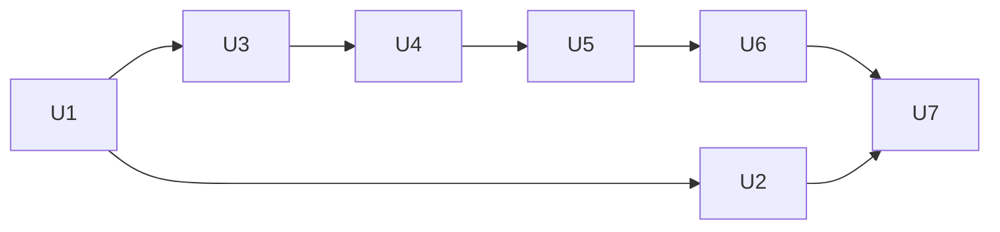

# #3995: 文脈の切り替えの 2 つの値（250,000・500,000）を 1 か所に置き、guard が知らせて止める実装計画

## 関連リンク

- 要求仕様: [issue-3995-requirements.md](./issue-3995-requirements.md)（正は #3995 の本文）。受け入れ条件は `3995:<番号>` で指す
- 設計書: [issue-3995-design.md](./issue-3995-design.md)、詳細設計書: [issue-3995-design-detail.md](./issue-3995-design-detail.md)。決定は設計書の番号（決定 1〜7）、テストは設計書の「テスト設計」の行と、詳細設計書の構成要素ごとの「単体テストの観点」の行で指す
- モード: `standard`（公開インタフェース（上限の設定のキー・`NDF_CONTEXT_LIMIT` の効く先・`ndf relay context resolve` の引数と結果）が変わり、触るファイルが 40 を超え、新設する関数が 9 ある。設計は main にマージ済み（#4041））
- 範囲の外: ラッパーが背景の作業の残る子を止めること（#4049）と #4052〜#4055 は、この計画に入れない

## 修正対象

詳細設計書の「地図」と、構成要素ごとの「関数の仕様」から引き写す。関数の名前と新設・変更・削除の区別は地図の行が正で、ここでは単位を割り当てるためにファイルごとにまとめる。パスは `plugins/ndf/` からの相対（`docs/glossary/` の 2 行だけはリポジトリの根から）。

| ファイル | 変える中身 | 単位 |
| --- | --- | --- |
| `src/ndf/domains/relay/context_thresholds.py`（新設） | `thresholds`・`Thresholds`・`DECIDE_FROM`・`LIMIT`・`ENV`。`CONTINUE`・`DENY`・`RESTART`・`REASONS`・`MIN_SAMPLES` を `context_policy` から移す | U1・U2 |
| `src/ndf/domains/relay/context_policy.py`（消す） | すべて | U2 |
| `src/ndf/domains/hooks/guards/context_limit.py` | 運用上限を `thresholds` から読む（U1）。`agent_id` と `_main` で外す（U3）。`_passes`・`_in_handoff`・`_ndf_args_pass`・`_reason`（U4）。`_notice`・`NOTICE_KEY`・`MEMO_KEY`・`MEMO_KEEP` と PostToolUse の分岐（U6） | U1・U3・U4・U6 |
| `src/ndf/domains/hooks/context.py` | `ShellScript` に `redirects`・`heredocs`・`assignments`、`Redirect` | U4 |
| `src/ndf/domains/hooks/dispatch.py` | `run` が `deny_key` が `none` の拒否を数えず、案内へ下げない | U5 |
| `src/ndf/domains/hooks/counter.py` | `remember`・`take` | U6 |
| `src/ndf/domains/relay/cli.py` | `wrapper_settings` の `context_limit` を `thresholds(...).limit` に | U1 |
| `src/ndf/domains/relay/switch_decide.py` | `HANDOVER_PROMPT` の文（U1 で転記の禁止と打ち直し・承認の回答の保留を足す。求める引継ぎ文書の Read と `ndf records handoff check` は guard が通すのと同じ単位にする） | U1・U4 |
| `src/ndf/domains/relay/cli_context.py` | `_context_resolve`・`_context_record`・`_context_report`・引数の定義（`--root`・`--policy` を消す） | U2 |
| `src/ndf/domains/relay/context_records.py` | `record_row(session_id, work, applied: Thresholds, event, reason)`。語を `context_thresholds` から引く | U2 |
| `src/ndf/domains/relay/context_report.py` | `no_policy_rows` を消す。語を `context_thresholds` から引く | U2 |
| `src/ndf/domains/statusline/statusline.sh` | `applied.json` を読む試行方式の分岐を消す | U2 |
| `src/ndf/checks/children.json` | S1e の `packages` から `ndf.domains.relay.context_policy` を外す | U2 |
| `contracts/limits.json` | `context.decide-from`（250000）・`context.limit`（500000）を足し、`hook.context-limit`・`relay.context` を消す | U1 |
| `contracts/domains/env.json` | `NDF_CONTEXT_LIMIT` の説明と `area`（U1）、`NDF_CONTEXT_POLICY` の行を消す（U2） | U1・U2 |
| `contracts/domains/ndf-files.json` | `context` の行を消す | U2 |
| `contracts/schemas/ndf-settings/context.schema.json`（消す） | すべて | U2 |
| `contracts/schemas/io/relay.args.schema.json`・`relay.result.schema.json` | `context resolve` の `--root`・`--policy`、結果の `policy`・`margin`・`config_error`・`no_policy_rows` を消し、`metrics.decide_from` を足す | U2 |
| `contracts/hooks/runtimes.json` | `claude` の `PreToolUse`・`PostToolUse` の `optional` に `agent_id` | U3 |
| `contracts/hooks/guards.json` | `context-limit` の `params.pass_tools`・`pass_ndf`（U4）、`deny_key` を `none`・`summary`（U5）、`events` に PostToolUse（U6） | U4・U5・U6 |
| `docs/contracts/env.md`・`files.md`・`ndf-settings.md`・`commands.md` | `ndf check --write-spec` で再生成（契約を変えた単位で再生成する） | U1・U2 |
| `README.md` | hook の表の `context-limit` の行 | U7 |
| `skills/development-workflow/references/context-window.md`・`parallel.md`・`relay.md`・`glossary.md`・`work-vessels.md`、`skills/development-workflow/SKILL.md`、`skills/statusline/SKILL.md` | 詳細設計書の「契約と手順書」の行のとおり | U7 |
| `docs/glossary/glossary.json`・`docs/glossary.md`（再生成） | 設計書の「用語」の表（意味の変更 2・廃止 4） | U7 |
| `tests/domains/relay/test_context_thresholds.py`（新設）・`test_context_policy.py`（消す）・`test_relay_decide.py`・`test_relay_cli_parse.py`・`test_context_report.py` | 各単位のテスト | U1・U2・U4 |
| `tests/domains/hooks/test_guards.py`・`test_dispatch.py`・`test_context.py`・`test_counter.py` | 各単位のテスト | U1・U3〜U6 |

## タスク分解

種類は機能追加なので、最初のタスクは今の振る舞いを縛る退行テストにする（Task 1）。ほかのタスクの進め方は、どれも失敗するテスト → 通す最小実装 → 整理（`tdd-cycle`）である。例外は Task 1（今の振る舞いを縛るので初めから通る）と Task 13・14（手順書と用語集）で、理由はそれぞれのタスクに書く。

テストは手元で打たず、単位の PR の CI で走らせる（`.ndf/project.json` の `test.ci.only`。合否は `gh pr checks <PR>` で読む）。静的解析（`bash scripts/check-lint.sh`・`python3 scripts/check-ndf-contracts.py`・`python3 scripts/check-script-structure.py`・`plugins/ndf/bin/ndf check`）は手元で打ってよい。文脈の量は偽の会話の記録（最後の応答の `usage`）で与え、境界の値（249,999 / 250,000 / 499,999 / 500,000）と呼び出しの回数で判定する。時刻はラッパーも dispatch も差し替えた時計で進め、時間で区切るテストを書かない（`3995:16`）。`.md` の文言を照らすテストは書かない（`AGENTS.md` の DON'T）。

### Task 1: 判定の記録の集計と較正、ラッパーの 1 セグメント 1 度を今のまま縛る（U1 の最初）

- **対象ファイル:** `tests/domains/relay/test_context_policy.py`・`tests/domains/relay/test_context_report.py`・`tests/domains/relay/test_relay_decide.py`
- **変更内容:** `test_context_policy.py` の記録・較正・集計のテスト（`test_recorded_work_normalizes_issue_numbers`・`test_append_and_read_skip_broken_lines`・`test_estimate_*`・`test_calibrate_*`・`test_cli_record_*`）を、`context_policy` に依らない形で `test_context_report.py` へ移す。旧い行（`policy`・`margin`・`config_error` を持つ）だけの記録で `report` の区分と `calibrate` の見込みを縛るテストを足す。ラッパーが同じセグメントで 2 度目の引継ぎを求めないことのテストが無ければ足す
- **満たす受け入れ条件:** 無し（決定 1 の代償「新旧の行を混ぜても集計と較正は変わらない」と `3995:7` の「1 セグメントに 1 度」の退行の土台）
- **進め方:** 退行テストなので初めから通る。移した後に CI で同じ数のテストが通ることを確かめる

### Task 2: 2 つの値を解く関数（U1）

- **対象ファイル:** `src/ndf/domains/relay/context_thresholds.py`（新設）・`contracts/limits.json`・`tests/domains/relay/test_context_thresholds.py`（新設）
- **変更内容:** 詳細設計書の「2 つの値を解く関数（`context_thresholds`）」のとおり `thresholds(environ, value)` と `Thresholds` を作り、`limits.json` に `context.decide-from`・`context.limit` を足す。`hook.context-limit`・`relay.context` は読み手を移す Task 3 で消す
- **満たす受け入れ条件:** `3995:1`・`3995:9`（関数の側）
- **進め方:** 失敗するテスト（詳細設計書の `thresholds` の「単体テストの観点」の行: 既定・`NDF_CONTEXT_LIMIT` の 250000 / 249999 / 300000・誤った値 5 つ・逆の値）→ 通す最小実装 → 整理

### Task 3: guard とラッパーが 2 つの値を読む（U1）

- **対象ファイル:** `src/ndf/domains/hooks/guards/context_limit.py`・`src/ndf/domains/relay/cli.py`・`contracts/limits.json`・`contracts/domains/env.json`・`docs/contracts/env.md`（再生成）・`tests/domains/hooks/test_guards.py`・`tests/domains/relay/test_relay_decide.py`
- **変更内容:** guard の運用上限を `thresholds(ctx.env, tables.policy_value).limit` に、`wrapper_settings` の `context_limit` を `thresholds(dict(os.environ), limits.value).limit` にし、`limits.json` から `hook.context-limit`・`relay.context` を消す。`HANDOVER_PROMPT` には転記の禁止（`--set` の値と、`next`・`routes` を含む再開・再試行・承認のコマンド）と、打ち直し・承認の回答の保留（引継ぎ中の会話は利用者に問わず、保留した操作と取得元を引継ぎ文書に残し、次のセグメントが照らし合わせられない操作の前に確かめる）だけを足す（PR 4216 の cross-review r10-1〜r10-3。ラッパーは U1 から 500,000 で子を止めて `--set` を含む結果が見える会話を `--resume` するため）。新しい文が求める `ndf records handoff check` と引継ぎ文書の Read の案内は U1 の guard が止めるので、通す Task 8 と同じ単位で足す。`env.json` の `NDF_CONTEXT_LIMIT` の説明と `area` を直して `ndf check --write-spec` で `env.md` を再生成する。guard の止め方（数えて 3 回目に案内へ下がる・通すのは引継ぎ文書の Write/Edit だけ）は U3〜U5 まで今のまま
- **満たす受け入れ条件:** `3995:4`、`3995:7` の判定の側（求める文の側は Task 8）、`3995:1`・`3995:9` の guard とラッパーの側
- **進め方:** 失敗するテスト（設計書のテスト設計の 7 の行と 4・9 の guard の行: PreToolUse の 249,999・250,000・499,999 で止めず 500,000 で止める、`NDF_CONTEXT_LIMIT=300000` で 300,000 で止め 299,999 で止めない。ラッパーは 500,000 で `handover`・499,999 で `wait`・`NDF_CONTEXT_LIMIT=300000` の環境から組んだ設定で 300,000 / 299,999。上限の設定の 2 つの値を差し替えると guard とラッパーの判定が差し替えた値を使う）→ 通す最小実装 → 整理

### Task 4: `ndf relay context` の resolve・record・report を 2 つの値へ（U2）

- **対象ファイル:** `src/ndf/domains/relay/cli_context.py`・`context_records.py`・`context_report.py`・`context_thresholds.py`（語を移す）・`contracts/schemas/io/relay.args.schema.json`・`relay.result.schema.json`・`docs/contracts/commands.md`（再生成）・`tests/domains/relay/test_relay_cli_parse.py`・`test_context_report.py`・`test_context_thresholds.py`
- **変更内容:** 詳細設計書の「ラッパーと `ndf relay context`」のとおり `_context_resolve`・`_context_record`・`_context_report`・`record_row` を変え、`--root`・`--policy` を消す。`CONTINUE`・`DENY`・`RESTART`・`REASONS`・`MIN_SAMPLES` を `context_thresholds` へ移し、`context_records`・`context_report` はそこから引く。結果のスキーマを直す
- **満たす受け入れ条件:** `3995:1`（`resolve` の側）・`3995:3`・`3995:9`（`resolve` の側）
- **進め方:** 失敗するテスト（テスト設計の 3 の行と、詳細設計書の `_context_resolve`・`record_row`・`report`・`calibrate` の行: 既定の 250,000 / 500,000・出所 `default`、`NDF_CONTEXT_LIMIT=300000`、出した JSON がスキーマを通る、`--policy current`・`--root .` は終了コード 2、新しい行に 3 つの列が無い、旧い行と新しい行を混ぜた記録の `report` と `calibrate` が Task 1 の旧い行だけのときと同じ）→ 通す最小実装 → 整理

### Task 5: 再起動の方針と設定の形を消す（U2）

- **対象ファイル:** `src/ndf/domains/relay/context_policy.py`（消す）・`src/ndf/domains/statusline/statusline.sh`・`src/ndf/checks/children.json`・`contracts/domains/env.json`・`contracts/domains/ndf-files.json`・`contracts/schemas/ndf-settings/context.schema.json`（消す）・`docs/contracts/env.md`・`files.md`・`ndf-settings.md`（再生成）・`tests/domains/relay/test_context_policy.py`（消す）・`test_context_thresholds.py`
- **変更内容:** 決定 1 で消すものを消す。`NDF_CONTEXT_POLICY` の行・`ndf-files.json` の `context` の行・`children.json` の S1e の `context_policy`・statusline の試行方式の分岐（500k、窓 200K 以下は 150k の赤は残す）。`test_context_policy.py` は Task 1・4 で移し終えた残りを消す
- **満たす受け入れ条件:** `3995:2`・`3995:10`（契約の側: `env.json`・`context.schema.json`）
- **進め方:** 失敗するテスト（テスト設計の 2 の行: 上限の設定に 2 つの旧い行が無い、`ndf.domains.relay.context_policy` を import できない、`context.schema.json` が無い）→ 消す → `ndf check`（`child-deps` を含む）を手元で通す → 整理。終わりの条件に要求の `git grep -n -E "800000|800_000|200_000|400_000" -- plugins/ndf/src plugins/ndf/contracts` に文脈の切り替えの閾値の行が無いことを足す

### Task 6: サブエージェントと NDF の外の会話を判定しない（U3）

- **対象ファイル:** `src/ndf/domains/hooks/guards/context_limit.py`・`contracts/hooks/runtimes.json`・`tests/domains/hooks/test_guards.py`
- **変更内容:** `check` の頭で入力の `agent_id` があれば None、`_main(ctx.cwd)` が None なら会話の記録を読まずに None にする。`_main` は詳細設計書の (a)〜(c) の規則で求め、git のコマンドを起動しない。`runtimes.json` の `optional` に `agent_id` を足す
- **満たす受け入れ条件:** `3995:15`（テスト設計の 4・6 の対象の行も）
- **進め方:** 失敗するテスト（詳細設計書の `_main` の行と、`check` の異常の列: `agent_id` つきは 600,000 の PreToolUse でも None、`agent_type` だけなら判定、`usage` が無ければ None、Git の管理の外と `.ndf` の無いリポジトリで `read_tail` を呼ばない、worktree の `cwd` はメインディレクトリの `.ndf` で決まる、`git init --separate-git-dir` のメインディレクトリと linked worktree の扱い）→ 通す最小実装 → 整理

### Task 7: Bash の構文木からリダイレクト・ヒアドキュメント・変数の代入を読む（U4）

- **対象ファイル:** `src/ndf/domains/hooks/context.py`・`tests/domains/hooks/test_context.py`
- **変更内容:** `ShellScript` に `redirects`（`Redirect` の組）・`heredocs`・`assignments` を足し、`_walk` が外側のスクリプトから集める（詳細設計書の「`ShellScript` の変更」の表）。どの構文木の節を見るかは、`tdd-cycle` で構文木を走らせて決める
- **満たす受け入れ条件:** `3995:6` の前提（Task 8 が使う）
- **進め方:** 失敗するテスト（詳細設計書の `ShellScript` の行: `2>&1 >/dev/null` が 2 つの組、`cat <<EOF` が `heredocs` 1、`> >(cat)`・`> "$F"` が `dynamic`、`GIT_DIR=x ndf a`・`GIT_DIR=x; ndf a` が `assignments` 1）→ 通す最小実装 → 整理

### Task 8: 運用上限でも引継ぎに要る呼び出しを通す（U4）

- **対象ファイル:** `src/ndf/domains/hooks/guards/context_limit.py`・`src/ndf/domains/relay/switch_decide.py`・`contracts/hooks/guards.json`・`tests/domains/hooks/test_guards.py`・`tests/domains/relay/test_relay_decide.py`
- **変更内容:** `_next_step` を `_passes` に置き換え、`_in_handoff`・`_ndf_args_pass` を足す。`guards.json` の `context-limit` に `params.pass_tools`（TaskStop）・`pass_ndf`（`records handoff check`・`relay context record` と許す引数）を足す。許すリダイレクトは詳細設計書の 2 つの形だけ。`HANDOVER_PROMPT` に引継ぎ文書の Read・`ndf records handoff check`・オーガナイザーの `wait` の行の案内を足して詳細設計書の文にする（文が求める呼び出しを通すのと同じ単位で入れる。U1 の PR 4216 の cross-review r1-1。転記の禁止と保留は U1 で入れた）
- **満たす受け入れ条件:** `3995:6`（通す呼び出しの側）・`3995:7`（求める文の側）
- **進め方:** 失敗するテスト（詳細設計書の `_passes` の行の通る例と止める例をすべて、`_ndf_args_pass` と CLI の更新先の行: 一時のメインディレクトリ・worktree・リンクの組で、真になった引数を `ndf records … handoff check --trim` で実際に打つと更新されたファイルがいつもメインディレクトリの `.ndf/handoff` の下にあり、`base` が `records/cli.py` の `_root` と等しい。`HANDOVER_PROMPT` が `wait` の行・`ndf records handoff check`・`ndf plan` の工程が動き続け得ること・`--set` の値と再開・再試行・承認のコマンド（`next`・`routes` を含む）を写さず取得元を残すこと・`ndf plan` の打ち直しと承認の回答を引継ぎ中の会話で送らず利用者にも問わないこと・保留した操作と取得元を引継ぎ文書に残し次のセグメントが照らし合わせられない操作の前に利用者に確かめることを含み、背景の作業が止まった・終わったとは書かない）→ 通す最小実装 → 整理

### Task 9: 拒否の文に背景の作業の扱いと引継ぎの手順を書く（U4）

- **対象ファイル:** `src/ndf/domains/hooks/guards/context_limit.py`・`tests/domains/hooks/test_guards.py`
- **変更内容:** `_reason(t, under_relay, handoff_dir)` を足し、詳細設計書の文（中継の下と外）にする。文に文脈の量を入れず、600 字以下にする
- **満たす受け入れ条件:** `3995:8`・`3995:6`（止める理由の文の側）
- **進め方:** 失敗するテスト（テスト設計の 8 の行と `check` の正常の列: 文が監視を TaskStop で止め supervisor を待つこと・戻った `wait` の行を残すこと・`.ndf/handoff/parallel-<計画>.md`・中継の下は次のセグメントのブロック・外は `ndf-next` を含み、600 字以下。照らすのは Python の文字列の定数で、`.md` ではない）→ 通す最小実装 → 整理

### Task 10: 運用上限の拒否を数えずに止め続ける（U5）

- **対象ファイル:** `src/ndf/domains/hooks/dispatch.py`・`contracts/hooks/guards.json`・`tests/domains/hooks/test_dispatch.py`・`tests/domains/hooks/test_guards.py`
- **変更内容:** `run` が `spec.deny_key == "none"` の行の拒否で `counter.allow_deny` を呼ばず、案内へ下げないようにする。`context-limit` の `deny_key` を `none` に、`summary` を詳細設計書の文にする
- **満たす受け入れ条件:** `3995:6`（止め続ける側）・`3995:11`（`NDF_HOOK_OFF=context-limit` の口の側）
- **進め方:** 失敗するテスト（詳細設計書の `run` の行: `deny_key` が `none` の拒否は違う呼び出しで 3 回続けても 3 回とも `deny`・数え手が使えなくても `deny`、`reason` の guard は今のとおり 3 回目に下がる、実際の `guards.json` で PreToolUse の Bash・Read の `select` の先頭が `context-limit`、差し替えた時計で締め切りを越えても `context-limit` の判定が残る、`_deadline_out` の 3 つの行。テスト設計の 11 の行: `NDF_HOOK_OFF=context-limit` で 600,000 でも判定も知らせもしない）→ 通す最小実装 → 整理

### Task 11: 状態のファイルに Tool の呼び出しごとの値を覚える（U6）

- **対象ファイル:** `src/ndf/domains/hooks/counter.py`・`tests/domains/hooks/test_counter.py`
- **変更内容:** `Counter.remember(key, item, value, keep)`・`Counter.take(key, item)` を足す。`memo` は `_fresh` に足さない（詳細設計書の「内部のデータと定数」の `memo` の行）
- **満たす受け入れ条件:** `3995:5` の前提（Task 12 が使う）
- **進め方:** 失敗するテスト（詳細設計書の `remember`・`take` の行: 次の `Counter.open` で取り出せる・取り出した後は None・`keep` を超えると最も古い値だけ消える・`reset("human")` の後の `remember` で前の入力の値が消え `reset("relay")` の後は残る・`memo` を持たない今の状態のファイルで `usable` が真のまま `take` が None・数え手が使えないときと形が違うとき）→ 通す最小実装 → 整理

### Task 12: 判断開始の値を超えたことを PostToolUse で 1 度知らせる（U6）

- **対象ファイル:** `src/ndf/domains/hooks/guards/context_limit.py`・`contracts/hooks/guards.json`・`tests/domains/hooks/test_guards.py`
- **変更内容:** `context-limit` の `events` に PostToolUse を足し、`check` に詳細設計書の「処理の手順」の PostToolUse の行と PreToolUse で覚える行を足す。`_notice`・`NOTICE_KEY`・`MEMO_KEY`・`MEMO_KEEP` を足す
- **満たす受け入れ条件:** `3995:5`・`3995:16`（境界の値と回数のテストがここでそろう）
- **進め方:** 失敗するテスト（テスト設計の 5 の行と詳細設計書の `check` の境界値の列: 249,999 で出ない・250,000 の 1 回目に出る・同じ入力の 2 回目は出ない・`reset("human")` の後は出て `reset("relay")` の後は出ない・500,000 と PreToolUse では出ない・知らせた後の PostToolUse 10 回で `read_tail` 0 回・200,000 の組 10 回で 10 回・並列の `Pre(A) → Pre(B) → Post(A) → Post(B)` で 2 回・知らせた後の組で `memo` の項目が増えない・数え手が使えなければ知らせず読まない・文が 600 字以下）→ 通す最小実装 → 整理。あわせて、設計書の「未確認のまま残ること」の 2 行目のとおり、hook の計測の記録（`ms`）から PostToolUse の所要時間の p95 を変更の前後で比べ、予算（`hook.budget.post-tool-use`）に収まるかを U6 の PR の本文に書く（合否を時間で決めるテストにはしない）

### Task 13: 手順書と README を 2 つの値と guard の振る舞いへ直す（U7）

- **対象ファイル:** `README.md`・`skills/development-workflow/references/context-window.md`・`parallel.md`・`relay.md`・`glossary.md`・`work-vessels.md`・`skills/development-workflow/SKILL.md`・`skills/statusline/SKILL.md`
- **変更内容:** 詳細設計書の「契約と手順書」の表の各行のとおり書き直す。U1〜U6 で入った振る舞いだけを書く。`NDF_CONTEXT_GUARD` を `NDF_HOOK_OFF=context-limit` に書き換え、`scripts/lib/token-guard-stages.txt` の参照と「再起動の方針」のセクションを消す
- **満たす受け入れ条件:** `3995:10`・`3995:11`（`git grep` が 0 件の側）・`3995:12`・`3995:13`・`3995:14`
- **進め方:** テスト駆動を当てない（文書。文言のテストを書かない）。終わりの条件は、`git grep -n NDF_CONTEXT_GUARD -- plugins/ndf` が 0 件、`git grep -n -E "200,000|200K|20 万" -- plugins/ndf/skills` に文脈の切り替えの閾値を指す行が無い、`git grep -n token-guard-stages -- plugins/ndf` が 0 件、`python3 scripts/check-markdown-links.py` が通る、ドキュメントレビューで手順書の主張（止める範囲・通す呼び出し・知らせの回数・切りどころ）を 1 つずつ `context_limit.py`・`guards.json` と照らすこと

### Task 14: 用語集に意味の変更と廃止を反映する（U7）

- **対象ファイル:** `docs/glossary/glossary.json`・`docs/glossary.md`（再生成）
- **変更内容:** 設計書の「用語」の表のとおり、判断開始の値・運用上限の意味を変え、再起動の方針・現行方式・試行方式・適用値を廃止にする。`ndf records glossary render` で再生成し、`ndf records glossary meanings` で確かめる
- **満たす受け入れ条件:** 無し（設計書の「用語」の表と「文脈と制約」の用語集の反映）
- **進め方:** テスト駆動を当てない（用語集のデータ）。終わりの条件は `ndf records glossary render --check` が通ること

## レビューの単位

課題を依存の向きで 7 つの単位に分ける。1 つの単位にしない理由は、見込みの差分が合わせて約 2,600 行で 1,000 行を超えるためである（guard の通す呼び出しの境界の例が多く、テストだけで約 1,000 行になる）。どの単位も単独で CI が通り、終えた後も guard とラッパーが動く。止め続ける（U5）は、引継ぎに要る呼び出しを通す（U4）の後に置き、引継ぎ文書を Read できないまま止め続ける状態をスプリントブランチに作らない。行数は `git diff --shortstat <ベース>...HEAD -- . ':(exclude)uv.lock' ':(exclude)plugins/ndf/docs/contracts' ':(exclude)docs/glossary.md'` で数える（`docs/contracts/*.md` は `ndf check --write-spec`、`docs/glossary.md` は `ndf records glossary render` の生成物）。

| 単位 | 含むタスク | 満たす受け入れ条件 | 見込みの差分の行数 | 実際の行数 |
| --- | --- | --- | --- | --- |
| U1 2 つの値を解く関数と guard・ラッパー | Task 1・2・3 | 3995:4 | 約 400 | 14 files changed, 451 insertions(+), 202 deletions(-)（plugins の下。cross-review r1-1 で `HANDOVER_PROMPT` を U4 へ移した後）（うち約 190 行は test_context_policy.py から test_context_report.py へ移したテストで、足した行と消した行の両方に数えられる） |
| U2 再起動の方針の撤去と `ndf relay context` | Task 4・5 | 3995:1・3995:2・3995:3・3995:9 | 約 750（うち削除が約 450） | （実装の後に書き足す） |
| U3 サブエージェントと NDF の外を外す | Task 6 | 3995:15 | 約 250 | （実装の後に書き足す） |
| U4 引継ぎに要る呼び出しと拒否の文 | Task 7・8・9 | 3995:7・3995:8 | 約 550 | （実装の後に書き足す） |
| U5 止め続ける | Task 10 | 3995:6 | 約 150 | （実装の後に書き足す） |
| U6 判断開始の値の知らせ | Task 11・12 | 3995:5・3995:16 | 約 400 | （実装の後に書き足す） |
| U7 手順書・README・用語集 | Task 13・14 | 3995:10・3995:11・3995:12・3995:13・3995:14 | 約 300 | （実装の後に書き足す） |

U2 は 400 行を超えるが、大半は `context_policy.py`・`test_context_policy.py`・`context.schema.json` の削除で、振る舞いを足す差分は約 300 行である。U4 は 400 行を超える見込みで、600 行を越えたら Task 7（`ShellScript`）を先の単位へ分け直す。単位の PR の acceptance には、その単位で初めてそろう条件だけを渡す。またがる条件は後の単位の側で渡す（`3995:1`・`3995:9` は U1 で guard とラッパー、U2 で `resolve` がそろう。`3995:6` は U4 で通す呼び出しと文、U5 で止め続ける振る舞いがそろう。`3995:7` は U1 で引継ぎを求める判定、U4 で求める文がそろう。`3995:10`・`3995:11` は U2 で契約、U7 で手順書がそろう。`3995:16` は U1〜U6 の境界のテストが U6 でそろう）。

### 単位ごとの touches の候補

オーガナイザーがレーンの touches を広げるときの候補である。パスはリポジトリの根から。ほかの単位と同じファイルを持つ行には、重なる単位を添える。

| 単位 | touches の候補 |
| --- | --- |
| U1 | `plugins/ndf/src/ndf/domains/relay/context_thresholds.py`・`plugins/ndf/src/ndf/domains/hooks/guards/context_limit.py`（U3・U4・U6）・`plugins/ndf/src/ndf/domains/relay/cli.py`・`plugins/ndf/contracts/limits.json`・`plugins/ndf/contracts/domains/env.json`（U2）・`plugins/ndf/docs/contracts/*.md`（U2）・`plugins/ndf/tests/domains/relay/test_context_thresholds.py`（U2）・`plugins/ndf/tests/domains/relay/test_context_policy.py`（U2）・`plugins/ndf/tests/domains/relay/test_context_report.py`（U2）・`plugins/ndf/tests/domains/relay/test_relay_decide.py`（U4）・`plugins/ndf/tests/domains/hooks/test_guards.py`（U3〜U6） |
| U2 | `plugins/ndf/src/ndf/domains/relay/context_*.py`（`context_policy.py` の削除・`context_thresholds.py`・`context_records.py`・`context_report.py`）・`plugins/ndf/src/ndf/domains/relay/cli_context.py`・`plugins/ndf/src/ndf/domains/statusline/statusline.sh`・`plugins/ndf/src/ndf/checks/children.json`・`plugins/ndf/contracts/domains/env.json`・`plugins/ndf/contracts/domains/ndf-files.json`・`plugins/ndf/contracts/schemas/ndf-settings/context.schema.json`・`plugins/ndf/contracts/schemas/io/relay.*.schema.json`・`plugins/ndf/docs/contracts/*.md`・`plugins/ndf/tests/domains/relay/test_context_*.py`・`plugins/ndf/tests/domains/relay/test_relay_cli_parse.py` |
| U3 | `plugins/ndf/src/ndf/domains/hooks/guards/context_limit.py`・`plugins/ndf/contracts/hooks/runtimes.json`・`plugins/ndf/tests/domains/hooks/test_guards.py` |
| U4 | `plugins/ndf/src/ndf/domains/hooks/context.py`・`plugins/ndf/src/ndf/domains/hooks/guards/context_limit.py`・`plugins/ndf/src/ndf/domains/relay/switch_decide.py`・`plugins/ndf/contracts/hooks/guards.json`（U5・U6）・`plugins/ndf/tests/domains/hooks/test_context.py`・`plugins/ndf/tests/domains/hooks/test_guards.py`・`plugins/ndf/tests/domains/relay/test_relay_decide.py` |
| U5 | `plugins/ndf/src/ndf/domains/hooks/dispatch.py`・`plugins/ndf/contracts/hooks/guards.json`・`plugins/ndf/tests/domains/hooks/test_dispatch.py`・`plugins/ndf/tests/domains/hooks/test_guards.py` |
| U6 | `plugins/ndf/src/ndf/domains/hooks/counter.py`・`plugins/ndf/src/ndf/domains/hooks/guards/context_limit.py`・`plugins/ndf/contracts/hooks/guards.json`・`plugins/ndf/tests/domains/hooks/test_counter.py`・`plugins/ndf/tests/domains/hooks/test_guards.py` |
| U7 | `plugins/ndf/README.md`・`plugins/ndf/skills/development-workflow/SKILL.md`・`plugins/ndf/skills/development-workflow/references/{context-window,parallel,relay,glossary,work-vessels}.md`・`plugins/ndf/skills/statusline/SKILL.md`・`docs/glossary/glossary.json`・`docs/glossary.md` |

1 本のレーンで全単位を順に流すなら、touches はこの表の和（`plugins/ndf/src/ndf/domains/relay/**`・`plugins/ndf/src/ndf/domains/hooks/**`・`plugins/ndf/src/ndf/domains/statusline/statusline.sh`・`plugins/ndf/src/ndf/checks/children.json`・`plugins/ndf/contracts/**`・`plugins/ndf/docs/contracts/**`・`plugins/ndf/tests/domains/relay/**`・`plugins/ndf/tests/domains/hooks/**`・`plugins/ndf/README.md`・`plugins/ndf/skills/development-workflow/**`・`plugins/ndf/skills/statusline/SKILL.md`・`docs/glossary/**`・`docs/glossary.md`）で足りる。

### 順序と依存

| 順 | 単位 | 先に要る単位 | 理由 |
| --- | --- | --- | --- |
| 1 | U1 | 無し | `thresholds` をほかのすべての単位が使う。旧い 2 つの行の読み手を移してから消す |
| 2 | U2 | U1 | `resolve`・`record` が `thresholds` を使い、記録の語を `context_thresholds` へ移す |
| 2 | U3 | U1 | `context_limit.py` は U1 で `thresholds` を読む形になっている |
| 3 | U4 | U3 | `_in_handoff`・`_ndf_args_pass` は U3 の `_main` を使う |
| 4 | U5 | U4 | 引継ぎに要る呼び出しを通してから止め続ける（逆にすると、間の状態で引継ぎ文書を Read できないまま止まる） |
| 5 | U6 | U5 | 同じ `context_limit.py`・`guards.json` の `context-limit` の行を触る。知らせは U3 の外し方の後に積む |
| 6 | U7 | U2・U6 | 手順書は入った振る舞いだけを書く |

並べてよいのは、触るファイルが重ならない U2 と U3〜U6 だけである（U2 は relay・statusline・契約の設定の形、U3〜U6 は hook）。U2 と U1 は `env.json`・`docs/contracts`・relay のテストを共に触るので、U2 は U1 の後に流す。U3〜U6 は `context_limit.py`・`test_guards.py` を共に触るので順に流す。

## リファクタリングの時機

| 時機 | 対象 | 理由 |
| --- | --- | --- |
| 実装の前（準備のリファクタリング） | しない | 最も大きい触るファイルは `hooks/context.py` 577 行で 14 タスク中 1 タスク（Task 7）だけが触り、`test_context.py` 324 行が覆う。最も集中する `guards/context_limit.py` は 14 タスク中 5 タスク（36%）が触るが 40 行で、`test_guards.py` に 33 件のテスト（うち `context-limit` は 3 件）がある。`relay/cli.py` 482 行は `wrapper_settings` の 1 行だけ。ほかの触るコードは 450 行以下 |
| 実装の中 | 各タスクで行う | `tdd-cycle` のリファクタリングのステップ |
| スプリントの終わり（cross-refactoring） | `guards/context_limit.py` の大きさと責務の分かれ目（U3・U4・U6 が 40 行から約 250 行へ育てる。`_main`・`_in_handoff`・`_ndf_args_pass` のパスの解決を guard の判定から分けるか）、`_main` と `core/converge/location.py` の `main_worktree`・`_ndf_args_pass` の `base` と `records/cli.py` の `_root` の同じ規則の重なり | 3 つの単位が同じ `context_limit.py` を触る。メインディレクトリと作業ツリーの根を求める規則が、hook の経路（git を起動しない）と CLI の経路（git を起動する）の 2 か所に置かれる |

## リスクと対処

| リスク | 対処 |
| --- | --- |
| 同じファイルを触る別の変更（中継のアカウントの切り替え #3604 #3864 が `relay/cli.py`・`switch_decide.py` を触る） | U1 を始める前に `gh pr list --state open --json number,files` で触るファイルを打ち直し、重なる PR があれば conductor へ知らせて順を決める |
| `ShellScript` の構文木の節の名前が詳細設計書の想定と違う | Task 7 で構文木を走らせて決める（詳細設計書の「見分け方は `tdd-cycle` で構文木を走らせて決める」）。集める項目と意味を変えずに済まないときは、実装を止めて設計へ戻す |
| PostToolUse の所要時間が予算を超える | 締め切りを過ぎても知らせが出ないだけで止める側は変わらない（設計書の「未確認のまま残ること」）。Task 12 で測った p95 を U6 の PR に書き、超えるなら conductor へ返す |
| U3〜U6 の間のスプリントブランチの guard が中途の形になる | U1 の後は値だけが下がり今の止め方のまま、U4 は通す呼び出しを広げるだけ、U5 で止め続ける。どの時点でも引継ぎ文書を書ける（U5 を U4 の前に流さない） |
| 見込みの行数が外れる | 実装の途中で単位を分け直し、この表を直す |
| 実装の細部で設計の判断が変わる指摘が出る | 単位の PR のレビューで扱い、決定・受け入れ条件を変える指摘なら実装を止めて設計へ戻す |

## 切り戻し手順

- 単位ごとに PR を revert すれば戻る。データの移行は無い。判定の記録の新しい行は 3 つの列を持たないだけで、旧い版の読み手（`report`・`calibrate`）も読める
- U5 を戻すと拒否が 3 回目から案内へ下がる形に戻る。U4 を戻すときは U5・U6 を先に戻す（止め続けたまま通す呼び出しが狭まるのを避ける）
- U2 を戻すと `context_policy` と `.ndf/context.json` の読み手が戻るが、U1 の `limits.json` の旧い 2 行は戻らないので、U2 だけを戻すときは `resolve` の値が `context_policy` の既定に戻る（guard とラッパーは U1 のまま 500,000）

## 完了の定義

- [ ] 受け入れ条件 3995:1〜16 をすべて満たし、条件ごとに設計書の「テスト設計」の行のテストと結果（単位の PR の CI）が対応している。2 の `git grep`・10・11 の後半・12・13・14 は `git grep` とドキュメントレビューで見る
- [ ] Task 12 の PostToolUse の所要時間の比べが U6 の PR の本文にある
- [ ] `standard` の検証の段階（`quality-gates`）。単位ごとの cross-review の収束、スプリントの完了判定

## 実装の前に今のコードと照らした結果（2026-11-23）

main は lracct（11.0.16）と lcrfast（11.0.17）で変わった。U1 の実装の前に、計画と詳細設計書の前提（ファイル・関数・行番号）をスプリントブランチの `f5af5a8d5` と照らした。扱いの列の「U1 で」は U1 の PR に入れたもの。

#4089（`last_context`）の実装はこのスプリントに入れない。U1〜U6 は `context_tokens` の呼び出し箇所を増やさない形で書く（#3995 の範囲を守るため）

| 計画の前提 | 今のコード | 扱い |
| --- | --- | --- |
| `relay/cli.py` は 482 行で、`wrapper_settings` の `context_limit` の 1 行だけを触る | 487 行。`context_limit=int(limits.value("relay.context", "count"))` は 307 行目 | 行番号だけの違い。U1 で 307 行目を `context_thresholds.thresholds(environ, limits.value).limit` にした |
| `statusline.sh` は `applied.json` を読む試行方式の分岐を消すだけ（U2） | lracct で費用・使用率の表示が足された | U1 では触らない。U2 で今の形に合わせて分岐だけを消す |
| `context_tokens` の呼び出しは guard の `check` の中の 1 か所 | `hooks/guards/context_limit.py`（`check`）・`relay/wrapper.py`（`observe.context_tokens`）・`crossreview/drive.py`（`claude.context_tokens`）の 3 か所 | U1 は増やさない（guard の `check` の 1 か所のまま）。#4089 で置き換える |
| `guards/context_limit.py` は 40 行 | 40 行（U1 の後は 42 行） | 違いは無い |
| guard が `context_thresholds` を import すれば足りる（詳細設計書の地図の依存） | hook のエントリポイントから import でたどれるモジュールは `contracts/hooks/imports.json` の `entry.modules` に限られ、`ndf.domains.relay.context_thresholds` は無い（`test_imports.py` が落とす） | U1 で `entry.modules` に `ndf.domains.relay.context_thresholds` を足した。標準ライブラリ（`re`・`typing`）だけに依存する |
| `context_thresholds.py` に定数 `ENV`（`NDF_CONTEXT_LIMIT`）を置く（詳細設計書の「内部のデータと定数」） | `ndf check` の `const-fact`（`table-str`）が、環境変数の表（`contracts/domains/env.json`）の `id` を最上位の定数へ写すことを落とす | U1 では `ENV` を置かず、`thresholds` の中で名前を字面で読む。名前の持ち主は環境変数の表のまま |
| `guards.json` の `context-limit` の `summary` は U5 で書き換える | 今の `summary` が消した `hook.context-limit` の名前を指す | U1 では消した名前の参照だけを「運用上限（上限の設定の context.limit・NDF_CONTEXT_LIMIT）」に直した。詳細設計書の文への書き換えは U5 のまま |
| Task 1: ラッパーが同じセグメントで 2 度目の引継ぎを求めないことのテストが無ければ足す | 既にある（`test_relay_decide.py` の `test_context_over_the_limit_asks_for_a_handover_once`、`test_relay_wrapper_question.py` の `test_a_resume_in_the_same_section_keeps_the_handover_asked`） | 足さない |
| Task 1: 移すテストは記録・較正・集計（`test_recorded_work_*`・`test_append_and_read_*`・`test_estimate_*`・`test_calibrate_*`・`test_cli_record_*`） | `test_context_dir_follows_the_legacy_state_root` も `context_policy` に依らない記録のテストで、U2 で `test_context_policy.py` を消すと失われる | U1 であわせて `test_context_report.py` へ移した |
| Task 3: `HANDOVER_PROMPT` を詳細設計書の文にする | U1 の guard は運用上限以上で引継ぎ文書の Write/Edit しか通さず、文が求める `ndf records handoff check` の Bash と引継ぎ文書の Read を止める（PR 4216 の cross-review r1-1）。設計書の「子を強制終了するので背景の作業が残らない」は事実と違い、`ndf plan queue` の工程は別のセッションで動き続けることがある（同 r1-2・r6-1・r6-2） | U1 で、文に `ndf plan` の工程が動き続け得ること・`--set` の値と再開・再試行・承認のコマンド（`runner.py` の `_result_of` が `inv.again` から組む `next` と `_routes` を含む）を写さず取得元だけを残すこと・`ndf plan` の打ち直しと承認の回答を引継ぎ中の会話で送らず利用者にも問わないこと・保留した操作と取得元を引継ぎ文書に残し、次のセグメントが照らし合わせられない操作を実行する前に利用者に確かめることを足した（同 r9-1〜r9-4・r10-1〜r10-3。ラッパーは U1 から 500,000 で子を止めて同じ会話を `--resume` するので U4 まで延ばさない。引継ぎ中に問うと回答待ちで切り替えが止まり、`relay.md` は `ndf-next` の前に確認を挟まない）。引継ぎ文書の Read と `ndf records handoff check` の案内は U1 の guard が止めるので、Task 8（U4）で `_passes` と同じ単位に入れる。文から「（背景の作業は終わった）」を外し、設計書の前提の行を事実に直した（文だけで、新しいコマンドは要らない。背景の作業が残る子を止めないのは #4049）。cross-review の r2〜r5・r7・r8 が求めた、引継ぎの後に `ndf plan` の実行を照らす手順（`src/ndf/core/plan/*` の変更を含む）は、承認済みの決定 4 を広げ touches の外なので取り込まない |
| hook のテストは `NDF_CONTEXT_LIMIT` を流す人の値から切り離している | `tests/domains/hooks/_hooks.py` の `ENV_NAMES` に無い | U1 で `ENV_NAMES` に足した（境界のテストが手元の値で揺れないように） |
| U1 の見込みの差分は約 400 行 | 実際は下の表の値。`test_context_policy.py` から `test_context_report.py` へ移したテスト（約 190 行）が足した行と消した行の両方に数えられる | 単位は分け直さない（振る舞いを足す差分は見込みの内） |
