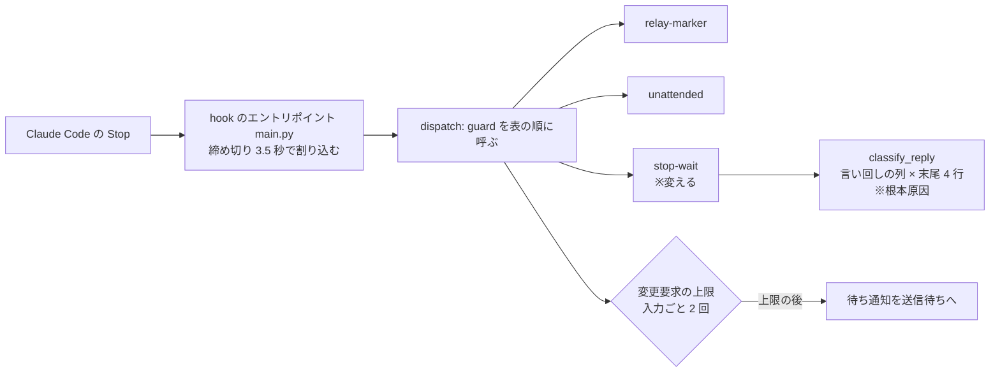
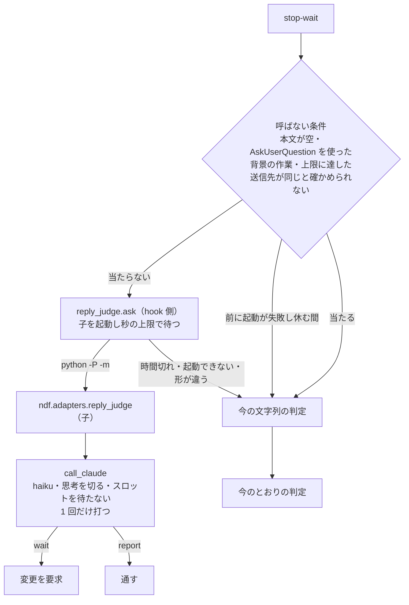
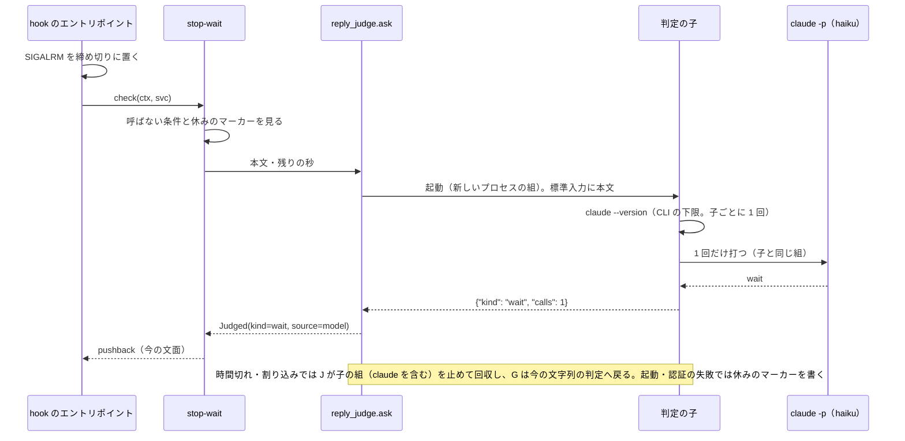

# stop-wait: 本文で人の回答を待って終えた応答を、言い回しと位置によらず軽いモデルで見分ける（#4000）

hook の guard `stop-wait` は、決まった言い回しの列と末尾 4 行だけで本文の待ちを見る。そのため、列に無い言い回しと、質問の後に報告が続く応答を 4 回見逃し、質問の引用を 1 回誤って止めた。直した後は、Stop の hook が最後の応答の本文全体を軽いモデル（思考を切った haiku の最小構成の `claude -p`）に渡す。Stop ごとに 1 回だけ打ち、モデルが「人の回答を待って終えている」（`wait`）と回答したら変更を要求する（同じ文を打ち直さない。決定 4）。モデルが回答しないときと呼ばない条件に当たる Stop（Codex のセッションなど送信先がセッション自身と同じと確かめられない Stop を含む）は今の文字列の判定で決める。採らなかった案（Claude Code の prompt 型の hook・背景から再開させる hook・列を足す）は「決定の記録」に、実測は「外部の調査」にある。

## 今の姿

何が起きたか・目的・受け入れ条件は要求仕様（[issue-4000-requirements.md](./issue-4000-requirements.md)、正は #4000 の本文）にある。この文書は「どう解くか」と「なぜその解き方か」だけを書く。

**根本原因は判定の仕組みそのものにある。** `classify_reply`（`plugins/ndf/src/ndf/domains/hooks/context.py`）は文字列の一致なので、次の 2 つを同時に満たせない。

- 見逃さないために列を広げ、範囲を本文全体へ広げるほど、質問の引用や別の場所の待ちの報告を誤って止める（誤検出の例は今の列と末尾 4 行でも起きた）
- 誤って止めないために列と範囲を絞るほど、応答を書く側の言い回しの数だけ見逃す（4 回とも別の言い回し）

設計に要る今の構造は次のとおりである。

| 項目 | 今の値と場所 |
| --- | --- |
| Stop の予算 | 締め切り 3.5 秒・余白 1.5 秒・登録の timeout 6 秒・p95 300 ms（`plugins/ndf/contracts/limits.json` の `hook.budget.stop`）。エントリポイントは締め切りで SIGALRM を打って guard を打ち切る |
| 予算の順序の検査 | guard の部品の上限（guard の表の `limits` の秒）≤ 締め切り − 余白 ≤ 登録の timeout（`ndf hooks check-budget`、`budget.py`） |
| hook の import の表 | hook の閉包が `ndf.adapters.claude`・`ndf.adapters.llm`・`jsonschema`・`httpx` を含むことを禁じる。hook の起動を軽く保つためである（`plugins/ndf/contracts/hooks/imports.json`、#3345 の決定 89） |
| hook が子を起動する前例 | 待ちの知らせなどの送信を担う送り手を `[sys.executable, "-P", "-m", <モジュール>]` で切り離して起動する（`outbox.kick`） |
| 既存の `claude -p` の起動 | `adapters/claude.py` の `ClaudeCall` と `call_claude`。判断の権限（`Permission.JUDGE`）は Tool を使わせない最小構成で、起動の前に学習に使わない設定の確かめ・重い起動のスロット・CLI の下限を通す |
| Stop の入力 | Claude Code は `last_assistant_message`（最後の応答の本文）・`stop_hook_active`（hook の変更要求で続いている最中か。この設計では使わない）・`background_tasks`（終わると会話を再開させる背景の処理）を渡す（`plugins/ndf/contracts/hooks/runtimes.json`）。Codex は `background_tasks` を渡さない |

## 文脈と制約

- **hook の import の表を変えない。** 表は hook の起動を軽く保つために `ndf.adapters.claude` を禁じている。軽いモデルの起動は hook のプロセスの外で行う
- **Stop の hook は会話の終わりごとに走る。** 2026-11-21〜23 のこの環境の Stop は 1 日 299〜822 回あり、待ちの秒と費用は回数に比例して効く
- **軽いモデルの回答は揺れる。** 同じ文に別の回答を返すことがある（実測で 1 つの例が 6 回中 1 回。MEA5）。揺れは文ごとに偏り、同じ文を打ち直しても独立には揺れない。回答が揺れても、見逃しを今より増やさず、誤って止める回数を上限（入力ごと 2 回）の内に収める
- **軽いモデルは思考を使うと遅い。** 思考を切らないと出力が 350〜7,473 token になり、1 回 17〜33 秒かかることがあった（外部の調査 MEA2）。思考を切ると 0.73〜1.51 秒で回答した（MEA3）
- **軽いモデルが使えない環境がある。** Codex だけを入れた環境・認証の切れた環境・学習に使わない設定を確かめられない環境では `claude` を起動できない。そこでも hook は今の判定で動き続ける

## 解き方の全体像

直した後は、`stop-wait` が Stop ごとに 1 回、最後の応答の本文（コードブロックを除く）を軽いモデルへ渡し、`wait` の回答で変更を要求する。軽いモデルの起動は hook の外の子プロセス（`ndf.adapters.reply_judge`）が既存の `call_claude` で行い、hook の側は標準ライブラリだけで子を起動して秒の上限で待つ。`claude` は判定の子と同じプロセスの組で起動し、hook の側が組ごと止めて回収する。呼ぶのは Claude Code のセッションで、送り先がセッション自身の Claude の API と同じと確かめられる Stop だけである（決定 11）。回答が得られないときは今の文字列の判定へ戻り、起動が続けて失敗する環境では休む間だけ呼ばない。呼ぶモデル・秒の上限・本文の字数の上限・休む間・確かめの周の数は `limits.json` の 1 行にある。質問の文を変えるときは、判定の例の組を実際のモデルで確かめる `ndf hooks judge-cases` を打つ。

## 構成要素

構成要素の名前に出てくる語のうち、このリポジトリの中だけで通じるものを 1 行で説明する。

| 語 | 意味 |
| --- | --- |
| guard | hook が呼ぶ判定の部品。`stop-wait` はそのうちの 1 つ |
| 変更要求（pushback） | 応答の終わりを認めず、AI へ直しを求める判定 |
| hook の閉包 | hook のエントリポイントから import でたどれるモジュールの集まり |

| 要素 | 責務 |
| --- | --- |
| guard `stop-wait`（変更） | 呼ばない条件を見て、軽いモデルの判定か今の文字列の判定かを選び、判定から変更要求か通過を返す。計測に判定の出所を残す |
| 判定のリクエスト（`ndf.domains.hooks.reply_judge`、新設。hook の閉包の中） | 本文から質問に渡す文を作り、子を起動して秒の上限で待ち、回答を読む。時間切れ・割り込みでは子の組を止めて回収する |
| 判定の子（`ndf.adapters.reply_judge`、新設。hook の閉包の外） | 質問の文を持ち、`call_claude` で軽いモデルを 1 回打ち、回答を 1 行の JSON で返す。認証の失敗に `auth` の種類を付ける。判定の例の組を確かめるコマンドの本体も持つ |
| 起動の前置き（`call_claude`・`launch_slot`、変更） | スロットを待つ上限と、`claude` を新しいプロセスの組で起動するかを呼び手が渡せるようにする（判定の子は 0 秒・呼び手と同じ組） |
| 変更要求の数え手（`Counter`、変更） | 数えずに、上限の手前かだけを返す。今の入力の中でモデルが `wait` と回答したことを持つ（上限の後の待ち通知に使う） |
| hook のエントリポイント（`main.py`）と dispatch（変更） | SIGALRM と同じ絶対時刻の締め切りを guard へ渡す |
| hook の文脈（`HookContext`、変更） | 最後の利用者の入力の後に AskUserQuestion を使ったかを会話の記録の末尾から読む |
| 休みのマーカー（状態の保存先のファイル、新設） | 起動が失敗した時刻を持ち、休む間のうちは子を起動させない（決定 10） |
| 設定（`limits.json`・`guards.json`・`hooks/*.json`、変更） | 判定の行を足し、Stop の予算を上げ、登録の timeout を作り直す |
| 判定の例の組（`plugins/ndf/contracts/hooks/reply-judge-cases.json`、新設） | 応答の例と期待の組 |
| `ndf hooks judge-cases`（新設） | 判定の例の組を実際のモデルで判定し、外れを出す |

## 処理の流れ

図の「呼ばない条件と休みのマーカーを見る」は、hook の文脈（ランタイム・AskUserQuestion を使ったか・背景の作業）・変更要求の数え手（上限の手前か）・休みのマーカー（前の起動の失敗の時刻）・残りの秒を読み、その後で送信先の確かめの hook の側（親の起動。決定 11）を読む。実効の設定の確かめは判定の子が `claude` の前に行う。子の `call_claude` はスロットを待たない前置きを通る。設定・判定の例の組・`ndf hooks judge-cases` は Stop の流れに乗らないので図に含めない。

## 非機能の実現方式

| 大項目 | 条件（要求） | 実現方式 |
| --- | --- | --- |
| 性能・拡張性 | 軽いモデルを呼ぶ Stop の待ちは秒の上限を超えない | 判定の上限 5 秒を、SIGALRM と同じ絶対時刻の締め切り（起動の時刻 ＋ 7 秒）から余白 1.5 秒を 1 回だけ引いた残りの内に置き、hook の側が子を上限で打ち切る。モデルを呼ぶ Stop が起動するプロセスは 3 つ（判定の子の python・`claude --version`・`claude -p`）。CLI の下限の確かめ（`cli_floor`）のバージョンの記録はプロセスの中にしか無く、判定の子は Stop ごとに新しいので毎回 `claude --version` を 1 回打つ。実測は子の起動 0.15〜0.2 秒 ＋ `claude --version` 0.007〜0.009 秒 ＋ 1 回 0.73〜1.51 秒（MEA3・MEA4・MEA7）で、打つのは 1 回である（決定 4） |
| 運用・保守性 | 直すのは質問の文と判定の例の組の 2 つ | 質問の文は子のモジュールの定数、組はコントラクトのファイルにあり、`ndf hooks judge-cases` が各例を 3 周打って組を確かめる |
| セキュリティ | 学習に使わない設定を通らない起動をしない。本文を送る先はセッション自身が使う Claude の API と同じ | 子は `call_claude` の前置き（学習の設定の確かめ）をそのまま通す。送り先が同じと確かめられる Stop（Claude Code のセッションで、起動の引数・設定ファイルのキー・設定の `env` のどれでも接続を切り替えていないと確かめられる）だけで呼び、Codex のセッションと確かめられない Stop は文字列の判定で決める（決定 11） |

## 決定の記録

### 決定 1: 言い回しの数だけ漏れる判定をやめるため、本文の待ちを軽いモデルに判定させ、文字列の判定はモデルが回答しないときにだけ使う

- **質問**: 本文の待ちを何で判定するか。文字列の判定をどう残すか
- **選んだ案**: 軽いモデルに本文全体を渡し、`wait` か `report` の 1 語で回答させる。文字列の判定（今の `classify_reply`）は、軽いモデルを呼ばない条件に当たるときと、回答が得られないときにだけ使う
- 採らなかった案: 言い回しの列へ語を足し、末尾の行数を広げる（4 回とも別の言い回しで、列を広げるほど引用を誤って止める。利用者が「文字列一致だけでは厳しい」と書いた）
- 採らなかった案: 文字列の判定に当たったら軽いモデルを呼ばずに止める前置きにする（誤検出の例は列に当たった引用で、前置きにすると誤検出が直らない）
- 採らなかった案: 文字列の判定に当たった応答だけを軽いモデルで確かめる（見逃しはどれも列に当たらない応答で、確かめる対象に入らない）
- 採らなかった案: 毎回の Stop で、応答を書いた本人（セッションの Claude）に「人の回答を待って終えたか」を判定させる（Stop の hook が判定の指示を返して本人にもう 1 ターン打たせる形。本人の文脈を持つので精度は見込めるが、大きなモデルの 1 ターンを毎回の Stop に足すので、費用と会話の終わりの遅れが軽いモデルより大きい。利用者が費用と遅れのために軽いモデルの方式を選んだ（設計承認ゲートの回答、2026-11-23））
- 採らなかった案: `elsewhere`（別の場所の待ちの報告）を 3 つ目の回答にする（`elsewhere` と `report` はどちらも通すので判定を変えない。3 つにすると質問の文が長くなり、思考を切った形で外れが増えた（MEA3））
- **代償**: Stop ごとに約 1〜1.7 秒の待ちと、1 回あたり 0.00006〜0.0008 USD の費用が増える。回答が揺れるため、待ちでない応答を待ちと読むことが残る（決定 4 で抑える）
- 作り方: ライブラリやサービスを使う
- 比べた候補: LIB1 / PRD1 / PRD2
- 根拠: Value 7（不具合が根本原因から直される）・Value 3（同じ手順は毎回同じ結果になる）（MVV バージョン 11）。課題の本文の利用者の方針

### 決定 2: 起動の前置きと計測と待ち通知をそろえて使うため、判定は NDF の Stop の hook の中で同期に待つ

- **質問**: 軽いモデルの判定を、どの仕組みの上で走らせるか
- **選んだ案**: 今の Stop の hook の `stop-wait` の中で判定を待つ。Stop の予算は締め切り 3.5 → 7 秒・登録の timeout 6 → 9 秒・p95 300 → 2,500 ms に上げる
- 採らなかった案: Claude Code の prompt 型の hook（`type: "prompt"`）を Stop に登録する（呼ばない条件・変更要求の上限・上限の後の待ちの知らせ・計測が使えず、毎回の Stop で呼ばれる。Codex に同じ仕組みが無い）
- 採らなかった案: 背景で走り、終了コード 2 で Claude を再開させる hook（`asyncRewake`）にする（待ちは消えるが、Claude が止まった後に再開させる。その間に利用者が打った入力や、中継（セッションを継いで動かす仕組み）の次のセグメントと競る。変更要求の上限を 1 つの数え手で数えられず、Codex に同じ仕組みも無い）
- **代償**: 軽いモデルを呼ぶ Stop では会話の終わりが約 1〜1.7 秒遅れ、プロセスを 3 つ起動する（子の起動 0.15〜0.2 秒 ＋ CLI の下限の確かめの `claude --version` 0.007〜0.009 秒 ＋ モデルの回答 0.73〜1.51 秒）。上限の 5 秒に当たる Stop は 5 秒遅れる
- 作り方: 自前で作る・ライブラリやサービスを使う
- 比べた候補: PRD1 / PRD2 / LIB1
- 根拠: Value 3（同じ手順は毎回同じ結果になる）・Value 4（どのプロジェクトでもそのまま使える）（MVV バージョン 11）

### 決定 3: hook の import の表を保つため、軽いモデルの起動を hook の外の子プロセスへ出す

- **質問**: hook の閉包が禁じる `ndf.adapters.claude` を使わずに、どう `claude -p` を打つか
- **選んだ案**: hook の側（`ndf.domains.hooks.reply_judge`）は標準ライブラリだけで子を起動する。起動は `[sys.executable, "-P", "-m", "ndf.adapters.reply_judge"]` を新しいプロセスの組で行い、標準入力で本文を渡して上限の秒で待つ。子（`ndf.adapters.reply_judge`）が `ClaudeCall` と `call_claude` で打つ
- 採らなかった案: import の表の禁止から `ndf.adapters.claude` を外す（hook の起動が `jsonschema`・`httpx` まで読み、すべてのイベントの hook が遅くなる。#3345 の決定 89 が、hook を軽く保つために禁じた形である）
- 採らなかった案: hook から `claude -p` を直に打つ（学習に使わない設定の確かめ・スロット・CLI の下限の前置きを二重に持つか、飛ばすことになる）
- **組の持ち方**: 判定の子は `call_claude` に新しい組を作らない指定（`new_group=False`）を渡し、`claude` を判定の子と同じ組で起動する。今の `call_claude` は `claude` を `start_new_session=True` で別の組に置くため、hook の側が判定の子の組だけを止めると `claude` が残る。同じ組に収めれば、hook の側の 1 回の組への送信で判定の子と `claude` の両方が止まる。`claude --version`（`cli_floor`）は今のとおり別の組だが、バージョンを出して 0.01 秒ほどで自ら終わり、子孫を持たない
- **代償**: 子の起動に 0.15〜0.2 秒かかる（MEA4）。hook の側は子の組を止めて回収する後始末を持つ。`call_claude` の起動の関数に組を選ぶ引数が 1 つ増える
- 根拠: Value 3（同じ手順は毎回同じ結果になる）・Value 8（正しいデータ構造で作られる）（MVV バージョン 11）

### 決定 4: 揺れる回答で誤って止めないため、同じ文を打ち直さず、通すべき報告の例を質問の文に置く

- **質問**: 待ちでない応答を待ちと読む揺れ（MEA3 では 9 例 × 5 周で 2 回）を、どう抑えるか
- **選んだ案**: Stop ごとに 1 回だけ打つ。質問の文に、通すべき報告の形を例として並べる（他人の質問を「」で引用して経緯を説明している・ほかのセッションやレーンの承認待ちを伝えている・承認を求める資料を用意したことや作業の結果を報告している）。残る揺れは変更要求の上限（利用者の入力ごとに 2 回。`hook.pushback`）が受け止める
- 採らなかった案: `wait` と回答したときだけもう 1 回打ち、2 回とも `wait` なら待ちとする（**実測で効かなかった。** 揺れる例「設計 PR を出しました。承認ゲートの承認資料は /tmp/a.md にあります。」は 1 回打ちで 6 回中 1 回外れ、2 回打ちでも 12 回中 2 回外れた（MEA5）。同じ文への回答は独立に揺れず、文の側が境目にあるためである。費用と待ちだけが倍になる）
- 採らなかった案: 思考を使わせて精度を上げる（1 回 17〜33 秒かかることがあり、Stop の予算に収まらない（MEA2））
- 採らなかった案: 毎回 2 回打って多数決にする（上と同じ理由で揺れが減らず、費用と待ちが倍になる）
- **代償**: 揺れた 1 回で、待ちでない応答に変更を要求することが残る。そのとき AI は無駄な応答を 1 つ足し、2 回目の変更要求の後は上限で通る。質問の文へ例を置くので、通すべき形が新しく出たら例を足す作業が要る（言い回しの列と違い、足すのは形であって言い回しではない）
- 根拠: Value 2（安く使える）・Value 1（人の判断を大事な所だけにする）（MVV バージョン 11）。実測は MEA5・MEA6

### 決定 5: 呼ぶ回数と費用を抑えるため、4 つの条件では軽いモデルを呼ばず、今の文字列の判定で決める

- **質問**: どの Stop で軽いモデルを呼ばないか。呼ばないときに何で決めるか
- **選んだ案**: 本文が空・最後の利用者の入力の後に AskUserQuestion を使った・背景の作業（Stop の入力の `background_tasks`。終わると会話を再開させる処理）が残る・その入力の後の変更要求が上限に達した、の 4 つでは呼ばない。呼ばないときは今の文字列の判定で決める（本文が空なら通す）
- 採らなかった案: 呼ばないときは判定せずに通す（今の振る舞いより見逃しが増える）
- 採らなかった案: いつも呼ぶ（AskUserQuestion で既に問うた応答・背景の作業が再開させる応答・上限で通すだけの応答に費用を使う）
- **上限の後の待ち通知**: 上限に達した Stop はモデルを呼ばないので、モデルでしか見えない質問が本文に残っても文字列の判定は `report` になり、待ち通知（dispatch が上限で通した変更要求に送る）が届かない。そこで、モデルが `wait` と回答したら数え手にそのフラグを置き（今の入力の間だけ。入力が変わると数え手と一緒に消える）、上限に達した Stop で文字列の判定が `report` でもフラグがあれば変更要求を返す。dispatch はそれを上限で通し、今のとおり待ち通知を送る。上限に達する前の変更要求はモデルの `wait` か文字列の判定の待ちから来るので、上限に達した Stop の多くはこのフラグを持つ
- **代償**: 背景の作業が残る応答の本文の質問は、今と同じく文字列の判定でしか見えない。上限の後に本当の報告で終えた応答でも、同じ入力の中で前にモデルが `wait` と回答していれば待ち通知が届く（届きすぎは利用者が読み捨てられ、見逃しより軽い）。Codex のセッションは決定 11 でモデルを呼ばないので、`background_tasks` を渡さないことは呼ぶ回数に効かない
- 根拠: Value 2（安く使える）（MVV バージョン 11）

### 決定 6: hook を止めないため、回答が得られないときは止める側にも通す側にも倒さず、今の文字列の判定へ戻す

- **質問**: 時間切れ・起動できない・認証の失敗・回答の形が違うときに、通すか止めるか
- **選んだ案**: 今の文字列の判定へ戻す。計測に失敗の種類を残す。続けて失敗する環境で毎回起動し直さない形は決定 10 が決める
- 採らなかった案: 変更を要求する（認証の切れた環境では毎回の Stop が止まる）
- 採らなかった案: 判定せずに通す（今の振る舞いより見逃しが増える）
- **代償**: 軽いモデルが使えない環境では、今の見逃しがそのまま残る
- 根拠: Value 1（人の判断を大事な所だけにする）（MVV バージョン 11）

### 決定 7: 末尾の行数で範囲を切らないため、質問に渡すのはコードブロックを除いた本文の末尾 1,600 字にする

- **質問**: 本文のどこまでを軽いモデルへ渡すか
- **選んだ案**: コードブロックの行を除いた本文を渡し、1,600 字を超えるときは末尾の 1,600 字を渡す。字数は `limits.json` の判定の行に置く
- 字数の根拠（オーガナイザーの実測、2026-11-23）: 直近 60 会話でターンを終えた応答 1,317 件の本文は、99% 点が 1,595 字・最大が 3,060 字。質問を含む 15 件で、質問が末尾から 1,600 字の外に出た例は 0 件だった（800 字では 2 件が外に出た）
- 採らなかった案: 本文全体を上限なしで渡す（長い報告ほど費用と待ちが増え、秒の上限に当たる）
- 採らなかった案: 末尾 6,000 字を渡す（実測で 1,600 字の外に質問が出た例が無く、費用と待ちだけが増える）
- 採らなかった案: 末尾 800 字を渡す（実測で質問を含む 15 件のうち 2 件が範囲の外に出た）
- 採らなかった案: 今の末尾 4 行を渡す（2 回目・3 回目の見逃しが直らない）
- **代償**: 1,600 字より前にだけ質問がある応答は見逃す。実測の 1,317 件のうち 1,600 字を超える本文は 1% ほどで、見逃した例の 3 回目（質問の後に 9 行）は約 300 字に収まる
- 根拠: Value 2（安く使える）・Value 7（不具合が根本原因から直される）（MVV バージョン 11）。利用者の指示（設計承認ゲートの回答、2026-11-23）

### 決定 8: Stop を長く待たせないため、判定の子は重い起動のスロットを待たない

- **質問**: 重い起動のスロット（LLM の CLI とテストの同時起動を、マシンのメモリに収まる本数へ絞る仕組み）が空かないとき、判定の子は待つか
- **選んだ案**: 待たない（待つ上限 0 秒）。空かなければ `no_slot` の失敗として文字列の判定へ戻る。セッションがスロットを持つ起動なら、子は親のスロットを受け継ぐ（今の `call_claude` の振る舞い）
- 採らなかった案: 今の上限（`launch.wait.llm-cli` の 1,800 秒）まで待つ（テストが並ぶ間の Stop がすべて判定の上限の 5 秒まで待つ）
- 採らなかった案: スロットを通さずに起動する（学習に使わない設定の確かめも同じ前置きにあり、一緒に飛ぶ）
- **代償**: `call_claude` と `launch_slot` の関数に、待つ上限の引数が 1 つ増える。マシンが混んでいる間は判定が働かず、文字列の判定に戻る
- 根拠: Value 5（速く届く）（MVV バージョン 11）

### 決定 9: 回答の揺れを実際のモデルで確かめるため、判定の例の組を実際のモデルで判定するコマンドを置き、CI では偽の判定器で振る舞いだけを縛る

- **質問**: 判定の精度をどこで確かめるか。回答が揺れる中で、何をもって合格とするか
- **選んだ案**: 判定の例の組（`reply-judge-cases.json`）と `ndf hooks judge-cases` を置く。コマンドは**各例を 3 周打ち、1 周でも外れた例があれば外れとして出し、終了コード 1 で終える**（周の数は `limits.json` の判定の行に置く）。質問の文を変える PR とこの課題の実装の PR では、マージの前に打ち、出力をそのまま PR に貼る。外れが出たらマージせず、質問の文の例を直して打ち直す。CI のテストは偽の判定器に置き換え、呼ぶ条件・回答の読み方・戻り方だけを縛る
- 採らなかった案: 1 周だけ打って全件通れば合格にする（揺れる例が 3 回に 1 回しか現れないので、合否がその場の運で決まる。MEA5 の例は 6 回中 1 回しか外れなかった）
- 採らなかった案: CI で実際のモデルを打つ（CI に認証情報を置くことになり、回答の揺れで CI が落ちる）
- 採らなかった案: 偽の判定器だけで確かめる（質問の文の良し悪しが一度も測られない）
- **代償**: 1 回の確かめに 9 例 × 3 周 ＝ 27 回の起動（約 30 秒・0.002〜0.02 USD）がかかる。打つのはマージの前だけで、打ったことは実装の PR の「手動確認（マージ前）」のチェック項目（要求仕様の検証手段）がマーカーで止めて確かめる
- 根拠: Value 3（同じ手順は毎回同じ結果になる）（MVV バージョン 11）

### 決定 10: 使えない環境で毎回起動し直さないため、続けて失敗したら一定の間だけ呼ばない

- **質問**: `claude` を起動できない環境（認証が切れている・CLI が無い）で、Stop のたびに子を起動して失敗し続けるのをどう避けるか
- **選んだ案**: 判定が起動の失敗（`launch`・`refused`・`usage_limit`・`auth`）か送信先の不一致（`endpoint`。決定 11 の判定の子の確かめ。設定を変えない限り続く）で終わったら、状態の保存先に失敗した時刻を書く。`auth`（認証の失敗）は判定の子が付ける。今の `call_claude` は認証の失敗に `failure` を付けず（`ok` が偽で `failure` が None）、そのままでは `exit` になって休まないためである。実測（MEA8）では認証の無い `claude -p` は終了コード 1 で、結果の行の本文が「Not logged in · Please run /login」か「Invalid API key · Fix external API key」になる。判定の子は、`failure` が None の失敗の本文が設定（`limits.json` の判定の行の `auth_markers`）の文字列を含めば `auth` にする。次からは、その時刻から**休む間**（`limits.json` の判定の行。既定 600 秒）が過ぎるまで子を起動せず、文字列の判定で決める。時間切れ（`timeout`）とスロットの空き待ち（`no_slot`）は書かない（環境でなくその時の混み具合で起きるため）
- 採らなかった案: 毎回起動して失敗する（1 日 299〜822 回、子のプロセスの起動と `claude` の起動の試みを無駄に重ねる）
- 採らなかった案: 失敗を数えて一定回数で永久に止める（認証が戻っても判定が戻らず、利用者が気づけない）
- 採らなかった案: `adapters/claude.py` の `Failure` に認証の失敗を足す（`Failure` を読むほかの呼び手すべての扱いに効き、この課題の外へ広がる）
- **代償**: 認証が戻った直後の最大 600 秒は、判定が働かず文字列の判定のままになる。認証の失敗の文言が `claude` のバージョンで変わると `exit` に戻り、休まずに毎回起動する（計測の `judge=fallback:exit` の多さで分かる）
- 根拠: Value 2（安く使える）・Value 6（使うほど散らからない）（MVV バージョン 11）

### 決定 11: 利用者のデータをセッションの外の接続先へ送らないため、送信先がセッション自身の Claude の API と同じと確かめられる Stop だけでモデルを呼ぶ

- **質問**: 応答の本文をどの接続先へ送ってよいか。同じと確かめられないときはどうするか
- **選んだ案**: 確かめは安い順に 3 ステップで行い、どこかで確かめられなければ呼ばない。満たさなければ文字列の判定で決める
  - **hook の側・ランタイム**（最初に見る。比べるだけ）: ランタイムが Claude Code（`ctx.runtime == "claude"`）。Codex のセッションの応答は Claude の API へ送らない（`judge=skip:runtime`）
  - **hook の側・親の起動**（休みのマーカーと残りの秒を見た後。モデルを呼ばないと分かっている Stop では `/proc` も設定も読まない）: 次をすべて満たす（`judge=skip:endpoint`）
    - hook の環境の `CLAUDE_CODE_ENTRYPOINT` が `endpoint.entrypoints`（既定 `cli`・`sdk-cli`。端末の対話と `claude -p`）のどれか。SDK に埋め込んだ起動（`sdk-ts` など）は、埋め込み元が設定を別の経路で渡しうるので、親と子で同じ設定が効くと確かめられない
    - `CLAUDE_PROJECT_DIR`（[hook のパスの解き方](https://code.claude.com/docs/en/hooks#reference-scripts-by-path)。セッションのプロジェクトの根）が絶対パスである。Stop の入力の `cwd` はセッション中の `cd` や worktree への移動で変わるので使わない
    - `CLAUDE_CONFIG_DIR` が無いか絶対パスである。相対パスは親の起動時の作業ディレクトリから解かれており、判定の子が解く場所と同じと確かめられないので呼ばない
    - hook のプロセスから親をたどり（`/proc/<pid>/stat` の親の番号、最大 `endpoint.ancestors` 代）、**最も近い Claude Code の実プロセス 1 つ**を親とする。Claude Code かは実行ファイルと起動の形で見分ける: `/proc/<pid>/exe` の実パスが `endpoint.cli_exe`（既定 `*/claude/versions/*`。ネイティブの導入）に当たる、または実行ファイルの名前が `node` で始まり、起動引数の 2 つ目の実パスが `endpoint.cli_script`（既定 `*/@anthropic-ai/claude-code/cli.js`）に当たる。シェルのコマンドの文字列や位置引数に `claude` が含まれても親としない。最も近い 1 つより上の Claude Code（入れ子の外側）は見ない。見つからない・`/proc` が読めない（macOS を含む）なら呼ばない
    - 親の起動引数（`/proc/<pid>/cmdline`）だけを判定の子へ渡す
  - **判定の子・実効の設定**（子は `claude` を起動する前に見る。外れたら `claude` を起動せずに `failure="endpoint"` を返し、hook の側は休みのマーカーを書く）: 次をすべて満たす
    - 親の起動引数を `claude_args.options`（`account_dir` が `--settings` を読むのと同じ解き方）で読み、`endpoint.flags`（既定 `--settings`・`--setting-sources`）のどれも無い。`--settings <値>` と `--settings=<値>` のどちらの形も当たる。判定の子は `--setting-sources ""` で設定を読まないので、[設定の優先順位](https://code.claude.com/docs/en/settings#settings-precedence) で利用者とプロジェクトの設定より強い起動時の設定は子へ渡らない
    - 既存の `account_dir.effective_env`（Claude Code が採用する実効値と出所を解く。中継が登録済みアカウントの起動の前に使う）を、子の環境・設定ディレクトリ・作業ディレクトリ `CLAUDE_PROJECT_DIR`・親の起動引数で打つ。これは管理者の設定（`managed-settings.json`・`managed-settings.d/*.json`・設定ディレクトリの `remote-settings.json`）・利用者の設定・プロジェクトの 2 つの設定を Claude Code と同じ順に重ねる。返りの `unresolved` が空で、`helper`（`apiKeyHelper`）が無く、`endpoint.keys`（既定 `awsAuthRefresh`・`awsCredentialExport`・`gcpAuthRefresh`）をどの層も定義せず、出所が設定の層（`子の環境` 以外）の変数に名前が `endpoint.env_names` で始まるもの（既定 `ANTHROPIC_`・`CLAUDE_CODE_USE_`・`CLAUDE_CONFIG_DIR`・`AWS_`・`GOOGLE_`・`CLOUD_ML_`・`VERTEX_`・`HTTPS_PROXY`・`HTTP_PROXY`・`ALL_PROXY`・`NO_PROXY`・`https_proxy`・`http_proxy`・`all_proxy`・`no_proxy`・`NODE_EXTRA_CA_CERTS`）が無い
    - 設定の層の `env` の変数は、hook の環境へ受け継がれるかに依らず呼ばない理由にする。受け継ぎを 1 つの変数や 1 つの層で確かめても、ほかの変数とほかの層には及ばないので、この設計では外す手立てを置かない（外すなら層と変数ごとに確かめる別の設計にする）
  - ほかに: 判定の子へ渡す環境は hook の環境から環境変数の表の `child` が `drop` の行（`CLAUDECODE`・`CLAUDE_CODE_SESSION_ID` など。接続と認証の変数を含まない）だけを外したもの。判定の子は中継の確かめ（`relay_checks`）を登録しないので、`call_claude` は利用上限で別のアカウントへ打ち直さない
  - 値（`entrypoints`・`ancestors`・`cli_exe`・`cli_script`・`flags`・`keys`・`env_names`）は `limits.json` の判定の行の `endpoint` に置く
- 採らなかった案: Codex でも `claude` が使えれば呼ぶ（Codex の応答の本文が、そのセッションと別に設定された Claude の接続先へ送られる）
- 採らなかった案: 最小構成をやめて設定ファイルを読ませる（hook・MCP・プラグインまで読み、遅くなるうえ判定の子が hook を起こす。`--settings` の起動時の設定はそれでも渡らない）
- 採らなかった案: hook の側で設定ファイルを自前で読む（管理者の設定の追加のファイルとサーバーから取ったコピー・層の重ね方を `account_dir` と二重に持つ。hook の閉包は `ndf.contracts` を読めないので `account_dir` を import できない）
- 採らなかった案: 祖先のうち引数のどこかに `claude` を含む最初のプロセスを親とする（シェルのコマンドの文字列やラッパーを親と読む）。上限の代のうちにフラグの無い Claude Code が 1 つあれば通す（入れ子の外側の Claude Code で通り、内側の `--settings` を見落とす）
- 採らなかった案: Stop の入力の `cwd` からプロジェクトの設定を探す（セッション中に移った先の設定を読み、親が読んだ設定を見落とす）
- 採らなかった案: macOS では `ps` で親の引数を読む（Stop ごとに外部コマンドを 1 つ起動し増やす）
- **代償**: Codex のセッション・起動の引数や設定で接続を選ぶ Claude Code のセッション・SDK に埋め込んだ起動・相対の `CLAUDE_CONFIG_DIR`・`/proc` の無い環境（macOS）・`CLAUDE_PROJECT_DIR` を渡さないバージョンでは、今の見逃しがそのまま残る。設定の `env` に `AWS_` などの変数を置くだけで、接続に関わらなくても呼ばなくなる。実効の設定で外れたセッションでは、休む間（600 秒）ごとに判定の子の python を 1 回起動する（`claude` は起動しない）。hook の側は Stop ごとに `/proc` の数ファイルを読む（1 ms に満たない）
- 根拠: Value 7（不具合が根本原因から直される）（MVV バージョン 11）。要求仕様の非機能（セキュリティ）。`cross` 系と同じく、同じ役割の解き方を 1 つに保つ（`account_dir.effective_env` を使い回す）

## 影響と危険

- **働く範囲**: NDF を入れたすべてのリポジトリの Claude Code のセッションの Stop（送信先が同じと確かめられるもの。決定 11。`/proc` の無い macOS は確かめられないので含まない）。Codex のセッションと確かめられない Stop はモデルを呼ばず、今の文字列の判定のまま動く
- **プロジェクトごとに違うもの**: 無い。モデル・秒・字数は NDF のコントラクト（`limits.json`）に置き、プロジェクトの設定にしない。guard を止めたいプロジェクトは、今ある guard の切り方（環境変数 `NDF_HOOK_OFF` に guard の名前をカンマで並べると、その guard を呼ばない。`tables.off_names`・`tables.is_off`）で止める
- **当たるモード**: モードに依らない（hook はすべてのセッションで動く）
- **利用者から見た振る舞いの変化**: 会話の終わりが約 1〜1.7 秒遅くなり、Stop ごとに費用がかかる。入出力のコントラクト（guard の名前・変更要求の文面・hook の登録のイベント）は変わらないが、使う人には遅れと費用として見える
- **書きかけの文書と同じファイルを触る別の変更**: `limits.json`・`guards.json`・`hooks/claude.json`・`hooks/codex.json` は多くの課題が触る。実装の PR はスプリントブランチの最新から切り、`ndf hooks render` で登録を作り直す
- **壊れうる箇所**: 判定の子が `claude` の子孫を残すと、会話の終わりごとにプロセスが積もる。hook の側が新しいプロセスの組で起動し、`claude` もその組に置き（決定 3）、時間切れ・割り込み（SIGALRM）・正常な終わりのどれでも組ごと止めて回収する。組への送信と回収の呼び出しを、偽の Popen と時計を差し込んだ単体テストで縛る
- **費用**: この環境の Stop は 1 日 299〜822 回である。**安全側に寄せた見積として、呼ばない条件に当たる分を引かず、全部の Stop で 1 回ずつ呼ぶとして数える**（決定 4 で打ち直しをやめたので、1 回の Stop が打つのは 1 回である）。起動するプロセスは Stop ごとに 3 つ（判定の子の python・`claude --version`・`claude -p`）で、1 日 900〜2,466 回になる。`claude --version` は 1 回 0.007〜0.009 秒（MEA7）で、待ちへの寄与は 0.01 秒に収まる。1 回 0.00006〜0.0008 USD（MEA3・MEA6。質問の文が同じなので、続けて打つとプロンプトのキャッシュが効いて安くなる）から、1 日 0.02〜0.7 USD を見込む。代わりの案（列を足す・prompt 型の hook）は決定 1・決定 2 にある

### 代表のリポジトリでの振る舞い

| 代表のリポジトリ | 設定の要点 | 直した後に起きること | この種類で扱えなくなること |
| --- | --- | --- | --- |
| Web サービス | 設定に依らない（hook の guard） | 本文で質問を書いて終えたセッションに変更が要求され、AskUserQuestion へ寄る | 無し |
| モバイルアプリ | 同上 | 同上 | 無し |
| 業務文書だけ | 同上 | 同上。文書の中で質問を引用した報告は通る | 無し |

### このリポジトリだけの事情

- 無し（モデル・秒・字数は NDF のコントラクトに置き、ai-plugins の設定に値を置かない）

## テスト設計

| 受け入れ条件・不変条件 | どの振る舞いで縛るか | どう壊したら落ちるべきか |
| --- | --- | --- |
| 1. 本文全体の回答で決まる | 偽の判定器が `wait` を返すと変更要求、`report` を返すと通過。質問の後に 9 行の報告が続く本文で、判定器に質問の行が渡る | 判定器へ末尾 4 行だけを渡すと落ちる。回答を読まずに文字列の判定で決めると落ちる |
| 1. コードブロックを除く | コードブロックの中に質問がある本文で、判定器に質問が渡らない | コードの行を除かずに渡すと落ちる |
| 2. 判定の例の組 | 組のファイルが要求の 5 文・引用の文・別の場所の待ち・作業の報告・承認資料の報告を持ち、期待が `wait` / `report` のどちらかである | 組から見逃しの文を消すと落ちる |
| 3. 実際のモデルで組を確かめる | `ndf hooks judge-cases` が各例を設定の周の数だけ打ち、1 周でも外れた例を出して終了コード 1。偽の判定器で 3 周のうち 1 周だけ外すと、その例が外れとして出て 1 で終わる | 外れを数えずに 0 で終わると落ちる。周を 1 回しか打たないと、1 周だけ外す偽の判定器で通ってしまい落ちる |
| 4. 呼ばない条件 | 本文が空・AskUserQuestion を使った・背景の作業が残る・上限に達した、の 4 つで判定器が呼ばれない。どれでもない Stop で 1 回呼ばれる | 条件の 1 つを外すと、その場合で判定器が呼ばれて落ちる |
| 決定 5. 上限の後も待ち通知が届く | 同じ入力の中で前の Stop の判定器が `wait` を返し、上限に達した Stop の本文が文字列の判定で `report` のとき、変更要求を返して dispatch が上限で通し、待ち通知が送信待ちに入る。前に `wait` が無ければ通すだけ | フラグを見ずに文字列の判定だけで決めると、通知が入らずに落ちる |
| 決定 11. 送信先が同じときだけ呼ぶ | hook の側: Codex のセッションで `skip:runtime`。`CLAUDE_CODE_ENTRYPOINT` が `sdk-ts`・`CLAUDE_PROJECT_DIR` が無い・`CLAUDE_CONFIG_DIR` が相対・親が見つからない（`/proc` が読めない）のどれでも子を起動せず `skip:endpoint`。偽の `/proc` で、近い順に「`bash -c 'claude …'`」「`--settings` 付きの Claude Code（実行ファイルが `…/claude/versions/2.1.330`）」「フラグの無い Claude Code」と並べると、近い方の Claude Code の引数が子へ渡り、子が `--settings` で `endpoint` を返す。休み中と残りの秒が足りない Stop では `/proc` を読まない。判定の子: 親の引数の `--settings x.json`・`--settings=x.json`・`--setting-sources=user`、`account_dir.effective_env` の返りの `unresolved`・`apiKeyHelper`・`awsCredentialExport`・設定の層の `ANTHROPIC_BASE_URL`・`HTTPS_PROXY`・`https_proxy` のどれでも `claude` を起動せず `failure="endpoint"`。`managed-settings.d/*.json` と `remote-settings.json` の `apiKeyHelper` でも同じ。子の環境の `ANTHROPIC_BASE_URL`（出所が `子の環境`）では呼ぶ。判定の子へ渡す環境から `CLAUDECODE`・`CLAUDE_CODE_SESSION_ID` が外れ、`ANTHROPIC_BASE_URL` などは残る | ランタイムを見ずに呼ぶと Codex の例で落ちる。シェルの文字列や外側の Claude Code を親と読むと落ちる。`=` の形を見逃すと落ちる。管理者の追加のファイルを読まないと落ちる。環境を外しすぎ・外し漏れで落ちる。休み中に `/proc` を読むと落ちる |
| 5. 回答が得られないときは文字列の判定 | 判定器が時間切れ・起動の失敗・認証の失敗・形の違う回答を返すと、文字列の判定と同じ結果になる。偽の Popen が時間切れを起こすと、組へ SIGTERM と SIGKILL が送られて回収（`wait`）される | 失敗を通過や変更要求に倒すと落ちる。組へ送らずに戻ると落ちる |
| 5. 割り込みでも回収する | 偽の Popen の待ちの中で例外（割り込みの代わり）が上がっても、組へ送って回収してから投げ直す | 割り込みで後始末を飛ばすと落ちる |
| 決定 4. 1 回で決める | 1 つの Stop で判定器が 1 回だけ呼ばれる | 同じ Stop で 2 回打つと落ちる |
| 6a・決定 10. 続けて失敗したら休む | 起動の失敗（`launch`・`refused`・`usage_limit`・`auth`）と送信先の不一致（`endpoint`）の後、休む間のうちは判定器が呼ばれず、間が過ぎると呼ばれる。時間切れとスロットの空き待ちでは休まない。判定の子は、`failure` の無い失敗の本文が `auth_markers` を含めば `auth` を返す | 失敗の時刻を書かずに毎回呼ぶと落ちる。時間切れで休むと落ちる。認証の失敗を `exit` として扱うと落ちる |
| 6. 計測に出所が残る | 計測の行の stop-wait の記録に、出所（`model` / `fallback`）・失敗の種類・判定の秒・呼んだ回数が入る | 出所を書かないと落ちる |
| 7. 設定の 1 か所 | モデル・秒・字数を `limits.json` の値を替えて読むと、子の起動の引数と渡す字数が替わる | コードに値を書くと、設定を替えても変わらずに落ちる |
| 8. 予算の順序 | `ndf hooks check-budget` が通り、登録の timeout が予算から作り直されている | 判定の上限を締め切り − 余白より大きくすると検査が落ちる |
| 9. 最小構成で hook が動かない | 子の起動の引数が最小構成（`--setting-sources ""`・`--strict-mcp-config`・`--tools ""`）で、`MAX_THINKING_TOKENS=0` を渡す | 最小構成の引数を外すと落ちる |
| 10. 退行しない | 既存の `plugins/ndf/tests/domains/hooks/` が通る。hook の import の表の検査が通る | 判定のリクエストから `ndf.adapters.claude` を import すると表の検査が落ちる |

関数ごとの仕様と異常系は詳細設計 [issue-4000-design-detail.md](./issue-4000-design-detail.md) にある。別ファイルにしたのは、新設する関数 15・シグネチャを変える関数 10 のためである。

## 設計の結果

| 課題 | 扱い | 統合先 | 触るファイル |
| --- | --- | --- | --- |
| #4000 | 実装する | — | `plugins/ndf/src/ndf/domains/hooks/guards/stop_wait.py`、`plugins/ndf/src/ndf/domains/hooks/reply_judge.py`（新設）、`plugins/ndf/src/ndf/adapters/reply_judge.py`（新設）、`plugins/ndf/src/ndf/domains/hooks/context.py`、`plugins/ndf/src/ndf/domains/hooks/counter.py`、`plugins/ndf/src/ndf/domains/hooks/dispatch.py`、`plugins/ndf/src/ndf/domains/hooks/main.py`、`plugins/ndf/src/ndf/domains/hooks/cli.py`、`plugins/ndf/src/ndf/adapters/claude.py`、`plugins/ndf/src/ndf/adapters/launch_slot.py`、`plugins/ndf/src/ndf/domains/relay/account_dir.py`、`plugins/ndf/contracts/limits.json`、`plugins/ndf/contracts/hooks/guards.json`、`plugins/ndf/contracts/hooks/reply-judge-cases.json`（新設）、`plugins/ndf/hooks/claude.json`、`plugins/ndf/hooks/codex.json`、`plugins/ndf/tests/domains/hooks/test_guards.py`、`plugins/ndf/tests/domains/hooks/test_reply_judge.py`（新設）、`plugins/ndf/tests/domains/hooks/test_context.py`、`plugins/ndf/tests/domains/hooks/test_counter.py`、`plugins/ndf/tests/domains/hooks/test_budget.py`、`plugins/ndf/tests/domains/hooks/test_dispatch.py`、`plugins/ndf/tests/adapters/test_launch_slot.py`、`plugins/ndf/tests/adapters/test_reply_judge_child.py`（新設）、`plugins/ndf/tests/domains/relay/test_account_dir.py` |

## 未確認のまま残ること

| 項目 | 内容 |
| --- | --- |
| Bedrock・Vertex での `haiku` の別名 | この環境（2026-11-23、Claude Code 2.1.330）では `--model haiku` が解けた。別の提供元の環境で別名が解けないときは起動の失敗として文字列の判定へ戻る。リリース後テストで、利用者の環境の計測に出所 `model` が出ることで分かる |
| 実際の会話での揺れの割合 | 実測は判定の例の組の 9 件（MEA6 で 54 回すべて期待どおり）だけで、実際の会話の本文は形がもっと多い。リリース後、計測の出所と変更要求の数を `ndf hooks stats` で数えて分かる |
| `CLAUDE_CODE_ENTRYPOINT` の値の種類 | この環境で見たのは端末の対話の `cli` と `claude -p` の `sdk-cli` だけ（MEA10）。VS Code などの拡張から起動したセッションの値は確かめていない。`entrypoints` に無い値では呼ばないので安全側に倒れ、計測の `skip:endpoint` の多さで分かる |
| `CLAUDE_PROJECT_DIR` が親の読んだプロジェクトの設定の場所と同じか | 決定 11 は、hook へ渡る `CLAUDE_PROJECT_DIR` を親が設定を読んだプロジェクトの根とみなす。worktree やサブディレクトリから起動したセッションで、親が読んだ `.claude/settings*.json` の場所と一致するかを実装の PR で確かめる。食い違えば、一致を確かめられる形に替えるまで呼ばない |
| macOS で呼べない | `/proc` が無いので決定 11 で呼ばない。macOS の利用者の割合と、計測の `skip:endpoint` の数でリリース後に分かる |
| 認証の失敗のほかの文言 | MEA8 で見た 2 つの文言（ログインしていない・無効な API キー）のほかに、OAuth の期限切れなどの文言は確かめていない。外れた文言は `exit` になって休まない。リリース後、計測の `fallback:exit` の多い環境の標準エラーを見て `auth_markers` へ足す |
| 質問の文へ例を足し続けることになるか | 決定 4 は通すべき報告の形を例として置く。形が増え続けるなら、言い回しの列と同じ形を足す作業に戻る。判定の例の組の件数の増え方で、次のバージョンで分かる |

## 外部の調査

| 種類 | 調べるか | 理由 |
| --- | --- | --- |
| 標準・仕様 | 調べない | 応答の本文の分類に業界の標準は無く、形を決めるのは Claude Code の hook の入出力（主要な製品の行）である |
| 主要な製品 | 調べる | Claude Code 自身が Stop に LLM の判定を載せる仕組み（prompt 型の hook・背景の hook）を持つ |
| ライブラリとサービス | 調べる | 軽いモデルの起動の形と、その所要・費用・精度を実測で決める |

### 主要な製品

| # | 製品 | どう解いているか | 設計への反映 | 出典 |
| --- | --- | --- | --- | --- |
| PRD1 | Claude Code の prompt 型の hook（`type: "prompt"`） | Stop・SubagentStop などで、hook の入力をモデルへ渡して `{"ok", "reason"}` を返させ、`ok: false` なら理由を次の指示にして続ける。既定の timeout 30 秒、モデルは背景の処理のモデル | 採らない（決定 2）。回答の形（判定と理由）は参考にした | https://code.claude.com/docs/en/hooks（2026-11-23） |
| PRD2 | Claude Code の背景の hook（`async: true` / `asyncRewake: true`） | command の hook を背景で走らせ、`asyncRewake` は終了コード 2 でセッションが止まっていても Claude を再開させる。timeout は `asyncRewake` にだけ効く | 採らない（決定 2） | https://code.claude.com/docs/en/hooks（2026-11-23） |
| PRD3 | Claude Code の Stop の入力 | `last_assistant_message`・`stop_hook_active`・`background_tasks` を渡す。最後の本文は会話の記録より `last_assistant_message` を読むよう求める（記録は遅れて書かれる） | 本文は今のとおり `last_assistant_message` を先に読む。背景の作業の条件に `background_tasks` を使う（決定 5） | https://code.claude.com/docs/en/hooks（2026-11-23） |

### ライブラリとサービス

| # | 候補 | バージョン | ライセンス | 最後のリリースの日付 | 終了のアナウンス | 要件を満たすか | 出典 |
| --- | --- | --- | --- | --- | --- | --- | --- |
| LIB1 | `claude -p`（最小構成・`--model haiku`・`MAX_THINKING_TOKENS=0`）を NDF の `call_claude` で打つ | Claude Code 2.1.330 | 商用（Anthropic） | 確かめていない | 無し | 満たす（MEA6: 9 例 × 6 周の 54 回すべて期待どおり。0.73〜1.51 秒・1 回 0.00006〜0.0008 USD） | `claude --version`、`plugins/ndf/src/ndf/adapters/claude.py`（2026-11-23） |

### 実測

この環境（Claude Code 2.1.330、2026-11-23）で、判定の例の組の文を `claude -p` に渡して測った。スクリプトは設計の作業ディレクトリに置き、リポジトリには含めない。

| # | 形 | 結果 |
| --- | --- | --- |
| MEA1 | haiku・最小構成・思考は既定・1 語の回答・短い質問の文 | 8 件すべて期待どおり。壁時計 1.92〜3.94 秒・0.0018〜0.0029 USD |
| MEA2 | 同上で質問の文を変えて同じ文を繰り返す | 外れ 2 件。出力 350〜7,473 token、1 回 17〜33 秒の回があった（思考に時間を使う） |
| MEA2b | `--json-schema` で回答を縛る | 2 ターンになり 2.51〜5.19 秒・0.0030〜0.0043 USD。引用の文を `elsewhere` と読んだ |
| MEA2c | `--effort low` | 3.01〜4.06 秒、出力 459〜533 token（思考が残る） |
| MEA3 | `MAX_THINKING_TOKENS=0`・例を添えた質問の文・9 件 × 5 周 | 0.71〜1.51 秒・0.0006〜0.0008 USD・出力 4 token。外れは 5 周で 2 回（どちらも待ちでない例を `wait`）。待ちの例は 25 回すべて `wait` |
| MEA4 | 子の import（`ndf.adapters.claude`・`ndf.adapters.launch_slot`） | 152〜205 ms |
| MEA5 | MEA3 で外れた例を切り分け、通すべき 4 例を 6 周ずつ判定 | 外れたのは「設計 PR を出しました。承認ゲートの承認資料は /tmp/a.md にあります。」だけで 6 回中 1 回。**同じ文を 2 回打って 2 回とも `wait` のときだけ待ちとする形**を 12 組試しても外れは 12 組中 2 組で、1 回打ち（6 回中 1 回）から減らなかった。回答の揺れは独立でなく、文が境目にあるために起きる（決定 4） |
| MEA6 | 質問の文の report の例に「承認を求める資料を用意したことや作業の結果を報告している」を足し、見逃しの 5 文・引用・別の場所の待ち・作業の報告・承認資料の報告の 9 例を 6 周ずつ判定 | **54 回すべて期待どおり**（外れ 0）。合計 0.0032 USD（続けて打つとプロンプトのキャッシュが効き、1 回あたり 0.00006 USD まで下がる） |
| MEA7 | CLI の下限の確かめが打つ `claude --version` を新しいプロセスから 6 回 | 0.007〜0.009 秒 |
| MEA8 | 空の設定ディレクトリで認証の変数を外した `claude -p --output-format json`、無効な API キーを渡した同じ起動 | どちらも終了コード 1・`is_error: true`。本文は「Not logged in · Please run /login」（`api_error_status` null）と「Invalid API key · Fix external API key」（401・`authentication_error`）。今の `call_claude` では `failure` の無い失敗になる |
| MEA9 | Claude Code の Bash の中の python から `/proc/<pid>/stat` の親の番号をたどり `/proc/<pid>/cmdline` を読む（Linux） | 2 代上（間に `/bin/bash -c`）で `claude -p --output-format …` の起動引数が読めた。入れ子のセッションでは最初に当たる `claude` が hook を動かすセッションである（決定 11） |
| MEA10 | 同じたどり方で `/proc/<pid>/exe` と hook 側の環境を読む | Claude Code の実行ファイルの実パスは `~/.local/share/claude/versions/2.1.330`（`~/.local/bin/claude` はその symlink）。`/proc/<pid>/environ` は起動時の環境で、親が自分で入れた `CLAUDE_CODE_ENTRYPOINT` は子孫の環境にだけ見える（端末の対話は `cli`、`claude -p` は `sdk-cli`） |

調べた量: 候補 4 件・取得の試み 3 回。
