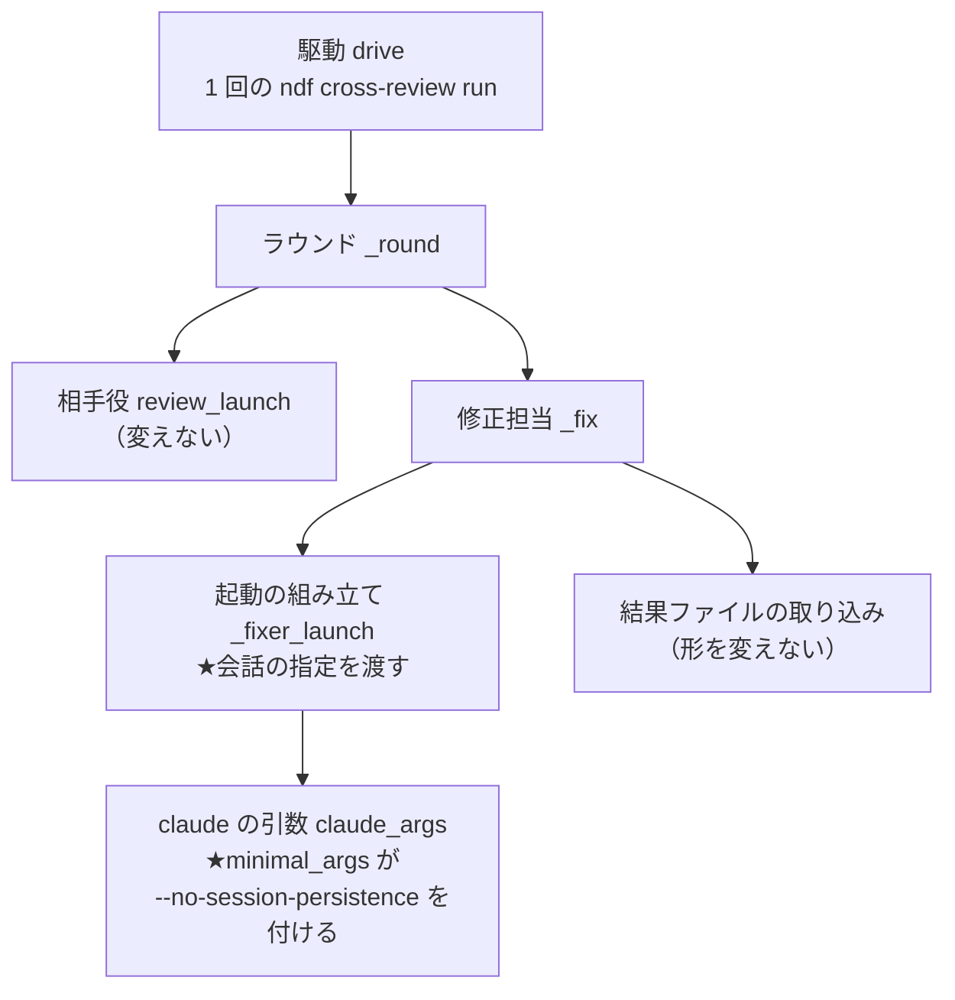
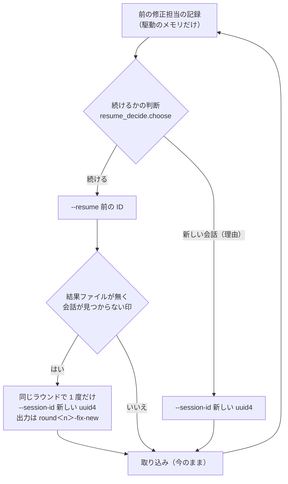
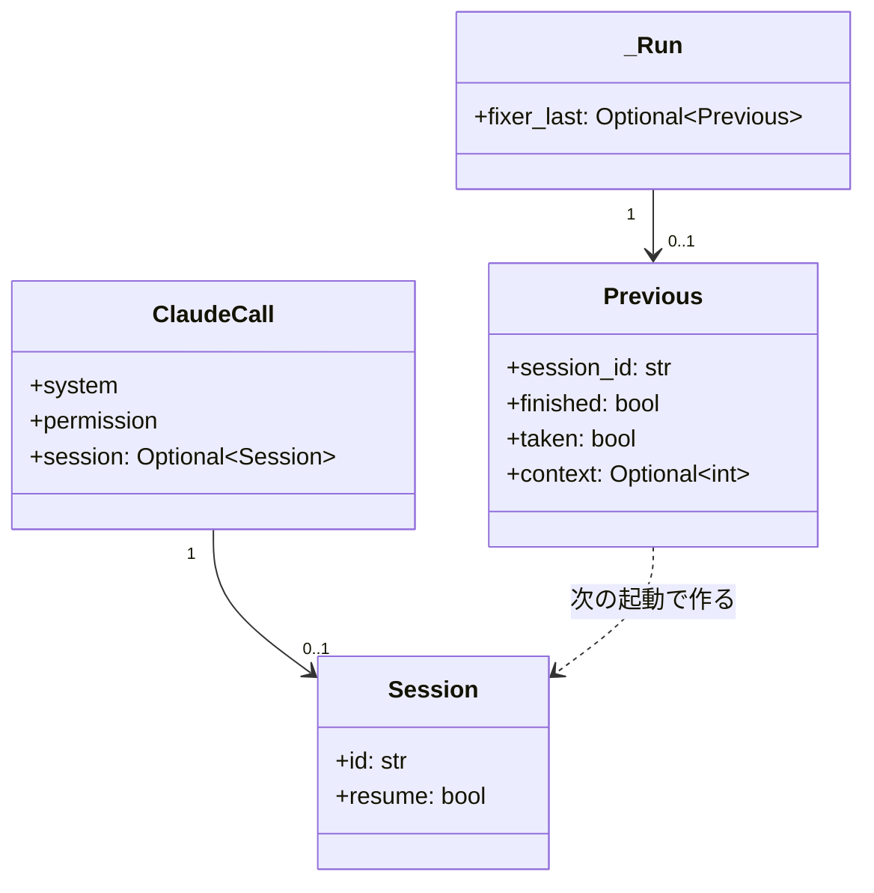
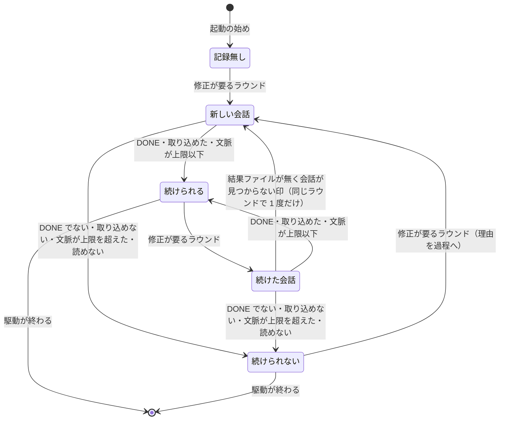

# cross-review: 2 ラウンド目からの修正担当が前のラウンドの会話を続けて直す（#4013）

cross-review の修正担当はラウンドごとに会話を残さない新しい `claude -p` として起動され、毎回同じ設計文書とコードを探し直してから直している。NDF が会話の ID を決めて `--session-id` で始め、同じ `ndf cross-review run` の起動の中では次のラウンドで `--resume` で続ける。前の修正担当の失敗・文脈の大きさ・その起動で初めて、のどれかに当たれば新しい会話で始め、続けようとした会話が見つからなければ同じラウンドで 1 度だけ新しい会話で起動し直す。採らなかった案は「決定の記録」に、調べた CLI と製品は付録の「外部の調査」にある。

## 今の姿

何が起きたか・目的・受け入れ条件は要求仕様（[issue-4013-requirements.md](./issue-4013-requirements.md)、正は #4013 の本文）にある。この文書は「どう解くか」と「なぜその解き方か」だけを書く。

★ が変わる位置である。設計に要る今の構造:

| 部品 | 今の振る舞い | 場所 |
| --- | --- | --- |
| 修正担当の起動 | ラウンドごとに、権限 `tools`（Tool は `Read,Edit,Write,Bash,Grep,Glob`）・逐次の出力（stream-json）の `claude -p` を、出力の名前 `round<n>-fix` で組む。プロンプトはその回の指摘・結果ファイルのパス・指摘の基準 | `plugins/ndf/src/ndf/domains/crossreview/drive.py` の `_fixer_launch`・`_fix_prompt` |
| 修正の取り込み | 結果ファイルが無ければ注意に載せて取り込まない（そのラウンドは `errored` で終わり、駆動のループも終わる）。番号が合わない・読めなければ退避して取り込まない。DONE で終わらなくても結果ファイルがあれば取り込む | `drive.py` の `_fix`・`_round` |
| claude の引数 | 起動の中身（`ClaudeCall`）から引数を組むのは `claude.py` だけ。最小構成（`minimal_args`）は必ず `--no-session-persistence` を付ける。会話を続ける `resume` は権限 `full` だけが受け、ほかの権限では `ValueError` | `plugins/ndf/src/ndf/adapters/claude.py` の `ClaudeCall`・`minimal_args`・`_full_args`・`claude_launch` |
| 起動し直しの前例 | 差分を読めなかった相手役を、同じラウンドで出力の名前の後ろに `-retry` を付けて 1 度だけ起動し直す | `drive.py` の `RETRY_SUFFIX`・`_review` |
| 過程 | 起動ごとの 1 行（`run`・`result`）を重ね、結果 JSON の `process` に出す。状態ファイル（`rounds`・`findings`）と要約（`summary.json`）には書かない | `drive.py` の `_note`・`Outcome`、`crossreview/cli.py` の `cmd_run` |

`ClaudeCall` の `resume` を渡している呼び手は、ソースに無い。`grep -rn 'resume=' plugins/ndf/src --include=*.py` の `ClaudeCall` の行は 0 件だった（2026-11-21 に確かめた）。渡すのはテストの `tests/adapters/test_claude_args.py` の 2 か所だけである。

修正担当の出力の最後の行（`type: result`）は、会話の ID（`session_id`）と使ったトークン（`usage.iterations`）を持つ。PR #3994 の 2 ラウンド目の修正担当の出力では、最後の iteration は次の合わせて 131,115 トークンだった。

| 値 | トークン |
| --- | ---: |
| `input_tokens` | 2 |
| `cache_read_input_tokens` | 130,418 |
| `cache_creation_input_tokens` | 695 |

キャッシュの書き込みは 1 時間の保持（`ephemeral_1h_input_tokens`）だった。どちらも同じ出力の最後の行を `python3` で読んで確かめた。

## 文脈と制約

- 「同じ起動」は `ndf cross-review run` の 1 回（`drive` の 1 回の呼び出し）である。会話の ID は駆動のメモリ（`_Run`）だけで持ち、状態ファイルにも要約にも書かない（要求の前提 1・受け入れ条件 4）
- 状態ファイルの形（`rounds`・`findings`）と修正の結果ファイルの形は変えない（受け入れ条件 4）。相手役の起動（`participants.review_launch`）は変えない（受け入れ条件 5）
- claude の会話の記録は、claude の設定の保存先の `projects/<作業ディレクトリのキー>/<会話の ID>.jsonl` に残る（STD3）。保存先は `CLAUDE_CONFIG_DIR`、無ければ `~/.claude` である。子の環境は `run_log.child_process_env` が組む。relay のアカウントの切り替えで保存先が起動ごとに変わると、前の会話は見つからない
- 無い ID への `--resume` は終了コード 1 で終わる。標準エラーと最後の結果の行の `errors` に、同じ文 `No conversation found with session ID: <ID>` が出る（要求の前提 4。2026-11-21 に claude 2.1.330 で確かめた）
- 修正担当の監視の上限は `monitor.phase.review`（1,200 秒）である。起動し直しを増やすと 1 ラウンドの時間の上限が伸びる
- NDF は普及のフェーズの前で、後方互換の経路を持たない（MVV Value 4）。決定の根拠に引く MVV の項目は `.ndf/mvv.md`（MVV バージョン 10）にある

## 解き方の全体像

- 修正担当は、その起動で初めてのラウンドでは NDF が決めた会話の ID で、会話を残して始まる。次のラウンドからは前のラウンドの会話を続ける。プロンプトと system は毎回今と同じものを渡す
- 続けるかは純粋な関数 `resume_decide.choose` が決める。材料は、前の修正担当の終わり方・結果を取り込めたか・最後の文脈の大きさと上限である。上限は `limits.json` の `cross-review.fixer.resume-context`（150,000 トークン）に置く
- 続けようとした会話が見つからなければ、同じラウンドで新しい会話で 1 度だけ起動し直し、そのラウンドの修正を失わない。タイムアウトなどほかの失敗では起動し直さない
- claude の引数は今のとおり `claude.py` だけが組む。`ClaudeCall` は会話の指定（`Session`）をすべての権限で受ける。指定があれば、`--no-session-persistence` を付けずに `--session-id` か `--resume` を付ける
- 結果 JSON の `process` の修正担当の行に「会話を続けた」か「新しい会話（理由）」が載る。状態ファイル・要約・結果ファイルの形は変わらない
- 会話の保存を許さないリポジトリは、`.ndf/review.json` に `"fixer_sessions": false` を書く。このとき修正担当はどのラウンドでも今と同じ `--no-session-persistence` で起動され、会話の ID を付けず、続けず、起動し直さない（決定 7）。書かなければ保存して続ける

## 構造

- `Session` は `claude.py` に置き、会話の ID と、続けるか（`resume`）を持つ。`ClaudeCall` の `resume: Optional[str]` はこれに置き換える
- `Previous` は `resume_decide.py` に置き、その起動の中で最後に起動した修正担当の記録を持つ。持つのは、会話の ID・DONE で終わったか・結果を取り込めたか・最後の文脈のトークン数（読めなければ None）である。`_Run` が 0 か 1 つ持ち、起動の始めは None

## 入出力のコントラクト

`ndf cross-review run` の引数・結果 JSON の形・状態ファイル・要約・修正の結果ファイルは変わらない。変わるのは子の `claude -p` の起動の引数と、結果 JSON の `process` の文と、`.ndf/review.json` の任意のキー `fixer_sessions` だけである。

| `.ndf/review.json` のキー | 型 | 既定 | 読み方 |
| --- | --- | --- | --- |
| `fixer_sessions` | 真偽値 | 真（キーが無い・ファイルが無い） | 偽なら修正担当の会話を保存しない。真偽値でない値は `ReviewDeclInvalid` で止める（黙って保存しない） |

`fixer_sessions` は `focus` と同じく実行者のメインディレクトリの `.ndf/review.json` から読み、PR の head の同じファイルの値は使わない（PR が保存を有効にできない。今の `FOCUS_DIFFERS` の注意がそのまま働く）。

| 起動 | 今の引数（会話に関わる部分） | 変えた後 |
| --- | --- | --- |
| その起動で初めての修正担当・続けない条件に当たった修正担当 | `--no-session-persistence` | `--session-id <新しい uuid4>` |
| 続ける修正担当 | `--no-session-persistence` | `--resume <前の会話の ID>` |
| 会話が見つからず起動し直した修正担当 | — | `--session-id <新しい uuid4>`。出力は `round<n>-fix-new.out`・`.err.log`・`-launch.json` |
| `.ndf/review.json` の `fixer_sessions` が `false` のリポジトリの修正担当（どのラウンドも） | `--no-session-persistence` | 今のまま（`--session-id`・`--resume` を付けない） |
| 相手役（codex・kiro） | 今のまま | 今のまま |
| 判断の呼び出し（権限 `judge`）・cross-refactoring の担当など、会話の指定を渡さない起動 | `--no-session-persistence` | 今のまま |

`process` の修正担当の行の `result` は、今の文の後ろに `（会話を続けた）` か `（新しい会話: <理由>）` を付ける。理由は次のどれかである。

- その起動で初めて
- 前の修正担当が正常に終わらなかった
- 前の修正の結果を取り込めなかった
- 前の会話の文脈を読めない
- 前の会話の文脈が上限を超えた
- 前の会話が見つからない
- 会話を保存しない設定（`fixer_sessions` が偽。このときだけ `--no-session-persistence` で起動する）

`process` は結果 JSON にだけ出て、状態ファイルと要約には書かれない（今の姿の表の「過程」の行）。このため受け入れ条件 4 に触れない。結果 JSON の形（`process` は `run`・`result` の文字列の組の並び）は変わらない。

## 処理の流れ

修正担当の会話の状態（同じ起動の中、ラウンドをまたぐ）:

- 起動し直した新しい会話は、もう一度会話が見つからない印を出しても起動し直さない（新しい ID は見つからないことが無い）。結果ファイルが無ければ今のとおり注意に載せ、そのラウンドを `errored` で終える
- 取り込めなかったラウンドは今のとおり `errored` で終わり、駆動のループも終わる。このため「取り込めなかった」の条件で新しい会話になるのは、次の起動（記録無し）で起きる。判断の関数はこの条件も持つ（ループの終わり方が変わっても続けない）
- 駆動が終わると記録は捨てる。中断からの再開・打ち直しは記録無しから始まる（要求の「含まない」）

## 決定の記録

### 決定 1: 出力を読まずに続けられるよう、NDF が uuid4 の会話の ID を決めて `--session-id` で始め、`--resume` で続ける

- **質問**: 修正担当の会話をどう始め、次のラウンドでどう指して続けるか。会話の ID をどこに持つか
- **選んだ案**: 修正担当を新しい会話で起動するたびに、NDF が uuid4 を作って `--session-id <ID>` で始める。続けるときは同じ ID を `--resume <ID>` で渡す。ID は駆動の 1 回の起動の中（`_Run` のメモリ）だけで持ち、状態ファイルに書かない
- 採らなかった案: 出力の最後の行の `session_id` を読んで `--resume` に渡す（出力を読めないとき・書きかけで止まったときに ID が無い。始める前に決めれば読まずに済む）
- 採らなかった案: `--continue`（作業ディレクトリの最後の会話を拾う。同じ worktree で並行する別の claude の会話を続ける恐れがある。`-p` の会話を拾うかも `-p` の有無で変わる。STD1）
- 採らなかった案: `--fork-session` で前の会話から分ける（会話の ID が毎回変わる。続けた会話と文脈は同じなので、得るものが無い。STD1・PRD1）
- **代償**: 修正担当の会話の記録が claude の設定の保存先に残る（前提 5）。会話の ID を状態ファイルに持たないので、中断から再開した起動は前の会話を続けない
- 作り方: 標準に倣う
- 比べた候補: STD1 / STD2 / PRD1 / PRD2
- 根拠: Value 3「判断の要らない手順（待ち・集計・検査・記録・整形・起動の組み立て）は仕組みが進めるので、結果が実行ごとにばらつかない」・Value 12「実行の基盤（Claude Code・Codex）の機能で足りるものは、NDF が自分で作らない」（MVV バージョン 10）。STD1・STD2

### 決定 2: 引数を組む場所を `claude.py` の 1 か所に保つため、`ClaudeCall` に会話の指定 `Session` を足してすべての権限で受ける

- **質問**: 権限 `tools` の起動に `--session-id`・`--resume` を付け、`--no-session-persistence` を外す変更を、どこで行うか
- **選んだ案**: `claude.py` に `Session`（`id: str`・`resume: bool`）を置く。`ClaudeCall` の `resume: Optional[str]` を `session: Optional[Session]` に置き換え、権限 `judge`・`tools`・`full` のどれでも受ける。`minimal_args` に会話の指定の引数を足す（シグネチャの変更）。指定があれば、`--no-session-persistence` を付けずに `--session-id <ID>` か `--resume <ID>` を付ける。`full` の起動は今の `--resume` の位置に同じ引数を付ける。今の `resume` の呼び手は無く（今の姿）、テストは `Session(<ID>, True)` へ置き換える
- 採らなかった案: `drive.py` が `claude_args` の組んだ列を書き換える（`--no-session-persistence` を除き、会話の引数を差し込む。引数を組むのは `claude.py` だけという分担が崩れる。引数の並びが変わると黙って外れる）
- 採らなかった案: `resume: Optional[str]` を残して `session_id: Optional[str]` を横に足す（2 つの値に、両方あるという意味の無い組み合わせが生まれる。`__post_init__` の検査が増える）
- **代償**: `ClaudeCall` の `resume` を使う既存のテストを書き換える。会話の指定を渡さない起動の引数は変わらない
- 根拠: Value 9「責務の分かれた設計で作られる」・Value 4（MVV バージョン 10）

### 決定 3: 続けると悪くなる場面で新しい会話にするため、続けるかを純粋な関数 `resume_decide.choose` が決め、文脈の上限を 150,000 トークンにする

- **質問**: 要求の前提 2 の 3 つの条件をどこで判定し、「文脈の上限」を何で測っていくつにするか
- **選んだ案**: 新しいモジュール `resume_decide.py` の純粋な関数 `choose(previous, cap)` が、続けるかと、続けないときの理由を返す。モジュールは `plugins/ndf/src/ndf/domains/crossreview/` に置く。次の条件・測り方・上限で決める
  - 新しい会話にする条件（どれか 1 つ）:
    - 前の記録が無い（その起動で初めて）
    - 前の修正担当が DONE でない
    - 結果を取り込めなかった（`_fix` が None を返した）
    - 最後の文脈が読めない
    - 最後の文脈が上限を超えた
  - 最後の文脈: 結果の行の `usage.iterations` の、最後の要素の 3 つの値の和。結果の行は修正担当の出力の最後の行で、値は `input_tokens`・`cache_read_input_tokens`・`cache_creation_input_tokens` である
  - 上限: `plugins/ndf/contracts/limits.json` の `cross-review.fixer.resume-context`（`count` 150,000）。上限ちょうどは続ける
- 採らなかった案: 既存の `fixgate_decide.py` に置く（そのモジュールは、修正の記録が要るかをラウンドの前に決める判断である。修正担当の会話の続け方とは入力も結果も違う）
- 採らなかった案: 結果の行の `usage` の合計（`cache_read_input_tokens` の合計）で測る（これは 1 回の修正の全ターンの読みの合計である。次の会話へ持ち越す文脈の大きさを表さない。PR #3994 の 2 ラウンド目は合計 354 万トークン・最後の文脈 13 万トークン）
- 採らなかった案: 上限を置かずにいつも続ける（続けるたびに、毎ターン読むキャッシュが持ち越した文脈の大きさだけ増える。ラウンドを重ねると自動の要約（compact）に近づく）
- **代償**: 最後の文脈が 150,000 トークンを超えた修正担当の次のラウンドは、今と同じく探し直しから始まる。値は 1 回の実測から決めたので、リリースの後の確認（受け入れ条件 6）で見直す
- 根拠: Value 2「費用・時間・繰り返しの上限に当たれば、手を広げずにやめるか縮める」「費用が増える仕組みを足すときは、その理由と代わりの案が示される」・Value 13「効果は実測（費用・秒・件数）で示され、測らずに良くなったとは言われない」（MVV バージョン 10）。値は実測の最後の文脈 13 万トークンを 1 回分持ち越せる大きさ

### 決定 4: 会話が見つからないときにそのラウンドの修正を失わないよう、印を見たときだけ新しい会話で 1 度だけ起動し直す

- **質問**: 続けようとした会話が見つからず起動が失敗したとき、そのラウンドをどう扱うか。ほかの失敗でも起動し直すか
- **選んだ案**: 続けた起動の結果ファイルが無いときに、会話が見つからない印を探す。印は `No conversation found with session ID` で、出力の最後の結果の行の `errors` か標準エラーを見る。印があれば、同じラウンドで新しい ID・`--session-id` で 1 度だけ起動し直す。出力の名前は `round<n>-fix-new` にする（相手役の起動し直しの `-retry` と同じく、名前の後ろで分けて前の出力を消さない）。印の文は `claude.py` に定数で置く。タイムアウト・誤りの終了など印の無い失敗では起動し直さない
- 採らなかった案: 続けた起動が DONE でなければいつも新しい会話で起動し直す（タイムアウトの修正担当は 20 分走った後である。もう 1 度 20 分を走らせると、1 ラウンドの時間が 2 倍になる。今のとおり `errored` で終え、次の起動に任せる）
- 採らなかった案: 起動の前に会話の記録のファイルがあるかを確かめる（記録の置き場は claude の内部の形である。`--resume` は作業ディレクトリの外の保存先も探す。STD1。claude が答える印を読む方が、置き場の形に依らない）
- 採らなかった案: 起動し直しの出力を `round<n>-fix` に上書きする（失敗した起動の標準エラーが消える。なぜ起動し直したかを後から読めない）
- **代償**: 会話が見つからないラウンドは、修正担当を 2 回起動する。1 回目は claude が起動してすぐ終わる（会話の読み込みで失敗する）
- 根拠: Value 3「版上げ・再起動・セッションの入れ替えをまたいでも、進行中の作業と人の回答は失われず、止まった所から続く」・Value 2（MVV バージョン 10）

### 決定 5: 続けた会話が前の指示を覚えていることを当てにしないため、毎回同じ形のプロンプトと system を渡す

- **質問**: 続けた会話の修正担当へ、その回の差分だけを渡すか、今と同じプロンプトを渡すか
- **選んだ案**: 続けた会話にも新しい会話にも、今の `_fix_prompt` のプロンプトと同じ system（`cross-review の修正担当`）を渡す。プロンプトは、その回の指摘の一覧・結果ファイルのパス・指摘の基準を持つ
- 採らなかった案: 続けた会話には指摘の一覧だけを渡す（前の指示が compact で落ちた会話では、結果ファイルのパスと基準を欠く。新しい会話へ落ちた起動でも同じである。プロンプトの組み立てが会話の状態で 2 通りになる）
- **代償**: 続けた会話のプロンプトに、前のラウンドと同じ基準の文が重なる（1 ラウンドで数百トークン）
- 根拠: Value 3「同じ操作を打ち直しても、結果は 1 回打ったときと変わらない」（MVV バージョン 10）。STD1（system は会話の最初の要求で記録され、続けた起動でも同じものが使われる）

### 決定 6: 会話の記録の後始末を claude に任せるため、NDF は記録を消さない

- **質問**: 会話を残すことで claude の設定の保存先に増える会話の記録を、NDF が消すか
- **選んだ案**: 消さない。claude の `cleanupPeriodDays`（既定 30 日）に任せる。cross-review の作業ディレクトリは開発の worktree なので、記録はその作業ディレクトリのキーに紐づく
- 採らなかった案: 駆動の終わりに、その起動で作った会話の記録を消す（記録の置き場は claude の内部の形である。`CLAUDE_CODE_PROJECT_DIR_NAME`・長いパスの切り詰めで変わる。STD3。消し損ねと消し過ぎを NDF が持つことになる）
- **代償**: 修正担当 1 回ごとに会話の記録が 1 つ、既定で 30 日残る。記録はディスクの平文である（STD3）。残したくないリポジトリは決定 7 の宣言で保存をやめる
- 根拠: Value 12「実行の基盤（Claude Code・Codex）の機能で足りるものは、NDF が自分で作らない」・Value 6（MVV バージョン 10）。STD3

### 決定 7: 未公開の指摘と読んだファイルを平文で残したくないリポジトリのため、会話の保存の可否を `.ndf/review.json` の `fixer_sessions` で選ばせる

- **質問**: 会話を保存すると、プロンプトの未公開の指摘と修正担当が読んだファイルの中身が claude の設定の保存先に平文で残る（STD3）。保存を許さないリポジトリをどう扱うか
- **選んだ案**: `.ndf/review.json` に任意の真偽値 `fixer_sessions` を足す。既定は真（保存して続ける）。偽なら `_fix` は `resume_decide.choose` を呼ばず、会話の指定を渡さない（`session=None`。`minimal_args` が今と同じ `--no-session-persistence` を付ける）。会話が見つからない印も探さず、`run.fixer_last` を置かない。過程の行は「新しい会話: 会話を保存しない設定」。読むのは `focus` と同じ実行者のメインディレクトリのファイルで、PR の head の値は使わない
- 採らなかった案: 既定を偽にして、保存したいリポジトリが真を書く（#4013 の目的の探し直しの削減が、宣言を書いたリポジトリでしか効かない。秘密を扱うリポジトリは宣言で外せる）
- 採らなかった案: 環境変数・`ndf cross-review run` の引数で選ぶ（打つ人ごと・打つたびに変わり、リポジトリの決まりとして固定できない。リポジトリの運用の値は宣言に置く）
- 採らなかった案: 新しい設定のファイルを足す（レビューの振る舞いの宣言は `.ndf/review.json` が持ち、実行者のメインディレクトリから読む仕組みと PR の head との比べが既にある）
- **代償**: `.ndf/review.json` のスキーマ（`additionalProperties: false`）とその説明にキーが 1 つ増える。保存しないリポジトリでは 2 ラウンド目からも今と同じ探し直しが残る
- 根拠: Value 6・Value 12（MVV バージョン 10）。STD2（`--no-session-persistence` は会話をディスクへ保存しない）・STD3

## 影響と危険

- **働く範囲**: cross-review を使う利用先のリポジトリのすべてで働く。変えるのは `plugins/ndf` の `adapters/claude.py`・`domains/crossreview`・`contracts/limits.json`・手順書である。会話の記録は利用者のマシンの claude の設定の保存先に残る
- **プロジェクトごとに違うもの**: 会話を保存するか（`.ndf/review.json` の `fixer_sessions`。決定 7）。上限は `limits.json` の 1 つの値で、プロジェクトの設定にも引数にも置かない
- **当たるモード**: cross-review を通るすべてのモード（設計・実装・リファクタリングの PR）。修正担当を起動しないラウンド（収束・振動）には当たらない
- **壊れうる箇所**:
  - **費用**: 続けた会話では、毎ターンのキャッシュ読みが持ち越した文脈の大きさだけ増える。PR #3994 の 2 ラウンド目は 58 ターン・最後の文脈 13 万トークンだった。同じターン数で 13 万トークンを持ち越すと、キャッシュ読みは合計でおよそ 750 万トークン増える。キャッシュ読みの単価は入力の 0.1 倍（Opus 5.5・Sonnet 5.5 は 0.05 倍）である（PRD3）。ターン数が減らなければ費用は増える。上限（決定 3）が持ち越しを 15 万トークンまでに抑える。増減は、リリースの後の確認（受け入れ条件 6）で費用も合わせて測る
  - **キャッシュの保持**: 実測の出力のキャッシュの書き込みは 1 時間の保持だった。相手役のレビュー（中央値 0.9 分・最大でも数分）を挟んでも、続けた最初のターンはキャッシュを読める見込みである。保持を外れれば、持ち越した文脈を書き直す（入力の 1.25 倍〜2 倍。PRD3）
  - **アカウントの切り替え**: relay のアカウントの切り替えで claude の設定の保存先が変わると、続けた起動は会話が見つからない。このときは決定 4 で新しい会話になる。その分の起動が 1 回増える
  - **同じファイルを触る別の変更**: #4015（修正担当の並列化）は `drive.py` の `_fix`・`_fixer_launch` を触る。並列にした修正担当の会話の続け方は #4015 の設計で決める（この設計は 1 本の修正担当を前提にする）
  - **`ClaudeCall` の値の改名**: `resume` を使う呼び手はソースに無い（今の姿）。`plugins/ndf/src/ndf/adapters/cli.py` は `minimal_args` を再び公開しているだけで呼ばない

### 代表のリポジトリでの振る舞い

| 代表のリポジトリ | 設定の要点 | 直した後に起きること | この種類で扱えなくなること |
| --- | --- | --- | --- |
| Web サービス（nd-factory） | 設計・実装の PR が cross-review を通る | 2 ラウンド目からの修正担当が前のラウンドの会話を続ける。設計・設計の検査・MVV 判定は変わらない | 無し |
| モバイルアプリ | 同上 | 同上 | 無し |
| 業務文書だけ | 文書の PR が cross-review を通る | 同上（文書の探し直しが減る） | 無し |

### ai-plugins だけの事情

- 無し（会話の続け方と上限はリポジトリの運用の値を持たず、どのリポジトリでも同じ振る舞いになる）

## テスト設計

| 受け入れ条件 | どの振る舞いで縛るか | どう壊したら落ちるべきか |
| --- | --- | --- |
| 1 | 修正が要るラウンドが 2 回続く起動で、1 ラウンド目の修正担当の引数に `--session-id <ID>` があり `--no-session-persistence` が無く、2 ラウンド目の引数に同じ ID の `--resume` がある。2 ラウンド目のプロンプトは指摘の一覧・結果ファイルのパス・指摘の基準を持つ。`claude_args` は `Session` を渡した権限 `tools`・`judge`・`full` で `--session-id`・`--resume` を付け、渡さなければ今の引数のまま | 2 ラウンド目で ID を作り直す・`--no-session-persistence` を残す・続けた会話のプロンプトを縮めると落ちる |
| 2 | `resume_decide.choose` が、記録無し・DONE でない・取り込めない・文脈を読めない・文脈が上限を超えた、のそれぞれで新しい会話と理由を返し、上限ちょうど・上限未満で続ける。駆動では、1 ラウンド目の修正担当がタイムアウトで終わり結果ファイルは書いた場合と、出力の最後の文脈が上限を超えた場合に、2 ラウンド目が新しい ID の `--session-id` で起動される。前の起動の状態ファイルから再開した起動の最初の修正担当は `--session-id` で起動される | 条件のどれかを落とす・上限の比べを `>=` にする・文脈の和から 1 つの値を落とす・状態ファイルから ID を読むと落ちる |
| 3 | 続けた起動が結果ファイルを書かず、出力の最後の結果の行の `errors` か標準エラーに会話が見つからない印を出すと、同じラウンドで新しい ID の `--session-id` の起動が `round<n>-fix-new` の名前で 1 回だけ走り、その結果がそのラウンドの修正として取り込まれる（ラウンドは `errored` にならない）。印の無い失敗（タイムアウト・誤りの終了）と、起動し直した起動の失敗では起動し直さない | 印が無くても起動し直す・2 回以上起動し直す・起動し直しの出力で元の出力を上書きする・起動し直した修正を取り込まないと落ちる |
| 4 | 既存の `plugins/ndf/tests/domains/crossreview/` のテストが変わらずに通る。会話を続けた起動の後の状態ファイルの `rounds` の各ラウンドと `findings` の各行が、今の形のキーだけを持ち、会話の ID を含まない | 状態ファイルや要約へ会話の ID・会話の状態を書くと落ちる |
| 2 | `.ndf/review.json` に `"fixer_sessions": false` を書いたリポジトリで修正が要るラウンドが 2 回続くと、どちらの修正担当の引数にも `--no-session-persistence` があり `--session-id`・`--resume` が無い。会話が見つからない印を出しても起動し直さない。過程に「会話を保存しない設定」。キーが無ければ保存する。真偽値でない値は `ReviewDeclInvalid` で止まる。PR の head の `.ndf/review.json` だけが `true` でも実行者の `false` が効く | 偽の設定で初回か 2 ラウンド目に会話の ID を付ける・キーの無いときに保存しない・文字列の `"false"` を受ける・PR の head の値を読むと落ちる |
| 5 | 会話を続けた起動でも、相手役の起動の引数が `participants.review_launch` の返す引数と同じで、会話の引数（`--session-id`・`--resume`）を持たない | 相手役へ会話の指定を渡すと落ちる |

受け入れ条件 6 はリリースの後の確認で、テストを書かない。手順書の説明は文言を突き合わせるテストを書かず、ドキュメントレビューで見る。

## どこを変えるか

詳細設計は [issue-4013-design-detail.md](./issue-4013-design-detail.md) にある。別のファイルにしたのは、新設する関数が 6・シグネチャを変える関数が 2 あるためである。

| 種類 | 関数 |
| --- | --- |
| 新設 | `claude.session_args`・`claude.result_line`・`claude.context_tokens`・`claude.conversation_missing`・`resume_decide.choose`・`criteria_decide.fixer_sessions_of` |
| シグネチャを変える | `claude.minimal_args`・`drive._fixer_launch` |

## 設計の結果

| 課題 | 扱い | 統合先 | 触るファイル |
| --- | --- | --- | --- |
| #4013 | 実装する | — | `plugins/ndf/src/ndf/adapters/claude.py`、`plugins/ndf/src/ndf/domains/crossreview/resume_decide.py`（新設）、`plugins/ndf/src/ndf/domains/crossreview/drive.py`、`plugins/ndf/src/ndf/domains/crossreview/criteria_decide.py`、`plugins/ndf/contracts/limits.json`、`plugins/ndf/contracts/schemas/ndf-settings/review.schema.json`、`plugins/ndf/docs/contracts/ndf-settings.md`、`plugins/ndf/skills/cross-review/docs/02-fix-and-rotation.md`、`plugins/ndf/tests/adapters/test_claude_args.py`、`plugins/ndf/tests/adapters/test_claude_reply.py`、`plugins/ndf/tests/domains/crossreview/test_crossreview_resume.py`（新設）、`plugins/ndf/tests/domains/crossreview/test_crossreview_run.py`、`plugins/ndf/tests/domains/crossreview/test_crossreview_criteria.py` |

## 未確認のまま残ること

| 項目 | 内容 |
| --- | --- |
| 2 ラウンド目からの修正の時間と tool 呼び出しが減るか | 前のラウンドの会話を持った修正担当が、探し直しをどれだけ省くかは使ってみるまで分からない。リリースの後、5 回以上の実行の `round<n>-fix.out` の `tool_use` の数と更新時刻、結果の行の費用を集計して #4013 に書く（受け入れ条件 6） |
| 150,000 トークンの上限が合うか | 値は PR #3994 の 1 回の実測から決めた。上の集計で、上限を超えて新しい会話になったラウンドの数と、続けた会話の費用を見て見直す |
| 会話が見つからない印の場所 | 標準エラーと結果の行の `errors` に出ることは 2.1.330 で確かめた。claude の版が上がって文が変わると印を見つけられず、決定 4 の起動し直しが働かない（そのラウンドは今のとおり `errored` で終わり、次の起動は新しい会話で始まる）。実装の `tdd-cycle` で実物の出力を 1 度通す |

## 外部の調査

| 種類 | 調べるか | 理由 |
| --- | --- | --- |
| 標準・仕様 | 調べる | 会話の始め方・続け方・残さない指定は Claude Code の CLI が定める。引数の振る舞いと会話の記録の置き場を一次情報で確かめる |
| 主要な製品 | 調べる | Claude Agent SDK と Codex CLI が、続けて使うエージェントの会話をどう指して続けるかを比べる |
| ライブラリとサービス | 調べない | 会話の保持は claude の CLI が持ち、NDF は引数を渡すだけである。保持を置き換えるライブラリは要らない（Agent SDK の `SessionStore` は別のマシンへ会話を移す仕組みで、同じマシンの 1 回の起動の中では要らない。PRD1） |

### 標準・仕様

| # | 標準・仕様 | 何を定めているか | 設計への反映 | 出典 |
| --- | --- | --- | --- | --- |
| STD1 | Claude Code の CLI リファレンス | `--session-id` は会話に指定の UUID を使う。`--resume` は ID か名前で会話を続け、ID を渡すと今の作業ディレクトリとその git worktree、続けてこのマシンのほかのプロジェクトを探す。`--continue` は今のディレクトリの最後の会話を続け、`claude -p` の会話は `-p` を付けたときだけ拾う。`--fork-session` は続けるときに新しい ID を作る。`--no-session-persistence` は会話をディスクへ保存せず、続けられない（`-p` だけ）。system は会話の最初の要求で記録され、続けた起動でも compact までは同じものが使われる | 決定 1（`--session-id` と `--resume`。`--continue`・`--fork-session` を採らない）・決定 2（指定があれば `--no-session-persistence` を外す）・決定 4・決定 5 | https://code.claude.com/docs/en/cli-reference（2026-11-21） |
| STD2 | `claude --help`（2.1.330） | `--session-id <uuid>`「Use a specific session ID for the conversation (must be a valid UUID)」、`--no-session-persistence`「Don't save sessions to disk; they can't be resumed (only works with --print)」、`--system-prompt-snapshot` の既定は on | 決定 1・決定 2・決定 5 | `claude --help`（2026-11-21） |
| STD3 | Claude Code の Data usage の Data retention | 会話の記録は `~/.claude/projects/` に平文で既定 30 日残り、続けるために使う。期間は `cleanupPeriodDays` で変える | 決定 6（NDF は消さず claude に任せる）・影響と危険 | https://code.claude.com/docs/en/data-usage（2026-11-21） |

### 主要な製品

| # | 製品 | どう解いているか | 設計への反映 | 出典 |
| --- | --- | --- | --- | --- |
| PRD1 | Claude Agent SDK のセッション | 複数の会話を持つアプリは会話の ID を控えて `resume` に渡す（最後の会話を拾う `continue` は 1 度に 1 つの会話のときだけ）。続けると読んだファイル・分析・決定を持ったまま進み、ファイルを読み直さずに直せる。会話の記録は `CLAUDE_CONFIG_DIR`（無ければ `~/.claude`）の `projects/<作業ディレクトリのキー>/<ID>.jsonl` にあり、同じマシンでだけ続けられる。`fork_session` は元の会話を残して分ける | 決定 1（ID を控えて続ける）・文脈と制約（設定の保存先が変わると続けられない）・決定 4 | https://code.claude.com/docs/en/agent-sdk/sessions（2026-11-21） |
| PRD2 | Codex CLI の `codex exec resume`（0.167.0） | 非対話の会話を ID か `--last`（作業ディレクトリの最後の会話）で続け、続けた直後に新しいプロンプトを送る。`--ephemeral` は会話のファイルを残さない。`codex exec fork` で分ける | 決定 1（ID で続け、最後の会話を拾う形は並行する会話と混ざる）。相手役（codex）の起動には取り込まない（要求の「含まない」） | `codex exec resume --help`（2026-11-21）・https://learn.chatgpt.com/docs/developer-commands?surface=cli（2026-11-21） |
| PRD3 | Claude のプロンプトキャッシュ | キャッシュ読みは入力の 0.1 倍（Opus 5.5・Sonnet 5.5 は 0.05 倍）、書き込みは 5 分の保持で 1.25 倍・1 時間の保持で 2 倍。既定の保持は 5 分で、使うたびに延びる | 影響と危険（続けた会話の費用・キャッシュの保持） | https://platform.claude.com/docs/en/build-with-claude/prompt-caching（2026-11-21） |

### 確かめられなかったこと

| 対象 | 試した手段 | 結果と理由 |
| --- | --- | --- |
| `cleanupPeriodDays` の項目の全文（最小の値など） | https://code.claude.com/docs/en/settings-reference | 取得したページが項目の手前で切れた（ページが 46 万字）。既定 30 日は STD3 で確かめた |
| `--ephemeral` の会話を続けられるか（PRD2） | https://learn.chatgpt.com/docs/developer-commands?surface=cli | ページが明記していない。設計は codex の起動を変えないので、確かめずに残す |

調べた量: 候補 6 件・取得の試み 14 回。
