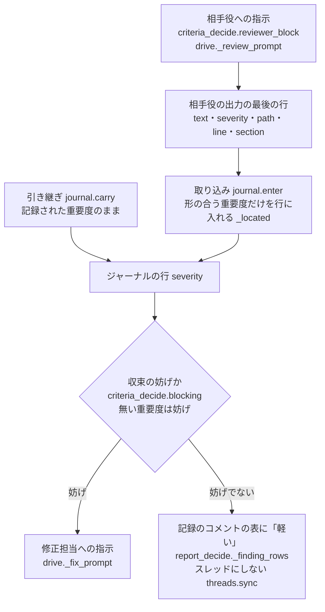
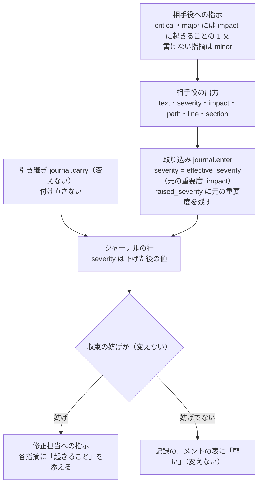

# cross-review: 起きることを書けない重い指摘を軽い指摘として残し、ラウンドを止めない（#4014）

cross-review の相手役が付ける重要度は major に偏っており、収束を止めない `minor`・`nit` の仕組みがラウンドを減らしていない。相手役の出力に「利用者の経路で何が起きるか」の 1 文の項目（`impact`）を足し、ジャーナルへの取り込みで、1 文の無い `critical`・`major` と重要度の無い指摘を `minor` へ下げる。相手役が付けた元の重要度はジャーナルの行に残し、記録のコメントの表とスレッドの書式は変えない。採らなかった案は「決定の記録」に、調べた標準と製品は付録の「外部の調査」にある。

## 今の姿

何が起きたか・目的・受け入れ条件は要求仕様（[issue-4014-requirements.md](./issue-4014-requirements.md)、正は #4014 の本文）にある。この文書は「どう解くか」と「なぜその解き方か」だけを書く。



変える箇所は、相手役への指示（図の 1 段目）と取り込み（3 段目）と修正担当への指示である。収束の妨げかの判定・記録のコメントの表・スレッドは、ジャーナルの行の重要度を読むだけなので変えない。

設計に要る今の構造:

| 部品 | 今の振る舞い | 場所 |
| --- | --- | --- |
| 相手役への指示 | 基準の行に続けて「重要度 severity は critical・major・minor・nit から選ぶ。基準に当たる指摘は critical・major。minor・nit は収束を止めず、修正担当へ渡らない。」と書く。最後の行の JSON の形は `text`・`severity`・`path`・`line`・`section` | `criteria_decide.reviewer_block`、`drive._review_prompt` |
| 重要度の読み方 | 尺度にある値ならそのまま、無い・知らない値は None（`severity_of`）。None は収束の妨げになる（`blocking`）。出し直しは重い方を残し、None は major と同じ重さに数える（`heavier`・`_rank`） | `criteria_decide.py` |
| 取り込み | 新しい指摘はジャーナルの行を作り、形の合う重要度と位置だけを足す（`_located`）。既にある指摘の出し直しは、重い方の重要度を残す（`_raised_again`）。ラウンドの収束の妨げになるキーは、重ねた後の行の重要度で決める | `journal.enter`・`_raised_again` |
| 引き継ぎ | 前の実行が PR のスレッドと記録のコメントに残した未解決の指摘を、記録された重要度のままラウンド 0 の行にする。重要度は取り込みと同じ `_located` で読む | `journal.carry`、`prior_decide` |
| 未解決の重い指摘 | ジャーナルの行の重要度で、修正担当へ渡す行を選ぶ | `journal.pending` |
| 修正担当への指示 | 指摘ごとに `- <id>: <本文>（<重要度>・<場所>）` の 1 行 | `drive._fix_prompt`・`_where` |
| 記録のコメントの表 | 収束の妨げでない未解決の行の終わり方を「軽い（直さずに残した）」と書く。表の「重要度」のセルは次の実行の引き継ぎ（`prior_decide`）が読み戻す | `report_decide._light`・`_finding_rows` |
| スレッド | 収束の妨げでない指摘はスレッドにしない。最初のコメントの頭に重要度を書く | `threads.opening`・`sync` |

重要度の無い指摘が止める側に倒れるのは、取り込みが形の合わない値を行に入れず、`blocking(None)` が真になるためである。要求仕様の実測で重要度の無い指摘は 280 件あり、すべてラウンドを止めていた。

## 文脈と制約

- 重要度の尺度と収束の妨げになるか（`severities.json` の `rank`・`blocking`）は変えない（要求の「含まない」）。`pr-review`・`fix`・`cross-refactoring` も同じ尺度を読むが、相手役の出力の形を持たないので触らない
- 引き継いだ指摘は、前の実行の規則で決まった重要度のまま扱う（要求の「含まない」と起票者の推定 S5）
- 記録のコメントの表の「重要度」のセルは、次の実行の引き継ぎが読み戻す。セルの書式を変えると引き継ぎの読み取りが変わる
- 状態ファイルは手元の保存先にあり、前の版で書いた行が残る。NDF は普及のフェーズの前で互換の経路を持たない（MVV Value 4）が、状態ファイルの行は読めることを保つ（要求の「影響」のデータの行）
- 相手役は NDF が起動する CLI で、出力の JSON は利用者が書く入力ではない。項目の無い古い出力は 1 文を持たない指摘として読む（要求の「影響」）
- 1 文の中身の妥当さは駆動が判定しない（前提 1）
- 決定の根拠に引く MVV の項目は `.ndf/mvv.md`（MVV バージョン 10）にある
- この文書の「取り込み」は、相手役の出力の指摘をジャーナルの行にすること（`journal.enter`）を指す。「引き継ぎ」は、前の実行の指摘を PR から読んでジャーナルの行にすること（`journal.carry`）を指す。「起きることの 1 文」は指摘の項目 `impact` を指す

## 解き方の全体像



- 相手役は `critical`・`major` を付ける指摘ごとに、利用者の経路で何が起きるか（基準 4 の設計文書の食い違いでは、実装する人が何を作り違えるか）を `impact` に 1 文で書く。書けない指摘は `minor` にするよう指示される
- 取り込みは、1 文の無い `critical`・`major` と重要度の無い指摘を `minor` に、1 文のある重要度の無い指摘を `major` にする。ジャーナルの行の `severity` は下げた後の値で、元の重要度は `raised_severity` に残る。下げたかは行から読める（`criteria_decide.downgraded`）
- 収束の妨げかの判定・未解決の重い指摘・記録のコメントの表・スレッドは今のまま行の `severity` を読む。そのため下げた指摘は今の `minor` と同じく修正担当へ渡らず、表に「軽い」で残る
- 修正担当への指示には、各指摘の 1 文が「起きること」として添わる
- 引き継いだ行と前の版で書いた行は付け直さず、今の重要度のまま読む

## データ構造

状態ファイル（`cross-review-pr<元の番号>-state.json`）のジャーナルの行（`findings[]`）に 2 つの項目を足す。どちらも、取り込みで作った行（相手役から入った行）にだけ置く。

| 項目 | 型 | 置く条件 | 中身 |
| --- | --- | --- | --- |
| `severity`（今もある） | 文字列 | 今と同じく、尺度の値があるとき | 取り込みでは下げた後の値（`effective_severity` の返り）。取り込みでは必ず尺度の値になる |
| `impact`（足す） | 文字列 | 相手役の 1 文が空白を除いて空でないとき | 前後の空白を除いた 1 文 |
| `raised_severity`（足す） | 文字列か null | 取り込みで作った行に必ず置く | 相手役が付けた重要度。尺度に無い・無いときは null |

| 行の出所 | `severity` | `impact` | `raised_severity` |
| --- | --- | --- | --- |
| 取り込み | 下げた後の値 | 1 文があれば | 置く（null を含む） |
| 引き継ぎ（`t<コメントの id>`・`p-<元の id>`） | 記録された値（今のまま） | 置かない | 置かない |
| 組み直しの足すべき内容（`rebuild`） | 置かない（今のまま） | 置かない | 置かない |
| 前の版で書いた行 | そのまま | 無い | 無い |

下げた指摘は「`raised_severity` が収束の妨げになる重さか null で、`severity` が `minor`」の行である。`raised_severity` の無い行は、下げていない行として読む（前の版の行と引き継いだ行）。

## 入出力のコントラクト

相手役へ渡す出力の形（`drive._review_prompt` の最後の行の指示）に 1 項目を足す。

```text
{"findings": [{"text": "<指摘>", "severity": "<重要度>", "impact": "<critical・major のとき、利用者の経路で何が起きるか 1 文 か 空>",
  "path": "<ファイルのパス か 空>", "line": <行の番号 か null>, "section": "<パス#見出し か 空>"}]}
```

| 項目 | 読み方 |
| --- | --- |
| `impact` が文字列で、空白を除いて空でない | 1 文を持つ指摘 |
| `impact` が無い・空・空白だけ・文字列でない | 1 文を持たない指摘（項目の無い古い出力を含む） |

`ndf cross-review run` の引数と結果 JSON（`cross-review.result.schema.json`）は変えない。

## 決定の記録

### 決定 1: 他の項目と並べて読めるよう、起きることの 1 文の項目名を `impact` にする

- **質問**: 相手役の出力の指摘に足す、起きることの 1 文の項目を何と名付けるか
- **選んだ案**: `impact`。既存の項目（`text`・`severity`・`path`・`line`・`section`）と同じ英語の短い 1 語にする。中身は「利用者の経路で何が起きるか」の 1 文で、基準 4（設計文書の食い違い）の指摘では「実装する人が何を作り違えるか」を書く
- 採らなかった案: `user_path`（基準 4 の指摘は利用者の経路を持たず、名前と中身が合わない）
- 採らなかった案: `consequence`（長く、`impact` と同じ意味で短い語がある）
- 採らなかった案: 日本語の項目名（他の項目が英語で、並べると揃わない）
- **代償**: 基準 4 の指摘では「起きること」の中身を相手役への指示で言い換えて伝える必要がある
- 根拠: Value 14「語は業界に流通している語で 1 語 1 意味にそろい」（MVV バージョン 10）。STD2・PRD3

### 決定 2: 記録に残る重要度と止める判定を食い違わせないため、取り込みで重要度を下げる

- **質問**: 1 文の無い `critical`・`major` と重要度の無い指摘を `minor` として扱う判定を、どこで行うか
- **選んだ案**: 取り込み（`journal.enter`）で行う。純粋な関数 `criteria_decide.effective_severity(severity, impact)` を新設する。1 文（空白を除いて空でない文字列）があれば、収束の妨げになる重さはそのまま、重要度の無い指摘は `major` にする。1 文が無ければ、収束の妨げになる重さと重要度の無い指摘は `minor` にする。`minor`・`nit` は 1 文の有無によらずそのまま。ジャーナルの行の `severity` には返りの値を書く
- 採らなかった案: 終わり方の判定（`finish_decide`）や未解決の重い指摘（`journal.pending`）で、行を読むたびに判定する（行の `severity` が元の値のまま残る。そのため記録のコメントの表・スレッド・引き継ぎに元の重要度が出て、止める判定と食い違う。読む箇所が 5 つあり、1 つでも漏れると下げた指摘でラウンドが止まる）
- **代償**: ジャーナルの行の `severity` は相手役が付けた値ではなくなる。元の値を知るには `raised_severity` を読む（決定 3）
- 作り方: 自前で作る
- 比べた候補: STD1 / PRD2 / PRD3
- 根拠: Value 3「判断の要らない手順は仕組みが進めるので、結果が実行ごとにばらつかない」・Value 11「同じ規則・定数・処理は 1 か所にまとまり」・Value 2「役に立たない繰り返しに費用を使わない」（MVV バージョン 10）

### 決定 3: 下げた指摘の元の重要度の分布を後から数えられるよう、ジャーナルの行に `impact` と `raised_severity` を持たせる

- **質問**: 下げた指摘を記録から抜き出すために、ジャーナルの行に何を残すか
- **選んだ案**: 取り込みで作った行にだけ、1 文があれば `impact` を、必ず `raised_severity`（相手役が付けた元の値。尺度に無い・無いときは null）を置く。`severity` は下げた後の値にする。下げたかは「`raised_severity` が収束の妨げになる重さか null で、`severity` が `minor`」で読む。この規則は純粋な関数 `criteria_decide.downgraded(row)` の 1 か所に置く。引き継いだ行は付け直さず、`raised_severity` を持たない
- 採らなかった案: 下げた印の真偽だけを持つ（下げた指摘が元は `critical`・`major`・重要度なしのどれだったかが残らず、受け入れ条件 6 の元の重要度の分布が取れない）
- 採らなかった案: `raised_severity` を引き継いだ行にも置く（引き継ぐ重要度は前の実行の記録した値で、相手役が付けた元の値を記録のコメントは持たない。推した値を置くと分布が狂う）
- **代償**: ジャーナルの行の項目が 2 つ増え、重要度の事実を 2 つの項目（元の値と下げた後の値）で持つ。下げた後の値は元の値と 1 文から導けるが、止める判定・表・スレッド・引き継ぎが読む `severity` を 1 つの項目に保つため両方を持つ
- 根拠: Value 13「効果は実測（費用・秒・件数）で示され」・Value 8「履歴を残す事実は追記だけで持ち」（MVV バージョン 10）

### 決定 4: 出し直された指摘でも同じ規則で止めるか決まるよう、出し直しは下げた後の値と既にある値の重い方を残す

- **質問**: 既にある指摘が別の相手役か別のラウンドから出し直されたとき、重要度と 1 文をどう重ねるか
- **選んだ案**: 新しい項目を `effective_severity` で下げた後の値と、既にある行の `severity` の重い方（`heavier`）を残す。新しい項目に 1 文があり、既にある行に無ければ足す。`raised_severity` は、行が既に持つときだけ、元の値どうしの重い方へ更新する（引き継いだ行には足さない）
  - 直した指摘（`fixed`）が戻ったときも同じ規則で重ねる。行を未解決へ戻し、位置とセクションは今のとおり再発したラウンドの値に置き換えるが、`severity`・`impact`・`raised_severity` は既にある行の値を引き継ぐ（捨てない）。たとえば 1 文つきの `major` で入って直した指摘が 1 文の無い `major` で戻ると、行は `major` と前の 1 文を持ったまま未解決になり、修正担当へ渡る。今の `_raised_again` も直した指摘を戻すときに重い方を残しており、振る舞いを変えない
- 採らなかった案: 直した指摘の再発だけ既にある値を捨てて、今回の値で付け直す（直したはずの重い指摘が 1 文の無い形で戻ると `minor` になって修正担当へ渡らず、直し損ねが残る。出し直しの規則が直したかどうかで 2 通りになる）
- 採らなかった案: 出し直しの元の重要度を下げずに重ねる（1 文の無い `major` が出し直されるだけで、取り込みで下げた指摘が止める側へ戻る）
- 採らなかった案: 出し直しで 1 文を上書きする（先に書かれた 1 文が消え、修正担当へ渡す 1 文が出し直しのたびに変わる）
- **代償**: 先に 1 文つきの `major` で入った指摘は、後から 1 文の無い `major` で出し直されても `major` のまま残る（前提 4 の「重い方を残す」のとおり）
- 根拠: Value 3「同じ操作を打ち直しても、結果は 1 回打ったときと変わらない」（MVV バージョン 10）

### 決定 5: 相手役が自分で分け方を確かめるよう、指示の文をデータに置き「基準に当たる指摘は critical・major」を外す

- **質問**: 相手役への指示で、重要度の付け方をどう書き、文をどこに置くか
- **選んだ案**: `review-criteria.json` に `impact` のキー（相手役への指示の文と、修正担当への添え書きの名前）を足す。`reviewer_block` の重要度の行を「重要度は critical・major・minor・nit から選ぶ。critical・major には impact に起きることの 1 文を書く（基準 4 の指摘では実装する人が何を作り違えるか）。書けない指摘は minor にする。minor・nit は収束を止めず、修正担当へ渡らない」の意味に替え、「基準に当たる指摘は critical・major」を消す。`_review_prompt` の最後の行の JSON の形に `impact` を足す
- 採らなかった案: 指示の文をコードに書く（基準の文と重要度の行の保存先が分かれ、手順書と食い違ったときに直す場所が 2 つになる）
- 採らなかった案: 「基準に当たる指摘は critical・major」を残して 1 文だけを足す（基準に当たるものだけを書かせ、当たれば major 以上と指示する。そのため `minor` を付ける余地が無いまま残る。要求の起票者の推定 S4）
- **代償**: 基準に当たる指摘でも `minor` が付き得る。`minor` の指摘は修正担当へ渡らず、記録のコメントの表に「軽い」で残るだけになる
- 根拠: Value 11「同じ規則・定数・処理は 1 か所にまとまり、ほかはそこを参照する」・Value 2「役に立たない繰り返しに費用を使わない」（MVV バージョン 10）。STD1・PRD1

### 決定 6: 修正担当が影響を読んで直し方を決められるよう、修正担当への指示にだけ 1 文を添え、表とスレッドの書式は変えない

- **質問**: 起きることの 1 文を、修正担当への指示・記録のコメントの表・スレッドのどこに出すか
- **選んだ案**: 修正担当への指示（`_fix_prompt`）の各指摘の行の末尾に「— 起きること: <1 文>」を添える（1 文の無い行は今のまま）。記録のコメントの表とスレッドの書式は変えない。下げた指摘は行の `severity` が `minor` なので、表には `minor` と「軽い（直さずに残した）」で出る
- 採らなかった案: 記録のコメントの表に「起きること」の列を足す（次の実行の引き継ぎが表を読み戻し、列を足すと読み取りの正規表現と引き継ぎの形も変わる。受け入れ条件はこの列を求めていない）
- 採らなかった案: スレッドの最初のコメントに 1 文を載せる（引き継ぎがスレッドの本文を指摘の本文として読み戻すので、次の実行の指摘の本文と重ねるキーが変わる）
- **代償**: PR を読む人は記録のコメントとスレッドで 1 文を読めず、状態ファイルでだけ読める
- 根拠: Value 10「使い続けても、読みやすく直しやすい」・Value 3「同じ手順は毎回同じ結果になる」（MVV バージョン 10）

### 決定 7: 前の版の状態ファイルを読めるよう、項目の無い行は下げていない行として読み、尺度は変えない

- **質問**: `impact`・`raised_severity` を持たない既にある行と、尺度の扱いをどうするか
- **選んだ案**: 項目の無い行はそのまま読む（付け直さない。下げていない行として扱う）。`severities.json` の尺度と `blocking` は変えない。`pr-review`・`fix`・`cross-refactoring` は触らない
- 採らなかった案: 状態ファイルを読むときに前の版の行も `effective_severity` で付け直す（引き継いだ行と同じく、前の実行の規則で決まった重要度を変えることになる。実行の途中で版を上げると、同じ実行の前のラウンドと後のラウンドで止める判定が変わる）
- **代償**: 版を上げる前に始めた実行の重要度の無い行は、続きの実行でも止める側に倒れる
- 根拠: Value 3「版上げ・再起動・セッションの入れ替えをまたいでも、進行中の作業と人の回答は失われず、止まった所から続く」（MVV バージョン 10）

## 影響と危険

- **働く範囲**: 利用先のリポジトリでも働く。`ndf cross-review run` を打つすべての設計・実装・リファクタリングの PR のレビューに効く
- **プロジェクトごとに違うもの**: 無い。重要度の規則と指示の文は NDF の契約（`review-criteria.json`・`severities.json`）が持つ。`.ndf/review.json` の重点（基準 3）の読み方は変えない
- **当たるモード**: cross-review を通すすべてのモード（`standard`・`light`・`legacy-refactor` など。cross-review を打つ工程すべて）
- **今より早く収束と判定されるラウンドがある**: 1 文の無い `critical`・`major` と重要度の無い指摘でラウンドが止まらない。相手役が利用者の経路への影響を書けない重い不具合を見つけたとき、その指摘は修正担当へ渡らずに表へ「軽い」で残る。下げた指摘のうち実は重かったものの数は、受け入れ条件 6 でリリースの後に記録を抜き取って読む
- **既存のテストの前提が変わる**: 偽の相手役（`test_crossreview_run.py` の `Fake`）は、文字列の指摘を `{"text": ..., "section": ""}` にして返す。この指摘は重要度も 1 文も持たない。多くのテストがそれで修正担当の起動を見ている。新しい規則では `minor` になり修正担当を起動しないので、`Fake` が文字列の指摘に 1 文を添える形に直す。`severity` に `critical`・`major` を書いて修正担当や収束の妨げを確かめるテストのうち、取り込みを通るものは 1 文を足す。引き継ぎの行を組むテストは変えない。そのテストの数（2026-11-21 に `grep -rc '"severity": "\(major\|critical\)"'` で数えた）:
  - `test_crossreview_criteria.py`: 2 件
  - `test_crossreview_journal.py`: 1 件
  - `test_crossreview_report.py`: 5 件
  - `test_crossreview_prior.py`: 6 件
- **同じファイルを触る別の変更**: #4013（修正担当の会話を続ける）が `drive._fix_prompt` と修正担当の起動を触る。同じ設計 PR で設計するので、実装の順序は実装のプランで決める。この設計は `_fix_prompt` の指摘の 1 行の末尾に 1 文を足すだけで、修正担当の起動の形は変えない

### 代表のリポジトリでの振る舞い

| 代表のリポジトリ | 設定の要点 | 直した後に起きること | この種類で扱えなくなること |
| --- | --- | --- | --- |
| Web サービス（nd-factory） | 実装とリファクタリングの PR を cross-review が見る。重点（`.ndf/review.json`）は任意 | 1 文の無い重い指摘と重要度の無い指摘は修正担当へ渡らず、記録のコメントの表に「軽い」で残る。修正担当への指示に起きることの 1 文が載る | 無し |
| モバイルアプリ | 同上 | 同上 | 無し |
| 業務文書だけ | 設計・文書の PR を cross-review が見る（基準 4 が主） | 基準 4 の指摘は、実装する人が何を作り違えるかの 1 文が無ければ `minor` になる | 無し |

### ai-plugins だけの事情

- 無し（重要度の規則と指示の文は NDF の契約が持ち、このリポジトリの宣言の値を使わない）

## テスト設計

| 受け入れ条件 | どの振る舞いで縛るか | どう壊したら落ちるべきか |
| --- | --- | --- |
| 1 | 相手役が 1 文の無い `major` と `critical` を返す実行で、ジャーナルの 2 行の `severity` が `minor`、修正担当を起動せず、そのラウンドの判定が `converged`。`impact` が空文字・空白だけ・数値でも同じ | 取り込みで下げない・空白だけの 1 文を 1 文として数える・`blocking` で下げる前の値を読むと落ちる |
| 1 | `effective_severity` が 4 つの重要度と None のそれぞれで、1 文の有り無しの 10 通りに決めた値を返す（`minor`・`nit` はそのまま） | `minor`・`nit` を 1 文で `major` に上げる・None を 1 文があっても `minor` にすると落ちる |
| 2 | 1 文つきの `major` を返す実行で、修正担当を起動し、修正担当への指示のその指摘の行に 1 文が載る。1 文の無い引き継いだ行には何も添えない | 修正担当への指示に 1 文を載せない・1 文つきの重い指摘を下げると落ちる |
| 2 | 同じ指摘を 1 文の無い `major` と 1 文つきの `major` で 2 人の相手役が返すと、行は `major` で 1 文を持ち、収束の妨げに数える。逆の順でも同じ | 出し直しを下げる前の値で重ねる・下げた後に重い方を取らない・後の 1 文で上書きすると落ちる |
| 2 | 1 文つきの `major` で入って直した指摘が、次のラウンドで 1 文の無い `major` で戻ると、行は未解決・`major` で前の 1 文を持ち、修正担当を起動する（決定 4） | 直した指摘の再発だけ今回の値で付け直す・前の 1 文を捨てると落ちる |
| 3 | 重要度の無い指摘が、1 文つきなら `severity` が `major` で修正担当へ渡り、1 文が無ければ `minor` で渡らない。知らない重要度の値（`"重い"`）も重要度の無い指摘と同じ | 重要度の無い指摘を今のまま止める側に倒す・知らない値を別に扱うと落ちる |
| 4 | 下げた行は `raised_severity` に元の値（`major`・`critical`・重要度なしは null）を持ち、`downgraded` が真。下げていない行（1 文つきの `major`・元から `minor`）と `raised_severity` の無い行（引き継いだ行・前の版の行）は偽。記録のコメントの表のその行の重要度が `minor`、終わり方が「軽い（直さずに残した）」で、スレッドを作らない | 元の値を残さない・引き継いだ行に `raised_severity` を足す・表の書式を変えると落ちる |
| 4 | 引き継いだ重要度の無い行（スレッドから読んだ行）は付け直さず、今のまま収束の妨げになる | 引き継ぎで `effective_severity` を通すと落ちる |
| 5 | `reviewer_block` の出力に、`critical`・`major` に `impact` の 1 文を書くこと・書けない指摘は `minor` にすることの行があり、「基準に当たる指摘は」で始まる重要度の指示が無い。`_review_prompt` の最後の行の形に `"impact"` がある。行の文は `review-criteria.json` の `impact` のキーから組まれる（キーの文を差し替えると出力が変わる） | 指示の文をコードに直書きする・古い行を残す・JSON の形に項目を足さないと落ちる |

受け入れ条件 6（入れた後の実測）はリリースの後に記録を集計して確かめ、テストにしない。手順書（`01-state-and-review.md`）の文は文言を突き合わせるテストを書かず、ドキュメントレビューで見る。

## どこを変えるか

詳細設計は [issue-4014-design-detail.md](./issue-4014-design-detail.md) にある（新設する関数 3 のため。新設は `criteria_decide.effective_severity`・`criteria_decide.downgraded`・`journal._raised`。シグネチャを変える関数は 0）。

## 設計の結果

| 課題 | 扱い | 統合先 | 触るファイル |
| --- | --- | --- | --- |
| #4014 | 実装する | — | `plugins/ndf/src/ndf/domains/crossreview/criteria_decide.py`、`plugins/ndf/src/ndf/domains/crossreview/journal.py`、`plugins/ndf/src/ndf/domains/crossreview/drive.py`、`plugins/ndf/contracts/data/review-criteria.json`、`plugins/ndf/skills/cross-review/docs/01-state-and-review.md`、`plugins/ndf/skills/cross-review/docs/02-fix-and-rotation.md`、`plugins/ndf/tests/domains/crossreview/test_crossreview_criteria.py`、`plugins/ndf/tests/domains/crossreview/test_crossreview_journal.py`、`plugins/ndf/tests/domains/crossreview/test_crossreview_run.py`、`plugins/ndf/tests/domains/crossreview/test_crossreview_report.py` |

## 未確認のまま残ること

| 項目 | 内容 |
| --- | --- |
| 相手役が 1 文を書く割合と、下げた指摘のうち実は重かったものの数 | codex・kiro が指示どおりに `impact` を書くか、書けない指摘を自分で `minor` にするかは、実際の実行の出力でしか分からない。リリースの後の 5 回以上の実行の状態ファイルの `raised_severity`・`severity`・`impact` と相手役の出力（`round<n>-<相手役>.out`）を集計し、下げた指摘を抜き取って読む（受け入れ条件 6） |

## 外部の調査

| 種類 | 調べるか | 理由 |
| --- | --- | --- |
| 標準・仕様 | 調べる | レビューのコメントに止めるか止めないかの印を付ける公開の規約がある |
| 主要な製品 | 調べる | 主要なレビューの製品と静的解析の製品が、重要度を何で決め、止める重さをどう分けているかを比べる |
| ライブラリとサービス | 調べない | 変えるのは、既にある重要度の尺度（`severities.json`）の上で 1 文の有無から重要度を決める数行の純粋な関数と指示の文で、置き換えられる部品の形が無い |

### 標準・仕様

| # | 標準・仕様 | 何を定めているか | 設計への反映 | 出典 |
| --- | --- | --- | --- | --- |
| STD1 | Conventional Comments | コメントにラベル（`issue`・`suggestion`・`nitpick` など）と飾り（`(blocking)`・`(non-blocking)`・`(if-minor)`）を付ける。`nitpick`・`thought`・`note` は止めない。`issue` は提案と組にし、確かでない問題は `question` にするよう勧める | 止めるかを重要度の印で分け、止める指摘には根拠を添えさせる形に倣う。確かでない重い指摘を止めない側へ寄せる（決定 2・5） | https://conventionalcomments.org/（2026-11-21） |
| STD2 | SonarQube の重要度（ソフトウェアの品質ごとの影響） | 重要度を品質（セキュリティ・信頼性・保守性）への影響の大きさで定義する。Blocker は「深刻な意図しない結果が起きる確率が高い」、Info は「アプリケーションへの影響が見込まれない」 | 重要度を「何が起きるか」（影響）で決める考え方に倣い、項目名を `impact` にする（決定 1） | https://docs.sonarsource.com/sonarqube-server/latest/user-guide/clean-code/software-qualities/（2026-11-21） |

### 主要な製品

| # | 製品 | どう解いているか | 設計への反映 | 出典 |
| --- | --- | --- | --- | --- |
| PRD1 | Google のコードレビューの手引き（eng-practices） | コメントの重さを `Nit`・`Optional`・`FYI` の印で明示し、すべてのコメントが必須と読まれるのを防ぐ | 軽い指摘を記録に残しつつ止めない今の形（`minor`・`nit`）を保つ（決定 5） | https://google.github.io/eng-practices/review/reviewer/comments.html（2026-11-21） |
| PRD2 | GitHub の Pull Request のレビュー | 重さはコメントごとに持たず、レビュー全体の状態（Comment・Approve・Request changes）だけを持つ。Request changes もルールセットが無ければマージを止めない | コメントごとの重さは製品が持たないので、cross-review が自前で持つ（決定 2）。スレッドの書式は変えない（決定 6） | https://docs.github.com/en/pull-requests/collaborating-with-pull-requests/reviewing-changes-in-pull-requests/reviewing-proposed-changes-in-a-pull-request（2026-11-21） |
| PRD3 | CodeRabbit | 重要度を critical・major・minor・trivial の 4 段に順位付けし、重要度の付いていない所見を `none` として順位の外に置く。静かなモードでは、インラインのコメントを影響の大きい critical・major に絞る | 重い重要度に影響の大きさを結び付け、影響の示せない指摘を重い側に数えない（決定 1・2） | https://docs.coderabbit.ai/change-stack/findings（2026-11-21）・https://docs.coderabbit.ai/guides/code-review-overview（2026-11-21、検索の結果の要約で読んだ） |

### 確かめられなかったこと

| 対象 | 試した手段 | 結果と理由 |
| --- | --- | --- |
| CodeRabbit の静かなモードの条件の原文 | 検索の語「CodeRabbit review comment severity critical major minor labels documentation」 | 検索の結果の要約で読み、`code-review-overview` のページを取得していない。PRD3 の静かなモードの記述は要約に拠る |

調べた量: 候補 5 件・取得の試み 6 回。
