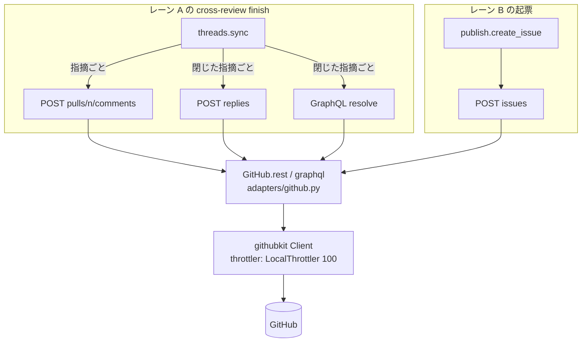
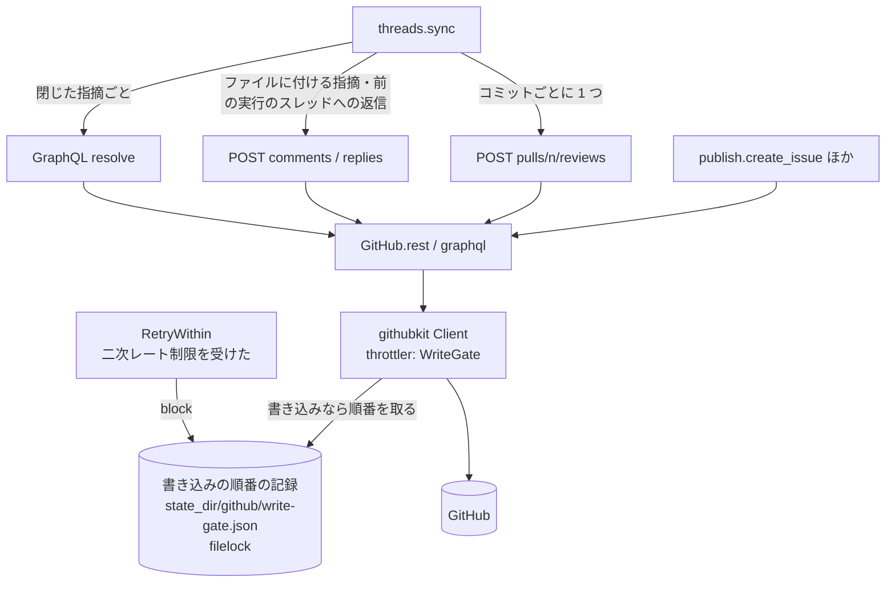
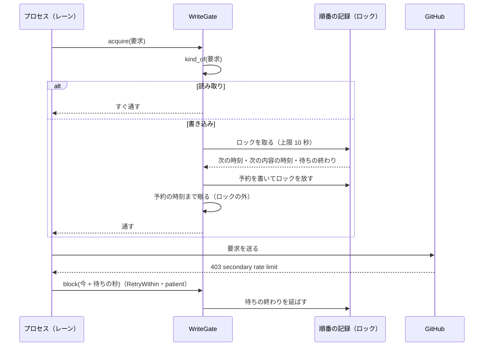

# GitHub への書き込み: 二次レート制限の内側に収まるよう、まとめて送り、マシン全体で間を空ける（#4016）

cross-review が終わるときに指摘 1 件ごとに 3 回書き、並列のレーンの書き込みと合わせて GitHub の二次レート制限に当たり、同じアカウントのすべてのレーンが書けなくなった。行に付ける指摘は付けるコミットごとに 1 つのレビューへまとめ、閉じた指摘の返信を省く。NDF が GitHub へ書くすべての要求にはマシン全体の間隔を当て、二次レート制限に当たったらその待ちをマシン全体へ知らせて、`retry-after` が無ければ指数的に延ばす。比べた案は「決定の記録」に、Octokit・githubkit・pyrate-limiter の調査は末尾の「外部の調査」にある。

## 今の姿

何が起きたか・目的・受け入れ条件は要求仕様（[issue-4016-requirements.md](./issue-4016-requirements.md)、正は #4016 の本文）にある。この文書は「どう解くか」と「なぜその解き方か」だけを書く。

- **NDF の GitHub への要求は、すべて `adapters/github.py` の `client()` が作る githubkit の `Client` を通る**（`grep -rn "github.client()\|gh.client()" plugins/ndf/src` で呼び手 10 か所。`grep -rn "Client(" plugins/ndf/src` の当たりは `adapters/github.py` の 1 か所と、GitHub 以外へ送る `httpx.Client` だけ）。throttler は githubkit の既定の `LocalThrottler(100)`（同時 100 本までのプロセス内のセマフォ）で、書き込みの間を空けない。githubkit の `BaseThrottler` の docstring も「TODO: Implement the pause between mutative requests」と書く
- 間隔は `threads.GitHubPort._post`（スレッドを作るとき）にだけあり、プロセスの中の時計で `cross-review.thread-spacing`（1 秒）を空ける。返信・resolve・記録のコメント・Issue の起票は間を空けない
- 二次レート制限の打ち直しは `threads.patient` だけが持つ（cross-review の書き込みと記録のコメント）。待ちは `throttle_decide.wait_before_retry` が決め、`exc.retry_after` があればその秒、無ければ `cross-review.secondary-rate-limit` の `interval`（60 秒）を毎回使う
- **githubkit は二次レート制限の待ちを必ず埋める。** `_extract_retry_after` は `retry-after` → `x-ratelimit-reset` → 60 秒の順で値を作り、`adapters/github.py` の `_translated` がそれを `GitHubError.retry_after` へ写す。そのため今の `patient` は `retry-after` の有無を見分けられず、ヘッダーが無くても毎回 60 秒を待つ
- 状態ファイル（cross-review の `threads`）は指摘の番号ごとに `comment`・`replied`・`resolved` を持ち、`sync` の後に `cli._post_report` が保存する。`sync` の途中でプロセスが落ちると、それまでに書いた分の印は残らない
- 記録のコメントは、cross-review が PR に 1 つだけ書く実行の記録（指摘の表・注意）で、打ち直しのたびに同じコメントを書き換える。指摘のスレッドとは別の書き込みである

## 文脈と制約

- **GitHub の上限**（要求の前提 1、外部の調査の STD1・STD2）: 内容を作るリクエストはおおむね 1 分 80 件・1 時間 500 件。書き込みは順に送り、間を 1 秒以上空ける。当たったら `retry-after` → `x-ratelimit-reset` → 1 分以上の順で待ち、続けば指数的に延ばす。ブロックが続く長さは公開されていない
- **当たった量は分かっていない。** 起票の事象の数（1 分 43 件・22 件）は 1 分 80 件を下回り、resolve とほかのレーンの書き込みは数えていない。間隔の既定は、数えられる上限のうち厳しい 1 時間 500 件から決める
- 決定の根拠の行の `Value <番号>` は、プロジェクト MVV（`.ndf/mvv.md`）の判断の基準の番号である
- **レビューの作成（`POST /pulls/{n}/reviews`）は `comments[]` に `subject_type` を持たず、応答に作ったコメントの id を持たない**（STD3）。ファイルに付けるスレッドはまとめられず、作ったコメントの id は `GET /pulls/{n}/reviews/{review_id}/comments` で読み直す
- **レビューは 1 つのコミットにしか付けられない。** 指摘の行は指摘のラウンドの head の行なので、別のコミットに付けると行がずれる
- **githubkit の throttler は要求を送る前にだけ呼ばれ、応答を見ない**（`core.py` の `_request` の `with throttler.acquire(request): client.send(request)`。応答の検査はその外）。応答の失敗は `auto_retry` の判断の関数（`RetryWithin`）が受ける。打ち直しのたびに throttler をもう一度通る
- **並列のレーンは別のプロセスで、同じ OS のユーザーで動く。** プロセスの中の時計では合計を抑えられない
- **他のレーンと重なる箇所がある**（下の「影響と危険」）。この設計 PR の差分は `issues/issue-4016-*` だけにする

## 解き方の全体像

- 行に付ける指摘は、付けるコミットごとに 1 つのレビューで書く。この実行で閉じた指摘は、最初のコメントに直したコミットか見送りの理由を書いて作り、返信しない。指摘が N 件・コミットが 1 つなら、インラインのコメントを作るリクエストは 1 件になる
- NDF が GitHub へ書く要求（REST の GET・HEAD 以外と、GraphQL の mutation）は、送る前にマシン全体の順番を取る。順番を取るのは githubkit の throttler（新しい `WriteGate`）である。どの書き込みも前の書き込みから 1 秒、内容を作る書き込みは前の内容を作る書き込みから 7.2 秒を空ける
- 二次レート制限に当たったプロセスは、待ちの終わりの時刻を順番の記録へ書く。ほかのプロセスの書き込みもその時刻まで待つ
- cross-review の打ち直しは、`retry-after` が無ければ 60 秒・120 秒・240 秒と延ばし、上限の回数で失敗を返す

## ドメインモデル

### コンテキスト

| コンテキスト | 何の語が 1 つの意味に決まるか |
| --- | --- |
| NDF の実行の基盤 | 書き込みの順番・内容を作る書き込み・待ちの終わり（GitHub への要求の数え方） |
| NDF の cross-review | 指摘のスレッド・記録のコメント（PR へ何を書くか） |

cross-review は実行の基盤の書き込みの順番を使う側で、順番の決め方を知らない（顧客と供給者の関係。供給者は実行の基盤）。

### 集約

| 集約 | オーナー（書き換えてよいもの） | 根 | エンティティ | 値オブジェクト |
| --- | --- | --- | --- | --- |
| 書き込みの順番の記録 | `WriteGate`（ロックの中でだけ書く） | 記録のファイル（マシンに 1 つ） | — | 次の書き込みの時刻・次の内容を作る書き込みの時刻・待ちの終わり |
| 指摘のスレッドの記録 | `threads.sync`（cross-review の状態ファイルの `threads`） | 状態ファイル（PR ごと） | 指摘の番号ごとの印 | 最初のコメントの id・返信済み・resolve 済み |

### 不変条件

| # | 集約 | 条件 | 破れたときの扱い |
| --- | --- | --- | --- |
| I1 | 書き込みの順番の記録 | 続く 2 つの書き込みの予約の時刻の差は `github.write-spacing` の `interval`（1 秒）以上 | 予約はロックの中で前の予約から計算するので、ロックを取れたら破れない。ロックを取れなければ I5 |
| I2 | 書き込みの順番の記録 | 続く 2 つの内容を作る書き込みの予約の差は `github.content-spacing` の `interval`（7.2 秒）以上 | I1 と同じ |
| I3 | 書き込みの順番の記録 | 待ちの終わりより前の時刻に、書き込みを予約しない | 同上 |
| I4 | 指摘のスレッドの記録 | 同じ指摘について、スレッド・返信・resolve をそれぞれ 2 回書かない | 書く前に PR のスレッドを読み、自分が書いた最初のコメントの本文に指摘の番号があれば、書かずに印を埋める（保存の前に落ちた打ち直しも同じ） |
| I5 | 書き込みの順番の記録 | 記録を読めない・ロックを取れないときも、書き込みを止めない | プロセスの中の間隔だけで送り、標準エラーへ 1 行を出す |

### ドメインイベント

| # | イベント | 発生元 | 受け手 |
| --- | --- | --- | --- |
| E1 | cross-review の実行が終わった | `cli._post_report` | `threads.sync` |
| E2 | 指摘をコミットごとのレビューにまとめて書いた | `threads.sync` | 指摘のスレッドの記録 |
| E3 | 前の実行のスレッドへ返信した | `threads.sync` | 指摘のスレッドの記録 |
| E4 | 閉じた指摘のスレッドを resolve した | `threads.sync` | 指摘のスレッドの記録 |
| E5 | 二次レート制限に当たった | `RetryWithin`・`threads.patient` | 書き込みの順番の記録（待ちの終わり） |
| E6 | 書き込みの順番を取った | `WriteGate.acquire` | 書き込みの順番の記録 |

## 構成要素

| 要素 | 責務 |
| --- | --- |
| `WriteGate`（新設。`adapters/write_gate.py`） | githubkit の `BaseThrottler` を継ぎ、書き込みの要求を送る前にマシン全体の順番を取って待つ。待ちの終わりを受け取って記録する |
| 要求の分け方（新設。`write_gate.kind_of`） | `httpx.Request` から、読み取り・書き込み・内容を作る書き込みのどれかを決める |
| `client()`（変更。`adapters/github.py`） | `Client` に `WriteGate` を渡す。`RetryWithin` が二次レート制限を受けたら `WriteGate.block` を呼ぶ |
| `GitHubError`（変更） | 二次レート制限か（`secondary`）と、GitHub が待ちの秒を返したか（`hinted`）を持つ |
| `threads.sync` と `GitHubPort`（変更） | 行に付ける指摘をコミットごとのレビューで書き、閉じた指摘の返信を最初のコメントへ入れる |
| `threads.patient`・`throttle_decide`（変更） | 打ち直しの待ちを指数的に延ばし、待つ前に `WriteGate.block` を呼ぶ |
| `contracts/limits.json`（変更） | `github.write-spacing`・`github.content-spacing` を足し、`cross-review.secondary-rate-limit` に `factor`・`max_interval` を足す。`cross-review.thread-spacing` を消す |

## 処理の流れ

予約の時刻は `max(今, 次の書き込みの時刻, 待ちの終わり)`、内容を作る書き込みはさらに `次の内容の時刻` との大きいほうである。予約を書いた後にロックを放してから眠るので、待つ間にほかのプロセスが順番を取れる（ロックを持ったまま眠ると、ロックの待ちの上限で I5 へ落ちる）。

`threads.sync` は次の順で書く。

1. PR のスレッドを 1 回読む（`open_threads`）。印の無い指摘のうち、自分が書いた最初のコメントの本文に番号があるものは、書かずに印を埋める（保存の前に落ちた打ち直しで同じものを二度作らない）
2. 前の実行のスレッドを持つ指摘（印に `comment` がある）: この実行で閉じたら返信し、resolve する（今のとおり）
3. 印の無い、行に付ける指摘: 付けるコミット（指摘のラウンドの head）ごとに組を作り、組ごとに 1 つのレビュー（`event: COMMENT`）を送る。この実行で閉じた指摘の本文には閉じた理由を入れる
4. レビューが 422 で断られた組と、行の分からない指摘: 1 件ずつ今の `open_thread`（行 → ファイルの付け直し）で書く
5. レビューを 1 つ以上送れたら、PR のスレッドをもう 1 回読み、本文の指摘の番号で印の `comment` を埋める。閉じた理由を本文に入れた指摘は印の `replied` を真にする。このときの読み取りが、resolve に要るスレッドの id も持つ
6. 閉じた指摘で resolve していないもの: 1 件ずつ resolve する

## 決定の記録

### 決定 1: レーンの数によらず合計を抑えるため、間隔を githubkit の throttler でマシン全体に当てる

- **質問**: 間隔をどの層に、どの範囲で置くか
- **選んだ案**: githubkit の `BaseThrottler` を継いだ `WriteGate` を `client()` が `Client` に渡す。NDF のすべての書き込みが 1 か所を通り、マシンに 1 つの記録（`identity.load().state_dir / "github" / "write-gate.json"`）を filelock で守って順番を取る
- 採らなかった案: 書く関数ごと（`threads.py`・`publish.py`・`issues_gh.py`）に間隔を置く（10 か所の呼び手のうち書く場所を漏れなく包む必要があり、新しく書く場所が漏れる）
- 採らなかった案: pyrate-limiter の SQLite のバケットで数える（依存が 1 つ増える。窓の中の回数を数える形で、前の書き込みからの間隔と待ちの終わりの共有を持たない）
- 採らなかった案: Octokit の throttling と同じく Redis で共有する（サーバーを 1 つ立てる必要がある。マシンの外の共有は要求の前提 2 で求めていない）
- **代償**: 読み取りを除くすべての書き込みが、ほかのレーンの書き込みの分だけ待つ。同じマシンで別のアカウントが書く分も同じ記録で数える（数え過ぎる側に倒れる）
- 作り方: ライブラリやサービスを使う・自前で作る
- 比べた候補: LIB1 / LIB2 / LIB3 / PRD1
- 根拠: Value 6（MVV バージョン 1）。STD1・STD2

### 決定 2: 書き込みの順番を公平に配るため、予約を書いてからロックの外で眠る

- **質問**: ロックを持ったまま待ちの時刻まで眠るか、予約だけをロックの中で書くか
- **選んだ案**: ロックの中で予約の時刻を計算して記録へ書き、ロックを放してから眠る。時刻は壁時計（`time.time`）を使う（プロセスをまたいで比べるため）
- 採らなかった案: ロックを持ったまま眠る（7.2 秒ずつ並ぶと、後ろのプロセスがロックの待ちの上限に当たる）
- **代償**: 予約した後にプロセスが落ちると、その予約の分だけほかの書き込みが待つ（最大 7.2 秒）。壁時計が大きく戻ると予約が遠い先に残るので、予約が今から `cross-review.secondary-rate-limit` の `max_interval` と `github.content-spacing` の `interval` の和より先なら記録を捨てて今から数える
- 根拠: 根拠なし（MVV バージョン 1）

### 決定 3: 内容を作る書き込みを 1 時間 500 件に収めるため、書き込みを 2 つに分けて間隔を変える

- **質問**: すべての書き込みに 7.2 秒を当てるか、内容を作る書き込みだけに当てるか
- **選んだ案**: REST の POST と、GraphQL の `create`・`add` で始まる mutation を内容を作る書き込みとする。GitHub の GraphQL で内容を作る mutation は `addComment`・`addPullRequestReview`・`createIssue`・`createPullRequest` のように `add`・`create` で始まり、resolve・更新・マージは別の動詞で始まる。内容を作る書き込みは、前の内容を作る書き込みから `github.content-spacing` の `interval`（7.2 秒 = 3,600 秒 ÷ 500 件）を空ける。どの書き込みも、前の書き込みから `github.write-spacing` の `interval`（1 秒）を空ける（PATCH・PUT・DELETE と resolve などの mutation はこれだけ）
- 採らなかった案: すべての書き込みに 7.2 秒（resolve とラベルの付け替えも 7.2 秒ずつ待ち、cross-review の終わりが指摘の数 × 7.2 秒だけ延びる）
- 採らなかった案: 内容を作るエンドポイントの一覧を持つ（GitHub は一覧を公開しておらず、POST の大半が内容を作る。一覧は古くなる）
- **代償**: ラベルを足す POST など、内容を作らない POST も 7.2 秒を待つ
- 根拠: Value 3（MVV バージョン 1）。STD1

### 決定 4: インラインのコメントを作るリクエストを減らすため、行に付ける指摘をコミットごとの 1 つのレビューで書く

- **質問**: 指摘をどの単位でまとめて書くか
- **選んだ案**: 指摘のラウンドの head のコミットごとに、そのコミットの行に付ける指摘を 1 つのレビュー（`POST /pulls/{n}/reviews`、`event: COMMENT`）にまとめる。ファイルに付ける指摘は 1 件ずつ書く
- 採らなかった案: PR の今の head に 1 つのレビューで付ける（ラウンドの後のコミットで行が動くと、別の行に付く）
- 採らなかった案: GraphQL の `addPullRequestReview` の `threads` で書く（REST と同じく 1 つのコミットにしか付けられず、利点が無い。今の Port（`GitHubPort`）が REST なので経路が 2 つになる）
- **代償**: レビューの応答は作ったコメントの id を持たないので、送った後に PR のスレッドを 1 回読み直す（書く前の 1 回と合わせて読み取りが 2 回）。要求の受け入れ条件 1 の「1 件」は、コミットが k 個なら k 件になる（要求の起票者の推定 S1）
- 作り方: 標準に倣う
- 比べた候補: STD3
- 根拠: Value 1（MVV バージョン 1）

### 決定 5: レビューの 1 件の行が断られても記録を欠かさないため、422 の組は 1 件ずつの書き込みへ落とす

- **質問**: レビューが 422（行が差分に無い）で断られたとき、どこまで書き直すか
- **選んだ案**: 断られた組の指摘を、今の `open_thread`（行に付け、断られたらファイルに付け直す）で 1 件ずつ書く
- 採らなかった案: 組を半分に割って断られた指摘を探す（どの指摘が断られたかを GitHub は返さず、要求が対数の回数だけ増える。断られるのはまれで、1 件ずつに落としても今より増えない）
- **代償**: 断られた組は今と同じ件数の書き込みになる
- 根拠: Value 1（MVV バージョン 1）

### 決定 6: この実行で閉じた指摘の書き込みを 1 回にするため、閉じた理由を最初のコメントへ入れて返信を省く

- **質問**: この実行で直した・見送った指摘を、スレッドと返信の 2 つで書くか、1 つで書くか
- **選んだ案**: 最初のコメントの本文の末尾に、返信に書いていた文（`直した（修正のコミット …）`・`見送った: …`）を足し、返信を書かない。前の実行が作ったスレッドの指摘をこの実行で閉じたときは、今のとおり返信する
- 採らなかった案: 返信を残す（指摘 1 件ごとに 1 回の内容を作る書き込みが残り、7.2 秒ずつ延びる）
- **代償**: PR の上では、閉じた指摘のスレッドに返信が付かず、1 つのコメントで閉じる
- 根拠: Value 1（MVV バージョン 1）

### 決定 7: 1 つのレーンが当たった二次レート制限でほかのレーンが打ち続けないよう、待ちの終わりを順番の記録で共有する

- **質問**: 二次レート制限の待ちを、当たったプロセスだけが持つか、マシン全体へ知らせるか
- **選んだ案**: 二次レート制限を受けた `RetryWithin`（githubkit の打ち直しの判断）と `threads.patient` が、待つ前に `WriteGate.block(今 + 待ちの秒)` を呼ぶ。ほかのプロセスの書き込みは、その時刻まで順番を予約しない
- 採らなかった案: 当たったプロセスだけが待つ（ほかのレーンが打ち続け、STD2 が言う BAN に近づく）
- **代償**: 1 つのレーンの当たりで、同じマシンのすべてのレーンの書き込みが止まる。読み取りは止めない
- 根拠: Value 6（MVV バージョン 1）。STD1

### 決定 8: GitHub が待ちの秒を返さないときを見分けるため、`GitHubError` に `hinted` を持たせて待ちを指数的に延ばす

- **質問**: githubkit が `retry-after` の無い待ちを 60 秒で埋めるので、ヘッダーの有無をどこで見分けるか
- **選んだ案**: `_translated` が二次レート制限の応答の `retry-after` と `x-ratelimit-reset` を見て、どちらかがあれば `hinted` を真にする。`patient` は `hinted` なら `retry_after` を、無ければ `contracts/routing.backoff`（`interval × factor^回数`、`max_interval` で頭打ち）を使う。`cross-review.secondary-rate-limit` は `attempts` 4・`interval` 60・`factor` 2・`max_interval` 600 にする（60・120・240 秒の後に失敗を返す）。二次レート制限かどうかも `_translated` が `secondary` に書き、`throttle_decide.secondary_limited` は消す
- 採らなかった案: `retry_after` を、ヘッダーが無ければ None にする（`grep -rn "retry_after is not None" plugins/ndf/src` の 10 か所が上限の待ちと読む分け方が変わる）
- 採らなかった案: 打ち直しの関数を新しく作る（`routing.backoff` が同じ式を持つ）
- **代償**: `GitHubError` の属性が 2 つ増える。テストの偽の失敗も 2 つの属性を持たせる
- 根拠: Value 6（MVV バージョン 1）。STD1・PRD1

### 決定 9: 打ち直しても状態が食い違わないよう、resolve は 1 件ずつ送る

- **質問**: 閉じた指摘の resolve を、1 つの GraphQL の要求に別名（alias）で並べてまとめるか、1 件ずつ送るか
- **選んだ案**: 1 件ずつ送る。resolve は内容を作らない書き込みなので、間隔は 1 秒である
- 採らなかった案: 別名で 1 つの要求にまとめる（一部だけが断られたときの応答の読み分けが要り、GitHub が mutation を別名ごとに数えるかは公開されていない。1 件ずつでも指摘 20 件で約 20 秒に収まる）
- **代償**: 閉じた指摘の数だけ要求が残る
- 根拠: Value 3（MVV バージョン 1）。STD1

## 影響と危険

- **働く範囲**: NDF を導入したすべてのリポジトリ。NDF が GitHub へ書く要求（cross-review・起票・リリース・マージキュー）のすべてが、マシン全体の順番を取る。エージェントが NDF を通さずに打つ `gh` は数えない（要求の「含まない」）
- **プロジェクトごとに違うもの**: 無い。間隔の値は `contracts/limits.json` の方針で、プロジェクトの設定では変えない（GitHub のアカウントの上限で、リポジトリで変わらない）
- **当たるモード**: すべてのモード
- **他のレーンと重なる箇所**（conductor の指示。2026-11-22）: 実装は次のファイルを触るので、同じスプリントの別のレーンの変更とマージの順を合わせる。この設計 PR はどれも変えない

  | ファイル | 重なるレーン | 扱い |
  | --- | --- | --- |
  | `plugins/ndf/src/ndf/domains/crossreview/threads.py`・`throttle_decide.py`・`cli.py` | lcrfast（cross-review のコード） | 実装は lcrfast のマージの後にその上で行う |
  | `plugins/ndf/contracts/limits.json` | lctx（limits.json） | 足す方針は `github.write-spacing`・`github.content-spacing` の 2 行、変える方針は `cross-review.secondary-rate-limit` と `cross-review.thread-spacing`（消す）の 2 行で、lctx が触る行と重ならなければ同じファイルの別の行として rebase で合わせる |

- **壊れうる箇所**
  - テストの GitHub の偽物（`transport` を渡すテスト）が順番の記録を書いて眠る。`client()` は `transport` を渡されたら `WriteGate` を付けず、`WriteGate` のテストは時計と眠りを差し替えて組む
  - リリースの経路（`release/` の `land.py`・`tagging.py`・`trail.py`・`assemble.py` の POST・PATCH）も 1 秒〜7.2 秒ずつ待つ。1 回のリリースの書き込みの件数は数えていない（未確認）
  - **待ちの長さは並ぶ数で延びる。** 1 つの書き込みの待ちは、先に並んだ内容を作る書き込みの数 × 7.2 秒と、待ちの終わりまでの秒の大きいほうになる。6 つのレーンが同時に内容を作れば、最後のレーンは約 36 秒待つ。二次レート制限の後は、待ちの終わりまで（最大 600 秒）どのレーンも書かない。待ちの予算を持つ呼び手（CI の監視の `RetryWithin`）の書き込みは、マージの操作など数件である。予算を越えて眠りうるが、二次レート制限の後に書けば断られるので、待たずに打つ利点は無い
  - 状態ファイルの `threads` の印の形は変わらない。前の版の状態ファイルはそのまま読める

### 代表のリポジトリでの振る舞い

| 代表のリポジトリ | 設定の要点 | 直した後に起きること | この種類で扱えなくなること |
| --- | --- | --- | --- |
| Web サービス | GitHub のリポジトリで cross-review と起票を使う | cross-review の終わりの書き込みがコミットごとのレビューにまとまり、並列のレーンの書き込みが順番を取って待つ。設計・cross-review・MVV 判定の振る舞いは変わらない | 無し |
| モバイルアプリ | 同上 | 同上 | 無し |
| 業務文書だけ | PR と cross-review で文書をレビューする | 同上 | 無し |

### このリポジトリだけの事情

- 無し（間隔の値は GitHub のアカウントの上限から決め、ai-plugins の運用の値を使わない）

## 用語

この設計 PR は `issues/issue-4016-*` だけを変える（conductor の指示）ため、用語集（`docs/glossary/glossary.json`）へは実装の PR で足し、`pending_source` にこの文書を書く。

| 用語 | 意味 | 用語集への反映 |
| --- | --- | --- |
| 書き込みの順番の記録 | NDF の GitHub への書き込みがマシン全体で順番を取るための記録（`<state_dir>/github/write-gate.json`）。次の書き込みの時刻・次の内容を作る書き込みの時刻・待ちの終わりを持つ | 追加（NDF の実行の基盤） |
| 内容を作る書き込み | REST の POST と、GraphQL の `create`・`add` で始まる mutation。前の内容を作る書き込みから `github.content-spacing` の秒を空ける | 追加（NDF の実行の基盤） |
| 二次レート制限 | GitHub が一次の上限とは別に、短い間の書き込みの多さ・同時の要求の多さで断る上限。403 か 429 と本文の `secondary rate limit` で返る | 追加（NDF の実行の基盤） |

## テスト設計

| 受け入れ条件・不変条件 | どの振る舞いで縛るか | どう壊したら落ちるべきか |
| --- | --- | --- |
| 受け入れ条件 1 | 行に付ける指摘 N 件が 1 つのコミットにあるとき、偽の Portが受けるレビューの作成が 1 回で、スレッドの作成が 0 回。コミットが 2 つなら 2 回 | 指摘ごとに `open_thread` を呼ぶ形へ戻す・コミットで組を分けない |
| 受け入れ条件 2 | この実行で閉じた指摘に返信が 0 回で、最初のコメントの本文が閉じた理由を含む。前の実行の印を持つ指摘を閉じると返信が 1 回 | 閉じた指摘にも返信する・前の実行のスレッドへの返信を省く |
| 受け入れ条件 3 | 返信と resolve の要求が `WriteGate` を通り、続く 2 つの間が `github.write-spacing` の秒以上 | `kind_of` が PATCH・GraphQL の mutation を読み取りとする |
| 受け入れ条件 4・I1・I2 | 2 つのプロセスが同じ記録で同時に順番を取ると、2 つの予約の差が `github.write-spacing`（内容を作るなら `github.content-spacing`）の秒以上 | ロックを外す・予約を記録へ書かない |
| I3 | `block` の後に取った順番が待ちの終わりより後 | `block` を記録へ書かない |
| I5 | 記録が壊れた JSON・ロックが取れないとき、書き込みが通り、標準エラーへ 1 行が出る | 例外をそのまま出す |
| 受け入れ条件 5 | `hinted` が偽の二次レート制限が続くと、待ちが 60・120・240 秒と延び、4 回目の失敗で例外を出す。`hinted` が真なら `retry_after` を待つ | 待ちを `interval` に固定する・回数の上限を見ない |
| 受け入れ条件 6・I4 | 印を保存せずに打ち直すと（レビューを送った後に落ちた形）、PR に自分のスレッドがある指摘のレビューを作らず、印を埋める。ほかの人が同じ書式で書いたスレッドは拾わない | 書く前のスレッドの読み取りを外す・書き手を確かめない |
| 決定 5 | レビューが 422 で断られた組の指摘が、1 件ずつの `open_thread` で書かれる | 422 の組を書かずに注意だけにする |

## どこを変えるか

詳細設計は別のファイル [issue-4016-design-detail.md](./issue-4016-design-detail.md) にある（新設する関数が 2 つ以上あるため）。

## 設計の結果

| 課題 | 扱い | 統合先 | 触るファイル |
| --- | --- | --- | --- |
| #4016 | 実装する | — | `plugins/ndf/src/ndf/adapters/write_gate.py`（新設）、`plugins/ndf/src/ndf/adapters/github.py`、`plugins/ndf/src/ndf/domains/crossreview/threads.py`、`plugins/ndf/src/ndf/domains/crossreview/throttle_decide.py`、`plugins/ndf/src/ndf/domains/crossreview/cli.py`、`plugins/ndf/contracts/limits.json`、`plugins/ndf/tests/adapters/test_write_gate.py`（新設）、`plugins/ndf/tests/adapters/test_github.py`、`plugins/ndf/tests/domains/crossreview/test_crossreview_report.py`、`plugins/ndf/tests/domains/crossreview/test_crossreview_throttle.py`、`docs/glossary/glossary.json`、`docs/glossary.md` |

## 未確認のまま残ること

| 項目 | 内容 |
| --- | --- |
| 1 つのレビューに載せられるコメントの数の上限 | 文書に上限が無い。実装のテストでは偽物で確かめ、リリースの後の最初の cross-review の終わりで、指摘の多い PR のレビューが通るかを事象の一覧で確かめる |
| 二次レート制限に当たった量 | 起票の事象の数は 1 分 80 件を下回る（文脈と制約）。GitHub の数え方は公開されていない。リリースの後の最初の並列の計画で、二次レート制限に当たらないことと事象の数で確かめる |
| GitHub がレビューの作成を内容を作るリクエストの何件と数えるか | 公開されていない。リリースの後の最初の cross-review の終わりで、二次レート制限に当たらないことと事象の数で確かめる |

## 外部の調査

| 種類 | 調べるか | 理由 |
| --- | --- | --- |
| 標準・仕様 | 調べる | GitHub の上限とレビューの作成の API が書き込みの形と間隔を決める |
| 主要な製品 | 調べる | GitHub の公式の SDK が書き込みの間隔をどう取るかを比べる |
| ライブラリとサービス | 調べる | 間隔の共有を自前で作る前に、使っているライブラリの拡張点と既存の候補を比べる |

### 標準・仕様

| # | 標準・仕様 | 何を定めているか | 設計への反映 | 出典 |
| --- | --- | --- | --- | --- |
| STD1 | GitHub の REST API のベストプラクティス | 書き込みは並列にせず順に送り、間を 1 秒以上空ける。当たったら `retry-after` → `x-ratelimit-reset` → 1 分以上待ち、続けば指数的に延ばす | 決定 1・3・7・8 | https://docs.github.com/en/rest/using-the-rest-api/best-practices-for-using-the-rest-api（2026-11-22、起票者が読んだ） |
| STD2 | GitHub の REST API の上限 | 内容を作るリクエストはおおむね 1 分 80 件・1 時間 500 件。同時 100 件。打ち続けると BAN されうる | 決定 1・3・7 | https://docs.github.com/en/rest/using-the-rest-api/rate-limits-for-the-rest-api（2026-11-22、起票者が読んだ） |
| STD3 | レビューの作成（`POST /pulls/{n}/reviews`） | `comments[]` は `path`・`position`・`body`・`line`・`side`・`start_line`・`start_side` を持ち `subject_type` を持たない。応答は作ったコメントの id を持たない。コメントは `GET /pulls/{n}/reviews/{review_id}/comments` で読む。古いコミットに付けると outdated になりうる | 決定 4・5（outdated は後のコミットがその行を変えたときの表示で、今の指摘のスレッドもラウンドの head に付けている） | https://docs.github.com/en/rest/pulls/reviews?apiVersion=2022-11-28#create-a-review-for-a-pull-request（2026-11-22） |

### 主要な製品

| # | 製品 | どう解いているか | 設計への反映 | 出典 |
| --- | --- | --- | --- | --- |
| PRD1 | Octokit の `@octokit/plugin-throttling` | Bottleneck のグループで書き込みを同時 1 本・間 1,000 ms、通知を起こすものを 3,000 ms にする。二次レート制限は本文の `secondary rate` で見分け、`retry-after` が無ければ 60 秒。`connection` を渡すとグループを Redis でクラスタにする | 決定 1（書き込みを 1 か所で順に並べる形を倣う。Redis は採らない）・決定 3（書き込みを種類で分ける）・決定 8 | https://raw.githubusercontent.com/octokit/plugin-throttling.js/main/src/index.ts（2026-11-22） |

### ライブラリとサービス

| # | 候補 | バージョン | ライセンス | 最後のリリースの日付 | 終了のアナウンス | 要件を満たすか | 出典 |
| --- | --- | --- | --- | --- | --- | --- | --- |
| LIB1 | githubkit の `BaseThrottler` | 0.17.1（導入済み） | MIT | 確かめられなかった | 無し | 拡張点として満たす。要求を送る前に `httpx.Request` を受け、打ち直しのたびに通る。既定の `LocalThrottler` は同時の本数だけを絞り、書き込みの間を空けない（docstring の TODO） | `.venv/lib/python3.14/site-packages/githubkit/throttling.py`・`core.py`（2026-11-22） |
| LIB2 | filelock | 4.2.10（導入済み。最新 4.3.0） | MIT | 確かめられなかった | 無し | 満たす。カーネルのロックでプロセスをまたいで排他する。`slot_pool.py` が同じ使い方をしている | `plugins/ndf/pyproject.toml`・https://pypi.org/pypi/filelock/json（2026-11-22） |
| LIB3 | pyrate-limiter | 4.5.1 | MIT | 確かめられなかった | 無し | 一部満たす。SQLite のバケットに `use_file_lock=True` で 1 つのマシンの複数のプロセスが数えられる。窓の中の回数の形で、前の書き込みからの間隔と待ちの終わりの共有を持たない。依存が増える | https://pypi.org/pypi/pyrate-limiter/json（2026-11-22） |

### 確かめられなかったこと

| 対象 | 試した手段 | 結果と理由 |
| --- | --- | --- |
| LIB1〜LIB3 の最後のリリースの日付 | PyPI の JSON（filelock・pyrate-limiter）。githubkit は試していない | ページが長く、取得の要約にリリースの日付が出なかった |
| Octokit が書き込みを `write` のグループへ振り分ける条件 | `src/index.ts` | 振り分けは `wrap-request` にあり、取得したファイルに無かった |

調べた量: 候補 5 件・取得の試み 5 回。
