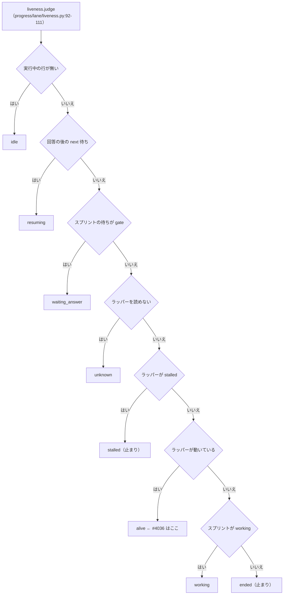
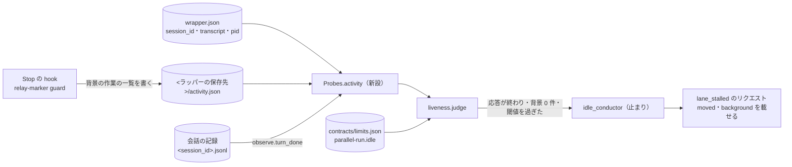
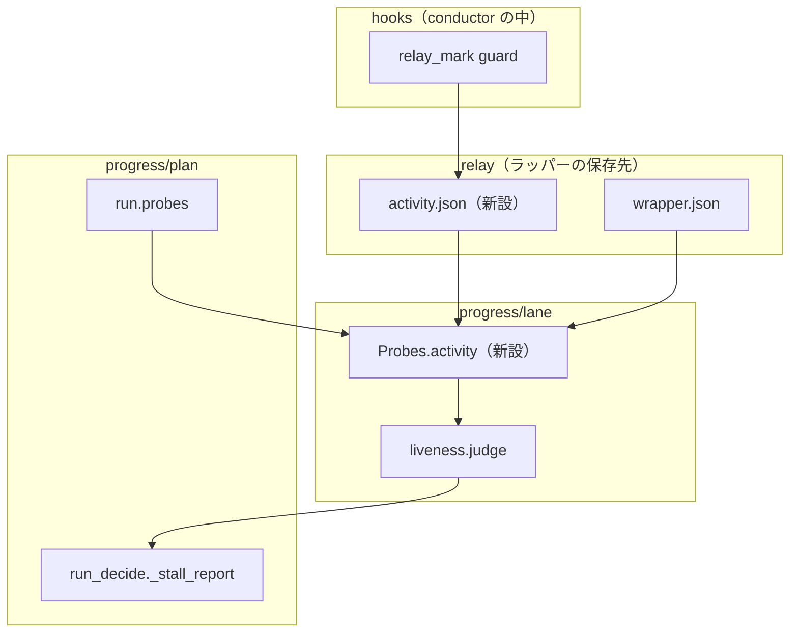
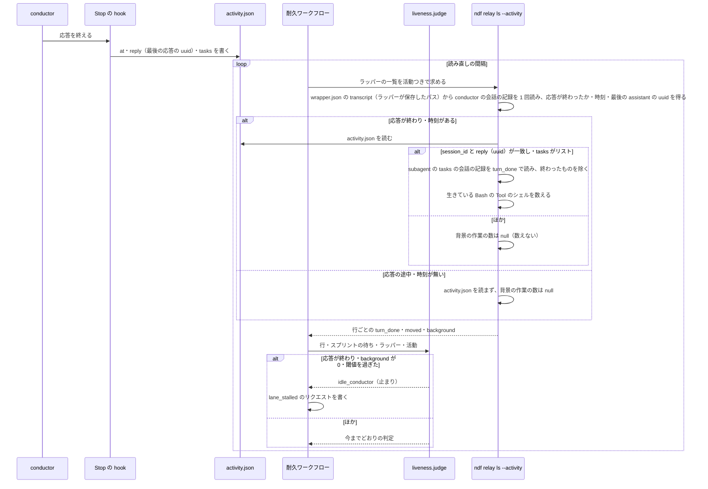

# レーンの生死: 何もしていない conductor を止まりとして知らせる（#4036）

レーンの生死は conductor のラッパーのプロセスが動いているかだけで決まる。そのため、背景の作業を持たないまま来ない通知を待つ conductor が「動いている」と判定され、約 3 時間が誰にも気づかれなかった。ラッパーの状態ファイルから会話の記録をたどって最後の応答の時刻を測り、背景の作業の件数を Stop の hook が書き残す形にして、両方がそろったときだけ止まりとする。閾値は `contracts/limits.json` に置く。採らなかった案は「決定の記録」にある。

## 今の姿

何が起きたか・目的・受け入れ条件は要求仕様（[issue-4036-requirements.md](./issue-4036-requirements.md)、正は #4036 の本文）にある。この文書は「どう解くか」と「なぜその解き方か」だけを書く。

- 判定は 8 つの値（`idle`・`resuming`・`waiting_answer`・`unknown`・`stalled`・`alive`・`working`・`ended`）を返す。止まりとして知らせるのは `stalled` と `ended` の 2 つだけである（`liveness.py:38-49`）
- 順 6 の `alive` は `ndf relay ls` の行の `running` だけを見る（`liveness.py:87-89`）。conductor が何をしているかは見ない
- 材料を読むインターフェースは `Probes` の 4 つ（`wrapper_name`・`wrappers`・`sprint`・`account_ok`。`liveness.py:124-133`）で、実装は `progress/plan/run.py:120-130` にある
- `liveness.py` は `contracts/limits.json` を 1 つも読んでいない。判定はすべて状態の値だけで決まる
- `lane_stalled` のリクエストの `moved`（最後に動いた時刻）は、ステートマシンの記録の時刻である（`progress/plan/run.py:171-181`）。**conductor の会話の動きは見ていない**ため、工程が進まない間はこの値も更新されない

会話の記録と背景の作業を読む材料は、別の場所に既にある。

| 材料 | 場所 | 読めるもの |
| --- | --- | --- |
| 会話の記録のパス | `domains/relay/observe.py:55-57`（`transcript_path(environ, cwd, session_id)`） | 記録のファイルのパス |
| 最後の応答の時刻 | `domains/relay/observe.py:196-208`（`turn_done(path, size)`） | 最後の記録が終わった応答なら `(True, その時刻)`、途中なら `(False, None)` |
| `session_id` と `cwd` | ラッパーの状態ファイル `wrapper.json`（`domains/relay/registry.py:28`・`wrapper.py:950-968`） | 会話の記録のパスを組む材料 |
| 背景の作業 | Stop の hook の入力の `background_tasks`（`domains/hooks/context.py:609-611`、`guards/relay_mark.py:22`） | conductor が応答を終えた時点で走っている作業の一覧。要素ごとに `id`・`type`（`shell`・`subagent` など）・`status` を持つ（STD3） |
| 背景のサブエージェントの会話の記録 | `<会話の記録のディレクトリ>/<session_id>/subagents/agent-<id>.jsonl`（2026-11-23 に手元の Claude Code で確かめた） | サブエージェントの最後の応答が終わったか（`observe.turn_done` で読める） |

`ndf relay ls` の行（`domains/relay/hub.py:498-510`）には `session_id` と `cwd` が載っていない。

## 文脈と制約

- 判定（`liveness.judge`）は DB もプロセスも読まない純粋な関数である。材料は `Probes` の呼び出しが集める。この形は変えない
- 背景の作業の有無は、Stop の hook の入力でしか読めない。計画の耐久ワークフローは hook の入力を受け取らない
- `wrapper.json` の `at` は「状態が変わった時刻」で、同じ状態では書き直さない（`wrapper.py:952-955`）。最後に動いた時刻としては使えない
- 承認ゲート・質問の回答を待つ行は、今の判定の順 2・順 3 が先に拾う。新しい条件はその後ろに置けば、今までどおり止まりにしない
- 時間で区切った試験は行わない。閾値の判定は、時刻を与えるテストで確かめる
- 閾値は `contracts/limits.json` に置き、コードに同じ値を書かない
- hook から見たラッパーの保存先は環境変数 `NDF_RELAY_DIR` で渡る。`domains/relay/wrapper.py:740` が `signals.launch_env(self.dir, …)` で渡し、`self.dir` は `registry.wrapper_dir(...)` である（`wrapper.py:278`）。`activity.json` はこの保存先へ書く
- `ndf lanes status` も判定を同じ `run.probes` を通して呼ぶ（`progress/plan/cli.py:103`）ので、活動を読む項目を 1 か所に足せば両方に当たる

## 解き方の全体像

Stop の hook が、conductor が応答を終えた時点の背景の作業の一覧（`id` と `type`）をラッパーの保存先へ書く。生死の判定は、`ndf relay ls --activity` がラッパーの状態ファイルに保存された会話の記録のパス（`transcript`）から、最後の応答が終わっているかとその時刻・最後の `assistant` の `uuid` を先に読む。`activity.json` はその後に読み、`session_id` と `uuid` が一致したときだけ背景の作業を数える。一覧のうちサブエージェントは、その会話の記録が終わっていれば除く。シェルは一覧に頼らず、conductor のプロセスの下で生きている Bash の Tool のシェルを数える。最後に動いた時刻（`moved`）は、conductor の最後の応答の時刻と、除いた背景の作業（終わったサブエージェント・終わったシェル）の終わった時刻のうち最も遅いものとする。応答が終わっていて、残った背景の作業が 0 件で、`moved` から閾値を過ぎていれば、新しい判定 `idle_conductor` を返して止まりとする。`lane_stalled` のリクエストには、最後に動いた時刻と背景の作業が 0 件であることを載せる。

## 構成要素

| 要素 | 責務 |
| --- | --- |
| `activity.json`（新設。ラッパーの保存先） | conductor が応答を終えた時点の、背景の作業の一覧（`id`・`type`）と書いた時刻 |
| `relay-marker` guard（`domains/hooks/guards/relay_mark.py`。変更） | Stop のたびに `activity.json` を書く |
| `Probes.activity`（新設。`progress/lane/liveness.py` のインターフェースと `progress/plan/run.py` の実装） | レーンの名前から、最後の応答が終わっているか・その時刻・まだ走っているとみなす背景の作業の数（終わったサブエージェントを除いた数）を返す |
| `liveness.judge`（変更） | 順 6 の前に、新しい条件を置いて `idle_conductor` を返す |
| `contracts/limits.json`（変更） | `parallel-run.idle` の閾値 |
| `_stall_report`（`progress/plan/run_decide.py:463-468`。変更） | `lane_stalled` のリクエストに `moved` と `background` を載せる |

## データ構造

`<ラッパーの保存先>/activity.json`:

| キー | 型 | 中身 |
| --- | --- | --- |
| `at` | string | 書いた時刻（ISO 8601）。conductor が応答を終えた時刻に当たる |
| `session_id` | string / null | 書いた Stop の hook の入力の `session_id`。読む側はラッパーの一覧の行の `session_id` と同じときだけこの記録を使う |
| `reply` | string / null | 書いた Stop が終えた応答。会話の記録の末尾から選んだ最後の `assistant` の記録の `uuid`（hook の `ctx.last_reply_id`）。読む側は conductor の会話の記録から同じ規則で選んだ `uuid`（`observe.reply_id`）と同じときだけこの記録を使う。会話の記録を読めない・`tasks` が `null` のとき（読む側が使わないので会話の記録を開かない）は `null` |
| `tasks` | array / null | その時点の背景の作業。要素は `{"id", "type"}`（hook の入力の `background_tasks` から写す）。入力に `background_tasks` が無い・リストでないときは `null`（背景の作業を観測できなかった印）で、空のリストと区別する |

`contracts/limits.json` に足す方針:

| 名前 | 値 | 説明 |
| --- | --- | --- |
| `parallel-run.idle` | `seconds: 600` | conductor が応答を終えて背景の作業を持たないまま、何もしていないとみなすまでの秒 |

`judge` は時刻を引数（`now`）で受け取る。判定を純粋な関数のままにし、閾値の境目を時刻を与えるテストで確かめるためである。

`Probes.activity(lane) -> Activity | None` が返す値:

| キー | 型 | 中身 |
| --- | --- | --- |
| `turn_done` | bool | 会話の記録の最後が、終わった応答か |
| `moved` | float / None | 最後に動いた時刻（UNIX 時刻）。conductor の最後の応答の時刻と、終わったとみなして除いた背景の作業（サブエージェントの会話の記録の最後の応答・シェルの終わりを最初に確かめた時刻）の時刻のうち、最も遅いもの。読めなければ `None` |
| `background` | integer / None | まだ走っているとみなす背景の作業の数。サブエージェントは `activity.json` の `tasks` のうち会話の記録の最後の応答が終わっていないもの、シェルは conductor のプロセスの下で今も生きている Bash の Tool のシェルの数。`activity.json` が無い・`tasks` が `null`・記録が今の応答のものと確かめられないときは `None` |

会話の記録が無い・読めない・`session_id` が取れないときは `None` を返し、判定は今までどおり `alive` にする。会話の記録を読めたときは、`activity.json` が無くても `None` を返さず、会話の記録から得た `turn_done` と `moved` を持つ `Activity` を返し、`background` だけを `None`（不明）にする（判定は `alive`）。`activity.json` が別のセッションのもの、または `reply` が conductor の会話の記録の最後の `assistant` の記録の `uuid` と違う・どちらかが無い（今の応答の Stop で書けなかった）ときは、背景の作業の数を `None`（不明）にする。今の応答との対応は時刻で確かめない。`at` は秒で書かれるので、前の Stop と今の応答が同じ秒に入ると時刻では区別できず、前の Stop の空の一覧を今の応答のものとして使ってしまう。

## 入出力のコントラクト

`liveness` の返す値に `idle_conductor` を 1 つ足し、`STALL_KINDS` に入れる。理由の文は「conductor が応答を終えてから \<分\> 分、背景の作業が無いまま動いていない」にする。

`lane_stalled` のリクエストの中身に 2 つ足す。

| キー | 型 | 中身 |
| --- | --- | --- |
| `moved` | string / null | 今までどおり ISO 8601 の文字列。`idle_conductor` のときは無活動の判定に使った最後の活動の時刻を入れる。conductor の最後の応答の時刻だけでなく、終わったとみなして除いた背景の作業の時刻も含めた最も遅いもの（上の `Activity.moved`。`Probes.activity` が返す UNIX 時刻を、リクエストを書く `_stall_report` が ISO 8601 へ直す） |
| `background` | integer / null | 背景の作業の件数。`idle_conductor` のときは 0 |

`ndf relay ls --activity` の行に `turn_done`・`moved`・`background` を足す（読み方は詳細設計の「活動を読む」の手順 1〜6。会話の記録のパスは `wrapper.json` に保存された `transcript` を使い、一覧の側で組み直さない）。既存のキーは変えない。

## 処理の流れ

判定の順序は、今の順 5（ラッパーが `stalled`）と順 6（`alive`）の間に新しい条件を置く。順 2（回答の後の `next` 待ち）と順 3（スプリントの待ちが `gate`）はその前にあるので、承認ゲートと質問の回答を待つ行は今までどおり止まりにならない。

## 決定の記録

### 決定 1: 最後の動きは、会話の記録の最後の応答の時刻で測る

- **質問**: conductor の「最後の動き」を何で測るか
- **選んだ案**: ラッパーが起動時に組んで状態ファイル（`wrapper.json`）に保存した会話の記録のパス（`transcript`）を `ndf relay ls --activity` が読み、`observe.turn_done` が返す最後の応答の時刻を使う。読む側の環境や `session_id`・`cwd` からパスを組み直さない
- 採らなかった案:
  - ラッパーの状態ファイルの `at`（同じ状態では書き直さないため、動いていても古いままになる）
  - ステートマシンの記録の時刻（今の `moved` がこれで、工程が進まない間は更新されない。まさに #4036 が見落とした値）
  - 画面（`tmux capture-pane`）を読む（コードに読む処理が無く、サジェストの文字を動きと読む危険がある）
- **代償**: 会話の記録のファイルを読むため、読み直しのたびに入出力が増える。読む大きさは `limits.json` の `hook.transcript-tail` に合わせる
- 作り方: 自前で作る（既存の `observe.turn_done` を呼ぶ）
- 比べた候補: STD1・STD2・PRD1・PRD2
- 根拠: Value 5「決められた範囲の資源はできるだけ使われる。…待つ間は別の作業を進めるか、待っていることをオーガナイザーや conductor へ伝え、伝えられた側が別のレーンか supervisor を起動する」（MVV バージョン 1）

### 決定 2: 背景の作業は Stop の hook が一覧を書き残し、終わったサブエージェントは会話の記録で除く

- **質問**: 背景の作業（シェル・サブエージェント）が今も走っているかを、耐久ワークフローからどう知るか
- **選んだ案**: Stop の hook（`relay-marker` guard）が、入力の `background_tasks` の要素の `id` と `type` を、セッションの `session_id` と書いた時刻と一緒にラッパーの保存先の `activity.json` へ書く。判定は、記録が今のセッションの今の応答のものか（`session_id` が同じで、欠けていない `reply` が conductor の会話の記録の最後の `assistant` の記録の `uuid` と同じか）を確かめてから使う。`at` は秒で書かれ、前の Stop と今の応答が同じ秒に入ると区別できないので、時刻では照合しない。`type` が `subagent` の要素は、そのサブエージェントの会話の記録の最後の応答が終わっていれば「終わった」とみなして除く。シェルは Stop の一覧に頼らず、読み直しの時点で conductor（`claude`）のプロセスの子に Bash の Tool のシェル（`shell-snapshots/snapshot-` を読み込む `bash -c`）が生きているかを数える。応答が終わった後（`turn_done` が真）に生きている Bash の Tool のシェルは背景のシェルだけである。最後に動いた時刻は、conductor の最後の応答と、除いた背景の作業の終わった時刻のうち最も遅いものにし、その時刻から閾値が過ぎるのを待つ
- 採らなかった案:
  - Stop の時点の件数だけを書く（今回の現象を捕まえられない。04:26 に conductor が応答を終えた時点では待っていた supervisor-waits が走っており件数は 1 で、04:50 に終わっても通知が届かなければ次の Stop は来ないので、件数は 1 のまま残る。読み手役の確かめで見つかった）
  - 会話の記録から読む（`observe.tool_pending` は「Tool の実行の途中か」を返すだけで、背景の作業が残っているかとは別である）
  - conductor の子プロセスだけで数える（サブエージェントは同じプロセスの中で動くので、プロセスの数に現れない。シェルにだけ使う）
  - シェルも Stop の一覧だけで数える（一覧に載ったシェルは終わった後も次の Stop まで残るので、完了の通知を取りこぼした行を捕まえられない）
  - 背景の作業を見ずに、時間だけで止まりとする（受け入れ条件 2 を満たさず、長い cross-review を回している間の行まで止まりとして知らせる）
- **代償**: 読み直しのたびに `/proc` を読む（conductor のプロセスの子の数だけ）。`/proc` が無い環境・ラッパーの `pid` が読めないときは、シェルの生死を確かめられないので、Stop の一覧の `shell` の数によらず（一覧が空でも）背景の作業の数を `None` にし、止まりの根拠にしない（一覧に載っていないシェルが走っていることがあるので、0 とは数えない。判定は `alive` で、今の代償へ戻る）。`subagent`・`shell` 以外の `type`（`monitor` など）は終わったかを確かめられないので「走っている」とみなす。hook が呼ばれない実行（中継を使わない conductor）では `activity.json` が無く、判定は今までどおり `alive` になる
- 作り方: 自前で作る（既存の guard に書き込みを足し、既存の `observe.turn_done` を呼ぶ）
- 比べた候補: STD3・PRD1・PRD2・PRD3
- 根拠: Value 3「判断の要らない手順は仕組みが進める」（MVV バージョン 1）

### 決定 3: 閾値は 10 分とし、`contracts/limits.json` に置く

- **質問**: 何もしていないとみなすまでの時間をいくつにするか
- **選んだ案**: `parallel-run.idle` を `seconds: 600`（10 分）にする。出力が止まったことを直接測る仕組みの一次情報は CircleCI の `no_output_timeout` の既定（10 分）だけで（PRD3）、同じ相場に合わせる
- 採らなかった案:
  - 15 分・30 分（`relay.stall` と同じ）・60 分（`parallel-repo.stall` と同じ）（背景の作業が 0 件であることを条件にしているので、長く待つ理由が無い。lracct では 60 分にすると 3 時間のうち最初の 1 時間が失われる）
  - 5 分（背景の作業が 0 件でも、conductor が応答を終えてから人やオーガナイザーの次の入力が届くまでには数分かかることがあり、その間の正常な行を止まりとして知らせうる。一次情報の相場（PRD3 の 10 分）より短い）
  - 既定を持たず、設定したときだけ働かせる（systemd の `WatchdogSec=` の形（STD2）。知らせが要るのは設定を忘れたレーンなので、既定を置く）
- **代償**: 値の妥当さは、知らせの実績を見るまで分からない。合わなければ設定の 1 か所を直す
- 根拠: Value 5「速く届く」・Value 2「役に立たない繰り返しに費用を使わない」（MVV バージョン 1）

### 決定 4: 新しい判定の値を足し、既存の `stalled` に混ぜない

- **質問**: 新しい止まりを、既存の `stalled` として返すか、新しい値にするか
- **選んだ案**: `idle_conductor` を足し、`STALL_KINDS` に入れる
- 採らなかった案: 既存の `stalled`（ラッパーが止まったときの判定）として返す（知らせを受けたオーガナイザーが、ラッパーの異常と conductor の待ちを見分けられない）
- **代償**: 判定の値が 8 から 9 に増え、値ごとに分岐する既存の規則を見直す対象が増える
- 根拠: Value 1「承認の場には、決めたこと・まだ確かめていないこと・MVV に照らした判定が中身の分かる語でそろって届く」（MVV バージョン 1）

## 影響と危険

- **働く範囲**: `plugins/ndf` のリリース対象。並列の計画を使うリポジトリで働く。単独の実行（レーンを持たない conductor）には当たらない
- **プロジェクトごとに違うもの**: 閾値だけで、`contracts/limits.json` の 1 行で受ける。引数では受けない
- **当たるモード**: すべてのモード（判定はモードを見ない）

### 代表のリポジトリでの振る舞い

| 代表のリポジトリ | 設定の要点 | 直した後に起きること | この種類で扱えなくなること |
| --- | --- | --- | --- |
| Web サービス | 並列の計画でレーンを流す | 何もしていない conductor が 10 分で `lane_stalled` に出る | 無し |
| モバイルアプリ | 同上 | 同上 | 無し |
| 業務文書だけ | 並列の計画を使うかはリポジトリによる。使わなければ判定そのものが働かない | 使うときは同じ。使わなければ変わらない | 無し |

### ai-plugins だけの事情

- 無し（閾値は `contracts/limits.json` の値で、リポジトリの運用の値を持たない）

危険:

- 判定の値を 8 から 9 に増やすため、値ごとに分岐する既存の規則が新しい値に当てはまるかを 1 つずつ見る。当てはまらない規則は実装で変える。集める経路は次の 2 つである
  - `liveness` の値の名前で `plugins/ndf` を検索する
  - 値を名指さずすべての判定に当たる規則（`STALL_KINDS` を読む側、知らせのキーを組む `notice_key`、リクエストを書く `write_report`）を読む
- conductor が `AskUserQuestion` を使わずに本文で問いかけて応答を終えた行（#4000）は、背景の作業が 0 件なら閾値を過ぎて `idle_conductor` になる。人の答えを待って止まっていることに変わりはないので、知らせとして正しい。`AskUserQuestion` の質問（`ndf lanes question` のリクエスト）とスプリントの承認ゲートを待つ行は、今までどおり順 2・順 3 が先に拾う
- `activity.json` を書くのは Stop の hook で、hook が落ちても conductor の進行は止めない（今の guard と同じ。書けなければ判定は `alive` のままになる）
- `relay_mark.py` と `hub.py` は中継の本流で、並行するほかのスプリントも触りうる

## 用語

| 用語 | 意味 | 用語集への反映 |
| --- | --- | --- |
| 活動 | conductor が最後に応答を終えた時刻と、その時点の背景の作業の一覧の組 | 追加 |

## テスト設計

| 受け入れ条件・不変条件 | どの振る舞いで縛るか | どう壊したら落ちるべきか |
| --- | --- | --- |
| 1（止まりになる） | 応答が終わり・背景 0 件・最後に動いた時刻（`moved`）から閾値を過ぎた実行中の行が `idle_conductor` になり、`lane_stalled` のリクエストになる | 閾値の比較を落とすと落ちる |
| 2（背景の作業がある行） | 背景の作業が 1 件以上の行は、閾値を過ぎても `alive` のまま | 件数を見ずに時刻だけで判定すると落ちる |
| 3（回答を待つ行） | スプリントの待ちが `gate` の行と、回答の後の `next` 待ちの行は、閾値を過ぎても止まりにならない | 新しい条件を順 2・順 3 より前に置くと落ちる |
| 4（リクエストの中身） | `idle_conductor` の `lane_stalled` に、最後に動いた時刻と背景の作業が 0 件であることが載る | `background` を載せずに書くと落ちる |
| 5（閾値を設定で変える） | `contracts/limits.json` の `parallel-run.idle` を変えると、判定の境目が変わる。コードに秒の値を書かない | 判定のコードに 600 を書くと落ちる |
| 決定 1（読めないとき） | 会話の記録を読めない・`session_id` が取れない行は、今までどおり `alive` になる | 読めないときに止まりとすると落ちる |
| 決定 2（hook が書く） | Stop の hook が、入力の `background_tasks` の `id`・`type` と時刻を `activity.json` へ書く。書けなくても conductor の進行を止めない | 書き込みの失敗で guard が例外を上げると落ちる |
| 決定 2（終わったサブエージェントを除く） | `activity.json` の `tasks` が `subagent` 1 件で、その会話の記録の最後の応答が終わっていれば、背景の作業は 0 件とみなし、閾値を過ぎれば `idle_conductor` になる（lracct の現象の形） | 会話の記録を読まずに件数だけで判定すると落ちる |
| 決定 2（シェルが生きている） | `tasks` が `shell` 1 件で、conductor のプロセスの下に生きている Bash の Tool のシェルが 1 つあれば、閾値を過ぎても `alive` のまま（一覧が空でも生きているシェルがあれば同じ） | 生きているシェルを数えずに一覧だけで判定すると落ちる |
| 決定 2（シェルが終わった） | `tasks` が `shell` 1 件で、生きているシェルが 0 なら、背景の作業は 0 件とみなし、終わりを最初に確かめた時刻（`moved`）から閾値を過ぎれば `idle_conductor` になる。過ぎていなければ `alive` | 一覧に `shell` が残るだけで `alive` とすると落ちる。終わった時刻を `moved` に重ねないと落ちる |
| 決定 2（シェルの生死を確かめられない） | `/proc` が読めない・ラッパーの `pid` が無いときは、一覧の `shell` の数によらず（空でも）`background` が `None` で、閾値を過ぎても `alive` のまま | 確かめられないシェルを 0 件と数えると落ちる |

詳細設計は [issue-4036-design-detail.md](./issue-4036-design-detail.md) にある（新設する関数が 2 つ以上のため別ファイル）。

## 設計の結果

| 課題 | 扱い | 統合先 | 触るファイル |
| --- | --- | --- | --- |
| #4036 | 実装する | — | `plugins/ndf/contracts/limits.json`、`plugins/ndf/src/ndf/progress/lane/liveness.py`、`plugins/ndf/src/ndf/progress/plan/run.py`、`plugins/ndf/src/ndf/progress/plan/run_decide.py`、`plugins/ndf/src/ndf/domains/hooks/guards/relay_mark.py`、`plugins/ndf/src/ndf/domains/relay/registry.py`、`plugins/ndf/src/ndf/domains/relay/hub.py`、`plugins/ndf/src/ndf/domains/relay/observe.py`、`plugins/ndf/src/ndf/progress/plan/cli.py`、`plugins/ndf/tests/progress/test_lane_liveness.py`、`plugins/ndf/tests/domains/hooks/test_relay_mark.py`（新設）、`plugins/ndf/tests/progress/test_plan_run_stall.py`（新設）、`plugins/ndf/tests/domains/relay/test_relay_observe.py` |

## 未確認のまま残ること

| 項目 | 内容 |
| --- | --- |
| 閾値の妥当さ | 10 分が短すぎて正常な行を止まりと知らせるか、長すぎて気づきが遅れるかは、知らせの実績を見るまで分からない。合わなければ `contracts/limits.json` の 1 行を直す |
| Stop の hook が呼ばれる頻度 | 公式の文書は、背景の作業を待って止まった応答でも Stop の入力に `background_tasks` が載ると定める（STD3）。実機で 1 回確かめる |
| 背景の作業の `id` とサブエージェントの会話の記録の名前 | `background_tasks` の `subagent` の要素の `id` が、会話の記録のファイル名 `agent-<id>.jsonl` の `<id>` と同じかは実測していない。実装の最初に 1 回確かめ、違えば `activity.json` に会話の記録を引ける値を足す |
| 背景のシェルの生死と終わった時刻 | Bash の Tool のシェルが `claude` の直接の子の `bash -c source <HOME>/.claude/shell-snapshots/snapshot-…` であることは、2026-11-23 に手元の `ps` で確かめた（前景の呼び出し）。背景の呼び出し（`run_in_background`）でも同じ形か、出力のファイル（`/tmp/claude-<uid>/<作業ディレクトリの鍵>/<session_id>/tasks/<id>.output`）の置き場と更新時刻が終わった時刻の代わりになるかは、実装の最初に 1 回確かめる。違えば、シェルの生死を確かめられない扱い（`background` を `None` にし、判定を `alive` に倒す）へ落とし、受け入れ条件 1 のシェルの取りこぼしが捕まえられないことを Pull Request に残す |

## 外部の調査

| 種類 | 調べるか | 理由 |
| --- | --- | --- |
| 標準・仕様 | 調べる | 「生きている」と「仕事をしている」を分けて測る形に事実上の標準があるか（決定 1・決定 4） |
| 主要な製品 | 調べる | 出力が止まった実行をどう打ち切るか、閾値の相場はいくつか（決定 3） |
| ライブラリとサービス | 調べない | 判定は既存の `liveness.judge` に条件を 1 つ足すだけで、外から持ち込む部品が無い |

### 標準・仕様

| # | 標準・仕様 | 何を定めているか | 設計への反映 | 出典 |
| --- | --- | --- | --- | --- |
| STD1 | Kubernetes の Probe（liveness / readiness / startup の分離） | 「Liveness probes determine when to restart a container.」「Readiness probes determine when a container is ready to accept traffic.」。生きているかと仕事を受けられるかを別の probe で測り、失敗時の処置も再起動と切り離しで分ける。`periodSeconds` の既定は 10 秒 | 決定 4。既存の `stalled`（ラッパーの異常）と新しい `idle_conductor`（何もしていない）を別の値にする根拠 | https://kubernetes.io/docs/concepts/workloads/pods/probes/ （2026-11-23） |
| STD2 | systemd の `WatchdogSec=` | サービス自身が `WATCHDOG=1` を打ち続け、間隔が設定を超えたら失敗とする。既定は 0 で無効 | 決定 1・決定 3。プロセスが居ることでなく「ハートビートが来続けること」を測る形の実績。既定を無効にせず置く理由は決定 3 にある | https://www.freedesktop.org/software/systemd/man/latest/systemd.service.html （2026-11-23） |
| STD3 | Claude Code の hooks（Stop の入力の `background_tasks`） | 「The `background_tasks` and `session_crons` arrays let hooks distinguish "session is done" from "session is paused waiting for background work to wake it back up".」。要素は `id`・`type`（`shell`・`subagent`・`monitor` など）・`status`・`description` を持ち、走っている作業がなければ空 | 決定 2。件数でなく要素の `id` と `type` を書き残し、サブエージェントは会話の記録で終わったかを確かめる根拠 | https://code.claude.com/docs/en/hooks （2026-11-23） |

### 主要な製品

| # | 製品 | どう解いているか | 設計への反映 | 出典 |
| --- | --- | --- | --- | --- |
| PRD1 | Temporal（Activity の heartbeat） | 「Each ping informs the Temporal Service that the Activity Execution is making progress and the Worker has not crashed.」。閾値（Heartbeat Timeout）に既定は無く、未設定は無効。送信の絞りは 30 秒・60 秒 | 決定 1。進んでいるかをハートビートで測る形。既定を持たない形は採らない（決定 3） | https://docs.temporal.io/encyclopedia/detecting-activity-failures （2026-11-23） |
| PRD2 | GitHub Actions・Buildkite | 時間の上限だけを持ち、出力の停止は測らない。GitHub Actions のジョブの `timeout-minutes` の既定は 360 分 | 決定 1。時間の上限だけでは、長い作業をしている行と何もしていない行を分けられない | https://docs.github.com/en/actions/reference/workflows-and-actions/workflow-syntax （2026-11-23）、https://buildkite.com/docs/pipelines/configure/build-timeouts （2026-11-23） |
| PRD3 | CircleCI（`no_output_timeout`） | 「Elapsed time the command can run without output.」で「The default is 10 minutes」。出力が止まったことを直接測る | 決定 3。閾値を 10 分にする根拠。出力の停止を測る仕組みの一次情報はこの 1 件だけだった | https://circleci.com/docs/reference/configuration-reference/ （2026-11-23） |

### 確かめられなかったこと

| 対象 | 試した手段 | 結果と理由 |
| --- | --- | --- |
| OpenTelemetry の heartbeat の標準 | 試していない | 取得の試みの上限（30 回）に達したため着手していない |
| GitHub Actions に「出力が止まったジョブを打ち切る」仕組みがあるか | 制限のページと workflow-syntax を 4 回取得 | 取得した範囲（237,191 文字のうち 200,000 文字）に記載が無かった。無いとは断定しない。理由: 上限 |
| CircleCI の `no_output_timeout` 超過時の処置の原文 | 設定の一覧のページを取得 | 既定の 10 分までは一次情報で確認したが、超過時に何が起きるかはサポート記事（二次）でしか確認できていない。理由: 原文に無い |
| Buildkite の「Default Command Step Timeout」の出荷時の値 | コマンドステップと打ち切りのページを 2 回取得 | 設定項目の存在は確認したが、出荷時の分数の記載が見つからなかった。理由: 原文に無い |

調べた量: 候補 6 件・取得の試み 13 回。
