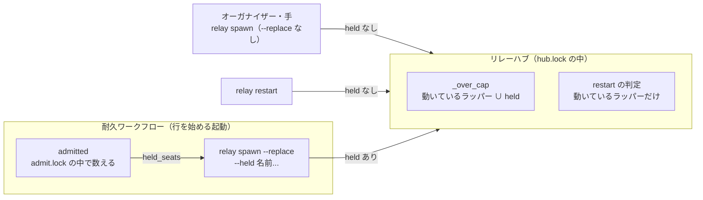
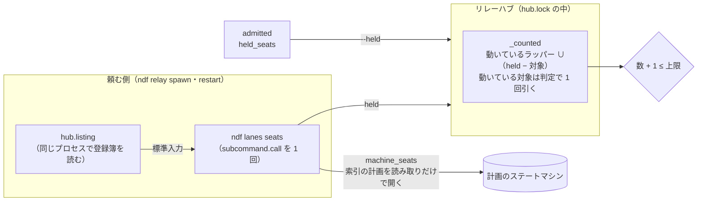

# リレーハブの上限: 通常の起動と再起動も、ラッパーの落ちた稼働中のレーンを数えて断る（#4044）

通常の `ndf relay spawn` と `ndf relay restart` は動いているラッパーだけで上限を判定するので、実行中の行を持つレーンのラッパーが落ちている間にその分を使え、続きの起動の後に上限を超える。頼む側が新しい計画のサブコマンド `ndf lanes seats` で実行中の行を持つレーンの名前を読み、行を始める起動と同じ要求の `held` に載せ、ハブはどの判定でも動いているラッパーと `held` の和集合で数える。ハブに計画を読ませる案・読めないときに断る案などを採らなかった理由は「決定の記録」に、比べた形（Kubernetes の ResourceQuota）は付録の「外部の調査」にある。

## 今の姿

何が起きたか・目的・受け入れ条件は要求仕様（[issue-4044-requirements.md](./issue-4044-requirements.md)、正は #4044 の本文）にある。この文書は「どう解くか」と「なぜその解き方か」だけを書く。パスは `plugins/ndf/` からの相対で書く。

設計に要る今の構造:

| 部品 | 今の振る舞い | 場所 |
| --- | --- | --- |
| 行を始める起動（置き換えの起動 `spawn --replace --seat <席>`。席は `<レーンのステートマシンの ID>:<行のキー>` で、ラッパーの名前ごとに 1 つ） | 起動の許可が、自分の計画・登録簿の conductor の行の計画・計画の索引の計画を 1 回ずつ読み（`machine_plans`）、実行中の行を持つレーンの名前（`held_seats`）を `--held` でハブへ渡す | `src/ndf/progress/lane/machine.py` の `admitted`、`src/ndf/progress/lane/launch.py` の `replace` |
| ハブの通常の起動・行を始める起動 | `_over_cap` が、行を始める起動のときだけ要求の `held` を読み、動いているラッパーとの和集合を数える。通常の起動は `held` を読まない | `src/ndf/domains/relay/hub.py` の `spawn`・`_over_cap`・`_held` |
| ハブの再起動 | `_own_count`（動いているラッパーの数）で判定し、要求を受け取らない（`restart(ctx, name)`） | `hub.py` の `handle`・`restart` |
| 頼む側の要求 | `--replace` のときだけ `held` を載せる。上限の値（`cap`）は spawn と restart のどちらにも載せる | `src/ndf/domains/relay/cli.py` の `_hub`、`hub.py` の `submit` |
| リレーから計画を読む前例 | 再起動の前の待ちの一覧は、リレーが計画のサブコマンド `ndf plan pending` を打って読む（読めなければ止めずに理由を載せる） | `src/ndf/domains/relay/pending.py`・`subcommand.py` |

**根本原因は、上限の判定の入力（何を数えるか）を、要求の種類ごとに別に決めていることである。** 行を始める起動だけが「実行中の行を持つレーン」を数える入力を持ち、通常の起動と再起動はそれを持たない。続きの起動は上限を読まないので、ほかの経路が数え落とした分が、続きの起動の後に上限超えとして表に出る。

同じ形の箇所は、この 2 つの判定（`_over_cap` の通常の起動の枝と `restart`）だけである。上限（`named_cap`）を読み込むファイルを `src/ndf` から検索すると、ほかは起動の許可（`machine.py`・`launch.py`）・`ndf lanes status`（`progress/plan/__init__.py`）・`ndf relay cap`（`cli.py`）で、どれも和集合で数えるか判定をしない。続きの起動は上限を読まないこと自体が約束で（上限を下げても稼働中のレーンを止めない）、変えない。人の起動（端末の `claude`）は上限で断らない約束で、範囲の外である。

## 文脈と制約

- リレーハブのパッケージ（`ndf.domains.relay`、子 M3b）は計画のパッケージ（`ndf.progress.lane`、子 P3）を読み込めない。子の依存の表（`src/ndf/checks/children.json`）の検査が落とす（要求仕様の前提 2）
- ハブは `hub.lock` の中で要求を 1 本ずつ処理する。耐久ワークフローは `admit.lock` を持ったまま子のハブの回答を待つ。ほかの計画の起動の許可は `admit.lock` を取るのを 10 秒（`parallel-machine.admit-lock`）まで待ち、取れなければその周の起動を待ちに戻す。ハブの中の処理を長くすると、ほかの要求が遅れ、ほかの計画の起動が待ちに戻りやすくなる
- 通常の起動と再起動の頼む側は、計画を持たない（オーガナイザー・手・プラグインの更新の再起動）
- 数える行の規則（`lanes_of`）と `held_seats` の中身は #4050 が変える（席を返した行を数えない）。計画の見つけ方（索引の寿命）は #4051 が変える。この課題はどちらの規則も変えない
- 公開インタフェースは、計画のサブコマンドを 1 つ足すほかは変えない（`ndf relay spawn`・`restart` の引数と結果 JSON の形はそのまま）

## 解き方の全体像

- 計画に `ndf lanes seats` を足す（`progress/plan/cli.py`）。自分の計画を持たずに、計画の索引から計画を見つけ、索引に書いた保存先と接続先で計画の DB を読み取りだけで開き、起動の許可と同じ `held_seats` の規則で、実行中の行を持つレーンのラッパーの名前を返す（登録簿の conductor の行にだけ載る計画と版 1 の索引の計画は `unreadable` に載せる）
- 頼む側は、通常の `spawn`（`--replace` も `--seated` も無い）と `restart` の要求を書く前に、登録簿の一覧を同じプロセスで読み（`hub.listing`）、新しいモジュール `domains/relay/seats.py` でその一覧を標準入力に載せて `ndf lanes seats` を 1 回打ち、名前を要求の `held` に載せる。サブコマンドの中では `ndf relay ls` も Git も起こさないので、増えるプロセスの起動は 1 回につき 1 本だけである。読めなければ `held` を載せず、結果の `warnings` に理由を載せて今の数え方で判定させる
- ハブは、上限を読むすべての判定（通常の起動・行を始める起動・再起動）で、動いているラッパーと要求の `held` の和集合から対象を 1 回だけ除いて数える。通常の起動の名前が `held` にあれば、上限の空きによらず断る（登録簿の席を `seat: null` で上書きさせない）。続きの起動は今のとおり上限を読まない
- 確定仕様は、通常の起動と再起動も和集合で数えると書き、「許可を通らない起動が席を使った後は一時的に上限を超え得る」を消す。上限を超え得るのは、上限を下げた直後と、既知の限界に書く 4 つの場面（名前を読めない間・読んでから判定するまでに行を始めてすぐ落ちたレーン・旧い版のハブが処理する間・版 1 の索引の計画が次の起動の許可で書き直されるまで）だけになる。手順書 `relay.md` の同時に動かす数の上限の段落にも、実行中の行を持つレーンを数えることを足す

## 決定の記録

### 決定 1: 上限の判定の入力を 1 つにするため、ハブはどの判定でも動いているラッパーと要求の `held` の和集合で数える

- **質問**: 通常の起動と再起動に、実行中の行を持つレーンをどう数えさせるか
- **選んだ案**: ハブの本数の数え方を 1 つの関数（`_counted`）にまとめ、通常の起動・行を始める起動・再起動のどれも、動いているラッパーのうちバージョンを持つもの（旧い NDF 10.x のラッパーでないもの。今の数え方と同じ）と要求の `held` の和集合から対象（行を始める起動・再起動の名前）を除いて数える。対象を除くのは 1 回だけで、`_counted` は `held` からだけ対象を除き（動いている対象は数に残す）、動いている対象は今のとおり `hub_decide` の `others_running` が引く（`Lanes.running` は動いている対象を含む数）。再起動は要求を受け取るようにする。通常の起動の名前が `held` にあるときは、数によらず断る（通常の起動は登録簿の行を `seat: null` で書くので、空きがあるときに通すとそのレーンの続きの起動が席の違いで断られる）。日次の再起動の回数の判定は今のまま再起動だけが持ち、本数を先に、回数を後に見る（`hub_decide.restart` の今の順）
- 採らなかった案: 通常の起動と再起動の判定に、それぞれ別に `held` を足す（数え方が 3 か所に分かれ、次に要求の種類を足したときに同じ穴が戻る）
- 採らなかった案: 続きの起動（`--seated`）も上限で判定する（上限を下げても稼働中のレーンを止めない今の約束を破り、上限を下げた後に中止の処理が終わらなくなる。#3989 の決定で採らなかった形）
- **代償**: ラッパーの落ちたレーンがあるマシンでは、オーガナイザーや手の起動が今より早く断られる。断られる本数は耐久ワークフローの起動の許可が待つ本数と同じになる
- 作り方: 自前で作る・標準に倣う
- 比べた候補: PRD1（Kubernetes の ResourceQuota）
- 根拠: Value 7 / Value 11 / Value 3（MVV バージョン 11）。Value 7「不具合は、現象が出た場所ではなく根本原因の場所で直され、形を変えて戻ってこない」・Value 11「同じ規則・定数・処理は 1 か所にまとまり、ほかはそこを参照する」・Value 3「判断の要らない手順は仕組みが進めるので、結果が実行ごとにばらつかない」

### 決定 2: 層の向きとハブの待ちを守るため、実行中の行を持つレーンの名前は頼む側が計画のサブコマンドで読んで要求に載せる

- **質問**: 計画を持たない頼む側の起動について、実行中の行を持つレーンの名前を、だれがいつ読むか
- **選んだ案**: 計画に `ndf lanes seats` を足し、頼む側（`ndf relay spawn`・`restart` の CLI）が要求を書く前に `subcommand.call` で打って、結果の名前を要求の `held` に載せる。リレーから計画のサブコマンドを打つ形は、再起動の前の待ちの一覧（`ndf plan pending`）と同じである。行を始める起動が `--held` を載せる形とも同じになり、ハブは要求の種類によらず `held` を読むだけになる
- 採らなかった案: リレーハブのパッケージから計画のパッケージを直接読み込む（子の依存の表で M3b は P3 に依存せず、検査が落とす。下の層が上の層を読む向きになる）
- 採らなかった案: ハブが `hub.lock` の中で `ndf lanes seats` を打つ（読む時点の新しさは増すが、計画のステートマシンを計画の数だけ開く間、ほかの要求と、`admit.lock` を持って待つ耐久ワークフローを待たせる。ハブは溜まった要求を最初に処理したプロセスが兼ねるので、そのプロセスの導入（版）でサブコマンドを打つことになり、頼む側の導入と版がずれうる）
- 採らなかった案: 登録簿の `seat` を持つ行を数える（`stop` は席を消さないので、行が終わったレーンの名前も数え続ける。行が実行中かは計画のステートマシンにしか無い）
- **代償**: 頼む側が読んでからハブが判定するまでの間に、新しく行を始めてすぐにラッパーが落ちたレーンは数え落とす（行を始めたレーンはラッパーが動いていれば和集合で数える）。通常の起動と再起動のたびに、CLI の起動が 1 本（`ndf lanes seats`）増え、計画のステートマシンを計画の数だけ 1 回ずつ開く。登録簿は頼む側が同じプロセスで読んで標準入力で渡すので、サブコマンドの中で `ndf relay ls` をもう 1 本起こさない（計画のパッケージはリレーのパッケージを読み込めないため、サブコマンドの中で読むとプロセスが 2 本になる）
- 作り方: 自前で作る・標準に倣う
- 比べた候補: PRD1（Kubernetes の ResourceQuota）
- 根拠: Value 9 / Value 11（MVV バージョン 11）。Value 9「下の層は上の層を読まず、依存の輪が無い」「1 つのモジュール・クラス・関数が 1 つの責務を持ち」・Value 11「同じ規則・定数・処理は 1 か所にまとまり、ほかはそこを参照する」

### 決定 3: 起動の許可と同じ規則で数え、Git を起こさないため、`ndf lanes seats` は索引の計画を保存先と ID で開いて `held_seats` を通す

- **質問**: 計画のサブコマンドは、どの計画のどの行を数えるか
- **選んだ案**: 計画の索引に計画のチェックアウトの保存先（`store_root`）と、計画が実際に使う DB の接続先（`db`。耐久ワークフローが起動時に確定した `spec["url"]` から、パスワードと認証情報のクエリを除いたもの）を足し、`ndf lanes seats` は索引の計画を保存先・接続先・計画のステートマシンの ID（`plan_id`）だけで 1 回ずつ開いて（`read_indexed`）、起動の許可と同じ規則（`lanes_of`・`held_seats`: 読めた計画の実行中の行を持つレーンのラッパーの名前）を通す。Git の子プロセスは計画の数によらず 0 本。起動の許可は行を始める起動の前に計画を索引に書くので、実行中の行を持つ計画は耐久ワークフローが動く間は索引に載る。索引に無く登録簿の conductor の行にだけ載る計画と読めない計画は `unreadable` に載せて名前に含めない（その計画のラッパーは動いていればハブが数える）。名前を返す関数 `machine_seats` を足す
- **接続先の解き方**: 頼む側の環境の `NDF_PROGRESS_DB` では解かない（別のシェルから打つと、計画の DB を数え落とすか、同じ ID を持つ別の DB を読む）。索引の `db` には、URL からパスワードと認証情報のクエリ（キー名に `password`・`secret`・`token` を含むもの）だけを除いた値を書き、ほかのクエリは残す。PostgreSQL ではクエリの `host`・`port`・`dbname` などが URL の本体より優先されて接続先を変えるので、クエリをまとめて除くと、クエリだけが違う別の DB を同じ接続先と見誤る。除いたものが無ければ（SQLite の URL と、パスワードも認証情報のクエリも持たない URL）その値で開く。除いたものがあれば（PostgreSQL のパスワードつきの URL）、頼む側の `NDF_PROGRESS_DB` から同じように除いた値が索引の `db` と一致するとき（違ってよいのはパスワードと認証情報のクエリだけ）だけその `NDF_PROGRESS_DB` で開き、一致しなければ開かずに `unreadable` に載せる。認証情報は索引に書かない
- **開き方**: `ndf lanes seats` は計画の DB を読み取りだけで開く（新設の `store.open_reader`）。表を作らない・表のバージョンを書かない・検査の目印を見ない（`quick_check` もバックアップもしない）。SQLite は `mode=ro` で開いてトランザクションを `BEGIN`（DEFERRED）で始めるので、WAL のもとで別のレーンが書いている間も待たずに確定済みの行を読む。表のバージョンが自分と違えば読まずに `unreadable` にする
- **版 1 の索引**: 索引の版は 2 にするが、`_read_index` は今のとおり `plan_id`・`cwd`・`plan` だけを検証し、版 1 の本文も読む。起動の許可（`machine_plans`）は索引の `store_root`・`db` を使わず、今のとおり `read_lanes` で所在を解くので、プラグインの更新の直後に版 1 のまま残る計画も数え続ける（`machine_plans` の本体は変えない）。`ndf lanes seats` は `store_root` か `db` の無い索引の計画を開かずに `unreadable` に載せ、頼む側は結果の `warnings` に「版 1 の索引の計画 <数> 件を数えていない」を 1 行載せる。版 1 の索引は、その計画の次の起動の許可が `index_plan` で版 2 に書き直す（本文が違うので書き直る）。それまでの間、その計画の止まったラッパーは通常の起動と再起動で数え落とす（既知の限界。起動の許可は数える）
- 採らなかった案: `machine_plans` の自分の計画を省けるようにして通す（`read_lanes` が計画ごとに保存先と ID を解くので、`git rev-parse`・`git worktree list`・`git remote get-url` を計画 1 件につき起こし、通常の起動と再起動のたびに計画の数に比例して増える）。サブコマンドの中で数え方を別に書く（#4050 が `lanes_of` と `held_seats` を変えたときに、起動の許可とハブの数がずれる）
- 採らなかった案: 版 1 の索引を `_read_index` で捨てる（起動の許可も版 1 の計画を見失い、更新の直後にラッパーの止まったレーンの席を別の計画が空きとして使う）。版 1 の索引だけ `ndf lanes seats` の中で `read_lanes` に落とす（Git を計画の数だけ起こし、接続先も頼む側の環境で解くので、上の接続先の誤りが戻る）
- 採らなかった案: 接続先の URL をそのまま索引に書く（PostgreSQL のパスワードが状態の保存先のファイルに残る）。パスワードとクエリをまとめて除いて比べる（クエリの `host` で別のホストを指す DB も一致し、同じ `plan_id` を持てばその行で席を判定する）。認証情報を含む URL のハッシュを書いて比べる（索引のファイルから弱いパスワードを総当たりで割り出せる）。頼む側の `NDF_PROGRESS_DB` で解く（上の数え落としと別の DB の読み違い）
- 採らなかった案: 起動の許可と同じ `store.open_store` で開く（表の用意と、目印が古いときの `quick_check` とバックアップを走らせ、`BEGIN IMMEDIATE` で別のレーンの書き込みを待つ。計画を順に読む間に `relay.seats` の待ちを超え、動いているラッパーだけの判定へ落ちる）
- **代償**: 索引から外れた後も実行中の行が残る計画（登録簿にだけ載る）は、ラッパーが止まると数え落とす。#4051 の実装の後は、索引は数える行が無くなるまで残るので（#4051 の決定 1）、実行中の行を持つのに索引に無い計画は、起動の許可が索引を書く前の版で行を始めた計画だけになる。版 1 の索引の計画は、次の起動の許可で書き直されるまで `ndf lanes seats` では数えない（起動の許可は数える）。パスワードつきの接続先の計画は、頼む側に同じ `NDF_PROGRESS_DB` が無いと数えない（`unreadable` に載る）
- 根拠: Value 11（MVV バージョン 11）。Value 11「同じ規則・定数・処理は 1 か所にまとまり、ほかはそこを参照する」

### 決定 4: 読めないときに起動の経路をすべて止めないため、名前を読めなければ今の数え方で判定させ、理由を `warnings` に載せる

- **質問**: `ndf lanes seats` が落ちた・時間内に返らない・結果を読めないとき（頼む側と同じ導入の `bin/ndf` で打つので、サブコマンドが無いことは導入が壊れたときだけ起きる）、通常の起動と再起動をどうするか
- **選んだ案**: `held` を載せずに要求を書き、ハブは動いているラッパーだけで判定する（今の振る舞い）。結果の `warnings` に読めなかった理由を 1 行載せる。待つ秒の上限は上限の設定に `relay.seats`（30 秒。同じ形の `relay.pending` と同じ値）を足して持つ
- 採らなかった案: 断る（計画のステートマシンの不具合 1 つで、オーガナイザーのセッションの起動とプラグインの更新の再起動がすべて止まる。起動の許可も、読めない計画はラッパーが動いているものだけを数えて止めない）
- **代償**: 読めない間は、今と同じくラッパーの落ちたレーンの分を数え落とし、続きの起動の後に上限を超え得る。結果の `warnings` と確定仕様の既知の限界に書く
- 根拠: Value 3 / Value 13（MVV バージョン 11）。Value 3「版上げ・再起動・セッションの入れ替えをまたいでも、進行中の作業と人の回答は失われず、止まった所から続く」・Value 13「確かめたことだけが済んだとされる」（読めなかったことを結果に残す）

### 決定 5: 版の混在で起動を壊さないため、要求の形は変えず、`held` を読まない旧いハブにはそのまま今の判定をさせる

- **質問**: 頼む側とハブの版が違うとき、通常の起動と再起動の要求をどう扱うか
- **選んだ案**: 要求の種類（`spawn`・`restart`）を変えずに `held` のキーを足す。旧いハブは知らないキーを読まずに今の数え方で判定し、新しいハブは `held` の無い旧い頼む側の要求を動いているラッパーだけで判定する。どちらも今の振る舞いより悪くならない
- 採らなかった案: 新しい種類で頼み、旧いハブに断らせて送り直す（置き換えの起動の `replace` の形。置き換えは旧いハブに席を書かずに処理させないためにそうしたが、通常の起動と再起動は旧いハブが処理しても今の振る舞いで、守るものが無い。Value 4「普及のフェーズに入るまで、後方互換は求めない」に沿い、送り直しの仕組みを足さない）
- **代償**: 旧いハブが処理する間は直らない。同じマシンのラッパーの版は混在の判定（`hub_decide.mixed`）が 1 つのメジャーバージョンにそろえるので、続くのはプラグインの更新の直後だけである
- 根拠: Value 9 / Value 4（MVV バージョン 11）。Value 9「まだ要らない仕組みは先回りして作らず」・Value 4「旧い設定の形を残す互換の仕組みを持たず」

### 決定 6: #4050・#4051 と持ち物を重ねないため、この課題は頼む側の読みとハブの数え方だけを持ち、数える行の規則と計画の見つけ方に触らない

- **質問**: #4050（待つ行の席を返す。`lanes_of`・`count`・`held_seats` の中身を変える）と #4051（計画の索引の寿命）が同じ数え方を変える。この課題はどこまでを持つか
- **選んだ案**: この課題は、索引の `store_root` と `read_indexed`・`machine_seats`、計画のサブコマンド、リレーの頼む側の読み、ハブの数え方の関数、確定仕様の「リレーハブの起動の判定」とその周りだけを持つ。`ndf lanes seats` は `held_seats` を通すので、#4050 が席を返した行を数えなくすると、ハブも同じ行を数えなくなる。#4051 が索引を残す条件を直すと、`ndf lanes seats` が見つける計画も同じだけ増える
- 採らなかった案: この課題で数える行の判定を別に書く（決定 3 と同じ理由）
- **代償**: 実装の順によって、片方の PR がもう片方の上へ rebase する手間がある（「影響と危険」）
- 根拠: Value 11 / Value 9（MVV バージョン 11）。Value 11「同じ規則・定数・処理は 1 か所にまとまり、ほかはそこを参照する」・Value 9「1 つのモジュール・クラス・関数が 1 つの責務を持ち」

## 影響と危険

- **働く範囲**: 利用先のリポジトリでも働く。リレーで名前つきのラッパーを起動・再起動するすべてのマシンに効く
- **プロジェクトごとに違うもの**: 無し（上限の値は今のとおりマシンの設定と環境変数で受ける。読む待ちの上限は上限の設定 `relay.seats`）
- **当たるモード**: リレーを使うすべてのモード（モードによらず、起動の判定の振る舞いである）
- **壊れうる箇所**:
  - ラッパーの落ちたレーンを持つマシンでは、オーガナイザーや手の `ndf relay spawn` と `restart` が今より早く上限で断られる。断りの結果は今と同じ形（`refused`・`max-named` の項目）で、上限を上げるか落ちたレーンを中止すれば通る
  - 通常の起動と再起動のたびに `ndf lanes seats` のプロセスを 1 本だけ起こし（登録簿は標準入力で受け、中で `ndf relay ls` を打たない）、計画のステートマシンを計画の数だけ開く。ハブの `hub.lock` の外なので、ほかの要求を待たせない。1 回の起動で増えるプロセスが 1 本であることは、頼む側のテストで `runner` の呼ばれた回数として縛る
  - 登録簿の席を持つ止まったレーンの名前を、`--seated` を付けずに通常の起動で起こすと、上限の空きがあっても断られる（今は通り、席が `seat: null` で上書きされていた）
- **同じファイルを触る別の変更と実装の順**:
  - #4050（レーン lanes。#4081 が設計を直している途中）は `src/ndf/progress/lane/machine.py` の `lanes_of`・`count`・`held_seats` と確定仕様の数える行の表を触る。この課題が `machine.py` で触るのは索引の本文（`PlanPlace`・`index_plan`・`indexed` の省略できる `store_root`・`db`。`_read_index` の検証は変えない）と、足す `read_indexed`・`machine_seats` だけで、`lanes_of`・`held_seats` の中身には触らない。先にマージした側の上へ後の側が rebase する。どちらが先でも振る舞いは決定 6 のとおり合う
  - #4051（設計は PR #4083 で main にマージ済み、実装はまだ）は `machine.py` に `unindex_idle`・`is_indexed` を足し、`src/ndf/progress/plan/run.py` の `_indexed_until_done` の引数を `machine.PlanPlace` に変え、`advance` がそれを `machine.PlanPlace(plan_id, str(where.cwd), plan)` で作る（[issue-4051-design-detail.md](./issue-4051-design-detail.md)）。確定仕様は「稼働中の数の数え方」の索引の段落と「マシンの計画の索引」の消す時点と条件と、ファイルの形（版 1 の `plan_id`・`cwd`・`plan`）を書く。この課題は `PlanPlace` に省ける `store_root`・`db`（既定 None）を足し、起動の許可へ渡す `PlanPlace` に値を載せ、索引の版を 2 にするので、`PlanPlace`・`run.py`・「マシンの計画の索引」の節が重なる。#4051 の `unindex_idle` は `PlanPlace` の `plan_id`・`cwd` だけを読むので、項目を足しても振る舞いは変わらない。関数は重ならない（この課題は索引を書く・外す条件を変えない）
  - 索引の形の持ち主: 確定仕様の「マシンの計画の索引」のファイルの形（版と項目）はこの課題の実装が版 2 へ書き直す。#4051 の文書は変えない（#4051 の詳細設計は版 1 の形を書くので、#4051 の実装が後に入るときは、その rebase で版 2 の形を残し、消す時点と条件だけを足す）。両方を適用した後は、書く形が版 2（`plan_id`・`cwd`・`plan`・`store_root`・`db`）、旧版の版 1（`plan_id`・`cwd`・`plan`）も読み、起動の許可と `unindex_idle` は版によらず扱い、`ndf lanes seats` だけが版 1 を `unreadable` にする（詳細設計の「確定仕様の書き直し」の「マシンの計画の索引」の行）。どちらが後に rebase しても、この形を落とさない
  - 実装の順: #4051 の実装を先にマージし、この課題の実装はその上へ rebase して、「マシンの計画の索引」の節の形を版 2（`plan_id`・`store_root`・`db` を足す）へ書き直す。#4051 が先に入ると、耐久ワークフローがどう終わっても実行中の行を持つ計画が索引に残るので、決定 3 の代償の「索引から外れた後も実行中の行が残る計画」が `cancel_failed` と例外の終わりでも起きなくなる。この課題が先にマージされたときは、#4051 の実装がこの課題の上へ rebase し、`advance` が作る `PlanPlace` に `store_root`・`db` を載せるかは #4051 の実装が決める（載せなくても `unindex_idle` は読まないので振る舞いは変わらない）
  - #4036（生死の判定）は `liveness.py` の側で重ならない。#4049・#4070（レーン lctx）は中継のラッパーの引継ぎと背景の作業の知らせで、`src/ndf/domains/relay/` の `hub.py`・`cli.py` を触るときだけ重なりうる。触るなら、`_hub` の要求の組み立てと `restart` の判定の行が衝突しうるので、後の側が rebase する
  - 確定仕様 `docs/specifications/ndf-parallel-machine-plan-limit.md` は、#4050・#4051 とこの課題の 3 つが書き直す。この課題の節は「リレーハブの起動の判定」・「常に成り立つ条件」の起動の許可とハブの数の行・「エラー処理」の 1 行・「既知の限界」の「ハブより早く待つ」の行と、#4051 と重なる「マシンの計画の索引」のファイルの形である

### 代表のリポジトリでの振る舞い

| 代表のリポジトリ | 設定の要点 | 直した後に起きること | この種類で扱えなくなること |
| --- | --- | --- | --- |
| Web サービス（nd-factory） | 並列の計画でスプリントのレーンを流し、オーガナイザーがリレーで起動する。上限はマシンの設定 | ラッパーの落ちたレーンがある間、オーガナイザーの起動と再起動がその分を空きとして使わず、続きの起動の後も上限を超えない | 無し |
| モバイルアプリ | 同上 | 同上 | 無し |
| 業務文書だけ | 同上（文書のスプリントのレーン） | 同上 | 無し |

### このリポジトリだけの事情

- 無し（起動の判定は NDF の製品の振る舞いで、ai-plugins の運用の値を持たない）

## テスト設計

| 受け入れ条件 | どの振る舞いで縛るか | どう壊したら落ちるべきか |
| --- | --- | --- |
| 1 | 上限 N、動いているラッパー N−1 本、要求の `held` に止まったレーンの名前を含む N 個の名前で、通常の起動の要求をハブが `refused`（`max-named`、`running: N`）で断り、起動しない。頼む側の CLI が `ndf lanes seats` の名前を要求の `held` に載せ、1 回の起動でサブコマンドを 1 本だけ打つ | 通常の起動の枝で `held` を読まないと落ちる。CLI が `held` を載せないと落ちる。サブコマンドの中で `ndf relay ls` を打つと落ちる |
| 1 | 上限に空きがある状態で、`held` にある名前の通常の起動が断られ、登録簿の席が変わらず、その後の `--seated` の続きの起動が通る | 通常の起動が席を `seat: null` で上書きすると落ちる |
| 2 | 同じ状態で、登録簿にあり止まっている別の名前の `restart` が上限で断られる。対象が `held` にある名前なら対象を除いて数え、通る。動いている対象を含めて N 本のときの `restart` と置き換えの起動は通り、ほかに `held` の止まったレーンが 1 本あれば断る | 再起動が `held` を読まないと前者で、対象を除かないと後者で、対象を 2 回引くと境界で落ちる |
| 3 | 1 の状態で通常の起動が断られた後、止まったレーンの `--seated` の続きの起動が通り、動くラッパーが N 本である | 1 が通ってしまうと N+1 本になって落ちる |
| 4 | `ndf lanes seats` が 0 以外で終わる・時間内に返らない・結果を読めないとき、頼む側が `held` を載せずに要求を書き、結果の `warnings` に理由が 1 行載り、動いているラッパーだけで判定する | 読めないときに断ると、または `warnings` を載せないと落ちる |
| 5 | 置き換えの起動（`--held` つき）と続きの起動の既存のテストが変えずに通る | 数え方の関数にまとめたときに置き換えの対象の除き方を変えると落ちる |
| 1・3（の前提） | `ndf lanes seats` が、自分の計画なしに、索引（版 2）に載る計画の実行中の行を持つレーンの名前を返す。名前の一致を比べるのは、両方の経路が読める同じ計画（索引の版 2 に載り、起動の許可も `read_lanes` で読める計画）だけで、そこでは起動の許可が渡す `held_seats` と同じ名前になる。索引に無く登録簿の conductor の行にだけ載る計画は、起動の許可は `read_lanes` で読んで名前に含めるが、`ndf lanes seats` は名前を返さず（`items` に含めない）その鍵を `metrics.unreadable` に載せる | 数え方を別に書いて起動の許可と食い違うと落ちる。登録簿だけの計画を開こうとして Git を起こすと落ちる |
| 1・3（の前提） | 接続先: 頼む側と計画の DB の設定が違う 3 つの場合。計画が保存先の外の SQLite（`NDF_PROGRESS_DB`）で、頼む側にその変数が無い・別の SQLite を指すとき、索引の `db` の DB を読む。計画がパスワードつきの URL で、頼む側の `NDF_PROGRESS_DB` が無いとき、その計画を `unreadable` に載せる。頼む側の `NDF_PROGRESS_DB` が同じ `plan_id` を持つ別の DB を指すとき（クエリの `host` だけが違う場合を含む）、その DB を開かず、行を名前に含めず `unreadable` に載せる。索引のファイルにパスワードと認証情報のクエリが書かれない | 頼む側の環境で `store.default_url` を評価すると落ちる。クエリをまとめて除いて比べると、クエリだけが違う別の DB で落ちる |
| 1・3（の前提） | 開き方: 計画の SQLite に別の接続が `BEGIN IMMEDIATE` で書き込みを開いたまま（未確定の行あり）のとき、`ndf lanes seats` が確定済みの行で名前を返す（読み手の待ちを 0 秒にしても `StoreBusy` にならない）。目印の古い DB を読んでも目印・バックアップ・表が変わらず、表の無い DB に表を作らない | `store.open_store` か `BEGIN IMMEDIATE` で読むと落ちる |
| 5（の前提） | 版 1 の索引だけに載る計画（登録簿に conductor の行が無く、そのレーンのラッパーは止まっている）で、更新の直後に両方の起動の経路を確かめる。起動の許可（`machine_plans` → `count`・`held_seats`）はその計画の実行中の行を持つレーンを数え、上限で待たせる。`ndf lanes seats` はその計画を `metrics.unreadable` に載せ、頼む側の結果の `warnings` に版 1 の索引の行が 1 行載る。次の起動の許可の後、索引が版 2 になり `ndf lanes seats` が名前を返す | `_read_index` が版 1 を捨てると起動の許可で落ちる。書き直さないと最後で落ちる |
| 6 | 確定仕様の該当の節を `hub.py`・`machine.py` と読み合わせる（文言のテストは書かない） | — |

詳細設計は [issue-4044-design-detail.md](./issue-4044-design-detail.md) にある（新設する関数が 9 つ・シグネチャを変える関数が 2 つあるため別ファイル）。

## 未確認のまま残ること

- `ndf lanes seats` 1 回にかかる秒（プロセスの起動と、計画の数だけステートマシンを開く分）を測っていない。起動の許可が `admit.lock` の中で同じ読みをしており、その待ちの短さ（既知の限界の「起動の排他を待つ 10 秒」）から数秒以内と見ている。実装の PR で 1 回測り、結果を PR に残す

## 設計の結果

| 課題 | 扱い | 統合先 | 触るファイル |
| --- | --- | --- | --- |
| #4044 | 実装する | — | `plugins/ndf/src/ndf/domains/relay/hub.py`、`plugins/ndf/src/ndf/domains/relay/cli.py`、`plugins/ndf/src/ndf/domains/relay/seats.py`、`plugins/ndf/src/ndf/domains/relay/subcommand.py`、`plugins/ndf/src/ndf/progress/lane/machine.py`、`plugins/ndf/src/ndf/progress/lane/launch.py`、`plugins/ndf/src/ndf/progress/store.py`、`plugins/ndf/src/ndf/progress/plan/run.py`、`plugins/ndf/src/ndf/progress/plan/cli.py`、`plugins/ndf/contracts/limits.json`、`docs/specifications/ndf-parallel-machine-plan-limit.md`、`plugins/ndf/skills/development-workflow/references/relay.md`、`plugins/ndf/tests/domains/relay/test_relay_hub.py`、`plugins/ndf/tests/domains/relay/test_relay_cli.py`、`plugins/ndf/tests/progress/test_lane_machine.py`、`plugins/ndf/tests/progress/test_plan.py`、`plugins/ndf/tests/progress/test_store_sqlite.py` |

## 外部の調査

| 種類 | 調べるか | 理由 |
| --- | --- | --- |
| 標準・仕様 | 調べない | 同じマシンの中の起動の数え方で、公開の仕様が定める領域ではない |
| 主要な製品 | 調べる | 資源の上限を、作る要求の経路によらず同じ数え方で判定し、動いていない物も数える形を、資源の割り当てを持つ製品がどう決めているかを比べる |
| ライブラリとサービス | 調べない | 新しい依存を足さず、今のハブの判定の入力を足すだけである。#3989 の設計が上限の置き方を比べ済みである |

### 主要な製品

| # | 製品 | どう解いているか | 設計への反映 | 出典 |
| --- | --- | --- | --- | --- |
| PRD1 | Kubernetes の ResourceQuota | 作成と更新の要求を制御プレーンが 1 か所で判定し、上限を超えれば 403 で断る。計算資源の上限は「終了していない状態のすべての Pod」の和で数え、まだ動いていない Pod も数える。上限の変更は作成済みの資源に効かない | 要求の経路によらずハブの 1 つの数え方で判定する（決定 1）。動いていなくても実行中の行を持つレーンを数える（決定 1・3）。上限を下げても続きの起動を断らない今の約束は「作成済みの資源に効かない」と同じ形で、変えない | https://kubernetes.io/docs/concepts/policy/resource-quotas/ （2026-11-22） |

調べた量: 候補 1 件・取得の試み 1 回。
